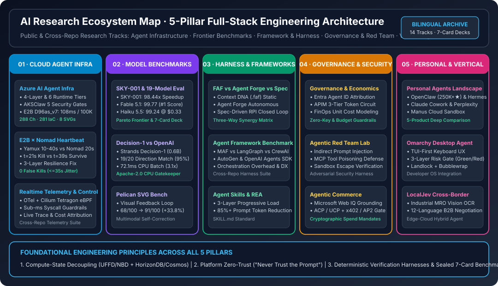

# AI Research Hub (`turbo998/ai-research-public`) — Enterprise Cloud & AI Solution Architect Edition

> 🌐 **Language / 语言切换**: **[🇬🇧 English Homepage (README.en.md)](README.en.md)** | **[🇨🇳 中文主页 (README.md)](README.md)** · **[📑 Research Index (EN)](docs/research/index.en.md)** | **[📑 研究专题总索引 (中文)](docs/research/index.md)** · **[🏠 Live Command Center (`turbo998.github.io`)](https://turbo998.github.io/)**

Public architecture decision playbooks, deterministic model/agent benchmarks, and daily open-source intelligence curated from an **Enterprise Cloud & AI Solution Architect (SA)** perspective:
1. **Architecture Decision-First**: Focused on production enterprise trade-offs — hardware-virtualized agent sandboxes, multi-model routing, multi-agent orchestration, Zero-Trust AI governance, and token FinOps — backed by deployable IaC blueprints.
2. **Sealed Evidence & 7-Card Visual Benchmarks**: Model and framework evaluations ship with self-contained **7-Card 4:5 visual benchmark decks**, deterministic verifiers, and explicit provenance tags (`measured`, `anonymized_reported`, `synthetic`).
3. **Bilingual Parity (`zh-CN` & `en`)**: Flagship playbooks, **62 Azure Enterprise Selection Guides**, and daily **GitHub AI Trending & Velocity Radar** digests are maintained in both English and Chinese.

---

## 🚀 Solution Architect Quick Launchpad

| SA Workbench | Primary Enterprise Use Case | Direct Bilingual Links |
|---|---|---|
| **☁️ Azure AI Agent Infra Playbook + 62 Enterprise Selection Guides** | Foundry vs. ACA vs. AKS vs. E2B sandboxes, PTU vs. MaaS FinOps, Fabric IQ vs. AI Search, APIM AI Gateway, Purview/Defender guardrails | [EN Playbook](docs/research/azure-agent-infra/README.en.md) · [中文](docs/research/azure-agent-infra/README.md) · **[62 Selection Guides (EN)](docs/research/azure-agent-infra/selection-guides/README.en.md)** ([中文](docs/research/azure-agent-infra/selection-guides/README.md)) · [100K Sandbox Sizer](docs/research/azure-agent-infra/selector.html) |
| **📡 GitHub AI Trending & Velocity Radar (Daily SA Desk)** | Daily tracking of fastest-rising AI repos scored via `Hype / Facts / Signal` for SA adoption value and customer PoC priority | [EN Radar Hub](workshops/github-trending-radar/README.en.md) · [中文](workshops/github-trending-radar/README.md) · [Latest Digest (`2026-11-17`)](workshops/github-trending-radar/daily/2026-11-17.en.md) ([ZH](workshops/github-trending-radar/daily/2026-11-17.md)) · [7-Card Deck](workshops/github-trending-radar/cards.en.html) |
| **📊 Frontier Model, Routing & Multi-Agent 7-Card Benchmarks** | 20-model coding/cybersecurity matrix, System-One confidence routing, `MAF v1.0` 6-framework benchmark, `DeepInfer` token economics | [`Gemini 4 Carbon` 20-Model](docs/research/gemini-4-carbon-and-20-model-benchmark/README.en.md) · [`MAF v1.0` Benchmark](docs/research/maf-multi-agent-benchmark/README.en.md) · [`Decision-1` Routing](docs/research/openai-decisions-vs-decision-1-routing-benchmark/README.en.md) · [`DeepInfer` Economics](ai-infra/reports/2026-11-01/ai-infra-phase167-deepinfer-v41-pd-economics-2026-11-01.en.md) |
| **🛡️ Zero-Trust AI Security & Security AI Landing Zone** | Microsoft 5-Tier DEFEND architecture, Purview sensitivity/DLP guardrails, Agent 365 5 security pillars, and Frontier SOC | [DEFEND Playbook (EN)](docs/research/defend-partner-playbook/README.en.md) ([中文](docs/research/defend-partner-playbook/README.md)) · [Security AI Landing Zone (EN)](docs/research/security-ai-landing-zone/index.md) ([中文](docs/research/security-ai-landing-zone/index.zh.md)) |

---

## 📚 5-Pillar Enterprise AI Research Catalog

### Pillar 1: Cloud-Native Agent Infrastructure & Hyperscale Inference Economics

| Research Deliverable (EN / ZH) | Core Stack & Comparison Scope | Key Quantitative Finding & SA Verdict | 7-Card & Interactive Assets |
|---|---|---|---|
| **[Azure AI Agent Infrastructure Full-Stack Playbook](docs/research/azure-agent-infra/README.en.md)** · **[中文](docs/research/azure-agent-infra/README.md)** | 4-Layer Reference · 6 Runtimes · `AKSClaw (Kata)` · `E2B on VMSS D96as_v7` · `HorizonDB` · **62 Selection Guides** | 5th-Gen EPYC Turin (`D96as_v7`) hits **`108 ms` UFFD snapshot restore**; **261 nodes sustain 100K concurrent MicroVMs**; includes 23 IaC blueprints & 62 SA selection guides | [62 Selection Guides](docs/research/azure-agent-infra/selection-guides/README.en.md) · [H5 Atlas](docs/research/azure-agent-infra/index.html) · [Live Sim](docs/research/azure-agent-infra/demo.html) · [100K Sizer](docs/research/azure-agent-infra/selector.html) · [7-Card](docs/research/azure-agent-infra/cards.html) |
| **[DeepSeek DeepInfer Disaggregated MoE Inference & Token Ledger](ai-infra/reports/2026-11-01/ai-infra-phase167-deepinfer-v41-pd-economics-2026-11-01.en.md)** · **[中文](ai-infra/reports/2026-11-01/ai-infra-phase167-deepinfer-v41-pd-economics-2026-11-01.md)** | `DeepSeek-V4.1-Flash (552B MoE)` · `E/P/D Disaggregation` · `100 PiB 3FS` · `GB300 NVL72` | **`96%` 3FS prefix-cache hit** amplifies effective prefill `25×` to **`1.50M tok/s/GPU`**; `1P:1D` pairing reconstructs **`$38.00 / GPU-hr`** off-peak unit economics at `155T` tokens/day | [7-Card HTML](ai-infra/reports/2026-11-01/ai-infra-phase167-benchmark-cards.html) · [Visual Workbench](ai-infra/reports/2026-11-01/ai-infra-phase167-visual-workbench.html) · [Python Verifier](ai-infra/experiments/phase167_deepinfer_v41_economics/simulate_deepinfer_economics.py) |
| **[E2B × Nomad Heartbeat Race & Sandbox Self-Healing](docs/research/e2b-nomad-heartbeat-resilience/README.en.md)** · **[中文](docs/research/e2b-nomad-heartbeat-resilience/README.md)** | `HashiCorp Nomad` · `yamux` · `E2B Orchestrator` · `Cgroup Slice` | Pinpoints race between `yamux` (`10–40s`) and Nomad heartbeat (`20–30s`); decoupling control-plane drain (`heartbeat_grace="50s"`) yields **zero false kills under `<=35s` jitter** | [EN Report](docs/research/e2b-nomad-heartbeat-resilience/test-report.en.md) · [中文](docs/research/e2b-nomad-heartbeat-resilience/test-report.md) · [7-Card HTML](docs/research/e2b-nomad-heartbeat-resilience/test-report-cards.html) |

### Pillar 2: Frontier Models, World Models & System-One Decision Routing

| Research Deliverable (EN / ZH) | Core Stack & Comparison Scope | Key Quantitative Finding & SA Verdict | 7-Card & Interactive Assets |
|---|---|---|---|
| **[Gemini 4 Carbon Cybersecurity, Long-Horizon Agent & 20-Model Benchmark](docs/research/gemini-4-carbon-and-20-model-benchmark/README.en.md)** · **[中文](docs/research/gemini-4-carbon-and-20-model-benchmark/README.md)** | `Gemini 4 Carbon` · `Gemini 4 Argon` · `GPT-6 Astra` · `Claude Opus 5.5` · `Fable 5.1` | Captures **`15 of 17` official benchmark `#1` ranks** at unchanged `$2/$10` pricing (`SEC-bench Pro 88.2%`, `Terminal-Bench 4.0 65.2%`, `Gray Swan IPI 0.0% ASR`) | [EN 7-Card](docs/research/gemini-4-carbon-and-20-model-benchmark/test-report.en.md) · [中文](docs/research/gemini-4-carbon-and-20-model-benchmark/test-report.md) · [7-Card HTML](docs/research/gemini-4-carbon-and-20-model-benchmark/test-report-cards.html) |
| **[SKY-001 Engineering World Model & 19-Model Coding Benchmark](docs/research/sky-001-and-coding-agent-19-model-benchmark/README.en.md)** · **[中文](docs/research/sky-001-and-coding-agent-19-model-benchmark/README.md)** | `SKY-001` · `Fable 5.1` · `Opus 5.5` · `Claude Haiku 5.5` · `GPT-6.1 Sol` | Across 19 models × 11 tasks, `Haiku 5.5` (`99.24`, `$0.33`) cuts cost **`91.6%`** to rank **#4 overall**, enabling hybrid planner + subagent routing | [EN 7-Card](docs/research/sky-001-and-coding-agent-19-model-benchmark/test-report.en.md) · [中文](docs/research/sky-001-and-coding-agent-19-model-benchmark/test-report.md) · [7-Card HTML](docs/research/sky-001-and-coding-agent-19-model-benchmark/test-report-cards.html) |
| **[OpenAI Decisions vs. Microsoft Decision-1 8-Engine Routing Benchmark](docs/research/openai-decisions-vs-decision-1-routing-benchmark/README.en.md)** · **[中文](docs/research/openai-decisions-vs-decision-1-routing-benchmark/README.md)** | `Switchyard` · `Microsoft Decision-1` · `TypeSafe Jev` · `OpenJev 27B` · `OpenAI Decisions` | Under neutral prompts, `Decision-1` / `Jev` / `OpenJev` hit **`40/40 (100%)`**; `Decision-1` costs **`$7.6 / 1M`** (`3.4×` cheaper than `OpenAI Decisions`) with `0.60` confidence gating | [7-Card Report](docs/research/openai-decisions-vs-decision-1-routing-benchmark/test-report.md) · [7-Card HTML](docs/research/openai-decisions-vs-decision-1-routing-benchmark/test-report-cards.html) |
| **[System-One Decision Models & Foundry Multi-Model Routing](docs/research/decision-model-routing/README.en.md)** · **[中文](docs/research/decision-model-routing/README.md)** | `Microsoft-Decision-1` · `Strands Decider` × `gpt-5.4-mini` / `gpt-6.1-sol` | Across `384` decision rows + `160` E2E runs, `Decision-1` achieves **`0.0082` score MAE** while proving why high-stakes tiers require `0.60` escalation fallback | [Results](docs/research/decision-model-routing/results.md) · [7-Card HTML](docs/research/decision-model-routing/visual-report.html) |
| **[LocalJev Typed Decision Bridge & Calibration Audit](docs/research/localjev/README.en.md)** · **[中文](docs/research/localjev/README.md)** | `githubnext/localjev` · `choice / score / noul` JSON Schema · License Governance | Separates **typed wire contracts** from **calibrated logprobs** (verbalized floats $\neq$ calibrated confidence) and flags `OpenJev 27B` (`CC BY-NC 4.0`) commercial limits | [EN Summary](docs/research/localjev/README.en.md) · [中文完整版](docs/research/localjev/README.md) |

### Pillar 3: Multi-Agent Orchestration, Harness Engineering & Progressive Skills

| Research Deliverable (EN / ZH) | Core Stack & Comparison Scope | Key Quantitative Finding & SA Verdict | 7-Card & Interactive Assets |
|---|---|---|---|
| **[Continuously Co-Evolving an Agent Harness Alongside Frontier Model Upgrades](docs/research/agent-harness-model-coevolution/README.en.md)** · **[中文](docs/research/agent-harness-model-coevolution/README.zh-CN.md)** | `Gemini 4 Carbon × GPT-6.2 Sol × Grok 4.7` · `<available_skills> 12 KB Cliff` · 3-Tier Progressive Disclosure · `Desktop Canvases` | `120 → 62` orthogonal skills (**`-50.2%` disk**): **`-79.2%` prompt compaction (`~38.6K → 8,019 chars`)** restores router visibility **`1.2% → 100.0%`**, refactors `OpenClaw` **`1,390 → 84` lines (`-94.0%`)**, and enforces **`0-Byte`** `MODEL-SKILL-MATRIX.md` governance | [EN Workbench](https://turbo998.github.io/workshops/agent-harness-coevolution/index.en.html) · [中文演讲台](https://turbo998.github.io/workshops/agent-harness-coevolution/index.html) · [EN 7-Card](https://turbo998.github.io/workshops/agent-harness-coevolution/cards.html) · [中文 7-Card](https://turbo998.github.io/workshops/agent-harness-coevolution/cards.zh.html) |
| **[Microsoft Agent Framework (MAF v1.0) vs. 6 Mainstream Frameworks](docs/research/maf-multi-agent-benchmark/README.en.md)** · **[中文](docs/research/maf-multi-agent-benchmark/README.md)** | `MAF v1.0` · `LangGraph` · `AutoGen v0.4` · `Semantic Kernel` · `OpenAI Agents SDK` · `CrewAI` | Ranks **#1 (`96.4/100`)**: unifies SK + AutoGen with 3-layer middleware (`100%` PII redaction + approval halt), 5 orchestration modes (`3.61×` 8-agent speedup), and native MCP/A2A v1.0 | [EN 7-Card](docs/research/maf-multi-agent-benchmark/test-report.en.md) · [中文](docs/research/maf-multi-agent-benchmark/test-report.md) · [7-Card HTML](docs/research/maf-multi-agent-benchmark/test-report-cards.html) · [Workbench](docs/research/maf-multi-agent-benchmark/index.html) |
| **[Agent Harness Engineering Frameworks: DSH × Claude Code × HVE Core](docs/research/harness-engineering-frameworks/README.en.md)** · **[中文](docs/research/harness-engineering-frameworks/README.zh-CN.md)** | `DeepSeek DSH` (`PTC run_code`) · `Claude Code` (3-tier compaction) · `Microsoft HVE Core` (4-phase RPI) | DSH `run_code` speeds up multi-tool cascades **`3.59×–7.51×`** and lifts prefix-cache hits to **`94.2%`**; HVE Core phase `/clear` eliminates `20×` long-context instruction dilution | [EN 7-Card](docs/research/harness-engineering-frameworks/test-report.en.md) · [中文](docs/research/harness-engineering-frameworks/test-report.md) · [7-Card HTML](docs/research/harness-engineering-frameworks/cards.html) · [Playground](docs/research/harness-engineering-frameworks/index.html) |
| **[Scientific & Industry Harness Engineering: CLIO & Calibrated Deference](docs/research/scientific-and-industry-harness-engineering/README.en.md)** · **[中文](docs/research/scientific-and-industry-harness-engineering/README.md)** | `Microsoft Discovery` · `CLIO` · `Calibrated Deference` · `GraphRAG + DRIFT` · Independent Verifier | Distills **10 Enterprise Domain Harness Laws**: uncertainty-gradient tracking, grey-box domain constraints, and cross-model 3-strike verification to halt domain hallucinations | [EN 7-Card](docs/research/scientific-and-industry-harness-engineering/test-report.en.md) · [中文](docs/research/scientific-and-industry-harness-engineering/test-report.md) · [7-Card HTML](docs/research/scientific-and-industry-harness-engineering/cards.html) · [Workbench](docs/research/scientific-and-industry-harness-engineering/index.html) |
| **[FAF v2 vs. AGENT-FORGE vs. HVE-Core SDLC Harness Showdown](docs/research/faf-vs-agent-forge/README.en.md)** · **[中文](docs/research/faf-vs-agent-forge/README.md)** | `faf-agents v2.0.1` · `@agent-forge-copilot/cli` · `Microsoft HVE-Core` | Maps complementary layers: **SDLC role plugins (FAF) × `.github/` repo context compiler (AGENT-FORGE) × adversarial RPI state machine (HVE-Core)** | [Side-by-Side Arena (`pelican-arena.html`)](docs/research/faf-vs-agent-forge/pelican-arena.html) · [7-Card HTML](docs/research/faf-vs-agent-forge/test-report-cards.html) |
| **[Enterprise Agent Skills Maturity (L1–L4) & AST Verification Harnesses](docs/research/agent-skills-and-rea/README.en.md)** · **[中文](docs/research/agent-skills-and-rea/README.md)** | `SKILL.md` Progressive Disclosure · `L2 Critic` · `L3 Deterministic Harness` · `L4 AST & Evidence MCP` | 3-tier lazy loading cuts initial prompt tokens **`85%+`** while evolving skills from static instructions (L1) to deterministic verifiers (L3) and AST/hash evidence ledgers (L4) | [Interactive Hub (`index.html`)](docs/research/agent-skills-and-rea/index.html) · [L1–L4 Explorer](docs/research/agent-skills-and-rea/h5/ryan-doser-skills-report/index.html) |

### Pillar 4: Zero-Trust AI Security, Purview Governance & Agentic Commerce

| Research Deliverable (EN / ZH) | Core Stack & Comparison Scope | Key Quantitative Finding & SA Verdict | 7-Card & Interactive Assets |
|---|---|---|---|
| **[Microsoft Security & AI Readiness Architecture: 5-Tier DEFEND & 6 Workloads](docs/research/defend-partner-playbook/README.en.md)** · **[中文](docs/research/defend-partner-playbook/README.md)** | `5-Tier DEFEND` · 6 Workload Deployment Guides · `Purview 4-Tier AI` · Copilot/Edge DLP | Maps the 41-capability security ladder and **51 hard exit gates** across Identity, Purview AI guardrails, Endpoint, Collaboration, and SaaS OAuth governance | [EN 7-Card](docs/research/defend-partner-playbook/test-report.en.md) · [中文](docs/research/defend-partner-playbook/test-report.md) · [EN Cards](docs/research/defend-partner-playbook/cards.html) · [中文卡片](docs/research/defend-partner-playbook/cards.zh.html) |
| **[Security AI Landing Zone & Frontier SOC Architecture](docs/research/security-ai-landing-zone/index.md)** · **[中文](docs/research/security-ai-landing-zone/index.zh.md)** | `Microsoft Agent 365` (5 Pillars) · `M365 E7` · `Defender ISOC & MDASH` | 4–6 week enterprise sprint blueprint: enforces a **Week-3 20-control security gate** before releasing production agents, paired with Red/Blue/Green SOC agent teams | [EN 7-Card](docs/research/security-ai-landing-zone/test-report.en.md) · [中文](docs/research/security-ai-landing-zone/test-report.md) · [EN Cards](docs/research/security-ai-landing-zone/cards.html) · [中文卡片](docs/research/security-ai-landing-zone/cards.zh.html) |
| **[Agentic Commerce Protocol Stack & Hardware-Signed Payment Breakers](docs/research/agentic-commerce/README.en.md)** · **[中文](docs/research/agentic-commerce/README.md)** | `Microsoft Web IQ` · `OpenAI/Stripe ACP` · `Google/Shopify UCP` · `AP2 & x402` | Combines Web IQ indirect-injection defense, idempotent ACP/UCP checkout, and **FIDO2 hardware-signed approval gates** above spending thresholds | [Overview SVG](docs/research/agentic-commerce/assets/overview.svg) · [Bilingual Report](docs/research/agentic-commerce/README.en.md) |

### Pillar 5: Daily Open-Source AI Radar, Agentic OS & Personal Agents

| Research Deliverable (EN / ZH) | Core Stack & Comparison Scope | Key Quantitative Finding & SA Verdict | 7-Card & Interactive Assets |
|---|---|---|---|
| **[GitHub AI Trending & Velocity Radar (Daily SA Intelligence Desk)](workshops/github-trending-radar/README.en.md)** · **[中文](workshops/github-trending-radar/README.md)** | Dual-Track Velocity (24h Surge + 7d Breakout) · `Hype / Facts / Signal` · Selection FAQs | Separates viral hype from reusable architectural primitives with daily **`P0 / P1 / P2` SA action items** and standalone 6-part selection FAQs | [Daily Archive (`daily/`)](workshops/github-trending-radar/README.en.md) · [EN 7-Card](workshops/github-trending-radar/cards.en.html) · [中文卡片](workshops/github-trending-radar/cards.html) |
| **[Omarchy Agentic OS Shell & Multi-Harness Integration Audit](docs/research/omarchy-agent-design/README.en.md)** · **[中文](docs/research/omarchy-agent-design/README.md)** | `omacom/omarchy` · 14-Harness Launcher · Progressive Skills · Crash Diagnostics | Verified across `174` source assertions: demonstrates OS-level multi-agent launcher integration, quota observability, and human-gated crash diagnostics | [EN Summary](docs/research/omarchy-agent-design/README.en.md) · [7-Card HTML](docs/research/omarchy-agent-design/test-report-cards.html) |
| **[Personal Agents 5-Product Architecture & Security Boundary Benchmark](docs/research/personal-agents/README.en.md)** · **[中文](docs/research/personal-agents/README.md)** | `Meta Muse` · `Grok Bot` · `OpenAI dot` · `Google Gemini Spark` · `Instinct` | Contrasts dedicated cloud VMs (`Muse`), shared-host personas (`Grok Bot` role separation $\neq$ isolation), and local mounts (`dot`) for enterprise BYOD policy | [18-Case Protocol](docs/research/personal-agents/benchmark.md) · [`cases.json`](docs/research/personal-agents/cases.json) |

---

## 📂 Governance, Provenance & Legal Notices

- **Complete Research Indexes**: [English Index (`docs/research/index.en.md`)](docs/research/index.en.md) · [中文总索引 (`docs/research/index.md`)](docs/research/index.md)
- **Attribution & Rights Boundary**: [`ATTRIBUTION.md`](ATTRIBUTION.md) · **Third-Party Open-Source & Trademarks**: [`THIRD_PARTY_NOTICES.md`](THIRD_PARTY_NOTICES.md)
- Sampling cutoffs, SHA-verified source ledgers, and provenance tags are sealed inside each deliverable's `evidence.json` and `review.md`.

