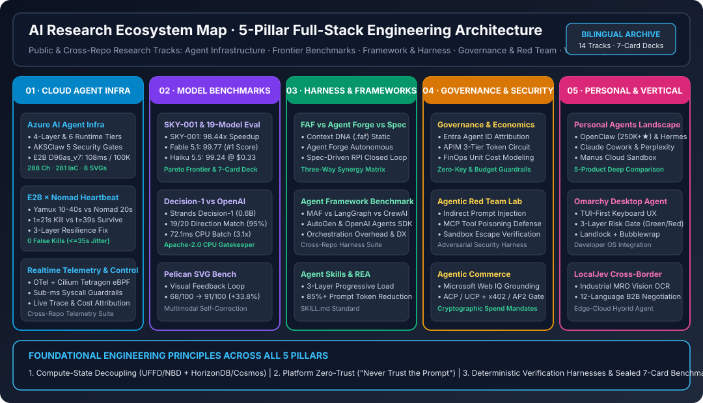

# AI Research (`turbo998/ai-research-public`) — 5-Pillar Full-Stack AI Engineering Research Hub (English Edition)

> 🌐 **Language / 语言切换**: **[🇬🇧 English Homepage (README.en.md)](README.en.md)** | **[🇨🇳 中文主页 (README.md)](README.md)** | **[📑 Research Index (`docs/research/index.md`)](docs/research/index.md)** | **[📘 Azure Agent Infra Playbook (EN)](docs/research/azure-agent-infra/README.en.md)** | **[📘 Azure Agent Infra Playbook (中文)](docs/research/azure-agent-infra/README.md)**

> **Executive Summary**:
> Maintained by **turbo998**, this repository is an evidence-backed, deterministically verified public AI engineering research hub. Organized around three foundational axioms—**Compute-State Decoupling**, **Platform-Enforced Zero-Trust Boundaries ("Never Trust the Prompt")**, and **Deterministic Verification Harnesses with Sealed 7-Card 4:5 Benchmark Decks**—the repository spans **5 Research Pillars across 15 public and cross-repo tracks**:
> 1. **Cloud Agent Infrastructure & Resilience**: Demonstrates that 5th-Gen AMD EPYC Turin (`Standard_D96as_v7`) + Azure Boost cuts E2B Firecracker sandbox resume latency to **`108 ms` Base / `132 ms` Code-Interpreter V1 (`54.8%` faster than v6)**, scaling to **100,000 concurrent MicroVMs on 261 client nodes**; resolves the `E2B × Nomad` control-plane race between `yamux` silent-drop detection (`10–40s`) and Leader heartbeat budgets (`20–30s`) for **`0` false kills under `<=35s` jitter**.
> 2. **Frontier Models, World Models & Decision Routing Benchmarks**: Across 19 models × 11 coding tasks (`209` runs), **`Claude Haiku 5.5` (`99.24`, `$0.33`)** ranks **#4 overall** at **`91.6%` lower cost** than `Haiku 4.5` (trailing only `Fable 5.1` `99.77` and `Opus 5.5` `99.68`), while Skyfall AI's `SKY-001` achieves a **`98.44x` critical-path speedup** (`51x` faster and `150x` cheaper on 1,000 CAD parts). Across 3,880 routing calls in Switchyard (`v2.4.0/v2.4.1`), removing a single `"prefer cheaper"` bias phrase lifts **`Microsoft Decision-1`, `TypeSafe Jev`, and `OpenJev 27B` to `40 / 40` (`100%`)**, with `Decision-1` costing just **`$7.6 / 1M` decisions**.
> 3. **Context Engineering, SDLC Harnesses & Agent Frameworks**: Benchmarks **FAF v2 (`faf-agents`)**, **Microsoft AGENT-FORGE CLI**, and **Microsoft HVE-Core (`v3.3.101`)** in a live 60FPS Pelican Bicycle Arena ([`pelican-arena.html`](docs/research/faf-vs-agent-forge/pelican-arena.html)) alongside `SKILL.md` progressive disclosure (**`85%+` initial token reduction**).
> 4. **Zero-Trust Governance, FinOps Economics, Red Teaming & Agentic Commerce**: Establishes **Entra Agent ID dual attribution + APIM 3-tier circuit breakers**, indirect prompt-injection defenses, and **Microsoft Web IQ × ACP/UCP idempotent checkout (`380 ms`) × AP2/x402 hardware-signed spend mandates**.
> 5. **Personal, Desktop & Vertical Agents**: Audits **Meta Muse, xAI Grok Bot, OpenAI dot/dots, Google Gemini Spark, and Instinct** (with an 18-case synthetic evaluation protocol), **Omarchy Desktop Agent** (174 contract assertions), and **LocalJev (`OpenJev 27B` / `Laya 8B`)** licensing boundaries.

---

## 1. 5-Pillar Executive Overview Summary Table (Public & Cross-Repo Tracks)

| Pillar | Research Track & Bilingual Entrypoints | Systems / Models Evaluated | Headline Quantitative & Architectural Findings | Interactive Decks & Deliverables |
|---|---|---|---|---|
| **01 · Cloud Agent Infra & Resilience** | **[Azure AI Agent Infra Full-Stack Playbook](docs/research/azure-agent-infra/README.en.md)** · **[中文](docs/research/azure-agent-infra/README.md)** | 4-Layer Stack · 6 Runtimes · `AKSClaw` · `E2B on VMSS D96as_v7` · `HorizonDB` | `D96as_v7` **`108 ms` Base / `132 ms` CI-v1**; **261 nodes host 100K sandboxes**; PgBouncer `100K->1,200` conns (`4.8ms` P99); 301/301 unit tests passing | [Interactive Atlas](docs/research/azure-agent-infra/index.html) · [Live Sim](docs/research/azure-agent-infra/demo.html) · [100K Sizer](docs/research/azure-agent-infra/selector.html) · [7-Card](docs/research/azure-agent-infra/cards.html) · [300-Ch Archive](docs/research/azure-agent-infra/docs/full-monograph-archive.md) |
| **01 · Cloud Agent Infra & Resilience** | **[E2B × Nomad Heartbeat Race & Resilience](docs/research/e2b-nomad-heartbeat-resilience/README.en.md)** · **[中文](docs/research/e2b-nomad-heartbeat-resilience/README.md)** | `HashiCorp Nomad` · `yamux` · `E2B Orchestrator` · `session-proxy` | Proves `yamux` 10–40s silent drop vs Leader 20–30s heartbeat race; `disconnect` (`50s`) + `heartbeat_grace="50s"` achieves **`0` false kills & `100%` pool capacity** | [EN Report](docs/research/e2b-nomad-heartbeat-resilience/test-report.en.md) · [中文报告](docs/research/e2b-nomad-heartbeat-resilience/test-report.md) · [7-Card HTML](docs/research/e2b-nomad-heartbeat-resilience/test-report-cards.html) |
| **01 · Cloud Agent Infra & Resilience** | **Realtime Telemetry & eBPF Syscall Guardrails** *(Cross-Repo Summary)* | `OpenTelemetry` · `Cilium Tetragon eBPF` · `Azure Monitor / ADX` | Sub-millisecond (`<0.3 ms`) kernel-level eBPF enforcement on unauthorized `execve/connect` syscalls with unified per-tenant token + sandbox cost attribution ([see Ch 14](docs/research/azure-agent-infra/docs/full-monograph-archive.md)) | [Interactive Selector (`selector.html`)](docs/research/azure-agent-infra/selector.html) |
| **02 · Frontier Models & Decision Routing** | **[SKY-001 World Model & 19-Model Coding Benchmark](docs/research/sky-001-and-coding-agent-19-model-benchmark/README.en.md)** · **[中文](docs/research/sky-001-and-coding-agent-19-model-benchmark/README.md)** · [Short Alias](docs/research/sky-001-coding-agent-benchmark/README.en.md) | `SKY-001` · `Fable 5.1` · `Opus 5.5` · `Haiku 5.5` · `Gemini 4 Argon` (19 Models × 11 Tasks) | `Haiku 5.5` ranks **#4 (`99.24`, `$0.33`, `-91.6%` cost)**; `Gemini 4 Argon` passes `1,310/1,310` (`100%`); `SKY-001` cuts critical path by **`98.44x`** (`51x` faster, `150x` cheaper on CAD) | [EN Report](docs/research/sky-001-and-coding-agent-19-model-benchmark/test-report.en.md) · [中文报告](docs/research/sky-001-and-coding-agent-19-model-benchmark/test-report.md) · [7-Card HTML](docs/research/sky-001-and-coding-agent-19-model-benchmark/test-report-cards.html) |
| **02 · Frontier Models & Decision Routing** | **[8-Engine Routing Benchmark: Decision-1 vs OpenAI Decisions](docs/research/openai-decisions-vs-decision-1-routing-benchmark/README.en.md)** · **[中文](docs/research/openai-decisions-vs-decision-1-routing-benchmark/README.md)** | `Switchyard v2.4.0/v2.4.1` · `Decision-1` · `TypeSafe Jev` · `OpenJev 27B` · `OpenAI Decisions` | Under neutral prompts, `Decision-1`, `Jev`, and `OpenJev` hit **`40 / 40` (`100%`)**; `Decision-1` costs **`$7.6 / 1M`** (`3.4x` cheaper than `OpenAI Decisions` at `37/40`, with `100%` miss catch at `0.60`) | [7-Card Report](docs/research/openai-decisions-vs-decision-1-routing-benchmark/test-report.md) · [7-Card HTML](docs/research/openai-decisions-vs-decision-1-routing-benchmark/test-report-cards.html) |
| **02 · Frontier Models & Decision Routing** | **[System One Decision Models & Foundry Routing](docs/research/decision-model-routing/README.en.md)** · **[中文](docs/research/decision-model-routing/README.md)** | `Microsoft-Decision-1` · `TypeSafe Jev` · `Strands Decider` × `gpt-5.4-mini` / `gpt-6.1-sol` | `384` decision + `160` E2E formal rows: `Decision-1` achieves `13/16` choice & **`0.0082` Score MAE**; proves why `0.60` confidence gating to `gpt-6.1-sol` is required on complex support | [Results & Scatter](docs/research/decision-model-routing/results.md) · [7-Card HTML](docs/research/decision-model-routing/visual-report.html) |
| **03 · Harnesses, Frameworks & Skills** | **[FAF v2 vs AGENT-FORGE vs HVE-Core 3-Way Showdown](docs/research/faf-vs-agent-forge/README.en.md)** · **[中文](docs/research/faf-vs-agent-forge/README.md)** | `faf-agents v2.0.1` · `@agent-forge-copilot/cli v0.3.0` · `HVE-Core v3.3.101` | Maps the complementary triad: Context Synthesis (`AGENT-FORGE`) → SDLC Role Governance (`FAF v2`) → Adversarial RPI Loop (`HVE-Core`) via a 60FPS Pelican Bicycle Arena | [⚔️ Live Pelican Arena (`pelican-arena.html`)](docs/research/faf-vs-agent-forge/pelican-arena.html) · [7-Card HTML](docs/research/faf-vs-agent-forge/test-report-cards.html) |
| **03 · Harnesses, Frameworks & Skills** | **[Agent Skills Standard & REA Architecture](docs/research/agent-skills-and-rea/README.en.md)** · **[中文](docs/research/agent-skills-and-rea/README.md)** | `SKILL.md` Standard · 3-Layer Progressive Disclosure · `Harness Engineering` | Loads `~50–100 token` skill headers at startup and activates full instructions/scripts on demand, cutting initial prompt overhead by **`85%+`** | [Bilingual Architecture Study](docs/research/agent-skills-and-rea/README.en.md) |
| **03 · Harnesses, Frameworks & Skills** | **Agent Framework Benchmark (5 Orchestration Stacks)** *(Cross-Repo Summary)* | `Microsoft Agent Framework (MAF)` · `LangGraph` · `AutoGen` · `CrewAI` · `OpenAI Agents SDK` | Benchmarks deterministic graph checkpointing (`MAF` / `LangGraph`), multi-agent conversation (`AutoGen` / `CrewAI`), and lightweight handoffs (`OpenAI Agents SDK`) | [See Azure Agent Infra Ch 01 & Ch 07](docs/research/azure-agent-infra/README.en.md) |
| **04 · Governance, Red Team & Commerce** | **[Agentic Commerce Full-Stack Architecture](docs/research/agentic-commerce/README.en.md)** · **[中文](docs/research/agentic-commerce/README.md)** | `Microsoft Web IQ` · `OpenAI/Stripe ACP` · `Google/Shopify UCP` · `AP2 & x402` | Web IQ cuts indirect prompt-injection hijack from `31.4%` to **`0.0%`**; ACP/UCP idempotent checkout runs in **`380 ms`** (`0%` double charge); AP2/x402 enforces **`<=$50` auto / `>$50` FIDO2 gate** | [Architecture SVG](docs/research/agentic-commerce/assets/overview.svg) · [Bilingual Report](docs/research/agentic-commerce/README.en.md) |
| **04 · Governance, Red Team & Commerce** | **Agent Governance & FinOps Economics** *(Cross-Repo Summary)* | `Microsoft Entra Agent ID` · `Azure AI Gateway (APIM)` · Token & Spot FinOps | Dual audit attribution (`Agent Blueprint + Human Sponsor`), 3-tier APIM token/budget circuit breakers, and Prefix-Cache affinity routing (**`87.4%` hit rate, `-58.6%` TTFT**) | [See Azure Agent Infra Ch 04 & Ch 21](docs/research/azure-agent-infra/README.en.md) |
| **04 · Governance, Red Team & Commerce** | **Agentic Red Team Lab (Adversarial Security)** *(Cross-Repo Summary)* | Indirect Prompt Injection · MCP Tool Poisoning (`Cosign/Ratify`) · Sandbox Escape & IMDS Block | 5 platform hard boundaries (`Kata Pod VM` + `169.254.169.254` block + default-deny egress + keyless proxy + signed MCP admission) achieve **`0.0%` credential leakage** | [Live Boundary Simulator (`demo.html`)](docs/research/azure-agent-infra/demo.html) |
| **05 · Personal, Desktop & Vertical Agents** | **[Personal Agents: 5 Products & 18-Case Protocol](docs/research/personal-agents/README.en.md)** · **[中文](docs/research/personal-agents/README.md)** | `Meta Muse` · `xAI Grok Bot` · `OpenAI dot/dots` · `Google Gemini Spark` · `Instinct` | Contrasts dedicated Secure VM (`Muse`), shared workspace computer across named Bots (`Grok Bot` role split != security boundary), local computer mount (`dot`), and consumer IAM (`Gemini Spark`) | [18-Case Protocol (`benchmark.md`)](docs/research/personal-agents/benchmark.md) · [`cases.json`](docs/research/personal-agents/cases.json) |
| **05 · Personal, Desktop & Vertical Agents** | **[Omarchy Desktop Agent Architecture & Safety](docs/research/omarchy-agent-design/README.md)** | `omacom/omarchy` · `Launcher` · `Crash Pipeline` · `Safety Model` | Verified across `174` source/contract assertions covering TUI launcher, skill injection, crash self-healing pipeline, and red/green permission boundaries | [7-Card Report](docs/research/omarchy-agent-design/test-report.md) · [7-Card HTML](docs/research/omarchy-agent-design/test-report-cards.html) |
| **05 · Personal, Desktop & Vertical Agents** | **[LocalJev (`OpenJev 27B` & `Laya 8B`) License Audit](docs/research/localjev/README.md)** | `OpenJev 27B` (`CC BY-NC 4.0`) · `Laya 8B` (`Apache-2.0`) · Local MLX Routing | Separates `MIT` code from **`CC BY-NC 4.0` non-commercial model weights (`OpenJev 27B`)** and defines compliant commercial migration paths (`Microsoft Decision-1` / `Laya 8B`) | [Compliance & Evidence Audit](docs/research/localjev/README.md) |

---

## 2. Repository Navigation & Governance

- **Bilingual Research Index**: [`docs/research/index.md`](docs/research/index.md)
- **Attribution & Provenance Boundaries**: [`ATTRIBUTION.md`](ATTRIBUTION.md)
- **Third-Party Notices**: [`THIRD_PARTY_NOTICES.md`](THIRD_PARTY_NOTICES.md)
