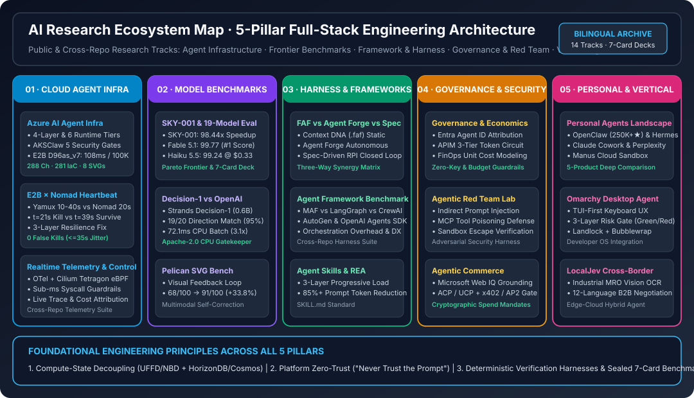

# AI Research Hub (`turbo998/ai-research-public`) · 企业级云与 AI 解决方案架构师研究总库

> 🌐 **Language / 语言切换**: **[🇨🇳 中文主页 (README.md)](README.md)** | **[🇬🇧 English Homepage (README.en.md)](README.en.md)** · **[📑 研究专题总索引 (中文)](docs/research/index.md)** | **[📑 Research Index (EN)](docs/research/index.en.md)** · **[🏠 个人主页 (`turbo998.github.io`)](https://turbo998.github.io/)**

面向 **Enterprise Cloud & AI Solution Architect (SA)** 的公开架构选型、基准评测与技术情报总库。所有专题遵循三大工程准则：
1. **架构选型导向（Decision-First）**：聚焦真实客户落地中的双难抉择（算力与沙箱隔离、多模型路由、多智能体编排、零信任安全护栏与 Token FinOps），提供量化边界与生产级 IaC 蓝图。
2. **密封证据与 7-Card 基准规范（Evidence-Backed）**：模型与框架横评统一配备 **7-Card 4:5 视觉评测卡**、确定性验证脚本及数据溯源分级（`measured` / `anonymized_reported` / `synthetic`）。
3. **中英双语同步（Bilingual by Default）**：核心专题、62 篇 Azure 企业级选型指南与每日 GitHub AI 趋势雷达均提供中英双语对照。

---

## 🚀 架构师高频快捷入口（SA Quick Launchpad）

| 高频工作台 | 适用场景 | 双语直达入口 |
|---|---|---|
| **☁️ Azure AI Agent Infra 全栈 Playbook + 62 篇企业选型 FAQ** | Foundry / ACA / AKS / E2B 沙箱选型、PTU vs MaaS 精算、Fabric IQ vs AI Search、APIM AI Gateway、Purview/Defender 护栏 | [中文 Playbook](docs/research/azure-agent-infra/README.md) · [EN](docs/research/azure-agent-infra/README.en.md) · **[62 篇选型指南目录](docs/research/azure-agent-infra/selection-guides/README.md)** ([EN](docs/research/azure-agent-infra/selection-guides/README.en.md)) · [100K 沙箱计算器](docs/research/azure-agent-infra/selector.html) |
| **📡 GitHub AI 趋势与飙升速度雷达（每日 SA 情报台）** | 基于 `Hype / Facts / Signal` 三轴去噪追踪每日最热 AI 开源仓库，评估 SA 学习价值与 PoC 优先级 | [中文雷达主页](workshops/github-trending-radar/README.md) · [EN](workshops/github-trending-radar/README.en.md) · [最新日报 (`2026-11-17`)](workshops/github-trending-radar/daily/2026-11-17.md) ([EN](workshops/github-trending-radar/daily/2026-11-17.en.md)) · [7-Card](workshops/github-trending-radar/cards.html) |
| **📊 前沿模型、路由与多智能体 7-Card 基准评测矩阵** | `Terminal-Bench 4.1` 65榜/66题容器评测、21 模型编码/校准路由横评（`GPT-6.2 Sol` 27 轮实测）、`Gemini 4 Carbon` 网安基准、`MAF v1.0` 编排对比 | **[`Terminal-Bench 4.1` 深度解构](docs/research/terminal-bench-4-1/README.md)** ([7-Card](docs/research/terminal-bench-4-1/test-report-cards.zh-CN.html) · [工作台](https://turbo998.github.io/workshops/terminal-bench/index.html)) · **[`GPT-6.2 Sol` 21模型实测](docs/research/gpt-6-2-sol-benchmark/README.md)** ([7-Card](docs/research/gpt-6-2-sol-benchmark/test-report-cards.zh-CN.html)) · [`Gemini 4 Carbon` 20模型](docs/research/gemini-4-carbon-and-20-model-benchmark/README.md) · [`MAF v1.0` 编排基准](docs/research/maf-multi-agent-benchmark/README.md) |
| **🛡️ 企业级 AI 零信任安全与 Security AI Landing Zone** | Microsoft DEFEND 五层安全阶梯、Purview 敏感标签与 DLP、Agent 365 五大安全支柱与 Frontier SOC | [DEFEND 架构指南](docs/research/defend-partner-playbook/README.md) ([EN](docs/research/defend-partner-playbook/README.en.md)) · [Security AI Landing Zone](docs/research/security-ai-landing-zone/index.zh.md) ([EN](docs/research/security-ai-landing-zone/index.md)) |

---

## 📚 五大研究支柱全量目录（5-Pillar SA Research Catalog）

### 支柱一：云原生 Agent 基础设施与超大规模推理经济学（Cloud Agent Infra & Token Economics）

| 专题报告（中 / EN） | 核心技术栈与对标范围 | 关键量化结论与 SA 选型建议 | 7-Card 与交互式交付物 |
|---|---|---|---|
| **[Azure AI Agent Infra 全栈方案设计与架构选型 Playbook](docs/research/azure-agent-infra/README.md)** · **[EN](docs/research/azure-agent-infra/README.en.md)** | 4 层架构 · 6 大运行时 · `AKSClaw (Kata)` · `E2B on VMSS D96as_v7` · `HorizonDB` · **62 篇选型指南** | 第五代 EPYC Turin (`D96as_v7`) 实现 **`108 ms` UFFD 快照恢复**；单集群 **261 节点稳态承载 100K 并发 MicroVM**；配套 23 套 IaC 蓝图与 62 篇 Azure 选型 FAQ | [62 篇选型 FAQ](docs/research/azure-agent-infra/selection-guides/README.md) · [H5 全景台](docs/research/azure-agent-infra/index.html) · [实时仿真](docs/research/azure-agent-infra/demo.html) · [容量计算器](docs/research/azure-agent-infra/selector.html) · [7-Card](docs/research/azure-agent-infra/cards.html) |
| **[DeepSeek DeepInfer 超大规模分离式推理与 Token 成本账本](ai-infra/reports/2026-11-01/ai-infra-phase167-deepinfer-v41-pd-economics-2026-11-01.md)** · **[EN](ai-infra/reports/2026-11-01/ai-infra-phase167-deepinfer-v41-pd-economics-2026-11-01.en.md)** | `DeepSeek-V4.1-Flash (552B MoE)` · `E/P/D 分离` · `100 PiB 3FS` · `GB300 NVL72` | **`96%` 3FS 前缀缓存命中** 将有效输入吞吐放大 `25×` 至 **`1.50M tok/s/GPU`**；`1P:1D` 配比精确还原谷电价 **`$38.00 / GPU-hr`** 与单集群日吞吐 `155T` Token 经济模型 | [7-Card HTML](ai-infra/reports/2026-11-01/ai-infra-phase167-benchmark-cards.html) · [视觉工作台](ai-infra/reports/2026-11-01/ai-infra-phase167-visual-workbench.html) · [仿真脚本](ai-infra/experiments/phase167_deepinfer_v41_economics/simulate_deepinfer_economics.py) |
| **[E2B × Nomad 心跳竞态根因与沙箱自愈架构](docs/research/e2b-nomad-heartbeat-resilience/README.md)** · **[EN](docs/research/e2b-nomad-heartbeat-resilience/README.en.md)** | `HashiCorp Nomad` · `yamux` · `E2B Orchestrator` · `Cgroup Slice` | 揭示 `yamux` 断连检测（`10–40s`）与 Nomad 心跳预算（`20–30s`）竞态根因；通过 `heartbeat_grace="50s"` 与控制面解耦实现 **`<=35s` 网络抖动零误杀** | [中文报告](docs/research/e2b-nomad-heartbeat-resilience/test-report.md) · [EN](docs/research/e2b-nomad-heartbeat-resilience/test-report.en.md) · [7-Card HTML](docs/research/e2b-nomad-heartbeat-resilience/test-report-cards.html) |

### 支柱二：前沿模型、世界模型与 System-One 决策路由基准（Frontier Models & Decision Routing）

| 专题报告（中 / EN） | 核心技术栈与对标范围 | 关键量化结论与 SA 选型建议 | 7-Card 与交互式交付物 |
|---|---|---|---|
| **[Terminal-Bench 4.1 (`tbench.ai` / Harbor) 架构、帕累托经济学与 66 项容器 Agent 深度评测（2026-11-19）](docs/research/terminal-bench-4-1/README.md)** · **[EN](docs/research/terminal-bench-4-1/README.en.md)** | `Harbor v4.1.0` (`environment_mode="separate"`) · `65` 榜 / `52` 唯一配对 · `66` 题 × `5` 轮 (`21,450` 试验) · `Copilot Fusion` · `GPT-6.2 Sol` · `Kimi K3.1 Pro` | `#1 Copilot Fusion + GitHub Copilot` 达 **`71.21% ± 2.88%`**（领先 `#2` **`+5.45pt`**）；`#2–#8` 同置信带暗藏 **`47.2×` 成本鸿沟**；仅 **`7/52 (13.5%)`** 跻身商业帕累托前沿（`GPT-6.2 Sol` **`$349.16 / $1.72/题`** 黄金拐点）；`Kimi K3.1 Pro` 获 `#1 pass@5 = 84.85%`；提出**编译器-验证器反馈密度定律**（`66%–78%` vs 4 道 `0/325` 零解墙） | [中文 7-Card HTML](docs/research/terminal-bench-4-1/test-report-cards.zh-CN.html) · [EN 7-Card HTML](docs/research/terminal-bench-4-1/test-report-cards.en.html) · [概览 SVG](docs/research/terminal-bench-4-1/assets/overview.svg) · [交互工作台](https://turbo998.github.io/workshops/terminal-bench/index.html) · [评测工程库](https://github.com/turbo998/benchmark-harness-engineering) |
| **[GPT-6.2 Sol 全档推理强度实测与二十一模型前沿编码/校准路由深度评测（增补报告 9，2026-11-18）](docs/research/gpt-6-2-sol-benchmark/README.md)** · **[EN](docs/research/gpt-6-2-sol-benchmark/README.en.md)** | `GPT-6.2 Sol`（五档强度 27 轮原生 CAPI）· `GPT-6.1 Sol` · `Gemini 4 Carbon` · `Claude Sonnet 5.5` · `GPT-6.2 Astra` | 同价位（`$2/$10`，`1.05M` 上下文）编码五档全部达 **`59/60 (98.33%)`**（`low` 仅 **`$0.055` / `45.4s`**），解码提速 **`1.61×`（`88.2 tok/s`）**；校准路由 **`12/12 (100%)`** 阻断前代 `R04=83` 误重启，六路批处理提速 **`3.66×`**；揭示 `>272K` 全请求加倍计费悬崖 | [中文 7-Card HTML](docs/research/gpt-6-2-sol-benchmark/test-report-cards.zh-CN.html) · [EN 7-Card HTML](docs/research/gpt-6-2-sol-benchmark/test-report-cards.en.html) · [概览 SVG](docs/research/gpt-6-2-sol-benchmark/assets/overview.svg) · [密封验证器](docs/research/gpt-6-2-sol-benchmark/simulator/verify_sol62_suite.py) |
| **[Gemini 4 Carbon 网安/长程智能体与 20 模型基准评测](docs/research/gemini-4-carbon-and-20-model-benchmark/README.md)** · **[EN](docs/research/gemini-4-carbon-and-20-model-benchmark/README.en.md)** | `Gemini 4 Carbon` · `Gemini 4 Argon` · `GPT-6 Astra` · `Claude Opus 5.5` · `Fable 5.1` | 同价位（`$2/$10`）斩获 **17 项官方基准中的 `15 项 #1`**（`SEC-bench Pro 88.2%`、`Terminal-Bench 4.0 65.2%`、`Gray Swan IPI 0.0% ASR`），适合高安全与百万上下文代码审计 | [中文 7-Card](docs/research/gemini-4-carbon-and-20-model-benchmark/test-report.md) · [EN](docs/research/gemini-4-carbon-and-20-model-benchmark/test-report.en.md) · [7-Card HTML](docs/research/gemini-4-carbon-and-20-model-benchmark/test-report-cards.html) |
| **[SKY-001 工程世界模型与 19 模型 Coding Agent 横评](docs/research/sky-001-and-coding-agent-19-model-benchmark/README.md)** · **[EN](docs/research/sky-001-and-coding-agent-19-model-benchmark/README.en.md)** | `SKY-001` · `Fable 5.1` · `Opus 5.5` · `Claude Haiku 5.5` · `GPT-6.1 Sol` | 19 模型 × 11 题实测：`Haiku 5.5`（`99.24` 分，`$0.33`）较前代降本 **`91.6%`** 跃居性价比首选；构建主力规划模型 + 高吞吐子执行器六角色混合路由 | [中文 7-Card](docs/research/sky-001-and-coding-agent-19-model-benchmark/test-report.md) · [EN](docs/research/sky-001-and-coding-agent-19-model-benchmark/test-report.en.md) · [7-Card HTML](docs/research/sky-001-and-coding-agent-19-model-benchmark/test-report-cards.html) |
| **[OpenAI Decisions vs Microsoft Decision-1 八引擎路由横评](docs/research/openai-decisions-vs-decision-1-routing-benchmark/README.md)** · **[EN](docs/research/openai-decisions-vs-decision-1-routing-benchmark/README.en.md)** | `Switchyard` · `Microsoft Decision-1` · `TypeSafe Jev` · `OpenJev 27B` · `OpenAI Decisions` | 消除省钱偏置提示后 `Decision-1` / `Jev` / `OpenJev` 均达 **`40/40 (100%)`**；`Decision-1` 成本仅 **`$7.6 / 1M`**（约为 `OpenAI Decisions` 的 `1/3.4`），`0.60` 置信门控可 100% 拦截失误 | [7-Card 报告](docs/research/openai-decisions-vs-decision-1-routing-benchmark/test-report.md) · [7-Card HTML](docs/research/openai-decisions-vs-decision-1-routing-benchmark/test-report-cards.html) |
| **[System-One 决策模型与 Foundry 多模型路由实践](docs/research/decision-model-routing/README.md)** · **[EN](docs/research/decision-model-routing/README.en.md)** | `Microsoft-Decision-1` · `Strands Decider` × `gpt-5.4-mini` / `gpt-6.1-sol` | `384` 决策行 + `160` 端到端行实测：`Decision-1` Score MAE 低至 **`0.0082`**；揭示高风险工单必须引入 `0.60` 概率升级阈值回退至强推理模型 | [实验结果](docs/research/decision-model-routing/results.md) · [7-Card HTML](docs/research/decision-model-routing/visual-report.html) |
| **[LocalJev 类型化决策桥与概率校准边界审计](docs/research/localjev/README.md)** · **[EN](docs/research/localjev/README.en.md)** | `githubnext/localjev` · `choice / score / noul` JSON Schema 契约 · 开源许可合规 | 明确区分**协议兼容**与**校准概率**：口头生成的 JSON 浮点数归一化不等于 Token Logprob 校准置信度，且 `OpenJev 27B` (`CC BY-NC 4.0`) 严禁直接商用 | [中文报告](docs/research/localjev/README.md) · [EN Summary](docs/research/localjev/README.en.md) |

### 支柱三：多智能体编排、Harness 工程与渐进式技能标准（Multi-Agent Harnesses & Skills）

| 专题报告（中 / EN） | 核心技术栈与对标范围 | 关键量化结论与 SA 选型建议 | 7-Card 与交互式交付物 |
|---|---|---|---|
| **[Google《Harnesses That Improve Themselves》：自进化 Agent Harness 双环门控架构](docs/research/google-self-improving-harnesses/README.zh-CN.md)** · **[EN](docs/research/google-self-improving-harnesses/README.en.md)** | `arXiv:2611.22299v1` · 内环四组件 (`h_ctx/ctrl/act/ver`) · 外环 `Stage 3 G_val + B_tok` · `Flash → Argon` 迁移 | 门控模块化演化在 `Gemini 3.8 Flash` 上解率 **`5.0% → 40.0%`（`8×`）**、均耗 **`46.7k`**（较全重写省 **`~10×`**，`<100` 题回本）；零样本迁移 `Gemini 4 Argon` 以 **`37.5%` 夺冠**（全重写崩至 `30.0%`） | [中文模拟台](https://turbo998.github.io/workshops/google-self-improving-harnesses/index.html) · [EN Simulator](https://turbo998.github.io/workshops/google-self-improving-harnesses/index.en.html) · [中文 7-Card](docs/research/google-self-improving-harnesses/cards.zh.html) · [EN Deck](docs/research/google-self-improving-harnesses/cards.html) |
| **[随前沿模型升级持续演进 Agent Harness：生产级 Skill 审阅与协同演化实践手册](docs/research/agent-harness-model-coevolution/README.zh-CN.md)** · **[EN](docs/research/agent-harness-model-coevolution/README.en.md)** | `Gemini 4 Carbon × GPT-6.2 Sol × Grok 4.7` · `<available_skills> 12 KB 悬崖` · 三层渐进式披露 · `Desktop Canvases` | `120 → 62` 正交技能（**`-50.2%` 体积**）：描述压缩 **`-79.2%`（`~38.6K → 8,019 chars`）** 将首轮路由可见率从 **`1.2%` 恢复至 `100.0%`**，`OpenClaw` 主干 **`1,390 → 84` 行（`-94.0%`）**，目录外治理矩阵 **`0 Bytes`** 提示词税 | [中文演讲台](https://turbo998.github.io/workshops/agent-harness-coevolution/index.html) · [EN Workbench](https://turbo998.github.io/workshops/agent-harness-coevolution/index.en.html) · [中文 7-Card](https://turbo998.github.io/workshops/agent-harness-coevolution/cards.zh.html) · [EN Deck](https://turbo998.github.io/workshops/agent-harness-coevolution/cards.html) |
| **[Microsoft Agent Framework (MAF v1.0) vs 6 大主流编排框架](docs/research/maf-multi-agent-benchmark/README.md)** · **[EN](docs/research/maf-multi-agent-benchmark/README.en.md)** | `MAF v1.0` · `LangGraph` · `AutoGen v0.4` · `Semantic Kernel` · `OpenAI Agents SDK` · `CrewAI` | MAF 以 **`96.4/100`** 居首：融合 SK + AutoGen，内置三层拦截中间件（`100%` PII 脱敏 + 审批挂起）、5 种编排模式（8-Agent 并发提速 **`3.61×`**）及原生 MCP/A2A v1.0 | [中文 7-Card](docs/research/maf-multi-agent-benchmark/test-report.md) · [EN](docs/research/maf-multi-agent-benchmark/test-report.en.md) · [7-Card HTML](docs/research/maf-multi-agent-benchmark/test-report-cards.html) · [编排工作台](docs/research/maf-multi-agent-benchmark/index.html) |
| **[主流 Agent Harness 框架源码解构：DSH × Claude Code × HVE Core](docs/research/harness-engineering-frameworks/README.zh-CN.md)** · **[EN](docs/research/harness-engineering-frameworks/README.en.md)** | `DeepSeek DSH` (`PTC run_code`) · `Claude Code` (三级压缩) · `Microsoft HVE Core` (四阶段 RPI) | DSH `run_code` 沙箱将多步工具级联提速 **`3.59×–7.51×`**，`in-history` 更新将前缀缓存命中率提至 **`94.2%`**；HVE Core 阶段间 `/clear` 消除长会话 `20×` 注意力稀释 | [中文 7-Card](docs/research/harness-engineering-frameworks/test-report.md) · [EN](docs/research/harness-engineering-frameworks/test-report.en.md) · [中文卡片](docs/research/harness-engineering-frameworks/cards.zh.html) · [Playground](docs/research/harness-engineering-frameworks/index.html) |
| **[科学发现与行业场景 Harness 工程：CLIO 与校准遵从蓝图](docs/research/scientific-and-industry-harness-engineering/README.md)** · **[EN](docs/research/scientific-and-industry-harness-engineering/README.en.md)** | `Microsoft Discovery` · `CLIO` · `Calibrated Deference` · `GraphRAG + DRIFT` · 独立验证铁律 | 提炼高风险企业场景 **10 大行业 Harness 法则**：通过不确定性梯度监测、灰盒机理约束与跨模型独立验证器（3 振熔断）阻断专业领域幻觉 | [中文 7-Card](docs/research/scientific-and-industry-harness-engineering/test-report.md) · [EN](docs/research/scientific-and-industry-harness-engineering/test-report.en.md) · [中文卡片](docs/research/scientific-and-industry-harness-engineering/cards.zh.html) · [工作台](docs/research/scientific-and-industry-harness-engineering/index.html) |
| **[FAF v2 vs AGENT-FORGE vs HVE-Core 三大研发脚手架实装对比](docs/research/faf-vs-agent-forge/README.md)** · **[EN](docs/research/faf-vs-agent-forge/README.en.md)** | `faf-agents v2.0.1` · `@agent-forge-copilot/cli` · `Microsoft HVE-Core` | 厘清**领域角色插件（FAF）× `.github/` 上下文编译器（AGENT-FORGE）× 对抗验证状态机（HVE-Core）**三层互补定位 | [同屏竞技场 (`pelican-arena.html`)](docs/research/faf-vs-agent-forge/pelican-arena.html) · [7-Card HTML](docs/research/faf-vs-agent-forge/test-report-cards.html) |
| **[企业级 Agent Skills 工程成熟度（L1–L4）与逆向验证架构](docs/research/agent-skills-and-rea/README.md)** · **[EN](docs/research/agent-skills-and-rea/README.en.md)** | `SKILL.md` 渐进式加载 · `L2 Critic` · `L3 Deterministic Harness` · `L4 AST & Evidence MCP` | 按需三级加载削减 **`85%+` 初始上下文 Token**；从静态提示包（L1）演进至确定性测试门禁（L3）与 AST/哈希证据账本（L4） | [交互式导览 (`index.html`)](docs/research/agent-skills-and-rea/index.html) · [L1–L4 成熟度台](docs/research/agent-skills-and-rea/h5/ryan-doser-skills-report/index.html) |

### 支柱四：企业级 AI 零信任安全、Purview 治理与电商协议（Zero-Trust AI Security & Governance）

| 专题报告（中 / EN） | 核心技术栈与对标范围 | 关键量化结论与 SA 选型建议 | 7-Card 与交互式交付物 |
|---|---|---|---|
| **[Microsoft 安全与 AI 就绪工程架构：DEFEND 五层与 6 大工作负载](docs/research/defend-partner-playbook/README.md)** · **[EN](docs/research/defend-partner-playbook/README.en.md)** | `5-Tier DEFEND` · 6 大工作负载部署手册 · `Purview 4-Tier AI` · Copilot/Edge DLP | 拆解 41 项安全能力阶梯与 **51 项硬性准出门禁**；给出身份、Purview AI 数据护栏、设备与 SaaS OAuth 治理的 P1/P2/P3 落地流水线 | [中文 7-Card](docs/research/defend-partner-playbook/test-report.md) · [EN](docs/research/defend-partner-playbook/test-report.en.md) · [中文卡片](docs/research/defend-partner-playbook/cards.zh.html) · [EN Cards](docs/research/defend-partner-playbook/cards.html) |
| **[Security AI Landing Zone 与 Frontier SOC 架构实践](docs/research/security-ai-landing-zone/index.zh.md)** · **[EN](docs/research/security-ai-landing-zone/index.md)** | `Microsoft Agent 365` 五大支柱 · `M365 E7` · `Defender ISOC & MDASH` | 4–6 周企业冲刺蓝图：**第 3 周 20 项安全控制硬门禁**通过后方可放行生产 Agent 上线；梳理红/蓝/绿安全智能体协同架构 | [中文 7-Card](docs/research/security-ai-landing-zone/test-report.md) · [EN](docs/research/security-ai-landing-zone/test-report.en.md) · [中文卡片](docs/research/security-ai-landing-zone/cards.zh.html) · [EN Cards](docs/research/security-ai-landing-zone/cards.html) |
| **[Agentic Commerce 全栈协议与硬件签名支付熔断](docs/research/agentic-commerce/README.md)** · **[EN](docs/research/agentic-commerce/README.en.md)** | `Microsoft Web IQ` · `OpenAI/Stripe ACP` · `Google/Shopify UCP` · `AP2 & x402` | Web IQ 消除页面间接提示词注入；ACP/UCP 幂等结账防止重复扣款；AP2/x402 实施小额自动执行、超额强制 **FIDO2 硬件签名审批** | [架构总览 SVG](docs/research/agentic-commerce/assets/overview.svg) · [双语报告](docs/research/agentic-commerce/README.md) |

### 支柱五：每日开源 AI 情报雷达、Agentic OS 与个人智能体（AI Radar & Desktop Harnesses）

| 专题报告（中 / EN） | 核心技术栈与对标范围 | 关键量化结论与 SA 选型建议 | 7-Card 与交互式交付物 |
|---|---|---|---|
| **[GitHub AI 趋势与飙升速度雷达（SA 每日情报工作台）](workshops/github-trending-radar/README.md)** · **[EN](workshops/github-trending-radar/README.en.md)** | 双轨追踪（24h 飙升榜 + 7d 新锐黑马榜）· `Hype / Facts / Signal` 评分 · 选型 FAQ 库 | 持续归档每日 AI 热门仓库评估，区分“包装炒作”与“可复用架构原语”，直接输出 SA 学习优先级（`P0/P1/P2`）与客户架构借力点 | [每日归档 (`daily/`)](workshops/github-trending-radar/README.md) · [中文 7-Card](workshops/github-trending-radar/cards.html) · [EN Deck](workshops/github-trending-radar/cards.en.html) |
| **[Omarchy Agent 桌面 OS 集成与多 Harness 启动架构](docs/research/omarchy-agent-design/README.md)** · **[EN](docs/research/omarchy-agent-design/README.en.md)** | `omacom/omarchy` · 14 分支 CLI Agent 启动器 · 渐进式技能 · 崩溃诊断流 | 基于 `174` 条源码断言核验：展示如何在云开发机/工程工作站层统一编排多厂商 CLI Agent、配额监控与人类确认触发器 | [7-Card 报告](docs/research/omarchy-agent-design/test-report.md) · [7-Card HTML](docs/research/omarchy-agent-design/test-report-cards.html) |
| **[Personal Agents 五款个人智能体产品架构与安全边界对比](docs/research/personal-agents/README.md)** · **[EN](docs/research/personal-agents/README.en.md)** | `Meta Muse` · `Grok Bot` · `OpenAI dot` · `Google Gemini Spark` · `Instinct` | 厘清独立云端 VM（`Muse`）、共享主机多角色（`Grok Bot` 角色分离 $\neq$ 安全隔离）与本地挂载（`dot`）的企业办公准入红线 | [18 案例测试协议](docs/research/personal-agents/benchmark.md) · [`cases.json`](docs/research/personal-agents/cases.json) |

---

## 📂 仓库治理与合规声明（Governance & Provenance）

- **完整研究索引**：[中文索引 (`docs/research/index.md`)](docs/research/index.md) · [English Index (`docs/research/index.en.md`)](docs/research/index.en.md)
- **权利归属与免责边界**：[`ATTRIBUTION.md`](ATTRIBUTION.md) · **第三方开源与商标声明**：[`THIRD_PARTY_NOTICES.md`](THIRD_PARTY_NOTICES.md)
- 各专题的采样截止时间、哈希校验台账与数据溯源分类均密封于各自目录下的 `evidence.json` 与 `review.md`。

