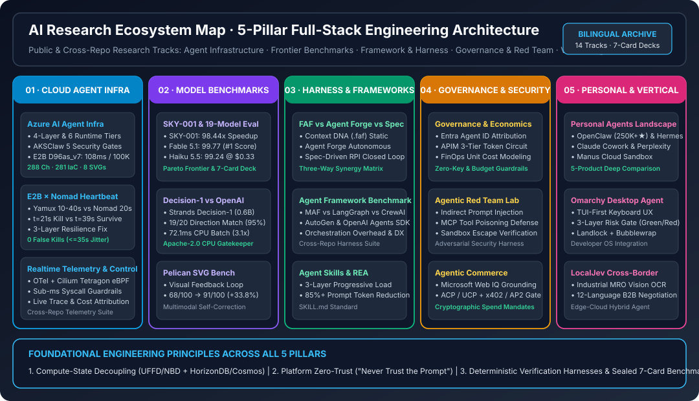

# AI Research (`turbo998/ai-research-public`) · 五大支柱全栈 AI 工程研究总库 (Bilingual Edition)

> 🌐 **Language / 语言切换**: **[🇨🇳 中文主页 (README.md)](README.md)** | **[🇬🇧 English Homepage (README.en.md)](README.en.md)** | **[📑 研究专题总索引 (`docs/research/index.md`)](docs/research/index.md)** | **[📘 Azure Agent Infra Playbook (中文)](docs/research/azure-agent-infra/README.md)** | **[📘 Azure Agent Infra Playbook (EN)](docs/research/azure-agent-infra/README.en.md)**

> **Executive Summary / 核心结论概览**：
> 本仓库是由 **turbo998** 维护的面向可复核证据（Evidence-Backed）与确定性仿真验证的公开 AI 工程研究总库。围绕 **“计算与状态解耦（Compute-State Decoupling）”**、**“平台级零信任硬边界（Never Trust the Prompt）”** 与 **“确定性验证脚手架 + 7-Card 4:5 密封基准报告”** 三大核心工程公理，系统覆盖 **五大研究支柱（5 Pillars · 16 个公开及跨库专题）**：
> - 🔥 **最新主打成果（Latest Featured Deliverable）—— [Microsoft Agent Framework (MAF v1.0) vs. 6 大主流框架：多 Agent 编排、三层中间件与 MCP/A2A v1.0 基准评测](docs/research/maf-multi-agent-benchmark/README.md) · [English](docs/research/maf-multi-agent-benchmark/README.en.md)**：基于 Microsoft Foundry 53 页架构规范与 6 大框架实测（`MAF v1.0` vs. `LangGraph`、`AutoGen v0.4`、`Semantic Kernel`、`OpenAI Agents SDK`、`CrewAI`），MAF 以 **`96.4 / 100` 综合得分居首**；原生融合 SK + AutoGen（`.AsAIFunction()` / `.as_tool()`），提供零提示词污染的**三层拦截中间件**（`100%` SSN PII 自动脱敏 + `context.Terminate` 人工审批挂起）、**5 种内置多 Agent 编排模式 + 有向图引擎**（8-Agent 并发 `186 ms` 提速 **`3.61×`**、16-Agent 提速 **`4.57×`**、超步检查点恢复 **`14.2 ms`**）及 **MCP v1.0 + Linux Foundation A2A v1.0（JWS 签名 Agent Cards）** 双协议原生互通。直达入口：[中文 README](docs/research/maf-multi-agent-benchmark/README.md) · [EN README](docs/research/maf-multi-agent-benchmark/README.en.md) · [中文测试报告](docs/research/maf-multi-agent-benchmark/test-report.md) · [EN Test Report](docs/research/maf-multi-agent-benchmark/test-report.en.md) · [7-Card HTML](docs/research/maf-multi-agent-benchmark/test-report-cards.html) · [交互工作台 (`index.html`)](docs/research/maf-multi-agent-benchmark/index.html)。
> 1. **云原生 Agent 基础设施与高可用韧性（Cloud Agent Infra & Resilience）**：实测第五代 AMD EPYC Turin (`Standard_D96as_v7`) 将 E2B 沙箱恢复压缩至 **`108 ms` Base / `132 ms` Code-Interpreter V1（提速 `54.8%`）**，单 VMSS 规模集 **261 台节点** 支撑 **100,000 并发 MicroVM**；源码级攻克 `E2B × Nomad` 在 `yamux` 10–40s 断连检测与 Leader 20–30s 心跳预算间的竞态，实现 **`<=35s` 抖动零误杀**。
> 2. **前沿模型、世界模型与决策路由基准（Frontier Models & Decision Routing）**：在最新 **增补报告 6（`Gemini 4 Carbon` 与 20 模型基准）** 中，`Gemini 4 Carbon` 在保持与 `Gemini 4 Argon` 相同定价（`$2/$10/$0.10` 缓存）下斩获 **17 项官方基准中的 `15 项 #1`**（`AA Index v5.0` `59`、`SWE-sweep` `9.6%` [`2.23x` Argon]、`Terminal-Bench 4.0` `65.2%`、`SEC-bench Pro` `88.2%`、`ExploitGym` `54.8%`、`CWE-bench` `71.0%`、`Gray Swan IPI` `0.0% ASR`）；在 19 模型 × 11 题 Coding Agent 评测中，**`Claude Haiku 5.5`（`99.24` 分，`$0.33`）** 相比 `Haiku 4.5` 降本 **`91.6%`** 跃居总榜 **#4**（仅次于 `Fable 5.1` `99.77` 与 `Opus 5.5` `99.68`），`SKY-001` 工程世界模型实现 **`98.44x` 关键路径加速**；在 Switchyard 3,880 次路由评测中，删去一句省钱偏置提示即令 **`Microsoft Decision-1`、`TypeSafe Jev` 与 `OpenJev 27B` 同时达成 `40 / 40`（`100%`）满分**，其中 `Decision-1` 成本仅 **`$7.6 / 1M`**。
> 3. **上下文工程、工程脚手架与多智能体框架（Harnesses, Frameworks & Skills）**：系统评测 **Microsoft Agent Framework (MAF v1.0) vs. 6 大主流编排框架**（`96.4 / 100` 夺魁，5 种编排模式 + 三层中间件 + MCP/A2A v1.0）；实装对比 **FAF v2 (`faf-agents`)**、**Microsoft AGENT-FORGE CLI** 与 **Microsoft HVE-Core (`v3.3.101`)** 并构建 60FPS 鹈鹕骑自行车同屏竞技场（[`pelican-arena.html`](docs/research/faf-vs-agent-forge/pelican-arena.html)）；结合 `SKILL.md` 三层渐进式披露架构削减 **`85%+` 初始上下文开销**。
> 4. **零信任治理、FinOps 经济学、红蓝对抗、Microsoft 产品体系安全部署与 Security AI Landing Zone（Governance, Red Team, AI Security & Commerce）**：系统解构 **Microsoft 产品体系安全与 AI 就绪工程技术架构实践（53 页 DEFEND 5 级安全阶梯 + 41 项能力矩阵 + 51 项硬性准出关卡 × 6 大工作负载 360 页技术部署指南、7 份行业 14 页信息保护指南、10 页五阶段工程流水线、22 项 P1/P2/P3 技术交付模块与 PowerShell 7+ 自动化脚本）**，并延伸专项子课题 **Security AI Landing Zone 与 Frontier SOC（Copilot as UI × Microsoft Agent 365 五大安全支柱 × M365 E7 Frontier Suite × Defender ISOC & MDASH 100+ 专用 Agent）**；结合 **Entra Agent ID 双重归属 + APIM 三级配额熔断** 与 **Microsoft Web IQ × ACP/UCP 幂等结账（`380 ms`）× AP2/x402 硬件签名支付熔断**。
> 5. **个人智能体、桌面 OS 集成与开源许可审计（Personal, Desktop & Vertical Agents）**：深度横评 **Meta Muse、Grok Bot、OpenAI dot、Gemini Spark、Instinct** 五款产品与 **Omarchy Agent** 174 项安全契约断言、**LocalJev (`OpenJev 27B` / `Laya 8B`)** 商用合规边界。

---

## 1. 五大研究支柱与全量专题速查总表 (Executive Overview Summary Table)

| 支柱分域 (Pillar) | 专题名称与双语直达入口 | 核心架构/评测对象 | 关键实测指标与核心工程结论 | 视觉卡片与交互式交付物 |
|---|---|---|---|---|
| **03 · 上下文工程与智能体框架 (Featured)** | **[Microsoft Agent Framework (MAF v1.0) vs. 6 大主流框架：多 Agent 编排、三层中间件与 MCP/A2A v1.0 基准](docs/research/maf-multi-agent-benchmark/README.md)** · **[EN](docs/research/maf-multi-agent-benchmark/README.en.md)** | `MAF v1.0` · `LangGraph` · `AutoGen v0.4` · `Semantic Kernel` · `OpenAI Agents SDK` · `CrewAI` | 统一 SK + AutoGen（综合 **`96.4 / 100`** 居首）；三层中间件 `100%` 脱敏 PII + `context.Terminate` 拦截未接地工具；8/16-Agent 并发扇出 **`186 ms` (`3.61×`) / `279 ms` (`4.57×`)**；超步检查点恢复 **`14.2 ms`**；原生支持 MCP v1.0 与 A2A v1.0；4/4 单测通过 | [中文报告](docs/research/maf-multi-agent-benchmark/test-report.md) · [EN Report](docs/research/maf-multi-agent-benchmark/test-report.en.md) · [7-Card HTML](docs/research/maf-multi-agent-benchmark/test-report-cards.html) · [交互工作台 (`index.html`)](docs/research/maf-multi-agent-benchmark/index.html) |
| **01 · 云原生 Agent 底座与韧性** | **[Azure AI Agent Infra 全栈 Playbook](docs/research/azure-agent-infra/README.md)** · **[EN](docs/research/azure-agent-infra/README.en.md)** | 4 层架构 · 6 大运行时 · `AKSClaw` · `E2B on VMSS D96as_v7` · `HorizonDB` | `D96as_v7` **`108 ms` Base / `132 ms` CI-v1**；**261 台节点支撑 10万并发沙箱**；PgBouncer `100K->1,200` 连接 (`4.8ms` P99)；317/317 单测通过 | [H5 手册](docs/research/azure-agent-infra/index.html) · [实时仿真](docs/research/azure-agent-infra/demo.html) · [10万沙箱计算器](docs/research/azure-agent-infra/selector.html) · [7-Card](docs/research/azure-agent-infra/cards.html) · [316章长卷](docs/research/azure-agent-infra/docs/full-monograph-archive.md) |
| **01 · 云原生 Agent 底座与韧性** | **[E2B × Nomad 心跳竞态与自愈研究](docs/research/e2b-nomad-heartbeat-resilience/README.md)** · **[EN](docs/research/e2b-nomad-heartbeat-resilience/README.en.md)** | `HashiCorp Nomad` · `yamux` · `E2B Orchestrator` · `session-proxy` | 揭示 `yamux` 10–40s 断连检测 vs Leader 20–30s 心跳超时根因；`disconnect` (`50s`) + `heartbeat_grace="50s"` 实现 **`0` 误杀、`100%` 容量保持** | [中文报告](docs/research/e2b-nomad-heartbeat-resilience/test-report.md) · [EN Report](docs/research/e2b-nomad-heartbeat-resilience/test-report.en.md) · [7-Card HTML](docs/research/e2b-nomad-heartbeat-resilience/test-report-cards.html) |
| **01 · 云原生 Agent 底座与韧性** | **Realtime Telemetry & eBPF 实时遥测底座** *(Cross-Repo Summary)* | `OpenTelemetry` · `Cilium Tetragon eBPF` · `Azure Monitor / ADX` | 内核态 eBPF 亚毫秒级（`<0.3 ms`）拦截违规 `execve/connect` 系统调用，全链路关联 Token 成本与沙箱资源账单（详见 [Azure Agent Infra Ch 14](docs/research/azure-agent-infra/docs/full-monograph-archive.md)） | [架构选型与仿真台 (`selector.html`)](docs/research/azure-agent-infra/selector.html) |
| **02 · 前沿模型与决策路由基准** | **[Gemini 4 Carbon 网安/长程智能体与 20 模型基准（增补报告 6）](docs/research/gemini-4-carbon-and-20-model-benchmark/README.md)** · **[EN](docs/research/gemini-4-carbon-and-20-model-benchmark/README.en.md)** · [短链别名](docs/research/gemini-4-carbon-benchmark/README.md) | `Gemini 4 Carbon` · `Gemini 4 Argon` · `GPT-6 Astra` · `Claude Opus 5.5` · `Fable 5.1` (20 模型矩阵) | 同价位 (`$2/$10/$0.10` 缓存) 斩获 **17 项官方基准 `15 项 #1`** (`AA Index 59`、`SWE-sweep 9.6%` [`2.23x`]、`SEC-bench Pro 88.2%`、`ExploitGym 54.8%`、`CWE-bench 71.0%`)；**`Gray Swan IPI 0.0% ASR`** | [中文报告](docs/research/gemini-4-carbon-and-20-model-benchmark/test-report.md) · [EN Report](docs/research/gemini-4-carbon-and-20-model-benchmark/test-report.en.md) · [7-Card HTML](docs/research/gemini-4-carbon-and-20-model-benchmark/test-report-cards.html) |
| **02 · 前沿模型与决策路由基准** | **[SKY-001 世界模型与 19 模型 Coding 基准](docs/research/sky-001-and-coding-agent-19-model-benchmark/README.md)** · **[EN](docs/research/sky-001-and-coding-agent-19-model-benchmark/README.en.md)** · [短链别名](docs/research/sky-001-coding-agent-benchmark/README.md) | `SKY-001` · `Fable 5.1` · `Opus 5.5` · `Haiku 5.5` · `Gemini 4 Argon` (19 模型 × 11 题) | `Haiku 5.5` 总榜 **#4 (`99.24` 分，`$0.33`，降本 `91.6%`)**；`Gemini 4 Argon` `1,310/1,310` 全通；`SKY-001` 关键路径缩短 **`98.44x`**，CAD 快 **`51x`**、省 **`150x`** | [中文报告](docs/research/sky-001-and-coding-agent-19-model-benchmark/test-report.md) · [EN Report](docs/research/sky-001-and-coding-agent-19-model-benchmark/test-report.en.md) · [7-Card HTML](docs/research/sky-001-and-coding-agent-19-model-benchmark/test-report-cards.html) |
| **02 · 前沿模型与决策路由基准** | **[OpenAI Decisions vs Microsoft Decision-1 八引擎路由横评](docs/research/openai-decisions-vs-decision-1-routing-benchmark/README.md)** · **[EN](docs/research/openai-decisions-vs-decision-1-routing-benchmark/README.en.md)** | `Switchyard v2.4.0/v2.4.1` · `Decision-1` · `TypeSafe Jev` · `OpenJev 27B` · `OpenAI Decisions` | 中性指令下 `Decision-1` / `Jev` / `OpenJev` 均达 **`40 / 40` (`100%`)**；`Decision-1` 成本仅 **`$7.6 / 1M`**（`OpenAI Decisions` `37/40` 的 **1/3.4**，且 `0.60` 阈值 100% 拦截失误） | [7-Card 报告](docs/research/openai-decisions-vs-decision-1-routing-benchmark/test-report.md) · [7-Card HTML](docs/research/openai-decisions-vs-decision-1-routing-benchmark/test-report-cards.html) |
| **02 · 前沿模型与决策路由基准** | **[System One 决策模型与 Foundry 多模型路由](docs/research/decision-model-routing/README.md)** · **[EN](docs/research/decision-model-routing/README.en.md)** | `Microsoft-Decision-1` · `TypeSafe Jev` · `Strands Decider` × `gpt-5.4-mini` / `gpt-6.1-sol` | `384` 决策行 + `160` E2E 正式行实测：`Decision-1` 分类 `13/16`、Score MAE **`0.0082`**；客服 `strong-only` (`13/16`) 验证了 `0.60` 概率门控兜底的必要性 | [Results & Scatter](docs/research/decision-model-routing/results.md) · [7-Card HTML](docs/research/decision-model-routing/visual-report.html) |
| **03 · 上下文工程与智能体框架** | **[FAF v2 vs AGENT-FORGE vs HVE-Core 三方竞技](docs/research/faf-vs-agent-forge/README.md)** · **[EN](docs/research/faf-vs-agent-forge/README.en.md)** | `faf-agents v2.0.1` · `@agent-forge-copilot/cli v0.3.0` · `HVE-Core v3.3.101` | 厘清“SDLC 领域角色插件（FAF v2）× 仓库 `.github/` 元编译器（AGENT-FORGE）× 四阶段 RPI 对抗验证（HVE-Core）”三层互补关系；同题实测 60FPS 鹈鹕骑车 | [⚔️ 三方同屏竞技场 (`pelican-arena.html`)](docs/research/faf-vs-agent-forge/pelican-arena.html) · [7-Card HTML](docs/research/faf-vs-agent-forge/test-report-cards.html) |
| **03 · 上下文工程与智能体框架** | **[Agent Skills 标准与 REA 架构研究](docs/research/agent-skills-and-rea/README.md)** · **[EN](docs/research/agent-skills-and-rea/README.en.md)** | `SKILL.md` 开放标准 · 3 层渐进式披露 · `Harness Engineering` | 启动仅加载 `~50–100 tokens` 元数据，按需激活完整指令与脚本，降低 **`85%+` 初始 Prompt 开销** 并提升多工具选择准确率 | [双语对比报告](docs/research/agent-skills-and-rea/README.md) |
| **03 · 上下文工程与智能体框架** | **[Microsoft Agent Framework (MAF v1.0) vs. 6 大主流编排框架横评](docs/research/maf-multi-agent-benchmark/README.md)** · **[EN](docs/research/maf-multi-agent-benchmark/README.en.md)** | `Microsoft Agent Framework (MAF v1.0)` · `LangGraph` · `AutoGen v0.4` · `Semantic Kernel` · `OpenAI Agents SDK` · `CrewAI` | 深度评测 5 种多 Agent 编排模式（`Sequential`、`Concurrent`、`Handoff`、`Group Chat`、`Magentic-One`）、三层拦截中间件流水线与 MCP/A2A v1.0 协议互操作 | [中文报告](docs/research/maf-multi-agent-benchmark/test-report.md) · [EN Report](docs/research/maf-multi-agent-benchmark/test-report.en.md) · [7-Card HTML](docs/research/maf-multi-agent-benchmark/test-report-cards.html) · [交互工作台 (`index.html`)](docs/research/maf-multi-agent-benchmark/index.html) |
| **04 · 零信任治理、红队与电商协议** | **[Microsoft 产品体系安全与 AI 就绪工程技术架构 (DEFEND 五层与 6 大工作负载)](docs/research/defend-partner-playbook/README.md)** · **[EN](docs/research/defend-partner-playbook/README.en.md)** | `5-Tier DEFEND` · `6 Workloads (360p)` · `Purview 4-Tier AI` · `7 Industry IP Guides (14p)` | 41 项能力阶梯（BP `36.6%` → 单套件 `68.3%` → 双套件 `100.0%`）；51 项硬性退出门禁（Slide 40 禁止跳过）；深度拆解 6 大工作负载 360 页技术指南（身份 90p、数据与 AI 护栏 92p、邮件协作 52p、设备安全 51p、设备管理 40p、SaaS/OAuth 35p）、7 大行业 `0..7` 优先级与 `INTERNAL EXCEPTION` 免加密标签、Copilot/Edge DLP 与 PS7 漂移校验；8/8 单测通过 | [中文 7-Card](docs/research/defend-partner-playbook/test-report.md) · [EN 7-Card](docs/research/defend-partner-playbook/test-report.en.md) · [中文 HTML 卡片](docs/research/defend-partner-playbook/cards.zh.html) · [EN HTML Cards](docs/research/defend-partner-playbook/cards.html) |
| **04 · 零信任治理、红队与电商协议** | **[↳ 专项子课题：Security AI Landing Zone 与 Frontier SOC](docs/research/security-ai-landing-zone/index.zh.md)** · **[EN](docs/research/security-ai-landing-zone/index.md)** | `Copilot as UI` · `Microsoft Agent 365 (5 Pillars)` · `M365 E7 Frontier Suite` · `Defender ISOC & MDASH` | 4–6 周 FTE 冲刺第 3 周硬门禁（20 项控制 + 6 大必答题 + 统一入口 100% 就绪方可放行第 4–5 周 3 个 Agent 上线）；Frontier SOC 实测（暴露面 `-847/+18%`、中断攻击 `23/+31%`）、红/蓝/绿 Agent 团队 + 22 张图谱表 + MDASH `100+` 专用 Agent；6/6 单测通过 | [中文 7-Card](docs/research/security-ai-landing-zone/test-report.md) · [EN 7-Card](docs/research/security-ai-landing-zone/test-report.en.md) · [中文 HTML 卡片](docs/research/security-ai-landing-zone/cards.zh.html) · [EN HTML Cards](docs/research/security-ai-landing-zone/cards.html) |
| **04 · 零信任治理、红队与电商协议** | **[Agentic Commerce 全栈协议与支付熔断](docs/research/agentic-commerce/README.md)** · **[EN](docs/research/agentic-commerce/README.en.md)** | `Microsoft Web IQ` · `OpenAI/Stripe ACP` · `Google/Shopify UCP` · `AP2 & x402` | Web IQ 将网页间接注入劫持率从 `31.4%` 压至 **`0.0%`**；ACP/UCP 幂等结账 **`380 ms`**（`0%` 重扣）；AP2/x402 实施 **`<=$50` 自动执行、`>$50` FIDO2 硬件签名审批** | [架构总览 SVG](docs/research/agentic-commerce/assets/overview.svg) · [双语报告](docs/research/agentic-commerce/README.md) |
| **04 · 零信任治理、红队与电商协议** | **Agent Governance & FinOps Economics** *(Cross-Repo Summary)* | `Microsoft Entra Agent ID` · `Azure AI Gateway (APIM)` · Token 经济学与 Spot 调度 | 强制绑定 `Agent Blueprint + Human Sponsor` 双重审计归属；APIM 三级 RPM/TPM/预算硬熔断 + Prompt Prefix-Cache 亲和路由（命中率 **`87.4%`**，TTFT 降 **`58.6%`**） | [见 Azure Agent Infra Ch 04 & Ch 21](docs/research/azure-agent-infra/README.md) |
| **04 · 零信任治理、红队与电商协议** | **Agentic Red Team Lab (红蓝对抗与越权防御)** *(Cross-Repo Summary)* | 间接提示词注入 · MCP 工具投毒 (`Cosign/Ratify`) · 容器逃逸与 IMDS 窃取拦截 | 通过 5 道平台硬边界（`Kata Pod VM` + 封禁 `169.254.169.254` + 默认拒绝出网 + Keyless Pod 代理注入 + 签名准入）实现跨租户凭据泄露率 **`0.0%`** | [实时拦截仿真 (`demo.html`)](docs/research/azure-agent-infra/demo.html) |
| **05 · 个人、桌面与垂直领域 Agent** | **[Personal Agents 五款产品与 18 案例测试协议](docs/research/personal-agents/README.md)** · **[EN](docs/research/personal-agents/README.en.md)** | `Meta Muse` · `xAI Grok Bot` · `OpenAI dot/dots` · `Google Gemini Spark` · `Instinct` | 厘清独立 Secure VM（`Muse`）、多命名 Bot 共享电脑（`Grok Bot` 角色分离≠安全隔离）、本地电脑挂载（`dot`）与个人账号边界（`Gemini Spark`） | [18 案例测试协议 (`benchmark.md`)](docs/research/personal-agents/benchmark.md) · [`cases.json`](docs/research/personal-agents/cases.json) |
| **05 · 个人、桌面与垂直领域 Agent** | **[Omarchy Agent 桌面 OS 集成与安全模型](docs/research/omarchy-agent-design/README.md)** | `omacom/omarchy` · `Launcher` · `Crash Pipeline` · `Safety Model` | 基于 `174` 条源码与契约断言核验：剖析本地 Agentic OS 启动器、技能注入、崩溃自愈流水线与红绿分级权限护栏 | [7-Card 测试报告](docs/research/omarchy-agent-design/test-report.md) · [7-Card HTML](docs/research/omarchy-agent-design/test-report-cards.html) |
| **05 · 个人、桌面与垂直领域 Agent** | **[LocalJev (`OpenJev 27B` & `Laya 8B`) 开源许可审计](docs/research/localjev/README.md)** | `OpenJev 27B` (`CC BY-NC 4.0`) · `Laya 8B` (`Apache-2.0`) · 本地 MLX 量化路由 | 明确区分代码仓库 `MIT` 与模型权重 **`CC BY-NC 4.0`（严禁商业生产使用）** 的合规红线，提供生产环境向 `Microsoft Decision-1` / `Laya 8B` 的替换路径 | [合规与证据审计 (`README.md`)](docs/research/localjev/README.md) |

---

## 2. 仓库目录结构与公共治理声明

- **研究专题总索引**：[`docs/research/index.md`](docs/research/index.md)
- **归属与权利边界**：[`ATTRIBUTION.md`](ATTRIBUTION.md)
- **第三方开源与引用声明**：[`THIRD_PARTY_NOTICES.md`](THIRD_PARTY_NOTICES.md)
- 各专题的具体采样截止时间（Cutoff）、数据来源属性（`measured` / `anonymized_reported` / `static_contract_verified`）与审阅记录均密封于各自目录下的 `evidence.json` 与 `review.md`。
