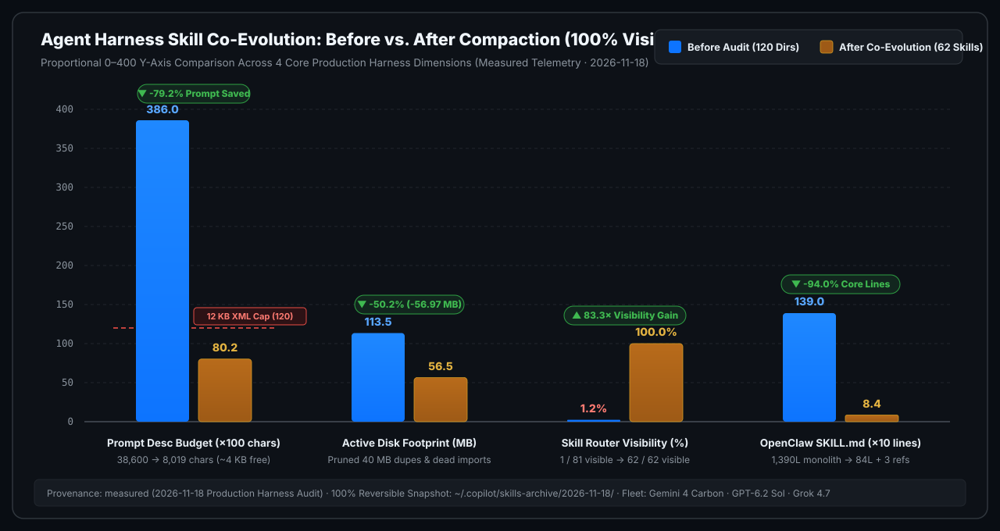
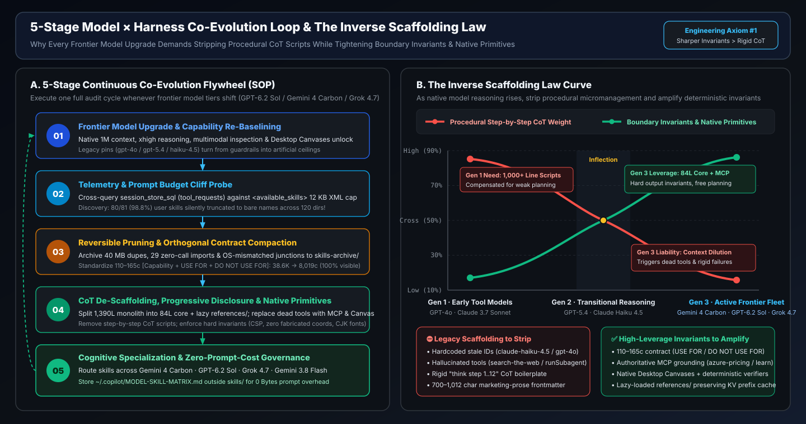
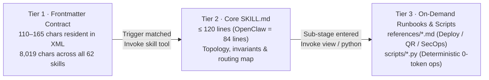
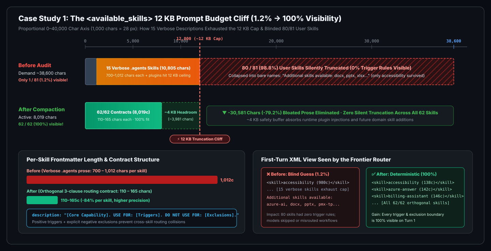
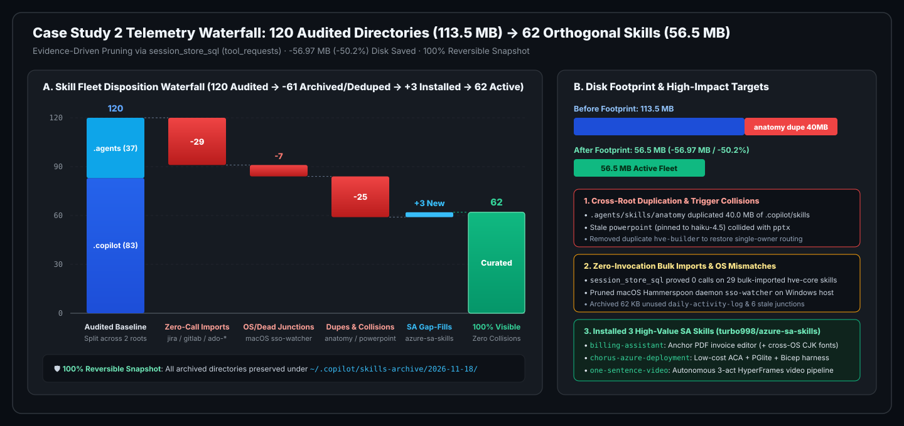
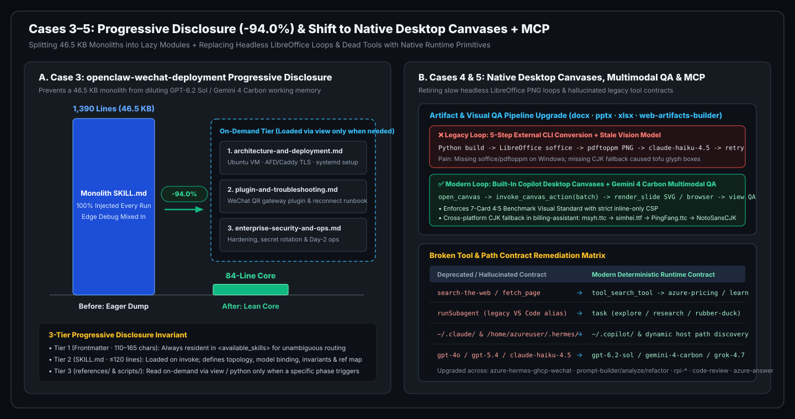
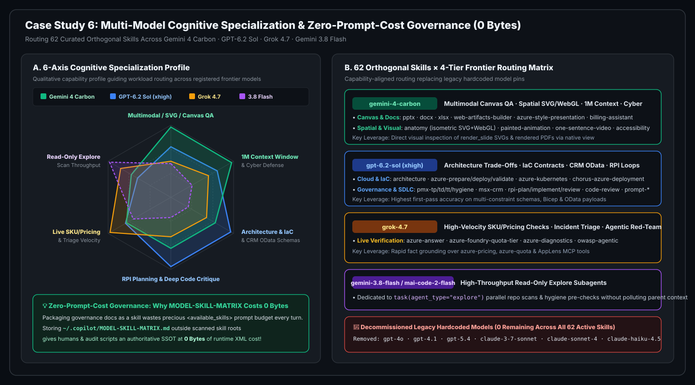

# Continuously Co-Evolving an Agent Harness Alongside Frontier Model Upgrades: Production Skill Audit, 12 KB Budget Cliff Recovery & Playbook

> 🌐 **Bilingual Navigation**: **[🇬🇧 English Edition (`README.en.md`)](./README.en.md)** | **[🇨🇳 中文完整版 (`README.zh-CN.md`)](./README.zh-CN.md)** | **[📑 Bilingual Landing (`README.md`)](./README.md)** | **[📊 Sealed Telemetry Ledger (`evidence/audit-summary.json`)](./evidence/audit-summary.json)**
>
> 🎤 **Live Presenter & Interactive Surfaces**:
> - 🖥️ **[Interactive Presenter Workbench (English `index.en.html`)](https://turbo998.github.io/workshops/agent-harness-coevolution/index.en.html)** · **[中文演示工作台 (`index.html`)](https://turbo998.github.io/workshops/agent-harness-coevolution/index.html)**
> - 🃏 **[7-Card 4:5 Visual Deck (English `cards.html`)](https://turbo998.github.io/workshops/agent-harness-coevolution/cards.html)** · **[中文 7 卡报告 (`cards.zh.html`)](https://turbo998.github.io/workshops/agent-harness-coevolution/cards.zh.html)**

---

## 1. Executive Summary & Production Compaction Scorecard

A pervasive misconception in enterprise AI engineering is: **"Now that our underlying models have upgraded from `GPT-4o` / `Claude 3.7` to `GPT-6.2 Sol`, `Gemini 4 Carbon`, and `Grok 4.7`, our Agent system will automatically perform better without touching the surrounding harness."**

**Production telemetry proves the exact opposite.** When models leap forward by a full generation while the **Agent Harness** (skill router catalog, frontmatter prompt contracts, context loading granularity, MCP/tool bindings, and model-routing governance) stays frozen in the previous era, yesterday's helpful scaffolding mutates into **today's systemic bottleneck**: verbose skill descriptions blow through XML prompt caps and blind **98.8% of user skills**, 1,300-line monolithic runbooks dilute frontier working memory, and hardcoded legacy model IDs (`claude-haiku-4.5`, `gpt-5.4`) or defunct tool names (`search-the-web`, `runSubagent`) trigger deterministic failures or model downgrades.

This report documents our **2026-11-18** end-to-end production audit, telemetry-driven pruning, progressive disclosure refactoring, and multi-model cognitive alignment across **120 installed skill directories (113.5 MB)**. Every metric below is grounded in live `session_store_sql` invocation telemetry and filesystem measurements (`provenance = measured`, zero synthetic estimates):



### Production Audit Scorecard (Before vs. After)

| Audit Dimension | Baseline (Before Audit) | Curated State (After Co-Evolution) | Net Delta | Root Cause & Architectural Impact |
| :--- | :---: | :---: | :---: | :--- |
| **`<available_skills>` Prompt Chars** | **`~38,600 chars`**<br>*(386.0 × 100 chars)* | **`8,019 chars`**<br>*(80.2 × 100 chars)* | **`-79.2%`** | 15 verbose `.agents/skills` descriptions (`700–1,012 chars` each) exhausted Copilot's `~12 KB` XML cap; standardized to `110–165 char` orthogonal contracts with **`~4 KB`** headroom |
| **First-Turn Skill Router Visibility** | **`1 / 81 (1.2%)`**<br>*(Only `accessibility` visible)* | **`62 / 62 (100.0%)`**<br>*(Full triggers & exclusions)* | **`83.3×` Gain**<br>*(Zero blind spots)* | Previously **80/81 (`98.8%`)** user skills collapsed into bare names (`Additional skills available: ...`); now 100% expose explicit positive & negative triggers |
| **Active Fleet Size & Disk Footprint** | **`120` dirs / `113.5 MB`**<br>*(`~/.copilot` 83 + `~/.agents` 37)* | **`62` orthogonal skills / `56.5 MB`**<br>*(Includes `+3` new SA skills)* | **`-56.97 MB`**<br>**(`-50.2%`)** | Pruned `40.0 MB` duplicate `anatomy`, 29 zero-call bulk imports, and 7 OS-mismatched junctions with a **100% reversible snapshot** at `~/.copilot/skills-archive/2026-11-18/` |
| **Monolithic Core Length (`OpenClaw`)** | **`1,390` lines (`46.5 KB`)**<br>*(139.0 × 10 lines eager load)* | **`84` core lines + `3` `references/`**<br>*(8.4 × 10 lines resident)* | **`-94.0%`**<br>*(Resident lines)* | Refactored into 3-tier Progressive Disclosure so deployment, QR troubleshooting, and security ops load on demand via `view` without polluting working memory |
| **Legacy Model Pins & Broken Tool Calls** | **6 legacy models + 3 dead tools**<br>*(`haiku-4.5` / `gpt-4o` / `runSubagent`)* | **`0` legacy model pins**<br>*(100% MCP + Native Canvas)* | **100% Tech Debt Cleared** | Aligned across `gemini-4-carbon`, `gpt-6.2-sol`, `grok-4.7`, and `gemini-3.8-flash` with built-in Desktop Canvases and cross-platform CJK font fallback |
| **Governance Prompt Budget Overhead** | `1.5–3.0 KB` if stored as a skill | **`0 Bytes`**<br>*(`~/.copilot/MODEL-SKILL-MATRIX.md`)* | **`0` Runtime Tax** | Placed multi-model routing SSOT outside scanned `skills/` folders so governance never competes for `<available_skills>` XML budget |

---

## 2. Five First-Principles Q&As for Engineering Presentations

When walking engineers or architecture review boards through **Model × Harness Co-Evolution**, five first-principles questions anchor the narrative:



### Q1: Why does upgrading to `GPT-6.2 Sol` and `Gemini 4 Carbon` without touching the Harness make an agent behave *worse* on real workflows?
**Answer: Because end-to-end agent performance is bounded by $\min(\text{Model Capability}, \text{Harness Fidelity})$. Stale harnesses bottleneck frontier models at three physical layers:**
1. **Silent Router Truncation (Prompt Budget Cliff)**: Host runtimes enforce a hard serialization ceiling on `<available_skills>` (`~12 KB` in Copilot). When uncurated descriptions balloon to `1,000` characters apiece, dozens of downstream skills lose their trigger descriptions entirely—even the strongest frontier model cannot route to a capability whose trigger contract was stripped before turn 1.
2. **Execution Contract Drift**: Skills authored 12–18 months ago hardcode `model: claude-haiku-4.5` or `gpt-4o`, reference defunct internal tools (`search-the-web`, `fetch_page`, `runSubagent`), or point to dead paths (`~/.claude/`). Because frontier models follow explicit instructions with high fidelity, stale specifications force model downgrades or deterministic tool-lookup errors.
3. **Working-Memory Dilution**: Legacy skills compensated for weak model planning by dumping 1,300+ lines of bash snippets, regexes, and rigid thought templates into a single `SKILL.md`. For `gpt-6.2-sol (xhigh)` or `gemini-4-carbon`, eager-loading `46.5 KB` of irrelevant troubleshooting branches degrades prefix KV-cache reuse and dilutes attention over critical safety invariants.

### Q2: What is "The Inverse Scaffolding Law," and what should architects delete vs. tighten after a model upgrade?
**Answer: As native model reasoning scales up, you must aggressively strip *procedural step-by-step CoT scripts* while tightening *deterministic boundary invariants*.**
- **Gen 1 Era (`GPT-4o` / `Claude 3.7`)**: Models skipped reasoning steps unless hand-held via verbose procedural prompts (*"Step 1: Think about X; Step 2: List 3 hypotheses; Step 3: Draft intermediate summary"*).
- **Gen 3 Frontier Era (`Gemini 4 Carbon` / `GPT-6.2 Sol` / `Grok 4.7`)**: Frontier models feature native adaptive reasoning effort (`low` → `xhigh` / `max`). Pre-scripted CoT straightjackets prevent the model from dynamically adapting to live tool outputs.
- **Architect's Rule of Thumb**:
  - **Delete**: Step-by-step CoT micromanagement, brittle headless CLI workarounds (e.g., LibreOffice → PDF → PNG shell loops when native Desktop Canvases exist), and hardcoded legacy model overrides.
  - **Tighten**: Orthogonal routing boundaries (`USE FOR` / `DO NOT USE FOR`), authoritative MCP grounding rules (never guess Azure SKU prices—query `azure-pricing` MCP), and strict output contracts (e.g., `default-src 'none'; style-src 'unsafe-inline'` CSP and zero fabricated coordinates in 7-Card benchmark decks).

### Q3: How did 80 out of 81 user skills (`98.8%`) become invisible to the router? How does the `<available_skills>` 12 KB cliff work?
**Answer: The host serializes `<skill><name>...<description>...</skill>` entries sequentially until cumulative XML hits `~12,000 chars`, then collapses every remaining skill into a bare comma-separated name list.**
Prior to our audit, just **15** verbose descriptions inside `.agents/skills` consumed **`10,805 chars`** (`700–1,012 chars` each). Combined with built-in plugin skills, the `~12 KB` budget was exhausted after the very first alphabetical user skill (`accessibility`, **`1/81 = 1.2%`**). All remaining **80 user skills (`98.8%`)** were truncated to:
`Additional skills available (invoke by name): azure-ai, docx, pptx, pmx-tp, ...`
Deprived of trigger conditions and exclusion guards, the router either missed specialized SA workflows completely or collided across overlapping names (`powerpoint` vs. `pptx` vs. `azure-style-presentation`).

### Q4: Where did the remaining 1,306 lines go when `openclaw-wechat-deployment` shrank from `1,390` lines to `84` lines (`-94.0%`)?
**Answer: Zero operational knowledge was deleted—it moved from *eager monolithic injection* to *3-Tier Progressive Disclosure*.**



When an engineer asks to provision a fresh OpenClaw gateway on Azure Ubuntu, the model loads the `84`-line core contract plus `references/architecture-and-deployment.md`—never paying context tokens for WeChat QR reconnect state machines or Day-2 key rotation runbooks unless an actual troubleshooting event occurs.

### Q5: Why store `MODEL-SKILL-MATRIX.md` at `~/.copilot/MODEL-SKILL-MATRIX.md` instead of packaging it as a skill?
**Answer: Because fleet governance metadata serves *session orchestration and quarterly audits*, not per-turn user intent matching.**
Wrapping a 62-skill routing table inside `~/.copilot/skills/` would burn precious `<available_skills>` XML quota on every single conversation. Storing `~/.copilot/MODEL-SKILL-MATRIX.md` one directory above `skills/` keeps runtime prompt cost at **`0 Bytes`** while giving coordinator agents and human architects a single authoritative reference when spawning sub-sessions or auditing new skills.

---

## 3. Six Production Refactoring Case Studies (Before / After Diffs)

### Case Study 1: Rescuing the `<available_skills>` 12 KB Prompt Budget Cliff (`1.2% → 100.0%` Visibility)



- **Symptom**: High-value domain skills (`pmx-tp`, `azure-foundry-quota-tier`, `pptx`) failed to trigger on first-turn prompts or suffered cross-skill collisions on slide generation tasks.
- **Measured Root Cause**: Total frontmatter descriptions across installed skills reached **`~38,600 chars`**. Fifteen verbose prose descriptions in `.agents/skills` (`700–1,012 chars` each = **`10,805 chars`**) plus plugin skills hit the `~12 KB` prompt cap immediately, starving **80/81 (`98.8%`)** user skills into bare names.
- **Engineering Fix**: Enforced a fleet-wide **`110–165 char` orthogonal three-clause frontmatter contract**:
  `[Core Capability]. USE FOR: [High-signal triggers]. DO NOT USE FOR: [Explicit exclusions].`

```yaml
# ❌ BEFORE (890+ chars of prose & keyword stuffing — starves downstream skills past the 12 KB cap)
---
name: azure-foundry-quota-tier
description: >
  This comprehensive enterprise skill helps Solution Architects, Cloud Engineers, and AI
  Developers understand, investigate, calculate, and troubleshoot Microsoft Azure AI Foundry
  and Azure OpenAI Service subscription quota tiers from Free Tier and Tier 1 all the way up
  to Tier 5 and Enterprise Tier 6. Whenever a user asks about Tokens Per Minute (TPM), Requests
  Per Minute (RPM), Provisioned Throughput Units (PTU), Global Standard deployments, DataZone
  quotas, rate limit HTTP 429 errors, or how to submit a quota increase request in the portal...
  [400+ additional characters omitted]
---

# ✅ AFTER (148 chars — >80% smaller, crisp positive triggers + explicit negative handoff)
---
name: azure-foundry-quota-tier
description: "Diagnose Azure AI Foundry/OpenAI quota tiers (Tier 1-6), TPM limits, and upgrade paths. USE FOR: TPM/RPM caps, 429 throttling, tier upgrades. DO NOT USE FOR: general SKU pricing (use azure-answer)."
---
```

- **Verified Outcome**: Active descriptions shrank from **`~38,600 chars → 8,019 chars` (`-79.2%`)**, restoring **`62/62` (`100.0%`)** full router visibility with **`~3,981 chars` (`~4 KB`)** of safety headroom.

---

### Case Study 2: Telemetry-Driven Pruning, Deduplication & SA Gap-Filling (`120 → 62` Skills)



- **Symptom**: Organic growth across `~/.copilot/skills` (83) and `~/.agents/skills` (37) created **120 directories (`113.5 MB`)** containing duplicate copies, colliding triggers, and unused bulk-imported packs.
- **Evidence-Based Method**: Cross-referenced every installed directory against historical `session_store_sql` (`tool_requests` where `name = 'skill'`) and `~/.copilot/settings.json`:

```sql
-- Read-only DuckDB audit query against cross-session tool_requests telemetry
SELECT
  json_extract_string(arguments_json, '$.skill') AS skill_name,
  COUNT(*) AS invocation_count,
  MAX(session_id) AS sample_session_id
FROM tool_requests
WHERE name = 'skill'
GROUP BY skill_name
ORDER BY invocation_count DESC;
```

- **Four Surgical Dispositions**:
  1. **Cross-Root Deduplication**: Removed `.agents/skills/anatomy` (an exact **`40.0 MB`** duplicate of `.copilot/skills/anatomy`) and duplicate `hve-builder`.
  2. **Collision Elimination**: Archived legacy `powerpoint` (pinned to `claude-haiku-4.5`), resolving its three-way routing collision with `pptx` and `azure-style-presentation`.
  3. **Zero-Call Bulk Imports & OS-Mismatched Junctions**: Archived **29** zero-invocation bulk-imported `hve-core` skills (`jira`, `gitlab`, `ado-*`, etc.) and **7** OS-mismatched/unused junctions (`sso-watcher` macOS Hammerspoon daemon on a Windows workstation, `62 KB` zero-call `daily-activity-log`, etc.).
  4. **High-Value SA Gap-Filling (`+3`)**: Installed **`billing-assistant`**, **`chorus-azure-deployment`**, and **`one-sentence-video`** from `turbo998/azure-sa-skills`.
- **Reversible Safety Net**: Every pruned directory was preserved intact under `~/.copilot/skills-archive/2026-11-18/`, cutting active disk usage by **`-56.97 MB` (`-50.2%`, `113.5 MB → 56.5 MB`)** with instant rollback capability.

---

### Case Study 3: Progressive Disclosure Refactor (`openclaw-wechat-deployment`: `1,390 → 84` Lines, `-94.0%`)



- **Symptom**: `openclaw-wechat-deployment/SKILL.md` had grown into a **`46.5 KB` / `1,390`-line** monolith bundling VM provisioning, Azure Front Door / Caddy TLS reverse proxying, WeChat QR authentication internals, systemd hardening, and edge-case logs—flooding `gpt-6.2-sol` or `gemini-4-carbon` on every activation.
- **Engineering Fix**: Split into an **`84`-line** architecture & routing core plus **3** orthogonal `references/` modules:

```text
# ❌ BEFORE (Monolithic Eager-Loaded Skill)
~/.copilot/skills/openclaw-wechat-deployment/
└── SKILL.md                              # 1,390 lines (46.5 KB) — 100% injected on skill load

# ✅ AFTER (3-Tier Progressive Disclosure Skill)
~/.copilot/skills/openclaw-wechat-deployment/
├── SKILL.md                              # 84 lines (-94.0%) — topology invariants, frontier models & stage router
└── references/                           # Loaded on demand via `view` only when that stage is active
    ├── architecture-and-deployment.md    # Azure Ubuntu VM + AFD/Caddy TLS + GHCP gateway setup
    ├── plugin-and-troubleshooting.md     # WeChat QR state machine, session drops & log diagnostics
    └── enterprise-security-and-ops.md    # Least-privilege hardening, secret rotation & Day-2 ops
```

- **Verified Outcome**: Initial activation payload dropped by **`94.0%`** with zero loss of production troubleshooting depth, while updating model bindings to `gpt-6.2-sol`, `gemini-4-carbon`, and `grok-4.7`.

---

### Case Study 4: De-Scaffolding Legacy CoT & Fixing Hallucinated Tool/Path Contracts

- **Symptom**: Static inspection across `azure-hermes-ghcp-wechat`, `prompt-builder`, `prompt-analyze`, `prompt-refactor`, `rpi-*`, `code-review`, and `azure-answer` uncovered four generational anti-patterns:
  1. **Stale Model Pins**: Hardcoded `gpt-5.4`, `gpt-4o`, `gpt-4.1`, `claude-haiku-4.5`, `claude-3-7-sonnet`, and `claude-sonnet-4`.
  2. **Non-Existent Tool Identifiers**: Instructions calling `search-the-web`, `fetch_page`, or legacy VS Code `runSubagent`.
  3. **Broken Host Paths**: Hardcoded `~/.claude/` scratch paths and fixed `/home/azureuser/.hermes/` usernames.
  4. **Rigid Procedural CoT Scripts**: Hundreds of lines dictating paragraph-by-paragraph internal monologue.
- **Before / After Contract Diff (`azure-answer` & `rpi-*` Exemplar)**:

```markdown
<!-- ❌ BEFORE: Legacy model pin + hallucinated tools + rigid procedural CoT -->
model: gpt-4o
Step 1: Call `search-the-web` and `fetch_page` to look up Azure pricing pages.
Step 2: Spawn `runSubagent` with `claude-haiku-4.5` to summarize region tables, saving scratch notes to `~/.claude/tmp/`.
Step 3: Write 4 paragraphs of step-by-step reasoning before answering...

<!-- ✅ AFTER: Capability-aligned tier + MCP-first verification + native `task` subagents -->
Recommended Tier: `grok-4.7` (high-velocity SKU/pricing verification) or `gpt-6.2-sol` (multi-service TCO architecture).
1. **MCP-First Grounding Invariant**: Load deferred Azure/Learn tools via `tool_search_tool` first (`azure-pricing`, `azure-quota`, `microsoft-learn-*`), backed by `az` CLI verification when live tenant state is needed. Never guess retail rates or regional SKU availability from memory.
2. **Native Subagent Delegation**: For multi-region/multi-SKU comparisons needing isolated context, invoke `task` (`agent_type: "research"` or `"explore"`), storing scratch artifacts in the active Copilot session `files/` directory.
```

---

### Case Study 5: Native Runtime Primitives, Copilot Desktop Canvases & Cross-Platform CJK QA

- **Symptom**:
  1. `docx`, `pptx`, `xlsx`, and `web-artifacts-builder` still prescribed legacy headless LibreOffice-to-PNG shell pipelines (`soffice --headless` → `pdftoppm` → `claude-haiku-4.5` vision loop), causing brittle external binary failures on Windows and slow edit-verify cycles.
  2. `billing-assistant/scripts/invoice_edit.py` lacked cross-platform CJK font fallback when rewriting bilingual PDF invoices, risking missing glyphs (`□` tofu boxes) on Chinese company headers.
- **Engineering Fix**:
  1. **Desktop Canvas-First Execution**: Upgraded `pptx`, `docx`, `xlsx`, and `web-artifacts-builder` to drive built-in Copilot Desktop Canvases (`open_canvas` + atomic `invoke_canvas_action(actionName="batch")` + native `powerpoint` `render_slide` vector SVG export) paired with `gemini-4-carbon` multimodal `view` inspection.
  2. **7-Card 4:5 Benchmark Standard Precedence**: Wired explicit precedence into `web-artifacts-builder` so any model benchmark report automatically adopts the **7-Card 4:5 Portrait Standard (`900×1125` / `1080×1350`, strict self-contained CSP `default-src 'none'; style-src 'unsafe-inline'`, zero fabricated coordinates)**.
  3. **Cross-Platform CJK Font Fallback (`billing-assistant/scripts/invoice_edit.py`)**:

```python
# ✅ Automatic Windows / macOS / Linux CJK font resolution for PyMuPDF invoice rewriting
CJK_FONT_CANDIDATES = [
    r"C:\Windows\Fonts\msyh.ttc",                        # Windows: Microsoft YaHei
    r"C:\Windows\Fonts\simhei.ttf",                      # Windows: SimHei fallback
    "/System/Library/Fonts/PingFang.ttc",                # macOS: PingFang SC
    "/usr/share/fonts/opentype/noto/NotoSansCJK-Regular.ttc",  # Linux: Noto Sans CJK
]
```

---

### Case Study 6: Multi-Model Cognitive Specialization & Zero-Prompt-Cost Governance (`MODEL-SKILL-MATRIX.md`)



- **Architectural Insight**: No single model dominates every axis of enterprise SA delivery simultaneously across *1M-token spatial/multimodal aesthetics*, *deep `xhigh` architectural/OData schema rigor*, *low-latency live SKU/quota verification*, and *high-concurrency read-only repo exploration*.
- **Zero-Budget Governance Pattern**: We codified the 4-tier routing map across all 62 orthogonal skills in `~/.copilot/MODEL-SKILL-MATRIX.md` (outside `~/.copilot/skills/`):
  - **Runtime `<available_skills>` Cost**: **`0 Bytes`**.
  - **Orchestration Determinism**: Coordinator sessions (`create_session`), scheduled automations, and quarterly audits read a single canonical table to select exact `model` and `reasoning_effort` pairings.

---

## 4. Frontier Model × 62-Skill Cognitive Routing Decision Matrix

| Frontier Model Tier | Reasoning Effort | Core Cognitive Edge (Why Route Here) | Primary Bound Skill Clusters (Representative) | Paired Runtime Primitives | Anti-Patterns (Avoid) |
| :--- | :---: | :--- | :--- | :--- | :--- |
| **`gemini-4-carbon`** | `high` + `long_context` (1M) | **Spatial SVG/UI aesthetics, multimodal layout QA, 1M-token synthesis, frontier cybersecurity depth** | `pptx`, `docx`, `xlsx`, `web-artifacts-builder`, `azure-style-presentation`, `anatomy`, `painted-animation`, `one-sentence-video`, `billing-assistant`, `accessibility`, `wechat-article` | `powerpoint` (`render_slide` SVG), `word`/`excel` (`batch`), `browser` Canvas, multimodal `view` | Over-allocating 1M-context multimodal capacity to trivial single-file text greps |
| **`gpt-6.2-sol`** | `xhigh` / `high` | **Multi-constraint cloud architecture trade-offs, zero-drift Bicep/Terraform IaC, strict CRM OData schemas, RPI planning/review** | `architecture`, `architecture-diagrams`, `azure-prepare`, `azure-deploy`, `azure-validate`, `azure-kubernetes`, `azure-compute`, `chorus-azure-deployment`, `pmx-tp/td/tt/hygiene`, `msx-crm`, `rpi-*`, `code-review`, `prompt-builder/refactor` | `azure-*` IaC/deploy tools, `task(rubber-duck / code-review)`, session `sql` state tracking | Feeding 1,000-line rigid Gen-1 CoT templates that fight native `xhigh` planning |
| **`grok-4.7`** | `high` | **High-velocity factual grounding, live Azure SKU/quota/pricing cross-checks, rapid incident triage, agentic red-teaming** | `azure-answer`, `azure-foundry-quota-tier`, `azure-diagnostics`, `owasp-agentic`, `prompt-analyze`, `openclaw-wechat-deployment`, `azure-hermes-ghcp-wechat` | `tool_search_tool` → `azure-pricing`, `azure-quota`, `azure-applens`, `microsoft-learn-*` | Answering regional SKU prices or quota ceilings from parametric memory without MCP calls |
| **`gemini-3.8-flash`** / **`mai-code-2-flash`** | `medium` / `low` (Fast Tier) | **Sub-second TTFT, parallel read-only repo reconnaissance, minimal token cost on high-fanout scans** | Read-only discovery sub-phases inside heavy skills (repo topology mapping, link checks, PMX hygiene pre-scans) | Parallel `task(agent_type="explore")`, `glob`, `grep` | Driving irreversible production mutations (CRM OData writes or multi-file refactors) |

---

## 5. 5-Step Continuous Harness Co-Evolution SOP (15-Minute Quarterly Runbook)

Run this five-step engineering loop whenever onboarding a new frontier model generation or adding `5+` custom skills:

### Step 1: Snapshot Before Touching Any Skill
Create a timestamped archive directory so every pruning or refactoring action remains 100% reversible:
```powershell
$stamp = Get-Date -Format "yyyy-MM-dd"
New-Item -ItemType Directory -Force -Path "$HOME\.copilot\skills-archive\$stamp" | Out-Null
```

### Step 2: Run the `<available_skills>` 12 KB Budget Cliff Probe (Mandatory Gate)
Verify total frontmatter `description` characters stay strictly **`≤ 9,000 chars`** (`≥ 3 KB` safety buffer below the `~12 KB` host cap) and individual descriptions stay within **`110–165 chars`**:
```powershell
python -c "import glob, re, pathlib; files = glob.glob(str(pathlib.Path.home()/'.copilot/skills/*/SKILL.md')); descs = [(pathlib.Path(f).parent.name, len(m.group(1).strip())) for f in files if (m := re.search(r'^description:\s*(.+)$', open(f, encoding='utf-8').read(), re.M))]; total = sum(n for _, n in descs); over = [(k, n) for k, n in descs if n > 175]; print(f'Skills={len(descs)} | TotalDescChars={total}/12000 ({total/120:.1f}%) | Over175c={over}')"
```

### Step 3: Prune Dead Weight & Cross-Root Duplicates via `session_store_sql`
Query 30–90 day `tool_requests` (`name = 'skill'`) invocation counts:
- Archive **0-invocation** bulk-imported third-party packs that are not explicit disaster-recovery runbooks;
- Eliminate duplicate folder names across `~/.copilot/skills` and `~/.agents/skills` plus OS-mismatched symlinks/junctions;
- Resolve overlapping triggers with explicit `DO NOT USE FOR:` handoff clauses.

### Step 4: Refactor Monoliths & Strip Generational Tech Debt
Scan every `SKILL.md` exceeding **`200` lines**:
1. Compress resident `SKILL.md` to **`80–120` lines** (invariants + routing map), moving deep runbooks into `references/*.md` and deterministic transformations into `scripts/*.py`;
2. Grep and purge stale model pins (`gpt-4o|gpt-4\.1|gpt-5\.4|claude-haiku-4\.5|claude-3-7|claude-sonnet-4`), defunct tool names (`search-the-web|fetch_page|runSubagent`), and dead paths (`~/.claude/`).

### Step 5: Refresh Out-of-Band `MODEL-SKILL-MATRIX.md` & Smoke-Test Routing
Update `~/.copilot/MODEL-SKILL-MATRIX.md` with new frontier model tiers and run three smoke probes (1 MCP live lookup, 1 Desktop Canvas render-and-inspect cycle, and 1 `references/` lazy-load workflow) to confirm 100% first-turn router precision.

---

## 6. 12-Point Production Agent Harness Audit Checklist

- [ ] **1. Prompt Budget Headroom**: Do cumulative active `description` strings stay **`≤ 9,000 chars`** (`≥ 25%` headroom under the `12 KB` XML cliff)?
- [ ] **2. 100% First-Turn Router Visibility**: Has the truncated `Additional skills available: ...` fallback list been completely eliminated for user skills?
- [ ] **3. Orthogonal 3-Clause Contracts**: Is every `description` **`110–165 chars`** with `[Core Capability]`, `USE FOR:`, and `DO NOT USE FOR:`?
- [ ] **4. Single Canonical Skill Root**: Are cross-root duplicates between `~/.copilot/skills` and `~/.agents/skills` (e.g., 40 MB asset clones) zeroed out?
- [ ] **5. Telemetry-Backed Lifecycle**: Is every retained third-party skill justified by `session_store_sql` usage evidence or an explicit DR role?
- [ ] **6. Host OS Alignment**: Are junctions/daemons targeting incompatible operating systems (e.g., macOS Hammerspoon scripts on Windows) removed?
- [ ] **7. Progressive Disclosure Ceiling**: Are resident `SKILL.md` files **`≤ 120` lines**, delegating deep stage runbooks to `references/`?
- [ ] **8. Zero Legacy Model Pins**: Are hardcoded legacy model IDs (`gpt-4o`, `gpt-5.4`, `claude-haiku-4.5`, etc.) completely removed (`0` matches)?
- [ ] **9. Zero Hallucinated Tool Contracts**: Do all external lookups and subagents use real host primitives (`tool_search_tool` → MCP + native `task` agents)?
- [ ] **10. Native Canvas & CJK Font Readiness**: Do document/deck/visual skills prioritize built-in Desktop Canvases (`powerpoint`/`word`/`excel`/`browser`) and cross-platform CJK font fallback?
- [ ] **11. Zero-Byte Governance Overhead**: Does `MODEL-SKILL-MATRIX.md` live outside `skills/` so governance consumes **`0 Bytes`** of prompt budget?
- [ ] **12. Reversible & Sanitized Archive**: Is every pruned artifact snapshotted under `skills-archive/YYYY-MM-DD/` and scrubbed of private paths/credentials?

---

## 7. Related Artifacts & Companion Research

- **Interactive Presenter Workbenches**: [English Workbench (`index.en.html`)](https://turbo998.github.io/workshops/agent-harness-coevolution/index.en.html) · [中文演示工作台 (`index.html`)](https://turbo998.github.io/workshops/agent-harness-coevolution/index.html)
- **7-Card 4:5 Visual Benchmark Decks**: [English 7-Card Deck (`cards.html`)](https://turbo998.github.io/workshops/agent-harness-coevolution/cards.html) · [中文 7 卡报告 (`cards.zh.html`)](https://turbo998.github.io/workshops/agent-harness-coevolution/cards.zh.html)
- **Sealed Empirical Audit Ledger**: [`evidence/audit-summary.json`](./evidence/audit-summary.json) (`2026-11-18`, `provenance: "measured"`)
- **Companion Monographs in `ai-research-public`**:
  - [Mainstream Agent Harness Engineering Frameworks: DeepSeek DSH × Claude Code × Microsoft HVE Core](../harness-engineering-frameworks/README.en.md)
  - [Gemini 4 Carbon & 20-Model Coding Agent Benchmark Deep Dive](../gemini-4-carbon-and-20-model-benchmark/README.md)
  - [Agent Skills Standard & Progressive Disclosure Architecture](../agent-skills-and-rea/README.md)
