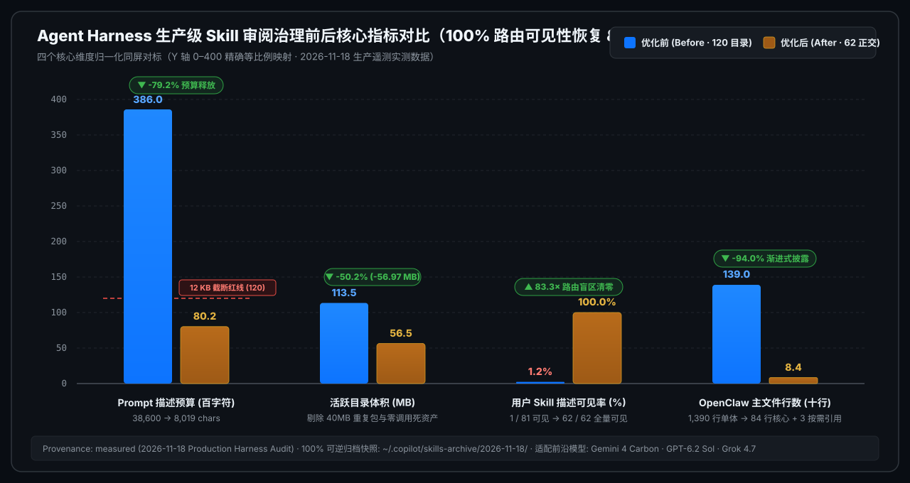

# 随前沿模型升级持续演进 Agent Harness / Continuously Co-Evolving an Agent Harness Alongside Frontier Model Upgrades

> **双语入口 / Bilingual Entrypoints**:
> - 🇨🇳 **[中文深度实践报告与架构师手册 (`README.zh-CN.md`)](./README.zh-CN.md)**
> - 🇬🇧 **[English Practice Report & Engineering Playbook (`README.en.md`)](./README.en.md)**
> - 🖥️ **[交互式演示工作台 (中文 `index.html`)](https://turbo998.github.io/workshops/agent-harness-coevolution/index.html)** | **[Interactive Presenter Workbench (EN `index.en.html`)](https://turbo998.github.io/workshops/agent-harness-coevolution/index.en.html)**
> - 🃏 **[7-Card 4:5 视觉卡片报告 (中文 `cards.zh.html`)](https://turbo998.github.io/workshops/agent-harness-coevolution/cards.zh.html)** | **[7-Card 4:5 Visual Deck (EN `cards.html`)](https://turbo998.github.io/workshops/agent-harness-coevolution/cards.html)**
> - 📊 **[密封实测审计台账 (`evidence/audit-summary.json`)](./evidence/audit-summary.json)** (`date: 2026-11-18`, `provenance: measured`)

---

## 1. 核心量化成果概览 / Lead Compaction Overview

基于 **2026-11-18** 对生产环境 **120 个已安装 Skill 目录（113.5 MB）** 的全量遥测审计（联合 `session_store_sql` 历史调用取证与 `<available_skills>` XML 预算探针），面向新一代前沿模型舰队（`gemini-4-carbon`、`gpt-6.2-sol`、`grok-4.7` 及 `gemini-3.8-flash` / `mai-code-2-flash`）完成了端到端 Harness 协同演进：

- **修复 `<available_skills>` 12 KB 提示词预算悬崖**：活跃描述从 **`~38,600 chars` 压缩至 `8,019 chars`（`-79.2%`）**，用户 Skill 首轮路由可见率从 **`1/81 (1.2%)` 恢复至 `62/62 (100.0%)`**，预留 `~4 KB` 安全缓冲。
- **遥测驱动去重裁剪与刚需补齐**：清理 `40.0 MB` 重复 `anatomy`、29 个零调用导入包与 7 个跨 OS 失效软链，同步安装 3 个高频 AI SA 技能（`billing-assistant`、`chorus-azure-deployment`、`one-sentence-video`），活跃体积收敛至 **`56.5 MB`（`-56.97 MB / -50.2%`）**，全量可逆备份于 `~/.copilot/skills-archive/2026-11-18/`。
- **三层渐进式披露与去旧脚手架**：将 `openclaw-wechat-deployment` 从 **`1,390` 行（`46.5 KB`）单体压缩至 `84` 行核心 + 3 个按需 `references/`（`-94.0%`）**；清零 `gpt-4o`/`gpt-5.4`/`claude-haiku-4.5` 等遗留硬编码与虚构工具契约，全面接入 MCP 权威核验、内置 Copilot Desktop Canvases 与跨平台 CJK 字体链。
- **零提示词税多模型治理**：将四级认知路由表置于扫描目录外的 `~/.copilot/MODEL-SKILL-MATRIX.md`（消耗 **`0 Bytes`** `<available_skills>` 预算）。

---

## 2. 交付物清单 / Deliverables Inventory

| 文件路径 / Path | 语言 / Lang | 说明 / Description |
| :--- | :---: | :--- |
| [`README.zh-CN.md`](./README.zh-CN.md) | `zh-CN` | 中文图文技术报告：高管摘要、5 大第一性原理问答、6 大真实重构案例（含 YAML/SQL/Python Diff）、多模型路由矩阵、5 步演进 SOP 与 12 项核对单 |
| [`README.en.md`](./README.en.md) | `en` | Full English illustrated technical report & engineering playbook with native English SVG charts, 6 Before/After diffs, routing matrix, SOP & 12-point checklist |
| [`evidence/audit-summary.json`](./evidence/audit-summary.json) | JSON | 密封生产遥测审计数据集（`provenance: "measured"`, `2026-11-18`，全部脱敏为 `~/.copilot/` 公共路径） |
| [`assets/svg/00-skills-compaction-before-after-chart.svg`](./assets/svg/00-skills-compaction-before-after-chart.svg) · [`.en.svg`](./assets/svg/00-skills-compaction-before-after-chart.en.svg) | `zh` / `en` | 核心指标优化前后分组柱状对比图（`386.0 vs 80.2` 百字符、`113.5 vs 56.5 MB`、`1.2% vs 100.0%` 可见率、`139.0 vs 8.4` 十行） |
| [`assets/svg/01-harness-model-coevolution-loop.svg`](./assets/svg/01-harness-model-coevolution-loop.svg) · [`.en.svg`](./assets/svg/01-harness-model-coevolution-loop.en.svg) | `zh` / `en` | 五阶段模型 × Harness 持续演进飞轮与“反脚手架定律（Inverse Scaffolding Law）”双曲线图 |
| [`assets/svg/02-available-skills-12kb-budget-cliff.svg`](./assets/svg/02-available-skills-12kb-budget-cliff.svg) · [`.en.svg`](./assets/svg/02-available-skills-12kb-budget-cliff.en.svg) | `zh` / `en` | `<available_skills>` 12 KB 系统提示词截断悬崖等比例堆叠条形图与单条契约长度对比 |
| [`assets/svg/03-progressive-disclosure-and-canvas-shift.svg`](./assets/svg/03-progressive-disclosure-and-canvas-shift.svg) · [`.en.svg`](./assets/svg/03-progressive-disclosure-and-canvas-shift.en.svg) | `zh` / `en` | `1,390 → 84` 行渐进式上下文披露与原生 Desktop Canvas / MCP 管线迁移图 |
| [`assets/svg/04-frontier-model-skill-routing-matrix.svg`](./assets/svg/04-frontier-model-skill-routing-matrix.svg) · [`.en.svg`](./assets/svg/04-frontier-model-skill-routing-matrix.en.svg) | `zh` / `en` | `Gemini 4 Carbon × GPT-6.2 Sol × Grok 4.7 × Gemini 3.8 Flash` 六维认知分工雷达与零开销治理图 |
| [`assets/svg/05-telemetry-audit-120-skill-disposition.svg`](./assets/svg/05-telemetry-audit-120-skill-disposition.svg) · [`.en.svg`](./assets/svg/05-telemetry-audit-120-skill-disposition.en.svg) | `zh` / `en` | `120 → 62` 目录遥测裁剪瀑布图与 `113.5 MB → 56.5 MB` 磁盘体积拆解图 |
