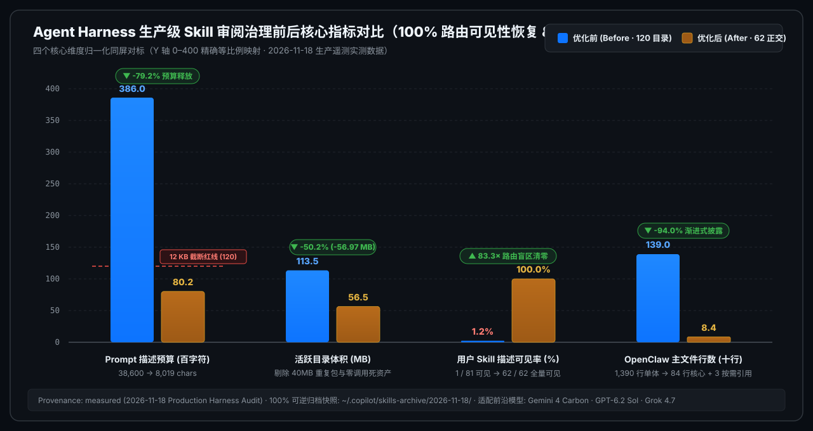
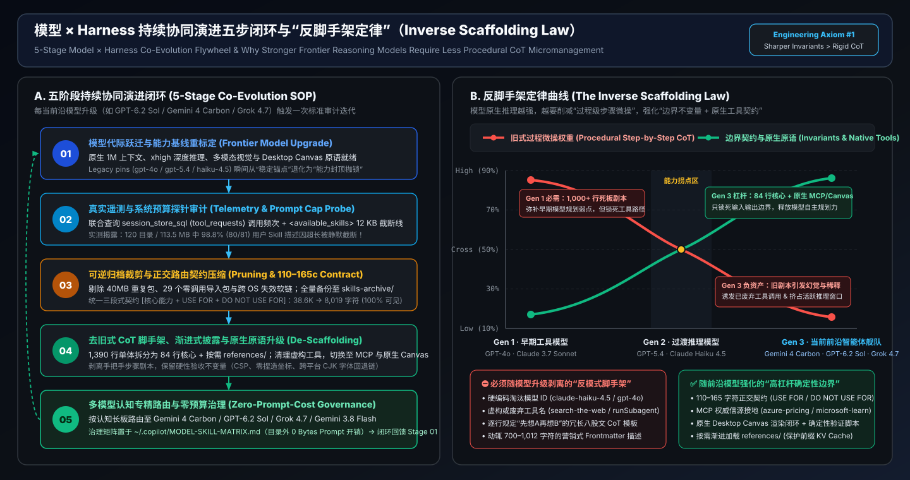
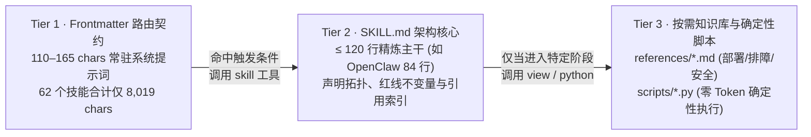
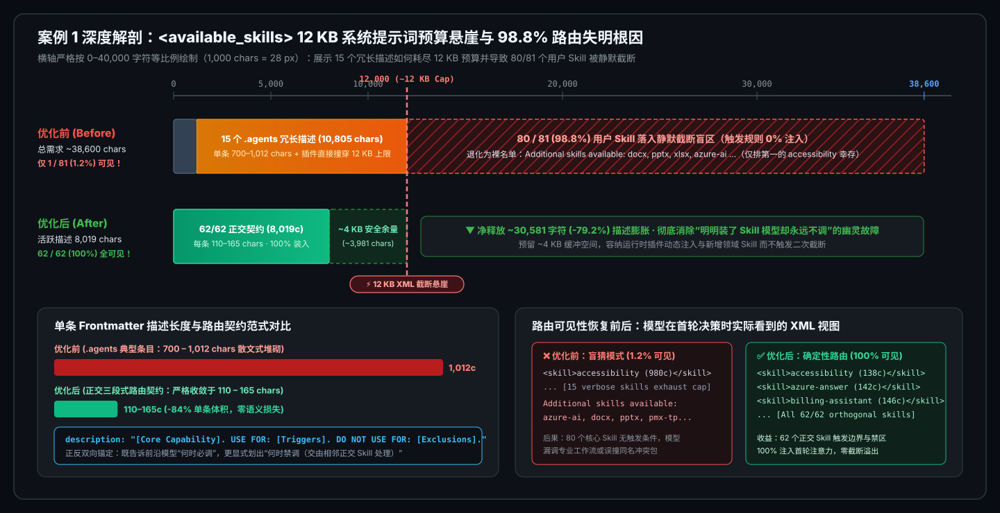
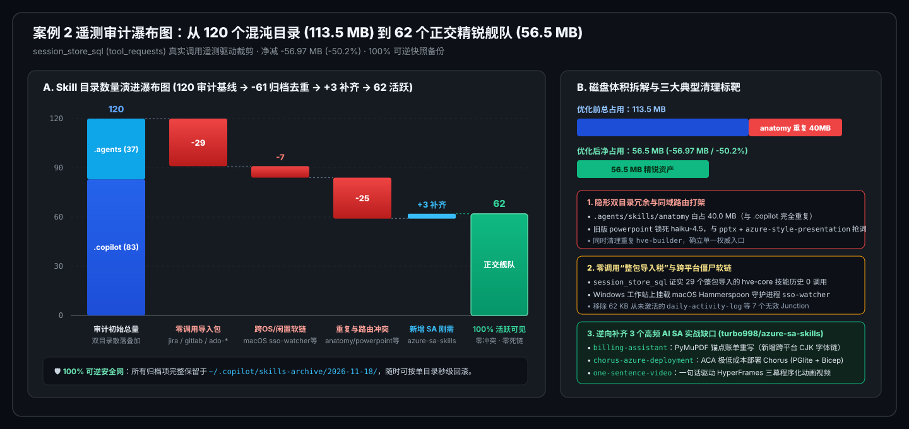
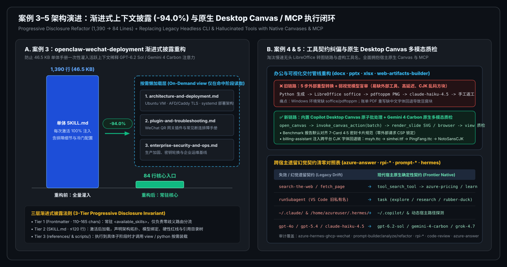
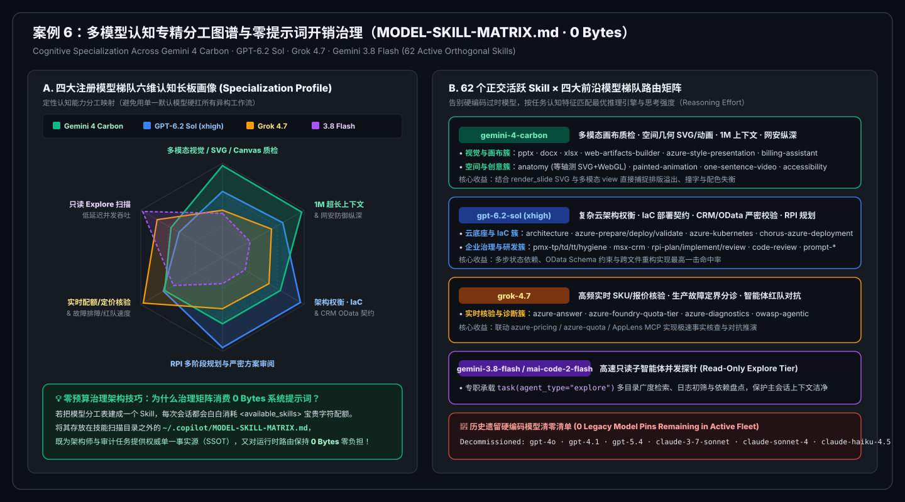

# 随前沿模型升级持续演进 Agent Harness：生产级 Skill 审阅、12 KB 预算悬崖修复与协同演化实践手册

> 🌐 **双语导航 / Bilingual Navigation**: **[🇨🇳 中文完整版 (`README.zh-CN.md`)](./README.zh-CN.md)** | **[🇬🇧 English Edition (`README.en.md`)](./README.en.md)** | **[📑 双语总入口 (`README.md`)](./README.md)** | **[📊 密封审计台账 (`evidence/audit-summary.json`)](./evidence/audit-summary.json)**
>
> 🎤 **技术演讲与交互演示直达 / Live Presenter Surfaces**:
> - 🖥️ **[交互式演示工作台 (Interactive Presenter Workbench · 中文)](https://turbo998.github.io/workshops/agent-harness-coevolution/index.html)** · **[English Workbench](https://turbo998.github.io/workshops/agent-harness-coevolution/index.en.html)**
> - 🃏 **[7-Card 4:5 视觉评测卡片组 (中文 `cards.zh.html`)](https://turbo998.github.io/workshops/agent-harness-coevolution/cards.zh.html)** · **[English 7-Card Deck (`cards.html`)](https://turbo998.github.io/workshops/agent-harness-coevolution/cards.html)**

---

## 1. 高管摘要与核心量化战果（Executive Summary & Compaction Scorecard）

在企业级智能体工程中，最常见的认知误区是：**“底层模型已经从 `GPT-4o` / `Claude 3.7` 升级到了 `GPT-6.2 Sol`、`Gemini 4 Carbon` 与 `Grok 4.7`，我们的 Agent 系统自然会自动变聪明。”**

**生产实测给出了恰恰相反的结论**：当模型发生代际跃迁而外围 **Agent Harness（技能路由表、Frontmatter 提示词契约、上下文装载粒度、工具/MCP 绑定与模型分工矩阵）** 停留在上一代时，旧时代的“辅助拐杖”会直接异化为新时代前沿模型的**系统级枷锁**——冗长描述撞穿宿主 XML 截断红线导致 **98.8% 的技能对路由器彻底隐形**，千行单体手册稀释长程工作记忆，过时的硬编码模型名（`claude-haiku-4.5`、`gpt-5.4`）与虚构工具名（`search-the-web`、`runSubagent`）持续诱发调用幻觉。

本报告完整复盘了 **2026-11-18** 针对真实生产环境 **120 个已安装 Skill 目录（113.5 MB）** 的端到端遥测审计、裁剪去重、渐进式重构与多模型认知对齐过程。所有指标均来自生产会话库（`session_store_sql`）与文件系统实测（`provenance = measured`），零合成估算：



### 核心治理指标前后对照总表

| 审计维度 | 优化前基线 (Before Audit) | 优化后稳态 (After Co-Evolution) | 净变化幅度 | 架构根因与核心工程收益 |
| :--- | :---: | :---: | :---: | :--- |
| **`<available_skills>` 描述总开销** | **`~38,600 chars`**<br>*(386.0 百字符)* | **`8,019 chars`**<br>*(80.2 百字符)* | **`-79.2%`** | 15 个 `.agents/skills` 超长散文描述（`700–1,012 chars`/条）直接耗尽 `~12 KB` 系统上限；统一收敛为 `110–165 chars` 正交三段式契约，预留 **`~4 KB`** 安全余量 |
| **用户 Skill 路由首轮可见率** | **`1 / 81 (1.2%)`**<br>*(仅 `accessibility` 可见)* | **`62 / 62 (100.0%)`**<br>*(全量触发规则注入)* | **`83.3×` 提升**<br>*(盲区清零)* | 修复前 **80/81 (`98.8%`)** 个技能被降级为无描述裸名单 `Additional skills available: ...`；修复后首轮路由 100% 看到正反触发边界 |
| **活跃 Skill 舰队规模与磁盘体积** | **`120` 个目录 / `113.5 MB`**<br>*(`~/.copilot` 83 + `~/.agents` 37)* | **`62` 个正交技能 / `56.5 MB`**<br>*(含新增补齐 3 个 SA 技能)* | **`-56.97 MB`**<br>**(`-50.2%`)** | 清理 `40.0 MB` 重复 `anatomy`、29 个零调用导入包、7 个跨 OS 失效软链，并建立 `~/.copilot/skills-archive/2026-11-18/` **100% 可逆快照** |
| **重型技能主文件体积 (`OpenClaw`)** | **`1,390` 行 (`46.5 KB`)**<br>*(139.0 十行单体全量灌入)* | **`84` 行核心 + `3` 个按需引用**<br>*(8.4 十行常驻核心)* | **`-94.0%`**<br>*(常驻行数)* | 采用三层渐进式披露（Progressive Disclosure），仅在命中具体部署/排障/安全子阶段时按需 `view` 读取 `references/`，保护活跃推理注意力 |
| **遗留硬编码模型与虚构工具契约** | **6 类旧模型 + 3 类失效工具**<br>*(`haiku-4.5` / `gpt-4o` / `runSubagent`)* | **`0` 遗留硬编码锁死**<br>*(100% 对齐 MCP + 原生 Canvas)* | **历史技术债清零** | 全面迁移至 `gemini-4-carbon`、`gpt-6.2-sol`、`grok-4.7`、`gemini-3.8-flash` 四级认知梯队，落地内置 Desktop Canvas 与跨平台 CJK 字体链 |
| **多模型治理文档系统提示词税** | 若封装为 Skill 约占 `1.5–3.0 KB` | **`0 Bytes`**<br>*(`~/.copilot/MODEL-SKILL-MATRIX.md`)* | **`0` 运行时损耗** | 将治理矩阵置于 `skills/` 扫描目录之外，既确立架构师与定期审计的单一事实源（SSOT），又不占一字节 `<available_skills>` 配额 |

---

## 2. 五大第一性原理架构问答（First-Principles Q&A for Technical Talks）

向研发团队或架构委员会展示“模型 × Harness 协同演进”时，以下五个问题构成了完整的第一性原理叙事主线：



### Q1：底层模型已经升级到 `GPT-6.2 Sol` 和 `Gemini 4 Carbon`，为什么不改 Harness 反而会出现“模型越强、表现越怪”？
**答：因为 Agent 的实际端到端表现取决于 $\min(\text{Model Capability}, \text{Harness Fidelity})$，过时的 Harness 会从三个物理层面卡死新模型的上限：**
1. **路由层静默截断（Router Blindness）**：宿主注入 `<available_skills>` 存在刚性字符预算上限（Copilot 约 `12 KB`）。当历史技能描述无人治理、单条膨胀至上千字符时，排在后面的数十个高价值技能连一句触发说明都进不了系统提示词，再强的模型也无法调用它“看不见触发条件”的能力。
2. **执行层契约漂移（Contract Drift）**：两年前编写的 Skill 往往硬编码了 `model: claude-haiku-4.5` 或 `gpt-4o`，甚至写死了早已不存在的工具名（如 `search-the-web`、`runSubagent`）和旧宿主目录（`~/.claude/`）。前沿模型指令遵循度极高，面对矛盾指令要么报错重试，要么被迫降级到弱模型运行。
3. **注意力层信噪比恶化（Working-Memory Dilution）**：早期模型规划能力弱，作者习惯把 1,000 多行排障命令、正则脚本、八股思考步骤全部塞进单个 `SKILL.md`。对具备深度原生推理链的 `gpt-6.2-sol (xhigh)` 而言，一次性灌入 `46.5 KB` 无关分支细节只会污染前缀 KV Cache 并拉低关键边界约束的注意力权重。

### Q2：什么是“反脚手架定律（The Inverse Scaffolding Law）”？模型升级后到底该删什么、加什么？
**答：模型原生推理与规划能力越强，越要大刀阔斧删减“过程级步骤微操（Procedural CoT）”，同时加倍收紧“确定性边界不变量（Boundary Invariants）”。**
- **过去（Gen 1 · `GPT-4o` / `Claude 3.7` 时代）**：模型容易跳步，因此 Prompt 工程重度依赖“第一步先思考 X，第二步列举 3 个假设，第三步按固定模板输出中间草稿”的过程脚手架。
- **现在（Gen 3 · `Gemini 4 Carbon` / `GPT-6.2 Sol` / `Grok 4.7` 时代）**：前沿模型内置自适应推理强度（`low` → `xhigh` / `max`）。人工手写的死板 CoT 剧本反而限制了模型根据实时工具返回动态调整搜索路径。
- **架构师操作准则**：
  - **坚决剥离**：删除“如何一步步思考”的说教段落、删除过时的外部无头 CLI 绕路脚本（如手动调 LibreOffice 转 PDF 再切 PNG 检查排版）、删除旧模型代号锁死。
  - **严格加固**：锁死路由正交边界（`USE FOR` / `DO NOT USE FOR`）、锁死权威数据源优先级（如查 Azure 价格必须走 `azure-pricing` MCP，严禁凭记忆估算）、锁死交付物验收红线（如 Benchmark 报告强制执行 `default-src 'none'; style-src 'unsafe-inline'` CSP 与零捏造坐标）。

### Q3：为什么安装了 81 个用户 Skill，模型首轮却只看得到 1 个（`1.2%` 可见率）？`<available_skills>` 的 12 KB 悬崖是如何触发的？
**答：宿主按目录扫描顺序序列化 `<skill><name>...<description>...</skill>` 节点，一旦累计字符触及 `~12,000 chars` 预算红线，剩余所有技能会被立即折叠为一行裸名称列表。**
在本次审计前，`.agents/skills` 下仅 **15 个** 技能的冗长营销式描述就吞噬了 **`10,805 chars`**（单条高达 `700–1,012 chars`），叠加内置插件技能后直接撞穿 `12 KB` 悬崖。结果导致 **81 个用户技能中有 80 个（`98.8%`）** 丢失了全部 `description`，在系统提示词末尾退化为：
`Additional skills available (invoke by name): azure-ai, docx, pptx, pmx-tp, ...`
模型只看得到名字、看不到触发规则与互斥边界，从而在相似技能（例如 `powerpoint` vs `pptx` vs `azure-style-presentation`）之间频繁漏调或误撞。

### Q4：将 `1,390` 行的超级 `SKILL.md` 压缩到 `84` 行（`-94.0%`），原本积累的宝贵排障经验去哪了？
**答：一行实战经验都没有丢——它们从“无脑全量预加载”升级成了“三层渐进式按需披露（3-Tier Progressive Disclosure）”。**



以 `openclaw-wechat-deployment` 为例，当用户仅询问网关架构选型或发起标准部署时，模型只需加载 `84` 行核心契约与 `references/architecture-and-deployment.md`，完全不必把微信二维码断连排障与企业安全加固的上千行脚本塞进当前上下文；只有当终端真实抛出插件异常时，模型才按索引精准 `view` 读取 `references/plugin-and-troubleshooting.md`。

### Q5：为什么不能把“模型与技能分工表”也做成一个 Skill，而要放在 `~/.copilot/MODEL-SKILL-MATRIX.md`？
**答：因为治理元数据服务于“架构设计与周期性审计”，而不是每一轮普通用户对话的实时触发器。**
如果把 62 个技能的模型路由矩阵放进 `~/.copilot/skills/model-matrix/SKILL.md`，宿主每一次启动会话都要为它支付额外的 XML 包装与描述配额（白白侵占刚刚省出来的 `~4 KB` 安全缓冲）。将其存放在扫描根目录之外的 `~/.copilot/MODEL-SKILL-MATRIX.md`，对运行时 `<available_skills>` 的消耗严格等于 **`0 Bytes`**，同时在新增技能或每季度模型升级审计时可通过文件读取直接作为权威治理基准（SSOT）。

---

## 3. 六大真实生产治理案例与代码级前后对比（Six Production Case Studies）

### 案例 1：抢救 `<available_skills>` 12 KB 预算悬崖（路由可见率 `1.2% → 100.0%`）



- **故障表征**：明明安装了 `pmx-tp`、`azure-foundry-quota-tier`、`pptx` 等数十个高价值专业技能，但模型在多轮实际任务中要么完全不调用 `skill` 工具，要么在制作演示文稿时随机混用旧版技能。
- **定量根因**：扫描全部 `SKILL.md` Frontmatter 发现，历史全量描述高达 **`~38,600 chars`**。其中 `.agents/skills` 内 15 个外部导入技能单条描述长达 **`700–1,012 chars`**（合计 **`10,805 chars`**），连同插件技能瞬间打满 `~12 KB` 注入上限，导致仅排在字母序最前的 `accessibility`（**`1/81 = 1.2%`**）完整保留了描述，其余 **80 个（`98.8%`）** 全部被截断为裸技能名。
- **工程重构方案**：制定全舰队强制生效的 **`110–165 chars` 正交三段式路由契约规范**：
  `[一句话核心能力边界]. USE FOR: [高区分度正向触发词]. DO NOT USE FOR: [显式负向排他分流].`

```yaml
# ❌ 优化前 (Before · 单条高达 890+ chars，充斥背景铺垫、实现细节与营销修辞，挤爆 12 KB 预算)
---
name: azure-foundry-quota-tier
description: >
  This comprehensive enterprise skill helps Solution Architects, Cloud Engineers, and AI
  Developers understand, investigate, calculate, and troubleshoot Microsoft Azure AI Foundry
  and Azure OpenAI Service subscription quota tiers from Free Tier and Tier 1 all the way up
  to Tier 5 and Enterprise Tier 6. Whenever a user asks about Tokens Per Minute (TPM), Requests
  Per Minute (RPM), Provisioned Throughput Units (PTU), Global Standard deployments, DataZone
  quotas, rate limit HTTP 429 errors, or how to submit a quota increase request in the portal...
  [省略其余 400+ 字符冗长堆砌]
---

# ✅ 优化后 (After · 148 chars，正反边界一目了然，单条体积压缩 >80% 且路由区分度更高)
---
name: azure-foundry-quota-tier
description: "Diagnose Azure AI Foundry/OpenAI quota tiers (Tier 1-6), TPM limits, and upgrade paths. USE FOR: TPM/RPM caps, 429 throttling, tier upgrades. DO NOT USE FOR: general SKU pricing (use azure-answer)."
---
```

- **实测收益**：62 个活跃技能的 Frontmatter 描述总计仅 **`8,019 chars`**（较优化前 **`-79.2%`**），距离 `12 KB` 截断红线留出 **`~3,981 chars`（约 `4 KB`）安全缓冲**，用户技能首轮路由可见率从 **`1.2%` 跃升至 `100.0%`（`62/62`）**。

---

### 案例 2：基于 `session_store_sql` 真实遥测的裁剪去重与刚需补齐（`120 → 62` 正交舰队）



- **故障表征**：`~/.copilot/skills`（83 个）与 `~/.agents/skills`（37 个）双目录野蛮生长至 **120 个技能目录（113.5 MB）**，存在大量同名双份拷贝、同义触发抢词与从未调用过的整包导入资产。
- **遥测取证方法**：拒绝拍脑袋删减，直接通过只读 DuckDB `session_store_sql` 聚合历史 `tool_requests` 表中的 `skill` 调用频次，并与 `~/.copilot/settings.json` 及双目录文件树交叉比对：

```sql
-- 生产审计取证查询：统计历史会话中每个 Skill 的真实激活次数与最近调用时间
SELECT
  json_extract_string(arguments_json, '$.skill') AS skill_name,
  COUNT(*) AS invocation_count,
  MAX(session_id) AS sample_session_id
FROM tool_requests
WHERE name = 'skill'
GROUP BY skill_name
ORDER BY invocation_count DESC;
```

- **四类精准外科手术**：
  1. **剔除跨根重复大包**：移除 `.agents/skills/anatomy`（与 `.copilot/skills/anatomy` 100% 重复，单目录白占 **`40.0 MB`**）及重复的 `hve-builder`。
  2. **消除同域路由碰撞**：归档锁死在旧模型 `claude-haiku-4.5` 的遗留 `powerpoint` 技能，消除其与原生画布技能 `pptx` 及网页演示技能 `azure-style-presentation` 的三角抢词冲突。
  3. **清理“整包导入税”与跨平台僵尸软链**：归档 `session_store_sql` 历史调用为 **0** 的 **29 个** `hve-core` 整包导入技能（`jira`、`gitlab`、`ado-*` 等非当前主栈工具），以及 **7 个** 跨 OS 失配或闲置软链（包括在 Windows 主机上完全无法运行的 macOS Hammerspoon 守护脚本 `sso-watcher`，以及 `62 KB` 零调用 `daily-activity-log`）。
  4. **补齐 3 个高频 AI SA 实战缺口**：从自有资产库 `turbo998/azure-sa-skills` 同步安装 **`billing-assistant`**（PDF 账单锚点无损改写）、**`chorus-azure-deployment`**（Azure Container Apps + 内嵌 PGlite 极低成本智能体底座部署）与 **`one-sentence-video`**（HyperFrames 三幕程序化动画视频生成）。
- **可逆安全网**：所有被移除目录均按原结构完整归档至 `~/.copilot/skills-archive/2026-11-18/`，实现 **`-56.97 MB`（`-50.2%`，`113.5 MB → 56.5 MB`）** 瘦身的同时保持 **100% 秒级可回滚**。

---

### 案例 3：渐进式上下文披露重构（`openclaw-wechat-deployment`：`1,390 → 84` 行，`-94.0%`）



- **故障表征**：`openclaw-wechat-deployment/SKILL.md` 在长期实战积累中膨胀为 **`46.5 KB` / `1,390` 行**的单体巨无霸文件，包含 Ubuntu VM 初始化、Azure Front Door / Caddy TLS 反代、WeChat QR 插件协议、systemd 保活、防火墙与十几类边缘报错排查。每当 `gpt-6.2-sol` 或 `gemini-4-carbon` 激活该技能，首轮即被动吞入近五万字节文本，绝大部分与当前子任务无关。
- **工程重构方案**：拆解为 **“84 行架构路由核心 + 3 个正交按需手册”**：

```text
# ❌ 重构前 (Monolithic Eager-Loaded Skill)
~/.copilot/skills/openclaw-wechat-deployment/
└── SKILL.md                              # 1,390 行 (46.5 KB) —— 每次调用 100% 强行塞入工作记忆

# ✅ 重构后 (3-Tier Progressive Disclosure Skill)
~/.copilot/skills/openclaw-wechat-deployment/
├── SKILL.md                              # 84 行 (-94.0%) —— 拓扑契约、前沿模型列表与阶段分流表
└── references/                           # 仅在进入对应子阶段时通过 view 工具按需加载
    ├── architecture-and-deployment.md    # Azure Ubuntu VM + AFD/Caddy TLS + GHCP 模型网关部署步骤
    ├── plugin-and-troubleshooting.md     # WeChat QR 扫码登录状态机、长连接断连与日志排障手册
    └── enterprise-security-and-ops.md    # 最小权限加固、密钥轮换、监控告警与 Day-2 运维规程
```

- **实测收益**：技能激活时的初始上下文注入量骤降 **`94.0%`**，同时保留了 100% 的生产排障深度，且前沿模型列表同步更新为 `gpt-6.2-sol`、`gemini-4-carbon` 与 `grok-4.7`。

---

### 案例 4：剥离旧式 CoT 八股脚手架与修复幻觉工具/路径契约

- **故障表征**：对 `azure-hermes-ghcp-wechat`、`prompt-builder`、`prompt-analyze`、`prompt-refactor`、`rpi-research/plan/implement/review`、`code-review` 与 `azure-answer` 进行逐行静态审计时，发现四类典型的“跨代际契约腐败”：
  1. **硬编码过时模型**：Frontmatter 或子智能体指令写死 `gpt-5.4`、`gpt-4o`、`gpt-4.1`、`claude-haiku-4.5`、`claude-3-7-sonnet`、`claude-sonnet-4`。
  2. **调用不存在的工具名**：旧技能要求模型调用 `search-the-web`、`fetch_page` 或 VS Code 早期内部别名 `runSubagent`，在当前 Copilot CLI/App 宿主中触发工具未定义异常或退化为低质量网页盲搜。
  3. **跨宿主死路径**：硬编码 `~/.claude/` 配置目录或固定用户名 `/home/azureuser/.hermes/`，换机或换云主机用户名即报错。
  4. **过度微操的 CoT 步骤脚本**：用数百行规则限制模型每一轮的内部推理句式。
- **工程重构对比（以 `azure-answer` 与 `rpi-*` 为例）**：

```markdown
<!-- ❌ 重构前：绑定旧模型 + 虚构工具名 + 僵化步骤微操 -->
model: gpt-4o
Step 1: Call `search-the-web` and `fetch_page` to look up Azure pricing pages.
Step 2: Spawn `runSubagent` with `claude-haiku-4.5` to summarize region tables, saving scratch notes to `~/.claude/tmp/`.
Step 3: Write 4 paragraphs of step-by-step reasoning before answering...

<!-- ✅ 重构后：能力对齐路由 + MCP 权威信源优先 + 原生 task 子智能体 + 反脚手架边界契约 -->
Recommended Tier: `grok-4.7` (high-velocity SKU/pricing verification) or `gpt-6.2-sol` (multi-service TCO architecture).
1. **MCP-First Grounding Invariant**: Load deferred Azure/Learn tools via `tool_search_tool` first (`azure-pricing`, `azure-quota`, `microsoft-learn-*`), backed by `az` CLI verification when live tenant state is needed. Never guess retail rates or regional SKU availability from training memory.
2. **Native Subagent Delegation**: For multi-region/multi-SKU comparisons requiring isolated context, invoke `task` (`agent_type: "research"` or `"explore"`), storing session scratch artifacts under the active Copilot session `files/` workspace.
```

---

### 案例 5：全面拥抱宿主原生 Desktop Canvas、7-Card 基准规范与跨平台多模态质检

- **故障表征**：
  1. `docx`、`pptx`、`xlsx` 与 `web-artifacts-builder` 仍沿用早期无头命令行质检链路（先生成文件 → 调 LibreOffice `soffice --headless` 转 PDF → 调 `pdftoppm` 切 PNG → 派发 `claude-haiku-4.5` 看图找错），在 Windows 工作站常因缺少外部二进制中断，且往返耗时极长。
  2. `billing-assistant/scripts/invoice_edit.py` 在重写双币种 PDF 账单时未配置跨平台中文字体回退链，遇到中文抬头或备注易出现字形缺失（豆腐块）。
- **工程重构方案**：
  1. **原生 Desktop Canvas 优先闭环**：在 `pptx`、`docx`、`xlsx`、`web-artifacts-builder` 中确立内置画布主路径——通过 `open_canvas` 挂载原生面板，优先使用 `invoke_canvas_action(actionName="batch")` 原子批量编辑，利用 `powerpoint` 画布自带的 `render_slide` 直接导出高保真矢量 SVG，并结合 `gemini-4-carbon` 原生多模态 `view` 完成版式、留白与撞字质检。
  2. **嵌入 7-Card 4:5 基准报告优先级**：在 `web-artifacts-builder` 与可视化工作流中声明：凡涉及模型评测（Model Benchmark）场景，优先遵循 **7-Card 4:5 纵向视觉卡片规范（`900×1125` / `1080×1350`，严格内联 CSP `default-src 'none'; style-src 'unsafe-inline'`，100% 坐标源自密封 `report.json`）**。
  3. **跨平台 CJK 字体自适应回退链（`billing-assistant/scripts/invoice_edit.py`）**：

```python
# ✅ 新增 Windows / macOS / Linux 全平台 CJK 字体自动探测回退链，彻底根除 PDF 账单中文方块乱码
CJK_FONT_CANDIDATES = [
    r"C:\Windows\Fonts\msyh.ttc",                        # Windows: Microsoft YaHei
    r"C:\Windows\Fonts\simhei.ttf",                      # Windows: SimHei fallback
    "/System/Library/Fonts/PingFang.ttc",                # macOS: PingFang SC
    "/usr/share/fonts/opentype/noto/NotoSansCJK-Regular.ttc",  # Linux: Noto Sans CJK
]
```

---

### 案例 6：多模型认知专精分工与“零提示词开销”治理（`MODEL-SKILL-MATRIX.md`）



- **核心洞察**：没有任何单一前沿模型能在“百万上下文空间多模态”、“超深度架构/OData 形式化严密性”、“秒级实时配额核验”与“高并发只读代码库扫描”四个正交维度同时做到帕累托最优（成本 × 延迟 × 准确率）。
- **零预算治理架构**：我们将 62 个正交技能与四大注册模型梯队的映射关系固化为 `~/.copilot/MODEL-SKILL-MATRIX.md`（位于 `skills/` 扫描路径之外）：
  - **运行时系统提示词开销：`0 Bytes`**（绝不侵占 `<available_skills>` 的 `12 KB` 生命线）。
  - **治理确定性：`100%`**（主协调器分派子会话 `create_session`、编写自动化工作流或执行季度 Harness 审计时，直接读取该矩阵即可获得精确的 `model` 与 `reasoning_effort` 推荐值）。

---

## 4. 前沿模型 × 62 项正交 Skill 认知分工决策矩阵（Decision Matrix）

在日常 AI Solution Architect 架构设计、客户交付与自动化研究管线中，按以下四级认知梯队执行路由：

| 前沿模型梯队 | 推荐推理档位 | 核心认知长板（为什么选它） | 绑定主力 Skill 簇（代表性正交技能） | 协同宿主原生原语 | 严禁误用场景（Anti-Patterns） |
| :--- | :---: | :--- | :--- | :--- | :--- |
| **`gemini-4-carbon`** | `high` + `long_context` (1M) | **原生空间几何理解、多模态版面审美质检、1M 超长上下文吞吐、网络安全纵深基准领先** | `pptx`、`docx`、`xlsx`、`web-artifacts-builder`、`azure-style-presentation`、`anatomy`、`painted-animation`、`one-sentence-video`、`billing-assistant`、`accessibility`、`wechat-article` | `powerpoint` (`render_slide` SVG)、`word`/`excel` (`batch`)、`browser` Canvas、原生图片 `view` | 避免在不涉及长上下文或视觉/安全的纯机械小文件查找上空耗高规格上下文 |
| **`gpt-6.2-sol`** | `xhigh` / `high` | **多约束云架构权衡、Bicep/Terraform IaC 零漂移契约、CRM OData Schema 严密推导、RPI 多阶段规划审阅** | `architecture`、`architecture-diagrams`、`azure-prepare`、`azure-deploy`、`azure-validate`、`azure-kubernetes`、`azure-compute`、`chorus-azure-deployment`、`pmx-tp/td/tt/hygiene`、`msx-crm`、`rpi-*`、`code-review`、`prompt-builder/refactor` | `azure-*` IaC/部署工具链、`task(rubber-duck / code-review)`、`sql` 状态机跟踪 | 严禁给它注入千行旧式八股 CoT 脚本（会干扰其原生 `xhigh` 自适应规划链） |
| **`grok-4.7`** | `high` | **极速实时事实检索核验、Azure 配额/SKU/定价交叉比对、线上故障快速定界、Agentic 安全红队推演** | `azure-answer`、`azure-foundry-quota-tier`、`azure-diagnostics`、`owasp-agentic`、`prompt-analyze`、`openclaw-wechat-deployment`、`azure-hermes-ghcp-wechat` | `tool_search_tool` → `azure-pricing`、`azure-quota`、`azure-applens`、`microsoft-learn-*` | 严禁在未挂载 `azure-pricing` / `learn` MCP 时凭参数记忆裸答区域价格或配额上限 |
| **`gemini-3.8-flash`** / **`mai-code-2-flash`** | `medium` / `low` (Fast Tier) | **亚秒级首字响应、高并发只读广度探索、极低 Token 成本过滤海量目录与日志** | 专职服务所有重型 Skill 内部的只读探索子阶段（仓库拓扑盘点、死链扫描、PMX 预检聚合） | `task(agent_type="explore")` 并行扇出、`glob`、`grep` | 严禁直接承担不可逆生产变更（如 CRM OData 写入或复杂跨模块重构主控） |

---

## 5. 随模型升级持续优化 Agent Harness 的五步标准 SOP（Continuous Evolution Playbook）

每当团队接入新一代旗舰模型（例如每季度模型版本迭代）或新增超过 5 个自定义 Skill 时，只需 **15 分钟** 按以下五步标准作业程序运行一次体检闭环：

### Step 1：先打时间戳可逆快照，再动任何一行配置
在归档或改写任何技能前，先建立带日期戳的完整离线备份，确保任何激进裁剪均可单目录无损回滚：
```powershell
$stamp = Get-Date -Format "yyyy-MM-dd"
New-Item -ItemType Directory -Force -Path "$HOME\.copilot\skills-archive\$stamp" | Out-Null
```

### Step 2：运行 `<available_skills>` 12 KB 预算水位线探针（核心必检！）
用一行 Python 脚本扫描所有活跃 `SKILL.md` 的 `description` 字符分布，确保总字符严格低于 **`9,000 chars`**（为 `12 KB` 系统上限预留至少 `3 KB` 插件缓冲），且单条严格落在 **`110–165 chars`**：
```powershell
python -c "import glob, re, pathlib; files = glob.glob(str(pathlib.Path.home()/'.copilot/skills/*/SKILL.md')); descs = [(pathlib.Path(f).parent.name, len(m.group(1).strip())) for f in files if (m := re.search(r'^description:\s*(.+)$', open(f, encoding='utf-8').read(), re.M))]; total = sum(n for _, n in descs); over = [(k, n) for k, n in descs if n > 175]; print(f'Skills={len(descs)} | TotalDescChars={total}/12000 ({total/120:.1f}%) | Over175c={over}')"
```

### Step 3：联合 `session_store_sql` 遥测清退“僵尸技能”与“跨根重复包”
查询过去 30–90 天 `tool_requests` 中 `name = 'skill'` 的真实激活分布：
- 对 **0 调用** 且不属于低频灾备应急类的外部整包导入技能，移入 `skills-archive/`；
- 检查 `~/.copilot/skills` 与 `~/.agents/skills` 是否存在同名目录或跨 OS 失效软链（如 Windows 上的 macOS/Linux 专属守护脚本）；
- 检查是否存在多个技能争夺同一组触发词（如同时存在两个 PPT/Word/架构图技能但未声明 `DO NOT USE FOR` 排他边界）。

### Step 4：执行“三层渐进式披露”与“去旧脚手架”重构
对所有行数 **`> 200` 行** 的 `SKILL.md` 执行静态扫描：
1. 将主文件收敛至 **`80–120` 行**（仅保留架构契约、模型梯队建议、硬性验收红线与按需引用表），把详细命令手册拆入 `references/*.md`，把重复计算/格式校验拆入 `scripts/*.py`；
2. 全局正则扫描并清零遗留模型 ID（`gpt-4o|gpt-4\.1|gpt-5\.4|claude-haiku-4\.5|claude-3-7|claude-sonnet-4`）、虚构工具名（`search-the-web|fetch_page|runSubagent`）与硬编码旧目录（`~/.claude/`）。

### Step 5：刷新目录外 `MODEL-SKILL-MATRIX.md` 并执行端到端冒烟验证
在 `~/.copilot/MODEL-SKILL-MATRIX.md` 中更新新模型梯队与技能簇绑定关系，抽样验证三类代表性任务（1 个 MCP 实时核验任务 + 1 个 Desktop Canvas 文档/胶片渲染质检任务 + 1 个渐进式 `references/` 按需加载任务），确认首轮路由 100% 命中预期技能。

---

## 6. 生产级 Agent Harness 12 项健康度核对清单（12-Point Audit Checklist）

在向技术团队评审或上线企业级 Agent Harness 前，逐项核对以下 **12 道工程门禁**：

- [ ] **1. 预算水位红线**：活跃用户 Skill 的 Frontmatter `description` 累计字符是否 **`≤ 9,000 chars`**（距 `12 KB` 截断悬崖保留 `≥ 25%` 安全余量）？
- [ ] **2. 100% 首轮可见性**：系统提示词末尾是否已彻底消除因预算耗尽而降级的 `Additional skills available: ...` 截断长尾？
- [ ] **3. 正交三段式契约**：每条 `description` 是否严格控制在 **`110–165 chars`**，且同时具备 `[核心能力]`、`USE FOR:` 与 `DO NOT USE FOR:` 排他边界？
- [ ] **4. 单一权威根目录**：是否已消除 `~/.copilot/skills` 与 `~/.agents/skills` 之间的同名重复拷贝（如 40 MB 重复静态资源包）？
- [ ] **5. 遥测驱动生命周期**：所有保留的第三方导入技能是否均有 `session_store_sql` 真实调用证据或明确的应急灾备定位？
- [ ] **6. 宿主 OS 兼容性**：是否已清理与当前工作站操作系统不匹配的软链与守护脚本（如 Windows 上的 macOS Hammerspoon / Linux 专属路径）？
- [ ] **7. 渐进式披露上限**：核心 `SKILL.md` 正文是否控制在 **`≤ 120` 行**，并将长篇部署排障手册下沉至 `references/` 按需加载？
- [ ] **8. 零过时模型锁死**：全量活跃技能是否已实现 **`0` 个遗留模型硬编码**（彻底清退 `gpt-4o`、`gpt-5.4`、`claude-haiku-4.5` 等旧代号）？
- [ ] **9. 零幻觉工具契约**：所有外部查询与子智能体委派是否已对齐真实宿主原语（`tool_search_tool` → MCP 工具链 + 原生 `task` 子智能体）？
- [ ] **10. 原生画布与字体闭环**：办公与视觉产出物是否已优先接入内置 Desktop Canvases（`powerpoint`/`word`/`excel`/`browser`）并配置跨平台 CJK 字体回退链？
- [ ] **11. 零预算外部治理**：多模型分工矩阵（`MODEL-SKILL-MATRIX.md`）是否存放在 `skills/` 扫描目录之外以保持 **`0 Bytes`** 运行时提示词损耗？
- [ ] **12. 100% 可逆快照**：每一次裁剪或重构前是否已归档至带日期的 `skills-archive/YYYY-MM-DD/` 且剥离所有个人隐私路径与凭据？

---

## 7. 配套资源与延伸阅读（Related Artifacts & References）

- **交互式演讲工作台（中/英）**：[中文 Presenter Workbench (`index.html`)](https://turbo998.github.io/workshops/agent-harness-coevolution/index.html) · [English Workbench (`index.en.html`)](https://turbo998.github.io/workshops/agent-harness-coevolution/index.en.html)
- **7-Card 4:5 视觉评测卡片组（中/英）**：[中文 7 卡 (`cards.zh.html`)](https://turbo998.github.io/workshops/agent-harness-coevolution/cards.zh.html) · [English 7-Card Deck (`cards.html`)](https://turbo998.github.io/workshops/agent-harness-coevolution/cards.html)
- **密封实测证据台账**：[`evidence/audit-summary.json`](./evidence/audit-summary.json)（`2026-11-18`, `provenance: "measured"`）
- **本库同系列姊妹篇**：
  - [主流 Agent Harness Engineering 框架与实现机制深度研究：DeepSeek DSH × Claude Code × Microsoft HVE Core](../harness-engineering-frameworks/README.zh-CN.md)
  - [Gemini 4 Carbon 网安/长程智能体与 Coding Agent 二十模型基准深度评测](../gemini-4-carbon-and-20-model-benchmark/README.md)
  - [Agent Skills 标准与渐进式披露架构研究](../agent-skills-and-rea/README.md)
