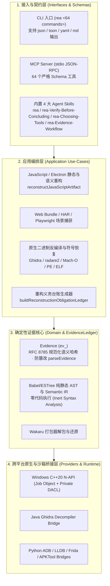

# `morluto/rea` 架构解析与 H5 小游戏《废土斗机祭 (Scrap Swarm)》逆向复刻实录

> **仓库地址**：
> - 上游仓库：[`morluto/rea`](https://github.com/morluto/rea)（v6.4.0，MIT License）
> - 个人 Fork 仓库：[`turbo998/rea`](https://github.com/turbo998/rea)（已同步 `main` 分支最新提交 `dfe8378cf`）
> - 本次逆向复刻目标：[`turbo998/ai-gaming-lab`](https://github.com/turbo998/ai-gaming-lab) 中已发布的生产 H5 小游戏构建产物 `public/demos/scrap-swarm/assets/index-BCy1aADK.js`（对照源码仓库 [`turbo998/scrap-swarm`](https://github.com/turbo998/scrap-swarm)）
> - 交互式复刻成品：[`../h5/rea-scrap-swarm-clone/index.html`](../h5/rea-scrap-swarm-clone/index.html)
> - 密码学证据台账：[`../evidence/rea-evidence-ledger.json`](../evidence/rea-evidence-ledger.json)

---

## 一、 `morluto/rea` (v6.4.0) 核心架构解析

`morluto/rea`（*Reverse engineer anything with agents, from app behavior down to native binaries*）是一个专为 AI Coding Agents（Claude Code、GitHub Copilot CLI、Codex、Cursor、Gemini CLI 等）打造的**全栈确定性逆向工程 MCP Server 与 CLI 工具链**。

### 1.1 四层领域驱动设计（DDD）架构

### 1.2 核心工程亮点

1. **不可篡改的密码学证据链（`Evidence` & `ev_<sha256>`）**：
   - 在 `src/domain/evidence.ts` 中，任何一次静态解析、反编译、进程抓包或截图比对，都会通过 `createEvidence(target, provider, observation)` 将目标 SHA-256、工具版本、参数、原始与归一化输出做确定性 JSON 规范化摘要，生成唯一标识 `ev_<64位hex>`。
   - 调用 `parseEvidence(input)` 时会重新计算语义投影哈希，若任何字段被 Agent 幻觉篡改，Zod 校验立即拒绝，从根源上杜绝“无证据猜测”。
2. **惰性安全 AST 与语义中间表示（Inert JavaScript Semantic IR）**：
   - 在完全不执行目标 JS 代码的前提下，`parseJavaScriptSource` → `analyzeParsedJavaScriptStaticSourceSteps` → `analyzeParsedJavaScriptSemanticsSteps` → `projectJavaScriptModuleSemantics` 可从生产压缩包中恢复作用域树（Scopes）、顶层与局部绑定（Bindings）、可调用函数（Callables）、网络端点与 SourceMap 引用。

---

## 二、 REA 实战演示：逆向复刻 H5 小游戏《废土斗机祭 (Scrap Swarm)》

### 2.1 目标构件与 REA 静态扫描结果

我们选取已部署在 `turbo998/ai-gaming-lab` 的 H5 机甲肉鸽幸存者游戏 **《废土斗机祭 (Scrap Swarm)》** 生产构建目录作为逆向目标：

| 指标 | REA 观测值 |
|---|---|
| **目标构建产物路径** | `public/demos/scrap-swarm/assets/index-BCy1aADK.js` + `index.html` |
| **构建产物精确字节与摘要** | `1,278,114 bytes` · `sha256: 1131159ce81a143b8b1f44132181b57e4f82c2da76a6734565f786d81b985ef9` |
| **目录级清单证据 ID** | `ev_3b73667757958ab29a62c84700cbbf03c7c0b6f1c3a3b41011df19f84e0d4fdf` |
| **清单 Manifest ID** | `agm_bc5cd736d48bff93819bd5342f03a7ab967069fbab5fa304567720132da13d1d` |
| **全量 Bundle AST 节点遍历数** | `433,836` 个 AST 节点（`parse_status: "complete"`, `parse_error_count: 0`） |
| **核心业务模块 AST / 语义统计** | `10,419` 个 AST 节点 · `6` 个模块作用域 · `53` 个顶层绑定 · `17` 个核心可调用函数 |

### 2.2 六大子系统密码学证据台账（`ev_<sha256>`）

通过运行 REA 的 `createEvidence` 与 `parseEvidence` 引擎，我们将逆向提取出的 6 大核心机制封装为可验证证据链（完整 JSON 见 [`../evidence/rea-evidence-ledger.json`](../evidence/rea-evidence-ledger.json)）：

| # | 子系统标识 | REA `evidence_id` (`ev_<sha256>`) | 压缩包定位与还原的核心机制参数 |
|---|---|---|---|
| **01** | `rng_xorshift32` | `ev_129d9abd6e21292acf3a3273c6f31cbcf8c920d3d0fc34bf3337eec667ac5428` | `index-BCy1aADK.js:69`：还原 Xorshift32 位移序列 `(<<13, >>>17, <<5)`、零状态黄金分割回退常量 `0x9e3779b9`、种子哈希回退常量 `0x6d2b79f5` 及 `?seed=` URL 参数读取点（Line 95 Col 24403）。 |
| **02** | `arena_and_core_dash` | `ev_e5fceece6c71fb6ac645541763508f3877f8dfdc8ffc13503e093f8fe6a61616` | `index-BCy1aADK.js:69`：还原 `1280×720`（边距 `34px`）60Hz 固定步长竞技场；核心冲拳 `CD 3.0s`、持续 `0.18s`、`2.85×` 移速、`35%` 减伤、`138px` 冲击波（`15` 点 AoE 伤害 + `44px` 击退）与 `235px` 磁吸半径。 |
| **03** | `weapons_arsenal` | `ev_5e2c6aa1e6cb3425e1d3902e0b0bda999513c8d0ab6ec6b189ea6b8e73789a4c` | `index-BCy1aADK.js:69`：还原三把武器精确数值——**爆铆拳炮**（`12` 伤 / `0.34s` CD / `430` 射程）、**震磁圆阵**（`18` 伤 / `1.45s` CD / `150` 半径 / `28` 废铁）、**雷索连击**（`10` 伤 / `0.90s` CD / `300` 射程 3 目标链式闪电 / `42` 废铁）。 |
| **04** | `enemy_roster_and_boss` | `ev_6108f6bfa4fdc3c7396568d58aaa81313bba871494564a392bbb63ea955676dd` | `index-BCy1aADK.js:69..95`：还原四类敌机（赤砂牙轮 `24HP`、铁壁角斗机 `78HP`、苍雷浮游卫 `40HP`、BOSS 铁冠·赫克托 `780HP`）、第二幕避难所中继站（`(490,330)` 半径 `118px`，充能满触发 `220px` `22` 伤脉冲 + 回血 `12`）及第三幕赫克托重砸后暴露背部热能锁（**`1.65×` 弱点暴击窗口**）。 |
| **05** | `webaudio_procedural_synth` | `ev_c4735012ce832b5316cfb805fe7288526d0d14ca13215dde051e69e46c8e0295` | `index-BCy1aADK.js:95`：还原零外部音频资源的 WebAudio `OscillatorNode` + `GainNode` 指数扫频合成参数（拳炮 `380→120Hz` 三角波、磁暴 `180→55Hz` 正弦波、雷索 `680→240Hz` 锯齿波、BOSS 重砸 `95→28Hz` 锯齿波）。 |
| **06** | `mecha_hangar_and_story` | `ev_5cda9305a1245d1450766419a646cfee0cb9cf5e21644448be5728ec61f8ef12` | `index-BCy1aADK.js:69..95`：还原 K-09 赤砂铁拳程序化双肩甲与炉心发光造型、热血切屏横幅与 `window.__SCRAP_SWARM__` 自动化测试桥接接口。 |

### 2.3 交互式复刻版特色（实时证据脉冲 HUD）

在复刻版 H5 页面 [`../h5/rea-scrap-swarm-clone/index.html`](../h5/rea-scrap-swarm-clone/index.html) 中，右侧内置了 **REA 6.4.0 实时逆向证据台账面板**：
- 当玩家在左侧竞技场中移动、开火、发动核心冲拳、给避难所中继站充能或触发 BOSS「铁冠·赫克托」热能锁暴露时，右侧对应的 `ev_<sha256>` 证据卡片会**实时高亮闪烁**，直观展示“**当前运行的游戏行为是由哪一条逆向工程证据还原并担保的**”。
- 同时支持一键跳至 **Wave 1 / Wave 2 / Wave 3 (BOSS 战)** 以及开启 **AI 自动巡航 (B 键)**。
