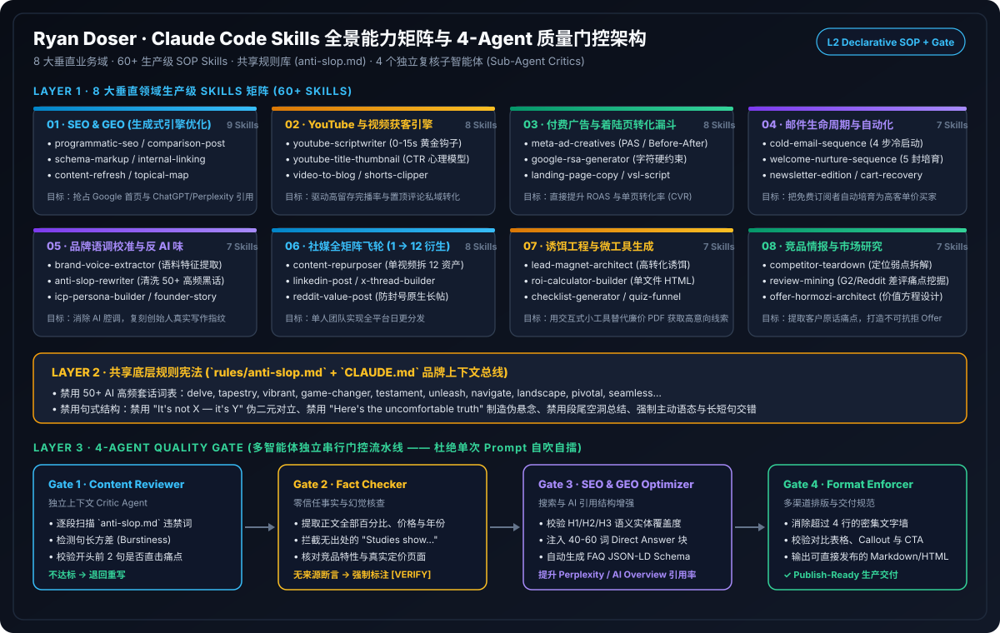
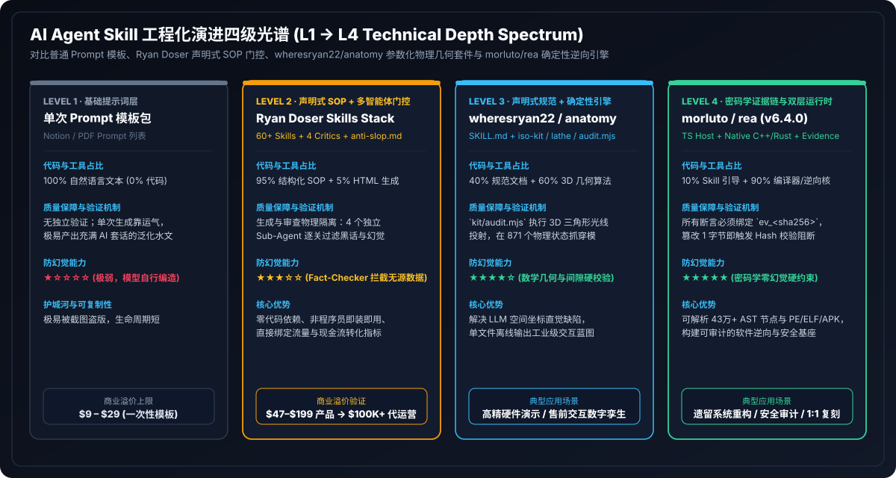
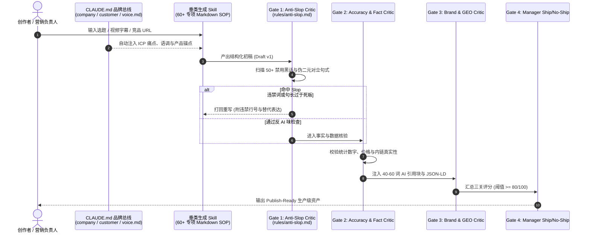
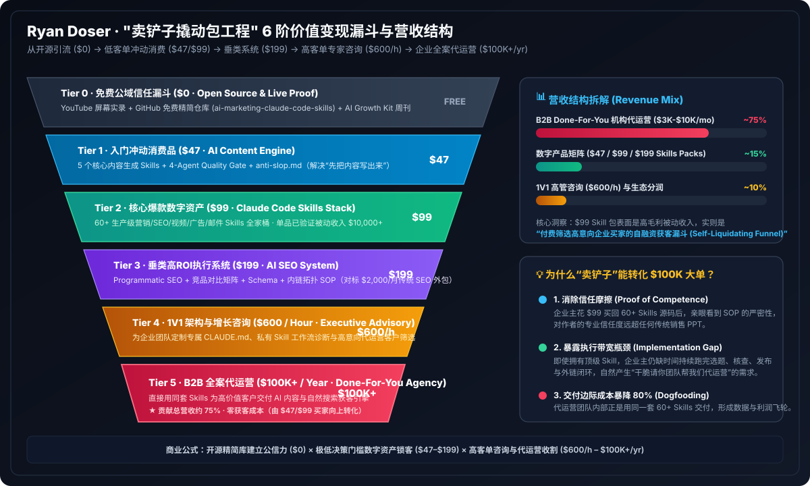
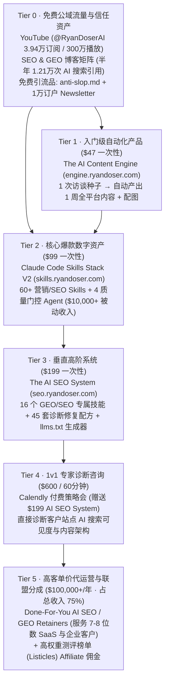

# Ryan Doser 的 Claude Code Skills 生态：覆盖范围、技术深度与商业变现路径深度研究

> **研究对象**：Ryan Doser（`@RyanDoserAI`，AI 营销与 SEO 咨询顾问 / Skills 独立开发者）  
> **一手证据来源**：
> - 核心技能栈官网：[`skills.ryandoser.com` — The Claude Code Skills Stack ($99)](https://skills.ryandoser.com/)
> - 内容引擎官网：[`engine.ryandoser.com` — The AI Content Engine ($47)](https://engine.ryandoser.com/)
> - AI SEO 系统官网：[`seo.ryandoser.com` — The AI SEO System ($199)](https://seo.ryandoser.com/)
> - V2 架构说明与案例复盘：[`ryandoser.com/claude-code-skills-stack-v2-update/`](https://ryandoser.com/claude-code-skills-stack-v2-update/)、[`ryandoser.com/make-money-with-claude/`](https://ryandoser.com/make-money-with-claude/)、[`ryandoser.com/claude-code-ai-marketing-agents/`](https://ryandoser.com/claude-code-ai-marketing-agents/)
> - 开源免费引流 Skill 原始源码：[`skills.ryandoser.com/anti-slop.md`](https://skills.ryandoser.com/anti-slop.md)
- 🌐 **在线交互式可视化报告（H5 页面，含 60+ Skill 检索器、`anti-slop.md` 实时检测沙盒与漏斗收益模拟器）**：  
  👉 **[立即打开 Ryan Doser Skill 可视化交互报告 (GitHub Pages)](https://turbo998.github.io/ai-research-public/docs/research/agent-skills-and-rea/h5/ryan-doser-skills-report/)**

---

## 0. 可视化核心图谱导览（Visual Atlas）

本报告配套 **3 张自包含高清矢量架构图（SVG）** 与 **1 个在线交互式 H5 仪表盘**：
1. [图 1：Ryan Doser 8 大垂直领域 Skills 矩阵与 4-Agent 质量门控架构图](../assets/01-ryan-doser-8category-skill-architecture.svg)
2. [图 2：Ryan Doser “卖铲子撬动包工程” 6 阶价值变现漏斗与营收结构图](../assets/02-ryan-doser-6tier-monetization-funnel.svg)
3. [图 3：AI Agent Skill 工程化演进四级光谱 (L1 提示词 → L2 Ryan Doser → L3 `anatomy` → L4 `rea`)](../assets/03-agent-skill-l1-to-l4-depth-spectrum.svg)

---

## 一、 核心结论（Executive Summary）

1. **产品矩阵与覆盖面**：Ryan Doser 围绕“**一人 AI 内容与 SEO 增长团队**”构建了 **8 大分类、60+ 个细分 Markdown Skills + 4 个子智能体质量门控（Quality Gate Sub-Agents）**，并拆分为 **$47（AI Content Engine）→ $99（Claude Code Skills Stack V2）→ $199（AI SEO System）** 三档数字产品。
2. **技术深度定级（L2 声明式专家 SOP + 多智能体 Critic 门控）**：通过对他公开的真实 Skill 源码（`anti-slop.md`）与 V2 架构拆解可见，其绝大多数 Skill **不包含复杂自研底层代码或二进制工具**（50+ 个技能仅靠原生 Claude 即可运行，仅 2 个可选调用 DataForSEO / Apify API，图形类技能通过生成 HTML/CSS 截图避免生图模型文字畸变）。其核心壁垒在于**将 10 年数字营销与 GEO（生成式引擎优化）领域经验编码为高密度负面清单（Negative Constraints）、颗粒度任务拆分与 4 层子智能体评审门控**。
3. **商业变现漏斗（6 阶价值阶梯）**：表层售卖 $47–$199 的 Skill 包已为其带来 **$10,000+ 纯被动收入**（Stripe 一次性买断 + 私有 GitHub 仓库持续交付）；但更关键的是，他用自己这套 Skill 驱动 YouTube（3.94 万订阅）与博客矩阵（半年内获得 **12,100+ 次 Microsoft Copilot / ChatGPT / Perplexity 引用**），将流量导入 **$600/小时 1v1 咨询** 与 **$100,000+ 年营收的高客单价 SEO/GEO 代运营服务（占总收入 75%）**。

---

## 二、 Skill 覆盖范围全景（8 大模块 · 60+ 技能矩阵）



在 2026 年 9 月发布的 **Claude Code Skills Stack V2** 中，Ryan Doser 将技能库扩展至 **60+ 个独立 Skill 文件**，全部搭载于统一的 `AGENTS.md` / `CLAUDE.md` 品牌中枢之上：

| 模块分类 | 数量 | 核心包含的 Skills 列表 | 外部工具/API 依赖 |
|---|---|---|---|
| **1. SEO 与 AI 搜索 (GEO)** | 10+ | `SEO Blog Post Writer`、`Keyword Research`、`GEO / AI Search Optimizer`、`Comparison / Listicle / Pricing Writers`、`Topical Cluster Builder`、`Internal Linking Architect`、`Local SEO Strategist`、`Content Updater`、`Reviews Writer`、`Monthly Accuracy Refresh` | 仅 `Keyword Research` 可选接入 **DataForSEO API**；其余零依赖 |
| **2. 内容与邮件营销** | 10 | `Content Repurposing`、`Social Media Manager`、`Email Newsletter Writer`、`Email Sequence Builder`、`Lead Magnet Creator`、`LinkedIn Post Writer`、`Short Form Video Scripts`、`Press Release Writer`、`Anti-Slop`、`Anti-Spam` | 仅 `LinkedIn Post Writer` 可选接入 **Apify** 抓取竞品高赞帖 |
| **3. YouTube 与播客包装** | 3 | `YouTube SEO Packaging`（标题/描述/标签/时间戳）、`Podcast SEO Packaging`、`YouTube Thumbnail Designer` | 原生 Claude + 本地 HTML 渲染 |
| **4. 视觉设计与信息图** | 5 | `Diagram Designer`、`Brand Kit Builder`、`Logo Generator`、`Social Media Graphics Generator`、`Infographics` | **以代码渲染图片**（生成 HTML/SVG 后快照导出，彻底规避生图模型文字拼写错误） |
| **5. 网站与落地页转化** | 5 | `Landing Page Designer`、`CRO Audit`（转化率审计）、`Personal Brand Website`、`Local Website Designer`、`Web Designer` | 原生 Claude 生成可直接部署的前端代码 |
| **6. 品牌研究与增长策略** | 4+ | `Brand Foundation Builder`（生成 `company.md`、`customer.md`、`offer.md`、`voice.md`）、`Paid Ads`、`Marketing Ideas`、`Podcast Research` | 原生 Claude + Web Search |
| **7. 系统级元技能与质量门控** | 6 + 4 Agents | **元技能**：`Skill Creator`、`AI Critic`、`Auto-Improve`、`MCP Setup`、`Delegate`、`Start Here 自引导安装`<br>**4 个质量门控子智能体**：`Accuracy Gate`、`Anti-Slop Gate`、`Brand Voice Gate`、`Manager Ship/No-Ship Gate` | 兼容 Claude Code、Codex、Cursor、Gemini CLI、Antigravity |
| **8. 开源小模型增强包** | 4 | `Instruction-Following Enforcer`、`Anti-Hallucination Grounding`、`Structured Output Enforcer`、`Advanced Model Behavior` | 针对 Llama、Qwen、DeepSeek 等开源模型的指令遵循补丁 |

---

## 三、 技术深度剖析：源码级拆解与工程范式对比

### 3.1 真实源码拆解：以 `anti-slop.md` 为例

通过对 [`https://skills.ryandoser.com/anti-slop.md`](https://skills.ryandoser.com/anti-slop.md)（134 行 Markdown）进行结构解析，Ryan Doser 的单个 Skill 遵循极其标准化的 **6 段式声明式契约结构**：

```text
┌──────────────────────────────────────────────────────────────────────────┐
│ 1. YAML Frontmatter (路由触发器)                                          │
│    name: anti-slop                                                       │
│    description: Rewrite AI-generated text to sound human...              │
├──────────────────────────────────────────────────────────────────────────┤
│ 2. Input Contract (输入契约与缺省追问)                                    │
│    - Text to clean (必填) / Target voice / Content type / Preserve list   │
├──────────────────────────────────────────────────────────────────────────┤
│ 3. Categorized Red-Flag Heuristics (分维度启发式特征库)                   │
│    - Word-level red flags (禁用高频 AI 词：delve, tapestry, landscape...) │
│    - Phrase-level red flags (禁用套话：In today's digital world...)       │
│    - Structural red flags (破折号滥用、三段排比、空洞过渡句)               │
│    - Tone red flags (强行中立、虚假热情、编造统计数据)                     │
├──────────────────────────────────────────────────────────────────────────┤
│ 4. Step-by-Step Execution Algorithm (4 步重写执行流水线)                  │
│    Read for meaning → Cut fat (删减 15-30%) → Rewrite flags → Read aloud │
├──────────────────────────────────────────────────────────────────────────┤
│ 5. Output Format Contract (强制输出模板)                                  │
│    ### Cleaned Text + ### Key Changes (3-5 项修改说明) + ### Word Count   │
├──────────────────────────────────────────────────────────────────────────┤
│ 6. Few-Shot Before/After Calibration (正反例对齐样本)                     │
│    提供典型 AI 腔原句 vs 极简人类口吻改写后的对比锚点                      │
└──────────────────────────────────────────────────────────────────────────┘
```

### 3.2 四大核心工程技巧

1. **单一职责与短小颗粒度（Granular Single-Responsibility）**：
   Ryan 强调“**5 个各 150 行、只做一件事的专注 Skill，远胜于 1 个 1,000 行的全能 Prompt**”。小体积保证了在长对话中不会污染上下文窗口（Context Window），且遵循率接近 100%。
2. **上下文与 SOP 解耦（Context-SOP Separation）**：
   通过 `Brand Foundation Builder` 先面试用户，生成持久化的 `company.md`、`customer.md`、`voice.md`，由根目录 `CLAUDE.md` / `AGENTS.md` 统一挂载；后续所有 60+ 个写作、SEO、社媒 Skill 自动继承同一套品牌记忆，无需每次重复粘贴背景。
3. **四层子智能体质量门控（4-Agent Quality Gate Pipeline）**：
   在 V2 与 $47 Content Engine 中，任何初稿生成后不会直接返回给用户，而是并行或串行经过 4 个独立 Critic 子智能体打分（>= 80/100 才放行）：
   - **Agent 1 (`Accuracy Critic`)**：核查事实声明、统计口径与内链锚点真实性；
   - **Agent 2 (`Anti-Slop Critic`)**：扫描禁用词表、破折号密度与句长方差（Burstiness）；
   - **Agent 3 (`Brand Voice Critic`)**：比对 `voice.md` 的人称、禁忌观点与读者水位；
   - **Agent 4 (`Manager Ship / No-Ship`)**：汇总前三者评分，不达标则自动打回重写循环。
4. **跨 Harness 零锁定交付（Cross-Agent Portability）**：
   每个技能包同时附带 `CLAUDE.md` 与通用 `AGENTS.md`，使同一套私有 GitHub 仓库可无缝运行在 Claude Code、OpenAI Codex、Cursor、Google Gemini CLI 与 Antigravity 上。

### 3.3 技术深度横向对比：`Ryan Doser` vs `wheresryan22/anatomy` vs `morluto/rea`





| 维度 | Ryan Doser (`Skills Stack V2`) | `wheresryan22/anatomy` (机械解剖学) | `morluto/rea` (逆向工程 Agent) |
|---|---|---|---|
| **技术深度层级** | **L2 · 声明式领域 SOP + 多 Agent 门控** | **L4 · 确定性几何引擎 + 空间光线投射验证** | **L4 · 多语言二进制/运行时桥接 + 密码学证据账本** |
| **代码与运行时占比** | ~95% 纯 Markdown 规则库 + ~5% HTML 截图脚本 | `15,934` 行纯 ES Module 3D 几何与深度排序引擎 | 数万行 TypeScript + C++ Win32 N-API + Java Ghidra + Python ADB/LLDB |
| **验证机制 (Verification)** | LLM 自评打分（4 个 Critic Sub-Agents 语义审查） | 数学确定性光线投射审计（`auditOrExit` 7 项 3D 干涉/遮挡零容忍检查） | `ev_<sha256>` 语义内容哈希 + Zod 严格模式验证 |
| **目标受众** | 非技术背景的内容创作者、SEO 从业者、一人公司 | 需要生成工业级等轴测交互解剖图的工程师与技术作者 | 安全研究员、二进制/前端逆向工程师、自动化重构 Agent |
| **核心护城河** | **10 年 SEO/GEO 实战经验的规则化沉淀 + 个人 IP 流量漏斗** | **纯 SVG 伪 3D 参数化车床/管线建模与弹簧拆解算法** | **64 项跨平台逆向工具编排与不可篡改证据链（EvidenceLedger）** |

---

## 四、 价值变现路径拆解（6 阶商业化漏斗）



Ryan Doser 并非单纯依靠“卖 Prompt/Skill 小册子”生存，而是将 **Claude Code Skills 同时作为「生产力内部引擎」与「对外标准化诱饵产品」**，跑通了完整的 **6 阶商业变现飞轮**：



### 4.1 关键财务与运营指标（据其公开复盘披露）

- **数字产品层（Tier 1–3）**：
  - 采用 **Stripe Payment Links + 私有 GitHub 仓库邀请制**，零 SaaS 服务器固定成本、零订阅流失焦虑（主打 *"One-time purchase, lifetime updates, no recurring fees"* 精准迎合厌恶月付订阅的用户心理）。
  - 自 2026 年 3 月上线以来，仅 `$99 Claude Code Skills Stack` 单品即创造 **超过 $10,000 美元高毛利被动收入**。
- **流量自举验证（Dogfooding）**：
  - 他用自己的 `AI Content Engine` 与 `AI SEO System` 运营个人网站 `ryandoser.com`：每录制一期 YouTube 视频，自动提炼字幕并在 30 分钟内转化为深度长文、Newsletter 与多平台贴文。
  - 在 6 个月内实现 **Google Search Console 89 万次展示、5,770 次自然点击**，并在 **Microsoft Copilot / Bing AI、ChatGPT、Perplexity 等生成式搜索引擎中获得 12,100+ 次品牌与文章引用**。
- **高客单价后端（Tier 4–5，利润大头）**：
  - 数字产品买家与博客读者中，有明确企业预算的创始人会预约 **$600/小时咨询** 或直接签署 **月度代运营合同（Retainer，累计贡献 $100,000+ 收入，占其总收入 75%）**，代表客户包括 AI 社媒工具 **Blotato（Sabrina Ramonov）**、8 位数营收 SaaS 公司及 7 位数医疗 IT 机构。

---

## 五、 对开发者与技术团队的启示

1. **Skill 的两极演进趋势**：
   - **领域 SOP 型 Skill（Ryan Doser 模式）**：胜在**工作流编排、负面清单去 AI 味、跨文件品牌记忆与多 Agent 评审门控**，开发门槛低、商业变现快，适合垂直行业专家将隐性经验显性化。
   - **确定性引擎型 Skill（`anatomy` / `rea` 模式）**：胜在**用确定性数学/AST/二进制工具补齐 LLM 的空间几何与精确计算短板**，具备极高工程壁垒。
2. **最佳实践融合**：将 Ryan Doser 的 **“上下文分离 + 多 Agent 质量门控 + GitHub 私有库版本化交付”** 与 `anatomy` / `rea` 的 **“确定性验证脚本（Audit / Evidence Digest）”** 结合，即可构建既有行业深度又零幻觉的企业级 Agent Skill 体系。
