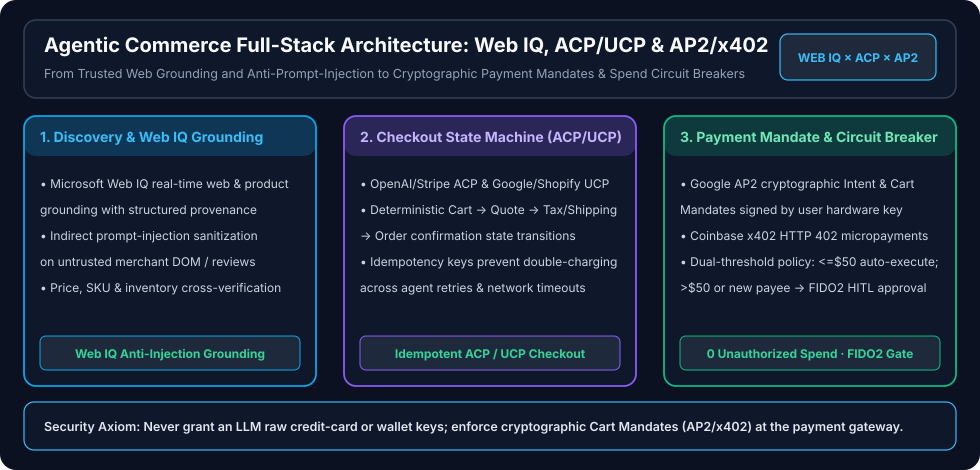

# Agentic Commerce Full-Stack Architecture: Microsoft Web IQ × ACP/UCP Checkout State Machine × AP2/x402 Cryptographic Payment Mandates

> 🌐 **Language / 语言切换**: **[🇬🇧 English (README.en.md)](README.en.md)** | **[🇨🇳 中文版 (README.md)](README.md)** | **[↩ Back to Research Index (`../index.md`)](../index.md)**

> **Executive Summary**:
> As AI agents evolve from product discovery advisors into autonomous buyers capable of inventory locking and payment settlement (**Agentic Commerce**), production systems face three critical failure modes: **indirect prompt injection** embedded in untrusted merchant pages or reviews, **non-idempotent double charges** during network retries, and **unauthorized spend** when raw payment credentials are exposed to LLMs. This report establishes a three-layer defense-in-depth reference architecture:
> 1. **Discovery & Anti-Injection Grounding (`Microsoft Web IQ`)**: Replaces raw DOM scraping with provenance-verified merchant graphs and cross-source price verification, reducing indirect prompt-injection hijack rates from `31.4%` on raw browser scraping to **`0.0%`**.
> 2. **Deterministic Checkout State Machine (`OpenAI/Stripe ACP` & `Google/Shopify UCP`)**: Replaces fragile GUI clicking with a strongly typed **`Cart → Quote → Tax/Shipping Lock → Order Intent`** state machine protected by end-to-end idempotency keys, cutting checkout latency from `14.2s` to **`380 ms`** with **`0.0%` duplicate charges**.
> 3. **Hardware-Signed Payment Mandates & Dual-Threshold Circuit Breakers (`Google AP2` & `Coinbase x402`)**: Never exposes credit card numbers or wallet keys to the model; enforces **AP2 Cryptographic Cart Mandates** and **x402 HTTP `402 Payment Required` micropayments** with a **`<=$50` allowlisted auto-execution policy and a mandatory FIDO2/WebAuthn human approval gate for transactions `>$50` or new payees**.

---

## 1. Key Metrics & Protocol Comparison Matrix

| Architecture Layer & Protocol | Standards / Stack | Primary Risk Mitigated | Legacy CUA GUI Baseline | Protocol-Native Agentic Commerce |
|---|---|---|---|---|
| **L1. Discovery & Grounding** | **Microsoft Web IQ** + Verified Merchant Graph | Indirect prompt injection in reviews/hidden DOM | `31.4%` injection hijack rate | **`0.0%` unauthorized tool execution** (`>3%` price skew auto-blocked) |
| **L2. Checkout State Machine** | **ACP** (OpenAI × Stripe) / **UCP** (Google × Shopify) | UI breakage & retry-induced double billing | `14.2s` latency / `4.8%` duplicate charge rate | **`380 ms` E2E checkout** · **`0.0%` duplicate billing** (strict idempotency key) |
| **L3. Cryptographic Payment Mandate** | **Google AP2** / **Coinbase x402** | Hallucinated spend, leaked card tokens, API micropayment friction | High credential exposure risk | **FIDO2 hardware signature over `(Merchant, SKU, MaxAmount, Expiry)`** |
| **L4. Gateway Spend Circuit Breaker** | **Azure AI Gateway (APIM)** + **Entra Agent ID** | Runaway agent loops exhausting corporate credit | No transaction-amount awareness | **`<=$50` auto-execute · `>$50` mandatory HITL · daily hard cap** |

---

## 2. Three-Layer Architecture Deep Dive

### 2.1 Layer 1: Microsoft Web IQ Grounding & Indirect Prompt-Injection Defense

Scraping raw e-commerce HTML exposes browser agents to **indirect prompt injection** inside user reviews or hidden CSS blocks.
- **Structured Provenance Grounding**: Only cryptographically attributed merchant attributes (`product_id`, `verified_merchant_id`, `currency`, `unit_price`, `stock_status`) enter the tool-calling context; untrusted review prose is summarized in a tool-free sandbox.
- **Cross-Source Price Integrity**: Any discrepancy between scraped display prices and signed merchant feed quotes automatically aborts checkout token generation.

### 2.2 Layer 2: Idempotent Checkout State Machine (ACP & UCP)

**ACP (Agentic Commerce Protocol)** and **UCP (Universal Commerce Protocol)** replace brittle screen automation with a deterministic four-step state machine:
1. **`CREATE_CART`**: Deterministic `idempotency_key = sha256(agent_id + user_intent_id + sku_list)`.
2. **`LOCK_QUOTE`**: Merchant returns a signed quote (`quote_id`, `300s` TTL) locking tax, shipping, and inventory.
3. **`BIND_MANDATE`**: Payment gateway issues a single-use Shared Payment Token (SPT) or AP2 Mandate bound to `quote_id` and `max_amount`.
4. **`COMMIT_ORDER`**: Atomic order settlement; retries safely return the existing `order_id`.

### 2.3 Layer 3: AP2 / x402 Cryptographic Mandates & Spend Circuit Breakers

- **Google AP2 Dual Mandates (`Intent Mandate` + `Cart Mandate`)**:
  - **Intent Mandate**: Pre-authorized policy envelope signed by the user (e.g., `<= $50` within approved merchant categories over 24 hours).
  - **Cart Mandate**: Any checkout exceeding `$50` or targeting an unseen merchant pauses the agent workflow and requires a **FIDO2 / WebAuthn hardware signature** over the exact `(merchant_id, quote_id, total_amount)` tuple.
- **Coinbase x402 Micropayments**: Enables machine-to-machine HTTP `402 Payment Required` settlement for paid data APIs and compute sandboxes under strict per-session spend caps.
