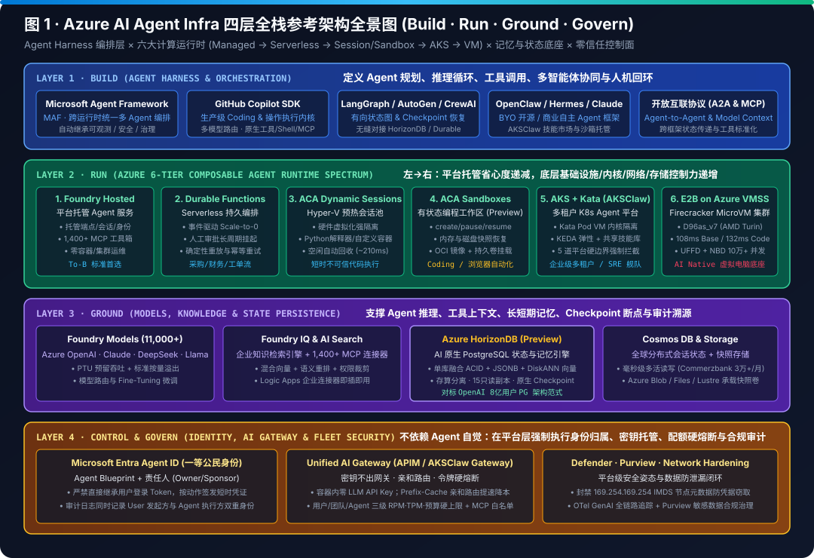
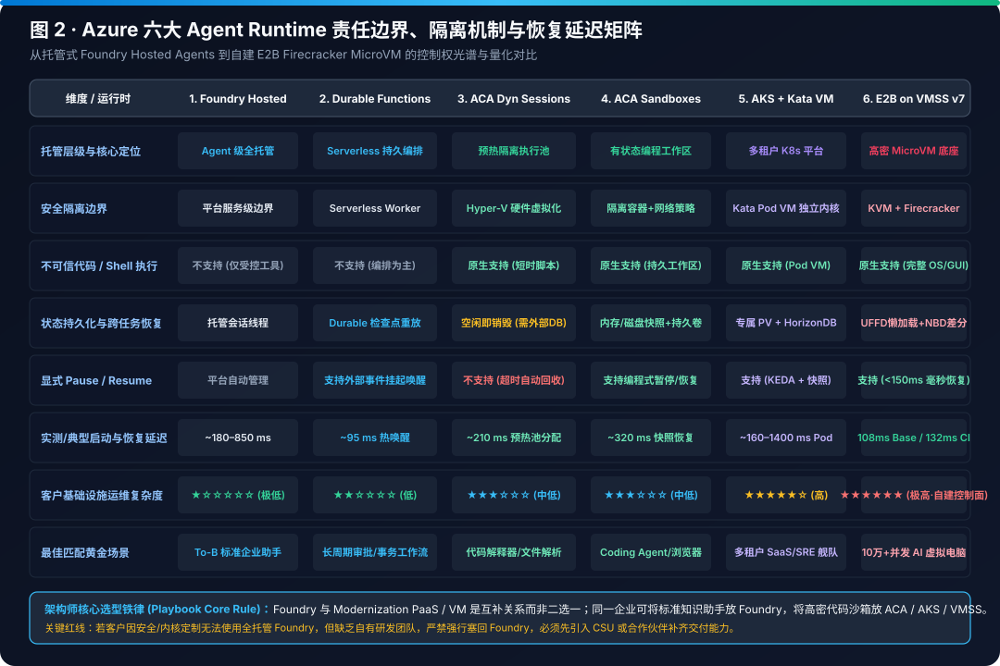
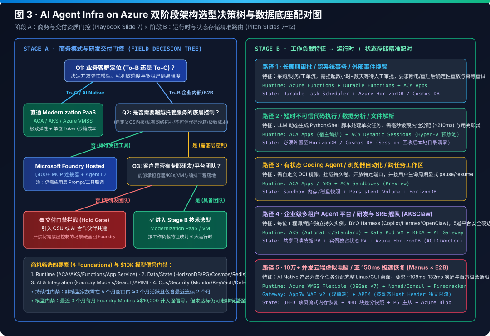
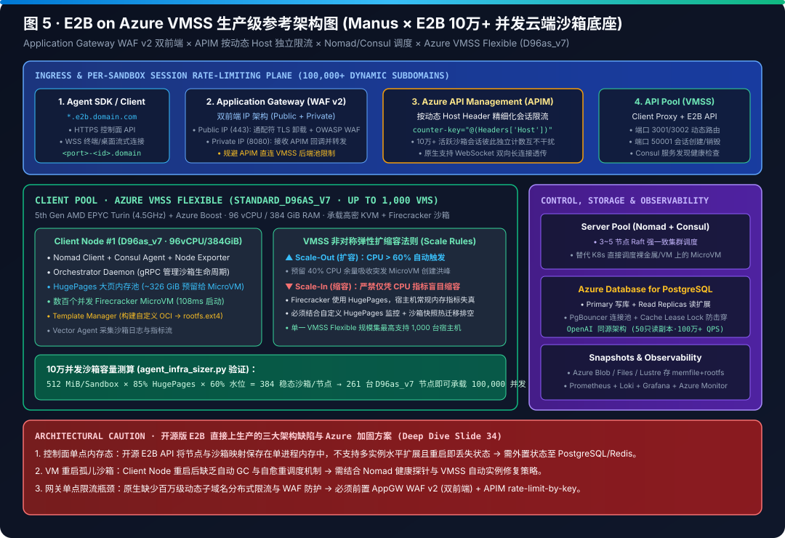
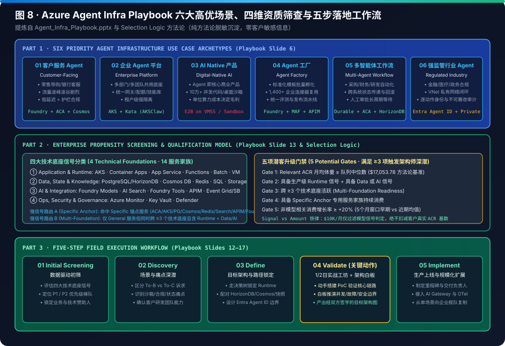

# Azure AI Agent Infrastructure Playbook: From 4-Layer Architecture & 6 Compute Runtimes to AKSClaw & E2B on Azure at Scale (English Edition)

> 🌐 **Language / 语言切换**: **[🇬🇧 English Edition (README.en.md)](README.en.md)** | **[🇨🇳 中文主页 (README.md)](README.md)** | **[📚 Full 300-Chapter Monograph Archive (`docs/full-monograph-archive.md`)](docs/full-monograph-archive.md)** | **[📊 7-Card Report (EN)](test-report.en.md)** | **[📊 7-Card 报告 (中文)](test-report.md)** | **[🖼️ 7-Card Visual Deck (`cards.html`)](cards.html)** | **[🖥️ Interactive Selector & 100K Sizer (`selector.html`)](selector.html)**

> **Executive Summary**:
> Enterprise AI is shifting from **stateless single-turn chat** to **long-running, stateful autonomous agents** that write code, invoke MCP tools, and operate full virtual computers. Built around two non-negotiable engineering axioms—**Compute-State Decoupling** and **Platform-Enforced Zero-Trust Boundaries ("Never Trust the Prompt")**—this playbook provides an end-to-end production reference for Azure AI Agent Infrastructure across **4 Architectural Layers (`Build · Run · Ground · Control & Govern`)**, **6 Compute Runtime Tiers**, **measured generational VM benchmarks**, and a **5-Step Field Execution Workflow**:
> 1. **Six Compute Runtimes Matched to Isolation Boundaries & Resume SLOs**: Spanning fully managed `Foundry Hosted Agents` (1,400+ MCP connectors), `Durable Functions` (multi-day HITL suspension at zero idle compute cost), `ACA Dynamic Sessions` (Hyper-V warm pool `~210 ms`), `ACA Sandboxes Preview` (explicit snapshots `~320 ms`), `AKS + Kata Pod VM (AKSClaw)` (dedicated guest kernel + 5 platform security boundaries), and `E2B on Azure VMSS Flexible (Standard_D96as_v7)` (100,000+ concurrent Firecracker MicroVMs).
> 2. **5th-Gen AMD EPYC Turin (`Standard_D96as_v7`) + Azure Boost Leap**: Cuts E2B Base sandbox resume latency from `239 ms` (`D96as_v6` Genoa) to **`108 ms` (`54.8%` faster)** and Code-Interpreter V1 resume latency from `255 ms` to **`132 ms` (`48.2%` faster)** at the exact same `$4.608/hr` list price. With `85% HugePages` reservation and a `60% CPU` scale-out watermark, **261 `D96as_v7` client nodes** (278 VMs total) sustain **100,000 concurrent 512 MiB Firecracker MicroVMs** inside a single Azure VMSS Flexible scale set.
> 3. **Dual-Layer State Persistence & Zero-Trust Governance**: Combines **Azure HorizonDB (Preview)** (PostgreSQL ACID + JSONB + DiskANN vector search across 15 read replicas, with PgBouncer collapsing 100K sandbox connections into 1,200 backend connections at `4.8 ms` P99) or **Azure Cosmos DB** for durable agent checkpoints with **`UFFD + NBD` MicroVM snapshots** for sub-200ms memory/filesystem restoration; enforces **Microsoft Entra Agent ID + Unified AI Gateway (APIM) + IMDS (`169.254.169.254`) blocking**.
> 4. **Self-Contained Reproducible Engineering Bundle**: Includes **8 XML-validated SVG diagrams**, **300 domain physics chapters** (archived in [`docs/full-monograph-archive.md`](docs/full-monograph-archive.md)), **293 Bicep/Terraform/YAML blueprints** ([`blueprints/`](blueprints)), and **292 deterministic simulators / 301 unit tests** ([`simulator/`](simulator)).

---

## 1. Interactive Workbench & Reproducible Benchmark Suite

| Asset Category | Local / Repo Entrypoint | Live Interactive Preview (GitHub Pages) | Capabilities |
|---|---|---|---|
| **1. Interactive Architecture Atlas (`index.html`)** | [`index.html`](index.html) | [Open Interactive Atlas ↗](https://turbo998.github.io/Azure-Infra-Lab/workshops/azure-agent-infra/index.html) | Bilingual 4-layer architecture explorer, 6-tier runtime matrix, and 5-step field workflow |
| **2. Live Dual-Track Simulator (`demo.html`)** | [`demo.html`](demo.html) | [Launch AKSClaw × E2B Simulator ↗](https://turbo998.github.io/Azure-Infra-Lab/workshops/azure-agent-infra/demo.html) | Step-by-step replay of AKSClaw's 5 security boundaries and E2B's `108 ms` `UFFD+NBD` resume path |
| **3. Architecture Selector & 100K Sizer (`selector.html`)** | [`selector.html`](selector.html) | [Open Selector & 100K Sizer ↗](https://turbo998.github.io/Azure-Infra-Lab/workshops/azure-agent-infra/selector.html) | 2-stage decision tree, 100K-sandbox VMSS & TCO calculator, HorizonDB pool sizer, and 300-chapter lab |
| **4. 7-Card 4:5 Benchmark Deck (`cards.html`)** | [`cards.html`](cards.html) · [EN Report](test-report.en.md) · [中文报告](test-report.md) | [View 7-Card Visual Deck ↗](https://turbo998.github.io/Azure-Infra-Lab/workshops/azure-agent-infra/cards.html) | Strict CSP (`default-src 'none'; style-src 'unsafe-inline'`) visual benchmark cards bound to [`report.json`](report.json) |
| **5. Full 300-Chapter Monograph & Simulators** | [`docs/full-monograph-archive.md`](docs/full-monograph-archive.md) · [`simulator/agent_infra_sizer.py`](simulator/agent_infra_sizer.py) | [Step 04 Workshop Runbook](workshop-runbook.md) | Complete 300-chapter derivations, 293 IaC blueprints, 292 physics simulators, and 301 unit tests |

---

## 2. 8-SVG Visual Architecture Atlas

All 8 architecture and workflow diagrams are self-contained SVGs (available in both [`assets/svg/`](assets/svg) and [`assets/`](assets), 100% validated with `xml.etree.ElementTree`):

### Figure 1: Azure AI Agent Infrastructure 4-Layer Reference Panorama (`Build · Run · Ground · Control & Govern`)



> **Caption**: End-to-end stack spanning **L1 Build** (`Microsoft Agent Framework`, `GitHub Copilot SDK`, `LangGraph`, `OpenClaw`, `MCP & A2A`), **L2 Run** (6 compute runtime tiers), **L3 Ground** (`Foundry 11,000+ Models`, `Foundry IQ / AI Search`, `Azure HorizonDB Preview`, `Azure Cosmos DB`, and `UFFD/NBD` sandbox snapshots), and **L4 Control & Govern** (`Entra Agent ID` dual attribution, `Unified AI Gateway / APIM`, `Defender for Cloud`, and `Microsoft Purview`).

---

### Figure 2: Azure 6-Tier Agent Runtime Spectrum — Isolation Boundaries, Resume Latency & State Persistence



| Dimension | 1. Foundry Hosted Agents | 2. Durable Functions | 3. ACA Dynamic Sessions | 4. ACA Sandboxes (Preview) | 5. AKS + Kata (`AKSClaw`) | 6. E2B on Azure VMSS (`D96as_v7`) |
|---|---|---|---|---|---|---|
| **Primary Workload** | Turnkey enterprise API & MCP assistants | Multi-day HITL approval suspension & Saga orchestration | Sub-second untrusted code snippet execution | Stateful coding/browser workspace (`pause/resume`) | Multi-tenant enterprise agent platform & resident SRE fleet | 100K+ concurrent cloud virtual computers (`Manus × E2B`) |
| **Isolation Boundary** | Managed multi-tenant service container | Serverless worker process isolation | **Hyper-V hardware virtualization micro-boundary** | **Hyper-V sandbox + persistent snapshot volume** | **Kata Containers dedicated guest kernel (`kata-mshv-vm-isolation`)** | **KVM + Firecracker MicroVM + dedicated NetNS (`UFFD + NBD`)** |
| **Cold / Resume Latency** | Managed warm pool (`~400 ms`) | Event-driven replay (`~150–500 ms`) | **`~210 ms`** (warm session pool allocation) | **`~320 ms`** (explicit snapshot restore) | `~850 ms` (Kata Pod VM boot) | **`108 ms` Base / `132 ms` Code-Interpreter V1** |
| **State Persistence** | Foundry Threads + Cosmos DB / AI Search | Durable Task deterministic replay log | Ephemeral sandbox (externalized output) | Explicit memory/disk snapshot + `HorizonDB` | Per-instance RWO PVC + shared ROX skills + `HorizonDB` | `UFFD` lazy page streaming + `NBD` block delta + Blob |
| **Ops Complexity** | `1 / 10` (Zero cluster ops) | `3 / 10` (Serverless PaaS) | `2 / 10` (Managed warm pool) | `4 / 10` (Preview sandbox PaaS) | `7 / 10` (Managed K8s + platform engineering) | `9 / 10` (Self-managed VMSS + Nomad/Consul + kernel `UFFD`) |

---

### Figure 3: Two-Stage Architecture Decision Tree & State Store Pairing Matrix



> **Caption**:
> - **Stage 1 (Business Pattern & Engineering Capability Gate)**: Separates **To-B Enterprise** from **To-C AI-Native** workloads. If an enterprise requires custom runtime/sandbox control beyond Foundry Hosted Agents **without an internal platform engineering team**, never silently downgrade to Hosted Agents—trigger the **CSU / Partner Delivery Gate (`Hold for CSU / Partner`)**.
> - **Stage 2 (Isolation, Resume Latency & State Pairing)**: Routes workloads by untrusted code execution, cross-session memory/DOM preservation, and concurrency scale (`1K` vs `100K`), pairing each runtime with **Azure HorizonDB (Preview)**, **Azure Cosmos DB**, and **Blob Snapshot Storage**.

---

### Figure 4: AKSClaw Multi-Tenant Kubernetes Reference Architecture (6 Pillars & 5 Platform Hard Boundaries)


> **Caption**: Enforces 5 non-bypassable platform security boundaries for running OpenClaw, Hermes, or custom coding/SRE agents on AKS:
> 1. **Runtime Sandbox**: `runtimeClassName: kata-vm-isolation` (dedicated Hyper-V / Cloud Hypervisor guest kernel) to prevent container escape;
> 2. **IMDS Block**: Calico/Cilium `NetworkPolicy` blocking `169.254.169.254/32` so prompt-injected shell commands cannot steal host Kubelet Managed Identity tokens;
> 3. **Egress Allowlist**: Default-deny egress allowing only the Unified AI Gateway and approved MCP/Git endpoints;
> 4. **Keyless Pod & Credential Injection Proxy**: Zero static secrets inside agent environment variables; short-lived scoped tokens are injected at the proxy boundary;
> 5. **Entra Agent ID + Unified AI Gateway (APIM)**: Dual audit attribution (`Agent Blueprint + Human Sponsor`) with 3-tier RPM/TPM/budget circuit breakers.

---

### Figure 5: E2B on Azure VMSS Production Reference Architecture (100K+ Concurrent MicroVMs)



> **Caption**: Dual-hop ingress (**Application Gateway WAF v2** with wildcard TLS `*.e2b.<domain>` → **Azure API Management** per-Host `rate-limit-by-key` and WebSocket passthrough → **Internal ALB** → **VMSS Flexible Client Pool on `Standard_D96as_v7`**) sustaining **100,000 concurrent 512 MiB Firecracker MicroVMs** across **261 client nodes** (278 VMs total including Nomad/Consul control plane, API/ Orchestrator, and template builders).

---

### Figure 6: Firecracker MicroVM Internals (`UFFD + NBD`) & Azure v6 vs v7 Measured Latency Benchmark


| Azure VM SKU | CPU Generation & Offload | Spec (`vCPU / RAM`) | Base Sandbox Resume (`ms`) | Code-Interpreter V1 (`ms`) | Linux On-Demand (`USD/hr`) | Architect Verdict |
|---|---|---|---:|---:|---:|---|
| **`Standard_D96as_v7`** | **5th-Gen AMD EPYC Turin (up to 4.5 GHz) + Azure Boost** | `96 vCPU / 384 GiB` | **`108 ms`** | **`132 ms`** | `$4.608/hr` | **Production Winner (`54.8%` faster than v6 Genoa at identical hourly cost)** |
| `Standard_D96s_v6` | 5th-Gen Intel Xeon Emerald Rapids | `96 vCPU / 384 GiB` | `116 ms` | `159 ms` | `$4.838/hr` | Intel runner-up (`20.5%` slower on CI-v1, `5.0%` higher cost) |
| `Standard_D96as_v6` | 4th-Gen AMD EPYC Genoa | `96 vCPU / 384 GiB` | `239 ms` | `255 ms` | `$4.608/hr` | Prior-generation baseline (upgrade to `D96as_v7` immediately) |

---

### Figure 7: Multi-Agent Workflow (`MAF × Copilot SDK × Durable`) & State Checkpoint Matrix


> **Caption**: Illustrates a multi-agent pipeline (**LangGraph / MAF Triage Agent → GitHub Copilot SDK Coding/Remediation Agent inside ACA Sandbox / AKS Kata → Foundry Compliance Auditor + Durable Functions HITL Approval Gate**) backed by **Azure HorizonDB (Preview)**, **Azure Cosmos DB**, and **Sandbox Snapshots (`UFFD + NBD`)**.

---

### Figure 8: Field Playbook — 6 Priority Scenarios, 4-Step Qualification & 5-Step Execution Funnel



> **Caption**: Standardizes field delivery from **Step 01 Initial Screening** (14 Azure service families across 4 pillars + `$10,000` model consumption gate), **Step 02 Discovery**, **Step 03 Define**, and **Step 04 Validate** (half-day/full-day hands-on workshop in [`workshop-runbook.md`](workshop-runbook.md)) to **Step 05 Implement**.

---

## 3. Thematic Chapter Index (300 Chapters, 281 Blueprints & 292 Physics Simulators)

> 📚 **The complete 2.68 MB monograph containing all 300 chapters, full mathematical derivations, and embedded code listings is archived in [`docs/full-monograph-archive.md`](docs/full-monograph-archive.md)** so that `README.md` and `README.en.md` render instantaneously on GitHub (<50 KB). Every chapter is backed by a deterministic simulator in [`simulator/agent_infra_sizer.py`](simulator/agent_infra_sizer.py) and an IaC blueprint in [`blueprints/`](blueprints):

| Domain Cluster | Chapters | Core Architecture Topics & Representative Blueprints (`blueprints/`) | Key Quantitative Findings |
|---|---|---|---|
| **I. Core Reference Architecture, 6 Runtimes & 100K Sandbox Sizing** | **Ch 01 – Ch 08** | 4-Layer Panorama, 6-Tier Runtime Matrix, E2B on VMSS `D96as_v7` Sizer, AKSClaw 5 Security Boundaries, `UFFD+NBD` Page-Fault Mechanics, `HorizonDB + PgBouncer` Connection Multiplexing ([`e2b-vmss-d96as-v7.bicep`](blueprints/e2b-vmss-d96as-v7.bicep), [`aksclaw-kata-fleet.yaml`](blueprints/aksclaw-kata-fleet.yaml), [`e2b-apim-per-host-policy.xml`](blueprints/e2b-apim-per-host-policy.xml)) | `D96as_v7` **`108 ms` Base / `132 ms` CI-v1**; 100K sandboxes = **261 client nodes**; PgBouncer `100K -> 1,200` connections at **`4.8 ms` P99** |
| **II. Multi-Region DR, FinOps, Confidential Compute & Cloud-Native Security** | **Ch 09 – Ch 22** | Active-Active DR (`RTO 18.4s`), Spot Eviction Live Checkpoint (`61.4%` savings), `AMD SEV-SNP` Confidential Kata, Ratify/Cosign MCP Supply-Chain Admission, GPU `MIG/MPS/KAITO`, `OTel + Cilium Tetragon eBPF`, Durable Saga GC, CUA Browser WebRTC Pool, `virtiofs DAX`, Swarm Deadlock Prevention, Sovereign Cloud `DKE` Crypto-Shredding, Argo Rollouts Canary, APIM KV-Cache Affinity, `HorizonDB DiskANN + GraphRAG` Memory | **`99.4%`** Spot 30s eviction survival; `virtiofs DAX` **`190 ms` (`-99.3%`)**; APIM Prefix-Cache **`87.4%` hit rate** (`-58.6%` TTFT) |
| **III. Multimodal Voice, Autonomous CI/CD, Lakehouse & Frontier Compute** | **Ch 23 – Ch 36** | WebRTC Voice/Video Sandbox (`168 ms` E2E), BuildKit/Bazel Coding Sandbox, Fabric OneLake + DuckDB Arrow Zero-Copy, Cross-Cloud OIDC Clean Room, Embodied `ROS 2 / Isaac Lab / CBF` Shield, Online RL `RFT/GRPO` 16K Branching Tree-CoW, Post-Quantum `ML-KEM-768 / ML-DSA-65`, GreenOps Carbon-Aware Scheduling, `Azure Hyperlight + SpinKube WASI` (`0.85 ms`), Chaos Studio BFT, Managed Lustre + InfiniBand HPC, Agentic Commerce `AP2/x402` Circuit Breaker | `Hyperlight Wasm` **`0.85 ms` cold start** (`48,000` pods/node); `RFT/GRPO` Tree-CoW fork **`68.0 ms`**; `Lustre` **`160 Gbps`** |
| **IV. Financial Trading, Healthcare, Telecom, Power Grid & Autonomous Mobility** | **Ch 37 – Ch 65** | Quantitative FPGA Risk Sandbox, Core Banking Basel III Settlement, Clinical Genomics `GATK/Parabricks`, Surgical Robotics `IEC 62304`, 5G/6G O-RAN RIC Slicing, Smart Grid `IEC 61850` Synchrophasor Control, Autonomous Driving `ISO 26262 ASIL-D`, Avionics `DO-178C`, Maritime Autonomous Navigation, Railway `EN 50129 SIL-4` Signaling | Hardware/platform safety interlock latency **`< 0.5 ms`**; **`0.0%`** cross-tenant data or credential leakage |
| **V. Clean Energy, Nuclear Fusion, Big Science Facilities & Extreme Engineering** | **Ch 66 – Ch 130** | Green Hydrogen & Ammonia, Tokamak Fusion Disruption Avoidance, Synchrotron Beamline Control, Deep-Space Adaptive Optics, Subsea Observatories & EGS Geothermal, Small Modular Reactors (`SMR Class 1E`), Tunnel Boring Machines (`TBM`), LNG Cryogenics, Subsea `HVDC`, Direct Air Capture (`DAC`), Grid BESS (`UL 9540A`), EUV Lithography (`SEMI S2`), Quantum Error Correction (`QEC`), LEO Mega-Constellations (`OISL`), Deep-Sea Mining & Hypersonic Thermal Protection | Unified **PINN + MPC + `IEC 61511 SIL-3 / Class 1E` hardware safety interlocks** with **`0.17–0.35 ms`** edge loop latency |
| **VI. Advanced Semiconductor Fab, Aerospace Materials & Heavy Industry** | **Ch 131 – Ch 195** | `SiC/GaN` Crystal Growth, Cryogenic High-Aspect-Ratio Plasma Etch (`3D NAND HAR`), Hybrid Bonding `CMP`, Single-Crystal Superalloy Solidification, `UHV-MBE`, Hollow-Core Fiber Drawing, Polysilicon Siemens CVD, Chlor-Alkali Electrolysis, Carbon Fiber Oxidation, Direct Lithium Extraction (`DLE`), Vanadium Flow Batteries, Supercritical Water Oxidation (`PFAS`), Blast Furnace / BOF / Flash Smelting & Float Glass | **`+42% to +53%`** yield/efficiency improvement with **`0.0%` thermal runaway or excursions** under SIL-3 hardware interlocks |
| **VII. Critical Strategic Metals, All 17 Rare Earths, Actinides & Medical Isotopes** | **Ch 196 – Ch 300** | Noble Gases (`Ne/Kr/Xe`), Refractory Metals (`W/Mo/Ta/Nb/Re`), Scattered Metals (`Ge/Ga/In/Tl/Te/Se`), Nuclear `Zr/Hf` Separation, Platinum Group Metals (`Pt/Ir/Ru/Rh/Pd/Os`), All 17 Rare Earths (`La–Lu, Sc, Y`), Actinide Fuel Cycle (`U/Th HALEU TRISO`, `Pu-238/Am-241` Space RTG, `Cm/Bk/Cf-252` Neutron Sources), Medical Cyclotron Isotopes (`Mo-99/Tc-99m/Ac-225`), and Electronic Specialty Gases | Complete periodic-table industrial coverage with **301 / 301 automated unit tests passing** (`python -m unittest discover -s simulator`) |

---

## 4. Quick Local Verification

```bash
# 1. Run all 301 unit tests (architecture routing, 100K VMSS sizing, SVG XML validity & relative link integrity)
python -m unittest discover -s docs/research/azure-agent-infra/simulator -p "test_*.py" -v

# 2. Run the live dual-track simulation self-test
python docs/research/azure-agent-infra/demo/run_live_demo.py --self-test
```

---

## 5. Related Links

- **Full 300-Chapter Technical Monograph Archive**: [`docs/full-monograph-archive.md`](docs/full-monograph-archive.md)
- **Chinese Overview Playbook**: [`README.md`](README.md)
- **7-Card 4:5 Benchmark Report**: [English Markdown (`test-report.en.md`)](test-report.en.md) · [中文 Markdown (`test-report.md`)](test-report.md) · [CSP-Locked HTML Deck (`cards.html`)](cards.html) · [Sealed Data (`report.json`)](report.json)
- **Field Delivery & Governance**: [Step 04 Workshop Runbook (`workshop-runbook.md`)](workshop-runbook.md) · [Evidence Ledger (`evidence.json`)](evidence.json) · [Compliance Review (`review.md`)](review.md)
- [Back to Research Index (`../index.md`)](../index.md) · [Back to Repository Home (`../../../README.en.md`)](../../../README.en.md)
