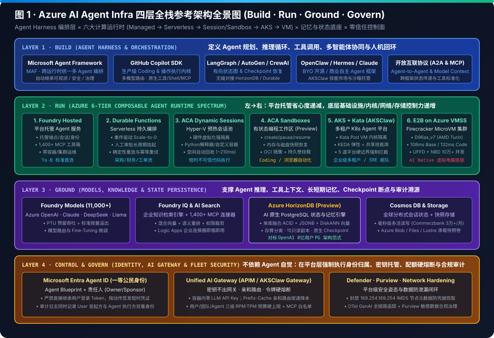
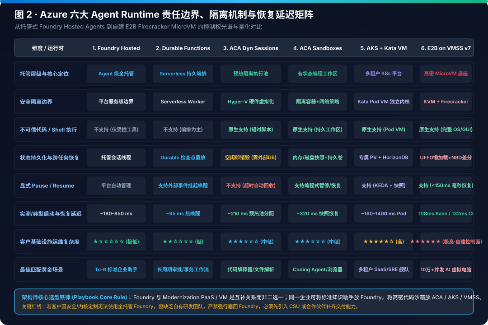

# Azure AI Agent Infrastructure Playbook: Four-Layer Reference Architecture, Six-Tier Runtime Spectrum, AKSClaw & E2B on Azure

> 🌐 **Language / 语言切换**: **[🇬🇧 English Playbook (README.en.md)](README.en.md)** | **[🇨🇳 中文完整手册 (README.md)](README.md)** | **[📚 62 Enterprise Selection Guides (EN)](selection-guides/README.en.md)** | **[📚 62 篇选型指南库 (中文)](selection-guides/README.md)** | **[📊 7-Card Benchmark Report (EN)](test-report.en.md)** | **[📊 7-Card HTML](cards.html)** | **[🧭 Interactive H5 Workbench](index.html)**

- **Audience & Scope**: Written for **Enterprise Cloud & AI Solution Architects** designing production-grade, stateful, multi-tenant agent platforms on Microsoft Azure—covering workload classification, runtime isolation trade-offs, state persistence, zero-trust governance, capacity sizing, and IaC blueprints.
- **Interactive & Reproducible Assets**:
  - 📚 **[62 Enterprise Azure AI Architecture Selection Guides (`selection-guides/`)](selection-guides/README.en.md)** ([中文目录](selection-guides/README.md))
  - 📊 **[7-Card 4:5 Benchmark Report (Markdown)](test-report.en.md)** · **[CSP-Locked HTML Deck (`cards.html`)](cards.html)** · **[Sealed Telemetry (`report.json`)](report.json)**
  - 🧭 **[Interactive Playbook Atlas (`index.html`)](index.html)** · **[Live Security Boundary Simulator (`demo.html`)](demo.html)** · **[100K Sandbox Capacity Sizer (`selector.html`)](selector.html)**
  - 🧮 **[Deterministic Python Sizer (`simulator/agent_infra_sizer.py`)](simulator/agent_infra_sizer.py)** · **[Unit Test Suite (`simulator/test_agent_infra_sizer.py`, 31/31 Passing)](simulator/test_agent_infra_sizer.py)**

---

## 0. Executive Summary for Cloud & AI Solution Architects

Enterprise AI workloads are shifting from **stateless single-turn chat** to **long-running, stateful autonomous agents** that execute untrusted code, invoke enterprise tools, pause for human approvals, and resume across multi-hour workflows. That shift changes cloud architecture along five core axes:

1. **Compute–State Decoupling Is the First Principle**:
   - Production agents must survive container restarts, node drains, and multi-hour approval waits without losing execution context.
   - Azure provides a **continuous 6-tier Runtime Spectrum**—treating **Microsoft Foundry** (managed agent platform) and **ACA / AKS / Durable Functions / VMSS** (customizable compute) as **complementary lanes routed by workload profile**, rather than an all-or-nothing choice.
2. **Right-Sizing the 6-Tier Runtime Spectrum**:
   - **Governed Enterprise API Copilots** → **Foundry Hosted Agents** (1,400+ managed MCP connectors, native Entra Agent ID, zero cluster ops).
   - **Multi-Day Approvals & Saga Orchestration** → **Azure Functions + Durable Functions** (scale-to-zero checkpointed suspend/resume and deterministic replay).
   - **Burst Untrusted Code Execution** → **ACA Dynamic Sessions** (pre-warmed Hyper-V micro-isolated pools with `~210 ms` allocation).
   - **Stateful Coding / Browser Workspaces** → **ACA Sandboxes (Preview)** (explicit `create / pause / resume / delete`, memory/disk snapshots, custom OCI images).
   - **Multi-Tenant Enterprise Agent Platforms (`AKSClaw`)** → **AKS + Kata Containers Pod VM** (dedicated guest kernel per pod, shared read-only Skill marketplace, per-instance state volumes, and 5 platform-enforced hard boundaries).
   - **100K+ Concurrent Cloud Virtual Computers (`Manus × E2B` Pattern)** → **E2B on Azure VMSS Flexible (`Standard_D96as_v7`)** (KVM + Firecracker + `UFFD` lazy memory paging + `NBD` block snapshots, delivering **`108 ms` Base** and **`132 ms` Code-Interpreter V1** restore).
3. **5th-Gen AMD EPYC Turin (`Standard_D96as_v7`) + Azure Boost Halves MicroVM Restore Latency**:
   - Measured E2B benchmarks in East US 2 and Central US show **`Standard_D96as_v7` (96 vCPU / 384 GiB)** cuts Base Sandbox restore from `239 ms` (`D96as_v6` Genoa) to **`108 ms` (`54.8%` faster)** and Code-Interpreter V1 startup from `255 ms` to **`132 ms` (`48.2%` faster)**, outperforming Intel `D96s_v6` (`116 ms` / `159 ms`).
   - With `85% HugePages` reservation and a `60% CPU` scale-out threshold, **261 `D96as_v7` client nodes** (`26.1%` of the 1,000-VM single-VMSS limit) host **100,000 concurrent 512 MiB MicroVM sandboxes**.
4. **Dual-Layer State Persistence (`HorizonDB` + `Cosmos DB` + Sandbox Snapshots)**:
   - Relational/vector databases store durable business checkpoints and cross-session semantic memory, while `UFFD/NBD` snapshots freeze live OS processes and browser DOMs.
   - **Azure HorizonDB (Preview)** unifies PostgreSQL ACID transactions, `JSONB` documents, `DiskANN` vector indexing, and storage-compute separation (up to 15 read replicas), while **Azure Cosmos DB** powers global multi-region conversational state (proven at 30,000+ monthly sessions and ~75% autonomous resolution in Commerzbank's virtual assistant).
5. **Platform-Enforced Zero Trust ("Never Trust the Prompt")**:
   - Prompt-level safety rules can be bypassed via indirect prompt injection or `--yolo` developer flags.
   - Enterprise governance must be enforced outside the agent process: **Microsoft Entra Agent ID** (dual attribution to Blueprint + Human Sponsor, scoped per-action tokens), **Unified AI Gateway on Azure APIM** (zero LLM API keys inside containers, prefix-cache session affinity, 3-tier RPM/TPM/budget circuit breakers), and **NetworkPolicy blocking `169.254.169.254` (IMDS)** with default-deny egress.

---

## 1. Four-Layer Reference Architecture & Visual Atlas



| Layer | Responsibility | Key Azure & Open-Source Building Blocks |
| :--- | :--- | :--- |
| **L1 · Build (Agent Harness)** | Multi-agent planning, tool routing, context compaction, human-in-the-loop gates | Microsoft Agent Framework (MAF v1.0), GitHub Copilot SDK, LangGraph, OpenClaw / Hermes, MCP & A2A v1.0 |
| **L2 · Run (6-Tier Runtime)** | Execution hosting, kernel/hypervisor sandbox isolation, scale-to-zero suspend/resume | Foundry Hosted Agents, Durable Functions, ACA Dynamic Sessions, ACA Sandboxes, AKS + Kata (`AKSClaw`), E2B on VMSS `D96as_v7` |
| **L3 · Ground (Knowledge & State)** | Foundation models, hybrid enterprise RAG, transactional checkpoints, VM snapshots | Foundry Models (11,000+), Azure AI Search / Fabric IQ / Foundry IQ, Azure HorizonDB, Cosmos DB, Blob `UFFD/NBD` Snapshots |
| **L4 · Govern (Identity & Control)** | Non-human identity, keyless model gateway, egress firewall, eBPF/OTel audit | Microsoft Entra Agent ID, Azure API Management (AI Gateway), Defender for Cloud AI, Microsoft Purview, Azure Monitor / ADX |

### Architecture SVG Atlas (`assets/01–08`)
1. [`01-azure-agent-infra-4layer-panorama.svg`](assets/01-azure-agent-infra-4layer-panorama.svg) — 4-Layer Reference Architecture (`Build · Run · Ground · Govern`)
2. [`02-runtime-spectrum-6tier-matrix.svg`](assets/02-runtime-spectrum-6tier-matrix.svg) — 6-Tier Runtime Responsibility, Isolation & Restore Latency Matrix
3. [`03-scenario-decision-tree-and-routing.svg`](assets/03-scenario-decision-tree-and-routing.svg) — Two-Stage Workload Selection Decision Tree & State Pairing
4. [`04-aksclaw-multi-tenant-k8s-architecture.svg`](assets/04-aksclaw-multi-tenant-k8s-architecture.svg) — `AKSClaw` Multi-Tenant Kubernetes Platform & 5 Hard Security Boundaries
5. [`05-e2b-on-azure-vmss-reference-architecture.svg`](assets/05-e2b-on-azure-vmss-reference-architecture.svg) — `E2B on Azure VMSS` Reference Topology for 100K+ Concurrent Sandboxes
6. [`06-e2b-microvm-internals-and-vm-benchmark.svg`](assets/06-e2b-microvm-internals-and-vm-benchmark.svg) — Firecracker `UFFD + NBD` Internals & Azure v6 vs. v7 Turin Benchmarks
7. [`07-multi-agent-workflow-and-state-checkpoint.svg`](assets/07-multi-agent-workflow-and-state-checkpoint.svg) — Multi-Agent Workflow (`MAF × Copilot SDK × Durable`) & Checkpointing
8. [`08-field-playbook-5step-execution-flow.svg`](assets/08-field-playbook-5step-execution-flow.svg) — Solution Architect 5-Step Customer Engagement Workflow

---

## 2. Six-Tier Agent Runtime Selection Matrix



| Runtime Tier | Isolation Boundary | Cold / Snapshot Restore | State Model | Best-Fit Enterprise Scenario | Platform Ops Effort |
| :--- | :--- | :--- | :--- | :--- | :--- |
| **1. Foundry Hosted Agents** | Managed multi-tenant platform + VNet integration | Managed warm endpoints | Foundry Thread / Cosmos / AI Search | Standard B2E/B2B copilots over M365, SAP, Salesforce & MCP tools | Lowest |
| **2. Azure Durable Functions** | App Service / Flex Consumption isolate | Event replay (`<100 ms` wake) | Durable Storage / Netherite | Multi-day human approvals, asynchronous sagas, event-driven glue | Low |
| **3. ACA Dynamic Sessions** | Hyper-V hardware micro-boundary per session | **`~210 ms`** (pre-warmed pool) | Ephemeral (externalize to DB) | Untrusted Python/JS code interpreter & document/chart generation | Low |
| **4. ACA Sandboxes (Preview)** | Hyper-V isolated custom OCI container | **`~320 ms`** (snapshot resume) | Memory/disk snapshot + HorizonDB | Stateful SWE coding workspaces & headless browser automation | Low–Medium |
| **5. AKS + Kata (`AKSClaw`)** | Dedicated Kata Guest VM kernel (`kata-mshv-vm-isolation`) | `~1.2–2.5 s` Pod VM boot | Read-only shared skills + RWO PVC + DB | Enterprise multi-tenant agent factory, autonomous SRE & BYO harnesses | High |
| **6. E2B on VMSS (`D96as_v7`)** | KVM + Firecracker MicroVM | **`108 ms` Base / `132 ms` CI-v1** | `UFFD` memory stream + `NBD` diff | AI-native SaaS needing 10K–100K+ instant cloud desktops/terminals | Highest |

> **Architecture Guardrail**: When a customer requires deep kernel, custom networking, or BYO sandbox control beyond managed PaaS—but lacks an internal platform engineering team—do **not** silently force the workload into Foundry Hosted Agents; engage CSU or an implementation partner to own the landing zone (`Playbook Delivery Gate`).

---

## 3. Production Reference Blueprints (`blueprints/`) & 62 Selection Guides

### 3.1 IaC & Policy Reference Blueprints (23 Cloud/Agent Templates)
All 23 infrastructure blueprints in [`blueprints/`](blueprints/) focus strictly on Azure Cloud & AI Agent Infrastructure:
- **Sandboxes & Compute Pools**: [`aca-dynamic-sessions-pool.bicep`](blueprints/aca-dynamic-sessions-pool.bicep), [`aksclaw-kata-fleet.yaml`](blueprints/aksclaw-kata-fleet.yaml), [`e2b-vmss-d96as-v7.bicep`](blueprints/e2b-vmss-d96as-v7.bicep), [`aksclaw-confidential-snp-nodepool.bicep`](blueprints/aksclaw-confidential-snp-nodepool.bicep), [`aksclaw-gpu-mig-kaito-nodepool.bicep`](blueprints/aksclaw-gpu-mig-kaito-nodepool.bicep), [`aksclaw-cua-browser-pool-cdn-relay.bicep`](blueprints/aksclaw-cua-browser-pool-cdn-relay.bicep), [`aksclaw-bazel-sccache-buildkit-cas-pool.bicep`](blueprints/aksclaw-bazel-sccache-buildkit-cas-pool.bicep), [`aksclaw-acr-artifact-cache-nvme-dax.bicep`](blueprints/aksclaw-acr-artifact-cache-nvme-dax.bicep)
- **AI Gateway, Identity & Zero-Trust Network**: [`entra-agent-id-ai-gateway-policy.xml`](blueprints/entra-agent-id-ai-gateway-policy.xml), [`e2b-apim-per-host-policy.xml`](blueprints/e2b-apim-per-host-policy.xml), [`aksclaw-apim-kv-affinity-cascade-router.bicep`](blueprints/aksclaw-apim-kv-affinity-cascade-router.bicep), [`aksclaw-zero-trust-egress-firewall-pls.bicep`](blueprints/aksclaw-zero-trust-egress-firewall-pls.bicep), [`aksclaw-sovereign-cmk-eu-data-boundary.bicep`](blueprints/aksclaw-sovereign-cmk-eu-data-boundary.bicep), [`aksclaw-multicloud-oidc-cleanroom-federation.bicep`](blueprints/aksclaw-multicloud-oidc-cleanroom-federation.bicep)
- **State, Memory, Orchestration & Observability**: [`aksclaw-horizondb-diskann-graphrag-memory.bicep`](blueprints/aksclaw-horizondb-diskann-graphrag-memory.bicep), [`horizondb-langgraph-checkpointer.py`](blueprints/horizondb-langgraph-checkpointer.py), [`aksclaw-onelake-adls-duckdb-abfs-proxy.bicep`](blueprints/aksclaw-onelake-adls-duckdb-abfs-proxy.bicep), [`aksclaw-dapr-workflow-keda-scaler.bicep`](blueprints/aksclaw-dapr-workflow-keda-scaler.bicep), [`aksclaw-swarm-fanout-redis-lease-governor.bicep`](blueprints/aksclaw-swarm-fanout-redis-lease-governor.bicep), [`aksclaw-webrtc-turn-acs-ebpf-media-pool.bicep`](blueprints/aksclaw-webrtc-turn-acs-ebpf-media-pool.bicep), [`aksclaw-otel-adx-tetragon-observability.bicep`](blueprints/aksclaw-otel-adx-tetragon-observability.bicep), [`aksclaw-node-soak-upgrade-pdb-surge.bicep`](blueprints/aksclaw-node-soak-upgrade-pdb-surge.bicep), [`agent-finops-cost-anomaly-alert.bicep`](blueprints/agent-finops-cost-anomaly-alert.bicep)

### 3.2 62 Bilingual Enterprise Architecture Selection Guides (`selection-guides/`)
For scenario-by-scenario trade-off matrices (Foundry vs. ACA vs. AKS, PTU vs. MaaS vs. KAITO, AI Search vs. Fabric IQ vs. GraphRAG, APIM AI Gateway vs. LiteLLM, MAF vs. LangGraph vs. Copilot Studio, Purview DSPM vs. Defender for AI, Voice Live vs. ACS, and more), browse the categorized catalog:
- 👉 **[Open the 62 Enterprise Azure AI Selection Guides Catalog (English)](selection-guides/README.en.md)** | **[中文选型指南目录](selection-guides/README.md)**

---

## 4. Verification & Reproducibility

Run the deterministic capacity & architecture verifier locally:

```bash
python -m unittest discover -s docs/research/azure-agent-infra/simulator -p "test_*.py"
```

- **Full 27-Chapter Chinese Technical Monograph**: [`README.md`](README.md)
- **Workshop Delivery Runbook**: [`workshop-runbook.md`](workshop-runbook.md)
- **Evidence & Provenance Audit**: [`evidence.json`](evidence.json) · [`review.md`](review.md)
