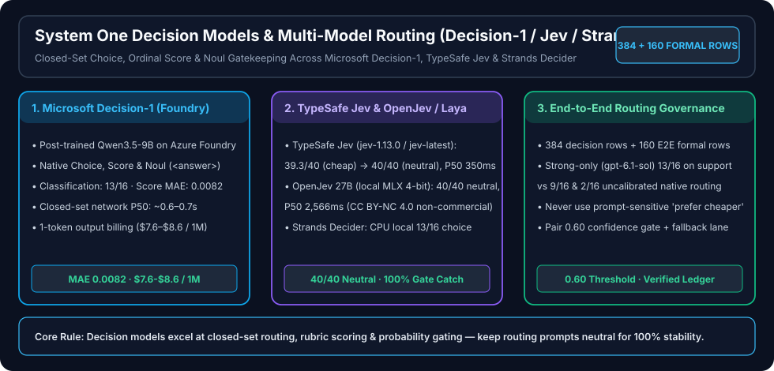

# Jev / Microsoft-Decision-1 / Strands Decider & Foundry Multi-Model Routing Study

> 🌐 **Language / 语言切换**: **[🇬🇧 English (README.en.md)](README.en.md)** | **[🇨🇳 中文版 (README.md)](README.md)** | **[📊 Switchyard 8-Engine × 3,880-Call Benchmark (`../openai-decisions-vs-decision-1-routing-benchmark/README.en.md`)](../openai-decisions-vs-decision-1-routing-benchmark/README.en.md)**

> **Executive Summary**:
> **Dedicated System One decision models excel at closed-set classification, tool/model routing, probability gating, and rubric scoring—they do not replace open-ended generation, multi-step reasoning, or deterministic authorization controls.** This study evaluates **TypeSafe Jev (`jev-1.13.0`)**, **Microsoft-Decision-1 (post-trained `Qwen3.5-9B` on Azure AI Foundry)**, and **Strands Decider (local CPU)** paired with **`gpt-5.4-mini` and `gpt-6.1-sol`** across **`384` decision rows + `160` formal end-to-end (E2E) rows**:
> 1. **Microsoft-Decision-1 Classification & Rubric Accuracy**: Achieves **`13 / 16` closed-set classification** and a **Score MAE of `0.0082`** with a closed-set network P50 of **`~0.6–0.7s`**, billing only 1 output token (`$7.6–$8.6 / 1M` decisions in Switchyard).
> 2. **Strands Decider Local CPU Baseline**: Reaches **`13 / 16` closed-set classification** and `16 / 16` on RAG routing on local CPU (`4 / 16` on rubric scoring, `2 / 16` on customer-support E2E), confirming that single-token `<answer>` logprob protocols work well for lightweight closed-set routing while trailing `9B` `Microsoft-Decision-1` on fine-grained rubric calibration.
> 3. **End-to-End Routing Governance**: On customer support (`n=16`), `strong-only (gpt-6.1-sol)` (`13/16`) outperforms uncalibrated native routing (`9/16` and `2/16`). Production routing must remove `"prefer cheaper"` bias phrasing and pair a `0.60` confidence gate with strong-model fallback.

---

## 1. Key Evaluation Matrix (`384 Decision + 160 E2E Formal Rows`)

| Model / Routing Strategy | Runtime & Architecture | Closed-Set Choice | Rubric Scoring | Support E2E (`n=16`) | RAG E2E (`n=16`) | Production Role |
|---|---|---:|---:|---:|---:|---|
| **Microsoft-Decision-1** | Azure AI Foundry Managed (`Qwen3.5-9B`) | **`13 / 16`** | **MAE `0.0082`** | `9 / 16` (Native Routing) | **`16 / 16`** | Primary cloud closed-set classifier, rubric scorer & confidence gate |
| **Strands Decider (Local CPU)** | Local open weights (CPU inference) | **`13 / 16`** | `4 / 16` pass | `2 / 16` (Native Routing) | **`16 / 16`** | Zero-API-fee local/edge closed-set pre-filter |
| **TypeSafe Jev (`jev-1.13.0`)** | Managed System One API (`40/40` neutral in Switchyard) | `98.3%–100%` (Switchyard) | Native `Score` | `untested_missing_external_api_key` | `untested_missing_external_api_key` | Lowest-latency (`~350ms`) commercial System One router |
| **Strong-Only (`gpt-6.1-sol`)** | Direct Foundry flagship generation | — | — | **`13 / 16` (Best E2E)** | **`16 / 16`** | Quality ceiling & fallback target when router confidence `< 0.60` |

---

## 2. Deliverable Entrypoints

- **Chinese Primary Report**: [`README.md`](README.md)
- **Architecture & Routing Topology**: [`architecture.md`](architecture.md)
- **Benchmark Protocol (`920-row` pool & frozen subset)**: [`benchmark.md`](benchmark.md)
- **Results (`7-Card` + 3 SVG Scatter Plots)**: [`results.md`](results.md) · [`visual-report.html`](visual-report.html) · [`visual-report-deck.json`](visual-report-deck.json)
- **Evidence Ledger & Review Log**: [`evidence.json`](evidence.json) · [`review.md`](review.md)
