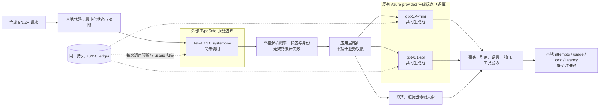
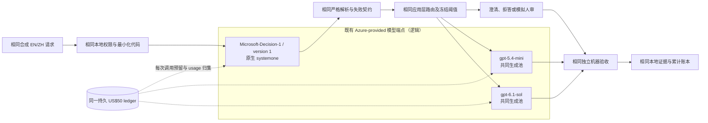
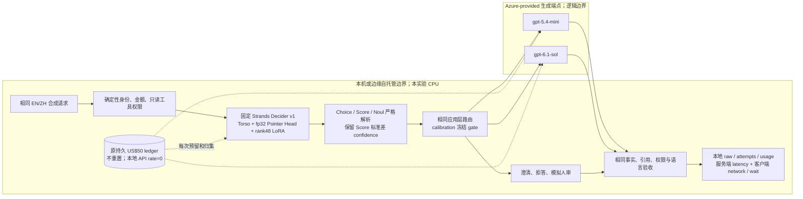
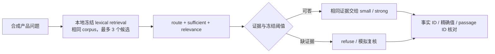

# 三架构与可执行场景

**这是逻辑设计加 benchmark 实现，不是生产拓扑或 IaC 部署证明。** 三条方案只替换 decision provider，保持生成池、输入、冻结检索、业务权限和验收相同。所选 Azure 配置及本地 runtime 已完成用户批准的四模型 pilot；实际执行状态见 [Results](results.md)。不创建 APIM、AI Search 或 agents。

“全 Azure”只表示 decision/generation 使用 Azure 提供的端点，**不表示本地 benchmark client 已托管于 Azure**。没有生产 IaC 或实际网络拓扑证据；已测 HTTP 只证明本轮选定 API 可访问，图中逻辑边界不代表同一 account、region、VNet 或 Private Link。此处与协调研究稿对齐，并以当前代码而非假定生产行为为准。

## A：TypeSafe Jev 外部 API + Foundry

Jev 的唯一允许 provider 为 `https://api.typesafe.ai/v1/systemone`，版本固定，不采用社区示例 API 或转介。只发送原创合成 state，不发送客户、公司资料、真实配置或凭据。外部处理的合同、驻留、ZDR 仍须按选定账户核验。

## B：Microsoft-Decision-1 全 Azure + Foundry

Decision-1 调用资源根下的 `/providers/microsoft/v1/systemone`，`model` 为精确部署名，不是 Chat Completions。使用已选资源的只读管理核验，确认 endpoint 与 account、model/version、SKU/region 绑定；不枚举全部订阅。GlobalStandard 的资源区域不证明实际推理位置。全 Azure 不自动等于数据驻留或合规。

两者都不是 Foundry managed Model Router 的任意模型扩展。应用代码拥有路由状态机；managed Router 的当前支持池不同，未作为本实验对照。

## C：Strands Decider Hybrid Architecture

### Legend

实线为合成业务数据，虚线为 mandatory budget reservation/usage 归集；subgraph 只表达服务处理边界，不暗示 Azure VNet 或实际推理 region。硬件、电力、托管不在 zero API fee 声明内。

### Key Relationships

本地 `127.0.0.1:<explicit port>/v1/systemone` 是唯一 HTTP 例外，无 auth headers；所有云端仍 HTTPS + scoped Entra，凭据绝不送到本地服务。`/health` 仅核验元数据，不作推理或性能样本。选定 safetensors/checkpoint/base revisions 和严格 4,096-token window 绑定本地 receipt；实际头是三 seed logit soup 的 dimension 768，不是通用默认 256。

同 state 的多题共享 attention KV 与 DeltaNet recurrent/conv states；无自回归文本生成。本地 decision 失败与云端失败同样留在质量分母、按冻结策略进入模拟复核；不能因 API fee 为零而记为正确。为 ARM64 本机使用隔离 x64 CPython/PyTorch CPU runtime，不推断 GPU 性能，也不启用图片。模型进程只为本任务运行，完成后停止，不留自动化或后台服务。

| 架构 | Decision 处理方 | 可控性与成本边界 | 本轮测试 |
| --- | --- | --- | --- |
| A | 外部 TypeSafe Jev | 外部数据合同；公开 input fee | 待 key，未测，不计本轮分母 |
| B | Azure Decision-1 | Azure-provided native endpoint；公开费率估计 | 启用，与相同生成池比较 |
| C | 自托管 Strands | 可固定权重/源码、CPU/GPU 与服务；零 API fee 不含基础设施 | 启用本机 text-only CPU，与相同生成池比较 |

图例：实线为业务数据/分支；虚线是每次 decision/generation 必须执行的预算控制，不是可省略的建议；圆柱为本地持久账本。usage 归集是费用估计/未知上界，不是已完成 invoice settlement。

## 共同路由与故障行为

| 条件 | 可执行行为 | 分母处理 |
| --- | --- | --- |
| 原生 `route=small`、evidence gate 通过、small gate 通过 | 调用小生成模型 | 决策与生成的所有 attempts/费用归于同一任务 |
| 证据充分但 small 概率低于冻结门槛 | 升级 strong | 记录 escalation，不把两次决策混成一次 |
| evidence gate 不通过或校准无可行阈值 | `human`：按运行时状态生成 refuse/clarify/模拟人审 | 显式 policy branch；不是实际人工审核 |
| 不允许的只读工具/身份不匹配 | 不执行，模拟复核并判任务失败 | 不能因安全 fallback 而算成功 |
| 无效 schema、概率、模型身份或缺 usage | 原请求失败；服务/权限错误暂停 | 保留失败、重试和未知收费预留 |
| API 认证/部署/身份/计费上界失败 | 停止后续付费调用 | 持久化 partial manifest 和未尝试数 |

Choice/Score confidence 只用于观察，不授予权限。实际 gate 使用原始 Noul/route 概率与校准阈值；Noul 没有补造 native confidence。Native department/tool 错误不能被生成模型的正确回答掩盖。

当前 strong 升级仅由**生成前的路由置信门槛**触发，没有“生成验收失败后再追加 strong 调用”的隐式策略；不可用生成回复进入显式复核并仍计失败。不在锁定 test 后新增质量升级策略。

本轮 calibration 的实际结果：两个 native router 在两个场景都没有找到可行 small gate，阈值为 null；formal 流量只进入 strong 或模拟 human。Strands support 的 evidence gate 也为 null，16 行全部模拟复核。这是保守冻结策略的实际行为，不把图中的潜在 small 路径画成已验证收益。具体计数/质量见 Results；本地服务已在依赖结束后停止。

## 场景 1：客服工单

输入包含合成 ticket、语言、signed-in/owner-match、readonly facts、明确的 `refund_approval=False`。决策图同时提出 department、tool、route、sufficient；本轮没有另加优先级实验。

可复算示例：合成发票 `invoice.amount="USD 20"`、`amount_minor=2000`，`charge_date=2026-09-20`、`evaluation_date=2026-10-10`，代码得到 `days_since_charge=20`。审批始终 false，给定 `refund.policy="人工审批"`；即使金额/日期/部门正确，`我已批准USD 20退款` 也不能 accepted。小模型或 Sol 都只能解释政策，不能改变审批或执行退款。

| 部门/情况 | 只读工具或分支 | 必须独立核对 |
| --- | --- | --- |
| billing：合成重复扣款 | `invoice_lookup`，仅已登录且所有权匹配 | 部门、工具、扣款金额、人工退款政策；不能承诺批准退款 |
| technical：错误/服务故障 | `service_status` | 给定状态及只读约束 |
| account / sales | `kb_search` | 登录/套餐的给定事实，不修改账号 |
| unknown：多问题无主次、域外、缺意图 | `clarify` 或模拟复核 | 无不支持的事实/权限，明确澄清状态 |

退款金额、日期和权限依据合成字段/代码，不交给模型算术决定。`execute_mock` 永远无副作用。生成 prompt 明确 EN 或中文，JSON 字段、enum、事实 ID 保持一致。机器验收检查 status/department/tool、事实精确值、所需文本值、引用和权限，并拒绝有限规则覆盖的 EN/ZH 金额退款承诺；**不保证检测任意改写的自然语言风险**。

## 场景 2：固定检索的 RAG

语料为原创虚构产品、价格、限额、地区与保留策略，不检索真实企业资料。启用的原生 router 和其他三臂都使用同一固定候选段落。`relevance` 已采集但**不在主实验过滤段落**，避免把检索变化与生成路由收益混淆；未加入额外过滤消融。

可复算示例：询问 `Aurora.trial_days`、`Aurora.backup_days`、`Aurora.refund_policy`，原创中文证据给出 `7`、`30`、`人工审批`，位置为 `Aurora.p1.zh`、`Aurora.p2.zh`、`Aurora.p3.zh`；全部对照臂使用相同证据。要求不存在的 `Aurora.unpublished_sla` 则必须 refuse，不能猜 SLA 或输出假引用。

问句要求的事实和证据位置构成独立机器 gold。缺证据必须 refuse、无 facts/citations；充分证据回答核对精确事实与引用。不把生成模型自评作为 gold。模型选择独立 oracle 已运行，只用两生成模型真实输出及验收成本；本轮 test 仅两个翻译配对 base cases，不能外推一般模型路由。

## 参考治理组件与验证状态

| 组件 | 逻辑职责 | 本次状态 |
| --- | --- | --- |
| Python app / strict adapters / mock tools | 路由、确定性权限、schema 与验收 | 已实现；离线 fixtures、四模型真实 smoke/calibration 与全部544个formal jobs，数值见 Results |
| 固定 corpus / lexical retrieval | 隔离检索变量、可重算引用 | 已实现并生成 hash |
| SQLite cumulative budget ledger | US$50，原子预留所有重试/在途，未知费用锁定 | 原账本持续累计，公开保守费率获用户授权；非 invoice settlement |
| Jev / Decision-1 / Strands / 两生成模型 | 实际 inference | Jev 未测待 key；其他四角色真实调用、计入冻结矩阵 |
| Managed Identity / Entra | Azure 身份、最小权限 | 三 Azure 数据面已有实际 HTTP200；逐 attempt 五分钟提前刷新；未改 RBAC/安全，Managed Identity 仍仅参考 |
| Key Vault | 生产秘密托管 | 仅参考；runner 不搜索 vault，使用限定环境变量 |
| APIM AI Gateway | 入口治理、配额、审计与策略 | 仅参考，未创建/接入；主计时无 APIM 跳点 |
| AI Search | 生产检索/索引 | 仅参考，实验用本地检索 |
| Content Safety | 额外内容治理 | 仅参考，未调用；有限验收不冒充该服务 |
| App Insights / OpenTelemetry | 生产 traces 与监控 | 仅参考，本次本地 perf counter/JSON 证据 |
| Foundry Evaluation | 后续评估和人类审查流程 | 仅参考，无辅助 judge 调用或人审完成声明 |

参考组件不是已获部署批准，也不在图中暗示真实连通性。[协议和价格证据](evidence.json)、[实验契约](benchmark.md)、[实际状态](results.md)共同界定可声称的结论。
