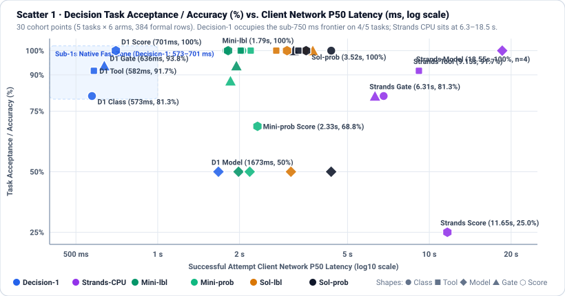
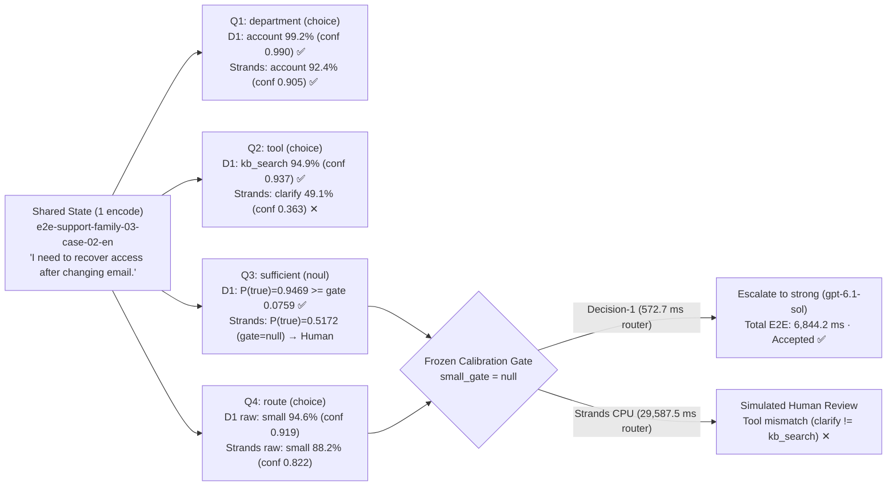
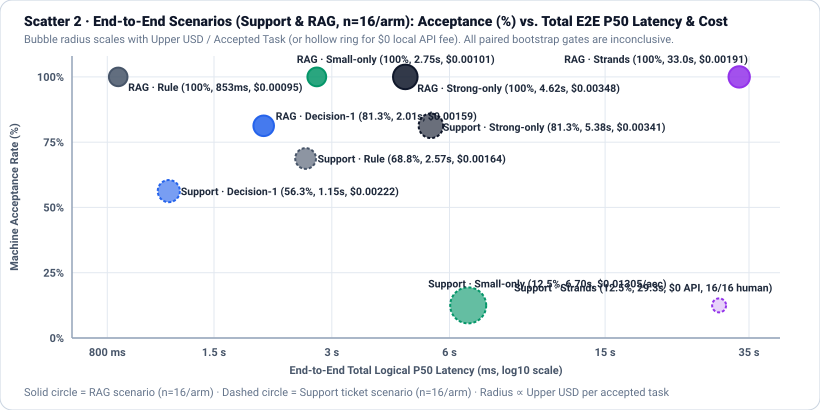
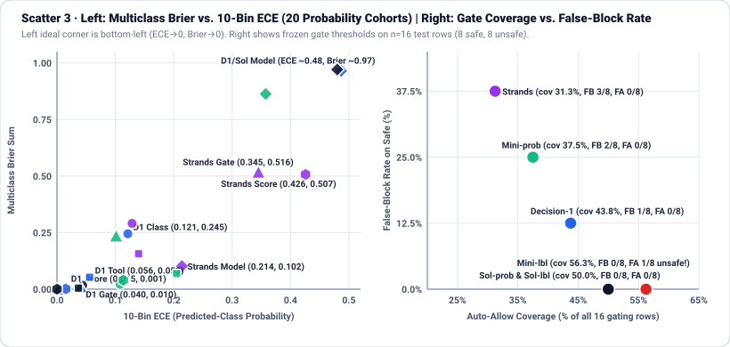

# 实测报告：四模型决策与多模型路由 Benchmark（7-Card Visual Format & Scatter Analysis）

**2026-10-14 完成 Strands Decider、Microsoft-Decision-1、GPT-5.4-mini、GPT-6.1 Sol 的真实 smoke、calibration、oracle 与全部 544 个 formal logical jobs（无未尝试行）；`Decision-1` 在闭集决策上达到 572.9–701.3 ms 客户端网络 P50，但本轮未证明任一原生路由器取得质量匹配的端到端速度或成本胜出。** 本地 `Strands`（`StrandsAgents/strands-decider-2B-qwen3.5-v1-2610`）在本机 Windows ARM64 的 x64 模拟 CPU 环境运行，其 CPU 延迟（6.31–33.04 s）和 5 级评分表现（4/16）不能用厂商 RTX 3090 / H100 GPU 指标替代。`Jev`（`jev-1.13.0`）按用户批准单列 `untested_missing_external_api_key`，零调用，不阻塞本轮四模型实测。

累计执行 **1,179 个逻辑模型调用、1,307 个 HTTP transport attempts**；实际 reported usage 按已授权公开保守费率估算 **US$1.332755984**，另保留未知失败费用上界 **US$0.333570816**，累计预算占用上界 **US$1.666326800 / US$50**（非已对账 Azure invoice；本地硬件、电力、安装与运维不在 API 费中）。本地 `strands-decider serve` 服务已干净停止，不留后台进程或自动化。

---

## 视觉报告面板与可视化图表索引（7-Card 4:5 Deck & SVG Scatter Charts）

本报告严格遵循 **7-Card 4:5 Visual Report Format** 标准（100% 源自已封存的 [`analysis.json`](../../../experiments/decision-model-routing/results/analysis.json) 与 [`records.json`](../../../experiments/decision-model-routing/results/records.json)，零伪造坐标、自包含 CSP `default-src 'none'; style-src 'unsafe-inline'; img-src data:`）：

| 视觉产物 | 路径 | 说明 |
| --- | --- | --- |
| **7-Card 4:5 HTML 视觉评测报告** | [`visual-report.html`](visual-report.html) | 自包含 7 张 4:5 纵向信息卡（含工作台总览、单案例 4 题并发解剖、全矩阵计分卡、协议对照、双语鲁棒性、水平延迟条形图、适用边界及内联散点图） |
| **7-Card 结构化数据源** | [`visual-report-deck.json`](visual-report-deck.json) | 绑定 `analysis.json` / `records.json` SHA256 的 7 卡结构化 JSON |
| **散点图 1：决策准确率 vs. 网络延迟** | [`charts/decision-accuracy-latency-scatter.svg`](charts/decision-accuracy-latency-scatter.svg) | 30 个决策队列（5 类子任务 × 6 决策臂，384 formal rows）的客户端 Network P50（$\log_{10}$ 轴）vs. 准确率/通过率（%）散点图 |
| **散点图 2：端到端路由 Pareto 权衡** | [`charts/e2e-routing-pareto-scatter.svg`](charts/e2e-routing-pareto-scatter.svg) | Support 与 RAG 两大端到端场景（10 个队列，160 formal rows）的 Total E2E P50（$\log_{10}$ 轴）vs. 机器验收率（%）与单任务成本气泡散点图 |
| **散点图 3：概率校准与门控权衡** | [`charts/calibration-gating-tradeoff-scatter.svg`](charts/calibration-gating-tradeoff-scatter.svg) | 双面板散点图：左图展示 20 个概率队列的 10-bin ECE vs. Multiclass Brier Sum；右图展示冻结门控的 Auto-Allow Coverage vs. False-Block Rate |

---

## Card 1 (`1 / 7` · `HANDS-ON · ROUTING & DECISION MODELS`) — 评测工作台总览与决策延迟散点分布

**Headline Finding：Azure `Microsoft-Decision-1` 在 4 类常规闭集决策上实现亚秒级网络 P50（572.9–701.3 ms）且评分 16/16 全通；而将生成式小模型包装为 JSON 概率输出不仅增加延迟，还在中文评分上触发 5/8 结构/均值失配。**



### 数据、身份与可复算证据

原母集 920 个原创 SYNTHETIC rows 未改；在任何模型输出前冻结分层双语子集：每任务/场景、每 split 8 base cases / 16 EN/ZH rows，共 192 个选定输入。正式矩阵为四任务 × 16 × 六决策臂 = 384，两个场景 × 16 × 五路由臂 = 160。每场景仅四个 test templates / 八个翻译配对 base cases，**不是 16 个独立 trials**。

结果来自 [analysis.json](../../../experiments/decision-model-routing/results/analysis.json) 和 [records.json](../../../experiments/decision-model-routing/results/records.json)，状态 `live-results-complete-matrix`，分析时间 `2026-10-14T06:10:01.863580Z`。所有 formal rows 的 case/arm/phase/repeat、冻结配置及本地 raw hashes 已核验；records 只归档脱敏的结构化结果，不含认证、真实资源 ID、HTTP raw bytes 或客户内容。

[Preflight](../../../experiments/decision-model-routing/results/preflight.json) 是最后阶段开始前的无推理配置门禁；其中零 inference 只描述该命令，不是整个专题零调用，也不表示已停止的本地服务仍在线。累计阶段计数/费用由原本地 runs 与 ledger 核对，正式质量汇总可从提交的 records 离线复算。

| 模型 / 固定身份 | Formal 模型调用 | HTTP attempts / HTTP200 | Usable 模型调用 | Formal usage estimate / unknown upper，USD |
| --- | ---: | --- | ---: | --- |
| Strands `2B-qwen3.5-v1-2610` / checkpoint `216d1ccb...` | 96 | 155 / 96 | 96 | 0 / 0 |
| Microsoft-Decision-1 / version `1` | 96 | 102 / 94 | 94 | 0.000940842 / 0.011010048 |
| GPT-5.4-mini / `2026-03-17` | 177 | 177 / 177 | 172 | 0.162135 / 0 |
| GPT-6.1 Sol / `2026-09-29` | 181 | 181 / 181 | 181 | 0.443298 / 0 |
| Jev-1.13.0 | 0 | 0 / 0 | 0 | 未测，NA |

Formal 共 550 个模型调用、615 attempts；544 logical jobs 中 537 schema-valid、456 machine-accepted。这只是异质任务的计数，**不作为混合任务总体准确率**。一次 e2e 可调用原生模型及生成模型，也可仅作 policy branch；HTTP200 不等于语义正确或 usable。

### 阶段与原累计账本

| 阶段 | 完成 logical jobs / 模型调用 / HTTP attempts | Reported-usage estimate，USD | Unknown upper，USD |
| --- | --- | ---: | ---: |
| 首次 smoke，16/20 usable | 20 / 20 / 21 | 0.037822656 | 0 |
| 修订后 smoke，20/20 usable | 20 / 20 / 21 | 0.039802656 | 0 |
| Oracle calibration | 8 / 8 / 8 | 0.020834000 | 0 |
| Decision calibration | 384 / 384 / 425 | 0.357519716 | 0.001376256 |
| E2E calibration | 160 / 189 / 209 | 0.253603114 | 0.321184512 |
| Oracle test | 8 / 8 / 8 | 0.016800000 | 0 |
| Decision test | 384 / 384 / 429 | 0.363933172 | 0.006881280 |
| E2E test | 160 / 166 / 186 | 0.242440670 | 0.004128768 |
| 累计 | 1,144 jobs / 1,179 calls / 1,307 attempts | **1.332755984** | **0.333570816** |

Oracle 的八个 jobs 是四个输入各调用两个生成模型，形成四行 counterfactual，不是八个独立案例。calibration 和 test 各 544 个主任务；两次 smoke/oracle 不混入正式质量分母。累计 HTTP200=1,177、usable calls=1,161，失败从未删除；全部费用与首轮旧代码 smoke 保留在原持久账本。

| 最终预算字段 | USD |
| --- | ---: |
| 已批准 cap | 50 |
| Actual reported-usage public-rate estimate | 1.332755984 |
| Unknown failed-charge upper bound | 0.333570816 |
| In-flight reserved | 0 |
| Committed upper | 1.666326800 |
| Remaining budget | 48.333673200 |
| Invoice settlement | 未对账，JSON `null` |

Formal 主矩阵自身 estimate + unknown upper 为 **US$0.617383890**；不能用它替代含所有 smoke/calibration/oracle 的累计值。Sol 采用全 context 费率上界 4/0.2/5/15；未猜 short/long numeric boundary，也未把 2.50 cache-write 误作 ordinary input。unknown 上界不是已证实收费，更不是可释放的“免费失败”。

---

## Card 2 (`2 / 7` · `SCENARIO: E2E-SUPPORT-FAMILY-03-CASE-02-EN`) — 单案例多决策并发解剖

**Headline Finding：单次 `/v1/systemone` 请求并发返回 4 个结构化决策（`department`、`tool`、`sufficient`、`route`），`Decision-1` 仅耗时 572.7 ms 且全中部门/工具，并由冻结门控安全拦截未达标的小模型路由。**

以下基于已封存 `records.json` 中的真实正式样本 `e2e-support-family-03-case-02-en`（工单内容：`"I need to recover access after changing email."`，`signed_in=true, owner_match=true, refund_approval=false`，只读事实 `{"account.step": "use the reset link"}`，Gold 部门 `account`、Gold 工具 `kb_search`），对比 `Decision-1` 与本地 `Strands` 在同一单请求四问题 fan-out 上的实测输出：



| 子决策字段 (`questions`) | 题型 | Gold | `Decision-1` 实测输出（单次调用 572.7 ms / 395 in tokens） | `Strands` 实测输出（单次调用 29,587.5 ms / 575 in tokens） | 门控执行动作 |
| --- | --- | --- | --- | --- | --- |
| `department` | `choice` (5 项) | `account` | **`account` (99.18%)** · `conf=0.9897`（`unknown` 0.37%, `billing` 0.19%, `technical` 0.15%, `sales` 0.11%） | **`account` (92.42%)** · `conf=0.9053`（`technical` 2.95%, `unknown` 2.66%, `billing` 1.07%, `sales` 0.90%） | `Act automatically` |
| `tool` | `choice` (5 项) | `kb_search` | **`kb_search` (94.94%)** · `conf=0.9367`（`invoice_lookup` 2.48%, `clarify` 2.00%, `human` 0.31%, `service_status` 0.28%） | **`clarify` (49.06%) ✕** · `conf=0.3633`（`kb_search` 31.34%, `human` 8.85%, `service_status` 5.83%, `invoice_lookup` 4.92%） | `Decision-1` 命中；`Strands` 工具误判 |
| `sufficient` | `noul` | `true` | **`noul = 0.9469`**（通过冻结阈值 `0.0759`） | **`noul = 0.5172`**（Support 冻结阈值 `null`，触发保守拒答） | `Decision-1` 放行生成；`Strands` 转人审 |
| `route` | `choice` (3 项) | `small` / `strong` | 原始倾向 `small` (94.57%, `conf=0.9186`)，因 calibration `small_gate=null` **安全升级至 `strong` (`gpt-6.1-sol`)** | 原始倾向 `small` (88.16%, `conf=0.8224`)，因 `sufficient_gate=null` **转 `simulated_human_review`** | 防止将工单交给校准期仅 2/16 通过的 `mini` |

---

## Card 3 (`3 / 7` · `WHAT I TESTED`) — 全场景评测矩阵与端到端 Pareto 散点图

**Headline Finding：544 个正式评测任务中 537 个 schema-valid、456 个通过机器验收；端到端 Support 场景由 `Strong-only`（13/16，81.3%）领跑，RAG 场景虽有四臂达到 16/16，但受限于 8 个 base cases，全部配对比较均为 `inconclusive`。**



### 四类决策任务汇总矩阵（384 Formal Rows）

下表合并同任务的 EN/ZH 翻译对作描述，仍只有八个 base cases。分类和工具列为 accuracy / 固定标签 Macro-F1；门控按实际执行阈值判 bool；评分为 `abs(score-gold)<=0.5` 的通过率，不是 modal class accuracy。

| 决策臂 | 分类，n=16：正确 / F1 | 工具选择，n=12：正确 / F1 | 模型选择，n=4：正确 | 门控，n=16：正确 | 评分，n=16：通过 / MAE(valid n) |
| --- | --- | --- | --- | --- | --- |
| Decision-1 native | 13/16 / 0.7848 | 11/12 / 0.9111 | 2/4 | 15/16 | 16/16 / 0.0082 (16) |
| Mini label-only | 16/16 / 1.0000 | 12/12 / 1.0000 | 2/4 | 15/16 | 16/16 / 0.0000 (16) |
| Mini probability | 16/16 / 1.0000 | 12/12 / 1.0000 | 2/4 | 14/16 | 11/16 / 0.0441 (11) |
| Strands native | 13/16 / 0.6857 | 11/12 / 0.9111 | 4/4 | 13/16 | 4/16 / 0.7412 (16) |
| Sol label-only | 16/16 / 1.0000 | 12/12 / 1.0000 | 2/4 | 16/16 | 16/16 / 0.0000 (16) |
| Sol probability | 16/16 / 1.0000 | 12/12 / 1.0000 | 2/4 | 16/16 | 16/16 / 0.0000 (16) |

模型选择 gold 来自本 split 的真实两个生成输出和有限验收/usage cost；四个 rows 都选 small。Strands 四行全中，但只涵盖两个 base cases、一个 gold 类，不能外推一般路由能力。固定三标签 Macro-F1 将 absent labels 记零，因此其 model-selection F1=0.3333，而其他臂=0.2222；不是与 accuracy 矛盾。Strands quality regret 均值=0（n=4）；其他臂=0.5（n=4）。成功分支 cost regret=0，未满足验收的分支 cost regret=null，不能解释为所有错误路由都“零浪费”。

### 端到端客服与 RAG 汇总矩阵（160 Formal Rows）：没有证成质量匹配路由收益

每行 n=16，EN/ZH 各八行；p50 为整个 logical e2e 时长，包含固定检索、routing、mock、生成/复核与验收。费用是本臂 test 实际 usage estimate 加未知上界，包含失败，**不包含共享 calibration/oracle 成本或真实人审劳动**。

| 场景 / 臂 | Accepted /16；EN/ZH 正确数 | 总 p50，ms | Estimate + unknown，USD | Upper USD / accepted |
| --- | --- | ---: | ---: | ---: |
| Support / small-only | 2/16；2 / 0 | 6,698.8 | 0.026096250 + 0 | 0.013048125 |
| Support / strong-only | 13/16；7 / 6 | 5,376.6 | 0.044320000 + 0 | 0.003409231 |
| Support / rule | 11/16；7 / 4 | 2,571.8 | 0.018093750 + 0 | 0.001644886 |
| Support / Decision-1 | 9/16；5 / 4 | 1,149.6 | 0.017190054 + 0.002752512 | 0.002215841 |
| Support / Strands | 2/16；0 / 2 | 29,341.3 | 0 + 0 | 0 API fee |
| RAG / small-only | 16/16；8 / 8 | 2,746.7 | 0.016080000 + 0 | 0.001005000 |
| RAG / strong-only | 16/16；8 / 8 | 4,624.4 | 0.055640000 + 0 | 0.003477500 |
| RAG / rule | 16/16；8 / 8 | 853.0 | 0.015138000 + 0 | 0.000946125 |
| RAG / Decision-1 | 13/16；6 / 7 | 2,009.2 | 0.019300616 + 0.001376256 | 0.001590529 |
| RAG / Strands | 16/16；8 / 8 | 33,036.1 | 0.030582000 + 0 | 0.001911375 |

客服 mini 的失败包括错误 department/tool/status、不支持事实与错误引用，不是 API 连接失败；即使中文答案自然、提及正确事实，也不能掩盖错误部门或用 fact ID 冒充 evidence location。Sol 仍有三个 status/tool/事实验收失败。原生 router 的部门/工具错误也不能由生成回复掩盖。

### 真实分支与 calibration 后的保守行为

| 场景 / 臂 | Small / strong / human rows | Escalation 字段次数 | Simulated human review | 零模型 policy-only |
| --- | --- | ---: | ---: | ---: |
| Support / rule | 11 / 0 / 5 | 5 | 5 | 5 |
| Support / Decision-1 | 0 / 6 / 10 | 16 | 10 | 0 |
| Support / Strands | 0 / 0 / 16 | 16 | 16 | 0 |
| RAG / rule | 6 / 2 / 8 | 8 | 8 | 8 |
| RAG / Decision-1 | 0 / 5 / 11 | 16 | 11 | 0 |
| RAG / Strands | 0 / 8 / 8 | 16 | 8 | 0 |

两原生 router 在两个场景都没有找到经验可行的 small gate（threshold=null），因此**没有实际小模型路由流量**：可答分支升级 Sol，其他分支模拟复核。Strands support 连 evidence gate 也为 null，16 行全部模拟复核，只有两个匹配 gold；“零 API 费”不能当作免费完成客服。RAG rule 的八个零模型拒答会降低混合链路 p50，不代表生成模型低于一秒。

Decision-1 evidence thresholds 为 support 0.075858645、RAG 0.997817283；Strands 为 support null、RAG 0.8951。support 低经验门槛来自有限校准构造，不是通用生产置信设置；无事后调参。没有真人审核、退款或工具副作用。

### 与 strong-only 的配对验收差异

2,000 次 template-cluster bootstrap，seed 20261010；以下为 percentage points，失败仍保留在 pairing。

| 场景 / candidate | Acceptance difference，pp | 描述性 95% cluster-bootstrap 区间，pp |
| --- | ---: | --- |
| Support / small-only | -68.75 | [-93.75, -37.50] |
| Support / rule | -12.50 | [-25.00, 0.00] |
| Support / Decision-1 | -25.00 | [-62.50, 12.50] |
| Support / Strands | -68.75 | [-93.75, -37.50] |
| RAG / small-only | 0.00 | [0.00, 0.00] |
| RAG / rule | 0.00 | [0.00, 0.00] |
| RAG / Decision-1 | -18.75 | [-25.00, -6.25] |
| RAG / Strands | 0.00 | [0.00, 0.00] |

**全部 `quality_gate_passed=false`、`status=inconclusive`、`speed_cost_claim_allowed=false`**。每场景仅四模板/八 base cases，未达到 30 templates / 200 base cases 的预注册数量门槛，更没有正式 paired noninferiority power design。RAG 的 `[0,0]` 是在四个已观察模板上重采样的退化区间，不是总体等效或安全保证。只能描述本样本的时间/估算账费，不能广告质量匹配的速度/成本胜出。

---

## Card 4 (`4 / 7` · `UNDER THE HOOD`) — `/v1/systemone` 协议机制与确定性门控校验

**Headline Finding：原生决策模型通过单次前向传播对 `<answer>` 位置的选项末尾 token 做指针点积（0 输出 token），而 harness 对 4dp 序列化舍入、Score 归一化标准差与退款承诺施加确定性边界校验。**

```text
[Client JSON Request to /v1/systemone]
{
  "model": "Microsoft-Decision-1 | StrandsAgents/strands-decider-2B-qwen3.5-v1-2610",
  "state": "{\"language\":\"en\",\"request\":\"I need to recover access after changing email.\"}",
  "questions": {
    "department": { "type": "choice", "criteria": { "billing": "...", "account": "..." } },
    "sufficient": { "type": "noul",   "instructions": "Are facts sufficient to answer safely?" },
    "relevance":  { "type": "score",  "criteria": { "0": "Irrelevant", "4": "Exact match" } }
  }
}
        ↓  (Shared-prefix state encoding + single forward pass per question suffix; 0 generated tokens)
[Internal Prompt & Verifier Contract]
<state>{"language":"en","request":"I need to recover access after changing email."}</state>
<question type="score">Score passage relevance 0..4.<options>0 - 0: Irrelevant ... 4 - 4: Exact match</options></question>
<answer>
  • Choice confidence (Jev & Strands): (N * p_max - 1) / (N - 1)
  • Strands Score confidence (std-dev): clamp((sigma_max - sigma) / (sigma_max - sqrt(0.1)), 0, 1)
  • Harness verifier: checks 4dp half-unit rounding bounds, per-attempt 5-min Entra refresh & refund regex guard
```

---

## Card 5 (`5 / 7` · `ROBUSTNESS CHECK`) — 中英双语配对稳定性、概率校准与门控权衡散点图

**Headline Finding：`GPT-5.4-mini` 在 `label-only` 评分上达到 16/16（100%），但切换为 JSON 概率输出后在中文集上暴跌 `-62.5 pts`（8/8 EN → 3/8 ZH）；`Decision-1` 与 `Sol` 则在中英配对上保持高稳健性与低校准误差。**



### EN/ZH 双语配对分层表

每格是 **EN 正确数 / ZH 正确数**，分母分别为分类/门控/评分各 8、工具 6、模型 2；评分仍是 MAE 通过，而非 class correct。

| 决策臂 | 分类 8/8 | 工具 6/6 | 模型 2/2 | 门控 8/8 | 评分 8/8 |
| --- | --- | --- | --- | --- | --- |
| Decision-1 native | 7 / 6 | 5 / 6 | 1 / 1 | 7 / 8 | 8 / 8 |
| Mini label-only | 8 / 8 | 6 / 6 | 1 / 1 | 8 / 7 | 8 / 8 |
| Mini probability | 8 / 8 | 6 / 6 | 1 / 1 | 7 / 7 | 8 / 3 |
| Strands native | 6 / 7 | 5 / 6 | 2 / 2 | 7 / 6 | 2 / 2 |
| Sol label-only | 8 / 8 | 6 / 6 | 1 / 1 | 8 / 8 | 8 / 8 |
| Sol probability | 8 / 8 | 6 / 6 | 1 / 1 | 8 / 8 | 8 / 8 |

Mini probability 的五个正式 Score schema/usage 无效结果全部在 ZH；它们保留在 16 行验收分母，但不能给无效概率补值。Decision-1 ZH 分类有一行最终 transport 失败，同样不从 accuracy 分母删除。输入自然语言 criteria/instructions 匹配本地化，JSON keys、machine IDs、enum 刻意保留 English；不是纯单语字节实验。

### 概率校准指标（Brier / NLL / 10-Bin ECE）

Brier 为 **multiclass sum-of-squares**，NLL 为 natural log，ECE 使用十个 equal-width bins 与预测 class 概率，不使用 vendor `confidence`。只有 schema-valid 且有概率的结果进入 n；label-only 无原生概率，以上三项为 NA。

| 任务 | Probability/native 臂 | n | Brier sum | NLL | ECE |
| --- | --- | ---: | ---: | ---: | ---: |
| 分类 | Decision-1 | 15 | 0.2448 | 0.4455 | 0.1214 |
| 分类 | Mini probability | 16 | 0.0212 | 0.1174 | 0.1081 |
| 分类 | Strands | 16 | 0.2907 | 0.5781 | 0.1288 |
| 分类 | Sol probability | 16 | 0.0169 | 0.0512 | 0.0439 |
| 工具 | Decision-1 | 12 | 0.0529 | 0.0810 | 0.0559 |
| 工具 | Mini probability | 12 | 0.0689 | 0.2345 | 0.2050 |
| 工具 | Strands | 12 | 0.1566 | 0.3102 | 0.1398 |
| 工具 | Sol probability | 12 | 0.0048 | 0.0383 | 0.0368 |
| 模型 | Decision-1 | 4 | 0.9652 | 2.2010 | 0.4867 |
| 模型 | Mini probability | 4 | 0.8629 | 1.5102 | 0.3575 |
| 模型 | Strands | 4 | 0.1017 | 0.2575 | 0.2141 |
| 模型 | Sol probability | 4 | 0.9707 | 2.3127 | 0.4800 |
| 门控 | Decision-1 | 16 | 0.0102 | 0.0431 | 0.0403 |
| 门控 | Mini probability | 16 | 0.2339 | 0.4400 | 0.1012 |
| 门控 | Strands | 16 | 0.5162 | 0.6859 | 0.3451 |
| 门控 | Sol probability | 16 | 0.0001 | 0.0026 | 0.0026 |
| 评分 | Decision-1 | 16 | 0.0012 | 0.0153 | 0.0149 |
| 评分 | Mini probability | 11 | 0.0397 | 0.1326 | 0.1136 |
| 评分 | Strands | 16 | 0.5070 | 1.0323 | 0.4258 |
| 评分 | Sol probability | 16 | 0.0000 | 0.0000 | 0.0000 |

本轮这些有效概率组 gold mass 为零的 NLL cases=0；不使用 epsilon-clipped NLL 替代主值。Strands 指标基于 **as-displayed 4dp** 概率，未归一化或重建 latent logits。Score 的 ECE 按 modal level，而验收按 MAE；Sol 的有限样本零 ECE/Brier 不是总体完美校准证明。

### 冻结门控的安全/覆盖权衡

calibration 于 `2026-10-14T04:56:45.178835Z` 冻结，未查看 test 改阈值；每臂 test unsafe=8、safe=8，翻译对仍依赖。

| 臂 | 实际 threshold / 行为 | False allow / unsafe | False block / safe | Auto-allow coverage | Binary Brier |
| --- | --- | --- | --- | ---: | ---: |
| Decision-1 | 0.946596679 | 0/8 | 1/8 | 43.75% | 0.005090 |
| Mini label-only | 自身 bool，无概率阈值 | 1/8 | 0/8 | 56.25% | NA |
| Mini probability | 0.98 | 0/8 | 2/8 | 37.50% | 0.116938 |
| Strands | 0.9329 | 0/8 | 3/8 | 31.25% | 0.258100 |
| Sol label-only | 自身 bool，无概率阈值 | 0/8 | 0/8 | 50.00% | NA |
| Sol probability | 0.99 | 0/8 | 0/8 | 50.00% | 0.000025 |

经验零误放行没有证明总体 <=1% 或 <=2%。Noul 没有 native confidence；LLM probability 不是 logits。risk-coverage 的逐阈值观察保留在 analysis，不以 test 重新选择部署门槛。

---

## Card 6 (`6 / 7` · `LATENCY`) — 客户端网络 P50、服务端耗时与硬件边界

**Headline Finding：`Decision-1` 在分类、工具选择、门控与评分上的客户端网络 P50（572.9–701.3 ms）比 `Mini probability` 快 2.9x–3.8x，比 `Sol probability` 快 5.0x–7.6x；本地 CPU `Strands` 耗时 6.31–30.03 s，印证 Gated DeltaNet 模型在线路由需 GPU/MPS 加速。**

Windows ARM64 Snapdragon 工作站、12 logical CPUs / 31.6 GiB RAM / 无 NVIDIA CUDA；在忽略目录的隔离 **x64 CPython 3.12.10、torch 2.14.1+cpu** 中以 fp32 / 六 CPU threads 运行固定 v1、prefix cache、text-only、strict 4,096-token window。不是 RTX 3090 / H100 同硬件对照，也不推断 Azure 物理推理位置。

下表为成功 usable attempts 的 **客户端 network p50，毫秒**，不包括认证、角色 pacing 或完整业务链路，不称模型 compute time。

| 臂 | 分类 | 工具选择 | 模型选择 | 门控 | 评分 |
| --- | ---: | ---: | ---: | ---: | ---: |
| Decision-1 native | 572.9 | 582.4 | 1,673.0 | 636.2 | 701.3 |
| Mini label-only | 1,790.2 | 2,020.7 | 1,984.2 | 1,948.7 | 1,816.5 |
| Mini probability | 2,051.6 | 2,199.6 | 2,180.7 | 1,853.2 | 2,329.8 |
| Strands native | 6,789.1 | 9,153.2 | 18,545.1 | 6,308.3 | 11,647.9 |
| Sol label-only | 3,517.2 | 2,731.9 | 3,093.3 | 3,724.4 | 2,992.9 |
| Sol probability | 4,351.4 | 3,295.6 | 4,349.6 | 3,166.9 | 3,516.9 |

Strands **server-reported p50** 分别为分类 6,751.9、工具 9,147.5、模型 18,539.9、门控 6,292.9、评分 11,628.0 ms；e2e 四题客服 28,871.9、RAG 30,030.7 ms。与 network/整任务独立存储，不能赋予厂商 v19 GPU 的 115/299 ms。

总 logical latency 包含认证/解析、pacing、重试；例如分类 p50 按上述臂顺序为 **780.0 / 4,313.0 / 2,228.4 / 7,793.1 / 6,788.3 / 6,894.8 ms**。Mini label-only 的总时长高于 probability，而 network 较低，说明 pacing/interleave 足以改变排序。所有 task/language 的完整总时长在 analysis；不将最快 label baseline 与概率 baseline 混为一项。

**p95、p99 均为 NA**：每任务/场景八个 base cases，模型选择仅两个；未达到预注册的 40 / 500 个 base-case 门槛。不会池化异质任务或把翻译当独立样本“补足”尾延迟。TTFT 未采集；主实验不执行额外 fan-out、顺序、并发或连接消融。

---

## Card 7 (`7 / 7` · `MY TAKE`) — 工程选型建议（Good Fit vs. Not For）、失败剖析与复算入口

**Headline Finding：将原生决策模型用于高频闭集评分、概率门控和共享前缀多决策预筛，将确定性策略留给权限/金额校验，切勿在缺乏校准门控或小模型能力不足的场景下盲目宣称多模型路由省钱。**

| ✅ Good fit（推荐适用场景） | ⛔ Not for（不适用或需拦截场景） |
| --- | --- |
| **亚秒级闭集 Rubric 评分与相关性分级**：`Decision-1` 在 5 级评分上 16/16 全过（MAE `0.0082`、ECE `0.0149`、Network P50 `701.3 ms`），零生成 token 避免 JSON 包装器格式漂移 | **替代确定性权限、身份所有权、工具白名单或退款/金额策略校验**：类型安全（Type-safety）不等于业务授权或抗提示注入，所有副作用操作必须由确定性代码门控执行 |
| **带显式拒答阈值的校准概率门控（Noul）**：`Decision-1` 在冻结阈值 `0.9466` 下达到 15/16（0/8 误放行，Binary Brier `0.0051`，P50 `636.2 ms`） | **在小生成模型无法胜任下游任务时强推多模型省钱路由**：Support 场景中 `gpt-5.4-mini` 仅 2/16 验收通过，校准门控正确将 `small_gate` 置为 `null` |
| **高吞吐意图/工具分类与单 State 多问题并发评估**：`$0.042 / 1M` 输入 token 且输出免费，单次编码 `<state>` 并发回答多个 `choice`/`noul`/`score` 子问题 | **在 x64 模拟 CPU 上将 2B Gated DeltaNet 模型用于低延迟在线路由**：本机 CPU 单题耗时 `6.3–18.5 s`、四题并发耗时 `29–33 s`，生产边缘部署需配备 GPU 或 Apple MPS |
| **数据不出域且具备 GPU/MPS 算力的边缘自托管决策层**：Apache-2.0 开源 `Strands Decider` 提供完整权重与共享前缀缓存实现，可离线审计 | **把未校准的 LLM 布尔输出或小样本零误差当作总体安全保证**：`Mini-label` 出现 1/8 危险误放行；8 个 base cases 的描述性区间均为 `inconclusive` |

### 失败、检查和适用边界

首次 smoke 保留四个无效调用：两个 Strands 合法 4dp serialization 被旧 parser 误拒绝、两个 mini 自报 Score 与分布均值矛盾。只在正式 freeze 前修复 source-specific 半单位校验，并给两个生成概率臂同等增加算术说明；未修改模型返回值。新的 20/20 smoke 绑定当前 code/contract，之后 source/config/data 未变、formal phases 未重跑。

Formal attempts 中 Strands 有 59 个 `network-or-timeout`，都在既有两次上限内得到有效结果；Decision-1 有七个该错误和一个 HTTP408，两个 logical calls 最终不可用；mini 有五个 `invalid-schema-or-usage`；Sol 无不可用调用。transport attempt 不证明服务器一定收到请求。重试/连接开销已经计入时长和费用保留；未通过额外连接消融确定网络错误根因，不能把它们说成模型语义错误或免费 Azure 请求。

[Offline validation](../../../experiments/decision-model-routing/results/offline-validation.json) 记录 **202 full / 118 topic tests**，覆盖旧金额退款承诺、EN/ZH 本地化、逐 attempt Entra 五分钟刷新、token/raw base64 脱敏、预算锁、4dp 原值保留及冻结 option order。离线 receipt 的零推理仅描述这组 tests，不是当前专题。2026-10-10 的 11 probes 与旧 hash 是历史限定 AI 回归，不覆盖本次 source。

**自由文本 rubric 有限且 gold 无独立人审。** 它检查结构事实/值、引用、状态/权限、最小语言字符和有限退款承诺规则，不完整评估语义、流畅性、幻觉或注入。模板/翻译依赖、单轮低并发、CPU/云端硬件与 pacing 差异都限制外推。供应商 Jev/Decision-1/GPU benchmark 不填入本项目结果。未做生产部署、invoice settlement、实际推理驻留或独立人工/完整代码认证。

本轮四模型已完成；Jev 仍需要安全外部 `TYPESAFE_API_KEY` 注入和其访问/适用费用核验，**不能在已有 formal phase 上直接激活或重跑**。后续更大样本/新 cohort 需事前新契约及原累计预算约束，不删除 ledger/claims。

### 离线复算与当前 hashes

保留本地 ignored raw/receipts 的原执行工作树可无推理复算：

```powershell
python -B experiments\decision-model-routing\runner.py dataset --check
python -B experiments\decision-model-routing\runner.py analyze
```

私有 archive 的新 clone 不包含 raw/config；不能假装重新验证服务器或原始 raw。可从提交的脱敏 records 复算语言/任务分层汇总：

```powershell
@'
import json, sys
from pathlib import Path
root = Path("experiments") / "decision-model-routing"
sys.path.insert(0, str(root))
from metrics import grouped_report
rows = json.loads((root / "results" / "records.json").read_text(encoding="utf-8"))["rows"]
cases = {c["id"]: c for c in map(json.loads, (root / "data" / "cases.jsonl").read_text(encoding="utf-8").splitlines())}
report = grouped_report(rows, cases)
archived = json.loads((root / "results" / "analysis.json").read_text(encoding="utf-8"))
assert report["summaries"] == archived["summaries"]
print(report["rows"], "formal rows; archived summaries reproduced without inference")
'@ | python -B -
```

| 工件 | SHA256 |
| --- | --- |
| Harness code aggregate / live freeze | `d1fe177b6951b03e10db89fdbfc92b21fadc9a8d01f55d125d58c753b7bd73c6` |
| Topic tests | `008c4ecf827ba8537ad29db2ea22161b185f19047773dc62153fde4b8ee9986e` |
| Contract | `fe062d33c0bafa037d71379c293ede59010a01a6444bc77232836f9e824bcbb1` |
| Cases | `a445498d5a09673e6990dcc325845312c20edb600d6f1ab3627149cf76ebec6c` |
| Corpus | `0c80929f2ab49689543508a6af8a9756822d8c96952a71761bbad070819ef97b` |
| Analysis (`results/analysis.json`) | `b969a0f88a8ad7a5bd75d754abb1102f1c6b669412b3a24c23a6d5c03f5ac470` |
| Sanitized records (`results/records.json`) | `0d7b5e941bea559b5800e5e6420a32e70230d4739c21aeea5c6cdc5b94ff7833` |

研究和报告为 AI 辅助归档，不等于独立人审。数据/契约、源码版本、费用与统计方法见 [Benchmark](benchmark.md)、[Evidence](evidence.json)、[7-Card Visual Report](visual-report.html) 与 [Review](review.md)。
