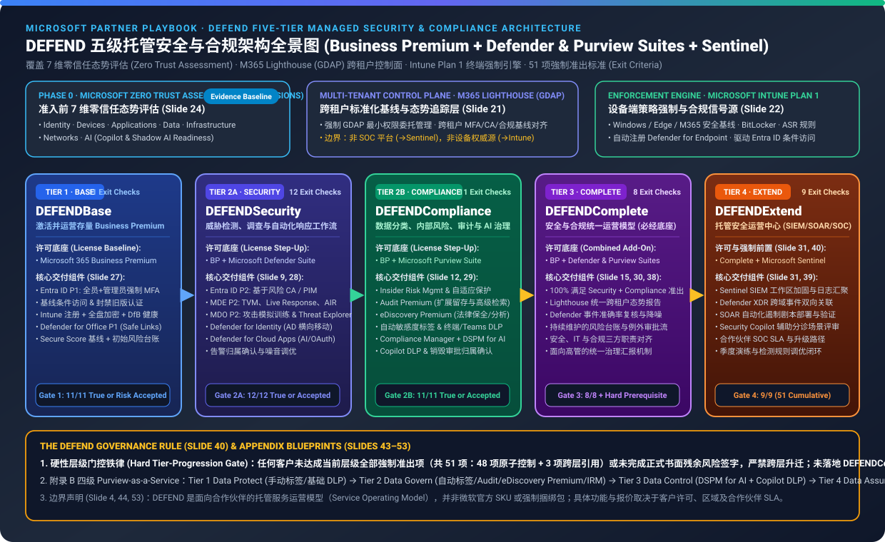
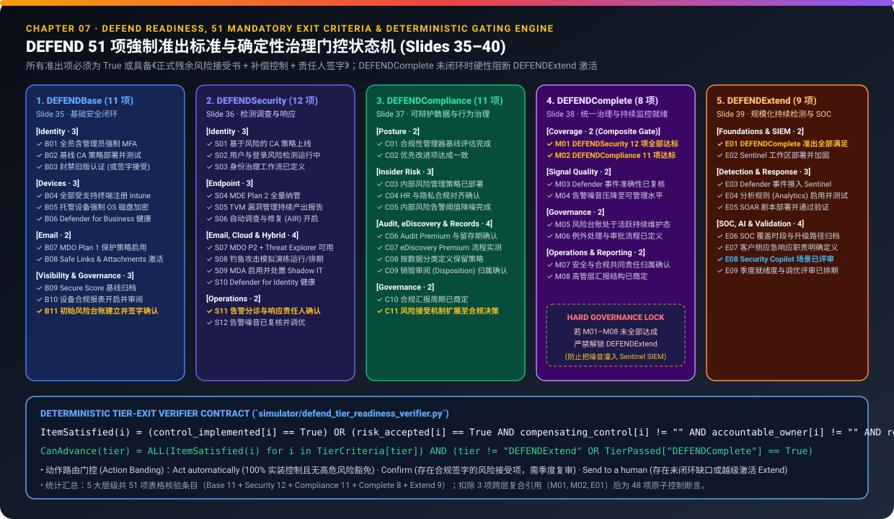
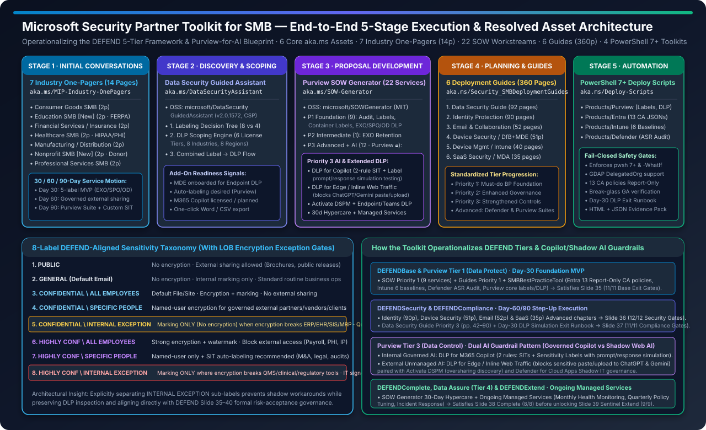
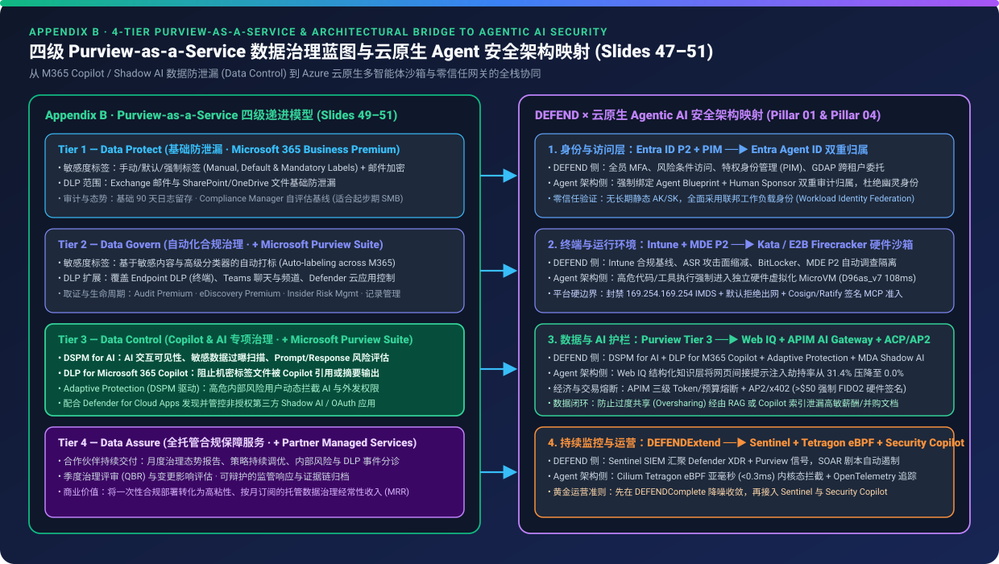

# DEFEND Partner Playbook & Microsoft Security Partner Toolkit for SMB: 5-Tier M365 Business Premium Security, Purview AI Governance & End-to-End Automation

> **Language / 语言**: [中文 (`README.md`)](./README.md) | **English (Current)**  
> **7-Card 4:5 Visual Benchmark Reports**: [English Report (`test-report.en.md`)](./test-report.en.md) · [中文报告 (`test-report.md`)](./test-report.md) · [Interactive HTML Deck (`test-report-cards.html`)](./test-report-cards.html) ([English Cards (`cards.html`)](./cards.html) | [中文卡片 (`cards.zh.html`)](./cards.zh.html))  
> **Deterministic Verifier & Datasets**: [`simulator/defend_tier_readiness_verifier.py`](./simulator/defend_tier_readiness_verifier.py) · [`simulator/test_defend_tier_readiness_verifier.py`](./simulator/test_defend_tier_readiness_verifier.py) · [`report.json`](./report.json) · [`evidence.json`](./evidence.json) · [`review.md`](./review.md)  
> **Companion Sub-Topic (`Child Study`)**: 🔗 **[Security AI Landing Zone & Frontier SOC Deep Dive (`../security-ai-landing-zone/`)](../security-ai-landing-zone/index.md)** ([中文专著](../security-ai-landing-zone/index.zh.md) | [English 7-Card](../security-ai-landing-zone/cards.html) | [中文 7 卡](../security-ai-landing-zone/cards.zh.html)) — *Security for AI × AI for Security*, Copilot as UI, Microsoft Agent 365 5-Pillar Control Plane, M365 E7 Frontier Suite & Defender ISOC / MDASH  
> **Research Pillar**: Pillar 04 — Zero-Trust Governance, Red Team & Managed Security

---

## ⚠️ Important Governance & Commercial Boundary Disclaimer

Per Slides 4, 8, 44, and 53 of the *DEFEND Partner Playbook* (`© 2026 Microsoft Corporation`):
1. **Partner-Delivered Service Construct — Not a Microsoft SKU**: **The DEFEND framework (`DEFENDBase`, `DEFENDSecurity`, `DEFENDCompliance`, `DEFENDComplete`, `DEFENDExtend`), its appendix blueprints (SMB Offer Blueprint, 4-Tier Purview-as-a-Service model), and the Microsoft Security Partner Toolkit for SMB are partner-delivered service constructs and operating models, NOT official Microsoft products, SKUs, licensing bundles, or mandated commercial offerings.**
2. **Licensing & Configuration Responsibility**: Outcomes depend on eligible Microsoft licensing (e.g., Microsoft 365 Business Premium, Microsoft Defender Suite add-on, Microsoft Purview Suite add-on, Microsoft Sentinel consumption billing) and explicit partner configuration and operational management. Partners remain solely responsible for validating current Microsoft Product Terms, licensing eligibility, service claims, and pricing before external use.
3. **Anonymization & Sanitization**: All personal author bylines, email addresses, phone numbers, and Outlook SafeLinks tracking tokens have been stripped from this public research archive. Only public technical architectures, canonical `aka.ms` links, and official `github.com/microsoft/*` open-source repositories are retained.

---

## 1. Executive Summary: Bridging Strategy (`DEFEND Playbook`) to Execution (`Security Partner Toolkit for SMB`)

In the Small and Medium Business (SMB, 1–300 seats) market, Managed Service Providers (MSPs) and security partners consistently encounter three structural failure modes (Slides 3, 6):
- **Silent Misconfiguration & Unclaimed Baseline Value**: Customers frequently own Microsoft 365 Business Premium licenses without enforcing MFA, Conditional Access, Intune device compliance, BitLocker, or legacy authentication blocks—leaving paid-for security controls unconfigured.
- **Copilot & Shadow AI Data Oversharing Risks**: Organizations adopting Microsoft 365 Copilot or web-based generative AI tools (ChatGPT, Gemini) without sensitivity labels, auto-classification, Endpoint/Teams/Copilot DLP, and Data Security Posture Management (DSPM for AI) expose confidential data to internal oversharing and external leakage.
- **Premature SIEM Onboarding & SOC Alert Fatigue**: Onboarding tenants directly into Microsoft Sentinel before configuring baseline identity, device, email, and data controls floods SOC analysts with raw, un-tuned telemetry and drives unsustainable ingestion costs.

This monograph unifies two complementary Microsoft partner assets into a single **Strategy + Execution** engineering reference:
1. **Strategy & Governance Engine — *DEFEND Partner Playbook* (11 Chapters / 53 Slides, SHA-256: `0298c3bb248a0465...`)**: Defines a **5-tier managed security & compliance operating model** anchored on Microsoft 365 Business Premium, a **41-row licensing capability matrix**, **51 mandatory tier-exit criteria**, the **Slide 40 Governance Rule**, and the **4-tier Purview-as-a-Service AI Readiness blueprint**.
2. **End-to-End Execution Engine — *Microsoft Security Partner Toolkit for SMB* (5 Lifecycle Stages / 6 Core `aka.ms` Assets)**: Provides field-ready **7 Industry Information Protection One-Pagers (14 PDF pages with an 8-Label DEFEND Taxonomy including LOB encryption exception sub-labels)**, the **Data Security Guided Assistant (`microsoft/DataSecurityGuidedAssistant` v2.0.1572)**, the **Purview Data Security SOW Generator (`microsoft/SOWGenerator`, 22 modular workstreams)**, **6 Best Practice Security Deployment Guides (360 PDF pages)**, and **idempotent PowerShell 7+ deployment scripts (`microsoft/BestPractice_Deploy-Scripts` / `SMBBestPracticeTool`)**.



---

## 2. Structural Breakdown of the *DEFEND Partner Playbook* (11 Chapters / 53 Slides)

| Chapter | Slides | Chapter Title | Core Architectural Deliverables & Mechanisms |
| :---: | :---: | :--- | :--- |
| **Ch 01** | Slides 1–7 | **Welcome to the DEFEND Partner Playbook** | Defines the 5 DEFEND tiers (`DEFENDBase` → `DEFENDSecurity` / `DEFENDCompliance` → `DEFENDComplete` → `DEFENDExtend`), 4 MSP business outcomes (repeatable delivery, structured upsell, reduced drift, higher retention), and the non-SKU disclaimer |
| **Ch 02** | Slides 8–16 | **Licensing Building Blocks** | Deconstructs **M365 Business Premium**, **Defender Suite** add-on (21-row comparison table, Slides 10–11), **Purview Suite** add-on (20-row comparison table, Slides 13–14), and **Microsoft Sentinel** SIEM/SOAR extension |
| **Ch 03** | Slides 17–20 | **Start with Security Posture (Zero Trust Assessment)** | Mandates running the **Microsoft Zero Trust Assessment** before quoting or configuring, evaluating **7 dimensions**: `Identity`, `Devices`, `Applications`, `Data`, `Infrastructure`, `Networks`, and `AI` |
| **Ch 04** | Slides 21–24 | **Core Operating Foundations (Lighthouse & Intune)** | Establishes strict control-plane separation between **M365 Lighthouse** (GDAP-based multi-tenant baseline visibility — **NOT a SOC/SIEM or Intune replacement**) and **Microsoft Intune Plan 1** (the authoritative device compliance enforcement engine) |
| **Ch 05** | Slides 25–31 | **The DEFEND Service Model** | Specifies target customer profiles, included controls, operational outcomes, and commercial triggers for each of the 5 DEFEND tiers |
| **Ch 06** | Slides 32–33 | **Mapping Capabilities Across Tiers** | Maps responsibility progression across Identity, Devices, Email/Collaboration, Data Protection, Governance, and SIEM/SOC |
| **Ch 07** | Slides 34–40 | **Tier Exit Criteria & Governance Rules** | Defines the **51 mandatory exit criteria rows (48 atomic controls + 3 composite cross-tier gates, Slides 35–39)** and the **Slide 40 Governance Rule** (no progression without exit criteria or signed risk acceptance; `DEFENDExtend` prohibited without `DEFENDComplete`) |
| **Ch 08** | Slides 41–42 | **Partner Readiness & Implementation Checklist** | Covers Commercial Readiness (catalog, SLAs, risk acceptance), Technical Readiness (GDAP, Lighthouse, Intune, LLDs), and Operational Readiness (alert routing, QBRs) |
| **Ch 09** | Slides 43–46 | **Appendix A — Partner Offer Blueprint (SMB)** | Customer-facing one-page commercial offer blueprint with explicit **Included** vs **Excluded** service boundaries per tier to prevent scope creep |
| **Ch 10** | Slides 47–51 | **Appendix B — Purview-as-a-Service Blueprint** | Packages Purview into **4 additive service tiers**: `Tier 1 Data Protect` → `Tier 2 Data Govern` → `Tier 3 Data Control (AI Ready)` → `Tier 4 Data Assure (Managed)` |
| **Ch 11** | Slides 52–53 | **Summary, Next Steps & Official References** | Consolidates partner next steps and 12 authoritative Microsoft Learn / `aka.ms` reference links |

---

## 3. Licensing Building Blocks & Exact 41-Capability Quantitative Matrix (Chapter 02 · Slides 8–16)

By parsing the underlying XML tables on Slides 10–11 (21 Defender rows) and Slides 13–14 (20 Purview rows) and verifying them via `defend_tier_readiness_verifier.py`, we establish that **Microsoft 365 Business Premium alone covers 15 of the 41 advanced capabilities (`36.6%`)**, whereas adding both the **Defender Suite** and **Purview Suite** reaches **`41 / 41` (`100.0%`)**—delivering full Enterprise E5 security and compliance parity for SMB tenants:

### 3.1 Cross-Tier Licensing Coverage Summary

| Licensing Bundle / DEFEND Tier | Defender Matrix (21 Rows, Slides 10–11) | Purview Matrix (20 Rows, Slides 13–14) | Combined 41-Row Coverage | Net Gain vs Business Premium |
| :--- | :---: | :---: | :---: | :---: |
| **Microsoft 365 Business Standard** *(Reference Baseline)* | `2 / 21` (`9.5%`) | `3 / 20` (`15.0%`) | **`5 / 41` (`12.2%`)** | `-24.4 pts` *(lacks Zero Trust baseline)* |
| **Microsoft 365 Business Premium (`DEFENDBase` / `Data Protect`)** | `8 / 21` (`38.1%`) | `7 / 20` (`35.0%`) | **`15 / 41` (`36.6%`)** | **Baseline (`0.0 pts`)** |
| **Business Premium + Defender Suite (`DEFENDSecurity`)** | **`21 / 21` (`100.0%`)** | `7 / 20` (`35.0%`) | **`28 / 41` (`68.3%`)** | **`+31.7 pts`** *(Security `+61.9 pts`)* |
| **Business Premium + Purview Suite (`DEFENDCompliance` / `Data Control`)** | `8 / 21` (`38.1%`) | **`20 / 20` (`100.0%`)** | **`28 / 41` (`68.3%`)** | **`+31.7 pts`** *(Compliance/AI `+65.0 pts`)* |
| **Business Premium + Both Suites (`DEFENDComplete` / E5 Parity)** | **`21 / 21` (`100.0%`)** | **`20 / 20` (`100.0%`)** | **`41 / 41` (`100.0%`)** | **`+63.4 pts`** *(100% Full Parity)* |

### 3.2 Defender Suite 21-Row Capability Matrix (Slides 10–11)

| Domain | ID | Capability Row | Business Standard | Business Premium (`DEFENDBase`) | + Defender Suite (`DEFENDSecurity`) | Enterprise E5 |
| :--- | :---: | :--- | :---: | :---: | :---: | :---: |
| **Email Protection (5)** | `D01` | Spam and malware protection (Exchange Online Protection) | ● | ● | ● | ● |
| **Email Protection** | `D02` | Advanced phishing, zero-day malware & link protection (MDO Plan 1: Safe Links / Safe Attachments) | ○ | ● | ● | ● |
| **Email Protection** | `D03` | Phishing simulation and end-user security training (Attack Simulation Training — MDO Plan 2) | ○ | ○ | **●** | ● |
| **Email Protection** | `D04` | Automated investigation and remediation for email threats (AIR — MDO Plan 2) | ○ | ○ | **●** | ● |
| **Email Protection** | `D05` | Cross-domain threat hunting across email, links and collaboration (Threat Explorer — MDO Plan 2) | ○ | ○ | **●** | ● |
| **Endpoint Protection (5)** | `D06` | Built-in OS antivirus protection | ● | ● | ● | ● |
| **Endpoint Protection** | `D07` | Next-gen endpoint protection, behavioral EDR & ASR rules (Defender for Business) | ○ | ● | ● | ● |
| **Endpoint Protection** | `D08` | Advanced endpoint threat hunting across devices (MDE Plan 2 Advanced Hunting) | ○ | ○ | **●** | ● |
| **Endpoint Protection** | `D09` | Extended alert retention (6 months) & deeper forensic investigation timelines (MDE Plan 2) | ○ | ○ | **●** | ● |
| **Endpoint Protection** | `D10` | Threat analytics and global threat intelligence insights (Defender Threat Intelligence / MDE P2) | ○ | ○ | **●** | ● |
| **Identity & Access (9)** | `D11` | Multi-factor authentication (MFA) | ○ | ● | ● | ● |
| **Identity & Access** | `D12` | Conditional Access policies (user, device, location, app — Entra ID P1) | ○ | ● | ● | ● |
| **Identity & Access** | `D13` | Risk-based Conditional Access & Identity Protection (sign-in risk & user risk — Entra ID P2) | ○ | ○ | **●** | ● |
| **Identity & Access** | `D14` | Self-service password reset (SSPR) for cloud and hybrid users (Entra ID P1) | ○ | ● | ● | ● |
| **Identity & Access** | `D15` | Automated remediation for compromised user accounts (Entra ID P2) | ○ | ○ | **●** | ● |
| **Identity & Access** | `D16` | Privileged Identity Management (PIM — just-in-time admin elevation & approval — Entra ID P2) | ○ | ○ | **●** | ● |
| **Identity & Access** | `D17` | Access reviews and entitlement management (Entra ID P2 Governance) | ○ | ○ | **●** | ● |
| **Identity & Access** | `D18` | Hybrid / on-premises Active Directory identity threat detection (Defender for Identity — MDI) | ○ | ○ | **●** | ● |
| **Identity & Access** | `D19` | Detailed identity risk investigation and workbook insights (Entra ID P2 + MDI) | ○ | ○ | **●** | ● |
| **Cloud App Security (2)** | `D20` | Basic cloud app visibility and OAuth app discovery | ○ | ● | ● | ● |
| **Cloud App Security** | `D21` | Full CASB: Shadow IT governance, real-time session control & SaaS posture (Defender for Cloud Apps) | ○ | ○ | **●** | ● |

### 3.3 Purview Suite 20-Row Capability Matrix (Slides 13–14)

| Domain | ID | Capability Row | Business Standard | Business Premium (`DEFENDBase`) | + Purview Suite (`DEFENDCompliance`) | Enterprise E5 |
| :--- | :---: | :--- | :---: | :---: | :---: | :---: |
| **Information Protection (6)** | `P01` | Manual sensitivity labels in Office apps | ● | ● | ● | ● |
| **Information Protection** | `P02` | Sensitivity labels with encryption, visual markings & rights management (Azure RMS) | ○ | ● | ● | ● |
| **Information Protection** | `P03` | Automatic sensitivity labeling in Office apps, SharePoint & OneDrive (Client + Service Auto-Labeling) | ○ | ○ | **●** | ● |
| **Information Protection** | `P04` | Classification using sensitive info types, trainable classifiers & fingerprinted templates | ○ | ○ | **●** | ● |
| **Information Protection** | `P05` | Customer-managed encryption keys (Bring Your Own Key — BYOK) | ○ | ○ | **●** | ● |
| **Information Protection** | `P06` | Double Key Encryption (DKE) for highly regulated workloads | ○ | ○ | **●** | ● |
| **Data Loss Prevention (6)** | `P07` | DLP for Exchange Online, SharePoint Online & OneDrive for Business | ○ | ● | ● | ● |
| **Data Loss Prevention** | `P08` | DLP for Teams chat and channel messages | ○ | ○ | **●** | ● |
| **Data Loss Prevention** | `P09` | Endpoint DLP (Windows & macOS file copy, print, USB, upload, browser transfer restrictions) | ○ | ○ | **●** | ● |
| **Data Loss Prevention** | `P10` | DLP for cloud apps and inline SaaS session controls (integrated with Defender for Cloud Apps) | ○ | ○ | **●** | ● |
| **Data Loss Prevention** | `P11` | **DLP for Microsoft 365 Copilot** (sensitivity label & SIT controls for AI prompts/grounding) | ○ | ○ | **●** | ● |
| **Data Loss Prevention** | `P12` | Adaptive DLP enforcement driven by user Insider Risk levels (Adaptive Protection) | ○ | ○ | **●** | ● |
| **Data Lifecycle Mgmt (3)** | `P13` | Manual retention and deletion labels | ● | ● | ● | ● |
| **Data Lifecycle Mgmt** | `P14` | Basic tenant-wide retention policies for Exchange, SharePoint & OneDrive | ○ | ● | ● | ● |
| **Data Lifecycle Mgmt** | `P15` | Automatic retention policies based on events, trainable classifiers & sensitive content (Records Mgmt) | ○ | ○ | **●** | ● |
| **Insider Risk & Comm (3)** | `P16` | Insider Risk Management (data theft, departing employee exfiltration, policy violations) | ○ | ○ | **●** | ● |
| **Insider Risk & Comm** | `P17` | Adaptive Protection (dynamic Conditional Access & DLP tightening based on insider risk score) | ○ | ○ | **●** | ● |
| **Insider Risk & Comm** | `P18` | Communication Compliance (detecting regulatory violations, harassment, sensitive sharing in Teams/Email) | ○ | ○ | **●** | ● |
| **eDiscovery & Audit (2)** | `P19` | Basic eDiscovery (Standard) and 90-day standard audit logs | ● | ● | ● | ● |
| **eDiscovery & Audit** | `P20` | **eDiscovery (Premium) & Audit (Premium)** (1-year+ log retention, legal hold notifications, review sets, AI-relevant high-value audit events) | ○ | ○ | **●** | ● |

---

## 4. Zero Trust Posture Discovery & Dual Operating Foundations (Chapters 03–04 · Slides 17–24)

### 4.1 Phase 0: The 7-Dimension Microsoft Zero Trust Assessment (Slides 17–20)
The Playbook establishes an explicit engagement rule: **Start with Security Posture, Not Licensing**. Before recommending add-on suites, partners run the Microsoft Zero Trust Assessment across **7 dimensions**:
1. **Identity**: MFA coverage, privileged account sprawl, legacy authentication protocols, Conditional Access gaps.
2. **Devices**: Intune enrollment coverage, non-compliant device access, BitLocker encryption state, OS patch hygiene.
3. **Applications**: OAuth third-party app consent risks and Shadow IT cloud app exposure.
4. **Data**: Sensitive data discovery, unlabeled files, anonymous external sharing links, and internal oversharing.
5. **Infrastructure**: Hybrid and administrative control-plane configurations.
6. **Networks**: Named locations, session controls, and boundary protections.
7. **AI**: Copilot and generative AI data access boundaries, DLP readiness, and DSPM for AI posture.

### 4.2 Strict Separation of Duties: M365 Lighthouse vs. Microsoft Intune Plan 1 (Slides 21–24)
- **Microsoft 365 Lighthouse = Multi-Tenant Visibility & Baseline Governance Plane**: Uses **GDAP (Granular Delegated Admin Privileges)** scoped to least-privilege security groups to aggregate baseline compliance, MFA/CA posture, risky users, and Defender for Business status across customer tenants. **Slide 21 explicitly warns: Lighthouse is NOT a SOC/SIEM detection platform, NOT a replacement for Intune device management, and NOT a substitute for Entra ID P2 PIM.**
- **Microsoft Intune Plan 1 = Authoritative Device Enforcement Engine**: All device compliance policies, BitLocker encryption, firewall and ASR rules, MAM App Protection Policies, and device-based Conditional Access enforcement must be authored and enforced in **Intune**.

---

## 5. The 5 DEFEND Tiers, 51 Mandatory Exit Criteria & Slide 40 Governance Rule (Chapters 05–07 · Slides 25–40)



### 5.1 Complete 51-Item Mandatory Tier Exit Criteria Checklist (Slides 35–39)

1. **`DEFENDBase` (Slide 35 · 11 Mandatory Exit Checks `B01–B11`)**:
   - `B01–B03` (Identity): MFA enforced for all users (`B01`); baseline Conditional Access policies live (`B02`); **legacy authentication blocked or formally risk accepted (`B03`)**.
   - `B04–B07` (Devices): Managed devices enrolled in Intune (`B04`); device compliance policies active (`B05`); BitLocker, firewall & Secure Boot enforced (`B06`); Defender for Business deployed & reporting (`B07`).
   - `B08–B09` (Email): Defender for Office 365 Plan 1 active (`B08`); mail flow protections validated and risky auto-forwarding blocked (`B09`).
   - `B10–B11` (Visibility & Governance): M365 Lighthouse connected (`B10`); **customer risk register created with residual risks and exceptions signed off (`B11`)**.
2. **`DEFENDSecurity` (Slide 36 · 12 Mandatory Exit Checks `S01–S12`)**:
   - `S01–S03` (Identity): Sign-in/user risk CA policies live (`S01`); **PIM active for all admin roles (`S02`)**; Access Reviews configured (`S03`).
   - `S04–S06` (Endpoint): MDE Plan 2 advanced hunting & AIR enabled (`S04`); TVM remediation workflow established (`S05`); endpoint alert noise tuned (`S06`).
   - `S07–S08` (Email): MDO Plan 2 advanced phishing & AIR live (`S07`); Attack Simulation Training scheduled (`S08`).
   - `S09–S12` (Cloud, Hybrid & Operations): Defender for Cloud Apps OAuth/Shadow IT controls active (`S09`); Defender for Identity deployed where hybrid AD exists (`S10`); alert triage/SLAs defined (`S11`); high-severity incident signal quality validated (`S12`).
3. **`DEFENDCompliance` (Slide 37 · 11 Mandatory Exit Checks `C01–C11`)**:
   - `C01–C02` (Posture): Compliance Manager baseline completed (`C01`); priority regulatory mappings aligned (`C02`).
   - `C03–C05` (Insider Risk): Insider Risk Management configured (`C03`); **review workflows aligned with HR, legal & privacy boundaries (`C04`)**; departing user/exfiltration indicators enabled (`C05`).
   - `C06–C07` (Audit & Investigation): **Audit Premium** retention extended (`C06`); **eDiscovery Premium** workflows tested (`C07`).
   - `C08–C11` (Records & Governance): Retention labels/policies active (`C08`); disposition reviews established (`C09`); compliance RBAC role separation enforced (`C10`); executive compliance reporting cadence agreed (`C11`).
4. **`DEFENDComplete` (Slide 38 · 8 Mandatory Exit Checks `M01–M08`)**:
   - `M01–M02` (Composite Coverage Gates): **All 12 `DEFENDSecurity` exit criteria met (`M01`)** AND **all 11 `DEFENDCompliance` exit criteria met (`M02`)**.
   - `M03–M08` (Signal Quality, Governance, Operations & Reporting): Security & compliance alerts noise-tuned (`M03`); false-positive suppressions documented (`M04`); unified risk register updated (`M05`); QBR cadence active (`M06`); cross-domain security/compliance escalation paths defined (`M07`); customer & Lighthouse dashboards operational (`M08`).
5. **`DEFENDExtend` (Slide 39 · 9 Mandatory Exit Checks `E01–E09`)**:
   - `E01` (Composite Hard Gate): **All `DEFENDComplete` exit criteria met (`E01`)**.
   - `E02–E09` (SIEM, Detection, Response, SOC, AI & Validation): Sentinel workspace & RBAC secured (`E02`); priority connectors ingested (`E03`); analytics rules tuned (`E04`); SOAR Logic Apps playbooks tested (`E05`); SOC escalation/SLAs signed (`E06`); Sentinel ↔ Defender XDR bidirectional sync validated (`E07`); **Security Copilot use cases reviewed where licensed (`E08`)**; end-to-end detection/response validated via tabletop or live test (`E09`).

---

## 6. Appendix B Deep Dive: 4-Tier Purview-as-a-Service & Copilot AI Governance (Chapter 10 · Slides 47–51)

| Service Tier | Licensing Requirement | Sensitivity Labels | DLP Scope | Audit & eDiscovery | Insider Risk & AI Governance (Copilot Readiness) |
| :--- | :--- | :--- | :--- | :--- | :--- |
| **Tier 1 — Data Protect** | Business Premium | Manual, default & mandatory | Email (Exchange) & files (SPO/OneDrive) | Basic (90-day audit, Standard eDiscovery) | Not included; Compliance Manager self-assessed baseline |
| **Tier 2 — Data Govern** | BP + **Purview Suite** | **Automated** (content & classifiers) | **Endpoints**, **Teams chats** & cloud apps | **Premium** (extended retention & legal hold) | **Insider Risk Management** included; automated compliance assessment |
| **Tier 3 — Data Control** | BP + **Purview Suite** | **AI-related** & classifier-driven | **+ AI surfaces (DLP for M365 Copilot)** | Forensic search & AI prompt/response audit | **AI-tuned (DSPM for AI + Adaptive Protection)** for Copilot readiness |
| **Tier 4 — Data Assure** | BP + Purview + **Partner Managed** | Partner-managed lifecycle | + Continuous policy tuning | Managed reporting & legal/HR workflows | Managed triage, monthly posture reporting & quarterly governance reviews |

---

## 7. Microsoft Security Partner Toolkit for SMB — End-to-End 5-Stage Execution & Resolved Link Asset Deep Dive

While the *DEFEND Partner Playbook* defines the strategic 5-tier service architecture (**what and why**), the **Microsoft Security Partner Toolkit for SMB — Accelerate Security and AI Readiness Engagements** provides the complete operational execution kit (**how**) across all 5 stages of a partner engagement.



### 7.1 Full Engagement Lifecycle & Resolved 6-Asset Catalog

| Lifecycle Stage | Toolkit Asset | Canonical Short Link | Resolved Target / Official GitHub Repository | Verified Technical Scope |
| :--- | :--- | :--- | :--- | :--- |
| **1. Initial Conversations** | **Industry-Specific Information Protection One-Pagers** | `https://aka.ms/MIP-Industry-OnePagers` | `Industry-Specific Information Protection Guides.zip` (`1.01 MB`) | **7 two-page PDFs (14 pages)**: Consumer Goods, Education (*New*), Financial Services & Insurance, Healthcare, Manufacturing & Distribution, Nonprofit (*New*), Professional Services; 30/60/90-day motion + **8-Label DEFEND Taxonomy** |
| **2. Discovery & Scoping** | **Data Security Guided Assistant** | `https://aka.ms/DataSecurityAssistant` | Live App: `https://microsoft.github.io/DataSecurityGuidedAssistant/`<br>Repo: `https://github.com/microsoft/DataSecurityGuidedAssistant` (`v2.0.1572`) | Client-side interactive decision engine (`index.html`, `570 KB`, strict CSP) with **Labeling Tool**, **DLP Tool**, and **Combined Flow** across 8 industries, 8 regions, 6 license tiers, and 8-tier vs 4-tier label models |
| **3. Proposal Development** | **Microsoft Purview Data Security SOW Generator** | `https://aka.ms/SOW-Generator` | Live App: `https://microsoft.github.io/SOWGenerator/`<br>Repo: `https://github.com/microsoft/SOWGenerator` (MIT License) | Browser-based **Statement of Work (SOW)** builder covering **22 modular workstreams** across Priority 1 (9 Foundation), Priority 2 (1 Intermediate), and Priority 3 (12 Advanced & AI Guardrails) + Managed Services |
| **4. Planning & Implementation** | **Security SMB Deployment Guides** | `https://aka.ms/Security_SMBDeploymentGuides` | `Best Practice Security Deployment Guides for SMB.zip` (`31.82 MB`) | **6 step-by-step PDF deployment manuals totaling 360 pages**: Data Security (92p), Identity Protection (90p), Email & Collaboration (52p), Device Security (51p), Device Management (40p), SaaS Security (35p) |
| **5. Deployment & Configuration** | **PowerShell Deployment Scripts (`SMBBestPracticeTool`)** | `https://aka.ms/Deploy-Scripts` | Docs: `https://microsoft.github.io/BestPractice_Deploy-Scripts/`<br>Repo: `https://github.com/microsoft/BestPractice_Deploy-Scripts` | Idempotent **PowerShell 7+ (`pwsh.exe`)** automation across **4 workload toolkits** (`Products/Purview`, `Products/Entra`, `Products/Intune`, `Products/Defender`) with GDAP, `-WhatIf`, safety gates & HTML/JSON reports |
| **Umbrella Playbook & Feedback** | **Security Partner Toolkit Playbook & Survey** | `https://aka.ms/SecurityPartnerToolkit_Playbook`<br>`https://aka.ms/SecurityPartnerToolkit-Survey` | `Partner Security Toolkit for Enabling SMB.pdf` & Microsoft Customer Voice | Master 5-stage partner orchestration playbook and product feedback channel |

---

### 7.2 Asset 1 Deep Dive: 7 Industry One-Pagers & the 8-Label DEFEND-Aligned Taxonomy (`aka.ms/MIP-Industry-OnePagers`)

The ZIP archive (`Industry-Specific Information Protection Guides.zip`) contains **7 two-page industry playbooks (14 PDF pages)**:
1. **Consumer Goods SMB** (`Consumer_Goods_SMB_Purview_One_Pager.pdf`, 2p): Food & Beverage, Health & Beauty, Apparel, Consumer Electronics, CPG; protects retailer joint business plans (JBPs), formulations, co-manufacturer specs, and FDA recall files.
2. **Education SMB (*New*)** (`Education_SMB_Purview_One_Pager_MVP.pdf`, 2p): K-12 Private Schools, Higher Education, Early Childhood, Workforce Training, EdTech; protects FERPA/COPPA student records, transcripts, IEP/504 plans, financial aid, and safeguarding files.
3. **Financial Services / Insurance SMB** (`Financial_Services_Insurance_SMB_Purview_One_Pager.pdf`, 2p): Capital Markets, Banking, Insurance Direct/Brokerage, Public Finance; protects KYC files, loan files, underwriting/claims, ABA/IBAN/SWIFT/credit card SITs, and AML filings.
4. **Healthcare SMB** (`Healthcare_SMB_Purview_One_Pager.pdf`, 2p): Health Provider, Pharma, Payor, MedTech, Allied Health; protects HIPAA PHI, patient intake/referrals, lab results, clinical trials, and claims/coding.
5. **Manufacturing / Distribution SMB** (`Manufacturing_Distribution_SMB_Purview_One_Pager.pdf`, 2p): Chemicals, Agribusiness, Industrial Machinery, High Tech Electronics, Semiconductor; protects CAD drawings, BOMs, chemical formulations, SDS sheets, and OEM supplier specs.
6. **Nonprofit SMB (*New*)** (`Nonprofit_SMB_Purview_One_Pager_MVP.pdf`, 2p): Human & Social Services, Foundations, Faith-Based, Advocacy, International NGOs; protects donor records, grant agreements, vulnerable-beneficiary case files, and Form 990 audit workpapers.
7. **Professional Services SMB** (`Professional_Services_SMB_Purview_One_Pager.pdf`, 2p): Accounting & Tax, Management Consulting, IT Services, Outsourced Services, Architecture & Engineering; protects client diligence packs, tax workpapers, M&A memos, and legal privilege logs.

#### The 8-Label DEFEND-Aligned Sensitivity Taxonomy (Solving LOB Encryption Breakage)
All 7 Industry One-Pagers and the Guided Assistant standardize an **8-label sensitivity hierarchy** paired with a **30 / 60 / 90-Day Service Motion** (Day 30: 5-label Business Premium MVP; Day 60: Governed external sharing; Day 90: Purview Suite expansion with custom SITs/EDM). Crucially, labels **5** and **8** introduce explicit **`INTERNAL EXCEPTION`** sub-labels for Line-of-Business (LOB) workflows where Azure RMS encryption would break legacy ERP, EHR, SIS, MRP, or core banking integrations:
1. `PUBLIC`: No encryption; external sharing allowed.
2. `GENERAL`: No encryption; internal marking only; **default email label**.
3. `CONFIDENTIAL \ ALL EMPLOYEES`: Encryption + marking; no external sharing; **default file/site label**.
4. `CONFIDENTIAL \ SPECIFIC PEOPLE`: Named-user encryption for governed external partners/clients.
5. **`CONFIDENTIAL \ INTERNAL EXCEPTION`**: **Marking only (no encryption, no external sharing)** for LOB workflows where encryption breaks ERP/EHR/SIS/MRP integrations; requires documented business justification and **quarterly (90-day) review**.
6. `HIGHLY CONFIDENTIAL \ ALL EMPLOYEES`: Strong encryption + watermark; block external sharing (payroll, PHI, safeguarding, AML, trade secrets).
7. `HIGHLY CONFIDENTIAL \ SPECIFIC PEOPLE`: Explicit named-user encryption; SIT auto-labeling recommended (regulatory filings, M&A, legal holds).
8. **`HIGHLY CONFIDENTIAL \ INTERNAL EXCEPTION`**: **Marking only without encryption** where encryption breaks critical QMS, clinical compliance, or regulatory-reporting tooling; requires IT sign-off and **quarterly (90-day) justification audit**.

---

### 7.3 Asset 2 & Asset 3 Deep Dive: Guided Assistant (`v2.0.1572`) & 22-Workstream Purview SOW Generator

- **`microsoft/DataSecurityGuidedAssistant` (`aka.ms/DataSecurityAssistant`)**: Zero-backend static browser app (`v2.0.1572`) offering three guided flows (**Labeling Tool**, **DLP Tool**, **Combined Flow**) across 8 industries, 8 global regions, and 6 license tiers, toggling seamlessly between the **8-tier DEFEND model** and **4-tier simplified model** with Word/CSV export.
- **`microsoft/SOWGenerator` (`aka.ms/SOW-Generator`)**: Browser-based SOW builder covering **22 modular services**:
  - **Priority 1 — Foundation (Business Premium, 9 workstreams)**: Audit Logging, Label Taxonomy Design, Label Creation & Encryption, Label Policy Deployment, Mandatory/Default Labeling, End-User Training, SPO/OD Sensitivity Labels, Container Labels (Teams/SPO/M365 Groups), and EXO/SPO/OD DLP Policies.
  - **Priority 2 — Intermediate (1 workstream)**: Retention Policy for Exchange Online (expandable to SPO/OD/Teams).
  - **Priority 3 — Advanced & AI Guardrails (Purview Suite Add-on 🔒, 12 workstreams)**: Custom SITs/EDM, Client-Side Auto-Labeling, Service-Side Auto-Labeling, Label-Based Encryption/RMS, Trainable Classifiers, Content/Activity Explorer, On-Premises Purview Scanner, Double Key Encryption (DKE), MIP SDK/LOB Integration, Advanced Analytics, **Extended & AI Guardrails** (**DLP for Endpoints**, **DLP for Teams**, **DLP for Copilot [two dedicated rules—one for SITs and one for sensitivity labels—with prompt/response simulation testing]**, **DLP for Microsoft Edge / Inline Web Traffic [blocks sensitive data paste/upload into unmanaged AI apps like ChatGPT and Gemini]**, and **Activate DSPM**), plus **Managed Services** (30-Day Hypercare, Monthly Health Monitoring, Quarterly Policy Tuning, Incident Response).

---

### 7.4 Asset 4 & Asset 5 Deep Dive: 6 Deployment Guides (360 Pages) & PowerShell 7+ `SMBBestPracticeTool`

- **6 Best Practice Security Deployment Guides (`aka.ms/Security_SMBDeploymentGuides`, 360 PDF pages total)**:
  1. *Data Security Deployment Guide for Small Business* (**92 pages**, updated June 24, 2026): Priority 1 "Good" (pp. 9–34), Priority 2 "Better" (pp. 35–41), Priority 3 "Advanced" (pp. 42–90: auto-labeling, Endpoint/Teams/Copilot/Edge DLP, DSPM, Insider Risk).
  2. *Identity Protection Best Practice Deployment* (**90 pages**, updated March 6, 2026): Entra ID P1 Priority 1–2 (pp. 8–31), Entra ID P2 risk-based CA & PIM (pp. 32–70), Defender for Identity (pp. 71–87).
  3. *Email & App + Collaboration Protection Best Practice Deployment* (**52 pages**, updated March 16, 2026): MDO Plan 1 Priority 1–3 (pp. 9–41), MDO Plan 2 AIR, Threat Explorer & Attack Simulation (pp. 42–51).
  4. *Device Security Best Practice Deployment* (**51 pages**, updated March 16, 2026): Defender for Business Priority 1–2 (pp. 14–41), Defender for Endpoint Plan 2 EDR & Threat Hunting (pp. 42–52).
  5. *Device Management Best Practice Deployment* (**40 pages**, updated March 16, 2026): Intune Plan 1 enrollment restrictions, compliance policies, MAM, BitLocker, and Device-Based CA (pp. 7–38).
  6. *SaaS Security Best Practice Deployment* (**35 pages**, updated March 16, 2026): MDE Shadow IT discovery, OAuth app governance, and cross-SaaS protection (pp. 9–34).
- **PowerShell 7+ `SMBBestPracticeTool` (`microsoft/BestPractice_Deploy-Scripts` / `aka.ms/Deploy-Scripts`)**:
  - Enforces **PowerShell 7+ (`pwsh.exe`)**, supports MSP **GDAP delegated administration** (`-DelegatedOrganization`), enforces `-WhatIf` and post-write readback verification, and outputs **HTML + JSON run reports**.
  - Ships 4 workload toolkits: `Products/Purview` (includes the **Day-30 DLP Simulation Exit Runbook** and 7-year retention risk note), `Products/Entra` (deploys **13 Conditional Access JSON templates in Report-Only mode by default** with permanent Global Admin break-glass verification), `Products/Intune` (6 baseline tasks with `-IncludeHighRisk` gate), and `Products/Defender` (read-only preflight + pilot-gated **ASR Audit configuration**).

---

## 8. Architectural Bridge: Mapping M365 DEFEND & SMB Toolkit to Cloud-Native Agentic AI Security



| Security Control Plane | M365 Tenant Controls (`DEFEND Playbook` + `SMB Partner Toolkit`) | Cloud-Native Agent Runtime Controls (`Pillar 01 Azure Agent Infra`) | Unified Zero-Trust Objective |
| :--- | :--- | :--- | :--- |
| **1. Identity & Least Privilege** | **Entra ID P1/P2**: 13 Report-Only CA templates, sign-in/user risk CA, **PIM JIT elevation**, Access Reviews (`S01–S03`) | **Microsoft Entra Agent ID**: On-Behalf-Of (OBO) dual attribution (User + Agent Identity), short-lived tokens & workload federation | Prevent credential theft, lateral movement & confused-deputy agent escalation |
| **2. Execution & Compute Isolation** | **Intune Plan 1 + Defender for Business / MDE P2**: Device compliance, BitLocker, ASR rules, behavioral EDR (`B04–B07`, `S04–S06`) | **AKS Kata / Confidential Containers (SEV-SNP) & E2B Firecracker microVMs**: Hardware-virtualized kernel isolation + **Tetragon eBPF** enforcement | Isolate untrusted code execution and tool calls; prevent container escape |
| **3. Dual AI & Data Guardrails** | **Purview Tier 3 (`Data Control`) + SOW Priority 3**: 8-Label taxonomy (with LOB exception sub-labels), **DLP for Copilot (2-rule sim)**, **Edge Inline Web DLP (ChatGPT/Gemini)**, **Activate DSPM** | **Azure APIM AI Gateway + Purview SDK + Web IQ**: Inline prompt/response redaction, MCP/A2A payload inspection & malicious domain circuit breakers | Stop internal Copilot oversharing AND external Shadow AI exfiltration / indirect prompt injection |
| **4. SIEM/SOAR & AI-Assisted SOC** | **DEFENDExtend (`E01–E09`)**: Noise-tuned **Microsoft Sentinel + Defender XDR + Security Copilot** after completing `DEFENDComplete` | **Azure Monitor + Sentinel + Prometheus/Grafana**: Agent trace telemetry, microVM lifecycle metrics, APIM gateway logs & automated containment playbooks | High-signal cross-plane detection and automated SOAR containment without alert fatigue |

---

## 9. Reproducibility & Verification Commands

```powershell
# 1. Run the deterministic unit test suite (7 tests verifying slide/criteria counts, 41 capabilities, Slide 40 lock & SMB Toolkit catalog)
python -m unittest discover -s docs\research\defend-partner-playbook\simulator -p "test_*.py" -v

# 2. Regenerate verifier-summary.json, report.json, evidence.json, CSVs, and bilingual 7-card HTML decks
python docs\research\defend-partner-playbook\simulator\generate_artifacts.py
```
