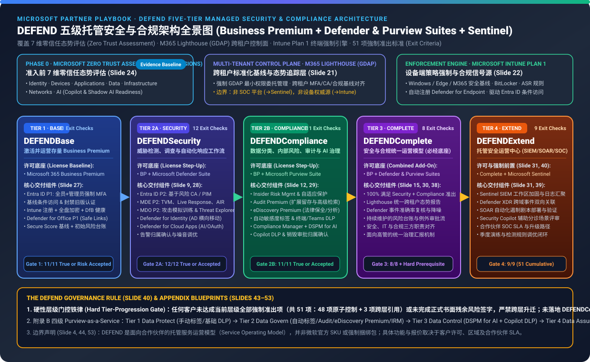
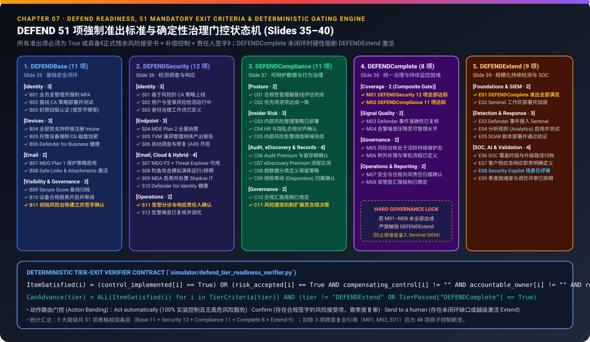
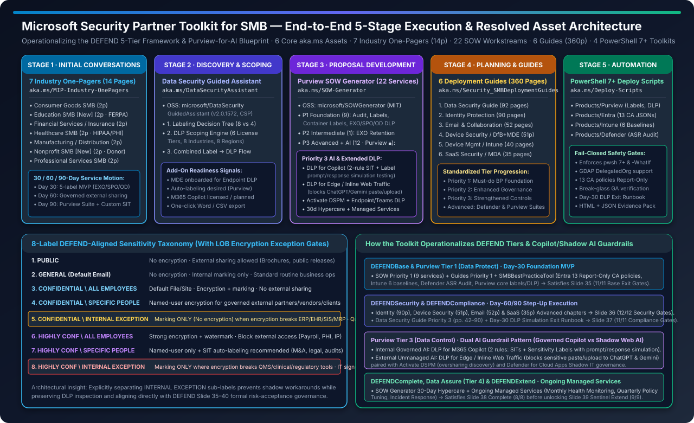
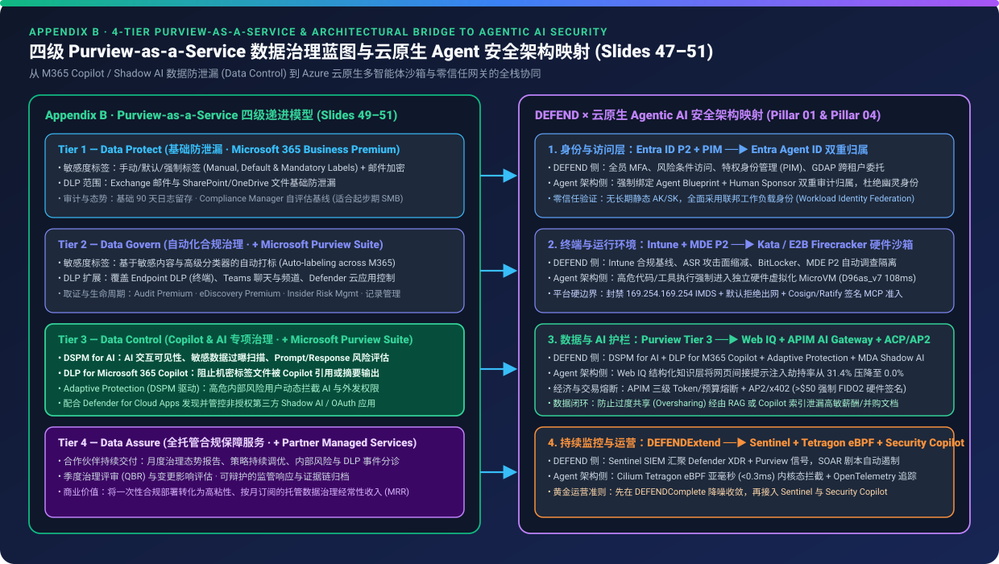

# Microsoft 产品体系安全与 AI 就绪工程技术架构实践：基于 M365 Business Premium、Defender/Purview 套件与六大工作负载（360 页）的零信任与 AI 护栏落地指南

> **语言 / Language**: **中文 (当前)** | [English (`README.en.md`)](./README.en.md)  
> **7-Card 4:5 视觉评测报告**: [中文报告 (`test-report.md`)](./test-report.md) · [English Report (`test-report.en.md`)](./test-report.en.md) · [交互式 HTML 卡片 (`test-report-cards.html`)](./test-report-cards.html) ([中文卡片 (`cards.zh.html`)](./cards.zh.html) | [English Cards (`cards.html`)](./cards.html))  
> **确定性验证器与数据集**: [`simulator/defend_tier_readiness_verifier.py`](./simulator/defend_tier_readiness_verifier.py) · [`simulator/test_defend_tier_readiness_verifier.py`](./simulator/test_defend_tier_readiness_verifier.py) · [`report.json`](./report.json) · [`evidence.json`](./evidence.json) · [`review.md`](./review.md)  
> **专项子课题延伸 (`Child Sub-Topic`)**: 🔗 **[Security AI Landing Zone 与 Frontier SOC 深度研究 (`../security-ai-landing-zone/`)](../security-ai-landing-zone/index.zh.md)** ([English](../security-ai-landing-zone/index.md) | [中文 7 卡](../security-ai-landing-zone/cards.zh.html) | [English 7-Card](../security-ai-landing-zone/cards.html)) —— 聚焦 *Security for AI × AI for Security*、Copilot as UI、Microsoft Agent 365 五大安全支柱、M365 E7 Frontier Suite 与 Defender ISOC / MDASH  
> **所属研究支柱**: Pillar 04 — 零信任治理、红队演练与安全运营架构 (Zero-Trust Governance, Red Team & Security Engineering)

---

## ⚠️ 重要架构边界声明与免责提示 (Important Architectural & Governance Boundary)

根据《DEFEND Partner Playbook》第 4、8、44、53 页（`© 2026 Microsoft Corporation`）及《Partner Security Toolkit for Enabling SMB》（10 页技术总览）的官方工程边界声明：
1. **参考工程架构而非独立 SKU**：**DEFEND 五层安全架构（`DEFENDBase`、`DEFENDSecurity`、`DEFENDCompliance`、`DEFENDComplete`、`DEFENDExtend`）、四层 Purview-for-AI 数据治理模型以及 Microsoft Security Engineering Toolkit 均属于可复用的安全与合规参考架构与工程交付构建块 (Technical Reference Architectures & Engineering Constructs)，并非独立的微软产品或 SKU。**
2. **授权与显式策略配置责任**：所有安全控制与 AI 护栏能力的生效，均取决于目标租户是否具备对应的微软平台授权（Microsoft 365 Business Premium、Microsoft Defender Suite、Microsoft Purview Suite、Microsoft Sentinel）以及是否按技术规范完成显式策略下发、模拟验证与持续漂移监控。
3. **纯技术研究与脱敏声明**：本研究严格聚焦于 **Microsoft 产品体系的工程技术架构、控制平面交互、策略编译器、360 页六大工作负载部署规范与 PowerShell 7+ 自动化机制**；已剥离原始材料中的所有个人署名、邮箱、电话及追踪令牌，仅保留公开可验证的技术参数、官方 `aka.ms` 链接与微软开源代码库结构。

---

## 1. 执行摘要：从“五层零信任顶层架构 (`DEFEND`)”到“六大工作负载工程实现 (`360p Guides + pwsh 7+`)”

在实际生产租户（特别是基于 Microsoft 365 Business Premium 构建的现代企业与多租户环境）中，安全工程团队普遍面临三大结构性技术瓶颈（Slides 3, 6）：
- **静默配置漂移与控制平面能力闲置**：租户虽已分配 Microsoft 365 Business Premium 许可证，但未强制启用抗钓鱼 MFA、条件访问（Conditional Access）、Intune 设备合规、BitLocker 全盘加密或阻止旧版身份验证（Legacy Authentication），导致底层平台控制项处于未激活状态。
- **Copilot 与生成式 AI 引发的 RAG 越权检索与未受管 Web AI 泄密**：在启用 Microsoft 365 Copilot 或允许员工访问第三方网页端生成式 AI（如 ChatGPT、Gemini、DeepSeek）时，若缺乏敏感度标签优先级体系、客户端/服务端自动分类、端点/Teams/Copilot/Edge 内联 DLP 与 AI 数据安全态势管理（DSPM for AI），极易触发内部 RAG 过度共享（Oversharing）或外部未受管 AI 粘贴泄密。
- **未降噪遥测直接接入 SIEM 引发的告警风暴**：在未完成基础身份、终端 ASR、邮件反钓鱼与数据策略调优前，直接将原始遥测接入 Microsoft Sentinel，会导致海量低信噪比事件淹没安全运营中心（SOC）并推高日志摄取开销。

本研究将四套高度互补的微软官方技术资产融合为统一的**“顶层控制状态机 + 六大工作负载全栈实现”技术工程体系**：
1. **五层安全状态机与治理门禁 ——《DEFEND Architecture Playbook》（11 章 / 53 页 PPTX，SHA-256: `0298c3bb248a0465...`）**：定义了以 **Microsoft 365 Business Premium** 为基准底座的 **5 层递进式安全控制模型**、横跨 **41 项平台能力**的许可证能力矩阵、**51 项强制层级准出检查项（Exit Criteria）**、**Slide 40 硬性治理公理**，以及面向 Copilot/AI 就绪的 **4 层 Purview 数据治理架构**。
2. **五阶段技术工程流水线 ——《Partner Security Toolkit for Enabling SMB.pdf》（10 页，2026-09-22 更新）**：将多产品协同工程拆解为 **垂直行业数据分类 → 纯前端策略与分类法编译 (`v2.0.1572`) → 22 项模块化工作流拆解 → 6 大工作负载门户与 PowerShell 实施手册 → PowerShell 7+ 幂等自动化下发与配置漂移校验**。
3. **七大受监管垂直行业信息保护规范 ——《Industry-Specific Information Protection Guides.zip》（7 本 PDF / 14 页）**：定义了各垂直行业的内置敏感信息类型（SIT）、自定义正则/EDM 标识符、30/60/90 天实施路径，以及解决 ERP/EHR/SIS/MES 批处理加密冲突的 **8 级 DEFEND 敏感度标签分类法（含第 5 级与第 8 级 `INTERNAL EXCEPTION` 免加密受控子标签）**。
4. **六大工作负载步进式技术部署指南 ——《Best Practice Security Deployment Guides for SMB.zip》（6 本 PDF / 总计 360 页）与 `SMBBestPracticeTool`（PowerShell 7+）**：完整覆盖 **身份保护（90 页）**、**数据安全与 AI 护栏（92 页）**、**邮件与协作保护（52 页）**、**终端设备安全（51 页）**、**设备注册与管理（40 页）** 与 **SaaS 云应用安全（35 页）** 的每一项门户路径、协议参数、PowerShell 命令与安全门禁。



---

## 2. 《DEFEND Architecture Playbook》全景技术拆解（11 章 / 53 页逐章映射）

| 章节 | 页码范围 | 章节标题 | 核心技术架构产出与控制机制 |
| :---: | :---: | :--- | :--- |
| **Ch 01** | Slides 1–7 | **Welcome to the DEFEND Architecture** | 定义 DEFEND 五层架构（`DEFENDBase` → `DEFENDSecurity` / `DEFENDCompliance` → `DEFENDComplete` → `DEFENDExtend`）、四大工程目标（消除配置漂移、分层启用套件能力、统一跨租户基线、降低告警噪音）及架构边界声明 |
| **Ch 02** | Slides 8–16 | **Licensing Building Blocks** | 拆解 **Microsoft 365 Business Premium** 核心底座、**Defender Suite** 附加组件（21 项能力对比表，Slides 10–11）、**Purview Suite** 附加组件（20 项能力对比表，Slides 13–14）与 **Microsoft Sentinel** SIEM/SOAR 扩展 |
| **Ch 03** | Slides 17–20 | **Start with Security Posture (Zero Trust Assessment)** | 强制要求在策略设计前执行 **Microsoft Zero Trust Assessment（零信任技术姿态评估）**，覆盖 **7 大评估维度**：`Identity`、`Devices`、`Applications`、`Data`、`Infrastructure`、`Networks`、`AI` |
| **Ch 04** | Slides 21–24 | **Core Operating Foundations (Lighthouse & Intune)** | 明确两大运营底座职责边界：**M365 Lighthouse**（基于 GDAP 的多租户基线可见性与漂移监控，**绝非 SOC/SIEM 或 Intune 替代品**）与 **Microsoft Intune Plan 1**（权威的设备合规强制执行引擎） |
| **Ch 05** | Slides 25–31 | **The DEFEND Service Model** | 逐层定义五大安全层级的技术适用场景、必配控制项、平台遥测要求与演进触发条件 |
| **Ch 06** | Slides 32–33 | **Mapping Capabilities Across Tiers** | 构建横跨身份、设备、邮件协作、数据保护、合规治理、SIEM/SOC 的跨层级控制平面推进矩阵 |
| **Ch 07** | Slides 34–40 | **Tier Exit Criteria & Governance Rules** | 制定 **51 项强制准出检查表（48 项原子控制 + 3 项跨层复合门禁，Slides 35–39）** 与 **Slide 40 治理铁律**（未满足准出或未签署正式补偿控制风险接受严禁跨层；未完成 `DEFENDComplete` 严禁激活 `DEFENDExtend`） |
| **Ch 08** | Slides 41–42 | **Technical & Operational Readiness Checklist** | 从治理架构（SLA、风险接受与例外复核）、技术底座（GDAP、Lighthouse、Intune、LLD 低层设计）到运营闭环（告警路由、季度态势复盘）的就绪清单 |
| **Ch 09** | Slides 43–46 | **Appendix A — Technical Scope Boundary Blueprint** | 明确每一层级的“已包含控制项 (Included Controls)”与“明确排除项 (Excluded Controls)”，防止跨层配置混乱与未受控变更 |
| **Ch 10** | Slides 47–51 | **Appendix B — Purview-for-AI 4-Tier Architecture** | 将合规与 AI 数据治理拆解为 **4 个递进式技术层级**：`Tier 1 Data Protect` → `Tier 2 Data Govern` → `Tier 3 Data Control (AI Ready)` → `Tier 4 Data Assure (Continuous Operations)` |
| **Ch 11** | Slides 52–53 | **Summary, Implementation Roadmap & Official References** | 汇总工程实施路线图与 12 条微软官方 Microsoft Learn / `aka.ms` 权威技术文档链接 |

---

## 3. 授权构建块与 41 项能力矩阵精确量化分析 (Chapter 02 · Slides 8–16)

通过对原始 PPTX 底层 XML 表格（Slides 10–11 及 Slides 13–14）的逐格解析与确定性验证器（`defend_tier_readiness_verifier.py`）核算，**Microsoft 365 Business Premium 单底座覆盖了 41 项高阶安全与合规能力中的 15 项（`36.6%`）**；而叠加 **Defender Suite** 与 **Purview Suite** 后，覆盖率跃升至 **`41 / 41`（`100.0%`）**，在 SMB 授权体系下实现与 Enterprise E5 100% 对齐的安全与合规能力：

### 3.1 跨层级授权覆盖率汇总表

| 授权组合 / 对应 DEFEND 层级 | Defender 矩阵覆盖 (共 21 项, Slides 10–11) | Purview 矩阵覆盖 (共 20 项, Slides 13–14) | 41 项总能力覆盖率 | 相对 Business Premium 净增幅 |
| :--- | :---: | :---: | :---: | :---: |
| **Microsoft 365 Business Standard** *(参考对照组)* | `2 / 21` (`9.5%`) | `3 / 20` (`15.0%`) | **`5 / 41` (`12.2%`)** | `-24.4 pts` *(严重缺失零信任基线)* |
| **Microsoft 365 Business Premium (`DEFENDBase` / `Data Protect`)** | `8 / 21` (`38.1%`) | `7 / 20` (`35.0%`) | **`15 / 41` (`36.6%`)** | **基准线 (`0.0 pts`)** |
| **Business Premium + Defender Suite (`DEFENDSecurity`)** | **`21 / 21` (`100.0%`)** | `7 / 20` (`35.0%`) | **`28 / 41` (`68.3%`)** | **`+31.7 pts`** *(安全域 `+61.9 pts`)* |
| **Business Premium + Purview Suite (`DEFENDCompliance` / `Data Control`)** | `8 / 21` (`38.1%`) | **`20 / 20` (`100.0%`)** | **`28 / 41` (`68.3%`)** | **`+31.7 pts`** *(合规/AI 域 `+65.0 pts`)* |
| **Business Premium + 双套件 (`DEFENDComplete` / Enterprise E5 对齐)** | **`21 / 21` (`100.0%`)** | **`20 / 20` (`100.0%`)** | **`41 / 41` (`100.0%`)** | **`+63.4 pts`** *(100% 完整覆盖)* |

### 3.2 Defender Suite 21 项能力逐项矩阵 (Slides 10–11)

| 能力域 | 编号 | 具体安全能力项 (Capability) | Business Standard | Business Premium (`DEFENDBase`) | + Defender Suite (`DEFENDSecurity`) | Enterprise E5 |
| :--- | :---: | :--- | :---: | :---: | :---: | :---: |
| **Email Protection (5 项)** | `D01` | Spam and malware protection (Exchange Online Protection) | ● | ● | ● | ● |
| **Email Protection** | `D02` | Advanced phishing, zero-day malware & link protection (MDO Plan 1: Safe Links / Safe Attachments) | ○ | ● | ● | ● |
| **Email Protection** | `D03` | Phishing simulation and end-user security training (Attack Simulation Training — MDO Plan 2) | ○ | ○ | **●** | ● |
| **Email Protection** | `D04` | Automated investigation and remediation for email threats (AIR — MDO Plan 2) | ○ | ○ | **●** | ● |
| **Email Protection** | `D05` | Cross-domain threat hunting across email, links and collaboration (Threat Explorer — MDO Plan 2) | ○ | ○ | **●** | ● |
| **Endpoint Protection (5 项)** | `D06` | Built-in OS antivirus protection | ● | ● | ● | ● |
| **Endpoint Protection** | `D07` | Next-gen endpoint protection, behavioral EDR & ASR rules (Defender for Business) | ○ | ● | ● | ● |
| **Endpoint Protection** | `D08` | Advanced endpoint threat hunting across devices (MDE Plan 2 Advanced Hunting) | ○ | ○ | **●** | ● |
| **Endpoint Protection** | `D09` | Extended alert retention (6 months) & deeper forensic investigation timelines (MDE Plan 2) | ○ | ○ | **●** | ● |
| **Endpoint Protection** | `D10` | Threat analytics and global threat intelligence insights (Defender Threat Intelligence / MDE P2) | ○ | ○ | **●** | ● |
| **Identity & Access (9 项)** | `D11` | Multi-factor authentication (MFA) | ○ | ● | ● | ● |
| **Identity & Access** | `D12` | Conditional Access policies (user, device, location, app — Entra ID P1) | ○ | ● | ● | ● |
| **Identity & Access** | `D13` | Risk-based Conditional Access & Identity Protection (sign-in risk & user risk — Entra ID P2) | ○ | ○ | **●** | ● |
| **Identity & Access** | `D14` | Self-service password reset (SSPR) for cloud and hybrid users (Entra ID P1) | ○ | ● | ● | ● |
| **Identity & Access** | `D15` | Automated remediation for compromised user accounts (Entra ID P2) | ○ | ○ | **●** | ● |
| **Identity & Access** | `D16` | Privileged Identity Management (PIM — just-in-time admin elevation & approval — Entra ID P2) | ○ | ○ | **●** | ● |
| **Identity & Access** | `D17` | Access reviews and entitlement management (Entra ID P2 Governance) | ○ | ○ | **●** | ● |
| **Identity & Access** | `D18` | Hybrid / on-premises Active Directory identity threat detection (Defender for Identity — MDI) | ○ | ○ | **●** | ● |
| **Identity & Access** | `D19` | Detailed identity risk investigation and workbook insights (Entra ID P2 + MDI) | ○ | ○ | **●** | ● |
| **Cloud App Security (2 项)** | `D20` | Basic cloud app visibility and OAuth app discovery | ○ | ● | ● | ● |
| **Cloud App Security** | `D21` | Full CASB: Shadow IT governance, real-time session control & SaaS posture (Defender for Cloud Apps) | ○ | ○ | **●** | ● |

### 3.3 Purview Suite 20 项能力逐项矩阵 (Slides 13–14)

| 能力域 | 编号 | 具体数据安全与合规能力项 (Capability) | Business Standard | Business Premium (`DEFENDBase`) | + Purview Suite (`DEFENDCompliance`) | Enterprise E5 |
| :--- | :---: | :--- | :---: | :---: | :---: | :---: |
| **Information Protection (6 项)** | `P01` | Manual sensitivity labels in Office apps | ● | ● | ● | ● |
| **Information Protection** | `P02` | Sensitivity labels with encryption, visual markings & rights management (Azure RMS) | ○ | ● | ● | ● |
| **Information Protection** | `P03` | Automatic sensitivity labeling in Office apps, SharePoint & OneDrive (Client + Service Auto-Labeling) | ○ | ○ | **●** | ● |
| **Information Protection** | `P04` | Classification using sensitive info types, trainable classifiers & fingerprinted templates | ○ | ○ | **●** | ● |
| **Information Protection** | `P05` | Customer-managed encryption keys (Bring Your Own Key — BYOK) | ○ | ○ | **●** | ● |
| **Information Protection** | `P06` | Double Key Encryption (DKE) for highly regulated workloads | ○ | ○ | **●** | ● |
| **Data Loss Prevention (6 项)** | `P07` | DLP for Exchange Online, SharePoint Online & OneDrive for Business | ○ | ● | ● | ● |
| **Data Loss Prevention** | `P08` | DLP for Teams chat and channel messages | ○ | ○ | **●** | ● |
| **Data Loss Prevention** | `P09` | Endpoint DLP (Windows & macOS file copy, print, USB, upload, browser transfer restrictions) | ○ | ○ | **●** | ● |
| **Data Loss Prevention** | `P10` | DLP for cloud apps and inline SaaS session controls (integrated with Defender for Cloud Apps) | ○ | ○ | **●** | ● |
| **Data Loss Prevention** | `P11` | **DLP for Microsoft 365 Copilot** (sensitivity label & SIT controls for AI prompts/grounding) | ○ | ○ | **●** | ● |
| **Data Loss Prevention** | `P12` | Adaptive DLP enforcement driven by user Insider Risk levels (Adaptive Protection) | ○ | ○ | **●** | ● |
| **Data Lifecycle Mgmt (3 项)** | `P13` | Manual retention and deletion labels | ● | ● | ● | ● |
| **Data Lifecycle Mgmt** | `P14` | Basic tenant-wide retention policies for Exchange, SharePoint & OneDrive | ○ | ● | ● | ● |
| **Data Lifecycle Mgmt** | `P15` | Automatic retention policies based on events, trainable classifiers & sensitive content (Records Mgmt) | ○ | ○ | **●** | ● |
| **Insider Risk & Comm (3 项)** | `P16` | Insider Risk Management (data theft, departing employee exfiltration, policy violations) | ○ | ○ | **●** | ● |
| **Insider Risk & Comm** | `P17` | Adaptive Protection (dynamic Conditional Access & DLP tightening based on insider risk score) | ○ | ○ | **●** | ● |
| **Insider Risk & Comm** | `P18` | Communication Compliance (detecting regulatory violations, harassment, sensitive sharing in Teams/Email) | ○ | ○ | **●** | ● |
| **eDiscovery & Audit (2 项)** | `P19` | Basic eDiscovery (Standard) and 90-day standard audit logs | ● | ● | ● | ● |
| **eDiscovery & Audit** | `P20` | **eDiscovery (Premium) & Audit (Premium)** (1-year+ log retention, legal hold notifications, review sets, AI-relevant high-value audit events) | ○ | ○ | **●** | ● |

---

## 4. 零信任姿态评估与双核心运营底座 (Chapters 03–04 · Slides 17–24)

### 4.1 Phase 0：Microsoft 零信任评估的 7 大核心维度 (Slides 17–20)
架构规范强调：**“永远以零信任技术姿态评估作为起点，而非单纯叠加许可证 (Start with Security Posture, Not Licensing)”**。通过运行官方零信任评估工具，安全工程团队可在单一视图中获取覆盖 **7 大维度**的实证基线差距：
1. **Identity（身份）**：MFA 覆盖率、特权账户数量、旧版认证残留、条件访问策略缺口。
2. **Devices（设备）**：Intune 纳管率、不合规设备放行风险、BitLocker 加密状态、操作系统补丁水位。
3. **Applications（应用）**：OAuth 第三方应用授权风险、Shadow IT 云应用暴露面。
4. **Data（数据）**：敏感数据分布、未标记文件占比、外部匿名链接与全员共享（Oversharing）风险。
5. **Infrastructure（基础设施）**：混合云与管理平面权限配置。
6. **Networks（网络）**：命名位置、会话控制与边界防护。
7. **AI（人工智能准备度）**：Copilot 及 AI 工具对底层数据的访问边界、DLP 与 DSPM for AI 准备情况。

### 4.2 M365 Lighthouse 与 Microsoft Intune Plan 1 的严格职责解耦 (Slides 21–24)
在多租户 MSP 运营中，最常见的架构误区是将 M365 Lighthouse 误认为全能安全控制台。Slide 21–24 明确划定了三者的工程边界：
- **Microsoft 365 Lighthouse = 跨租户可见性与治理控制平面 (Multi-Tenant Visibility Plane)**：通过 **GDAP（细粒度委派管理权限，强制绑定安全组与最小权限角色）** 聚合多个 SMB 客户租户的基线合规度、MFA/CA 覆盖率、风险账户与 Defender for Business 基础态势。**Slide 21 明确警告：Lighthouse 绝不是 SOC/SIEM 实时威胁检测平台，不能替代 Intune 设备管理，也不能替代 Entra ID P2 的 PIM 特权审批。**
- **Microsoft Intune Plan 1 = 租户内设备强制执行引擎 (Device Enforcement Authority)**：所有设备合规策略、BitLocker 全盘加密、防火墙与 ASR 攻击面减少规则、应用保护策略（MAM）以及基于设备合规性的条件访问（Device-based CA）均必须在 **Intune** 中定义并强制执行。

---

## 5. DEFEND 五层服务架构、51 项强制准出关卡与 Slide 40 治理铁律 (Chapters 05–07 · Slides 25–40)



### 5.1 五大服务层级完整技术规范与 51 项强制准出检查表 (Slides 35–39)

#### Tier 1: `DEFENDBase` — 夯实 Microsoft 365 Business Premium 核心防线 (Slide 27, 35 · 11 项准出标准)
- **核心目标**：100% 兑现客户已购买的 Business Premium 安全价值，消除静默配置错误与技术债。
- **11 项强制准出标准 (`B01–B11`)**：
  - `B01` [Identity]: 全员强制启用 MFA，且任何例外账户均已登记并具备补偿控制。
  - `B02` [Identity]: 基线条件访问（Conditional Access）策略已上线并完成测试。
  - `B03` [Identity]: **旧版身份验证（Legacy Authentication）已被完全阻止，或已通过正式风险接受流程签字豁免**。
  - `B04` [Devices]: 所有受管设备已成功注册至 Microsoft Intune。
  - `B05` [Devices]: 设备合规策略已生效，并配置了不合规设备的自动处置动作。
  - `B06` [Devices]: BitLocker 磁盘加密、主机防火墙与安全启动（Secure Boot）已强制执行。
  - `B07` [Devices]: Microsoft Defender for Business 已完成全量终端部署且传感器遥测上报正常。
  - `B08` [Email]: Defender for Office 365 Plan 1（Safe Links、Safe Attachments、反钓鱼策略）已激活。
  - `B09` [Email]: 邮件流保护策略已验证通过，高风险自动转发规则已受控阻断。
  - `B10` [Visibility]: Microsoft 365 Lighthouse 已完成租户接入并启用基线态势监控。
  - `B11` [Governance]: **客户风险登记册（Risk Register）已建立，所有残余风险与例外项均已记录并由客户签字确认**。

#### Tier 2A: `DEFENDSecurity` — 进阶身份、终端、邮件与云应用主动防御 (Slide 28, 36 · 12 项准出标准)
- **前置条件**：`DEFENDBase` (`11/11`) 达标 + **Microsoft Defender Suite** 附加组件。
- **12 项强制准出标准 (`S01–S12`)**：
  - `S01` [Identity]: 基于登录风险与用户风险的条件访问策略（Entra ID P2 Risk-based CA）已上线生效。
  - `S02` [Identity]: **Privileged Identity Management (PIM)** 已针对所有管理员角色启用（消除常驻全局管理员）。
  - `S03` [Identity]: 定期访问评审（Access Reviews）已针对特权组与关键业务组配置运行。
  - `S04` [Endpoint]: Defender for Endpoint Plan 2 高级威胁狩猎与自动调查修复（AIR）已启用。
  - `S05` [Endpoint]: 威胁与漏洞管理（TVM）修复工作流已建立并纳入月度运营。
  - `S06` [Endpoint]: 终端告警已完成调优，消除重复/良性噪音告警。
  - `S07` [Email]: Defender for Office 365 Plan 2 高级钓鱼防护与自动调查已上线。
  - `S08` [Email]: 钓鱼攻击模拟训练（Attack Simulation Training）已按计划周期性开展。
  - `S09` [Cloud]: Defender for Cloud Apps 已部署，完成 OAuth 应用治理与 Shadow IT 风险控制。
  - `S10` [Hybrid]: 针对存在本地 Active Directory 的混合环境，Defender for Identity (MDI) 传感器已部署并完成校准。
  - `S11` [Operations]: 安全告警分类分级、升级路径与 SLA 响应所有权已明确定义。
  - `S12` [Operations]: 高严重性安全事件已验证具备稳定的高信噪比。

#### Tier 2B: `DEFENDCompliance` — 数据生命周期、内部风险与法务审计治理 (Slide 29, 37 · 11 项准出标准)
- **前置条件**：`DEFENDBase` (`11/11`) 达标 + **Microsoft Purview Suite** 附加组件。
- **11 项强制准出标准 (`C01–C11`)**：
  - `C01` [Posture]: Microsoft Purview Compliance Manager 基线评估已完成。
  - `C02` [Posture]: 优先监管法规映射（如 GDPR、ISO 27001、NIS2、HIPAA、行业规范）已与客户对齐。
  - `C03` [Insider Risk]: Insider Risk Management（内部风险管理）策略已配置并上线。
  - `C04` [Insider Risk]: **内部风险告警审核工作流已与客户 HR、法务及隐私保护边界完成正式对齐**。
  - `C05` [Insider Risk]: 针对高风险角色的离职数据窃取与敏感数据外发检测已启用。
  - `C06` [Audit]: **Audit (Premium)** 已启用，保留周期已按客户监管要求完成扩展。
  - `C07` [Investigation]: **eDiscovery (Premium)** 工作流（案件管理、法律保全 Legal Hold、审查集）已配置并完成演练验证。
  - `C08` [Records]: 关键数据域的保留标签（Retention Labels）与生命周期自动处置策略已生效。
  - `C09` [Records]: 处置审查（Disposition Reviews）与合规证据导出机制已建立。
  - `C10` [Governance]: 合规管理角色与最小权限职责分离（RBAC Role Separation）已落实。
  - `C11` [Governance]: 合规态势报告模板与面向管理层/监管机构的汇报节奏已确立。

#### Tier 3: `DEFENDComplete` — 安全与合规跨域融合运营态 (Slide 30, 38 · 8 项准出标准)
- **前置条件**：同时具备 **Defender Suite + Purview Suite**，且 `DEFENDSecurity` 与 `DEFENDCompliance` 全部准出。
- **8 项强制准出标准 (`M01–M08`)**：
  - `M01` [Coverage — 复合门禁]: **`DEFENDSecurity` 全部 12 项准出标准均已满足**。
  - `M02` [Coverage — 复合门禁]: **`DEFENDCompliance` 全部 11 项准出标准均已满足**。
  - `M03` [Signal Quality]: 安全告警与合规告警均已完成降噪调优，信噪比达到 SOC 接入标准。
  - `M04` [Signal Quality]: 假阳性抑制规则与例外白名单已完成文档化并纳入版本控制。
  - `M05` [Governance]: 统一风险登记册已定期更新，同时涵盖网络安全威胁与数据合规风险。
  - `M06` [Governance]: 季度业务复盘（QBR）与高管姿态汇报节奏已稳定运行。
  - `M07` [Operations]: 安全团队与法务/合规团队之间的跨领域事件升级与协同调查路径已定义。
  - `M08` [Reporting]: 客户级与跨租户（Lighthouse）态势仪表盘已实现常态化运营监控。

#### Tier 4: `DEFENDExtend` — Microsoft Sentinel SIEM/SOAR 与 Security Copilot 托管 SOC (Slide 31, 39 · 9 项准出标准)
- **前置条件**：**必须先完成 `DEFENDComplete`（累计 42 项准出标准）** + **Microsoft Sentinel**（可选叠加 **Microsoft Security Copilot**）。
- **9 项强制准出标准 (`E01–E09`)**：
  - `E01` [Foundations — 复合硬锁]: **`DEFENDComplete` 全部准出标准均已满足（硬性门槛）**。
  - `E02` [SIEM]: Microsoft Sentinel 工作区已部署，且 Log Analytics RBAC 权限与数据保留策略已加固。
  - `E03` [Detection]: 核心数据源（Defender XDR、Entra ID、Purview、关键第三方日志）已接入并完成归一化解析。
  - `E04` [Detection]: 自定义分析规则（Analytics Rules）已部署并针对客户业务环境完成调优。
  - `E05` [Response]: 自动化响应剧本（Logic Apps SOAR Playbooks）已完成测试并上线运行。
  - `E06` [SOC]: 事件分类分级、升级矩阵、24x7/8x5 SLA 响应时效与客户沟通机制已签署生效。
  - `E07` [SOC]: Microsoft Sentinel 与 Microsoft Defender XDR 双向事件同步与统一调查已验证。
  - `E08` [AI]: **若客户或合作伙伴启用了 Microsoft Security Copilot，其辅助研判、KQL 狩猎与事件摘要用例已完成安全审查与验证**。
  - `E09` [Validation]: 已通过紫队桌面推演（Tabletop Exercise）或实景模拟告警完成端到端检测与响应闭环验证。

### 5.2 Slide 40 硬性治理铁律的形式化表达
Slide 40 定义了两条不可妥协的工程治理公理：
1. **跨层演进门禁公理**：任何客户在未满足当前层级全部准出标准（或未针对个别遗留项签署包含**补偿控制**、**问责人**与 **$\le 90$ 天季度复核周期**的正式风险接受单）之前，不得进入下一 DEFEND 层级。
2. **Sentinel 接入硬锁公理**：**除非 `DEFENDComplete` 控制项已全部就位，否则严禁激活 `DEFENDExtend`（Microsoft Sentinel）**。这从根本上杜绝了将未经调优的终端/邮件/身份告警直接倾倒进 SIEM 的行业反模式。

---

## 6. 附录 B 深潜：4 层 Purview 数据治理架构与 Copilot / AI 准备度工程 (Chapter 10 · Slides 47–51)

针对多组件数据安全体系在工程落地中的依赖耦合挑战，附录 B 将 Microsoft Purview 数据安全与合规能力解构为 **4 个递进式技术架构层**，使数据分类、DLP 与内部风险控制直接成为安全启用 Microsoft 365 Copilot 的前置工程基座：

| 技术层级 | 英文名称 | 授权需求 | 敏感度标签能力 | DLP 覆盖范围 | 审计与电子发现 | 内部风险与 AI 治理 (DSPM for AI / Copilot) |
| :---: | :--- | :--- | :--- | :--- | :--- | :--- |
| **Tier 1** | **Data Protect** *(基线数据保护)* | Business Premium | 手动、默认与强制标签 | 邮件 (Exchange) 与文件 (SharePoint/OneDrive) | 基础版（180 天审计、标准 eDiscovery） | 不包含 IRM；基于 Compliance Manager 完成基础自评 |
| **Tier 2** | **Data Govern** *(自动化分类与治理)* | BP + **Purview Suite** | **自动敏感度标签**（基于内容与分类器） | 扩展至 **终端 (Endpoint DLP)**、**Teams 聊天**与云应用 | **高级版 (Audit & eDiscovery Premium)** | **启用 Insider Risk Management**；自动化合规持续评估 |
| **Tier 3** | **Data Control** *(Copilot 与 AI 准备度)* | BP + **Purview Suite** | **AI 关联标签**与可训练分类器驱动 | **+ AI 交互面 (DLP for Microsoft 365 Copilot)** | AI 提示词/响应取证搜索与高价值审计事件 | **启用 DSPM for AI + Adaptive Protection**，治理 Copilot 过曝风险 |
| **Tier 4** | **Data Assure** *(持续合规运营态)* | BP + Purview + **持续安全运营** | 全生命周期标签治理与异常复核 | + 持续策略调优与新型外发通道封堵 | 合规审计报告、法律保全与取证协查流水线 | 持续内部风险研判、月度姿态评估与季度策略漂移复盘 |

---

## 7. Microsoft 产品体系安全与 AI 就绪工程流水线 —— 五阶段技术编排与 6 大官方技术资产深度拆解

如果说《DEFEND Architecture Playbook》定义了五层零信任安全的**顶层状态机（What & Why）**，那么 **《Partner Security Toolkit for Enabling SMB.pdf》（10 页，2026-09-22 更新）** 及其关联的 6 大官方技术资产则提供了从垂直行业数据分类、纯前端策略编译、22 项工程工作流定义、360 页六大工作负载实施手册到 PowerShell 7+ 幂等部署与漂移校验的**完整技术工程工具箱（How）**。



### 7.1 五阶段技术工程流水线与 6 大官方 `aka.ms` 技术资产解析总表

| 工程阶段 (Engineering Pipeline Stage) | 核心技术资产名称 | 官方短链 (`aka.ms`) | 解析后目标地址 / 微软官方开源仓库 | 资产形态与实测规模 |
| :--- | :--- | :--- | :--- | :--- |
| **Stage 1: 垂直行业分类与 SIT 映射**<br>*(Vertical Data Classification)* | **行业特定信息保护技术指南**<br>*(Industry-Specific IP Guides)* | `https://aka.ms/MIP-Industry-OnePagers` | `Industry-Specific Information Protection Guides.zip` (`1.01 MB`) | **7 份双页行业技术指南 PDF（共 14 页）**：覆盖消费品、教育、金融保险、医疗、制造分销、非营利、专业服务；含 30/60/90 天工程路径与 **8 级 DEFEND 敏感度标签体系** |
| **Stage 2: 纯前端策略与分类法编译**<br>*(Client-Side Policy Compilation)* | **数据安全引导助手**<br>*(Data Security Guided Assistant)* | `https://aka.ms/DataSecurityAssistant` | 在线应用: `https://microsoft.github.io/DataSecurityGuidedAssistant/`<br>开源仓库: `https://github.com/microsoft/DataSecurityGuidedAssistant` (`v2.0.1572`) | 纯前端零后端交互式策略编译器（单文件 `570 KB`，严格 CSP），包含 **Labeling Tool**、**DLP Tool** 与 **Combined Flow**，支持 8 大行业、8 大地区、6 档授权与 8 级/4 级标签模型切换及配置导出 |
| **Stage 3: 工程工作流与依赖编排**<br>*(Workstream Scope & RACI)* | **Purview 数据安全工程范围生成器**<br>*(Purview Scope Generator)* | `https://aka.ms/SOW-Generator` | 在线应用: `https://microsoft.github.io/SOWGenerator/`<br>开源仓库: `https://github.com/microsoft/SOWGenerator` (MIT License) | 浏览器端工程范围与依赖生成器，涵盖 **22 项模块化技术工作流**（Priority 1 基础 9 项、Priority 2 进阶 1 项、Priority 3 高阶与 AI 护栏 12 项）与 AES-GCM 加密 JSON 状态导出 |
| **Stage 4: 六大工作负载实施手册**<br>*(6-Workload Technical Runbooks)* | **最佳实践安全部署技术指南**<br>*(Security Deployment Guides)* | `https://aka.ms/Security_SMBDeploymentGuides` | `Best Practice Security Deployment Guides for SMB.zip` (`31.82 MB`) | **6 本完整技术部署手册 PDF（总计 360 页）**：数据安全（92 页）、身份保护（90 页）、邮件与协作（52 页）、设备安全（51 页）、设备管理（40 页）、SaaS 安全（35 页） |
| **Stage 5: 幂等自动化下发与漂移检测**<br>*(Idempotent Automation & Drift)* | **PowerShell 最佳实践部署脚本**<br>*(SMBBestPracticeTool)* | `https://aka.ms/Deploy-Scripts` | 文档门户: `https://microsoft.github.io/BestPractice_Deploy-Scripts/`<br>开源仓库: `https://github.com/microsoft/BestPractice_Deploy-Scripts` | 基于 **PowerShell 7+ (`pwsh.exe`)** 的 4 大工作负载幂等自动化套件（`Products/Purview`、`Products/Entra`、`Products/Intune`、`Products/Defender`），支持 GDAP、`-WhatIf`、安全门禁与漂移检测报告 |
| **Stage 0: 流水线顶层编排规范**<br>*(Pipeline Orchestration Guide)* | **技术工程工具包总览与反馈遥测** | `https://aka.ms/SecurityPartnerToolkit_Playbook`<br>`https://aka.ms/SecurityPartnerToolkit-Survey` | `Partner Security Toolkit for Enabling SMB.pdf` (10 页, 2026-09-22) | 端到端五阶段技术工程编排规范与配置漂移监控说明 |

---

### 7.2 资产一深潜：7 大行业信息保护一页纸与 8 级 DEFEND 敏感度标签体系 (`aka.ms/MIP-Industry-OnePagers`)

压缩包 `Industry-Specific Information Protection Guides.zip` 包含 **7 份两页装 PDF 行业剧本（共 14 页）**，每一份均精确映射到垂直行业的最高风险数据资产、内置敏感信息类型（SIT）与法规要求：

| # | 行业指南 PDF 文件名 | 覆盖子行业 (Sub-Verticals) | 高风险数据资产与核心业务场景 | 关键法规与内置 SIT / 自定义标识符 |
| :---: | :--- | :--- | :--- | :--- |
| **1** | `Consumer_Goods_SMB_Purview_One_Pager.pdf` (2p) | 食品饮料、美妆个护、服饰软线、消费电子、家居日化 (CPG) | 客户导出表、零售商联合商业计划 (JBP)、促销定价表、产品配方、代工厂 (Co-manufacturer) 规格书、FDA 召回文件 | GDPR / CCPA / PCI-DSS；信用卡号、税号、订单号与 SKU 配方标识 |
| **2** | `Education_SMB_Purview_One_Pager_MVP.pdf` (2p, *New*) | K-12 私立学校、高等教育、学前教育、职业培训、教育科技 (EdTech) | 学生档案、成绩单、IEP/504 特殊教育计划、助学金与财务记录、未成年人保护 (Safeguarding) 档案、董事会材料 | FERPA / COPPA / 州学生隐私法；SSN、学生学号 (Student ID)、医疗健康记录 |
| **3** | `Financial_Services_Insurance_SMB_Purview_One_Pager.pdf` (2p) | 资本市场/证券、银行业、直保机构、保险经纪、公共财政 | KYC 开户材料、贷款审批卷宗、理赔与核保文件、精算模型、反洗钱 (AML) 申报、监管机构函件 | GLBA / PCI-DSS / SOX / FCA；ABA 路由号、IBAN、SWIFT、信用卡号、保单/理赔号 |
| **4** | `Healthcare_SMB_Purview_One_Pager.pdf` (2p) | 医疗机构、生物医药、医保支付方 (Payor)、医疗器械、辅助医疗 | 患者接诊表、转诊单、实验室检验报告、临床试验数据、不良事件报告、医保编码与账单 | HIPAA / HITECH / FDA 21 CFR Part 11；PHI、患者病历号 (MRN)、NPI、医保号 |
| **5** | `Manufacturing_Distribution_SMB_Purview_One_Pager.pdf` (2p) | 化工材料、农业科技、工业机械、高科技电子、半导体 | CAD 工程图纸、物料清单 (BOM)、化学品配方、安全数据表 (SDS)、OEM/供应商技术规范、质量管理 (QMS) 记录 | ITAR / EAR / ISO 9001 / TISAX；零件编号 (Part/BOM ID)、专利与图纸编号 |
| **6** | `Nonprofit_SMB_Purview_One_Pager_MVP.pdf` (2p, *New*) | 社会服务、基金会与拨款机构、社区公益、行业协会、国际 NGO 与救援 | 捐赠人档案、大额捐赠协议、受助弱势群体个案卷宗、Form 990 与审计底稿、资助方合规报告 | 慈善监管法规 / GDPR / HIPAA；捐赠人 ID、银行账号、弱势群体保护记录 |
| **7** | `Professional_Services_SMB_Purview_One_Pager.pdf` (2p) | 会计与税务、管理咨询、IT 服务、外包服务、建筑与工程设计 | 客户尽职调查包、税务底稿、并购 (M&A) 备忘录、律师委托特权文件 (Privilege logs)、外部联席顾问协作区 | 行业保密准则 / AICPA / 律协规范；案件/项目编号 (Matter/Engagement ID)、税号 |

#### 核心架构创新：包含 LOB 免加密异常分支的“8 级 DEFEND 对齐敏感度标签体系”
在真实中小企业交付中，一刀切地对所有“机密/高度机密”文件启用 Azure RMS 加密，往往会导致 ERP、EHR（电子病历）、SIS（学生信息系统）、MRP（物料需求计划）或核心银行批处理任务无法读取文件而崩溃。为此，7 份行业一页纸与引导助手共同定义了 **8 级 DEFEND 对齐标签分类法**，专门引入第 5 级与第 8 级 **`INTERNAL EXCEPTION`（内部免加密异常子标签）**：

| 标签序号 | 标准标签路径 (Label Hierarchy) | 加密与权限策略 | 外部共享策略 | 默认应用范围与治理规则 |
| :---: | :--- | :--- | :--- | :--- |
| **1** | `PUBLIC` | 无加密 | 允许外部共享 | 公开宣传册、新闻稿、公开网站资料 |
| **2** | `GENERAL` | 无加密（仅内部页眉/页脚标记） | 允许受控外发 | **默认邮件标签 (Default Email Label)**；日常一般业务沟通 |
| **3** | `CONFIDENTIAL \ ALL EMPLOYEES` | **强制加密 + 视觉标记**（仅限租户内全员访问） | **禁止外部共享** | **默认文档与站点标签 (Default File/Site Label)**；内部业务文档 |
| **4** | `CONFIDENTIAL \ SPECIFIC PEOPLE` | **具名用户加密 (Named-User Permissions)** | 仅限受控外部协作方 | 与受信供应商、律所、经销商、家长的受控外部共享 |
| **5** | **`CONFIDENTIAL \ INTERNAL EXCEPTION`** | **仅视觉标记，不启用加密 (Marking Only, No Encryption)** | **禁止外部共享** | **专为加密会破坏 ERP/EHR/SIS/MRP 集成的 LOB 工作流设计；强制要求书面业务理由并每季度（90 天）复核** |
| **6** | `HIGHLY CONFIDENTIAL \ ALL EMPLOYEES` | **强加密 + 水印 + 禁止复制/打印/非受管共享** | **严禁外部访问** | 薪资表、PHI 病历、未成年人保护、AML 反洗钱、核心配方与源代码 |
| **7** | `HIGHLY CONFIDENTIAL \ SPECIFIC PEOPLE` | **显式具名用户强加密**（推荐绑定 SIT 自动标签） | 仅限指定审计/监管人员 | 监管问询回复、并购尽调包、法律保全卷宗、董事会绝密文件 |
| **8** | **`HIGHLY CONFIDENTIAL \ INTERNAL EXCEPTION`** | **仅视觉标记，不启用加密 (Marking Only, No Encryption)** | **严禁外部访问 + DLP 严密监控** | **专为强加密会导致 QMS 质量体系、临床合规或监管报送工具失效的极特殊场景设计；必须经 IT 负责人签字批准并每季度审计** |

---

### 7.3 资产二深潜：Data Security Guided Assistant (`aka.ms/DataSecurityAssistant`)

- **托管地址与版本**：`https://microsoft.github.io/DataSecurityGuidedAssistant/`（开源仓库 `microsoft/DataSecurityGuidedAssistant`，版本 `v2.0.1572`）。
- **零后端安全架构**：采用单文件静态 HTML 应用架构（`index.html`，`570 KB`），配置了极其严格的 `Content-Security-Policy: default-src 'none'` 与脚本/样式 SHA-256 哈希校验，所有客户访谈输入均保留在本地浏览器内存中，零外部遥测外发。
- **三大交互式引导工作流**：
  1. **Labeling Tool（标签决策树）**：通过业务场景问答引导顾问与客户确定正确的敏感度标签，实时渲染 **Reference Cards（参考卡片）**、**Explicit Exceptions（显式免加密异常条件）** 与 **Industry Examples（行业实例）**。
  2. **DLP Tool（DLP 范围界定引擎）**：采集客户授权档位（*Business Basic/Standard*、*Business Premium/E3*、*BP/E3 + Defender Suite*、*BP/E3 + Purview Suite*、*E5 / BP+DS+PS*、*E7*）、附加组件准备度（*是否已部署 MDE 终端*、*是否需要自动标签*、*是否已采购或计划部署 M365 Copilot*）、办公与设备形态以及敏感信息类型（SIT）簇，自动生成分阶段 DLP 实施蓝图。
  3. **Combined Flow（标签 → DLP 联动流）**：先完成敏感度标签体系设计（支持在 **8 级 DEFEND 模型** 与 **4 级简化模型** 间一键切换），随后将确认的标签集合直接注入 DLP 策略规划器，并支持一键导出为 Word 或 CSV 交付件。

---

### 7.4 资产三深潜：Microsoft Purview Data Security SOW Generator (`aka.ms/SOW-Generator`)

- **托管地址与开源协议**：`https://microsoft.github.io/SOWGenerator/`（开源仓库 `microsoft/SOWGenerator`，MIT License）。
- **核心功能**：将客户探索阶段的输入（席位规模 `1–50` / `51–150` / `151–300`、当前许可证、MIP/DLP 成熟度、项目周期 `2 周` 至 `>6 个月托管服务`）自动转化为包含工作量估算、里程碑、可勾选交付物与责任矩阵（RACI）的标准 **工作说明书（SOW）**，并支持使用口令加密（AES-GCM）导出项目 JSON 状态。
- **22 项模块化服务目录（横跨 Priority 1 / Priority 2 / Priority 3）**：
  - **Priority 1 — Foundation（基于 M365 Business Premium 即可交付，共 9 项工作流）**：
    1. `Enable Audit Logging`（开启统一审计日志）
    2. `Sensitivity Label Taxonomy Design`（敏感度标签分类体系设计）
    3. `Sensitivity Label Creation & Configuration`（标签创建、加密与水印配置）
    4. `Label Policy Deployment`（标签发布策略部署）
    5. `Mandatory & Default Label Enforcement`（强制标签与默认标签策略）
    6. `End-User Training & Adoption`（终端用户培训与采纳推广）
    7. `Enable Sensitivity Labels for SharePoint & OneDrive`（开启 SPO/OD 容器与文件标签支持）
    8. `Container Label Configuration`（配置 Teams、SharePoint 站点与 M365 组容器标签）
    9. `DLP Policies: Exchange, SharePoint & OneDrive`（核心工作负载 DLP 模拟、调优与告警看板）
  - **Priority 2 — Intermediate（治理与生命周期就绪，共 1 项核心工作流）**：
    10. `Retention Policy: Exchange Online`（Exchange 保留策略，并可扩展至 SharePoint、OneDrive 与 Teams）
  - **Priority 3 — Advanced & AI Guardrails（需解锁 Purview Suite 附加组件 🔒，共 12 项高阶工作流）**：
    11. `Custom Sensitive Information Types (SITs)`（正则表达式、关键字字典与 Exact Data Match 精确数据匹配）
    12. `Client-Side Auto-Labeling`（Office 客户端实时自动打标）
    13. `Service-Side Auto-Labeling Policies`（SharePoint/OneDrive/Exchange 静态数据自动打标模拟与强制）
    14. `Label-Based Encryption & Azure RMS`（深度权限管理与外部撤销控制）
    15. `Trainable Classifiers`（基于机器学习的可训练分类器）
    16. `Content Explorer & Activity Explorer`（敏感数据分布与用户操作行为猎寻）
    17. `On-Premises Purview Scanner`（本地文件服务器与 SMB 共享扫描器部署）
    18. `Double Key Encryption (DKE)`（双密钥加密）
    19. `MIP SDK / LOB Application Integration`（业务系统 SDK 集成）
    20. `Advanced Analytics & Compliance Reporting`（高管合规报表）
    21. **扩展与 AI 护栏工作流（Extended & AI Guardrails — 包含 5 大专项子能力）**：
        - **DLP for Endpoints**：管控 Windows/macOS 终端上的复制、打印、USB 拷贝与浏览器上传。
        - **DLP for Teams**：实时拦截 Teams 内部及外部访客聊天/频道中的敏感信息发送。
        - **DLP for Copilot（内部受控 AI 护栏）**：**配置两条专属 Purview DLP 规则（一条基于 SIT 敏感信息类型，一条基于敏感度标签），并在正式阻断前对 Copilot 提示词（Prompts）与生成响应（Responses）执行全量模拟测试**。
        - **DLP for Microsoft Edge / Inline Web Traffic（外部 Shadow AI 护栏）**：**通过 Edge for Business 内联流量控制，阻止员工将公司敏感数据粘贴或上传至 ChatGPT、Gemini 等未受管第三方生成式 AI 网站**。
        - **Activate DSPM (Data Security Posture Management)**：**全面盘点租户内的过度共享（Oversharing）风险与 AI 准备度态势**。
    22. **Managed Services（持续托管服务包）**：提供 **30 天上线护航 (Hypercare)** 与 **持续托管服务**（月度健康监控、季度策略调优、事件响应支持），直接对应 Playbook 的 `DEFENDCompliance` 与 `Data Assure`（Purview Tier 4）。

---

### 7.5 资产四深潜：六大工作负载安全部署技术指南（总计 360 页 PDF · `aka.ms/Security_SMBDeploymentGuides`）全栈工程规范

压缩包 `Best Practice Security Deployment Guides for SMB.zip` (`31.82 MB`) 提供了 **6 本总计 360 页的步进式工程实施手册**。每本手册均严格遵循 `前置条件与 RBAC 角色 (Prerequisites) → Priority 1 (Must-do 基线必做) → Priority 2 (Enhanced 增强保护) → Priority 3 (Strengthened 强化控制) → Advanced Security (Defender / Purview Suite 高阶升级)` 的统一工程结构：

| 工作负载编号 | 部署指南 PDF 名称 | 页数 | 版本日期 | 核心技术章节与页码分布 | 对应 DEFEND 层级 |
| :---: | :--- | :---: | :---: | :--- | :--- |
| **Workload 1** | **Identity Protection Best Practice Deployment** (`Identity Protection Best Practice Deployment_Final030626.pdf`) | **90 页** | 2026-03-06 | • **Entra ID P1 Priority 1 & 2** (pp. 8–31)：Break-glass 应急账户 (FIDO2/Passkey)、无密码与抗钓鱼 MFA、10 套零信任 CA 模板、SSPR + 密码写回、最小权限 RBAC/TAP<br>• **Entra ID P2 风险控制与身份治理** (pp. 32–70)：独立的登录风险与用户风险 CA 策略、**PIM 角色与组即时激活 (JIT)**、季度访问评审 (`Auto-apply` 自动撤销)、权利管理访问包 (Access Packages)<br>• **Defender for Identity (MDI)** (pp. 71–87)：DC/ADFS/ADCS 传感器静默安装、`Set-MDIConfiguration`、gMSA 目录服务账户、NNR 网络名称解析 (TCP 135/UDP 137/TCP 3389) | `DEFENDBase` → `DEFENDSecurity` |
| **Workload 2** | **Data Security Deployment Guide for Small Business** (`Data Security Deployment Guide for Small Business_Final.pdf`) | **92 页** | 2026-06-24 | • **Priority 1 "Good"** (pp. 9–34)：统一审计日志、现代标签组方案、8 级敏感度标签优先级 (`0..7`)、SPO/OD 协同编辑与容器同步 (`Execute-AzureAdLabelSync`)、按工作负载拆分的模拟 DLP<br>• **Priority 2 "Better"** (pp. 35–41)：静态范围 vs **自适应范围 (Adaptive Scopes)** 保留策略、离职非活动邮箱、**7 年默认保留存储与法务风险修正（建议从 2 年起步）**<br>• **Priority 3 "Best"** (pp. 42–90)：Endpoint DLP、Teams DLP、**DLP for M365 Copilot（双规则 SIT+标签阻断）**、**Edge 内联 Web AI 阻断**、客户端/服务端自动标签、仅在线解密 (`Allow offline access = Never`)、Custom SIT/EDM、**DSPM for AI**、**Insider Risk + Adaptive Protection** | `DEFENDBase` → `DEFENDCompliance` & Purview Tiers 1–3 |
| **Workload 3** | **Email & App + Collaboration Protection Best Practice Deployment** (`Email & App + Collaboration Protection Best Practice Deployment_Final030926.pdf`) | **52 页** | 2026-03-16 | • **MDO Plan 1 Priority 1–3** (pp. 9–41)：SPF (`-all`)/DKIM (2048-bit)/DMARC (`p=quarantine/reject` 含停放域名)、Standard/Strict 预设安全策略、反钓鱼仿冒保护、Safe Links/Safe Attachments（含 SPO/OD/Teams 全局开关）、**禁用出站自动外部转发 (`Off`)**、Teams 禁用第三方云盘与 **Teams ZAP 零日自动清除**<br>• **MDO Plan 2 协作安全** (pp. 42–51)：优先账户标记、**7 类钓鱼模拟训练（含二维码钓鱼与 OAuth 授权诱骗）**、AIR 自动调查修复、Threat Explorer 狩猎 | `DEFENDBase` → `DEFENDSecurity` |
| **Workload 4** | **Device Security Best Practice Deployment** (`Device Security Best Practice Deployment_Final030926.pdf`) | **51 页** | 2026-03-16 | • **Defender for Business Priority 1 & 2** (pp. 8–43)：Intune-MDE 连接器、防篡改保护 (`Tamper Protection = On`)、静默 BitLocker 加密 (`TPM 2.0 + XTS-AES`)、内置自动攻击中断 (Automatic Attack Disruption)、**ASR 规则先审计 (`RuleMode=2`) 后阻断 (`RuleMode=1`)**（强制阻断 LSASS 凭据转储、WMI 持久化、易受攻击签名驱动）、**MDE 设备风险评分 = `Clear (Secure)` 联动 Intune 合规与 Entra CA**<br>• **Defender for Endpoint Plan 2** (pp. 44–51)：**租户订阅状态显式切换 (`Defender for Business -> MDE P2`)**、SOC 级 RBAC 设备组与 5 级自动化修复权限 | `DEFENDBase` → `DEFENDSecurity` |
| **Workload 5** | **Device Management Best Practice Deployment** (`Device Management Best Practice Deployment_Final030726.pdf`) | **40 页** | 2026-03-16 | • **MDM vs MAM 架构矩阵** (pp. 7–14)：企业设备 MDM 自动注册 vs 个人 BYOD MAM 应用保护（**明确标注 Windows Information Protection [WIP] 已退役，由 Purview MIP/Endpoint DLP 替代**）、**默认合规策略加固 (`Mark devices with no compliance policy assigned = Not compliant`)**<br>• **Intune Priority 2 & 3** (pp. 15–38)：平台注册限制（阻止个人设备 MDM 注册）、MAM 核心应用数据隔离（阻断 iCloud/iTunes 备份与跨非受管应用拷贝）、Windows 10/11 合规策略、**针对 Intune 注册服务主体 (`d4ebce55-015a-49b5-a083-c84d1797ae8c`) 的每次必验 MFA 条件访问策略** | `DEFENDBase` |
| **Workload 6** | **SaaS Security Best Practice Deployment** (`SaaS Security Best Practice Deployment_Final030926.pdf`) | **35 页** | 2026-03-16 | • **Shadow IT 持续发现与终端拦截** (pp. 9–18)：一键开启 **MDE + Defender for Cloud Apps 集成**（无需防火墙日志即可评估 **31,000+ 云应用与 90+ 风险指标**），将 `Unsanctioned`（未批准）应用同步至 MDE 网络保护直接阻断<br>• **OAuth 应用治理与跨 SaaS DLP** (pp. 19–34)：**App Governance** 审计高权限/过度授权/闲置 Graph API 应用并支持自动禁用 (`Disable app`)、SSPM 云姿态评分、跨 SaaS 文件 DLP 与条件访问应用控制（CA App Control）实时会话代理、Entra ID 用户名脱敏富化 | `DEFENDSecurity` → `DEFENDComplete` |

---

#### 7.5.1 Workload 1 深度技术解析：身份访问控制与身份保护（`Identity Protection Best Practice Deployment`，90 页）

1. **Entra ID P1 基线与硬化控制（pp. 8–31）**：
   - **应急访问账户（Emergency Access / Break-Glass Accounts，pp. 12–13）**：必须创建至少 **2 个纯云端（`*.onmicrosoft.com`）永久 Global Administrator 账户**，与员工个人账户及联邦认证（AD FS / PTA / PHS）完全解耦；强制绑定硬件 **FIDO2 安全密钥或 Passkey**（无移动设备依赖），并在所有条件访问（CA）策略与 PIM 策略中配置显式排除，同时监控其登录日志（正常状态下登录次数应为 `0`）。
   - **抗钓鱼无密码认证与数字匹配（pp. 14–20）**：在 `Entra Admin Center > Protection > Authentication methods > Policies > Microsoft Authenticator` 中启用 `Enable = All users`、`Authentication mode = Any`（同时激活无密码电话登录与推送数字匹配），并在 Azure/Entra/Intune 管理门户强制多因素认证（`aka.ms/mfaforazure`）。
   - **10 套内置零信任条件访问模板的分阶段上线策略（pp. 21–25）**：
     - **立即启用（`On`）的 7 条模板**：`Require multifactor authentication for admins`、`Block legacy authentication`、`Require multifactor authentication for all users`、`Require multifactor authentication for guest access`、`Require multifactor authentication for Azure management`、`Block access for unknown or unsupported device platform`。
     - **先以仅报告模式（`Report-Only`）部署的 4 条模板**：`Securing security info registration`（待定义可信命名网络位置与临时访问通行证 TAP 后切换为 `On`）、`No persistent browser session`（待设备注册就绪后切换为 `On`）、`Require approved client apps or app protection policies`（待 Intune MAM 策略下发后切换为 `On`）、`Require compliant or Microsoft Entra hybrid joined device or MFA for all users`。
   - **自助密码重置（SSPR）与最小权限架构（pp. 26–31）**：开启 `Self service password reset enabled = All`（混合环境通过 Entra Connect 启用密码写回 Password Writeback）；强制管理员使用**独立、无邮件许可证的专用特权账号**（防钓鱼邮件直接命中管理员信箱），为 Global Admin 强制绑定 FIDO2 Authentication Strength，并启用 **Admin Consent Workflow（管理员同意工作流）** 拦截高危第三方 OAuth 权限申请。

2. **Entra ID P2 风险驱动条件访问与身份治理（Defender Suite，pp. 32–70）**：
   - **风险登录与风险用户的解耦建模（pp. 37–41）**：指南明确要求**绝不能将用户风险（User Risk）与登录风险（Sign-in Risk）合并在同一条 CA 策略中**，必须分别创建两条独立策略并同时包含无密码用户（Passwordless users）：
     - **User Risk CA Policy（pp. 37–38）**：触发条件 `User risk = High` $\rightarrow$ 授权控制 `Grant access` + 勾选 **`Require risk remediation`**（系统自动联动要求 `Authentication strength (MFA)` + 安全密码重置）+ 会话控制 `Sign-in frequency = Every time`（先 `Report-only` 验证后切 `On`）。
     - **Sign-In Risk CA Policy（pp. 39–41）**：触发条件 `Sign-in risk = High and Medium` $\rightarrow$ 授权控制 `Grant access` + `Require authentication strength (Multifactor authentication)` + 会话控制 `Sign-in frequency = Every time`。
   - **特权身份管理（PIM for Entra Roles & PIM for Groups，pp. 44–55）**：
     - 将所有日常管理员从常驻 `Active` 转化为按需激活的 `Eligible` 状态（仅保留 2 个 Break-glass 账户为 `Permanent Active`）。
     - 角色激活参数加固：`Activation maximum duration = 1–8 hours`（Owner 权限设置更短窗口）、`On activation, require = Azure MFA or Microsoft Entra Conditional Access authentication context`、勾选 `Require justification on activation` 与 `Require approval to activate`。
     - **PIM for Groups（pp. 49–53）**：通过纯云端可分配角色的安全组（`isAssignableToRole = true`，一旦纳入 PIM 管理即不可逆）实现多角色打包即时提权（JIT）。
   - **季度访问评审（Access Reviews，pp. 56–62）与权利管理访问包（Entitlement Management Access Packages，pp. 63–70）**：
     - 针对含外部访客（Guests）的所有 Microsoft 365 组、敏感安全组、核心企业应用及 PIM 特权角色配置季度自动评审；强制开启 **`Auto-apply results to resource = Enabled`**、**`If reviewers don't respond = Remove access`** 以及辅助决策信号 **`No sign-in within 30 days`** 与 **`User-to-group affiliation`**。
     - 通过 Catalog（目录）将安全组、应用、SharePoint 站点及 **服务主体/智能体 API 权限（Application API Permissions）** 封装为 **Access Packages**，区分内部员工与外部合作方审批流，强制填写业务申请理由并配置 **30 天或 90 天自动到期回收（Never Indefinite）**。

3. **Microsoft Defender for Identity 混合 AD 纵深防御（Defender Suite，pp. 71–87）**：
   - **传感器静默部署与自动审计下发**：在所有域控制器（DC）、AD FS、AD CS 与 Entra Connect 服务器部署 MDI 传感器（`Azure ATP sensor Setup.exe /quiet NetFrameworkCommandLineArguments="/q" AccessKey="<Key>"`）；MDI Sensor `v3.x` 支持自动配置 Windows 高级安全审计策略，而 `v2.x` 通过 PowerShell 模块 `DefenderForIdentity` 执行 `Set-MDIConfiguration -Mode Domain -Configuration All` 与 `Test-MDIConfiguration` 开启 NTLM（Event 8004）、目录服务变更（Event 4662）、安全组变更（4728/4732/4756）与 SAM-R 查询审计。
   - **gMSA 目录服务账户与 NNR 网络名称解析（pp. 80–84）**：优先使用组托管服务账户（`gMSA`）作为 Directory Service Account；开启 **NNR（Network Name Resolution，基于 RPC TCP 135、NetBIOS UDP 137 与 RDP TCP 3389）** 将原始网络层 IP 流量精确关联至域内计算机实体，从而实时检测 `DCSync` 域控复制攻击、横向移动路径（Lateral Movement Paths）与 Kerberos 票据伪造，并配置 Honeytoken 诱饵账户（一旦产生认证即触发高危告警）。

---

#### 7.5.2 Workload 2 深度技术解析：数据安全与生成式 AI 护栏（`Data Security Deployment Guide for Small Business`，92 页 + 7 大行业指南 14 页）

1. **Priority 1 ("Good") — 审计、现代敏感度标签组与基础模拟 DLP（pp. 9–34）**：
   - **统一审计日志校验（pp. 9–12）**：通过 Exchange Online PowerShell 运行 `Get-AdminAuditLogConfig | Format-List UnifiedAuditLogIngestionEnabled` 确认返回 `True`（否则执行 `Set-AdminAuditLogConfig -UnifiedAuditLogIngestionEnabled $true`），确保所有文件、标签与 AI 交互事件写入 Purview 审计管道（标准保留 180 天，Audit Premium 扩展至 1 年+）。
   - **现代敏感度标签架构（Modern Label Scheme，pp. 13–21）**：自 2025 年 10 月起新建租户默认启用 **Label Groups（标签组）** 模型——顶层标签组仅作为逻辑分类容器（不挂载任何加密或水印策略），实际保护策略全部定义在二级子标签上；**标签表顺序（Priority Index `0..7`）直接决定保护强度优先级**（序号 `0` 为最低限制 `Public`，最大序号 `7` 为最高限制 `Highly Confidential`，当自动分类命中多个规则时系统自动采用序号更高的强保护标签）。
   - **LOB 免加密异常子标签（`INTERNAL EXCEPTION`）的底层工程机制（p. 15 & 7 份行业指南）**：
     - 当对 `Confidential` 或 `Highly Confidential` 文件启用 Azure RMS AES-256 加密时，许多无头（Headless）企业后台服务——如医疗行业的 EHR/HL7 接口与器械校准包、金融行业的每日贷款/理赔批处理与核心银行导入、制造行业的 CAD/PLM/MES 机台解析器、教育行业的 SIS 学生系统批量导入、消费品行业的 EDI/ERP 订单同步——因未集成 MIP SDK 解密令牌而直接报错中断。
     - **`CONFIDENTIAL \ INTERNAL EXCEPTION`（第 5 级）** 与 **`HIGHLY CONFIDENTIAL \ INTERNAL EXCEPTION`（第 8 级）** 在文件 OpenXML/PDF 属性中写入完整的 `MSIP_Label_<GUID>_Enabled=true` 明文分类元数据与视觉页眉/页脚/水印，**显式关闭 Azure RMS 内容加密（`Encryption = Disabled`）以保证 LOB 批处理无损读取，但同时在 Purview DLP、Endpoint DLP、Teams DLP 与 DLP for M365 Copilot 中将其绑定为高敏感拦截对象**（禁止外部共享、禁止匿名链接、禁止非受管终端拷贝、限制 Copilot RAG 检索），并强制执行 90 天季度异常复核。
   - **SharePoint/OneDrive 加密文件协同编辑与容器同步（pp. 26–28）**：在 Purview 开启 `Process content in encrypted Office files for OneDrive and SharePoint`，并通过 `Connect-AzureAD` 运行 `Execute-AzureAdLabelSync` 将容器级敏感度标签同步至 Microsoft Entra ID，从而允许在创建 Microsoft Teams 团队、M365 组与 SharePoint 站点时直接强制继承隐私级别（`Public` vs `Private`）、外部访客开关与非受管设备访问控制。
   - **按工作负载独立编排的基础 DLP 策略（pp. 29–34）**：指南强调必须为 **Exchange 邮件**、**SharePoint 站点**与 **OneDrive 账户**分别创建独立的 Custom DLP 策略（避免单一混合策略导致排查困难），触发条件设为 `Content is shared from Microsoft 365 with people outside my organization` + `Sensitivity label = Confidential \ All Employees`，动作设为 `Block only people outside your organization` + 开启 Policy Tips，并强制以 **Simulation Mode（模拟模式，15–30 天无修改自动转生产或人工签字准出）** 启动。

2. **Priority 2 ("Better") — 静态范围 vs 自适应范围（Adaptive Scopes）保留策略与 7 年默认风险修正（pp. 35–41）**：
   - **自适应范围（Adaptive Scopes，pp. 37–41）**：不同于静态勾选站点或邮箱，Adaptive Scopes 基于 Entra ID 属性（如 `Department -eq 'Legal'` 或 `Department -eq 'Finance'` 或 `JobTitle -eq 'Executive'`）或 SharePoint 站点属性动态计算策略作用范围，并自动为离职员工创建 **Inactive Mailboxes（非活动保留邮箱）**。
   - **7 年默认保留期的存储膨胀与法务电子发现风险（p. 40 关键工程警告）**：Purview 保留模板默认将保留周期设为 **7 年（Retain items for a specific period = 7 years）**。若直接按默认值全租户下发，会导致 SharePoint/Exchange 存储配额因历史离职人员与归档附件激增而耗尽，并在诉讼电子发现（eDiscovery）中显著扩大企业法定披露义务面。工程最佳实践要求**常规邮件保留策略从 2 年起步（Retain only，到期不自动删除）**，仅对受法规强制约束的财务/医疗/法务子集通过 Adaptive Scope 应用长周期保留。

3. **Priority 3 ("Best") — Purview Suite 全栈扩展、Copilot/Edge 双重 AI 护栏与自适应保护（pp. 42–90）**：
   - **Endpoint DLP（pp. 43–47）与 Teams DLP（pp. 48–52）**：在 `Locations = Devices` 中针对 `Confidential \ All Employees` 及以上文件审计或阻断 `Copy to clipboard`、`Copy to a removable USB device`、`Copy to a network share` 与 `Print`；在 `Locations = Teams chat and channel messages` 中实时拦截外部访客（External users）会话中的敏感标签文件与 SIT 发送。
   - **DLP for Microsoft 365 Copilot & Copilot Chat 双规则工程实现（pp. 53–57）**：
     - 在 Purview DLP 创建自定义策略并仅勾选 **`Microsoft 365 Copilot and Copilot Chat`** 位置，构建两条正交防御规则：
       - **Rule 1（Prompt SIT 实时拦截规则）**：条件 `Content contains -> Sensitive info types`（如 Credit Card Number、U.S./U.K. Bank Account、SSN/National ID），实时拦截在 Copilot 提示词中输入高危金融/个人隐私凭据。
       - **Rule 2（Sensitivity Label RAG 检索隔离规则）**：条件 `Content contains -> Sensitivity labels`（勾选 `Confidential \ Specific People`、`Highly Confidential \ *`，或高安全部门的 `Confidential \ All Employees`），执行动作 **`Restrict Copilot from processing content`**，在推理检索（RAG Grounding）阶段直接在 Graph 语义索引层剥离高密文档，防止 Copilot 将受限文档摘要输出给提问者。
   - **DLP for Microsoft Edge / Inline Web Traffic（p. 72 & SOW Priority 3）**：通过 Edge for Business 浏览器内联策略，阻止用户（特别是被标记为高风险的用户）将含敏感信息或高密标签的数据粘贴、拖拽或上传至未受管的第三方生成式 AI 站点（ChatGPT、Gemini、DeepSeek 等）。
   - **客户端/服务端自动标签（pp. 58–61）与仅在线解密（`Allow offline access = Never`，pp. 62–63）**：对高密级标签设置 `Allow offline access = Never`，强制每次打开文档时实时向 Entra ID 请求 RMS 解密令牌，彻底杜绝文档被下载至本地后离线打开或设备丢失泄密。
   - **自定义敏感信息类型（Custom SITs，pp. 64–67）**：支持克隆内置 SIT 调优误报，或通过 **正则表达式（如员工号 `EMP-[0-9]{6}`）**、**关键字列表/字典（如绝密项目代号 `Project Falcon`）**、**校验和函数（Luhn 算法）**、**字符邻近窗口（Character Proximity，默认 300 字符）**、**精确数据匹配（EDM）** 与 **文档指纹（Document Fingerprinting）** 构建高置信度（High Confidence = 85%+）检测器。
   - **AI 数据安全态势管理（DSPM，pp. 68–73）**：一键完成 Purview DSPM 启用，系统每周自动针对 Copilot 访问的所有 SharePoint 站点执行 **Data Risk Assessment（过度共享风险扫描）**，并提供一键激活的预置修复策略（*Block elevated risk users from pasting or uploading sensitive info on AI sites*、*Block sensitive info from AI apps in Edge*、*Protect items with sensitive labels from M365 Copilot and agent process*）。
   - **内部风险管理（IRM）与自适应保护（Adaptive Protection，pp. 74–86）**：开启 IRM Analytics 扫描后部署 `Data leaks` 快速策略并启用 **Adaptive Protection Quick Setup**（经过 72 小时行为基线建模），系统根据离职倾向、批量下载、外发频次将用户实时划分为 **`Elevated`（高风险）**、**`Moderate`（中风险）** 与 **`Minor`（低风险）** 三档，并自动下发 3 条联动策略：
     1. **Teams + Exchange 动态 DLP**：对 `Elevated` 用户立即执行硬阻断（Block）。
     2. **Devices 终端动态 DLP**：对 `Elevated` 用户阻断 USB/打印/剪贴板，对 `Moderate/Minor` 用户执行审计告警。
     3. **Entra ID P2 动态条件访问策略**：当用户触发内部高风险时实时限制其会话或强制重认证。

---

#### 7.5.3 Workload 3 深度技术解析：邮件、应用与协作保护（`Email & App + Collaboration Protection Best Practice Deployment`，52 页）

1. **Defender for Office 365 Plan 1 纵深加固（pp. 9–41）**：
   - **DNS 邮件身份认证三件套（pp. 9–14）**：所有外发域名及**停放域名（Parked Domains）**必须配置 `SPF`（以 `-all` 硬拒绝收尾）、`DKIM`（在 `security.microsoft.com/dkimv2` 启用 2048-bit CNAME 密钥轮换）与 `DMARC`（从 `p=none` 演进至 `p=quarantine; pct=100` 乃至 `p=reject`）。
   - **Standard / Strict 预设安全策略与反钓鱼仿冒保护（pp. 15–20）**：启用 EOP 反垃圾/反恶意软件、MDO Anti-Phishing（高管与核心域名仿冒保护 Impersonation Protection、邮箱智能 Mailbox Intelligence、欺骗情报 Spoof Intelligence）、**Safe Links**（跨邮件、Microsoft Teams 与 Office 客户端的实时点击时 URL 重写与引爆检查）以及 **Safe Attachments**（沙箱动态引爆 `Dynamic Delivery` 或 `Block`）。
   - **阻断攻击者邮箱自动外发规则与配置漂移分析（pp. 24–28）**：在 `Outbound spam filter policy (Default)` 中将 **`Automatic forwarding rules` 显式配置为 `Off — Forwarding is disabled`**，彻底封死攻击者攻陷单个邮箱后通过隐藏收件箱转发规则静默窃取邮件的路径；定期运行 **Configuration Analyzer** 检测当前策略相对 Standard/Strict 基线的配置漂移。
   - **Microsoft Teams 协作面收敛与零日自动清除（ZAP for Teams，pp. 29–37）**：在 Teams Admin Center 关闭未受管第三方云存储（`Files > Citrix/DropBox/Box/Google Drive/Egnyte = Off`）；在 `security.microsoft.com/securitysettings/teamsProtectionPolicy` 开启 **Zero-hour auto purge (ZAP) for Teams**（对已发送的恶意文件与钓鱼消息在 Teams 聊天中实时溯源撤回并移入管理员隔离区）；并在 `Safe Attachments > Global settings` 中开启 **`Turn on Defender for Office 365 for SharePoint, OneDrive, and Microsoft Teams`**。
2. **Defender for Office 365 Plan 2 主动狩猎与模拟演练（Defender Suite，pp. 42–51）**：
   - **Priority Account Protection（p. 43）**：为高管、财务审批人与核心研发人员打上 `Priority account` 标签，启用差异化高敏告警与专属威胁过滤。
   - **7 类社会工程学钓鱼模拟训练（Attack Simulation Training，pp. 44–46）**：周期性运行覆盖 7 大攻击载荷的自动化演练：**Credential Harvest（凭据收割）**、**Malware Attachment（恶意附件）**、**Link in Attachment（附件内嵌链接）**、**Link to Malware（恶意软件链接）**、**Drive-by URL（路过式下载）**、**OAuth Consent Grant（恶意 OAuth 应用授权诱骗）** 与 **How-to Guide**，并重点启用 **QR Code Phishing（二维码钓鱼/Quishing）** 模板，对中招员工自动派发靶向微课程。
   - **自动调查与响应（AIR，pp. 48–49）与 Threat Explorer 跨租户威胁狩猎（pp. 50–51）**：当单封钓鱼邮件触发告警时，AIR 自动聚类同源邮件簇、关联点击用户、排查可疑收件箱转发规则并一键从所有受害者邮箱中硬删除恶意载荷。

---

#### 7.5.4 Workload 4 深度技术解析：终端设备安全与 EDR/ASR 闭环（`Device Security Best Practice Deployment`，51 页）

1. **Defender for Business 终端硬化与自动攻击中断（pp. 8–43）**：
   - **Intune-MDE 连接器与防篡改保护（pp. 10–19）**：在 Intune 与 Defender 门户打通服务连接器（开启 `Connect Windows/Android/iOS devices to Microsoft Defender for Endpoint` 与 `Enable Windows/Mobile devices compliance`），强制 `Tamper Protection = On`（防止本地管理员权限的勒索软件卸载或停用 Defender 传感器），并将 `Cloud-delivered protection level` 设为 `High` + 开启 `Block at First Sight (BAFS)`。
   - **静默 BitLocker 全盘加密与自动攻击中断（pp. 24–29）**：通过 Intune Endpoint Security Disk Encryption 策略配置 `Require Device Encryption = Enabled` 与 `Allow Warning For Other Disk Encryption = Disabled`（基于 TPM 2.0 + XTS-AES 实现零用户弹窗静默加密）；内置启用 **Automatic Attack Disruption（自动攻击中断）**，当 XDR 图谱高置信度识别出人工操作的勒索软件或横向移动时，毫秒级自动在网络层隔离受感染终端并挂起关联被盗账户。
   - **攻击面减少（ASR）规则的分阶段审计与强制阻断（pp. 32–38）**：指南严禁未经评估直接全量开启 ASR Block，强制要求先以 **`Audit` 模式（`RuleMode=2`）** 运行并在 `ASR Rules Report` 中完成业务兼容性排除，随后切入 **`Block` 模式（`RuleMode=1`）**。其中 Standard Protection 必须优先强制阻断三大高危技术动作：
     1. **`Block credential stealing from the Windows local security authority subsystem (lsass.exe)`**（阻断 Mimikatz 等工具转储 LSASS 内存凭据）；
     2. **`Block persistence through WMI event subscription`**（阻断通过 WMI 事件订阅驻留后门）；
     3. **`Block abuse of exploited vulnerable signed drivers`**（阻断 BYOVD 自带易受攻击签名驱动提权并致盲 EDR）。
   - **MDE 设备风险评分联动 Intune 合规与 Entra 条件访问（pp. 39–43）**：在 Intune 合规策略中设置 `Microsoft Defender for Endpoint -> Require the device to be at or under the machine risk score = Clear (Secure)`；一旦终端触发中/高危 EDR 告警，其风险评分高于 `Clear`，Intune 立即将其标记为 `Non-compliant`，Entra ID 条件访问策略随之在数分钟内阻断该设备对 Exchange、SharePoint、Teams 及 Copilot 的全部令牌刷新。
2. **Defender for Endpoint Plan 2 升级中的关键租户订阅状态陷阱（Defender Suite，pp. 44–51）**：
   - **混合授权下的门户降级陷阱（pp. 46–47 关键工程提示）**：当租户在 Microsoft 365 Business Premium（含 Defender for Business）基础上采购了 **Defender Suite / Defender for Endpoint Plan 2** 附加组件时，**租户默认仍停留在简化的 Defender for Business 门户模式**！工程团队必须前往 `Microsoft Defender Portal > System > Settings > Endpoints > General > Subscription state`，确认或申请切换为 **`Microsoft Defender for Endpoint Plan 2`**。
   - **SOC 级 RBAC 设备组与 5 级自动化修复权限（pp. 48–51）**：切换至 MDE P2 后，在 `security.microsoft.com/securitysettings/endpoints/machine_groups` 解锁按高管终端、生产服务器、标准办公本划分的 **Device Groups（设备组）**，并可按组精细配置 5 档 AIR 自动化修复级别：`No automated response`、`Semi — require approval for all folders`、`Semi — require approval for non-temp folders`、`Semi — require approval for system folders` 直至 **`Full — remediate threats automatically`**（推荐作为生产默认档位）。

---

#### 7.5.5 Workload 5 深度技术解析：设备注册与移动应用管理（`Device Management Best Practice Deployment`，40 页）

1. **MDM vs MAM 架构解耦与 WIP 退役迁移（pp. 7–14）**：
   - **企业设备走 MDM、个人 BYOD 走 MAM**：企业资产通过 Windows Autopilot、Apple Business Manager (ABM + APNs 证书) 与 Android Enterprise Managed Google Play 执行全设备注册（MDM）；个人自带设备（BYOD）不注册进 MDM，而是通过 **Intune App Protection Policies (MAM)** 在应用容器层实现企业数据加密、防拷贝与选择性擦除（Selective Wipe）。
   - **Windows Information Protection (WIP) 正式退役说明（p. 10）**：指南明确指出微软已正式弃用并退役 Windows Information Protection (WIP)，所有 Windows 端数据防泄漏必须迁移至 **Microsoft Purview Information Protection（敏感度标签加密）+ Purview Endpoint DLP**。
   - **默认合规策略防绕过加固（p. 14）**：在 `Intune Admin Center > Endpoint security > Device compliance > Compliance policy settings` 中，必须将 **`Mark devices with no compliance policy assigned` 显式设为 `Not compliant`（不合规）**——若保持默认的 `Compliant`，任何漏配策略的新注册设备都将直接绕过条件访问门禁！
2. **平台注册限制、MAM 核心策略与注册时强制 MFA（pp. 15–38）**：
   - **阻断个人设备混入企业 MDM（pp. 15–17）**：在 `Enrollment device platform restrictions` 中，针对采用 MAM 模式的平台将 **`Personally-owned` 显式设为 `Block`**，仅允许 Corporate 硬件哈希/序列号注册。
   - **MAM 核心应用数据边界（pp. 18–23）**：针对 Core Microsoft Apps 配置 `Backup org data to iTunes and iCloud backups = Block`、`Send org data to other apps = Policy managed apps`、`Save copies of org data = Block`、`Restrict cut, copy, and paste between other apps = Policy managed apps with paste in`，并启用越狱/Root 检测立即擦除。
   - **Windows 10/11 硬件安全合规策略（pp. 24–27）**：强制校验 `Require BitLocker = Require`、`Require Secure Boot on the device = Require`、`Require code integrity = Require`、TPM、Windows Firewall 以及 Microsoft Defender Antimalware 实时保护与病毒库时效。
   - **针对 Intune 注册服务主体的专用 MFA 条件访问策略（pp. 35–38）**：创建专门针对云应用 **`Microsoft Intune Enrollment`（App ID: `d4ebce55-015a-49b5-a083-c84d1797ae8c`；若新租户中未显示该服务主体，需通过 Graph PowerShell `New-MgServicePrincipal -AppId d4ebce55-015a-49b5-a083-c84d1797ae8c` 实例化）** 的条件访问策略，要求 `Grant = Require multifactor authentication` 且 `Sign-in frequency = Every time`。

---

#### 7.5.6 Workload 6 深度技术解析：SaaS 云应用安全与 OAuth 治理（`SaaS Security Best Practice Deployment`，35 页）

1. **MDE + Defender for Cloud Apps (MDA) 零设备影子 IT 与 Shadow AI 持续发现（pp. 9–18）**：
   - **一键打通终端网络遥测（pp. 9–10）**：在 `Microsoft Defender Portal > Settings > Endpoints > General > Advanced features` 中开启 **`Microsoft Defender for Cloud Apps = On`**。无需部署企业边界防火墙日志收集器，所有办公网与远程居家办公的 Windows/macOS 终端流量即刻自动上传至 MDA，并对照微软云应用目录中的 **31,000+ 款云应用（含各类生成式 AI 工具）与 90+ 项合规/安全风险因子** 进行自动评分。
   - **异常流量告警与终端内联封禁（pp. 14–18）**：启用内置的 **Cloud Discovery Anomaly Detection** 策略（检测单日异常大体积上传至未知云盘或生成式 AI 站点）；管理员将高危应用标记为 **`Unsanctioned`（未批准）** 后，MDE Network Protection 自动在终端网卡驱动层阻断对该域名的访问。
2. **OAuth 应用治理（App Governance）与跨 SaaS 会话代理控制（pp. 19–34）**：
   - **高权限 Graph API / OAuth 应用审计与自动熔断（pp. 19–25）**：在 `Settings > Cloud Apps > App Governance` 激活应用治理（最长 10 小时完成租户图谱初始化），实时盘点 `Highly Privileged`（如拥有 `Mail.ReadWrite`、`Files.ReadWrite.All`、`Directory.ReadWrite.All` 权限）、`Overprivileged`（申请了高危权限但近 90 天未使用）及访问了 Purview 敏感标签数据的第三方 OAuth 应用；启用预置机器学习异常检测策略，并创建自定义 OAuth 策略将修复动作设为 **`Disable app`**（先在 Audit 模式验证后转生产自动熔断）。
   - **跨 SaaS 敏感文件 DLP、SSPM 与实时会话代理（pp. 26–32）**：通过 API **App Connectors** 接入受管 SaaS 平台，开启 **SaaS Security Posture Management (SSPM)** 评分；在 `Settings > Cloud Apps > Information Protection > Files` 中勾选 `Enable file monitoring` 创建跨云文件 DLP 策略；并结合 **Conditional Access App Control（条件访问应用控制反向代理）** 部署实时 **Session Policies（会话策略）**，在非受管设备上动态拦截敏感文件的下载、打印或复制。
   - **Entra ID 用户名富化与 SecOps 三级运营节奏（pp. 33–35）**：开启 `Enrich discovered user identifiers with Microsoft Entra ID usernames` 将底层网络日志关联至真实身份，并执行 **每日（Daily：高危 OAuth/会话告警处置）→ 每周（Weekly：新发现 Shadow AI/IT 应用评级与封禁）→ 每月（Monthly：过度授权 OAuth 应用清理与 SSPM 复盘）** 的标准化工程闭环。

---

### 7.6 资产五深潜：PowerShell 7+ 自动化部署与漂移检测工具包 `SMBBestPracticeTool` (`aka.ms/Deploy-Scripts`)

开源仓库 `https://github.com/microsoft/BestPractice_Deploy-Scripts`（文档门户 `https://microsoft.github.io/BestPractice_Deploy-Scripts/`）将上述 360 页指南中的基础配置转化为可重复、可审计、幂等的 **PowerShell 7+ (`pwsh.exe`)** 自动化工程代码，并在《Partner Security Toolkit for Enabling SMB.pdf》（2026-09-22 更新）中新增了 **配置漂移检测（Configuration Drift Detection）** 能力：

1. **核心运行时、多租户安全架构与漂移检测**：
   - **强制 PowerShell 7+ 运行时与子进程隔离**：在 Windows PowerShell 5.1 下会立即主动报错退出（Exchange Online v3 REST 与 Microsoft.Graph SDK 依赖 .NET Core 连接池与现代 TLS API），同时通过 `Import-Module Microsoft.Online.SharePoint.PowerShell -UseWindowsPowerShell` 将旧版 SharePoint 模块隔离在隐藏的 PS 5.1 子进程中，彻底避免 MSAL DLL 程序集冲突。
   - **原生支持 GDAP 委派管理**：支持直接管理员模式（`-TenantAdminUpn`）与多租户委派模式（`-DelegatedOrganization <customer.onmicrosoft.com>`），并在每次写入前通过 `Get-MgOrganization` 校验目标租户身份。
   - **预部署意图计划（Deployment Plans）与租户漂移验证报告（Tenant Validation Reports）**：在 `Products/Purview` 中支持在任意变更前生成 **Deployment Plan（预部署计划）**，并在部署后随时运行 **Tenant Validation Report（租户验证报告）**，将租户当前线上标签/DLP/审计对象与基线 JSON 定义逐字段比对，自动识别被人为篡改或漂移的策略项。
   - **全局 `-WhatIf`、瞬态重试与 HTML/JSON 证据包**：所有变更均封装在 `Invoke-WithTransientRetry.ps1` 中，执行后执行回读校验（Post-Write Readback Verification），并自动生成 `Reports/<product>-run-report.html` 与 `.json` 审计证据包。
2. **四大产品线自动化套件与安全门禁 (`Safety Gates`)**：
   - **`Products/Purview/` (`Deploy-PurviewBestPractice.ps1`)**：幂等部署敏感度标签与核心 DLP 策略；仓库内随附 **《Day-30 DLP 模拟准出手册》(`docs/DLP-Simulation-Exit-Runbook.md`)**、**《7 年默认保留风险提示》(`docs/Retention-Default-Risk.md`)** 与 **《终端用户推广通知模板 (`T-7` / `T-0` / `T+30`)》**，强制要求经过 30 天模拟期与误报清理后方可切入生产阻断。
   - **`Products/Entra/` (`Deploy-EntraBestPractice.ps1`)**：内置 **13 个标准化条件访问 JSON 策略模板**（阻止设备代码流 `block-device-code-flow.json`、阻止旧版认证 `block-legacy-authentication.json`、阻止不受支持设备平台、禁止持久化浏览器会话、保护安全信息注册、要求批准的客户端应用、要求合规设备或 MFA、要求管理门户 MFA、要求管理员 MFA、要求全员 MFA、要求 Azure 管理平面 MFA、要求访客 MFA、要求管理员使用抗钓鱼 MFA `require-phishing-resistant-mfa-admins.json`）。**关键安全门禁：全部 13 条策略默认以 `Report-Only`（仅报告模式）创建，脚本在写入前强制检查是否存在真实的永久 Global Administrator 应急（Break-Glass）排除账户，且绝不自动关闭 Security Defaults。**
   - **`Products/Intune/` (`Deploy-IntuneBestPractice.ps1`)**：自动化 6 项基线设备任务，并将可能影响生产访问的高风险变更（默认合规策略、设备注册限制、关联 CA 策略）锁定在显式的 `-IncludeHighRisk` 开关之后。
   - **`Products/Defender/` (`Deploy-DefenderBestPractice.ps1`)**：默认执行只读预检（`Setup-DefenderPreflight.ps1`、权限规划与配置差距分析），并提供经过试点验证的 **ASR 攻击面减少规则 Audit（审计模式）下发通道**（`DefenderAsrConfiguration.ps1` + `DefenderSafetyGates.ps1`），将具有潜在业务中断风险的强制阻断保留为 `GuidedOnly` 人工受控变更。

---

## 8. 架构师视角：从 M365 DEFEND 与 SMB 工具包到云原生 Agentic AI 安全架构的跨栈映射



在本研究仓库（`turbo998/ai-research-public`）的四支柱体系中，**DEFEND Partner Playbook + SMB Security Partner Toolkit** 构成了 **企业租户与生产力侧（M365 / SaaS Plane）** 的零信任与 AI 治理基石，并与 **Pillar 01（Azure 云原生智能体基础设施）** 的运行时沙箱控制形成严密的 1:1 纵深防御映射：

| 安全控制维度 | M365 租户侧控制 (`DEFEND Playbook` + `SMB Partner Toolkit`) | 云原生 Agent 运行时侧控制 (`Pillar 01 Azure Agent Infra`) | 协同防御目标 |
| :--- | :--- | :--- | :--- |
| **1. 身份与最小权限治理** | **Entra ID P1/P2**：13 个标准化 CA 模板、登录/用户风险策略、**PIM 即时特权激活**、访问评审 (`S01–S03`) | **Microsoft Entra Agent ID**：On-Behalf-Of (OBO) 双重身份归因（User + Agent Identity）、短期令牌与工作负载身份联邦 | 防止凭据盗用、横向移动与智能体越权代理（Confused Deputy） |
| **2. 执行环境与计算隔离** | **Intune Plan 1 + Defender for Business / MDE P2**：设备合规强制、BitLocker、ASR 攻击面减少规则、EDR 行为阻断 (`B04–B07`, `S04–S06`) | **AKS Kata Containers / Confidential Containers (AMD SEV-SNP) & E2B Firecracker microVMs**：硬件级虚拟化内核隔离 + **Tetragon eBPF** 系统调用阻断 | 隔离不可信代码执行与工具调用，阻断容器逃逸与宿主机污染 |
| **3. 内部受控 AI 与外部 Shadow AI 双重数据护栏** | **Purview Tier 3 (`Data Control`) + SOW Priority 3**：8 级敏感度标签（含 LOB 免加密异常分支）、**DLP for Copilot（SIT+标签双规则模拟）**、**Edge 内联网页 DLP（拦截向 ChatGPT/Gemini 粘贴上传）**、**Activate DSPM** | **Azure APIM AI Gateway + Microsoft Purview SDK + Web IQ**：实时提示词/工具输出脱敏、MCP/A2A 协议载荷审计、恶意域名/高危 URL 电路熔断器 | 内部防止 Copilot 越权检索敏感文件，外部阻断网页端 Shadow AI 泄密与间接提示词注入 |
| **4. 集中式 SIEM/SOAR 与 AI 辅助 SOC 运营** | **DEFENDExtend (`E01–E09`)**：在完成 `DEFENDComplete` 降噪后接入 **Microsoft Sentinel + Defender XDR + Security Copilot** | **Azure Monitor + Sentinel + Prometheus/Grafana**：汇聚智能体推理轨迹、沙箱生命周期指标、APIM 网关拦截日志与自动隔离剧本 | 在确保高信噪比的前提下，实现跨生产力租户与云原生智能体集群的统一可观测性与秒级自动遏制 |

---

## 9. 复现实验与确定性验证指南 (Reproducibility & Verification)

本研究目录内置零外部依赖的确定性 Python 验证器与单元测试套件，可一键复现全部 41 项授权能力核算、51 项准出关卡状态机、Slide 40 治理规则门禁以及 7 卡 4:5 视觉评测报告：

```powershell
# 1. 运行确定性单元测试套件（7 项测试：校验页数/章节/能力表/51 项准出关卡/风险接受/Slide 40 硬锁/SMB 工具包目录）
python -m unittest discover -s docs\research\defend-partner-playbook\simulator -p "test_*.py" -v

# 2. 重新生成 verifier-summary.json、report.json、evidence.json、CSV 数据集与中英双语 7 卡 HTML 报告
python docs\research\defend-partner-playbook\simulator\generate_artifacts.py
```

### 目录文件清单 (Artifact Manifest)
- `README.md` / `README.zh-CN.md` / `index.zh.md`：中文深度技术专著（含 DEFEND 53 页全解与 SMB 安全合作伙伴工具包 6 大链接资产深潜）
- `README.en.md` / `index.md`：英文深度技术专著 (English Full Technical Monograph)
- `test-report.md` / `test-report.en.md`：中英双语 7-Card 4:5 视觉基准评测报告（Markdown 版）
- `test-report-cards.html` / `cards.html` / `cards.zh.html`：自包含交互式 7-Card 4:5 视觉卡片组（严格内联 CSS，零外部网络依赖）
- `assets/overview.svg`：DEFEND 五层服务架构、零信任 7 维评估与双运营底座全景图
- `assets/gating-matrix.svg`：51 项强制准出标准（48 项原子控制 + 3 项复合门禁）与 Slide 40 治理状态机图
- `assets/purview-ai-bridge.svg`：附录 B 四层 Purview-as-a-Service 与云原生 Agentic AI 安全架构跨栈映射图
- `assets/partner-toolkit-lifecycle.svg`：Microsoft Security Partner Toolkit for SMB 五阶段执行流、6 大资产与 8 级敏感度标签架构图
- `simulator/defend_tier_readiness_verifier.py` & `simulator/test_defend_tier_readiness_verifier.py`：确定性验证器与单元测试
- `report.json` / `evidence.json` / `evidence/*.csv` / `evidence/verifier-summary.json` / `review.md`：结构化评测数据与 SHA-256 校验清单
