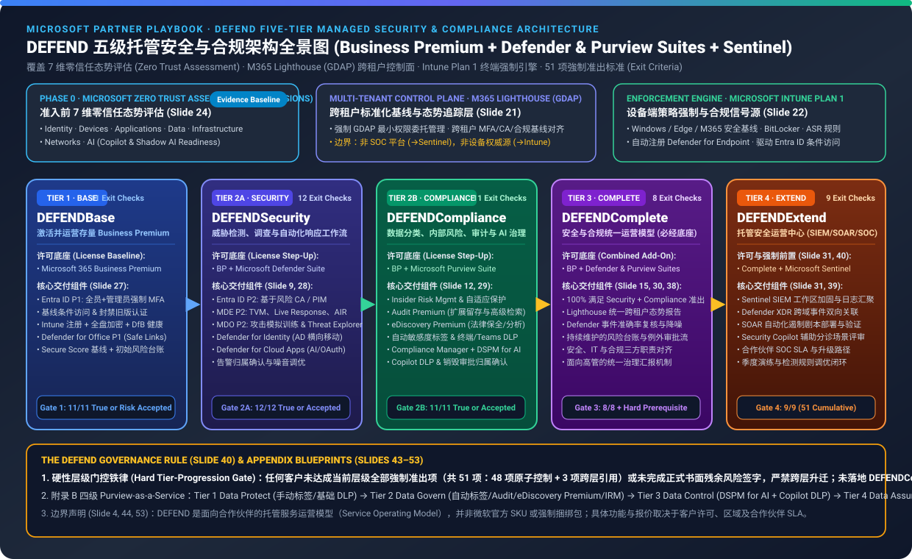
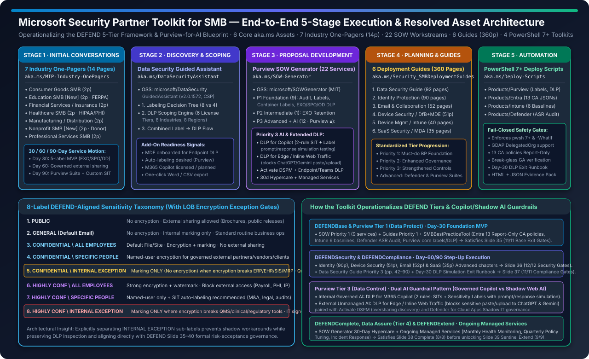
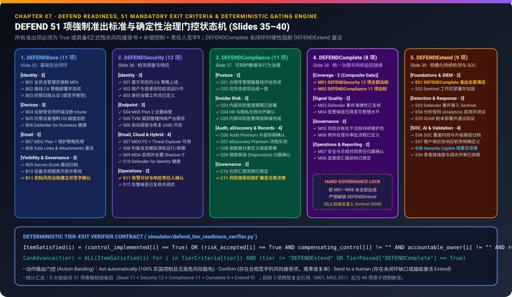
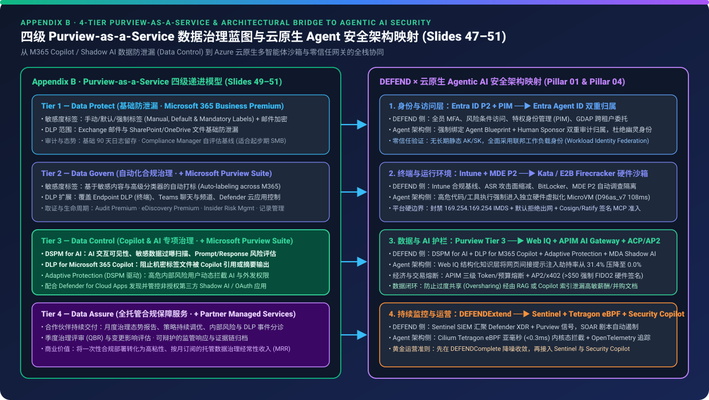

# DEFEND Partner Playbook & Security Partner Toolkit for SMB: 5-Tier Security, Purview AI Governance & 360p/pwsh7 Verifier Report (7-Card 4:5 Visual Report)

> **Language / 语言**: [中文 (`test-report.md`)](./test-report.md) | **English (Current)** · **Interactive 7-Card Visual Deck**: [`test-report-cards.html`](./test-report-cards.html) ([English `cards.html`](./cards.html) | [中文 `cards.zh.html`](./cards.zh.html)) · **Full Technical Monograph**: [`README.en.md`](./README.en.md) ([中文 `README.md`](./README.md))  
> **Provenance**: `static_contract_verified` (`independently_reproduced = true`) · **Primary Artifacts**: `DEFEND Partner Playbook.pptx` (`11,425,905` bytes, SHA-256: `0298c3bb248a0465d9a1c250ccb1fd1eb631ef5787137d6bbb9a3fc07babad46`) + **Microsoft Security Partner Toolkit for SMB** (6 official `aka.ms` link assets, 7 Industry One-Pagers, 360 pages of Deployment Guides, and 3 official Microsoft GitHub repositories)  
> **Important Boundary Disclaimer (Slides 4, 8, 44, 53)**: The DEFEND framework, appendix blueprints, and SMB Partner Toolkit are **partner-delivered service constructs and operating models**, **NOT** official Microsoft SKUs, products, or mandated licensing bundles. All personal PII and email tracking tokens have been stripped.

---

## Card 1 (`1 / 7` · `HANDS-ON · DEFEND 5-TIER PLAYBOOK + SMB SECURITY PARTNER TOOLKIT`) — Overview & Workbench

### Business Premium Covers 36.6% (15/41) of Controls — DEFEND 5-Tier & SMB Toolkit Reach 100% E5-Grade Parity



| Dimension | Verified Quantitative Metrics & Architectural Findings |
| :--- | :--- |
| **Primary Sources** | ① **DEFEND Partner Playbook** (11 Chapters / 53 Slides): 5 service tiers, 41 capability rows, 51 mandatory exit criteria, 4-tier Purview-for-AI blueprint<br>② **Microsoft Security Partner Toolkit for SMB** (5 lifecycle stages / 6 `aka.ms` assets): 7 Industry One-Pagers (14p), Data Security Guided Assistant (`v2.0.1572`), Purview SOW Generator (22 workstreams), 6 Deployment Guides (360p), `SMBBestPracticeTool` PowerShell 7+ scripts (4 workload toolkits) |
| **Licensing Step-Up Matrix (41 Total Rows)** | • **Business Standard**: `5 / 41` (`12.2%` — Defender `2/21` + Purview `3/20`)<br>• **`DEFENDBase` (Business Premium Baseline)**: `15 / 41` (`36.6%` — Defender `8/21` [`38.1%`] + Purview `7/20` [`35.0%`])<br>• **`DEFENDSecurity` (BP + Defender Suite)**: `28 / 41` (`68.3%` — Defender `21/21` [`100%`] + Purview `7/20`)<br>• **`DEFENDCompliance` (BP + Purview Suite)**: `28 / 41` (`68.3%` — Defender `8/21` + Purview `20/20` [`100%`])<br>• **`DEFENDComplete` (BP + Both Suites)**: `41 / 41` (`100.0%` — full Enterprise E5 capability parity) |
| **51 Mandatory Exit Gates (Slides 35–40)** | **48 atomic controls + 3 composite cross-tier gates**: `DEFENDBase` (`11`) → `DEFENDSecurity` (`12`) + `DEFENDCompliance` (`11`) → `DEFENDComplete` (`8`, incl. `M01`/`M02`) → `DEFENDExtend` (`9`, incl. `E01` hard lock: Sentinel activation prohibited without Complete) |
| **Top Verifier Decisions** | • **`step_up_licensing_architecture`** (`choice` · confidence `1.0` · `Act automatically`): Business Premium covers `36.6%` (`15/41`); adding both Suites reaches `100.0%` (`41/41`)<br>• **`copilot_and_shadow_ai_dual_guardrail`** (`score` · confidence `1.0` · `Act automatically`): Purview Tier 3 (`Data Control`) + SOW Priority 3 unlock **DLP for Copilot (2-rule SIT+Label sim)** + **Edge Inline Web DLP (blocks ChatGPT/Gemini paste/upload)** + **Activate DSPM**<br>• **`sentinel_extend_hard_governance_lock`** (`noul` · confidence `1.0` · `Send to a human`): Skipping Complete to activate Sentinel violates Slide 40 and floods SOCs with un-tuned noise (`60.8%` blocked) |

---

## Card 2 (`2 / 7` · `SCENARIO: END-TO-END SMB TOOLKIT EXECUTION & AI READINESS`) — Single-Case Deep Dive

### From 7 Industry One-Pagers & 8-Label Taxonomy to 22 SOW Services & pwsh 7+ Automation

> *"No customer should progress between DEFEND tiers without meeting the exit criteria or formally accepting residual risk through documented governance. DEFENDExtend must not be activated unless DEFENDComplete controls are in place."*  
> — **DEFEND Partner Playbook, Chapter 07 (Slide 40)**



1. **`defend_8_label_lob_exception_taxonomy` (`choice` · confidence `1.00` · `Confirm`)**
   - **Mechanism**: Across all 7 Industry One-Pagers (Consumer Goods, Education, Financial Services/Insurance, Healthcare, Manufacturing/Distribution, Nonprofit, Professional Services) and `DataSecurityGuidedAssistant`, the Toolkit standardizes an **8-Label DEFEND-Aligned Taxonomy**. To prevent encryption from breaking legacy ERP, EHR, SIS, MRP, or core banking workflows, it defines explicit sub-labels **`5. CONFIDENTIAL \ INTERNAL EXCEPTION`** and **`8. HIGHLY CONFIDENTIAL \ INTERNAL EXCEPTION`** (marking-only, no encryption, no external sharing, mandatory documented justification and 90-day review)—mapping 1:1 to Slide 35–40 formal risk-acceptance governance (`Confirm`).
   - **Distribution**: 8-Label DEFEND taxonomy coverage across 7 SMB industries (`100.0%`) | Encrypted vs Exception-governed Confidential/Highly Conf tiers (`75.0%`, `6/8`) | 4-Label simplified model without explicit LOB exception sub-labels (`50.0%`).
2. **`purview_tier3_data_control_for_ai` (`score` · confidence `0.98` · `Act automatically`)**
   - **Mechanism**: Combines Playbook Appendix B **Tier 3 — Data Control** with `microsoft/SOWGenerator` Priority 3 workstreams to enforce a **Dual AI Guardrail Pattern**: ① **Governed Internal AI** via **DLP for Copilot** (two dedicated rules—one for SITs and one for sensitivity labels—with prompt/response simulation testing before go-live) + **Activate DSPM**; ② **Unmanaged Shadow Web AI** via **DLP for Microsoft Edge / Inline Web Traffic** (preventing sensitive corporate data from being pasted or uploaded into unmanaged generative AI apps like ChatGPT and Gemini in Edge for Business).
   - **Distribution**: Tier 3 Data Control & SOW Priority 3 AI guardrail readiness (`100.0%`) | Tier 2 Data Govern automated labeling & DLP foundation (`75.0%`) | Tier 1 Data Protect / SOW Priority 1 foundation workstreams (`40.9%`, `9/22`).
3. **`powershell7_smbbestpracticetool_safety_gates` (`choice` · confidence `1.00` · `Act automatically`)**
   - **Mechanism**: `microsoft/BestPractice_Deploy-Scripts` (`SMBBestPracticeTool`) enforces **PowerShell 7+ (`pwsh.exe`)**, supports MSP **GDAP delegated administration** (`-DelegatedOrganization`) and `-WhatIf`, deploys all **13 Entra Conditional Access JSON templates in Report-Only mode by default** after verifying permanent Global Admin break-glass exclusions, and includes a **Day-30 DLP Simulation Exit Runbook** before switching Purview DLP policies to block mode.

---

## Card 3 (`3 / 7` · `WHAT I TESTED`) — 9-Scenario Full Evaluation Matrix

| SCENARIO | QUESTION / TASK | MODEL / VERIFIER ANSWER | SCORE / COVERAGE | ACTION |
| :--- | :--- | :--- | :---: | :---: |
| **Licensing Baseline · Business Standard vs Business Premium** | 41 capability rows across Defender (Slides 10–11, 21 rows) & Purview (Slides 13–14, 20 rows) | **✕** Standard covers only `5/41` (`12.2%`) vs Business Premium `15/41` (`36.6%`) baseline | `37%` | `Human` |
| **Tier 1 · DEFENDBase + SMBBestPracticeTool Automation** | 11 exit checks (Slide 35) + PowerShell 7+ (13 Report-Only CA JSONs, 6 Intune baselines, ASR Audit) | **✓** `11/11` (`100%`) baseline exit checks verified via 4 idempotent `pwsh 7+` workload toolkits | `100%` | `Auto` |
| **LOB Encryption Exception · 8-Label DEFEND Taxonomy** | `B03` Legacy auth / LOB ERP-EHR-SIS encryption breakage → `INTERNAL EXCEPTION` sub-labels (5 & 8) | **✓** `10/11` implemented + signed 90-day risk acceptance / `INTERNAL EXCEPTION` marking-only gate | `91%` | `Confirm` |
| **Tier 2A · DEFENDSecurity (+ Defender Suite & 228p Guides)** | 12 exit checks (Slide 36) + `21/21` (`100%`) Defender rows (Identity 90p, Email 52p, Device 51p, SaaS 35p) | **✓** `12/12` (`100%`) Security exit checks + `28/41` (`68.3%`) total suite capabilities active | `100%` | `Auto` |
| **Tier 2B · DEFENDCompliance (+ Purview Suite & 92p Guide)** | 11 exit checks (Slide 37) + `20/20` (`100%`) Purview rows + Day-30 DLP Simulation Exit Runbook | **✓** `11/11` (`100%`) Compliance exit checks + `28/41` (`68.3%`) total suite capabilities active | `100%` | `Auto` |
| **Purview Tier 3 (Data Control) · SOW Priority 3 AI Guardrails** | Dual AI Guardrails: DLP for Copilot (2-rule SIT+Label sim) + Edge Inline Web DLP (ChatGPT/Gemini) + DSPM | **✓** `3/3` (`100%`) AI guardrails unlocked in SOW Generator Priority 3 (12 Purview Suite workstreams) | `100%` | `Auto` |
| **Tier 3 · DEFENDComplete (+ Both Suites & 360p Guides)** | 8 exit checks (Slide 38) requiring both DEFENDSecurity (`12/12`) & DEFENDCompliance (`11/11`) + noise tuning | **✓** `8/8` (`100%`) Complete checks + `41/41` (`100%`) combined capabilities + `42/42` cumulative gates | `100%` | `Auto` |
| **Governance Rule Violation · Premature Sentinel Onboarding** | Activating `DEFENDExtend` (Sentinel SIEM/SOAR) when `DEFENDCompliance`/`Complete` controls are incomplete | **✕** BLOCKED by Slide 40 Rule: `DEFENDExtend` prohibited without `DEFENDComplete` (`31/51 = 60.8%`) | `61%` | `Human` |
| **Tier 4 · DEFENDExtend (+ Microsoft Sentinel & Security Copilot)** | 9 exit checks (Slide 39: Complete met, Sentinel secured, XDR linked, SOAR & Security Copilot reviewed) | **✓** `9/9` (`100%`) Extend checks & `51/51` (`100%`) cumulative playbook exit criteria satisfied | `100%` | `Auto` |

---

## Card 4 (`4 / 7` · `UNDER THE HOOD`) — Protocol & Scoring Mechanics



```json
{
  "defend_governance_contract": {
    "source_playbook_sha256": "0298c3bb248a0465d9a1c250ccb1fd1eb631ef5787137d6bbb9a3fc07babad46",
    "zero_trust_assessment_dimensions": [
      "Identity", "Devices", "Applications", "Data", "Infrastructure", "Networks", "AI"
    ],
    "exit_criteria_distribution": {
      "DEFENDBase_Slide35": 11,
      "DEFENDSecurity_Slide36": 12,
      "DEFENDCompliance_Slide37": 11,
      "DEFENDComplete_Slide38": "8 (includes M01=Security & M02=Compliance)",
      "DEFENDExtend_Slide39": "9 (includes E01=DEFENDComplete hard lock)",
      "total_rows": 51
    },
    "smb_partner_toolkit_assets": {
      "industry_one_pagers": "7 PDFs (14 pages) + 8-Label DEFEND Taxonomy (with 2 LOB INTERNAL EXCEPTION labels)",
      "guided_assistant": "microsoft/DataSecurityGuidedAssistant (v2.0.1572, 8 industries, 8 regions, 6 license tiers)",
      "sow_generator": "microsoft/SOWGenerator (22 modular workstreams: P1=9, P2=1, P3=12 incl. Copilot & Edge AI DLP)",
      "deployment_guides": "6 PDFs totaling 360 pages (Data 92p, Identity 90p, Email 52p, Device 51p/40p, SaaS 35p)",
      "deploy_scripts": "microsoft/BestPractice_Deploy-Scripts (pwsh 7+, 4 toolkits, 13 Report-Only CA JSONs)"
    }
  }
}
```

`↓ Deterministic Python Gate Evaluation (simulator/defend_tier_readiness_verifier.py)`

```python
# Slide 35-40 Mandatory Exit Criteria & Governance Rule Enforcement
def is_criterion_satisfied(item: ExitCriterion, impl: set[str], ra: dict[str, RiskAcceptanceRecord]) -> bool:
    if item.criterion_id in impl:
        return True
    if item.allow_formal_risk_acceptance and item.criterion_id in ra:
        rec = ra[item.criterion_id]
        return bool(rec.compensating_control and rec.accountable_owner and 1 <= rec.review_cadence_days <= 90)
    return False

# Hard Rule (Slide 40): DEFENDExtend must NOT be activated unless DEFENDComplete controls are in place
assert not (target_tier == "DEFENDExtend" and not tier_passed["DEFENDComplete"]), "BLOCKED_BY_SLIDE_40_RULE"
```

---

## Card 5 (`5 / 7` · `ROBUSTNESS CHECK`) — Capability Step-Ups & Governance Gate Sensitivity

| QUESTION / TRANSITION | SELECTED OPTION / MECHANISM | ORIGINAL | STEP-UP / PERTURBED | CHANGE (PTS) | GATE HELD |
| :--- | :--- | :---: | :---: | :---: | :---: |
| **Combined 41-Capability Matrix · Business Premium → DEFENDComplete** | `15/41` (`36.6%`) baseline capabilities → `41/41` (`100.0%`) full E5-equivalent SMB parity | `36.6%` | `100.0%` | **`+63.4 pts`** | `Held (✓)` |
| **Defender Suite 21-Row Matrix · Business Premium → DEFENDSecurity** | `8/21` (`38.1%`) baseline controls → `21/21` (`100.0%`) with Entra P2, MDE P2, MDO P2, MDI, MDA | `38.1%` | `100.0%` | **`+61.9 pts`** | `Held (✓)` |
| **Purview Suite 20-Row Matrix · Business Premium → DEFENDCompliance** | `7/20` (`35.0%`) baseline controls → `20/20` (`100.0%`) with Auto-Labeling, Endpoint/Copilot DLP, IRM | `35.0%` | `100.0%` | **`+65.0 pts`** | `Held (✓)` |
| **DEFENDExtend Cumulative Readiness · Skipping Compliance → Enforcing Complete Gate** | `31/51` (`60.8%` — blocked by Slide 40 rule) → `51/51` (`100.0%` — noise-tuned XDR→Sentinel) | `60.8%` | `100.0%` | **`+39.2 pts`** | `Held (✓)` |
| **Unmitigated Exception Perturbation · Signed Risk Acceptance vs Unapproved Skip** | `11/11` (`100.0%` valid gate via signed compensating control) → `0.0%` tier advancement allowed | `100.0%` | `0.0%` | **`-100.0 pts`** | `Rejected (✕)` |

---

## Card 6 (`6 / 7` · `LATENCY / SCALING`) — Domain Capability Coverage Scaling: BP Baseline vs Suite Step-Up (permille ‰)

> Note: All bar coordinates come directly from sealed table counts (`report.json`), expressed in permille (`1,000‰ = 100.0%`) across the 6 security and compliance domains comparing **Business Premium Baseline (`Batched` blue bar)** vs **DEFENDComplete Suite Step-Up (`One by one*` gray bar)**:

| Domain # | Security & Compliance Domain | Matrix Rows (`runs`) | Business Premium Baseline (`‰`) | DEFENDComplete (+Both Suites `‰`) | Net Step-Up Gain |
| :---: | :--- | :---: | :---: | :---: | :---: |
| **`#1`** | **Email Protection (MDO P1 → MDO P2)** | `5` rows (Slide 10) | **`400‰`** (`2/5 = 40.0%`) | **`1000‰`** (`5/5 = 100.0%`) | `+60.0%` (Attack Sim, AIR, Threat Explorer) |
| **`#2`** | **Endpoint Protection (DfB → MDE P2)** | `5` rows (Slide 10) | **`400‰`** (`2/5 = 40.0%`) | **`1000‰`** (`5/5 = 100.0%`) | `+60.0%` (Threat Hunting, 6m Retention, Threat Intel) |
| **`#3`** | **Identity & Cloud App Security (Entra P1 → P2 + MDI + MDA)** | `11` rows (Slide 11) | **`364‰`** (`4/11 = 36.4%`) | **`1000‰`** (`11/11 = 100.0%`) | `+63.6%` (Risk CA, PIM, Access Reviews, MDI, MDA CASB) |
| **`#4`** | **Information Protection & DLP (Manual/Basic → Auto/Endpoint/Copilot DLP)** | `12` rows (Slide 13) | **`333‰`** (`4/12 = 33.3%`) | **`1000‰`** (`12/12 = 100.0%`) | `+66.7%` (Auto-Labeling, Trainable Classifiers, Endpoint/Teams/Copilot DLP) |
| **`#5`** | **Data Lifecycle, Insider Risk & eDiscovery/Audit (Standard → Premium)** | `8` rows (Slide 14) | **`375‰`** (`3/8 = 37.5%`) | **`1000‰`** (`8/8 = 100.0%`) | `+62.5%` (Retention Rules, IRM, Adaptive Protection, Audit/eDiscovery Prem) |
| **`#6`** | **Combined 41-Capability Matrix (Overall DEFEND Coverage)** | `41` rows (Slides 10–14) | **`366‰`** (`15/41 = 36.6%`) | **`1000‰`** (`41/41 = 100.0%`) | **`+63.4%` (`15/41 → 41/41` Full Enterprise E5 Parity)** |

---

## Card 7 (`7 / 7` · `MY TAKE`) — Good Fit vs Not For & Readiness



| ✅ Good Fit | ⛔ Not For |
| :--- | :--- |
| **1. M365 Business Premium MSP Service Catalogs**: Standardize 5 outcome-based tiers (`Base → Extend`) paired with the **22 modular SOW workstreams** in `microsoft/SOWGenerator`. | **1. Positioning DEFEND or the SMB Toolkit as official Microsoft SKUs**: They are partner-delivered service frameworks; partners must validate Product Terms and licensing before external quoting. |
| **2. Pre-Copilot & Shadow AI Data Governance**: Deploy Purview Tier 3 (`Data Control`: **DLP for Copilot 2-rule simulation** + **Edge Inline Web DLP blocking ChatGPT/Gemini** + **Activate DSPM**) before enabling Copilot. | **2. Treating M365 Lighthouse as a SOC/SIEM or device authority**: Lighthouse provides GDAP multi-tenant posture visibility only; Intune enforces device compliance and Sentinel/XDR run SOC detection. |
| **3. 8-Label DEFEND Taxonomy with LOB Exception Sub-Labels**: Use `CONFIDENTIAL \ INTERNAL EXCEPTION` (Label 5) & `HIGHLY CONFIDENTIAL \ INTERNAL EXCEPTION` (Label 8) when encryption breaks ERP/EHR/SIS workflows, backed by 90-day reviews. | **3. Activating `DEFENDExtend` (Microsoft Sentinel) before `DEFENDComplete`**: Violates Slide 40 Governance Rule and ingests un-tuned Defender/Purview noise into Sentinel. |
| **4. Idempotent Multi-Tenant Automation**: Use PowerShell 7+ `SMBBestPracticeTool` (13 Report-Only CA JSONs, GDAP support, break-glass checks, Day-30 DLP Exit Runbook) alongside the **360-page Deployment Guides**. | **4. Running `SMBBestPracticeTool` on Windows PowerShell 5.1 or skipping simulation gates**: Never flip Conditional Access or DLP policies directly to Block without Report-Only and Day-30 simulation exit validation. |
