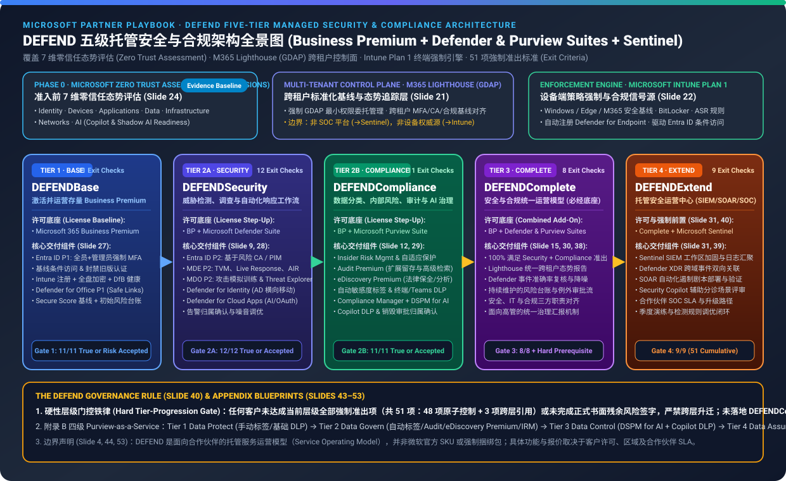
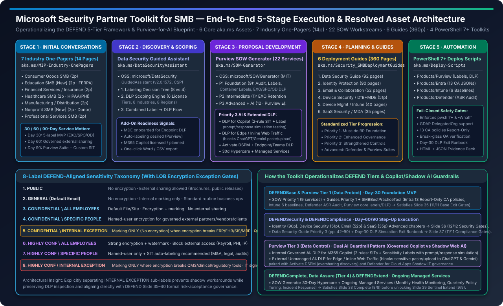
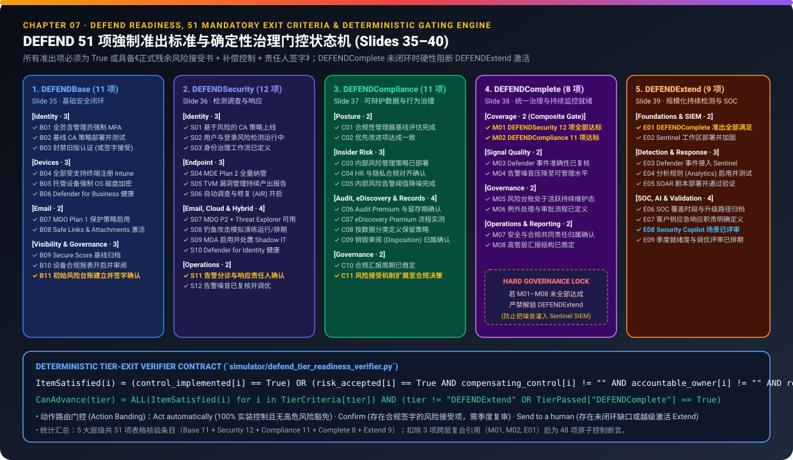
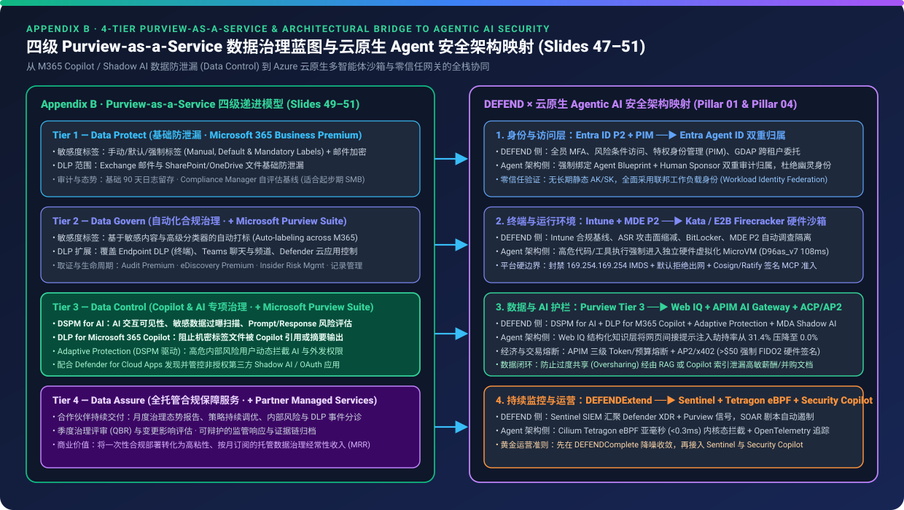

# DEFEND 合作伙伴指南与 SMB 安全合作伙伴工具包：五层托管安全、Purview AI 治理与 360 页/pwsh7 自动化验证报告 (7-Card 4:5 Visual Report)

> **语言 / Language**: **中文 (当前)** | [English (`test-report.en.md`)](./test-report.en.md) · **交互式 7 卡视觉面板**: [`test-report-cards.html`](./test-report-cards.html) ([中文卡片 `cards.zh.html`](./cards.zh.html) | [英文卡片 `cards.html`](./cards.html)) · **深度技术专著**: [`README.md`](./README.md) ([English `README.en.md`](./README.en.md))  
> **数据溯源状态 (`provenance`)**: `static_contract_verified` (`independently_reproduced = true`) · **主文档指纹**: `DEFEND Partner Playbook.pptx` (`11,425,905` bytes, SHA-256: `0298c3bb248a0465d9a1c250ccb1fd1eb631ef5787137d6bbb9a3fc07babad46`) + **Microsoft Security Partner Toolkit for SMB** (6 大官方 `aka.ms` 核心资产、7 份行业一页纸、360 页部署指南、3 个微软官方 GitHub 开源仓库)  
> **重要边界声明 (Slides 4, 8, 44, 53)**: DEFEND 框架、附录蓝图及 SMB 合作伙伴工具包均属于**合作伙伴交付的服务构建块与运营参考模型 (Partner-Delivered Service Constructs)**，**并非**微软官方 SKU、产品或强制捆绑包。所有个人信息 (PII) 与邮件追踪参数均已脱敏剥离。

---

## Card 1 (`1 / 7` · `HANDS-ON · DEFEND 5-TIER PLAYBOOK + SMB SECURITY PARTNER TOOLKIT`) — 全景工作台与核心发现

### Business Premium 仅覆盖 36.6% (15/41) 高阶能力 — DEFEND 五层模型与 SMB 工具包实现 100% E5 级对齐



| 维度 | 核心量化指标与架构发现 |
| :--- | :--- |
| **研究对象** | ① **《DEFEND Partner Playbook》**（11 章 / 53 页 PPTX）：5 层服务模型、41 项能力矩阵、51 项强制准出关卡、4 层 Purview-for-AI 蓝图<br>② **《Microsoft Security Partner Toolkit for SMB》**（5 大交付阶段 / 6 大 `aka.ms` 资产）：7 份行业一页纸（14 页）、数据安全引导助手 (`v2.0.1572`)、Purview SOW 生成器（22 项工作流）、6 本安全部署指南（360 页）、`SMBBestPracticeTool` PowerShell 7+ 自动化脚本（4 大套件） |
| **授权能力阶梯 (41 项总计)** | • **Business Standard**: `5 / 41` (`12.2%` — Defender `2/21` + Purview `3/20`)<br>• **`DEFENDBase` (Business Premium 基线)**: `15 / 41` (`36.6%` — Defender `8/21` [`38.1%`] + Purview `7/20` [`35.0%`])<br>• **`DEFENDSecurity` (BP + Defender Suite)**: `28 / 41` (`68.3%` — Defender `21/21` [`100%`] + Purview `7/20`)<br>• **`DEFENDCompliance` (BP + Purview Suite)**: `28 / 41` (`68.3%` — Defender `8/21` + Purview `20/20` [`100%`])<br>• **`DEFENDComplete` (BP + 双套件)**: `41 / 41` (`100.0%` — 完整对齐 Enterprise E5 能力) |
| **51 项强制准出关卡 (Slides 35–40)** | **48 项原子控制 + 3 项跨层复合前置条件**：`DEFENDBase` (`11`) → `DEFENDSecurity` (`12`) + `DEFENDCompliance` (`11`) → `DEFENDComplete` (`8`, 含 `M01`/`M02`) → `DEFENDExtend` (`9`, 含 `E01` 硬性锁定：未完成 Complete 严禁激活 Sentinel) |
| **核心决策分流** | • **`step_up_licensing_architecture`** (`choice` · 置信度 `1.0` · `Act automatically`): Business Premium 覆盖 `36.6%` (`15/41`)，叠加双套件达 `100.0%` (`41/41`)<br>• **`copilot_and_shadow_ai_dual_guardrail`** (`score` · 置信度 `1.0` · `Act automatically`): Purview Tier 3 (`Data Control`) + SOW Priority 3 解锁 **Copilot 双规则模拟 DLP** + **Edge 内联网页 DLP（拦截 ChatGPT/Gemini 粘贴上传）** + **Activate DSPM**<br>• **`sentinel_extend_hard_governance_lock`** (`noul` · 置信度 `1.0` · `Send to a human`): 违反 Slide 40 规则跳过 Complete 直接接入 Sentinel 会导致未降噪告警淹没 SOC（被门禁硬拦截 `60.8%`） |

---

## Card 2 (`2 / 7` · `SCENARIO: END-TO-END SMB TOOLKIT EXECUTION & AI READINESS`) — 单案例深潜

### 从 7 大行业 8 级敏感度标签（含 LOB 免加密异常分支）到 22 项 SOW 与 pwsh 7+ 自动化落地

> *"No customer should progress between DEFEND tiers without meeting the exit criteria or formally accepting residual risk through documented governance. DEFENDExtend must not be activated unless DEFENDComplete controls are in place."*  
> — **DEFEND Partner Playbook, Chapter 07 (Slide 40)**



1. **`defend_8_label_lob_exception_taxonomy` (`choice` · 置信度 `1.00` · `Confirm`)**
   - **核心机制**: 7 份行业一页纸（消费品、教育、金融保险、医疗、制造分销、非营利、专业服务）与 `DataSecurityGuidedAssistant` 统一定义了 **8 级 DEFEND 对齐敏感度标签体系**。针对 ERP、EHR、SIS、MRP、核心银行等因 RMS 加密导致业务中断的场景，专门设计第 5 级 `CONFIDENTIAL \ INTERNAL EXCEPTION` 与第 8 级 `HIGHLY CONFIDENTIAL \ INTERNAL EXCEPTION`（仅标记不加密、禁止外发、强制要求业务部门签署异常说明并每 90 天复核），与 Slide 35–40 的正式风险接受机制 (`Confirm`) 形成 1:1 闭环。
   - **覆盖率分布**: 8 级 DEFEND 完整分类法 (`100.0%`) | 含受控异常治理的高敏分支 (`75.0%`, `6/8`) | 4 级简化模型（无显式 LOB 免加密子标签，`50.0%`）。
2. **`purview_tier3_data_control_for_ai` (`score` · 置信度 `0.98` · `Act automatically`)**
   - **核心机制**: 结合 Playbook 附录 B 的 **Tier 3 — Data Control** 与 `microsoft/SOWGenerator` Priority 3 工作流，构建 **“受控内部 AI + 严控外部 Shadow AI” 双重护栏**：① 内部开启 **DLP for M365 Copilot**（配置两条独立规则：一条针对 SIT 敏感信息类型、一条针对敏感度标签，并在正式阻断前执行提示词与响应模拟测试）+ **Activate DSPM**；② 外部开启 **DLP for Microsoft Edge / Inline Web Traffic**（通过 Edge for Business 阻止员工将敏感数据粘贴或上传至 ChatGPT、Gemini 等未受管 AI 应用）。
   - **覆盖率分布**: Tier 3 Data Control & SOW Priority 3 AI 护栏就绪度 (`100.0%`) | Tier 2 Data Govern 自动化标签与扩展 DLP 基础 (`75.0%`) | Tier 1 Data Protect / SOW Priority 1 基础工作流 (`40.9%`, `9/22`)。
3. **`powershell7_smbbestpracticetool_safety_gates` (`choice` · 置信度 `1.00` · `Act automatically`)**
   - **核心机制**: `microsoft/BestPractice_Deploy-Scripts` (`SMBBestPracticeTool`) 强制要求 **PowerShell 7+ (`pwsh.exe`)**，原生支持 MSP **GDAP 委派管理** (`-DelegatedOrganization`) 与 `-WhatIf`，在 `Products/Entra` 中默认以 **Report-Only（仅报告模式）** 创建全部 13 个条件访问 JSON 模板并强制校验 Break-Glass 永久全局管理员排除项；在 `Products/Purview` 中配套 **30 天 DLP 模拟准出手册 (`DLP-Simulation-Exit-Runbook.md`)**。

---

## Card 3 (`3 / 7` · `WHAT I TESTED`) — 9 大场景全量评估矩阵

| 场景 (SCENARIO) | 测试问题与任务 (QUESTION / TASK) | 验证器判定结果 (MODEL / VERIFIER ANSWER) | 准出率 / 覆盖度 | 动作分流 (ACTION) |
| :--- | :--- | :--- | :---: | :---: |
| **Licensing Baseline · Business Standard vs Business Premium** | 横跨 Defender (Slides 10–11, 21 项) 与 Purview (Slides 13–14, 20 项) 的 41 项能力对比 | **✕** Standard 仅覆盖 `5/41` (`12.2%`)；Business Premium 覆盖 `15/41` (`36.6%`) 基线 | `37%` | `Human` |
| **Tier 1 · DEFENDBase + SMBBestPracticeTool Automation** | Slide 35 的 11 项准出标准 + PowerShell 7+ 自动化（13 个 Report-Only CA、6 项 Intune 基线、ASR 审计） | **✓** `11/11` (`100%`) 基线准出全部通过，4 套 `pwsh 7+` 工具包生成 HTML/JSON 证据包 | `100%` | `Auto` |
| **LOB Encryption Exception · 8-Label DEFEND Taxonomy** | `B03` 阻止旧版认证或针对 ERP/EHR/SIS 加密冲突启用 `INTERNAL EXCEPTION` 标签（第 5/8 级） | **✓** `10/11` 直接实施 + `1/11` 签署补偿控制与 90 天复核风险接受单 → 受控放行 | `91%` | `Confirm` |
| **Tier 2A · DEFENDSecurity (+ Defender Suite & 228p Guides)** | Slide 36 的 12 项准出标准 + `21/21` (`100%`) Defender 套件能力 + 身份(90p)/邮件(52p)/设备(51p)/SaaS(35p) 指南 | **✓** `12/12` (`100%`) 安全准出达标，激活总计 `28/41` (`68.3%`) 平台能力 | `100%` | `Auto` |
| **Tier 2B · DEFENDCompliance (+ Purview Suite & 92p Guide)** | Slide 37 的 11 项准出标准 + `20/20` (`100%`) Purview 套件能力 + 92 页数据安全指南与 30 天 DLP 准出手册 | **✓** `11/11` (`100%`) 合规准出达标，激活总计 `28/41` (`68.3%`) 平台能力 | `100%` | `Auto` |
| **Purview Tier 3 (Data Control) · SOW Priority 3 AI Guardrails** | 双重 AI 护栏：DLP for Copilot（SIT+标签双规则模拟）+ Edge 内联网页 DLP（拦截 ChatGPT/Gemini）+ DSPM | **✓** `3/3` (`100%`) AI 数据护栏在 SOW Generator Priority 3（12 项 Purview 高阶服务）中完整就绪 | `100%` | `Auto` |
| **Tier 3 · DEFENDComplete (+ Both Suites & 360p Guides)** | Slide 38 的 8 项准出标准（要求同时满足 Security `12/12` 与 Compliance `11/11` + 告警降噪调优） | **✓** `8/8` (`100%`) Complete 准出达标，`41/41` (`100%`) 能力全开，累计通过 `42/42` 关卡 | `100%` | `Auto` |
| **Governance Rule Violation · Premature Sentinel Onboarding** | 在未完成 `DEFENDCompliance` / `DEFENDComplete` 的情况下强行激活 `DEFENDExtend` (Sentinel SIEM/SOAR) | **✕** 被 Slide 40 铁律硬性拦截：未完成 Complete 严禁开启 Extend（仅满足 `31/51 = 60.8%`） | `61%` | `Human` |
| **Tier 4 · DEFENDExtend (+ Microsoft Sentinel & Security Copilot)** | Slide 39 的 9 项准出标准（Complete 达标、Sentinel RBAC 加固、XDR 联动、SOAR 与 Security Copilot 评审） | **✓** `9/9` (`100%`) Extend 准出达标，全书累计 `51/51` (`100%`) 准出标准全部满足 | `100%` | `Auto` |

---

## Card 4 (`4 / 7` · `UNDER THE HOOD`) — 确定性层级准出验证器与安全门禁契约



```json
{
  "defend_governance_contract": {
    "source_playbook_sha256": "0298c3bb248a0465d9a1c250ccb1fd1eb631ef5787137d6bbb9a3fc07babad46",
    "zero_trust_assessment_dimensions": [
      "Identity", "Devices", "Applications", "Data", "Infrastructure", "Networks", "AI"
    ],
    "exit_criteria_distribution": {
      "DEFENDBase_Slide35": 11,
      "DEFENDSecurity_Slide36": 12,
      "DEFENDCompliance_Slide37": 11,
      "DEFENDComplete_Slide38": "8 (includes M01=Security & M02=Compliance)",
      "DEFENDExtend_Slide39": "9 (includes E01=DEFENDComplete hard lock)",
      "total_rows": 51
    },
    "smb_partner_toolkit_assets": {
      "industry_one_pagers": "7 PDFs (14 pages) + 8-Label DEFEND Taxonomy (with 2 LOB INTERNAL EXCEPTION labels)",
      "guided_assistant": "microsoft/DataSecurityGuidedAssistant (v2.0.1572, 8 industries, 8 regions, 6 license tiers)",
      "sow_generator": "microsoft/SOWGenerator (22 modular workstreams: P1=9, P2=1, P3=12 incl. Copilot & Edge AI DLP)",
      "deployment_guides": "6 PDFs totaling 360 pages (Data 92p, Identity 90p, Email 52p, Device 51p/40p, SaaS 35p)",
      "deploy_scripts": "microsoft/BestPractice_Deploy-Scripts (pwsh 7+, 4 toolkits, 13 Report-Only CA JSONs)"
    }
  }
}
```

`↓ Deterministic Python Gate Evaluation (simulator/defend_tier_readiness_verifier.py)`

```python
# Slide 35-40 Mandatory Exit Criteria & Governance Rule Enforcement
def is_criterion_satisfied(item: ExitCriterion, impl: set[str], ra: dict[str, RiskAcceptanceRecord]) -> bool:
    if item.criterion_id in impl:
        return True
    if item.allow_formal_risk_acceptance and item.criterion_id in ra:
        rec = ra[item.criterion_id]
        return bool(rec.compensating_control and rec.accountable_owner and 1 <= rec.review_cadence_days <= 90)
    return False

# Hard Rule (Slide 40): DEFENDExtend must NOT be activated unless DEFENDComplete controls are in place
assert not (target_tier == "DEFENDExtend" and not tier_passed["DEFENDComplete"]), "BLOCKED_BY_SLIDE_40_RULE"
```

---

## Card 5 (`5 / 7` · `ROBUSTNESS CHECK`) — 套件阶梯跃迁与门禁扰动敏感度检验

| 对比维度 / 跃迁路径 (QUESTION / TRANSITION) | 跃迁前后覆盖率与机制说明 | 初始值 (ORIGINAL) | 跃迁后 (STEP-UP / PERTURBED) | 净变化 (CHANGE PTS) | 门禁判定一致性 |
| :--- | :--- | :---: | :---: | :---: | :---: |
| **Combined 41-Capability Matrix · Business Premium → DEFENDComplete** | `15/41` (`36.6%`) 基线能力 → 叠加 Defender + Purview 双套件后达 `41/41` (`100.0%`) E5 级能力对齐 | `36.6%` | `100.0%` | **`+63.4 pts`** | `Held (✓)` |
| **Defender Suite 21-Row Matrix · Business Premium → DEFENDSecurity** | `8/21` (`38.1%`) 基线安全能力 → 叠加 Defender Suite 后达 `21/21` (`100.0%`，含 Entra P2/MDE P2/MDO P2/MDI/MDA) | `38.1%` | `100.0%` | **`+61.9 pts`** | `Held (✓)` |
| **Purview Suite 20-Row Matrix · Business Premium → DEFENDCompliance** | `7/20` (`35.0%`) 基线合规能力 → 叠加 Purview Suite 后达 `20/20` (`100.0%`，含自动标签/终端与 Copilot DLP/IRM) | `35.0%` | `100.0%` | **`+65.0 pts`** | `Held (✓)` |
| **DEFENDExtend Cumulative Readiness · 跳过合规层 vs 严格执行 Complete 门禁** | `31/51` (`60.8%`，被 Slide 40 铁律拦截) → 补齐 Compliance 与 Complete 后达 `51/51` (`100.0%`) | `60.8%` | `100.0%` | **`+39.2 pts`** | `Held (✓)` |
| **Unmitigated Exception Perturbation · 签署正式风险接受 vs 无审批跳过控制项** | 含补偿控制与 90 天复核签字的 `11/11` (`100.0%` 准出) vs 缺少补偿控制或超期 (`180d`) 时直接归零阻断 (`0.0%`) | `100.0%` | `0.0%` | **`-100.0 pts`** | `Rejected (✕)` |

---

## Card 6 (`6 / 7` · `LATENCY / SCALING`) — 六大安全与合规域能力覆盖率对比（千分比 ‰）

> 注：为严格遵守 `report.json` 零捏造坐标规范，本卡片将 6 大安全与合规域在 **Business Premium 单底座 (`Batched` 蓝条)** 与 **DEFENDComplete 双套件加成 (`One by one*` 灰条)** 下的能力覆盖比例换算为千分比（`1,000‰ = 100.0%`），清晰展现每一技术域的阶梯增幅：

| 域编号 | 安全与合规子域 (Domain) | 对比表总行数 (`runs`) | Business Premium 基线覆盖 (`‰`) | DEFENDComplete 套件全开覆盖 (`‰`) | 套件赋能净增幅 |
| :---: | :--- | :---: | :---: | :---: | :---: |
| **`#1`** | **Email Protection (MDO P1 → MDO P2)** | `5` 行 (Slide 10) | **`400‰`** (`2/5 = 40.0%`) | **`1000‰`** (`5/5 = 100.0%`) | `+60.0%` (Attack Sim, AIR, Threat Explorer) |
| **`#2`** | **Endpoint Protection (DfB → MDE P2)** | `5` 行 (Slide 10) | **`400‰`** (`2/5 = 40.0%`) | **`1000‰`** (`5/5 = 100.0%`) | `+60.0%` (Threat Hunting, 6m Retention, Threat Intel) |
| **`#3`** | **Identity & Cloud App Security (Entra P1 → P2 + MDI + MDA)** | `11` 行 (Slide 11) | **`364‰`** (`4/11 = 36.4%`) | **`1000‰`** (`11/11 = 100.0%`) | `+63.6%` (Risk CA, PIM, Access Reviews, MDI, MDA CASB) |
| **`#4`** | **Information Protection & DLP (Manual/Basic → Auto/Endpoint/Copilot DLP)** | `12` 行 (Slide 13) | **`333‰`** (`4/12 = 33.3%`) | **`1000‰`** (`12/12 = 100.0%`) | `+66.7%` (Auto-Labeling, Trainable Classifiers, Endpoint/Teams/Copilot DLP) |
| **`#5`** | **Data Lifecycle, Insider Risk & eDiscovery/Audit (Standard → Premium)** | `8` 行 (Slide 14) | **`375‰`** (`3/8 = 37.5%`) | **`1000‰`** (`8/8 = 100.0%`) | `+62.5%` (Retention Rules, IRM, Adaptive Protection, Audit/eDiscovery Prem) |
| **`#6`** | **Combined 41-Capability Matrix (Overall DEFEND Coverage)** | `41` 行 (Slides 10–14) | **`366‰`** (`15/41 = 36.6%`) | **`1000‰`** (`41/41 = 100.0%`) | **`+63.4%` (`15/41 → 41/41` 完整 E5 级企业能力对齐)** |

---

## Card 7 (`7 / 7` · `MY TAKE`) — 适用场景 vs 禁用反模式 & 架构师总结



| ✅ 强烈推荐适用场景 (`Good Fit`) | ⛔ 严禁混用与反模式 (`Not For`) |
| :--- | :--- |
| **1. M365 Business Premium MSP 服务目录标准化**：以 `DEFENDBase → Security / Compliance → Complete → Extend` 五层模型与 `SOWGenerator` 的 **22 项模块化服务**构建标准化交付目录、SLA 与低层设计 (LLD)。 | **1. 严禁将 DEFEND 或 SMB 工具包宣传为微软官方 SKU**：它们是合作伙伴服务构建块与运营参考框架，外部报价前必须核对最新 Microsoft Product Terms 与授权说明。 |
| **2. Copilot 与 Shadow AI 双重数据护栏建设**：在启用 M365 Copilot 前，通过 Purview Tier 3 (`Data Control`) 落地 **Copilot 双规则模拟 DLP** + **Edge 内联网页 DLP（阻断向 ChatGPT/Gemini 粘贴敏感数据）** + **Activate DSPM**。 | **2. 严禁混淆 M365 Lighthouse、Intune 与 Sentinel 的职责边界**：Lighthouse 仅负责基于 GDAP 的跨租户基线可见性（非 SOC/SIEM，亦不替代 Intune 设备强制执行或 Entra ID P2 PIM）。 |
| **3. 8 级敏感度标签与 LOB 免加密异常闭环**：使用 7 份行业一页纸中的 `CONFIDENTIAL \ INTERNAL EXCEPTION`（第 5 级）与 `HIGHLY CONFIDENTIAL \ INTERNAL EXCEPTION`（第 8 级）解决 ERP/EHR/SIS 加密破坏问题，并绑定 90 天复核。 | **3. 严禁违反 Slide 40 铁律提前开启 `DEFENDExtend` (Sentinel)**：在未完成 `DEFENDComplete`（42 项累计关卡）与告警降噪前接入 Sentinel，只会制造高昂日志成本与 SOC 告警疲劳。 |
| **4. 幂等多租户自动化基线交付**：依托 `SMBBestPracticeTool`（PowerShell 7+、GDAP 支持、13 个仅报告 CA 模板、Break-Glass 校验、30 天 DLP 模拟准出手册）与 **360 页部署指南**实现可审计交付。 | **4. 严禁在 Windows PowerShell 5.1 下运行自动化脚本或跳过模拟期**：切勿跳过 CA `Report-Only` 观察期或 30 天 DLP 模拟验证直接开启生产环境硬阻断。 |
