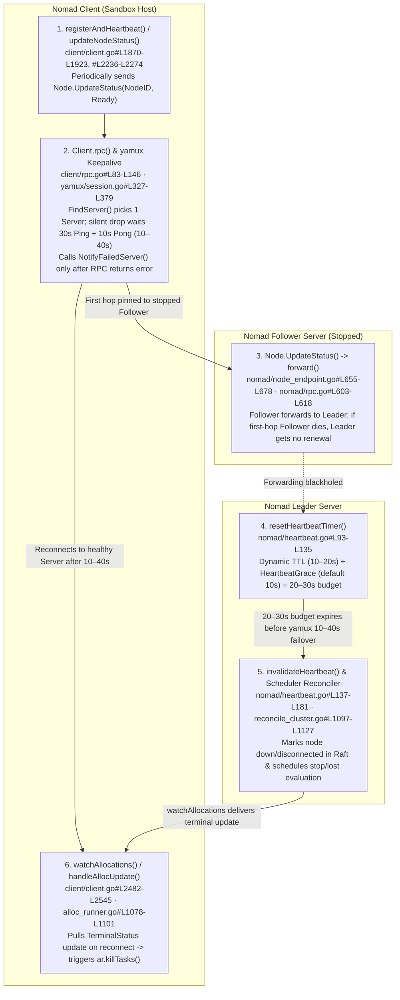

# Building E2B Sandbox Resilience: Discovering and Tuning Nomad Heartbeats — Deep Study Notes & Source-Level Architecture Analysis

> **Language / 语言**: [中文 (`README.zh-CN.md`)](README.zh-CN.md) | **English (Current)**  
> **Deliverables**: [English Benchmark Report (`test-report.en.md`)](test-report.en.md) · [中文评测报告 (`test-report.md`)](test-report.md) · [7-Card 4:5 Visual Deck (`test-report-cards.html`)](test-report-cards.html) · [Sealed Data (`report.json`)](report.json) · [Provenance Ledger (`evidence.json`)](evidence.json) · [Deterministic Simulator (`simulator/`)](simulator/) · [Review Log (`review.md`)](review.md)

---

## 1. Executive Summary

During a single-node fault-injection experiment on a self-hosted **E2B (AI Sandbox / Code Interpreter) + HashiCorp Nomad** cluster (**3 Nomad Servers + 20 Nomad Client sandbox hosts**), forcibly stopping just **1 non-Leader Nomad Server VM** exposed a counterintuitive control-plane cascade:

1. **Counterintuitive Baseline Failure (Quorum Intact, Yet Healthy Client Workloads Were Killed)**:
   - With 2 of 3 Nomad Servers healthy (Raft quorum and Leader intact) and all 20 Nomad Client sandbox hosts completely healthy, running under default settings (no `disconnect` block, `heartbeat_grace = "10s"`) over an 11-minute window caused:
     - **`7 / 20` (`35.0%`) `Orchestrator` allocations** to be replaced;
     - **`7 / 20` (`35.0%`) `session-proxy` allocations** to be replaced;
     - **`2 / 3` (`66.7%`) `client-proxy` allocations** to be replaced.
2. **The Paradoxical Log Timeline ("Why Were Tasks Killed 18 Seconds AFTER Heartbeats Recovered?")**:
   - Relative to the moment the cloud platform confirmed the non-Leader Server VM stopped ($t_{\text{obs}} = 0\text{s}$):
     - **$t \approx 21\text{s}$**: The Nomad Client logged a successful heartbeat to a healthy Server;
     - **$t \approx 39\text{s}$**: The original task on that same Client began `Killing`;
     - **$t \approx 44\text{s}$**: The active application stream (HTTP NDJSON) closed.
   - **True Causal Chain**: `Leader heartbeat timer expires first` $\rightarrow$ `Leader marks node down/disconnected and triggers a scheduler evaluation` $\rightarrow$ `Scheduler marks the original allocation as stop / lost` $\rightarrow$ `Client finishes yamux failover and reconnects to a healthy Server` $\rightarrow$ `Client pulls the pending allocation updates via watchAllocations()` $\rightarrow$ `Local AllocRunner executes killTasks()`. **Reconnecting to a healthy Server did not save the task—it was the exact mechanism by which the Client pulled and executed the already-decided stop plan.**
3. **Root-Cause Timing Race (`yamux` 10–40s Silent Drop Detection vs. Leader 20–30s Heartbeat Budget)**:
   - Nomad Clients maintain a **node-level heartbeat (`Node.UpdateStatus`)** shared by all allocations on the host (`Orchestrator`, `session-proxy`, `client-proxy`). Task-level updates (`Node.UpdateAlloc`) and application gRPC health checks do **not** renew the node heartbeat timer.
   - In `client/rpc.go`, `rpc()` selects a single Server (`FindServer()`) and only calls `NotifyFailedServer(server)` *after* `connPool.RPC(...)` returns an error. When a non-Leader Server VM silently stops without sending TCP FIN/RST, `hashicorp/yamux@v0.1.2` relies on its `30s` Keepalive Ping interval plus a `10s` Pong wait timeout—yielding a **`10s–40s` failure detection window**.
   - Meanwhile, in a small cluster, the Nomad Leader computes a dynamic heartbeat `ttl` of **`10s–20s`** plus the default `heartbeat_grace = "10s"`, leaving a total pre-expiration budget of only **`20s–30s`**. Any Client pinned to the stopped Follower whose `yamux` Keepalive phase takes $>20\text{s–}30\text{s}$ loses the race.
4. **Two Complementary Solutions & the New-Sandbox Creation Capacity Blast Radius**:
   - **Solution 1 (Task-Group `disconnect`: `lost_after = "50s"`, `replace = false`, `reconcile = "keep_original"`)**: Decouples temporary node disconnection from immediate task replacement across the entire access path (`Orchestrator`, `session-proxy`, and `client-proxy`). In validation, affected allocations entered `unknown` for **`1.7s–31.6s`** and recovered with **`0` replacements, `10 / 10` sandboxes preserved (PID, memory, files), `23 / 23` HTTP NDJSON long streams uninterrupted, and `12,581` short requests with `0` errors**.
   - **Capacity Blast Radius Discovery**: While `disconnect` protects existing sandboxes and streams, it **does not prevent the Client node from briefly entering `disconnected` or its allocation from entering `unknown`**. Both the self-hosted E2B API (`Filter: Status == "ready"`) and open-source `e2b-dev/runtime` (`ClientStatus == "running"`) temporarily remove those **7 / 20 (`35%`)** healthy nodes from the new-sandbox placement pool, concentrating new creation traffic onto the remaining **13 / 20 (`65%`)** hosts (**`+53.85%` per-node creation load surcharge**).
   - **Solution 2 (`server { heartbeat_grace = "50s" }`) & Architectural Trade-Off**: Extends the Leader's pre-disconnect budget from `20s–30s` to **`60s–70s`** (`10–20s TTL + 50s grace`), fully absorbing the `10s–40s` `yamux` failover window. Across 2 full fault-injection rounds (even without `disconnect`), **`20 / 20` surviving Clients remained `ready` (`0` down/disconnected, `0` replacements, `100%` placement pool capacity)**. The trade-off is that Nomad heartbeat-layer detection of a *genuinely crashed* Client host is also delayed to `60s–70s`, requiring fast upper-layer application health checks alongside balanced Nomad tuning.

---

## 2. E2B × Nomad Architecture Topology & Component Responsibilities

In the self-hosted E2B cluster, **3 Nomad Servers (1 Leader + 2 Followers)** coordinate **20 Nomad Client sandbox hosts**:

```mermaid
flowchart TB
    User([User / SDK Client])

    subgraph NomadServers["Nomad Server Cluster (3 Nodes · Raft Quorum)"]
        Leader["Nomad Leader Server<br/>(Heartbeat Timers + Scheduler Reconciler)"]
        Follower1["Nomad Follower Server 1<br/>(RPC Forwarder)"]
        Follower2["Nomad Follower Server 2<br/>(Fault Target: Force Stopped)"]
        Leader <-->|Raft Consensus| Follower1
        Leader <-->|Raft Consensus| Follower2
    end

    subgraph AccessLayer["E2B Access & Control Plane"]
        API["E2B API Service<br/>(Sandbox Placement & Node Pool Cache)"]
        ClientProxy["client-proxy (3 Allocations)<br/>(Shared External Ingress)"]
    end

    subgraph SandboxHost["Nomad Client Host (×20 Sandbox Nodes)"]
        SessionProxy["session-proxy (20 Allocations)<br/>(Per-Host Reverse Proxy)"]
        Orchestrator["Orchestrator (20 Allocations)<br/>(Host-Level Sandbox Lifecycle Manager)"]
        subgraph FirecrackerVMs["Firecracker microVM Sandboxes"]
            SBX1["Sandbox VM #1<br/>(PID / Memory / Rootfs)"]
            SBX2["Sandbox VM #2<br/>(HTTP NDJSON Stream)"]
        end
        SessionProxy --> Orchestrator
        Orchestrator --> SBX1
        Orchestrator --> SBX2
    end

    User -->|Create / Control Sandbox| API
    User -->|Active Sandbox Traffic / Streams| ClientProxy
    ClientProxy --> SessionProxy
    API -->|Select Ready Node & gRPC Create| Orchestrator
    SandboxHost -.->|Node.UpdateStatus Heartbeat<br/>(yamux Multiplexed TCP)| Follower2
    SandboxHost -.->|Failover RPC after 10-40s| Follower1
    Follower1 -->|forward() RPC| Leader
```

| Component | Deployment Topology | Primary Responsibility | Impact When Replaced by Nomad |
| :--- | :--- | :--- | :--- |
| **`Orchestrator`** | 1 per sandbox host (`20` allocations) | Directly manages Firecracker microVM sandboxes, processes, and local runtime state on the host | **Critical**: Restarting `Orchestrator` invalidates or orphans running sandboxes on that host, losing in-memory state |
| **`session-proxy`** | 1 per sandbox host (`20` allocations) | Reverse-proxies traffic to target sandboxes on the local host | **Stream Severed**: Even if the microVM survives, restarting `session-proxy` drops all active streams on that host |
| **`client-proxy`** | Shared ingress (`3` allocations) | Routes external client/SDK traffic into `session-proxy` instances | **Global Ingress Disruption**: `2/3` (`66.7%`) replaced in baseline, breaking active user streams across multiple hosts |
| **`API`** | Control-plane service | Maintains the ready node pool and places new sandboxes onto `Orchestrator` instances | Evicts nodes whose Nomad status leaves `ready` / `running`, shrinking new-sandbox creation capacity |

---

## 3. Baseline Fault-Injection Results & the Paradoxical Log Timeline

### 3.1 Baseline Numbers (1 Non-Leader Server Stopped, 11-Minute Observation Window)

- **Fault Action**: Force-stop **1 non-Leader Nomad Server VM** via the infrastructure platform while the Leader and the other Follower maintain a 2/3 Raft quorum.
- **Observed Replacements (Default Config: no `disconnect`, `heartbeat_grace = "10s"`)**:
  - `Orchestrator`: **`7 / 20` (`35.0%`)** allocations replaced;
  - `session-proxy`: **`7 / 20` (`35.0%`)** allocations replaced;
  - `client-proxy`: **`2 / 3` (`66.7%`)** allocations replaced.

### 3.2 Decoding the Log Timeline ($t \approx 21\text{s}$ Heartbeat Recovery vs. $t \approx 39\text{s}$ Task Killing)

| Observed Time ($t_{\text{obs}}$) | Observed Log Event | Naive Misinterpretation | Actual Control-Plane State |
| :---: | :--- | :--- | :--- |
| **$t_{\text{obs}} = 0\text{s}$** | Platform confirms non-Leader Server VM stopped | "The fault just started now." | The VM began stopping before platform confirmation; the last successful heartbeat occurred prior to $t_{\text{obs}} = 0\text{s}$. |
| **$t_{\text{obs}} \approx 21\text{s}$** | Client logs a successful heartbeat to a healthy Server | "Failover succeeded in time; the node is safe!" | **The Leader's heartbeat timer had already expired before $t \approx 21\text{s}$**, marking the node `down` and its allocations `stop` / `lost`. |
| **$t_{\text{obs}} \approx 39\text{s}$** | Client begins `Killing` the original local task | "Why kill a healthy task 18s after heartbeat recovery?" | Upon reconnecting, `watchAllocations()` pulled the pending `TerminalStatus` update from the Leader and invoked `ar.killTasks()`. |
| **$t_{\text{obs}} \approx 44\text{s}$** | Original HTTP NDJSON application stream closes | User-visible session failure | The killed local task/proxy exited, severing the stream before the replacement allocation started. |

---

## 4. Source-Code Root Cause Trace: The 6-Stage Call Chain (`hashicorp/nomad` & `hashicorp/yamux`)

Tracing [`hashicorp/nomad@bf24b0dd`](https://github.com/hashicorp/nomad/tree/bf24b0dd97430d3b364b68b1f7375e85e585778f) and [`hashicorp/yamux@v0.1.2`](https://github.com/hashicorp/yamux/tree/v0.1.2) reveals the exact 6-step mechanism:



1. **Stage 1 — Shared Node-Level Heartbeat (`client/client.go#L1870-L1923`, `#L2236-L2274`)**: `updateNodeStatus()` sends `Node.UpdateStatus` with `NodeID` and `NodeStatusReady`, updating `c.heartbeatTTL = resp.HeartbeatTTL`. Every task on the Client shares this single node heartbeat.
2. **Stage 2 — Single-Server RPC Selection & `yamux` `10s–40s` Silent Drop Detection (`client/rpc.go#L83-L146` & `yamux@v0.1.2/session.go#L327-L379`)**: `rpc()` calls `c.servers.FindServer()` and blocks on `c.connPool.RPC(...)`. Only when `rpcErr != nil` does it call `c.servers.NotifyFailedServer(server)` to fail over. Under `yamux`, Keepalive pings run every `30s` with a `10s` Pong timeout, producing a **`10s–40s` silent failure detection window**.
3. **Stage 3 — Follower RPC Forwarding (`nomad/node_endpoint.go#L655-L678` & `nomad/rpc.go#L603-L618`)**: Non-Leader Servers forward `Node.UpdateStatus` to the Leader via `n.srv.forward(...)`. While a Client remains stuck on a dead first-hop Follower, the healthy Leader receives no heartbeat renewal.
4. **Stage 4 — Leader Timer Calculation (`nomad/heartbeat.go#L93-L135`)**: `resetHeartbeatTimer()` computes `ttl = RateScaledInterval(MaxHeartbeatsPerSecond, MinHeartbeatTTL, n) + RandomStagger(ttl)` (`10s–20s` in a small cluster) and arms the timer for `ttl + s.config.HeartbeatGrace`. With default `heartbeat_grace = "10s"`, the Leader's total patience is **`20s–30s`**—shorter than the upper half of `yamux`'s `10s–40s` detection window.
5. **Stage 5 — Heartbeat Invalidation & Reconciler Evaluation (`nomad/heartbeat.go#L137-L181`, `nomad/node_endpoint.go#L816-L873`, `scheduler/reconciler/reconcile_cluster.go#L1097-L1127`, `reconcile_node.go#L185-L263`)**: `invalidateHeartbeat()` transitions the node to `NodeStatusDown` (or `NodeStatusDisconnected` if `canDisconnect && hasPendingReconnects`), commits to Raft, and triggers an evaluation that marks running allocations `lost` / `stop`.
6. **Stage 6 — Allocation Watch Pulls Stop Decision & Kills Healthy Tasks (`client/client.go#L2482-L2545`, `client/allocrunner/alloc_runner.go#L1078-L1101`)**: After failing over to a healthy Server, `watchAllocations()` pulls the updated allocation where `update.TerminalStatus()` is `true`, and `handleAllocUpdate()` executes `ar.killTasks()`.

---

## 5. Solution 1: Task-Group `disconnect` Window (Preserving Running Sandboxes & Active Connections)

### 5.1 Configuration & Source-Code Semantics

Adding the `disconnect` block to **`Orchestrator`, `session-proxy`, and `client-proxy`** task groups decouples transient control-plane disconnection from task destruction:

```hcl
disconnect {
  lost_after = "50s"
  replace    = false
  reconcile  = "keep_original"
}
```

- **`replace = false` (`scheduler/reconciler/filters.go#L527-L544`)**: `if isDisconnecting && !alloc.ReplaceOnDisconnect() { return }` prevents Nomad from spawning replacement allocations while the node is disconnecting.
- **`lost_after = "50s"` (`nomad/structs/alloc.go#L756-L779` `Allocation.Expired()`)**: `expiry := a.LastUnknown().Add(tg.GetDisconnectLostAfter())`. Crucially, **the `50s` timer starts at $t_U$ (`LastUnknown()`, when the Leader heartbeat expires at $\approx 25\text{s}$), NOT when the Server VM stopped**. With `TTL = 15s` and `grace = 10s`, the allocation does not expire until $t_U + 50\text{s} \approx 75\text{s}+$, giving ample time for the `10s–40s` `yamux` switch to complete.
- **`reconcile = "keep_original"`**: Retains the original running allocation on the reconnecting Client host.

### 5.2 Empirical Validation Results (`lost_after = "50s"`)

- **Observed `unknown` Duration**: Affected allocations briefly entered `unknown` for **`1.7s–31.6s`** and then returned to `running`.
- **Task Replacements**: **`0`** across `Orchestrator` (`0/20`), `session-proxy` (`0/20`), and `client-proxy` (`0/3`).
- **Running Sandbox Integrity**: **`10 / 10` (`100%`)** pre-existing sandboxes retained identical PIDs, memory content, and files across multiple post-fault inspection rounds.
- **Active Long Streams & Short Requests**: **`23 / 23` (`100%`)** HTTP NDJSON streams remained open without interruption, and **`12,581 / 12,581` (`100%`)** short requests succeeded with **`0` errors**.

---

## 6. Blast Radius on New Sandbox Creation Capacity (`e2b-dev/runtime` Discovery Analysis)

Even with `disconnect` preserving 100% of existing sandboxes and streams, **7 / 20 (`35.0%`) healthy hosts still briefly enter `NodeStatusDisconnected` (with allocations in `AllocClientStatusUnknown`)**.

Inspecting both the self-hosted E2B API and open-source [`e2b-dev/runtime@afaaeaef`](https://github.com/e2b-dev/runtime/tree/afaaeaef96aae86f65ce60bf38fe083e7638a28e) shows why this impacts **new sandbox creation capacity**:
1. **Self-Hosted E2B API (20s Sync Loop)**: Queries Nomad nodes with `Filter: "Status == \"ready\" and NodePool == \"default\""`. Any node in `"disconnected"` is omitted and marked `unhealthy` (`markAsUnhealthy()`), removing it from new sandbox placement.
2. **Open-Source `e2b-dev/runtime` (`packages/shared/pkg/clusters/discovery/nomad.go#L29-L57` & `packages/api/internal/orchestrator/cache.go#L195-L211`)**: Filters Nomad allocations by `if v.ClientStatus != "running" { continue }` and calls `c.remove(ctx, item.GetInfo().NodeID)` for any `Orchestrator` whose `ClientStatus` becomes `"unknown"`.
3. **Quantified Capacity Impact**: During the failover window, available placement capacity drops from **20 to 13 nodes (`65.0%`)**, increasing per-node new-sandbox creation load on the remaining 13 hosts by **`+53.85%`** ($20/13 \approx 1.5385\times$).

---

## 7. Solution 2: Server `heartbeat_grace = "50s"` & the Real-Crash Detection Trade-Off

```hcl
server {
  heartbeat_grace = "50s"
}
```

- **Mechanism**: Raising `heartbeat_grace` from `10s` to `50s` expands the Leader's pre-disconnect budget from `20s–30s` to **`60s–70s`** (`10–20s TTL + 50s grace`). Every Client completes its `10s–40s` `yamux` failover *before* the Leader timer expires.
- **Empirical Validation (2 Full Rounds without `disconnect`)**: In both test rounds, **`20 / 20` (`100%`) surviving Clients stayed `ready`** (`0` entered `down` or `disconnected`, `0` task replacements, and `20 / 20` E2B API placement capacity preserved).
- **Architectural Trade-Off**: If a Client host *genuinely crashes*, Nomad heartbeat-layer detection is also delayed from `20s–30s` to **`60s–70s` (`+40s` window)**. Therefore, production deployments should combine **fast application-layer gRPC health checks in E2B API + a moderate `heartbeat_grace` + full-chain `disconnect` on `Orchestrator`, `session-proxy`, and `client-proxy`**.
