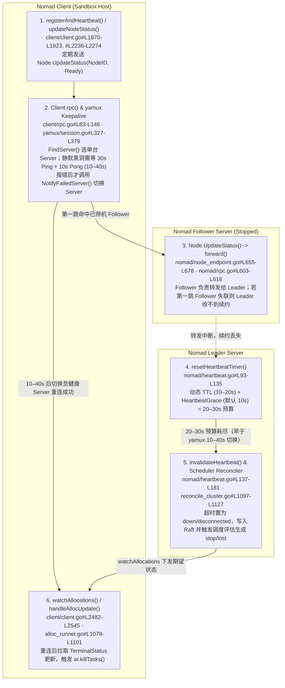
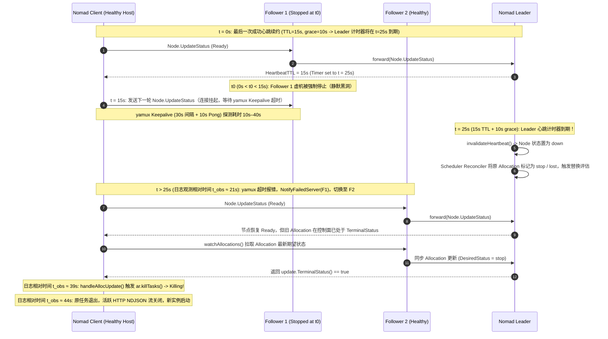
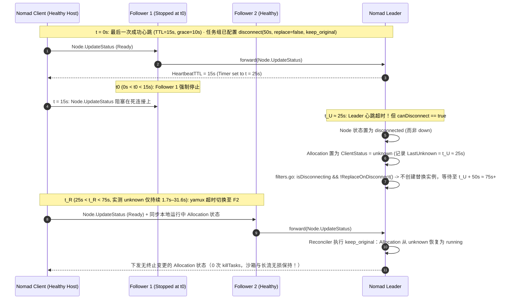
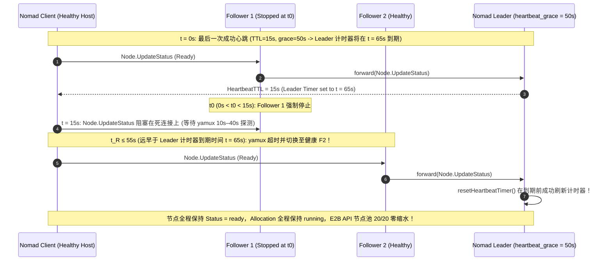

# 构建 E2B 沙箱韧性：Nomad 心跳机制的发现与实践 — 深度学习笔记与源码级架构解析

> **语言 / Language**: **中文 (当前)** | [English (`README.en.md`)](README.en.md)  
> **配套产出 / Deliverables**: [中文评测报告 (`test-report.md`)](test-report.md) · [English Report (`test-report.en.md`)](test-report.en.md) · [7-Card 4:5 可视化卡片 (`test-report-cards.html`)](test-report-cards.html) · [密封评测数据 (`report.json`)](report.json) · [溯源账本 (`evidence.json`)](evidence.json) · [确定性仿真验证器 (`simulator/`)](simulator/) · [复核记录 (`review.md`)](review.md)

---

## 1. 核心结论速览（Executive Summary）

在自建 **E2B（Code Interpreter / AI Agent Sandbox）+ HashiCorp Nomad** 生产/测试集群（**3 台 Nomad Server + 20 台 Nomad Client 沙箱宿主机**）的单台非 Leader Server 故障注入测试中，暴露出了一个极具反直觉的控制面级联故障现象：

1. **反直觉故障表现（Server 仍保持 2/3 多数派，健康 Client 上的任务却被成批杀死）**：
   - 仅强制关停 **1 台非 Leader Nomad Server VM**（其余 2 台 Server 仍维持 Raft 多数派与集群领导权，20 台 Client 沙箱宿主机完全健康），在默认无 `disconnect` 配置、11 分钟观测窗口内：
     - **`Orchestrator`（共 20 个实例）发生 `7 / 20`（`35.0%`）替换**；
     - **`session-proxy`（共 20 个实例）发生 `7 / 20`（`35.0%`）替换**；
     - **`client-proxy`（共 3 个实例）发生 `2 / 3`（`66.7%`）替换**。
2. **日志时间线悖论（“心跳明明已经恢复，为什么旧任务反而在十几秒后被 `Killing`？”）**：
   - 以平台确认目标非 Leader Server 停止为参考零点（$t_{\text{obs}} = 0\text{s}$）：
     - **$t \approx 21\text{s}$**：Client 日志打印已成功向健康 Server 发送心跳；
     - **$t \approx 39\text{s}$**：该 Client 上的原任务才开始执行 `Killing`；
     - **$t \approx 44\text{s}$**：原应用长连接流（HTTP NDJSON stream）关闭。
   - **真实因果顺序**：`Leader 侧心跳先超时` $\rightarrow$ `Leader 更新节点状态并触发调度评估（Evaluation）` $\rightarrow$ `调度器将原 Allocation 标记为 stop / lost` $\rightarrow$ `Client 随后完成底层连接切换并恢复心跳` $\rightarrow$ `Client 重新拉取（watchAllocations）控制面下发的终止结果` $\rightarrow$ `本地 AllocRunner 执行 killTasks()`。**心跳恢复不是避免旧任务停止的原因，恰恰是旧任务收到控制面已生成的 `stop` 指令并开始 `Killing` 的直接触发条件！**
3. **底层时间竞争根因（`yamux` 10–40s 静默断连检测 vs Leader 20–30s 心跳超时预算）**：
   - Nomad Client 维护的是**节点级心跳（`Node.UpdateStatus`）**，单台宿主机上的所有任务（`Orchestrator`、`session-proxy`、`client-proxy`）共享这一个心跳生命周期；任务级状态上报（`Node.UpdateAlloc`）或业务层 gRPC 健康检查均**不能替代**节点心跳。
   - 当 Client 当前复用连接指向的非 Leader Server 静默停机（黑洞）时，`client/rpc.go` 中的 `rpc()` 仅在单次 RPC 返回错误后才会调用 `NotifyFailedServer(server)` 触发连接切换；而底层 `hashicorp/yamux@v0.1.2` 默认每 `30s` 发送一次 Keepalive Ping、等待 Pong 超时为 `10s`，导致**静默断连的故障感知耗时分布在 `10s–40s`**。
   - 与此同时，小规模集群中 Nomad Leader 动态分配的心跳周期 `ttl` 约为 **`10s–20s`**，加上默认 `heartbeat_grace = "10s"`，Leader 容忍心跳缺失的总窗口仅为 **`20s–30s`**。一旦某台 Client 落入 `yamux` Keepalive 的慢半区（`25s–40s`），Leader 必然在 Client 完成切换前判定节点超时。
4. **双层解决方案与新建沙箱容量爆炸半径（Blast Radius）**：
   - **方案一（任务组级 `disconnect` 容忍窗口：`lost_after = "50s"`, `replace = false`, `reconcile = "keep_original"`）**：将“节点短暂失联”与“立即放弃/替换任务”解耦，且必须**同时覆盖 `Orchestrator`、`session-proxy`、`client-proxy` 全链路任务组**。实测 Client `unknown` 持续 `1.7s–31.6s` 后全部自动恢复：**`0` 次任务替换、`10 / 10` 沙箱进程/内存/文件无损、`23 / 23` 条 HTTP NDJSON 长流不断连、`12,581` 次短请求 `0` 错误**。
   - **容量爆炸半径发现**：`disconnect` 保住了存量沙箱与存量连接，但**不会阻止节点短暂进入 `disconnected`、Allocation 短暂进入 `unknown`**。无论自建 E2B API（每 `20s` 轮询 `Status == "ready"`）还是开源 `e2b-dev/runtime`（过滤 `ClientStatus == "running"`），都会在故障窗口内将该节点从**新建沙箱可用节点池**中剔除，导致 **35%（7/20）的健康宿主机暂时退出新建沙箱调度池，剩余 13 台节点承接新建流量（单机新建负载上升 `+53.85%`）**。
   - **方案二（Server 级 `heartbeat_grace = "50s"`）与工程权衡**：将 Leader 判定失联前的总容忍窗口从 `20s–30s` 扩展至 **`60s–70s`**（`10–20s TTL + 50s grace`），完整覆盖 `yamux` `10s–40s` 切换耗时。2 轮完整故障注入实测中，**`20 / 20` 台存活 Client 全程保持 `ready`（`0` 台进入 `down`/`disconnected`、`0` 次任务替换）**。代价是当某台 Client 宿主机**真实宕机**时，Nomad 心跳层面的故障感知也会延后到 `60s–70s`；因此生产最佳实践是**“上层业务快速健康检查兜底 + 适度调大 `heartbeat_grace` + 关键有状态/代理任务组配置 `disconnect`”的三层防御组合**。

---

## 2. E2B × Nomad 部署拓扑与核心组件职责

在自建 E2B 沙箱集群中，控制面与数据面由 **3 台 Nomad Server（1 Leader + 2 Followers）** 与 **20 台 Nomad Client 沙箱宿主机** 组成：

```mermaid
flowchart TB
    User([User / SDK Client])

    subgraph NomadServers["Nomad Server Cluster (3 Nodes · Raft Quorum)"]
        Leader["Nomad Leader Server<br/>(Heartbeat Timers + Scheduler Reconciler)"]
        Follower1["Nomad Follower Server 1<br/>(RPC Forwarder)"]
        Follower2["Nomad Follower Server 2<br/>(Fault Target: Force Stopped)"]
        Leader <-->|Raft Consensus| Follower1
        Leader <-->|Raft Consensus| Follower2
    end

    subgraph AccessLayer["E2B Access & Control Plane"]
        API["E2B API Service<br/>(Sandbox Placement & Node Pool Cache)"]
        ClientProxy["client-proxy (3 Allocations)<br/>(Shared External Ingress)"]
    end

    subgraph SandboxHost["Nomad Client Host (×20 Sandbox Nodes)"]
        SessionProxy["session-proxy (20 Allocations)<br/>(Per-Host Reverse Proxy)"]
        Orchestrator["Orchestrator (20 Allocations)<br/>(Host-Level Sandbox Lifecycle Manager)"]
        subgraph FirecrackerVMs["Firecracker microVM Sandboxes"]
            SBX1["Sandbox VM #1<br/>(PID / Memory / Rootfs)"]
            SBX2["Sandbox VM #2<br/>(HTTP NDJSON Stream)"]
        end
        SessionProxy --> Orchestrator
        Orchestrator --> SBX1
        Orchestrator --> SBX2
    end

    User -->|Create / Control Sandbox| API
    User -->|Active Sandbox Traffic / Streams| ClientProxy
    ClientProxy --> SessionProxy
    API -->|Select Ready Node & gRPC Create| Orchestrator
    SandboxHost -.->|Node.UpdateStatus Heartbeat<br/>(yamux Multiplexed TCP)| Follower2
    SandboxHost -.->|Failover RPC after 10-40s| Follower1
    Follower1 -->|forward() RPC| Leader
```

| 组件名称 | 部署形态与实例数 | 核心职责 | 被 Nomad 误杀/替换时的业务影响 |
| :--- | :--- | :--- | :--- |
| **`Orchestrator`** | System/ Host 级部署（`20` 个实例，每台沙箱宿主机 1 个） | 直接管理本机所有 Firecracker microVM 沙箱的创建、生命周期、进程与本地状态 | **最严重**：`Orchestrator` 重启会导致其托管的本机运行中沙箱失效或孤儿化，内存态与执行上下文丢失 |
| **`session-proxy`** | 每台沙箱宿主机 `1` 个实例（共 `20` 个实例） | 负责将流量反向代理并路由到对应宿主机上的目标沙箱实例 | **连接中断**：即使底层沙箱 VM 仍存活，代理进程被杀会直接掐断该宿主机上所有活跃长连接与请求 |
| **`client-proxy`** | 多副本共享入口服务（共 `3` 个实例） | 承接外部客户端与 SDK 的沙箱访问流量并转发至后端 `session-proxy` | **全局入口抖动**：基线测试中 `2/3`（`66.7%`）实例被替换，导致跨多台宿主机的外部长流连接中断 |
| **`API`** | 控制面服务 | 维护可用沙箱节点池（Node Pool），处理新建沙箱调度请求 | 若节点在 Nomad 中脱离 `ready` / `running`，API 会将其移出可用池，缩减新建沙箱容量 |

---

## 3. 故障现象与“先恢复心跳、后杀死任务”的时间线悖论

### 3.1 基线实验设置与统计结果

- **注入动作**：在云平台控制台对 **1 台非 Leader 的 Nomad Server 虚机**执行强制停止（Force Stop），模拟底层宿主机断电或网络黑洞。
- **理论预期**：3 台 Nomad Server 中仍有 2 台完全正常，Raft 多数派（Quorum = 2）未丢失，且 Leader 本身未发生切换；20 台 Nomad Client 沙箱宿主机也没有任何硬件或业务故障，理想情况下**运行中的沙箱任务不应受到任何干扰**。
- **基线实测结果（无 `disconnect` 配置，默认 `heartbeat_grace = "10s"`，观测窗口 11 分钟）**：
  - `Orchestrator`：**`7 / 20`（`35.0%`）** 发生 Allocation 替换；
  - `session-proxy`：**`7 / 20`（`35.0%`）** 发生 Allocation 替换；
  - `client-proxy`：**`2 / 3`（`66.7%`）** 发生 Allocation 替换。

### 3.2 关键日志时间线拆解（为什么 $t \approx 21\text{s}$ 心跳恢复，$t \approx 39\text{s}$ 才开始杀任务？）

单看某一台受影响 Nomad Client 的本地日志，会看到一个极易误导排查方向的现象：

| 相对观测时间 ($t_{\text{obs}}$) | 观测到的关键事件 | 表面直觉（误区） | 底层真实控制面状态 |
| :---: | :--- | :--- | :--- |
| **$t_{\text{obs}} = 0\text{s}$** | 云平台确认目标非 Leader Server VM 已停止 | 故障刚刚发生 | 实际上虚机停机过程早于平台最终确认时间，最后一次成功心跳发生在 $t_{\text{obs}} = 0\text{s}$ 之前 |
| **$t_{\text{obs}} \approx 21\text{s}$** | Client 日志显示已成功向另一台健康 Server 发送心跳 | “Client 已经自动切到好 Server 了，危机解除！” | **Leader 侧的心跳定时器其实已经先一步超时**，节点状态已被改为 `down`（或 `disconnected`），调度器已将原 Allocation 标记为 `stop` / `lost` |
| **$t_{\text{obs}} \approx 39\text{s}$** | Client 本地日志开始打印原任务 `Killing` | “为什么心跳恢复 18 秒后反而无故杀任务？” | Client 重连成功后通过 `watchAllocations()` 拉取到了控制面早已生成的终止计划，本地 `AllocRunner` 执行 `killTasks()` |
| **$t_{\text{obs}} \approx 44\text{s}$** | 客户端侧观测到原应用长流（NDJSON）断开 | 业务连接中断 | 本地代理/任务进程完成退出，旧连接彻底关闭，随后新 Allocation 启动 |

**核心认知纠正**：在 Nomad 架构中，**Leader 判定节点心跳超时后，并不会（也无法向失联节点）直接发送一条实时“强杀命令”**；Leader 只是在 Raft 状态机中修改节点与 Allocation 的期望状态。只有当该 Client 重新连回健康 Server 并同步最新 Allocation 状态时，这纸“早已签发的死刑判决”才会被 Client 自己拉取并落地执行。

---

## 4. 源码级根因追踪：从单台非 Leader Server 停机到任务被杀的 6 步调用链

结合 [`hashicorp/nomad@bf24b0dd`](https://github.com/hashicorp/nomad/tree/bf24b0dd97430d3b364b68b1f7375e85e585778f) 与 [`hashicorp/yamux@v0.1.2`](https://github.com/hashicorp/yamux/tree/v0.1.2) 源码，完整链路可分为 6 个精确阶段：



### 第 1 步：Client 周期性发送节点级心跳（`client/client.go`）
- **源码位置**：[`client/client.go#L1870-L1923`](https://github.com/hashicorp/nomad/blob/bf24b0dd97430d3b364b68b1f7375e85e585778f/client/client.go#L1870-L1923)（`registerAndHeartbeat()`）与 [`client/client.go#L2236-L2274`](https://github.com/hashicorp/nomad/blob/bf24b0dd97430d3b364b68b1f7375e85e585778f/client/client.go#L2236-L2274)（`updateNodeStatus()`）。
- **核心逻辑**：
  ```go
  req := structs.NodeUpdateStatusRequest{
      NodeID: c.NodeID(),
      Status: structs.NodeStatusReady,
  }
  var resp structs.NodeUpdateResponse
  if err := c.RPC("Node.UpdateStatus", &req, &resp); err != nil { ... }
  c.heartbeatTTL = resp.HeartbeatTTL
  ```
- **关键结论**：心跳续约只汇报 `NodeID` 和 `NodeStatusReady`。**单台 Client 宿主机上的所有任务共享同一个节点心跳状态**；任务状态上报 `Node.UpdateAlloc` 或业务层健康检查均不会重置 Leader 上的节点心跳计时器。

### 第 2 步：Client 单次 RPC 只选一台 Server，底层 `yamux` 静默探测需 `10s–40s`（`client/rpc.go` & `yamux/session.go`）
- **源码位置**：[`client/rpc.go#L83-L146`](https://github.com/hashicorp/nomad/blob/bf24b0dd97430d3b364b68b1f7375e85e585778f/client/rpc.go#L83-L146)（`rpc()`）与 [`hashicorp/yamux@v0.1.2/session.go#L327-L379`](https://github.com/hashicorp/yamux/blob/v0.1.2/session.go#L327-L379)（`keepalive()`）。
- **核心逻辑**：
  ```go
  server := c.servers.FindServer()
  rpcErr = c.connPool.RPC(c.Region(), server.Addr, method, args, reply)
  if rpcErr != nil {
      c.servers.NotifyFailedServer(server)
      ...
  }
  ```
- **为什么需要 `10s–40s` 才能切走？**
  - Nomad Client 并非每次心跳都向 3 台 Server 广播，而是通过 `FindServer()` 选中当前池中的 1 台 Server 并复用已建立的 TCP + `yamux` 多路复用连接。
  - 当该非 Leader Server 虚机被强制关停且未优雅发送 TCP RST/FIN（静默黑洞）时，正在进行的 RPC 不会立即返回错误，而是依赖底层 `yamux` 会话的 Keepalive 探测来关闭死连接：
    - `yamux` 默认每 **`30s`** 触发一次 Keepalive `Ping`；
    - 发出 `Ping` 后等待对端回复 `Pong` 的超时时间为 **`10s`**。
  - 如果 Server 恰好在下一次 `Ping` 发出前瞬间停机，只需等待 **`10s`** 即可判定连接死亡；如果恰好在刚完成一次 `Ping/Pong` 后立即停机，则必须等待完整 **`30s` 间隔 + `10s` 超时 = `40s`** 才会触发 `ErrKeepAliveTimeout`，进而让 `connPool.RPC` 返回错误并调用 `NotifyFailedServer(server)` 切往其他健康 Server。

### 第 3 步：Follower 转发机制决定“第一跳失联即全链路续约失败”（`nomad/node_endpoint.go` & `nomad/rpc.go`）
- **源码位置**：[`nomad/node_endpoint.go#L655-L678`](https://github.com/hashicorp/nomad/blob/bf24b0dd97430d3b364b68b1f7375e85e585778f/nomad/node_endpoint.go#L655-L678) 与 [`nomad/rpc.go#L603-L618`](https://github.com/hashicorp/nomad/blob/bf24b0dd97430d3b364b68b1f7375e85e585778f/nomad/rpc.go#L603-L618)。
- **核心逻辑**：
  ```go
  if args.WriteRequest.Region == "" {
      args.WriteRequest.Region = n.srv.config.Region
  }
  if done, err := n.srv.forward("Node.UpdateStatus", args, args, reply); done {
      return err
  }
  ```
- **关键结论**：所有 `Node.UpdateStatus` 最终必须由 **Leader** 处理。当 Client 连接的是某台 Follower 时，由该 Follower 通过内部 RPC 转发给 Leader。只要 Client 的第一跳仍卡在已停机的 Follower 上，哪怕 Leader 自身 100% 健康，Leader 也收不到该 Client 的任何心跳续约。

### 第 4 步：Leader 心跳计时器预算仅 `20s–30s`（`nomad/heartbeat.go`）
- **源码位置**：[`nomad/heartbeat.go#L93-L135`](https://github.com/hashicorp/nomad/blob/bf24b0dd97430d3b364b68b1f7375e85e585778f/nomad/heartbeat.go#L93-L135)（`resetHeartbeatTimer()` / `resetHeartbeatTimerLocked()`）。
- **核心逻辑**：
  ```go
  ttl := lib.RateScaledInterval(s.config.MaxHeartbeatsPerSecond, s.config.MinHeartbeatTTL, n)
  ttl += lib.RandomStagger(ttl)
  s.resetHeartbeatTimerLocked(id, ttl+s.config.HeartbeatGrace)
  ```
- **时间窗口对比（决定性的竞态不等式）**：
  - 在 20 台 Client 的中小规模集群中，Leader 计算出的动态 `ttl`（含随机抖动）落在 **`10s–20s`**（以典型中位值 `15s` 为例）；
  - 加上默认的 `HeartbeatGrace = 10s`（对应配置项 `min_heartbeat_ttl = "10s"`、`max_heartbeats_per_second = 50.0`、`heartbeat_grace = "10s"`），Leader 从收到上一次心跳到判定该节点失联的总预算仅为：
    $$T_{\text{leader\_budget}} = \text{TTL} + \text{HeartbeatGrace} \in [10\text{s} + 10\text{s},\ 20\text{s} + 10\text{s}] = [20\text{s},\ 30\text{s}]$$
  - 对比第 2 步中 `yamux` 的静默故障感知窗口 $T_{\text{yamux\_detect}} \in [10\text{s},\ 40\text{s}]$：凡是当前连接指向被停机 Follower（约占集群 1/3 节点）、且其 `yamux` Keepalive 相位落在后半段（导致切换耗时 $> 20\text{s}\text{–}30\text{s}$）的 Client，**必然在完成 Server 切换之前先被 Leader 判定心跳超时！** 这完美解释了为什么 20 台 Client 中恰好有 7 台（`35%`）在基线测试中中招。

### 第 5 步：Leader 触发状态翻转与调度器重算（`nomad/heartbeat.go` & `scheduler/reconciler/`）
- **源码位置**：
  - [`nomad/heartbeat.go#L137-L181`](https://github.com/hashicorp/nomad/blob/bf24b0dd97430d3b364b68b1f7375e85e585778f/nomad/heartbeat.go#L137-L181)（`invalidateHeartbeat()`）
  - [`nomad/node_endpoint.go#L816-L873`](https://github.com/hashicorp/nomad/blob/bf24b0dd97430d3b364b68b1f7375e85e585778f/nomad/node_endpoint.go#L816-L873)
  - [`scheduler/reconciler/reconcile_cluster.go#L1097-L1127`](https://github.com/hashicorp/nomad/blob/bf24b0dd97430d3b364b68b1f7375e85e585778f/scheduler/reconciler/reconcile_cluster.go#L1097-L1127) 与 [`scheduler/reconciler/reconcile_node.go#L185-L263`](https://github.com/hashicorp/nomad/blob/bf24b0dd97430d3b364b68b1f7375e85e585778f/scheduler/reconciler/reconcile_node.go#L185-L263)
- **核心逻辑**：
  ```go
  status := structs.NodeStatusDown
  if canDisconnect && hasPendingReconnects {
      status = structs.NodeStatusDisconnected
  }
  ```
  - 当未配置 `disconnect` 时，节点直接进入 `NodeStatusDown`；若配置了 `disconnect`，则进入 `NodeStatusDisconnected`。
  - 节点状态变更通过 Raft 落盘后，立即创建调度 Evaluation。在默认无 `disconnect` 策略下，Reconciler 将失联节点上的旧 Allocation 标记为 `lost` / `stop`，并计算替换调度计划。

### 第 6 步：Client 重连后拉取更新并自杀本地任务（`client/client.go` & `client/allocrunner/alloc_runner.go`）
- **源码位置**：[`client/client.go#L2482-L2545`](https://github.com/hashicorp/nomad/blob/bf24b0dd97430d3b364b68b1f7375e85e585778f/client/client.go#L2482-L2545)（`watchAllocations()`）与 [`client/allocrunner/alloc_runner.go#L1078-L1101`](https://github.com/hashicorp/nomad/blob/bf24b0dd97430d3b364b68b1f7375e85e585778f/client/allocrunner/alloc_runner.go#L1078-L1101)（`handleAllocUpdate()`）。
- **核心逻辑**：
  ```go
  stopping := !ar.Alloc().TerminalStatus() && update.TerminalStatus()
  ar.setAlloc(update)
  if stopping {
      ar.killTasks()
  }
  ```
- **闭环解释**：当 Client 在 $t \approx 21\text{s}$ 切换到健康 Server 并恢复心跳后，`watchAllocations()` 流同步回来的 `update.TerminalStatus()` 已经是 `true`，从而触发 `ar.killTasks()` 在 $t \approx 39\text{s}$ 杀死原本完全健康的本地 `Orchestrator`、`session-proxy` 和 `client-proxy`！

### 4.1 基线故障完整时序图（以典型 `TTL = 15s`、`heartbeat_grace = 10s` 为例）



---

## 5. 解决方案一：任务组级 `disconnect` 失联保留窗口（保住存量沙箱与存量长连接）

### 5.1 为什么选择了这组 `disconnect` 参数？

Nomad 在 Job Specification 的 `group` 级别提供了 [`disconnect` 配置块](https://developer.hashicorp.com/nomad/docs/job-specification/disconnect)，专门用于控制“当节点进入 `disconnected` 状态时，调度器如何对待该节点上正在运行的 Allocation”。针对 E2B 的业务诉求（**宁可在控制面短暂失联期间保留原宿主机上的运行态任务，也绝不轻易重启或跨机重建**），在关键任务组上配置：

```hcl
disconnect {
  lost_after = "50s"
  replace    = false
  reconcile  = "keep_original"
}
```

三个参数在 Nomad 调度器源码中的精确语义如下：

| 配置项 | 设定值 | 源码位置与核心判断逻辑 | 在 E2B 场景下的工程作用 |
| :--- | :---: | :--- | :--- |
| **`lost_after`** | `"50s"` | [`nomad/structs/alloc.go#L756-L779`](https://github.com/hashicorp/nomad/blob/bf24b0dd97430d3b364b68b1f7375e85e585778f/nomad/structs/alloc.go#L756-L779) (`Allocation.Expired()`)：<br/>`expiry := a.LastUnknown().Add(tg.GetDisconnectLostAfter())` | 定义 Allocation 进入 `unknown` 状态后允许保留的最大时长（`50s`），完整覆盖 `yamux` 剩余切换耗时与重连抖动 |
| **`replace`** | `false` | [`scheduler/reconciler/filters.go#L527-L544`](https://github.com/hashicorp/nomad/blob/bf24b0dd97430d3b364b68b1f7375e85e585778f/scheduler/reconciler/filters.go#L527-L544)：<br/>`if isDisconnecting && !alloc.ReplaceOnDisconnect() { return }` | 节点刚进入 `disconnected` 时，**禁止调度器立即在其他节点或本机创建替代实例**（避免像 `client-proxy` 这类多副本服务立即漂移重建） |
| **`reconcile`** | `"keep_original"` | 节点在 `lost_after` 窗口内恢复连接时的对账策略 | 当 Client 重连成功且超时前未发生替换（或即便存在冲突），明确指示**保留原节点上的原始运行实例**，不执行 `killTasks()` |

### 5.2 极易混淆的时钟起点：`lost_after = "50s"` 从哪一刻开始计时？

阅读 [`nomad/structs/alloc.go#L756-L779`](https://github.com/hashicorp/nomad/blob/bf24b0dd97430d3b364b68b1f7375e85e585778f/nomad/structs/alloc.go#L756-L779) 中的 `Allocation.Expired()` 实现可以确认：

```go
func (a *Allocation) Expired(now time.Time, tg *TaskGroup) bool {
    if tg == nil || tg.MaxClientDisconnect == nil || a.ClientStatus != AllocClientStatusUnknown {
        return false
    }
    expiry := a.LastUnknown().Add(tg.GetDisconnectLostAfter())
    return now.After(expiry) || now.Equal(expiry)
}
```

- **`lost_after` 并不是从非 Leader Server 停机的那一刻（$t_0$）开始计时，也不是从上一次成功心跳（$t = 0\text{s}$）开始计时！**
- 它是从 **Leader 心跳计时器先超时、节点进入 `disconnected`、且该 Allocation 被标记为 `AllocClientStatusUnknown` 的时刻 $t_U$（记录为 `a.LastUnknown()`）** 才开始起算 `50s`。
- 以典型 `TTL = 15s`、`heartbeat_grace = 10s` 为例：
  - $t = 0\text{s}$：最后一次成功心跳；
  - $t_U \approx 25\text{s}$：Leader 心跳超时，节点进入 `disconnected`，Allocation 进入 `unknown`；
  - $t_{\text{expire}} = t_U + 50\text{s} \approx 75\text{s}+$：此时 `lost_after` 才会真正到期！
  - 而 Client 通过 `yamux` 探测并切换到健康 Server 只需 `10s–40s`（相对 $t_0$），必然远早于 $t_{\text{expire}} \approx 75\text{s}+$ 完成重连。



### 5.3 为什么要全链路覆盖 `Orchestrator`、`session-proxy` 和 `client-proxy`？

在 E2B 的数据面访问路径 `User -> client-proxy -> session-proxy -> Orchestrator / Firecracker VM` 中：
1. 如果只给 `Orchestrator` 配置 `disconnect`，虽然沙箱 microVM 进程本身还在宿主机上运行，但同机上的 `session-proxy`（基线替换率 `35%`）或入口层的 `client-proxy`（基线替换率 `66.7%`）一旦被 Nomad 杀死重建，**正在传输的 HTTP NDJSON 实时输出流与交互式会话依然会立刻中断**。
2. 因此，必须将 `disconnect` 策略**同时应用到 `Orchestrator`、`session-proxy` 和 `client-proxy` 三个任务组**，才能实现真正的端到端零中断。

### 5.4 方案一实测验证数据（`lost_after = "50s"`）

在相同故障注入条件（强制关停 1 台非 Leader Server）下，开启三组件 `disconnect` 后的实测结果：

| 验证维度 | 基线表现（无 `disconnect`） | 方案一实测表现（`disconnect: 50s`） | 验证结论 |
| :--- | :---: | :---: | :--- |
| **受影响 Allocation 的 `unknown` 持续时长** | 直接 `stop` / `lost` | **`1.7s – 31.6s`**（均远小于 `50s` 上限） | 所有失联节点均在窗口内恢复为 `running` |
| **`Orchestrator` / `session-proxy` / `client-proxy` 替换数** | `7/20` · `7/20` · `2/3` | **`0 / 20` · `0 / 20` · `0 / 3`（0 替换）** | 控制面波动不再引发任何工作负载重启 |
| **存量运行中沙箱状态抽检（进程 PID / 内存 / 文件）** | 受影响宿主机沙箱丢失 | **`10 / 10`（100% 完好）** | 故障前启动的沙箱在故障后跨轮次复查完全一致 |
| **活跃长连接（HTTP NDJSON 流）存活率** | 随代理重启在 $t \approx 44\text{s}$ 断开 | **`23 / 23`（100% 保持不断连）** | 实时流式输出全程无中断 |
| **高频短请求压测成功率** | 切换期间伴随连接重置报错 | **`12,581 / 12,581`（`0` 错误）** | 外部短请求实现 100% 零报错 |

---

## 6. 爆炸半径（Blast Radius）深挖：为什么 `disconnect` 保住了存量沙箱，却仍会影响“新建沙箱容量”？

这是本文最精彩的架构洞察之一：**配置 `disconnect` 后，存量沙箱与存量连接 100% 无损，但在此期间集群的“新建沙箱可用容量”依然会暂时缩水 35%（7/20 节点不可用于新建分配）**。

### 6.1 根本原因：`disconnect` 改变的是“失联后的容忍策略”，并未改变“节点已进入失联状态”的事实

当 Leader 心跳计时器在 $t_U \approx 25\text{s}$ 到期时，哪怕配置了 `disconnect`：
1. Nomad Server 上该 Client 节点的 `Status` 会从 `"ready"` 变为 **`"disconnected"`**；
2. 该节点上 `Orchestrator` Allocation 的 `ClientStatus` 会从 `"running"` 变为 **`"unknown"`**。

而在上层 **E2B API 服务**中，为了避免把新建沙箱请求调度到失联或异常的宿主机上，节点发现（Node Discovery）逻辑恰恰严格依赖这两个状态字段：

### 6.2 自建 E2B API 与开源 `e2b-dev/runtime` 的双重源码印证

| 实现分支 | 节点同步周期与过滤条件 | 源码位置 / 关键实现代码 | 当节点进入 `disconnected` / `unknown` 时的行为 |
| :--- | :--- | :--- | :--- |
| **自建 E2B API 节点池同步** | 每 **`20s`** 查询一次 Nomad 节点列表，过滤条件硬编码 `Status == "ready"` | ```go\nopts := &nomadapi.QueryOptions{\n    Filter: "Status == \"ready\" and NodePool == \"default\"",\n}\nnodes, _, err := nomadClient.Nodes().List(opts)\n``` | 进入 `"disconnected"` 的 7 台节点不会出现在返回列表中；本地节点池对缺失节点执行 **`markAsUnhealthy()`**，暂停向其分配新沙箱 |
| **开源 `e2b-dev/runtime` 最新实现** | 通过 Nomad Allocation 列表发现 `Orchestrator`，硬编码过滤 `ClientStatus == "running"` | [`packages/shared/pkg/clusters/discovery/nomad.go#L29-L57`](https://github.com/e2b-dev/runtime/blob/afaaeaef96aae86f65ce60bf38fe083e7638a28e/packages/shared/pkg/clusters/discovery/nomad.go#L29-L57) 与 [`packages/api/internal/orchestrator/cache.go#L195-L211`](https://github.com/e2b-dev/runtime/blob/afaaeaef96aae86f65ce60bf38fe083e7638a28e/packages/api/internal/orchestrator/cache.go#L195-L211)：<br/>`if v.ClientStatus != "running" { continue }` | Allocation 进入 `"unknown"` 的 `Orchestrator` 不会进入 `found` 集合；`syncInstanceList()` 遍历本地缓存时调用 **`c.remove(ctx, item.GetInfo().NodeID)`** 将其从可用池移除 |

### 6.3 新建沙箱容量的量化冲击（Blast Radius Math）

- **健康可用节点池缩水比例**：20 台实际健康的沙箱宿主机中，有 **7 台（`35.0%`）** 在失联窗口内被 E2B API 从新建调度池中剔除，仅剩 **13 台（`65.0%`）** 节点处于 `ready` / `running`。
- **单机新建沙箱负载放大倍数**：原本均匀分摊到 20 台宿主机的突发新建沙箱流量，在故障切换窗口内全部集中压向剩余 13 台节点，单机承受的新建流量变为原来的：
  $$\frac{20}{13} \approx 1.5385\times \quad (\text{单节点新建负载激增 } \mathbf{+53.85\%})$$
- 如果此时集群整体水位已经高于 `65%`，就会在新建沙箱路径上触发容量不足或排队延迟。

---

## 7. 解决方案二：调大 Server `heartbeat_grace`（从源头阻断误判）与工程权衡

### 7.1 为什么调大 `heartbeat_grace` 能同时保住“存量沙箱”与“新建沙箱容量”？

既然 `disconnect` 是在节点已经被判定为 `disconnected` 之后的“事后止损”，那么能否让 Leader 在单台非 Leader Server 停机时**根本不把健康 Client 误判为失联**？

答案就在第 4 步的 Leader 计时器公式 `ttl + s.config.HeartbeatGrace` 中。通过在 Nomad Server 配置中显式调大 [`heartbeat_grace`](https://developer.hashicorp.com/nomad/docs/configuration/server#heartbeat_grace)：

```hcl
server {
  heartbeat_grace = "50s"
}
```

- **新的 Leader 心跳容忍预算**：
  $$T_{\text{leader\_budget\_tuned}} = \text{TTL}\ (10\text{s–}20\text{s}) + \text{HeartbeatGrace}\ (50\text{s}) = \mathbf{60\text{s–}70\text{s}}$$
- **彻底消除竞态**：由于底层 `yamux` Keepalive 探测并切换 Server 的最大耗时为 **`40s`**（`10s–40s`），在 `60s–70s` 的宽限期内，Client **100% 能够赶在 Leader 心跳计时器到期前完成连接切换并送上新心跳**！



### 7.2 方案二实测验证数据（`heartbeat_grace = "50s"`，未开启 `disconnect`）

在未配置 `disconnect`、仅将 Server 端 `heartbeat_grace` 设为 `"50s"` 的条件下，连续进行了 **2 轮完整单非 Leader Server 强制停止测试**：
- **第 1 轮测试**：**`20 / 20` 台存活 Client 全程保持 `ready`**，**`0` 台**进入 `down` 或 `disconnected`，**`0` 次**任务替换；
- **第 2 轮测试**：**`20 / 20` 台存活 Client 全程保持 `ready`**，**`0` 台**进入 `down` 或 `disconnected`，**`0` 次**任务替换；
- **新建沙箱节点池**：E2B API 可用节点池全程维持 **`20 / 20`（100% 容量）**，无任何节点掉线或负载倾斜。

### 7.3 为什么不能无脑只靠调大 `heartbeat_grace`？（真实宿主机宕机的感知延迟代价）

`heartbeat_grace` 是一把双刃剑——Nomad Leader 无法区分“因为中间转发 Follower 挂掉导致的假失联”与“Client 沙箱宿主机自身物理断电导致的真失联”：

| 对比维度 | 基线默认配置 (`grace=10s`, 无 `disconnect`) | 方案一：仅配置任务组 `disconnect` (`lost_after=50s`, `grace=10s`) | 方案二：仅调大 Server `heartbeat_grace` (`grace=50s`) | **生产推荐：组合防御策略** (`适度 grace` + `全链路 disconnect` + `业务快检`) |
| :--- | :---: | :---: | :---: | :---: |
| **存量运行中沙箱存活率** | ❌ 差（`35%` `Orchestrator` 被杀） | ✅ **100% 存活**（`10/10` 沙箱无损） | ✅ **100% 存活**（`0` 替换） | ✅ **双重兜底 100% 存活** |
| **存量外部长连接/短请求不断连** | ❌ 差（`66.7%` `client-proxy` 被杀） | ✅ **100% 存活**（`23/23` 长流，`12,581` 短请求 0 错） | ✅ **100% 存活** | ✅ **双重兜底 100% 存活** |
| **故障期间新建沙箱可用节点池容量** | ❌ 缩水 `35%`（`13/20`） | ⚠️ **短暂缩水 `35%`**（`13/20`，持续 `1.7–31.6s`） | ✅ **100% 保持**（`20/20` 全程 `ready`） | ✅ **大幅减少或消除节点池抖动** |
| **Nomad 心跳层感知“真实 Client 宿主机宕机”耗时** | ⚡ 快（**`20s–30s`**） | ⚡ 快（**`20s–30s`** 标记 `disconnected`） | 🐢 慢（延后至 **`60s–70s`**，增加 `+40s` 盲区） | ⚖️ **由 E2B 上层 gRPC 健康检查快速摘除真死机节点，Nomad 层稳健容错** |

---

## 8. 生产级 E2B + Nomad 韧性架构落地方案（Actionable Playbook）

基于上述源码分析与实测数据，构建高韧性 E2B 沙箱集群应遵循以下四条工程准则：

1. **准则一：明确区分三类核心韧性指标，按指标对齐参数**
   - **指标 A（存量沙箱运行时状态不丢失）** + **指标 B（存量用户活跃连接不中断）**：由任务组级 `disconnect { lost_after = "50s", replace = false, reconcile = "keep_original" }` 兜底，且必须**同时覆盖 `Orchestrator`、`session-proxy`、`client-proxy`**。
   - **指标 C（控制面单点故障期间新建沙箱容量不大幅跳水）**：通过适度上调 Server `heartbeat_grace`（或配合容量冗余缓冲）减少健康节点误入 `disconnected` 的概率。
2. **准则二：理解两个 `50s` 的本质差异，切勿混为一谈**
   - `heartbeat_grace = "50s"` 作用于 **Nomad Server 判定节点失联之前**（把 `20s–30s` 预算拉长到 `60s–70s`，阻止节点离开 `ready`）；
   - `lost_after = "50s"` 作用于 **节点已被判定为 `disconnected`、Allocation 进入 `unknown`（$t_U \approx 25\text{s}$）之后**（在 $t_U$ 基础上再给 `50s`，总容忍窗口达 `~75s+`，阻止调度器杀死并替换任务）。
3. **准则三：上层业务健康检查与底层 Nomad 心跳各司其职**
   - 在调大 `heartbeat_grace` 时，不能仅靠每 `20s` 同步一次的 Nomad 节点状态来判断宿主机死活；E2B `API` 应结合对 `Orchestrator` 的主动 gRPC 健康探测与创建失败快速熔断（Fast Failover / Circuit Breaking），确保当某台沙箱宿主机**真实物理宕机**时，秒级停止向其派发新沙箱，而不必苦等 Nomad `60s–70s` 心跳超时。
4. **准则四：关注上游演进但立足当前可配原语**
   - 社区 Issue [`hashicorp/nomad#17974`](https://github.com/hashicorp/nomad/issues/17974) 已专门讨论 Nomad Client 在单台 Server 故障时的 RPC 重试与切换优化，但在当前生产版本中，`heartbeat_grace` + 全链路 `disconnect` + 上层健康熔断是最直接、最可靠的工程闭环。

---

## 9. 确定性仿真验证器与复现指南（Deterministic Simulator & Verification）

本学习笔记配套编写了零外部依赖的 Python 确定性验证器（[`simulator/e2b_nomad_heartbeat_verifier.py`](simulator/e2b_nomad_heartbeat_verifier.py)），精确复刻了：
- Nomad 动态心跳 `ttl` + `heartbeat_grace` 预算模型；
- `hashicorp/yamux@v0.1.2` `30s` Keepalive Ping + `10s` Pong 相位感知模型；
- `Allocation.Expired()` 中 `LastUnknown() + lost_after` 累积窗口模型；
- E2B API 节点池容量爆炸半径计算与三条完整时序图验证。

在仓库根目录或本目录下运行单元测试与产物生成：

```powershell
python docs/research/e2b-nomad-heartbeat-resilience/simulator/test_e2b_nomad_heartbeat_verifier.py -v
python docs/research/e2b-nomad-heartbeat-resilience/simulator/generate_artifacts.py
```

---

## 10. 参考资料与源码锚点索引（References）

1. **原文（中文）**：[构建 E2B 沙箱韧性：Nomad 心跳机制的发现与实践](https://robinsujob.github.io/zh/p/e2b-sandbox-resilience-nomad-heartbeats/)（2026-10-22）
2. **Original Article (English)**：[Building E2B Sandbox Resilience: Discovering and Tuning Nomad Heartbeats](https://robinsujob.github.io/p/e2b-sandbox-resilience-nomad-heartbeats/)（2026-10-22）
3. **HashiCorp Nomad 源码（Pinned Commit `bf24b0dd97430d3b364b68b1f7375e85e585778f`）**：
   - [`client/client.go#L1870-L1923`](https://github.com/hashicorp/nomad/blob/bf24b0dd97430d3b364b68b1f7375e85e585778f/client/client.go#L1870-L1923) (`registerAndHeartbeat`) & [`#L2236-L2274`](https://github.com/hashicorp/nomad/blob/bf24b0dd97430d3b364b68b1f7375e85e585778f/client/client.go#L2236-L2274) (`updateNodeStatus`) & [`#L2482-L2545`](https://github.com/hashicorp/nomad/blob/bf24b0dd97430d3b364b68b1f7375e85e585778f/client/client.go#L2482-L2545) (`watchAllocations`)
   - [`client/rpc.go#L83-L146`](https://github.com/hashicorp/nomad/blob/bf24b0dd97430d3b364b68b1f7375e85e585778f/client/rpc.go#L83-L146) (`rpc` / `FindServer` / `NotifyFailedServer`)
   - [`client/allocrunner/alloc_runner.go#L1078-L1101`](https://github.com/hashicorp/nomad/blob/bf24b0dd97430d3b364b68b1f7375e85e585778f/client/allocrunner/alloc_runner.go#L1078-L1101) (`handleAllocUpdate` / `killTasks`)
   - [`nomad/node_endpoint.go#L655-L678`](https://github.com/hashicorp/nomad/blob/bf24b0dd97430d3b364b68b1f7375e85e585778f/nomad/node_endpoint.go#L655-L678) & [`#L816-L873`](https://github.com/hashicorp/nomad/blob/bf24b0dd97430d3b364b68b1f7375e85e585778f/nomad/node_endpoint.go#L816-L873) (`Node.UpdateStatus`)
   - [`nomad/rpc.go#L603-L618`](https://github.com/hashicorp/nomad/blob/bf24b0dd97430d3b364b68b1f7375e85e585778f/nomad/rpc.go#L603-L618) (`forward`)
   - [`nomad/heartbeat.go#L56-L181`](https://github.com/hashicorp/nomad/blob/bf24b0dd97430d3b364b68b1f7375e85e585778f/nomad/heartbeat.go#L56-L181) (`resetHeartbeatTimer` / `invalidateHeartbeat`)
   - [`nomad/structs/alloc.go#L756-L779`](https://github.com/hashicorp/nomad/blob/bf24b0dd97430d3b364b68b1f7375e85e585778f/nomad/structs/alloc.go#L756-L779) (`Allocation.Expired`)
   - [`scheduler/reconciler/reconcile_cluster.go#L1097-L1127`](https://github.com/hashicorp/nomad/blob/bf24b0dd97430d3b364b68b1f7375e85e585778f/scheduler/reconciler/reconcile_cluster.go#L1097-L1127)、[`reconcile_node.go#L185-L263`](https://github.com/hashicorp/nomad/blob/bf24b0dd97430d3b364b68b1f7375e85e585778f/scheduler/reconciler/reconcile_node.go#L185-L263)、[`filters.go#L527-L544`](https://github.com/hashicorp/nomad/blob/bf24b0dd97430d3b364b68b1f7375e85e585778f/scheduler/reconciler/filters.go#L527-L544)
4. **HashiCorp Yamux 源码（Tag `v0.1.2`）**：[`session.go#L327-L379`](https://github.com/hashicorp/yamux/blob/v0.1.2/session.go#L327-L379) (`keepalive`)
5. **E2B Runtime 源码（Pinned Commit `afaaeaef96aae86f65ce60bf38fe083e7638a28e`）**：
   - [`packages/shared/pkg/clusters/discovery/nomad.go#L29-L57`](https://github.com/e2b-dev/runtime/blob/afaaeaef96aae86f65ce60bf38fe083e7638a28e/packages/shared/pkg/clusters/discovery/nomad.go#L29-L57)
   - [`packages/api/internal/orchestrator/cache.go#L53-L120`](https://github.com/e2b-dev/runtime/blob/afaaeaef96aae86f65ce60bf38fe083e7638a28e/packages/api/internal/orchestrator/cache.go#L53-L120) & [`#L195-L211`](https://github.com/e2b-dev/runtime/blob/afaaeaef96aae86f65ce60bf38fe083e7638a28e/packages/api/internal/orchestrator/cache.go#L195-L211)
6. **Nomad 官方文档与 Issue**：
   - [`hashicorp/nomad#17974`](https://github.com/hashicorp/nomad/issues/17974)
   - [Nomad Server Configuration: `heartbeat_grace` & Client Heartbeats](https://developer.hashicorp.com/nomad/docs/configuration/server#heartbeat_grace)
   - [Nomad Job Specification: `disconnect` Block](https://developer.hashicorp.com/nomad/docs/job-specification/disconnect)
