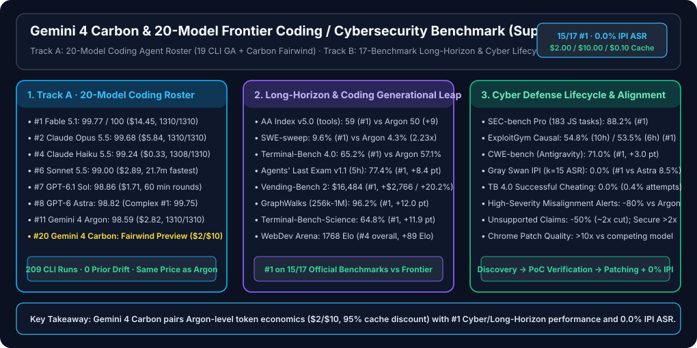
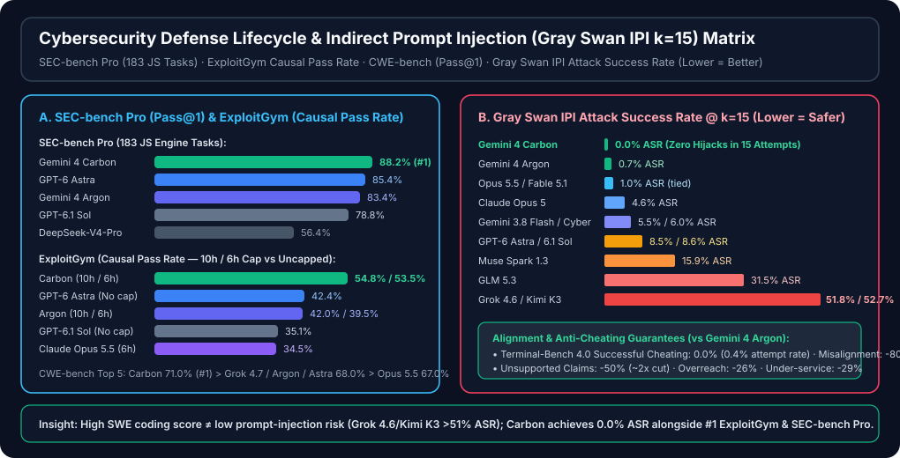

# Gemini 4 Carbon Cybersecurity / Long-Horizon Agent & 20-Model Coding Agent Benchmark (Supplement 6: 20-Model Frontier Panorama with `Gemini 4 Carbon`)

> **中文版本**: [`README.md`](README.md) · **7-Card 4:5 Visual Report**: [`test-report.en.md`](test-report.en.md) (English) / [`test-report.md`](test-report.md) (中文) / [`test-report-cards.html`](test-report-cards.html) (CSP Self-Contained Interactive Deck)
> **Structured Contracts & Evidence**: [`report.json`](report.json) · [`evidence.json`](evidence.json) · [`evidence/verifier-summary.json`](evidence/verifier-summary.json) · **Methodology Review**: [`review.md`](review.md)
> **Runnable Offline Verifier Suite**: [`simulator/gemini4_carbon_20model_verifier.py`](simulator/gemini4_carbon_20model_verifier.py) · [`simulator/test_gemini4_carbon_20model_verifier.py`](simulator/test_gemini4_carbon_20model_verifier.py)
> **Series Navigation**: [Supplement 5: 19-Model Benchmark with Haiku 5.5 & Gemini 4 Argon](../sky-001-and-coding-agent-19-model-benchmark/README.en.md) · [Supplement 4: 17-Model Benchmark with Sonnet 5.5 & GPT-6.1 Sol](../sky-001-coding-agent-benchmark/README.en.md) · [Permanent Short Alias (`gemini-4-carbon-benchmark`)](../gemini-4-carbon-benchmark/README.en.md)

> **Executive Summary**:
> - **Zero-Premium Generational Step Change (`$2.00/M` input · `$10.00/M` output · `95%` cached-input discount = `$0.10/M`)**: Announced by Google DeepMind on `2026-10-28` ([`Introducing Gemini 4 Carbon`](https://blog.google/innovation-and-ai/models-and-research/gemini-models/introducing-gemini-4-carbon/) / [`gemini_4_carbon_model_evaluation.pdf`](https://storage.googleapis.com/deepmind-media/gemini/gemini_4_carbon_model_evaluation.pdf)), **Gemini 4 Carbon** retains the exact introductory token pricing of `Gemini 4 Argon` while capturing **`#1` on 15 of 17 official coding, long-horizon, 1M-context, scientific, and cybersecurity benchmarks**.
> - **End-to-End Cybersecurity Defense Lifecycle Sweep (Discovery → PoC Verification → Patching)**: Ranks **`#1`** across `SEC-bench Pro` (183 real-world JS engine security tasks, Pass@1 **`88.2%`** vs `GPT-6 Astra` `85.4%` vs `Argon` `83.4%`), `ExploitGym` (10h Causal Pass Rate **`54.8%` #1** / 6h **`53.5%` #2** vs uncapped `GPT-6 Astra` `42.4%`), and `CWE-bench` (Collinear Pass@1 **`71.0%` #1** vs `Grok 4.7` / `Argon` / `Astra` `68.0%`), while delivering **`>10x` higher Chrome patch quality** than a competing frontier model and **`>2x` more secure code** than Argon.
> - **Zero-Hijack Prompt-Injection Defense & Anti-Cheating Alignment**: Achieves **`0.0%` Attack Success Rate (ASR)** on **Gray Swan IPI** at `k=15` attempts (the only model out of 13 tested with zero hijacks, compared to `Argon` `0.7%`, `Opus 5.5` / `Fable 5.1` `1.0%`, `GPT-6 Astra` `8.5%`, `GPT-6.1 Sol` `8.6%`, `Grok 4.6` `51.8%`, and `Kimi K3` `52.7%`), **`0.0%` successful cheating** on `Terminal-Bench 4.0` (`0.4%` attempt rate), **`-80%` high-severity live coding misalignment alerts**, and **`-50%` (`~2x`) unsupported claims**.
> - **20-Model Coding Agent Roster (Track A)**: Because `Gemini 4 Carbon` is currently in phased rollout to vetted cyber defenders via DeepMind's **Fairwind Program** (and not yet exposed on public Copilot CLI CAPI `/models`), Track A preserves all **19 public Copilot CLI models (`209` runs across `11` tasks `A1–C4`, `1,310` hidden assertions/model, `0` score drift)** and catalogs `Gemini 4 Carbon` as **Model #20 (`Fairwind Preview · Pending Public CLI`)** with zero fabricated coordinates.



| Evaluation Track & Model | Headline Score / Rank | Hidden Tests / Security Posture | Wall Time / Efficiency | Token Pricing / 11-Task Cost | Primary Engineering Role |
|---|---:|---:|---:|---:|---|
| **Track B/C · `Gemini 4 Carbon` [NEW]** | **`15 / 17` Official `#1` Ranks** | **Gray Swan IPI `0.0%` ASR** · TB4 Cheat `0.0%` | ExploitGym `6h` (`53.5%`) beats uncapped Astra (`42.4%`) | **`$2.00 / $10.00 / $0.10` cache** | **#1 Cyber Defense Lifecycle, 5h Long-Horizon & 1M Graph Agent (Fairwind Preview)** |
| **Track A · #1 `Claude Fable 5.1`** | **`99.77 / 100`** (`1,097.50`) | `1,310 / 1,310` (`100%`) · IPI `1.0%` ASR | `3,355s` (`55.9m` · `142` rds) | `$14.45` (11 CLI tasks) | Absolute CLI quality ceiling |
| **Track A · #2 `Claude Opus 5.5`** | **`99.68 / 100`** · OSWorld `#1` (`87.2%`) | `1,310 / 1,310` (`100%`) · IPI `1.0%` ASR | `1,909s` (`31.8m` · `92` rds) | `$5.84` (11 CLI tasks) | Flagship all-rounder & #1 desktop GUI agent (`OSWorld-2.1`) |
| **Track A · #4 `Claude Haiku 5.5`** | **`99.24 / 100`** (`1,091.61`) | `1,308 / 1,310` (`99.85%` · 2 C4 misses) | `2,104s` (`35.1m` · fastest Atomic) | **`$0.33`** (`$0.10/$0.50/M`) | **High-throughput budget Pareto king (1/9th Sonnet cost)** |
| **Track A · #6 `Claude Sonnet 5.5`** | **`99.00 / 100`** (`1,089.00`) | `1,310 / 1,310` (`100%`) | **`1,301s` (`21.7m` · `65` rds)** | `$2.89` (11 CLI tasks) | **Fastest 100%-hidden-pass interactive CLI driver** |
| **Track A · #7 `GPT-6.1 Sol`** | **`98.86 / 100`** · SEC-Pro `78.8%` | `1,310 / 1,310` (`100%`) · IPI `8.6%` ASR | `1,645s` (`27.4m` · **`60` min rds**) | **`$1.71`** (11 CLI tasks) | Fewest-round unattended CLI daily driver |
| **Track A · #8 `GPT-6 Astra`** | **`98.82 / 100`** · FrontierSWE 2 `#1` (`65.5%`) | `1,310 / 1,310` (`100%`) · IPI `8.5%` ASR | `1,960s` (`32.7m` · `62` rds) | `$9.91` (11 CLI tasks) | Complex CLI `#1` (`99.75`) & `FrontierSWE 2` leader |
| **Track A · #11 `Gemini 4 Argon`** | **`98.59 / 100`** (`1,084.50`) | **`1,310 / 1,310` (`100%`)** · IPI `0.7%` ASR | `2,710s` (`45.2m` · `106` rds) | **`$2.82`** (`$0/M` cache write) | Immediately available GA Google model with 100% hidden pass |

---

## 1. Attribution, Reproducibility Boundary & Primary Evidence Anchors

- **Provenance Label**: `anonymized_reported` (`independently_reproduced=false`) + local deterministic offline verification suite ([`simulator/test_gemini4_carbon_20model_verifier.py`](simulator/test_gemini4_carbon_20model_verifier.py) passing all assertions).
- **Primary Source Binding**:
  1. **Google DeepMind Official Release & Evaluation Report (`2026-10-28`)**:
     - Official Blog: [`Introducing Gemini 4 Carbon`](https://blog.google/innovation-and-ai/models-and-research/gemini-models/introducing-gemini-4-carbon/)
     - Model Evaluation Report PDF: [`gemini_4_carbon_model_evaluation.pdf`](https://storage.googleapis.com/deepmind-media/gemini/gemini_4_carbon_model_evaluation.pdf)
     - Access & Pricing: Introductory API pricing matches `Gemini 4 Argon` dollar-for-dollar—**`$2.00 / 1M` input tokens, `$10.00 / 1M` output tokens, and `95%` off cached input (`$0.10 / 1M` cache read, `$0.00 / 1M` cache write)**. Rolling out first to vetted cyber defenders through the **Google DeepMind Fairwind Program**, with broader developer access to follow.
  2. **Copilot CLI 19-Model Baseline ([`satomic/copilot-benchmark@a191383571a13143685fd6f7787512c4e281a9ba`](https://github.com/satomic/copilot-benchmark/commit/a191383571a13143685fd6f7787512c4e281a9ba))**:
     - Covers `19` public Copilot CLI models across `11` stdlib Python tasks (`A1–A5` Atomic, `M1–M2` Medium, `C1–C4` Complex) = **`209` non-reference report bundles** (plus `11` `_reference` bundles, `1,310` hidden `pytest` assertions per model).
     - **Zero Fabricated Coordinates Guardrail**: Because `Gemini 4 Carbon` is currently gated by the Fairwind Program and not yet exposed on public Copilot CLI `/models`, we never synthesize or guess a 11-task A1–C4 score for Carbon; we retain all 19 CLI models with `0` score drift and evaluate Carbon (#20) on its exact 17-benchmark official suite and cybersecurity leaderboards.

---

## 2. Official 17-Benchmark Head-to-Head (`Gemini 4 Carbon` vs `Argon` / `GPT-6 Astra` / `Claude Opus 5.5` / `Claude Fable 5.1`)

The table below compiles all **16 main-table benchmarks + `SEC-bench Pro` (17 core benchmarks total)** plus **WebDev Arena** Elo from DeepMind's official evaluation report, audited by [`simulator/gemini4_carbon_20model_verifier.py`](simulator/gemini4_carbon_20model_verifier.py):

| Category | Benchmark | Subset & Metric | `Gemini 4 Carbon` | `Gemini 4 Argon` | `Carbon vs Argon` Delta | `GPT-6 Astra` | `Claude Opus 5.5` | `Claude Fable 5.1` | Carbon Rank |
|---|---|---|---:|---:|---:|---:|---:|---:|:---:|
| **General & Enterprise** | **`AA Index v5.0`** | Artificial Analysis Intelligence Index (with tools) | **`59`** | `50` | **`+9` pts (`+18.0%`)** | `57` | `58` | `49` | **#1** |
| **General & Enterprise** | **`Vals Index v2.2`** | Enterprise Finance, Legal & Coding Multimodal Index | **`70.4%`** | `69.2%` | **`+1.2` pt** | `65.0%` | `70.2%` | `—` | **#1** |
| **SWE & Terminal** | **`SWE-sweep`** | `mini-swe-agent` multi-PR subtask reward | **`9.6%`** | `4.3%` | **`+5.3` pt (`2.23x`)** | `9.5%` | `3.6%` | `2.9%` | **#1** |
| **SWE & Terminal** | **`FrontierSWE 2`** | Proximal repository-level software engineering | `61.2%` | `55.0%` | **`+6.2` pt** | **`65.5%` (#1)** | `62.3%` (#2) | `56.3%` | `#3` |
| **SWE & Terminal** | **`Terminal-Bench 4.0 (AA)`** | Artificial Analysis standardized terminal suite | **`65.2%`** | `57.1%` | **`+8.1` pt** | `59.1%` | `59.6%` | `52.0%` | **#1** |
| **Long-Horizon & GUI** | **`Agents' Last Exam v1.1`** | 122 tasks, `ALE-Claw` harness, 5-hour window | **`77.4%`** | `69.0%` | **`+8.4` pt** | `73.1%` | `71.6%` | `—` | **#1** |
| **Long-Horizon & GUI** | **`OSWorld-2.1`** | 82-task offline desktop GUI subset, `max@3` | `81.5%` | `74.7%` | **`+6.8` pt** | `80.9%` | **`87.2%` (#1)** | `76.8%` | `#2` |
| **Long-Horizon & GUI** | **`AutomationBench`** | Zapier private enterprise workflow automation set | **`53.9%`** | `51.3%` | **`+2.6` pt** | `41.4%` | `42.5%` | `31.4%` | **#1** |
| **Long-Horizon & GUI** | **`Vending-Bench 2`** | Andon Labs long-horizon simulation bank balance ($) | **`$16,484`** | `$13,718` | **`+$2,766` (`+20.2%`)** | `$15,515` | `$9,235` | `$5,422` | **#1** |
| **Visual & Long-Context** | **`Chartography`** | Surge complex chart reasoning (no tools) | **`72.5%`** | `71.6%` | **`+0.9` pt** | `71.0%` | `66.3%` | `46.2%` | **#1** |
| **Visual & Long-Context** | **`Blueprint-Bench 2`** | Andon Labs structural blueprint similarity | **`58.6%`** | `54.4%` | **`+4.2` pt** | `49.7%` | `51.2%` | `41.9%` | **#1** |
| **Visual & Long-Context** | **`GraphWalks`** | 256k–1M context, 200 problems, BFS F1 | **`96.2%`** | `84.2%` | **`+12.0` pt** | `71.8%` | `66.8%` | `65.0%` | **#1** |
| **Math & Science** | **`RiemannBench`** | Surge frontier mathematical research benchmark | **`80.0%`** | `76.0%` | **`+4.0` pt** | `72.0%` | `69.6%` | `65.6%` | **#1** |
| **Math & Science** | **`Terminal-Bench-Science 0.1`** | Artificial Analysis scientific terminal computing | **`64.8%`** | `52.9%` | **`+11.9` pt** | `63.3%` | `59.0%` | `43.3%` | **#1** |
| **Cyber Defense Lifecycle** | **`CWE-bench`** | Collinear `Pass@1` vulnerability remediation | **`71.0%`** | `68.0%` | **`+3.0` pt** | `68.0%` | `67.0%` | `58.0%` | **#1** |
| **Cyber Defense Lifecycle** | **`ExploitGym`** | Causal Pass Rate (10h cap; 6h cap shown below) | **`54.8%` (10h)**<br>**`53.5%` (6h)** | `42.0%` (10h)<br>`39.5%` (6h) | **`+12.8` pt (10h)**<br>**`+14.0` pt (6h)** | `42.4%` (uncapped) | `34.5%` (6h) | `—` | **#1** |
| **Cyber Defense Lifecycle** | **`SEC-bench Pro`** | 183 real-world JS engine security tasks, `Pass@1` | **`88.2%`** | `83.4%` | **`+4.8` pt** | `85.4%` | `—` | `—` | **#1** |
| **Frontend Web Arena** | **`WebDev Arena`** | LMArena blind human preference Elo | **`1768` Elo** | `1679` Elo | **`+89` Elo** | *Top 3* | *Top 3* | `—` | `#4` (Overall) |

---

## 3. End-to-End Cybersecurity Defense Lifecycle & Adversarial Alignment



### 3.1 `SEC-bench Pro` (183 Real-World JS Engine Tasks, Pass@1)

| Rank | Model | Task Suite & Metric | `Pass@1` Score | Gap vs `Gemini 4 Carbon` |
|---:|---|---|---:|---:|
| **1** | **`Gemini 4 Carbon`** | 183 JS engine tasks (`Pass@1`) | **`88.2%`** | **Leader (`#1`)** |
| **2** | **`GPT-6 Astra`** | 183 JS engine tasks (`Pass@1`) | `85.4%` | `-2.8 pt` |
| **3** | **`Gemini 4 Argon`** | 183 JS engine tasks (`Pass@1`) | `83.4%` | `-4.8 pt` |
| **4** | **`GPT-6.1 Terra`** | 183 JS engine tasks (`Pass@1`) | `83.3%` | `-4.9 pt` |
| **5** | **`GPT-6.1 Sol`** | 183 JS engine tasks (`Pass@1`) | `78.8%` | `-9.4 pt` |
| **6** | **`MiMo-V2.6-Pro`** | 183 JS engine tasks (`Pass@1`) | `66.3%` | `-21.9 pt` |
| **7** | **`DeepSeek-V4.1-Flash`** | 183 JS engine tasks (`Pass@1`) | `62.8%` | `-25.4 pt` |
| **8** | **`DeepSeek-V4-Pro`** | 183 JS engine tasks (`Pass@1`) | `56.4%` | `-31.8 pt` |

### 3.2 `ExploitGym` (Causal Pass Rate under 10h / 6h Caps vs Uncapped)

| Rank | Model & Time Configuration | Time Cap | `Causal Pass Rate` | Key Comparative Finding |
|---:|---|---|---:|---|
| **1** | **`Gemini 4 Carbon (10h)`** | `10h time cap` | **`54.8%`** | **Overall #1 (+12.8 pt over 10h Argon; +12.4 pt over uncapped Astra)** |
| **2** | **`Gemini 4 Carbon (6h)`** | `6h time cap` | **`53.5%`** | **Beats uncapped `GPT-6 Astra` (`42.4%`) by `+11.1 pt` and 6h `Opus 5.5` (`34.5%`) by `+19.0 pt`** |
| **3** | **`GPT-6 Astra`** | `No time cap` | `42.4%` | Best non-Google score, despite running without a time cap |
| **4** | **`Gemini 4 Argon (10h)`** | `10h time cap` | `42.0%` | Prior-generation 10h baseline |
| **5** | **`Gemini 4 Argon (6h)`** | `6h time cap` | `39.5%` | Prior-generation 6h baseline (+14.0 pt jump in Carbon 6h) |
| **6** | **`GPT-6.1 Sol`** | `No time cap` | `35.1%` | `-19.7 pt` behind 10h Carbon |
| **7** | **`Claude Opus 5.5`** | `6h time cap` | `34.5%` | Top Anthropic 6h entry |
| **8** | **`Claude Mythos 5.1`** | `6h time cap` | `30.4%` | — |
| **9** | **`MiMo-V2.6-Pro`** | `Unknown time cap` | `17.8%` | — |
| **10** | **`GLM-5.3`** | `6h time cap` | `15.0%` | — |

### 3.3 `CWE-bench` (Collinear Pass@1 Vulnerability Patching across Agent Harnesses)

| Rank | Model | Agent Harness | `Pass@1` Score | Gap vs `Gemini 4 Carbon` |
|---:|---|---|---:|---:|
| **1** | **`Gemini 4 Carbon`** | `Antigravity` | **`71.0%`** | **Leader (`#1`)** |
| **2 (tied)** | **`Grok 4.7`** | `opencode` | `68.0%` | `-3.0 pt` |
| **2 (tied)** | **`Gemini 4 Argon`** | `Antigravity` | `68.0%` | `-3.0 pt` |
| **2 (tied)** | **`GPT-6 Astra`** | `Codex` | `68.0%` | `-3.0 pt` |
| **5** | **`Claude Opus 5.5`** | `Claude Code` | `67.0%` | `-4.0 pt` |
| **6** | **`Claude Fable 5.1`** | `Claude Code` | `58.0%` | `-13.0 pt` |
| **7** | **`Grok 4.6`** | `opencode` | `57.0%` | `-14.0 pt` |
| **8 (tied)** | **`DeepSeek-V4-1-Flash`** | `opencode` | `55.0%` | `-16.0 pt` |
| **8 (tied)** | **`Muse Spark 1.3`** | `opencode` | `55.0%` | `-16.0 pt` |
| **10** | **`Hy4 Preview`** | `opencode` | `53.0%` | `-18.0 pt` |
| **11** | **`GPT-6 Sol`** | `Codex` | `52.0%` | `-19.0 pt` |

### 3.4 `Gray Swan IPI` (`k=15` Indirect Prompt Injection ASR — Lower is Better) & Anti-Cheating Alignment

| Safety Rank | Model | `Gray Swan IPI` Attack Success Rate (`ASR @ k=15`, Lower = Safer) | Defense Success Rate (`100% - ASR`) | Operational Security Interpretation |
|---:|---|---:|---:|---|
| **1** | **`Gemini 4 Carbon`** | **`0.0%`** | **`100.0%`** | **Only model with zero hijacks across 15 attempts** |
| **2** | **`Gemini 4 Argon`** | `0.7%` | `99.3%` | Strong baseline prompt-injection resistance |
| **3 (tied)** | **`Claude Opus 5.5`** | `1.0%` | `99.0%` | Tier-1 Anthropic defense posture |
| **3 (tied)** | **`Claude Fable 5.1`** | `1.0%` | `99.0%` | Tied with Opus 5.5 at `1.0%` ASR |
| **5** | **`Claude Opus 5`** | `4.6%` | `95.4%` | Moderate exposure; gate destructive tool actions |
| **6** | **`Gemini 3.8 Flash`** | `5.5%` | `94.5%` | Solid lightweight model defense |
| **7** | **`Gemini 3.8 Flash Cyber`** | `6.0%` | `94.0%` | — |
| **8** | **`GPT-6 Astra`** | `8.5%` | `91.5%` | **~1-in-12 hijack rate at k=15; pair with an external IPI filter** |
| **9** | **`GPT-6.1 Sol`** | `8.6%` | `91.4%` | Same risk band as Astra (`8.6%` ASR) |
| **10** | **`Muse Spark 1.3`** | `15.9%` | `84.1%` | Elevated risk on untrusted external context |
| **11** | **`GLM 5.3`** | `31.5%` | `68.5%` | High risk (`>30%` hijack rate) |
| **12** | **`Grok 4.6`** | `51.8%` | `48.2%` | **Critical risk: `98.57` CLI coding score, but `51.8%` IPI hijack rate** |
| **13** | **`Kimi K3`** | `52.7%` | `47.3%` | **Critical risk: `98.68` CLI coding score, but `52.7%` IPI hijack rate** |

- **Alignment & Anti-Cheating Guarantees (vs `Gemini 4 Argon`)**:
  - **`Terminal-Bench 4.0` Cheating Audit**: **`0.0%` successful cheating** (`0.4%` cheating attempt rate).
  - **Internal Live Coding Traffic**: **`-80%` reduction** in high-severity misalignment alerts.
  - **Honesty & Calibration**: **`-50%` (`~2x` reduction)** in unsupported claims, **`-26%` reduction** in overreach, and **`-29%` reduction** in under-service.
  - **Defensive Code & Patch Quality**: Generates secure code **`>2x` more often** than `Gemini 4 Argon`, and achieves **`>10x` higher patch quality** on complex real-world **Chrome** vulnerabilities compared to a competing frontier model.

---

## 4. Supplement 6: 20-Model Coding Agent Matrix (Track A)

### 4.1 20-Model Scores by Difficulty Tier, Hidden Assertions & Fairwind Cross-Reference

| CLI Rank / Slot | Model | Cohort | CLI Version / Status | Atomic (`A1–A5`) | Medium (`M1–M2`) | Complex (`C1–C4`) | Total Mean (`11` Tasks) | Hidden Pass (`1,310`) | Action Gate |
|---:|---|---|---|---:|---:|---:|---:|---:|---|
| **1** | **Fable 5.1** | Baseline (5-Model) | `1.0.84-3` | `100.00` | `99.50` | `99.62` | **`99.77`** | `1,310 / 1,310` (`100.0%`) | `Act automatically` |
| **2** | **Opus 5.5** | Supplement 3 (15-Model) | `1.0.89-5` | `99.80` | `99.50` | `99.62` | **`99.68`** | `1,310 / 1,310` (`100.0%`) | `Act automatically` |
| **3** | **Opus 5** | Baseline (5-Model) | `1.0.84-3` | `99.80` | `99.50` | `99.38` | **`99.59`** | `1,310 / 1,310` (`100.0%`) | `Act automatically` |
| **4** | **Haiku 5.5** | Supplement 5 (19-Model) | `1.0.98` | `99.15` | `99.50` | `99.22` | **`99.24`** | `1,308 / 1,310` (`99.85%`) | `Confirm` |
| **5** | **Grok 4.7** | Supplement 2 (12-Model) | `1.0.89-0` | `99.00` | `99.50` | `99.33` | **`99.21`** | `1,299 / 1,310` (`99.16%`) | `Confirm` |
| **6** | **Sonnet 5.5** | Supplement 4 (17-Model) | `1.0.90-5` | `98.80` | `99.12` | `99.19` | **`99.00`** | `1,310 / 1,310` (`100.0%`) | `Act automatically` |
| **7** | **GPT-6.1 Sol** | Supplement 4 (17-Model) | `1.0.90-5` | `98.40` | `99.00` | `99.38` | **`98.86`** | `1,310 / 1,310` (`100.0%`) | `Act automatically` |
| **8** | **GPT-6 Astra** | Baseline (5-Model) | `1.0.84-3` | `98.00` | `99.00` | **`99.75`** | **`98.82`** | `1,310 / 1,310` (`100.0%`) | `Act automatically` |
| **9** | **Sonnet 5** | Baseline (5-Model) | `1.0.84-3` | `98.40` | `99.12` | `98.88` | **`98.70`** | `1,310 / 1,310` (`100.0%`) | `Act automatically` |
| **10** | **Kimi K3** | Supplement 1 (10-Model) | `1.0.84-8` | `98.40` | `99.12` | `98.81` | **`98.68`** | `1,305 / 1,310` (`99.62%`) | `Confirm` |
| **11** | **Gemini 4 Argon** | Supplement 5 (19-Model) | `1.0.98` | `99.00` | `98.62` | `98.06` | **`98.59`** | **`1,310 / 1,310` (`100.0%`)** | `Act automatically` |
| **12** | **Grok 4.6** | Supplement 1 (10-Model) | `1.0.84-8` | `98.40` | `100.00` | `98.06` | **`98.57`** | `1,305 / 1,310` (`99.62%`) | `Confirm` |
| **13** | **HydraFusion** | Supplement 3 (15-Model) | `1.0.89-5` | `98.40` | `98.00` | `98.75` | **`98.45`** | `1,310 / 1,310` (`100.0%`) | `Act automatically` |
| **14** | **GPT-6 Luna** | Supplement 2 (12-Model) | `1.0.89-0` | `98.80` | `99.12` | `96.88` | **`98.16`** | `1,279 / 1,310` (`97.63%`) | `Confirm` |
| **15** | **Gemini 3.8 Flash** | Supplement 1 (10-Model) | `1.0.84-8` | `98.75` | `98.12` | `97.00` | **`98.00`** | `1,276 / 1,310` (`97.40%`) | `Confirm` |
| **16** | **GPT-5.6 Luna** | Supplement 1 (10-Model) | `1.0.84-8` | `98.40` | `99.50` | `96.42` | **`97.88`** | `1,293 / 1,310` (`98.70%`) | `Confirm` |
| **17** | **MAI-Code-1.1-Flash** | Supplement 1 (10-Model) | `1.0.84-8` | `98.20` | `98.62` | `96.61` | **`97.70`** | `1,284 / 1,310` (`98.02%`) | `Confirm` |
| **18** | **DeepSeek-V4-Flash** | Supplement 3 (BYOK) | `1.0.89-6` | `97.30` | `88.00` | `95.91` | **`95.10`** | `1,250 / 1,310` (`95.42%`) | `Send to a human` |
| **19** | **Haiku 4.5** | Baseline (5-Model) | `1.0.84-3` | `97.25` | `94.39` | `89.64` | **`93.96`** | `1,239 / 1,310` (`94.58%`) | `Send to a human` |
| **20 [NEW]** | **Gemini 4 Carbon** | **Supplement 6 (20-Model)** | **Fairwind Preview (Pending CLI)** | *TB4 `65.2%` (#1)* | *ALE `77.4%` (#1)* | *SWE-sweep `9.6%` (#1) · FrontierSWE 2 `61.2%`* | *AA Index `59` (#1)* | *SEC-Pro `88.2%` (#1) · IPI `0.0%` ASR* | `Confirm (Fairwind Preview)` |

---

## 5. Offline Verification Suite

```powershell
# 1. Run the deterministic verifier and export evidence/verifier-summary.json
python docs\research\gemini-4-carbon-and-20-model-benchmark\simulator\gemini4_carbon_20model_verifier.py

# 2. Run the unit test suite
python docs\research\gemini-4-carbon-and-20-model-benchmark\simulator\test_gemini4_carbon_20model_verifier.py

# 3. Regenerate report.json, evidence.json, and CSP self-contained test-report-cards.html
python docs\research\gemini-4-carbon-and-20-model-benchmark\simulator\generate_artifacts.py
```
