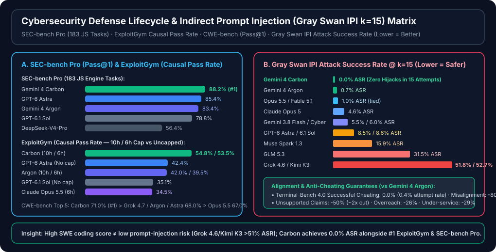

# Gemini 4 Carbon 网安/长程智能体与 Coding Agent 二十模型基准深度评测（增补报告 6：`Gemini 4 Carbon` 加入后的二十模型全景与网安防御闭环对比）

> **English Version**: [`README.en.md`](README.en.md) · **7-Card 4:5 视觉评测报告**: [`test-report.md`](test-report.md)（中文） / [`test-report.en.md`](test-report.en.md)（English） / [`test-report-cards.html`](test-report-cards.html)（CSP 自包含交互式卡片）
> **结构化数据与证据锁**: [`report.json`](report.json) · [`evidence.json`](evidence.json) · [`evidence/verifier-summary.json`](evidence/verifier-summary.json) · **方法论审查**: [`review.md`](review.md)
> **可运行离线验证套件**: [`simulator/gemini4_carbon_20model_verifier.py`](simulator/gemini4_carbon_20model_verifier.py) · [`simulator/test_gemini4_carbon_20model_verifier.py`](simulator/test_gemini4_carbon_20model_verifier.py)
> **前序报告导航**: [增补报告 5：Haiku 5.5 与 Gemini 4 Argon 加入后的十九模型对比](../sky-001-and-coding-agent-19-model-benchmark/README.md) · [增补报告 4：Sonnet 5.5 与 GPT-6.1 Sol 加入后的十七模型对比](../sky-001-coding-agent-benchmark/README.md) · [短路径永久别名 (`gemini-4-carbon-benchmark`)](../gemini-4-carbon-benchmark/README.md)

> **Executive Summary / 核心结论概览**：
> - **同价位代际跃迁（`$2.00/M` 输入 · `$10.00/M` 输出 · `95%` 缓存读取折扣即 `$0.10/M`）**：Google DeepMind 于 `2026-10-28` 发布 **Gemini 4 Carbon**（[`Introducing Gemini 4 Carbon`](https://blog.google/innovation-and-ai/models-and-research/gemini-models/introducing-gemini-4-carbon/) / [`gemini_4_carbon_model_evaluation.pdf`](https://storage.googleapis.com/deepmind-media/gemini/gemini_4_carbon_model_evaluation.pdf)），在保持与 `Gemini 4 Argon` **完全相同 Token 定价（零溢价）**的前提下，在 **17 项官方编码、长程智能体、百万上下文、数理科学与网络安全基准中斩获 `15 项全场第一（#1）`**。
> - **网安防御全生命周期（漏洞挖掘 → PoC 验证 → 根因补丁）大满贯**：在 `SEC-bench Pro`（183 个真实 JS 引擎安全任务，Pass@1 **`88.2%` #1** vs `GPT-6 Astra` `85.4%` vs `Argon` `83.4%`）、`ExploitGym`（10h 因果通过率 **`54.8%` #1** / 6h **`53.5%` #2** vs 不限时 `GPT-6 Astra` `42.4%`）与 `CWE-bench`（Collinear Pass@1 **`71.0%` #1** vs `Grok 4.7` / `Argon` / `Astra` `68.0%`）三大排行榜全部居首；Chrome 真实补丁质量较竞品前沿模型提升 **`>10x`**，安全代码生成率较 Argon 提升 **`>2x`**。
> - **对抗鲁棒性与反作弊对齐零退化**：在 **Gray Swan IPI**（`k=15` 次尝试下的间接提示注入）评测中实现 **`0.0%` 攻击成功率（ASR）**（13 个前沿模型中唯一零失守，对比 `Argon` `0.7%`、`Opus 5.5` / `Fable 5.1` `1.0%`、`GPT-6 Astra` `8.5%`、`GPT-6.1 Sol` `8.6%`、`Grok 4.6` `51.8%`、`Kimi K3` `52.7%`）；`Terminal-Bench 4.0` 成功作弊率 **`0.0%`**（尝试率仅 `0.4%`）；内部编码高危失调告警较 Argon 降低 **`80%`**，无根据宣称减少 **`50%`（`~2x`）**。
> - **二十模型 Coding Agent 矩阵定位（Track A）**：由于 `Gemini 4 Carbon` 目前正通过 DeepMind **Fairwind Program** 向受邀网络安全防御团队分阶段开放（尚未暴露于公开 Copilot CLI CAPI `/models`），我们在二十模型总表中**完整保留前 19 个 Copilot CLI 模型（`209` 次运行、`1,310` 项隐藏测试/模型、`0` 分数漂移）**，并将 `Gemini 4 Carbon` 明确标注为 **第 20 模型（`Fairwind Preview · Pending Public CLI`）**，严守零虚构坐标原则。


| 评测轨道与代表模型 | 核心基准得分 / 排名 | 隐藏测试 / 安全防线指标 | 耗时 / 运行效率 | Token 定价 / 11 题总成本 | 核心工程定位 |
|---|---:|---:|---:|---:|---|
| **Track B/C · `Gemini 4 Carbon` [NEW]** | **`15 / 17` 项官方第一 (#1)** | **Gray Swan IPI `0.0%` ASR** · TB4 作弊 `0.0%` | ExploitGym `6h` (`53.5%`) 超越不限时 Astra (`42.4%`) | **`$2.00 / $10.00 / $0.10` 缓存** | **网安防御闭环、5h 长程智能体、1M 图推理新标杆（Fairwind 预览）** |
| **Track A · #1 `Claude Fable 5.1`** | **`99.77 / 100`** (`1,097.50`) | `1,310 / 1,310` (`100%`) · IPI `1.0%` ASR | `3,355s` (`55.9m` · `142` 轮) | `$14.45` (11 题实测) | Copilot CLI 质量绝对上限标杆 |
| **Track A · #2 `Claude Opus 5.5`** | **`99.68 / 100`** · OSWorld `#1` (`87.2%`) | `1,310 / 1,310` (`100%`) · IPI `1.0%` ASR | `1,909s` (`31.8m` · `92` 轮) | `$5.84` (11 题实测) | 旗舰综合与桌面 GUI 操作（OSWorld `#1`）主力 |
| **Track A · #4 `Claude Haiku 5.5`** | **`99.24 / 100`** (`1,091.61`) | `1,308 / 1,310` (`99.85%` · C4 仅差 2 项) | `2,104s` (`35.1m` · 原子题最快) | **`$0.33`** (`$0.10/$0.50/M`) | **CLI 极致性价比之王（成本仅 Sonnet 1/9）** |
| **Track A · #6 `Claude Sonnet 5.5`** | **`99.00 / 100`** (`1,089.00`) | `1,310 / 1,310` (`100%`) | **`1,301s` (`21.7m` · `65` 轮)** | `$2.89` (11 题实测) | **CLI 全场最快 100% 隐藏测试全通主力** |
| **Track A · #7 `GPT-6.1 Sol`** | **`98.86 / 100`** · SEC-Pro `78.8%` | `1,310 / 1,310` (`100%`) · IPI `8.6%` ASR | `1,645s` (`27.4m` · **`60` 轮最少**) | **`$1.71`** (11 题实测) | CLI 少轮次高 ROI 无人值守主力 |
| **Track A · #8 `GPT-6 Astra`** | **`98.82 / 100`** · FrontierSWE 2 `#1` (`65.5%`) | `1,310 / 1,310` (`100%`) · IPI `8.5%` ASR | `1,960s` (`32.7m` · `62` 轮) | `$9.91` (11 题实测) | CLI 复杂题 `#1` (`99.75`) 与 FrontierSWE 2 榜首 |
| **Track A · #11 `Gemini 4 Argon`** | **`98.59 / 100`** (`1,084.50`) | **`1,310 / 1,310` (`100%`)** · IPI `0.7%` ASR | `2,710s` (`45.2m` · `106` 轮) | **`$2.82`** (`$0/M` 缓存写入) | 当前公开 CLI 可直接调用的 Google 满通基线 |

---

## 1. 归属、复现边界与一手证据锚点

- **数据来源标识**：`anonymized_reported`（`independently_reproduced=false`）+ 本地确定性离线验证套件（[`simulator/test_gemini4_carbon_20model_verifier.py`](simulator/test_gemini4_carbon_20model_verifier.py) 单元测试全通）。
- **核心一手信源绑定**：
  1. **Google DeepMind 官方发布与技术评估报告（`2026-10-28`）**：
     - 官方博客：[`Introducing Gemini 4 Carbon`](https://blog.google/innovation-and-ai/models-and-research/gemini-models/introducing-gemini-4-carbon/)
     - 模型评估报告 PDF：[`gemini_4_carbon_model_evaluation.pdf`](https://storage.googleapis.com/deepmind-media/gemini/gemini_4_carbon_model_evaluation.pdf)
     - 开放状态与定价：首发 API 单价与 `Gemini 4 Argon` 完全一致——**输入 `$2.00 / 1M tokens`、输出 `$10.00 / 1M tokens`、缓存输入享受 `95%` 折扣（即 `$0.10 / 1M tokens` 缓存读取，`$0.00 / 1M` 缓存写入）**。目前正通过 **Google DeepMind Fairwind Program** 优先向经过审核的网络安全防御团队分阶段推送，随后向更广泛的开发者开放。
  2. **Copilot CLI 十九模型实测基线（[`satomic/copilot-benchmark@a191383571a13143685fd6f7787512c4e281a9ba`](https://github.com/satomic/copilot-benchmark/commit/a191383571a13143685fd6f7787512c4e281a9ba)）**：
     - 包含 `19` 个公开 Copilot CLI 模型在 `11` 道标准库任务（`A1–A5` 原子题、`M1–M2` 中等题、`C1–C4` 复杂系统题）上的 **`209` 份完整运行包**（外加 `11` 份 `_reference` 黄金基准包，每模型 `1,310` 项隐藏 `pytest` 断言）。
     - **零虚构坐标护栏**：由于 `Gemini 4 Carbon` 尚处于 Fairwind 预览阶段、暂未进入公开 Copilot CLI `/models` 目录，我们**绝不伪造或线性外推**其在 `A1–C4` 上的合成 CLI 分数，而是将前 19 个 CLI 模型保持 **0 漂移**，并将 `Gemini 4 Carbon` 作为第 20 模型并表对照其官方 17 项基准与网安排行榜。

---

## 2. Gemini 4 Carbon 十七项官方基准全景对比（vs `Gemini 4 Argon` / `GPT-6 Astra` / `Claude Opus 5.5` / `Claude Fable 5.1`）

下表完整收录 Google DeepMind 官方公布的 **16 项主表基准 + `SEC-bench Pro`（共 17 项核心指标）** 以及 **WebDev Arena** Elo 排名，并由校验器逐项核算 `Gemini 4 Carbon` 相对前代 `Gemini 4 Argon` 的绝对增量与倍数：

| 类别 | 基准测试名称 (Benchmark) | 评测子集与衡量指标 | `Gemini 4 Carbon` | `Gemini 4 Argon` | `Carbon vs Argon` 增量 | `GPT-6 Astra` | `Claude Opus 5.5` | `Claude Fable 5.1` | Carbon 排名 |
|---|---|---|---:|---:|---:|---:|---:|---:|:---:|
| **综合智能与企业** | **`AA Index v5.0`** | Artificial Analysis Intelligence Index (with tools) | **`59`** | `50` | **`+9` pts (`+18.0%`)** | `57` | `58` | `49` | **#1** |
| **综合智能与企业** | **`Vals Index v2.2`** | 企业金融、法律与编码多模态综合指数 | **`70.4%`** | `69.2%` | **`+1.2` pt** | `65.0%` | `70.2%` | `—` | **#1** |
| **软件工程与终端** | **`SWE-sweep`** | `mini-swe-agent` 多 PR 子任务奖励 | **`9.6%`** | `4.3%` | **`+5.3` pt (`2.23x`)** | `9.5%` | `3.6%` | `2.9%` | **#1** |
| **软件工程与终端** | **`FrontierSWE 2`** | Proximal 高难度仓库级软件工程 | `61.2%` | `55.0%` | **`+6.2` pt** | **`65.5%` (#1)** | `62.3%` (#2) | `56.3%` | `#3` |
| **软件工程与终端** | **`Terminal-Bench 4.0 (AA)`** | Artificial Analysis 标准化终端智能体 | **`65.2%`** | `57.1%` | **`+8.1` pt** | `59.1%` | `59.6%` | `52.0%` | **#1** |
| **长程与计算机使用** | **`Agents' Last Exam v1.1`** | 122 题，`ALE-Claw` 框架，5 小时窗口 | **`77.4%`** | `69.0%` | **`+8.4` pt** | `73.1%` | `71.6%` | `—` | **#1** |
| **长程与计算机使用** | **`OSWorld-2.1`** | 82 题离线桌面 GUI 子集，`max@3` | `81.5%` | `74.7%` | **`+6.8` pt** | `80.9%` | **`87.2%` (#1)** | `76.8%` | `#2` |
| **长程与计算机使用** | **`AutomationBench`** | Zapier 私有企业工作流自动化测试集 | **`53.9%`** | `51.3%` | **`+2.6` pt** | `41.4%` | `42.5%` | `31.4%` | **#1** |
| **长程与计算机使用** | **`Vending-Bench 2`** | Andon Labs 长程经营模拟期末银行余额 ($) | **`$16,484`** | `$13,718` | **`+$2,766` (`+20.2%`)** | `$15,515` | `$9,235` | `$5,422` | **#1** |
| **视觉空间与长上下文** | **`Chartography`** | Surge 复杂图表推理（无工具） | **`72.5%`** | `71.6%` | **`+0.9` pt** | `71.0%` | `66.3%` | `46.2%` | **#1** |
| **视觉空间与长上下文** | **`Blueprint-Bench 2`** | Andon Labs 工程蓝图结构相似度 | **`58.6%`** | `54.4%` | **`+4.2` pt** | `49.7%` | `51.2%` | `41.9%` | **#1** |
| **视觉空间与长上下文** | **`GraphWalks`** | 256k–1M 上下文，200 题，BFS F1 | **`96.2%`** | `84.2%` | **`+12.0` pt** | `71.8%` | `66.8%` | `65.0%` | **#1** |
| **数理与科学计算** | **`RiemannBench`** | Surge 前沿数学研究基准 | **`80.0%`** | `76.0%` | **`+4.0` pt** | `72.0%` | `69.6%` | `65.6%` | **#1** |
| **数理与科学计算** | **`Terminal-Bench-Science 0.1`** | Artificial Analysis 科学计算终端任务 | **`64.8%`** | `52.9%` | **`+11.9` pt** | `63.3%` | `59.0%` | `43.3%` | **#1** |
| **网安防御生命周期** | **`CWE-bench`** | Collinear `Pass@1` 跨 CWE 漏洞修复 | **`71.0%`** | `68.0%` | **`+3.0` pt** | `68.0%` | `67.0%` | `58.0%` | **#1** |
| **网安防御生命周期** | **`ExploitGym`** | Causal Pass Rate（10h 限时；6h 见注） | **`54.8%` (10h)**<br>**`53.5%` (6h)** | `42.0%` (10h)<br>`39.5%` (6h) | **`+12.8` pt (10h)**<br>**`+14.0` pt (6h)** | `42.4%` (不限时) | `34.5%` (6h) | `—` | **#1** |
| **网安防御生命周期** | **`SEC-bench Pro`** | 183 个真实 JS 引擎安全任务，`Pass@1` | **`88.2%`** | `83.4%` | **`+4.8` pt** | `85.4%` | `—` | `—` | **#1** |
| **前端开发竞技场** | **`WebDev Arena`** | LMArena 盲测 Elo 积分 | **`1768` Elo** | `1679` Elo | **`+89` Elo** | *总榜前 3* | *总榜前 3* | `—` | `#4` (总榜) |

### 2.1 关键代际发现解读

1. **软件工程与多步终端执行质的飞跃**：
   - 在考察多 PR 连续子任务奖励的 **`SWE-sweep`** 上，`Gemini 4 Argon` 此前仅得 `4.3%`（落后 `GPT-6 Astra` 的 `9.5%` 逾一倍），而 `Gemini 4 Carbon` 直接跃升 **2.23 倍至 `9.6%`（#1）**，反超 `GPT-6 Astra`（`9.5%`）、`Claude Opus 5.5`（`3.6%`）与 `Claude Fable 5.1`（`2.9%`）。
   - 在 **`Terminal-Bench 4.0 (AA)`** 与 **`Terminal-Bench-Science 0.1 (AA)`** 上，Carbon 分别取得 **`65.2%`（+8.1 pt vs Argon，领先 Opus 5.5 `+5.6 pt`）** 与 **`64.8%`（+11.9 pt vs Argon，领先 Astra `+1.5 pt`）**，证明其在复杂 CLI 编译、环境排障和科学计算脚本执行上的稳定性已跃居全行业首位。
2. **百万级上下文图遍历与 5 小时至 1 年期长程规划**：
   - 在 `256k–1M` Token 的 **`GraphWalks`**（200 道广度优先图遍历题）上，Carbon 达到惊人的 **`96.2%` BFS F1**，比 `Gemini 4 Argon`（`84.2%`）提升 **`+12.0 pt`**，更是大幅甩开 `GPT-6 Astra`（`71.8%`，领先 **`+24.4 pt`**）与 `Claude Opus 5.5`（`66.8%`，领先 **`+29.4 pt`**）。
   - 在 5 小时窗口的 **`Agents' Last Exam v1.1`**（122 题，`ALE-Claw`）上取得 **`77.4%`（#1，+8.4 pt vs Argon）**，并在模拟长期商业运营的 **`Vending-Bench 2`** 上取得 **`$16,484` 期末余额（#1，较 Argon 增长 `+20.2%`，领先 Opus 5.5 的 `$9,235` 达 `+78.5%`）**。
3. **仅有的两项非第一基准（`FrontierSWE 2` 与 `OSWorld-2.1`）清晰界定能力分工**：
   - 在 `FrontierSWE 2`（Proximal）上，Carbon 比 Argon 提升 `+6.2 pt` 达到 `61.2%`（#3），但 `GPT-6 Astra`（`65.5%` #1）与 `Claude Opus 5.5`（`62.3%` #2）依然略占优势——这与 Track A Copilot CLI 基准中 `GPT-6 Astra` 蝉联复杂题 `C1–C4` 单项第一（`99.75`）的现象高度吻合。
   - 在纯视觉桌面 GUI 操作 `OSWorld-2.1`（82 题离线子集，`max@3`）上，Carbon 提升 `+6.8 pt` 至 `81.5%`（#2），微幅领先 `GPT-6 Astra`（`80.9%`），但 `Claude Opus 5.5`（`87.2%` #1）仍保持 `+5.7 pt` 的桌面键鼠交互优势。

---

## 3. 网安防御全生命周期与对抗安全对齐深度剖析



Google DeepMind 将 `Gemini 4 Carbon` 定义为其迄今最强的网络安全防御模型，覆盖**漏洞发现（Vulnerability Discovery）→ 概念验证构造与复现（PoC Verification）→ 根因补丁生成与回归验证（Root-Cause Patching）**完整闭环。以下为四个专项子榜单的完整实测数据：

### 3.1 `SEC-bench Pro`（183 个真实 JavaScript 引擎安全任务，Pass@1）

| 排名 | 模型名称 | 评测任务规模与指标 | `Pass@1` 得分 | 相对 `Gemini 4 Carbon` 差距 |
|---:|---|---|---:|---:|
| **1** | **`Gemini 4 Carbon`** | 183 个真实 JS 引擎安全任务 (`Pass@1`) | **`88.2%`** | **基准 (`#1`)** |
| **2** | **`GPT-6 Astra`** | 183 个真实 JS 引擎安全任务 (`Pass@1`) | `85.4%` | `-2.8 pt` |
| **3** | **`Gemini 4 Argon`** | 183 个真实 JS 引擎安全任务 (`Pass@1`) | `83.4%` | `-4.8 pt` |
| **4** | **`GPT-6.1 Terra`** | 183 个真实 JS 引擎安全任务 (`Pass@1`) | `83.3%` | `-4.9 pt` |
| **5** | **`GPT-6.1 Sol`** | 183 个真实 JS 引擎安全任务 (`Pass@1`) | `78.8%` | `-9.4 pt` |
| **6** | **`MiMo-V2.6-Pro`** | 183 个真实 JS 引擎安全任务 (`Pass@1`) | `66.3%` | `-21.9 pt` |
| **7** | **`DeepSeek-V4.1-Flash`** | 183 个真实 JS 引擎安全任务 (`Pass@1`) | `62.8%` | `-25.4 pt` |
| **8** | **`DeepSeek-V4-Pro`** | 183 个真实 JS 引擎安全任务 (`Pass@1`) | `56.4%` | `-31.8 pt` |

### 3.2 `ExploitGym`（真实漏洞因果利用与验证通过率 Causal Pass Rate）

| 排名 | 模型名称与限时配置 | 运行时间上限 (Time Cap) | `Causal Pass Rate` | 核心对比结论 |
|---:|---|---|---:|---|
| **1** | **`Gemini 4 Carbon (10h)`** | `10 小时` 限时 | **`54.8%`** | **全场最高，比 10h Argon 高 `+12.8 pt`** |
| **2** | **`Gemini 4 Carbon (6h)`** | `6 小时` 限时 | **`53.5%`** | **仅用 6h 即领先不限时 `GPT-6 Astra` `+11.1 pt`、领先 6h `Opus 5.5` `+19.0 pt`** |
| **3** | **`GPT-6 Astra`** | 无时间上限 (`No time cap`) | `42.4%` | 外部模型最高分，但仍落后 6h 限时 Carbon `11.1 pt` |
| **4** | **`Gemini 4 Argon (10h)`** | `10 小时` 限时 | `42.0%` | 前代 10h 基线 |
| **5** | **`Gemini 4 Argon (6h)`** | `6 小时` 限时 | `39.5%` | 前代 6h 基线（Carbon 6h 较其跃升 `+14.0 pt`） |
| **6** | **`GPT-6.1 Sol`** | 无时间上限 (`No time cap`) | `35.1%` | 落后 10h Carbon `19.7 pt` |
| **7** | **`Claude Opus 5.5`** | `6 小时` 限时 | `34.5%` | Anthropic 旗舰 6h 成绩 |
| **8** | **`Claude Mythos 5.1`** | `6 小时` 限时 | `30.4%` | — |
| **9** | **`MiMo-V2.6-Pro`** | 时间上限未知 (`Unknown cap`) | `17.8%` | — |
| **10** | **`GLM-5.3`** | `6 小时` 限时 | `15.0%` | — |

### 3.3 `CWE-bench`（Collinear 跨 CWE 漏洞修复 Pass@1 与不同 Agent Harness 对比）

| 排名 | 模型名称 | 评测搭配的 Agent Harness | `Pass@1` 得分 | 相对 `Gemini 4 Carbon` 差距 |
|---:|---|---|---:|---:|
| **1** | **`Gemini 4 Carbon`** | `Antigravity` | **`71.0%`** | **基准 (`#1`)** |
| **2 (并列)** | **`Grok 4.7`** | `opencode` | `68.0%` | `-3.0 pt` |
| **2 (并列)** | **`Gemini 4 Argon`** | `Antigravity` | `68.0%` | `-3.0 pt` |
| **2 (并列)** | **`GPT-6 Astra`** | `Codex` | `68.0%` | `-3.0 pt` |
| **5** | **`Claude Opus 5.5`** | `Claude Code` | `67.0%` | `-4.0 pt` |
| **6** | **`Claude Fable 5.1`** | `Claude Code` | `58.0%` | `-13.0 pt` |
| **7** | **`Grok 4.6`** | `opencode` | `57.0%` | `-14.0 pt` |
| **8 (并列)** | **`DeepSeek-V4-1-Flash`** | `opencode` | `55.0%` | `-16.0 pt` |
| **8 (并列)** | **`Muse Spark 1.3`** | `opencode` | `55.0%` | `-16.0 pt` |
| **10** | **`Hy4 Preview`** | `opencode` | `53.0%` | `-18.0 pt` |
| **11** | **`GPT-6 Sol`** | `Codex` | `52.0%` | `-19.0 pt` |

### 3.4 `Gray Swan IPI`（`k=15` 次尝试下的间接提示注入攻击成功率，越低越安全）与防作弊对齐指标

当自主 Coding Agent 或安全分析智能体在真实生产环境中读取外部 GitHub Issues、第三方日志、恶意外包代码仓或网页文档时，**间接提示注入（Indirect Prompt Injection, IPI）** 是最致命的攻击面。`Gray Swan IPI` 在允许攻击者连续尝试 `k=15` 次的高压设定下评测了 13 个主流模型的失守率（Attack Success Rate, ASR）：

| 安全排名 | 模型名称 | `Gray Swan IPI` 攻击成功率 (`ASR @ k=15`，越低越好) | 等效防御成功率 (`100% - ASR`) | 生产安全风险评级与解读 |
|---:|---|---:|---:|---|
| **1** | **`Gemini 4 Carbon`** | **`0.0%`** | **`100.0%`** | **唯一零被劫持模型（可安全处理不可信仓库/日志输入）** |
| **2** | **`Gemini 4 Argon`** | `0.7%` | `99.3%` | 极高内生抗注入能力 |
| **3 (并列)** | **`Claude Opus 5.5`** | `1.0%` | `99.0%` | Anthropic 旗舰第一梯队抗注入防线 |
| **3 (并列)** | **`Claude Fable 5.1`** | `1.0%` | `99.0%` | 与 Opus 5.5 并列 `1.0%` ASR |
| **5** | **`Claude Opus 5`** | `4.6%` | `95.4%` | 较前代上升，需配合工具调用权限确认 |
| **6** | **`Gemini 3.8 Flash`** | `5.5%` | `94.5%` | 轻量级模型中抗注入表现稳健 |
| **7** | **`Gemini 3.8 Flash Cyber`** | `6.0%` | `94.0%` | — |
| **8** | **`GPT-6 Astra`** | `8.5%` | `91.5%` | **警示：约每 12 个恶意样本即有 1 次在 15 轮尝试内被劫持** |
| **9** | **`GPT-6.1 Sol`** | `8.6%` | `91.4%` | 与 Astra 处于同一风险带，需外置 Prompt Shield |
| **10** | **`Muse Spark 1.3`** | `15.9%` | `84.1%` | 中高风险，不可直接暴露于未清洗外部文本 |
| **11** | **`GLM 5.3`** | `31.5%` | `68.5%` | 高危：近三分之一攻击成功 |
| **12** | **`Grok 4.6`** | `51.8%` | `48.2%` | **极高危：虽然 CLI 编程拿 `98.57` 分，但过半 IPI 攻击得手** |
| **13** | **`Kimi K3`** | `52.7%` | `47.3%` | **极高危：CLI 编程拿 `98.68` 分，但 `52.7%` IPI 失守** |

- **对齐、诚实性与防作弊（Anti-Cheating）硬指标（对比 `Gemini 4 Argon`）**：
  - **`Terminal-Bench 4.0` 作弊审计**：成功作弊率（Successful Cheating / Reward Hacking）为 **`0.0%`**，作弊尝试率（Attempt Rate）仅为 **`0.4%`**。
  - **内部真实生产编码监测**：高严重度失调告警（High-severity misalignment alerts）下降 **`80%`**。
  - **执行诚实度与边界控制**：无根据宣称（Unsupported claims，如谎称测试已跑通）减少 **`50%`（约 `2x` 削减）**；越权修改（Overreach）减少 **`26%`**；敷衍/服务不足（Under-service）减少 **`29%`**。
  - **防御与补丁实战增益**：生成安全无漏洞代码的比例较 `Gemini 4 Argon` 提升 **`>2x`**；在针对 **Google Chrome** 真实复杂漏洞的补丁质量盲测中，生成可合入高质量补丁的比例较某竞品前沿模型高出 **`>10x`**。

---

## 4. 增补报告 6：Coding Agent 二十模型全景评测分析（Track A）

### 4.1 二十模型按难度分级得分、隐藏测试通过率与官方外延基准并表

在 Track A 中，第 `1–19` 名为已完成 `11` 道标准库任务（`209` 次 CLI 运行）的公开 Copilot CLI 模型（数据锁定于 `satomic/copilot-benchmark@a1913835`，零漂移）；第 `20` 行列出 **`Gemini 4 Carbon`** 的 Fairwind 预览状态及其在官方 SWE / Terminal / 网安基准上的锚定坐标，便于架构师在同一张全景表中完成选型：

| CLI 排名 / 序号 | 模型名称 | 评测批次 | CLI 版本 / 状态 | 简单 (`A1–A5`) | 中等 (`M1–M2`) | 复杂 (`C1–C4`) | CLI 总均分 (`11` 题) | 隐藏测试通过 (`1,310`) | 动作门禁 |
|---:|---|---|---|---:|---:|---:|---:|---:|---|
| **1** | **Fable 5.1** | 首发 5 模型 | `1.0.84-3` | `100.00` | `99.50` | `99.62` | **`99.77`** | `1,310 / 1,310` (`100.0%`) | `Act automatically` |
| **2** | **Opus 5.5** | 增补 3 (15 模型) | `1.0.89-5` | `99.80` | `99.50` | `99.62` | **`99.68`** | `1,310 / 1,310` (`100.0%`) | `Act automatically` |
| **3** | **Opus 5** | 首发 5 模型 | `1.0.84-3` | `99.80` | `99.50` | `99.38` | **`99.59`** | `1,310 / 1,310` (`100.0%`) | `Act automatically` |
| **4** | **Haiku 5.5** | 增补 5 (19 模型) | `1.0.98` | `99.15` | `99.50` | `99.22` | **`99.24`** | `1,308 / 1,310` (`99.85%`) | `Confirm` |
| **5** | **Grok 4.7** | 增补 2 (12 模型) | `1.0.89-0` | `99.00` | `99.50` | `99.33` | **`99.21`** | `1,299 / 1,310` (`99.16%`) | `Confirm` |
| **6** | **Sonnet 5.5** | 增补 4 (17 模型) | `1.0.90-5` | `98.80` | `99.12` | `99.19` | **`99.00`** | `1,310 / 1,310` (`100.0%`) | `Act automatically` |
| **7** | **GPT-6.1 Sol** | 增补 4 (17 模型) | `1.0.90-5` | `98.40` | `99.00` | `99.38` | **`98.86`** | `1,310 / 1,310` (`100.0%`) | `Act automatically` |
| **8** | **GPT-6 Astra** | 首发 5 模型 | `1.0.84-3` | `98.00` | `99.00` | **`99.75`** | **`98.82`** | `1,310 / 1,310` (`100%`) | `Act automatically` |
| **9** | **Sonnet 5** | 首发 5 模型 | `1.0.84-3` | `98.40` | `99.12` | `98.88` | **`98.70`** | `1,310 / 1,310` (`100.0%`) | `Act automatically` |
| **10** | **Kimi K3** | 增补 1 (10 模型) | `1.0.84-8` | `98.40` | `99.12` | `98.81` | **`98.68`** | `1,305 / 1,310` (`99.62%`) | `Confirm` |
| **11** | **Gemini 4 Argon** | 增补 5 (19 模型) | `1.0.98` | `99.00` | `98.62` | `98.06` | **`98.59`** | **`1,310 / 1,310` (`100.0%`)** | `Act automatically` |
| **12** | **Grok 4.6** | 增补 1 (10 模型) | `1.0.84-8` | `98.40` | `100.00` | `98.06` | **`98.57`** | `1,305 / 1,310` (`99.62%`) | `Confirm` |
| **13** | **HydraFusion** | 增补 3 (15 模型) | `1.0.89-5` | `98.40` | `98.00` | `98.75` | **`98.45`** | `1,310 / 1,310` (`100.0%`) | `Act automatically` |
| **14** | **GPT-6 Luna** | 增补 2 (12 模型) | `1.0.89-0` | `98.80` | `99.12` | `96.88` | **`98.16`** | `1,279 / 1,310` (`97.63%`) | `Confirm` |
| **15** | **Gemini 3.8 Flash** | 增补 1 (10 模型) | `1.0.84-8` | `98.75` | `98.12` | `97.00` | **`98.00`** | `1,276 / 1,310` (`97.40%`) | `Confirm` |
| **16** | **GPT-5.6 Luna** | 增补 1 (10 模型) | `1.0.84-8` | `98.40` | `99.50` | `96.42` | **`97.88`** | `1,293 / 1,310` (`98.70%`) | `Confirm` |
| **17** | **MAI-Code-1.1-Flash** | 增补 1 (10 模型) | `1.0.84-8` | `98.20` | `98.62` | `96.61` | **`97.70`** | `1,284 / 1,310` (`98.02%`) | `Confirm` |
| **18** | **DeepSeek-V4-Flash** | 增补 3 (BYOK) | `1.0.89-6` | `97.30` | `88.00` | `95.91` | **`95.10`** | `1,250 / 1,310` (`95.42%`) | `Send to a human` |
| **19** | **Haiku 4.5** | 首发 5 模型 | `1.0.84-3` | `97.25` | `94.39` | `89.64` | **`93.96`** | `1,239 / 1,310` (`94.58%`) | `Send to a human` |
| **20 [NEW]** | **Gemini 4 Carbon** | **增补 6 (20 模型)** | **Fairwind Preview (待 CLI GA)** | *TB4 `65.2%` (#1)* | *ALE `77.4%` (#1)* | *SWE-sweep `9.6%` (#1) · FrontierSWE 2 `61.2%`* | *AA Index `59` (#1)* | *SEC-Pro `88.2%` (#1) · IPI `0.0%` ASR* | `Confirm (Fairwind Preview)` |

### 4.2 二十模型交互轮次、Token 消耗、耗时与成本总表

| 模型 | 简单轮次均 | 中等轮次均 | 复杂轮次均 | 复杂/简单比 | 11 题总轮次 | 输出 Token | 11 题总成本 / API 单价 | 总 Wall 耗时 (`s` / `min`) | 纯推理耗时 (`s` / `min`) |
|---|---:|---:|---:|---:|---:|---:|---:|---:|---:|
| **Fable 5.1** | `4.2` | `13.0` | `23.8` | `5.7x` | `142` | `157,854` (`15.8w`) | `$14.45` | `3,355s` (`55.9m`) | `2,210s` (`36.8m`) |
| **Opus 5.5** | `4.8` | `7.5` | `13.2` | `2.8x` | `92` | `175,976` (`17.6w`) | `$5.84` | `1,909s` (`31.8m`) | `1,570s` (`26.2m`) |
| **Opus 5** | `5.0` | `12.5` | `34.5` | `6.9x` | `188` | `249,164` (`24.9w`) | `$17.41` | `3,797s` (`63.3m`) | `3,042s` (`50.7m`) |
| **Haiku 5.5** | `4.2` | `8.5` | `14.0` | `3.3x` | `94` | `453,116` (`45.3w`) | **`$0.33`** (`$0.10/$0.50/M`) | `2,104s` (`35.1m`) | `1,852s` (`30.9m`) |
| **Grok 4.7** | `5.0` | `6.5` | `26.2` | `5.2x` | `143` | `514,873` (`51.5w`) | `$12.22` | `10,873s` (`181.2m`) | `7,849s` (`130.8m`) |
| **Sonnet 5.5** | **`2.8`** | `6.5` | `9.5` | `3.4x` | `65` | `161,136` (`16.1w`) | `$2.89` | **`1,301s` (`21.7m`)** | **`995s` (`16.6m`)** |
| **GPT-6.1 Sol** | `4.4` | **`5.0`** | **`7.0`** | `1.6x` | **`60`** | `92,907` (`9.3w`) | `$1.71` | `1,645s` (`27.4m`) | `1,348s` (`22.5m`) |
| **GPT-6 Astra** | `4.0` | `5.5` | `7.8` | `1.9x` | `62` | `98,061` (`9.8w`) | `$9.91` | `1,960s` (`32.7m`) | `1,617s` (`27.0m`) |
| **Sonnet 5** | `5.0` | `12.5` | `35.0` | `7.0x` | `190` | `239,150` (`23.9w`) | `$7.87` | `3,192s` (`53.2m`) | `2,393s` (`39.9m`) |
| **Kimi K3** | `6.6` | `16.5` | `19.2` | `2.9x` | `143` | `175,321` (`17.5w`) | `$5.58` | `9,028s` (`150.5m`) | `4,944s` (`82.4m`) |
| **Gemini 4 Argon** | `6.0` | `7.5` | `15.2` | `2.5x` | `106` | `116,755` (`11.7w`) | **`$2.82`** (`$2/$10/M`, `$0.10` 缓存) | `2,710s` (`45.2m`) | `2,512s` (`41.9m`) |
| **Grok 4.6** | `8.0` | `10.0` | `19.5` | `2.4x` | `138` | `194,210` (`19.4w`) | `$5.21` | `4,172s` (`69.5m`) | `3,302s` (`55.0m`) |
| **HydraFusion** | `6.2` | `8.0` | `9.5` | **`1.5x`** | `85` | **`88,979` (`8.9w`)** | `$3.58` | `1,444s` (`24.1m`) | `1,034s` (`17.2m`) |
| **GPT-6 Luna** | `4.8` | `8.0` | `24.8` | `5.2x` | `139` | `145,411` (`14.5w`) | **`$0.17`** | `2,675s` (`44.6m`) | `2,129s` (`35.5m`) |
| **Gemini 3.8 Flash** | `18.0` | `28.5` | `32.5` | `1.8x` | `277` | `122,989` (`12.3w`) | `$2.83` | `5,122s` (`85.4m`) | `3,750s` (`62.5m`) |
| **GPT-5.6 Luna** | `9.2` | `14.0` | `40.2` | `4.4x` | `235` | `106,599` (`10.7w`) | `$0.39` | `3,061s` (`51.0m`) | `1,316s` (`21.9m`) |
| **MAI-Code-1.1-Flash** | `6.0` | `14.0` | `33.5` | `5.6x` | `192` | `233,100` (`23.3w`) | `$0.53` | `3,388s` (`56.5m`) | `2,448s` (`40.8m`) |
| **DeepSeek-V4-Flash** | `8.0` | `22.0` | `84.0` | `10.5x` | `420` | `290,100` (`29.0w`) | `$1.95` | `10,740s` (`179.0m`) | `5,618s` (`93.6m`) |
| **Haiku 4.5** | `13.8` | `22.0` | `57.0` | `4.1x` | `341` | `303,100` (`30.3w`) | `$3.93` | `4,849s` (`80.8m`) | `3,163s` (`52.7m`) |
| **Gemini 4 Carbon [NEW]** | *Fairwind* | *Fairwind* | *Fairwind* | *—* | *待 CLI GA* | *待 CLI GA* | **`$2.00 / $10.00 / $0.10` 缓存（与 Argon 同价）** | *ExploitGym 6h 击败不限时 Astra* | *待 CLI GA* |

---

## 5. 跨评测体系深度横向对比：Copilot CLI 编程 vs 官方长程/网安 vs IPI 安全防线

将同时出现在 **Copilot CLI 二十模型矩阵**、**DeepMind 17 项官方基准**以及 **Gray Swan IPI / 网安子榜**中的 **8 个核心前沿模型**并表分析，可以得出极具实战指导意义的工程选型矩阵：

| 模型家族 | Copilot CLI 11 题均分 (隐藏测试) | CLI 11 题总成本 / 耗时 | `SWE-sweep` / `FrontierSWE 2` | `Terminal-Bench 4.0` / `ALE v1.1 (5h)` | `SEC-bench Pro` / `ExploitGym` / `CWE-bench` | `Gray Swan IPI` (`k=15` ASR，越低越安全) | 生产工程选型结论 |
|---|---:|---:|---:|---:|---:|---:|---|
| **`Gemini 4 Carbon`** | *Fairwind 预览 (待 CLI GA)* | **`$2/$10/M`** (`$0.10` 缓存) | **`9.6%` (#1)** / `61.2%` (#3) | **`65.2%` (#1)** / **`77.4%` (#1)** | **`88.2%` (#1)** / **`54.8%` (#1)** / **`71.0%` (#1)** | **`0.0%` (#1 零失守)** | **网安攻防闭环、不可信输入智能体、5h 长程与 1M 图推理首选** |
| **`Gemini 4 Argon`** | `98.59` (#11 · **`1310/1310`**) | **`$2.82`** / `45.2m` | `4.3%` / `55.0%` | `57.1%` / `69.0%` | `83.4%` (#3) / `42.0%` (10h) / `68.0%` (#2) | **`0.7%` (#2)** | 当前公开 CLI 上可直接调用的高安全、零缓存写入费 1M 上下文主力 |
| **`Claude Fable 5.1`** | **`99.77` (#1 · `1310/1310`)** | `$14.45` / `55.9m` | `2.9%` / `56.3%` | `52.0%` / `—` | `—` / `—` / `58.0%` | **`1.0%` (#3 并列)** | CLI 自包含模块架构与代码质量天花板，抗注入极强 |
| **`Claude Opus 5.5`** | **`99.68` (#2 · `1310/1310`)** | `$5.84` / `31.8m` | `3.6%` / `62.3%` (#2) | `59.6%` (#2) / `71.6%` | `—` / `34.5%` (6h) / `67.0%` | **`1.0%` (#3 并列)** | **桌面 GUI (`OSWorld-2.1` `87.2%` #1)** 与全能高安全旗舰主力 |
| **`GPT-6 Astra`** | `98.82` (#8 · **`1310/1310`**) | `$9.91` / `32.7m` | `9.5%` (#2) / **`65.5%` (#1)** | `59.1%` / `73.1%` (#2) | `85.4%` (#2) / `42.4%` (不限时) / `68.0%` (#2) | `8.5%` (#8) | **复杂仓库重构 (`FrontierSWE 2` #1 & CLI Complex #1 `99.75`)**，处理外部不可信输入需加 IPI 护栏 |
| **`GPT-6.1 Sol`** | `98.86` (#7 · **`1310/1310`**) | **`$1.71`** / `27.4m` (`60` 轮) | *未单列* | *未单列* | `78.8%` (#5) / `35.1%` / `—` | `8.6%` (#9) | 公开 CLI 无人值守高性价比日用主力，接入外部文本需加 IPI 护栏 |
| **`Grok 4.7 / 4.6`** | `99.21` (#5) / `98.57` (#12) | `$12.22` / `$5.21` | *未单列* | *未单列* | `—` / `—` / **`68.0%` (Grok 4.7 #2)** | **`51.8%` (Grok 4.6 极高危)** | 代码修补能力强（CWE `68%`），但严禁在无隔离条件下直接读取不可信外部输入 |
| **`Kimi K3`** | `98.68` (#10 · `1305/1310`) | `$5.58` / `150.5m` | *未单列* | *未单列* | *未单列* | **`52.7%` (#13 极高危)** | 仅适合受控内网纯代码生成，不可用于开放外部数据源 Agent |

---

## 6. 复现与验证指南（Offline Verification Suite）

本目录提供零外部依赖的确定性 Python 校验器与单元测试，完整锁定 20 模型参数、17 项官方基准增量、网安子榜排序与 Gray Swan IPI 边界：

```powershell
# 1. 运行验证器并生成 evidence/verifier-summary.json
python docs\research\gemini-4-carbon-and-20-model-benchmark\simulator\gemini4_carbon_20model_verifier.py

# 2. 运行单元测试套件（验证全部 20 模型与 17 项官方基准断言）
python docs\research\gemini-4-carbon-and-20-model-benchmark\simulator\test_gemini4_carbon_20model_verifier.py

# 3. 重新生成 report.json、evidence.json 与 CSP 自包含 7-Card HTML 报告
python docs\research\gemini-4-carbon-and-20-model-benchmark\simulator\generate_artifacts.py
```
