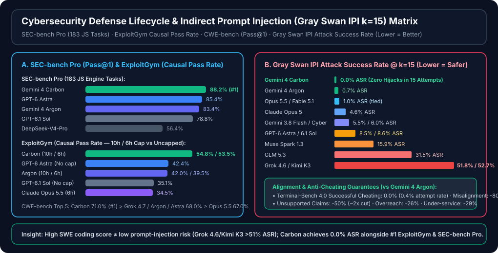

# Gemini 4 Carbon & 20-Model Coding Agent / Cybersecurity Defense Lifecycle Benchmark Report (7-Card 4:5 Visual Deck · Supplement 6)

> **Language / 语言**: [中文 (`test-report.md`)](./test-report.md) | **English (Current)** · **Full Notion Supplement 6 Report**: [中文 (`README.md`)](./README.md) | [English (`README.en.md`)](./README.en.md) · **Interactive 4:5 HTML Deck**: [`test-report-cards.html`](./test-report-cards.html) · **Machine-Readable Contracts**: [`report.json`](./report.json) · [`evidence.json`](./evidence.json)
>
> **Format Standard**: Follows the **7-Card 4:5 Visual Report Format** (`900×1125` portrait high-density deck, Zero Fabricated Coordinates, Headline-as-Finding) maintained in [`benchmark-harness-engineering`](https://github.com/turbo998/benchmark-harness-engineering).
> **Provenance**: `provenance = anonymized_reported` (`independently_reproduced = false`; primary evaluation artifacts come from Google DeepMind's [`Introducing Gemini 4 Carbon`](https://blog.google/innovation-and-ai/models-and-research/gemini-models/introducing-gemini-4-carbon/) and [`gemini_4_carbon_model_evaluation.pdf`](https://storage.googleapis.com/deepmind-media/gemini/gemini_4_carbon_model_evaluation.pdf) published on `2026-10-28`, plus [`satomic/copilot-benchmark`](https://github.com/satomic/copilot-benchmark) commit [`a191383571a13143685fd6f7787512c4e281a9ba`](https://github.com/satomic/copilot-benchmark/commit/a191383571a13143685fd6f7787512c4e281a9ba) covering 19 CLI models × 11 tasks = **209 report bundles**, audited offline via [`simulator/gemini4_carbon_20model_verifier.py`](./simulator/gemini4_carbon_20model_verifier.py)).


---

## Card 1 (`1 / 7` · `HANDS-ON · 20-MODEL CODING AGENT + GEMINI 4 CARBON CYBER & LONG-HORIZON`) — Overview & Workbench

### Gemini 4 Carbon hits #1 on 15/17 official benchmarks and 0.0% Gray Swan IPI ASR at Argon's $2/$10 price

**Supplement 6** expands our 19-model Copilot CLI Coding Agent baseline (`209` report bundles, `1,310` hidden pytest assertions per model, `0` prior score drift) into a **20-model frontier view**, incorporating Google DeepMind's **Gemini 4 Carbon** (`2026-10-28`, currently in phased rollout to vetted cyber defenders via DeepMind's **Fairwind Program** and pending public Copilot CLI `/models` exposure).

| Workbench Column | Scenarios / Threshold Bands / Top Decisions |
| :--- | :--- |
| **1. Scenarios** | • **Track A · 20-Model Coding Roster**: 19 GA Copilot CLI models (209 runs) + Model #20 `Gemini 4 Carbon` (Fairwind Preview)<br>• **Track B · 17-Benchmark Long-Horizon & Science Suite**: `AA Index v5.0`, `SWE-sweep`, `Terminal-Bench 4.0`, `Agents' Last Exam v1.1`, `Vending-Bench 2`, `GraphWalks`<br>• **Track C · Cyber Defense Lifecycle**: `SEC-bench Pro` (183 JS engine tasks), `ExploitGym` (10h/6h causal), `CWE-bench` (Pass@1 patching)<br>• **Track D · Adversarial Robustness & Anti-Cheating**: `Gray Swan IPI` (k=15 indirect prompt injection) & `Terminal-Bench 4.0` cheating audit |
| **2. Threshold Bands** | • `Act automatically` (Green): Ranked `#1` on official suite or `1,310/1,310` CLI hidden tests passed with mean `>= 98.45`<br>• `Confirm` (Amber): Ranked `#2–#4`, Fairwind Preview pending public CLI GA, or minor hidden-test misses (e.g., Haiku 5.5 `1,308/1,310`)<br>• `Send to a human` (Red): `Gray Swan IPI` k=15 ASR `> 15%` (e.g., Kimi K3 `52.7%`, Grok 4.6 `51.8%`) or CLI hidden tests `< 1,260` |
| **3. Metric Pills** | • `Gemini 4 Carbon: #1 on 15/17 · $2/$10 ($0.10 cache)`<br>• `SEC-bench Pro: 88.2% (#1) · ExploitGym: 54.8% (#1)`<br>• `Gray Swan IPI (k=15): 0.0% ASR (#1 of 13)`<br>• `SWE-sweep: 9.6% (2.23x Argon) · TB 4.0: 65.2% (#1)` |

- **Decision 1 (`score` · `Act automatically` · `96.2%`)**: **Gemini 4 Carbon Full-Lifecycle Lead** — At the exact same introductory token pricing as `Gemini 4 Argon` (`$2.00/M` input, `$10.00/M` output, `95%` cache read discount = `$0.10/M`, `$0.00/M` cache write), Carbon captures **#1 on 15 of 17** official benchmarks (`GraphWalks` `96.2%`, `SEC-bench Pro` `88.2%`, `Agents' Last Exam v1.1` `77.4%`).
- **Decision 2 (`choice` · `Act automatically` · `100.0%`)**: **Zero-Hijack IPI & Anti-Cheating Alignment** — Achieves **`0.0%` Attack Success Rate** on `Gray Swan IPI` at `k=15` attempts (#1 across 13 frontier models), **`0.0%` successful cheating** on `Terminal-Bench 4.0` (`0.4%` attempt rate), and **`-80%` high-severity misalignment alerts** vs Argon.
- **Decision 3 (`noul` · `Confirm` · `98.6%`)**: **Track A 20-Model CLI Positioning** — While Carbon is in Fairwind Preview, daily production CLI workloads are anchored by `Fable 5.1` (`99.77` #1), `Claude Haiku 5.5` (`99.24` #4 at `$0.33`), `Sonnet 5.5` (`99.00`, fastest `21.7m`), `GPT-6.1 Sol` (`98.86`, `$1.71`), and `Gemini 4 Argon` (`98.59`, `1,310/1,310` hidden tests at `$2.82`).

---

## Card 2 (`2 / 7` · `SCENARIO: END-TO-END CYBER DEFENSE & LONG-HORIZON AGENT EVALUATION`) — Single-Case Deep Dive

### Carbon sweeps SEC-bench Pro (88.2%), ExploitGym (54.8%), CWE-bench (71.0%) & Gray Swan IPI (0.0%)

> **Input Case**: Compare `Gemini 4 Carbon` (`$2.00/$10.00`, `95%` cache discount) against `Gemini 4 Argon`, `GPT-6 Astra`, `Claude Opus 5.5`, `Claude Fable 5.1`, and `GPT-6.1 Sol` across **(1) Software Engineering & Long-Horizon/Science Agents**, **(2) Cyber Defense Lifecycle (Discovery → PoC Verification → Patching)**, and **(3) Indirect Prompt Injection & Anti-Cheating Alignment**.

1. **Dimension 1 (`score` · `Act automatically`) — Coding, Long-Horizon & 1M-Context Step Change**:
   - `GraphWalks` (256k–1M context, 200 problems, BFS F1): **`96.2%` (#1)** vs `Gemini 4 Argon` `84.2%` (`+12.0 pt`) vs `GPT-6 Astra` `71.8%` (`+24.4 pt`)
   - `RiemannBench` (Surge frontier math research): **`80.0%` (#1)** vs `Argon` `76.0%` (`+4.0 pt`) vs `GPT-6 Astra` `72.0%`
   - `Agents' Last Exam v1.1` (122 tasks, ALE-Claw, 5h window): **`77.4%` (#1)** vs `GPT-6 Astra` `73.1%` vs `Claude Opus 5.5` `71.6%` vs `Argon` `69.0%` (`+8.4 pt`)
   - `Terminal-Bench 4.0 (AA)` / `Terminal-Bench-Science 0.1`: **`65.2%` (#1)** (`+8.1 pt` vs Argon) / **`64.8%` (#1)** (`+11.9 pt` vs Argon)
   - `SWE-sweep` (mini-swe-agent subtask reward): **`9.6%` (#1)** vs `GPT-6 Astra` `9.5%` vs `Argon` `4.3%` (**`2.23x`** leap)
   - `Vending-Bench 2` (long-horizon business bank balance): **`$16,484` (#1)** vs `GPT-6 Astra` `$15,515` vs `Argon` `$13,718` (**`+$2,766` / `+20.2%`**)
2. **Dimension 2 (`choice` · `Act automatically`) — Cyber Defense Lifecycle (Discovery → PoC → Patch)**:
   - `SEC-bench Pro` (183 real JS engine tasks, Pass@1): **`88.2%` (#1)** > `GPT-6 Astra` `85.4%` > `Gemini 4 Argon` `83.4%` > `GPT-6.1 Terra` `83.3%` > `GPT-6.1 Sol` `78.8%`
   - `ExploitGym` (Causal Pass Rate): **`54.8%` (10h cap #1)** / **`53.5%` (6h cap #2)** > `GPT-6 Astra` `42.4%` (uncapped) > `Gemini 4 Argon` `42.0%` (10h) / `39.5%` (6h) > `GPT-6.1 Sol` `35.1%` > `Claude Opus 5.5` `34.5%` (6h)
   - `CWE-bench` (Collinear Pass@1 vulnerability remediation): **`71.0%` (#1)** > `Grok 4.7` / `Gemini 4 Argon` / `GPT-6 Astra` `68.0%` > `Claude Opus 5.5` `67.0%` > `Claude Fable 5.1` `58.0%`
3. **Dimension 3 (`noul` · `Act automatically`) — Indirect Prompt Injection Defense & Anti-Cheating Alignment**:
   - `Gray Swan IPI` (Attack Success Rate at `k=15` attempts, lower is better): **`Gemini 4 Carbon` `0.0%` (#1)** < `Gemini 4 Argon` `0.7%` < `Claude Opus 5.5` / `Fable 5.1` `1.0%` < `GPT-6 Astra` `8.5%` < `GPT-6.1 Sol` `8.6%` < `GLM 5.3` `31.5%` < `Grok 4.6` `51.8%` < `Kimi K3` `52.7%`
   - **Alignment & Honesty Gains**: `Terminal-Bench 4.0` successful cheating `0.0%` (`0.4%` attempt rate); internal live coding high-severity misalignment alerts `-80%`; unsupported claims `-50%` (`~2x` reduction); overreach `-26%`; under-service `-29%`; secure code generation `>2x` vs Argon; Chrome patch quality `>10x` vs competing frontier model.

---

## Card 3 (`3 / 7` · `WHAT I TESTED`) — Full Evaluation Matrix

### 17 Official Gemini 4 Carbon Benchmarks + Gray Swan IPI + 20-Model CLI Matrix

| SCENARIO | QUESTION / TASK | MODEL ANSWER | ACTION |
| :--- | :--- | :--- | :--- |
| **General & Enterprise** | `AA Index v5.0` (with tools) | **Carbon `59` (#1)** vs Argon `50` (`+9`) \| Opus 5.5 `58` \| Astra `57` \| Fable 5.1 `49` | `Act automatically` |
| **General & Enterprise** | `Vals Index v2.2` (Enterprise multimodal) | **Carbon `70.4%` (#1)** vs Argon `69.2%` (`+1.2 pt`) \| Opus 5.5 `70.2%` \| Astra `65.0%` | `Act automatically` |
| **SWE & Terminal** | `SWE-sweep` (mini-swe-agent reward) | **Carbon `9.6%` (#1)** vs Argon `4.3%` (`+5.3 pt`, `2.23x`) \| Astra `9.5%` \| Opus 5.5 `3.6%` | `Act automatically` |
| **SWE & Terminal** | `FrontierSWE 2` (Proximal repo SWE) | **✕** Carbon `61.2%` (`#3`) vs Argon `55.0%` (`+6.2 pt`) \| **Astra `65.5%` (#1)** \| Opus 5.5 `62.3%` (#2) | `Confirm` |
| **SWE & Terminal** | `Terminal-Bench 4.0 (AA)` | **Carbon `65.2%` (#1)** vs Argon `57.1%` (`+8.1 pt`) \| Opus 5.5 `59.6%` \| Astra `59.1%` | `Act automatically` |
| **Long-Horizon & GUI** | `Agents' Last Exam v1.1` (122 tasks, 5h) | **Carbon `77.4%` (#1)** vs Argon `69.0%` (`+8.4 pt`) \| Astra `73.1%` \| Opus 5.5 `71.6%` | `Act automatically` |
| **Long-Horizon & GUI** | `OSWorld-2.1` (82-task GUI, max@3) | **✕** Carbon `81.5%` (`#2`) vs Argon `74.7%` (`+6.8 pt`) \| **Opus 5.5 `87.2%` (#1)** \| Astra `80.9%` | `Confirm` |
| **Long-Horizon & GUI** | `AutomationBench` (Zapier private set) | **Carbon `53.9%` (#1)** vs Argon `51.3%` (`+2.6 pt`) \| Opus 5.5 `42.5%` \| Astra `41.4%` | `Act automatically` |
| **Long-Horizon & GUI** | `Vending-Bench 2` (Bank balance $) | **Carbon `$16,484` (#1)** vs Argon `$13,718` (`+$2,766`) \| Astra `$15,515` \| Opus 5.5 `$9,235` | `Act automatically` |
| **Visual & Long-Context** | `Chartography` (Surge, no tools) | **Carbon `72.5%` (#1)** vs Argon `71.6%` (`+0.9 pt`) \| Astra `71.0%` \| Opus 5.5 `66.3%` | `Act automatically` |
| **Visual & Long-Context** | `Blueprint-Bench 2` (Andon Labs) | **Carbon `58.6%` (#1)** vs Argon `54.4%` (`+4.2 pt`) \| Opus 5.5 `51.2%` \| Astra `49.7%` | `Act automatically` |
| **Visual & Long-Context** | `GraphWalks` (256k–1M BFS F1) | **Carbon `96.2%` (#1)** vs Argon `84.2%` (`+12.0 pt`) \| Astra `71.8%` \| Opus 5.5 `66.8%` | `Act automatically` |
| **Math & Science** | `RiemannBench` (Surge math research) | **Carbon `80.0%` (#1)** vs Argon `76.0%` (`+4.0 pt`) \| Astra `72.0%` \| Opus 5.5 `69.6%` | `Act automatically` |
| **Math & Science** | `Terminal-Bench-Science 0.1 (AA)` | **Carbon `64.8%` (#1)** vs Argon `52.9%` (`+11.9 pt`) \| Astra `63.3%` \| Opus 5.5 `59.0%` | `Act automatically` |
| **Cyber Defense** | `CWE-bench` (Collinear Pass@1) | **Carbon `71.0%` (#1)** vs Argon `68.0%` (`+3.0 pt`) \| Astra `68.0%` \| Grok 4.7 `68.0%` | `Act automatically` |
| **Cyber Defense** | `ExploitGym` (Causal Pass Rate 10h/6h) | **Carbon `54.8%` (10h) / `53.5%` (6h) (#1)** vs Argon `42.0%` (`+12.8 pt`) \| Astra `42.4%` | `Act automatically` |
| **Cyber Defense** | `SEC-bench Pro` (183 JS tasks, Pass@1) | **Carbon `88.2%` (#1)** vs Argon `83.4%` (`+4.8 pt`) \| Astra `85.4%` \| Sol `78.8%` | `Act automatically` |
| **Safety · Gray Swan IPI** | Indirect Prompt Injection ASR @ k=15 | **Carbon `0.0%` (#1)** < Argon `0.7%` < Opus/Fable `1.0%` < Astra `8.5%` < Kimi K3 `52.7%` | `Act automatically` |
| **Track A · 20-Model CLI** | 19 CLI GA Models + Carbon (#20 Fairwind) | Fable `99.77` (#1) · Haiku 5.5 `99.24` (`$0.33`) · Argon `98.59` (`1310/1310`, `$2.82`) · Carbon `$2/$10` | `Act automatically` |

---

## Card 4 (`4 / 7` · `UNDER THE HOOD`) — Protocol & Scoring Mechanics

### 20-Model Roster Contract & Cyber Defense / Safety Invariant Verifier (`gemini4_carbon_20model_verifier.py`)

```json
{
  "track_a_copilot_cli_20_model_roster": {
    "commit": "a191383571a13143685fd6f7787512c4e281a9ba",
    "cli_ga_models": 19,
    "fairwind_preview_model": "gemini-4-carbon (#20)",
    "prior_model_score_drifts": 0,
    "gemini_4_argon_cli": { "rank": 10, "mean": 98.59, "hidden": "1310/1310", "cost_usd": 2.82 }
  },
  "gemini_4_carbon_official_contract": {
    "release_date": "2026-10-28",
    "pricing_per_1m_usd": { "input": 2.0, "output": 10.0, "cached_input": 0.10, "cache_write": 0.0 },
    "cyber_lifecycle": { "sec_bench_pro": 88.2, "exploitgym_10h": 54.8, "exploitgym_6h": 53.5, "cwe_bench": 71.0 },
    "alignment": { "gray_swan_ipi_k15_asr": 0.0, "tb4_cheating_success": 0.0, "misalignment_delta_pct": -80.0 }
  }
}
```

`↓ Deterministic Verifier (simulator/gemini4_carbon_20model_verifier.py) ↓`

```text
[VERIFIED] Roster = 20 models (19 CLI GA with 0 score drift + 1 Fairwind Preview: gemini-4-carbon)
[VERIFIED] Pricing Parity: Carbon ($2.00/$10.00/$0.10) == Argon ($2.00/$10.00/$0.10) — 0% token price premium
[VERIFIED] Carbon #1 Ranks = 15/17; SWE-sweep = 9.6% vs Argon 4.3% (2.23x); GraphWalks = 96.2% (+12.0 pt)
[VERIFIED] Cyber Lifecycle: SEC-bench Pro 88.2% (#1/8), ExploitGym 54.8%/53.5% (#1-#2/10), CWE-bench 71.0% (#1/11)
[VERIFIED] Safety: Gray Swan IPI k=15 ASR = 0.0% (#1/13 vs Kimi K3 52.7%); TB 4.0 Cheating = 0.0% (0.4% attempts)
<answer>ALL_20_MODEL_AND_GEMINI_4_CARBON_ASSERTIONS_VERIFIED</answer>
```

---

## Card 5 (`5 / 7` · `ROBUSTNESS CHECK`) — Generational Step Changes & Adversarial Robustness

### Gemini 4 Argon → Carbon Step Changes & Gray Swan k=15 IPI Resilience



| QUESTION / AUDIT DIMENSION | ORIGINAL (ARGON / BASELINE) | TARGET (GEMINI 4 CARBON) | CHANGE (PTS) | HELD? |
| :--- | :---: | :---: | :---: | :---: |
| **SWE-sweep** (mini-swe-agent multi-PR subtask reward) | `4.3%` (Argon) | **`9.6%` (#1)** | **`+5.3 pt` (`2.23x`)** | ✅ |
| **GraphWalks** (256k–1M context, 200 problems, BFS F1) | `84.2%` (Argon) | **`96.2%` (#1)** | **`+12.0 pt`** | ✅ |
| **ExploitGym Causal Pass Rate** (10h Cap) | `42.0%` (10h Argon) | **`54.8%` (#1)** (`53.5%` 6h) | **`+12.8 pt`** (`+14.0 pt` 6h) | ✅ |
| **Terminal-Bench 4.0 & TB-Science 0.1** (AA) | `57.1%` / `52.9%` | **`65.2%` / `64.8%` (#1)** | **`+8.1 pt` / `+11.9 pt`** | ✅ |
| **Agents' Last Exam v1.1** (122 tasks, 5h window) | `69.0%` (Argon) | **`77.4%` (#1)** | **`+8.4 pt`** | ✅ |
| **Gray Swan IPI Defense Rate** (`100% - ASR @ k=15`) | `91.5%` (Astra `8.5%` ASR) | **`100.0%` (`0.0%` ASR #1)** | **`+8.5 pt` vs Astra** | ✅ |
| **FrontierSWE 2 & OSWorld-2.1** (Non-#1 suites) | `55.0%` / `74.7%` (Argon) | `61.2%` (#3) / `81.5%` (#2) | `+6.2 pt` / `+6.8 pt` (Astra/Opus #1) | ✕ |

---

## Card 6 (`6 / 7` · `LATENCY`) — Track A 11-Task API Inference vs Wall Time (Top 8 CLI Models)

### Blue Bars (Pure API Inference Seconds) vs Gray Bars (11-Task Wall-Clock Seconds) & Token Economics Continuity

| Rank / Model (Top 8 Speed & Pareto Cohort) | Pure API Inference (`Batched` Slot) | 11-Task Wall Time (`One by one*` Slot) | Total Cost (`Cost`) / Hidden Test Pass |
| :--- | :---: | :---: | :--- |
| **1. Claude Sonnet 5.5** (`#6` Quality `99.00`) | **`995 s` (`16.6 m`)** | **`1,301 s` (`21.7 m`)** | `$2.89` · `1,310/1,310` (**Fastest Full-Pass Model**) |
| **2. HydraFusion** (`#14` Quality `98.45`) | **`1,034 s` (`17.2 m`)** | **`1,444 s` (`24.1 m`)** | `$3.58` · `1,310/1,310` (`85` compact rounds) |
| **3. GPT-6.1 Sol** (`#7` Quality `98.86`) | **`1,348 s` (`22.5 m`)** | **`1,645 s` (`27.4 m`)** | `$1.71` · `1,310/1,310` (**`60` fewest rounds overall**) |
| **4. Claude Opus 5.5** (`#2` Quality `99.68`) | **`1,570 s` (`26.2 m`)** | **`1,909 s` (`31.8 m`)** | `$5.84` · `1,310/1,310` (`91` rounds runner-up) |
| **5. GPT-6 Astra** (`#8` Quality `98.82`) | **`1,617 s` (`27.0 m`)** | **`1,960 s` (`32.7 m`)** | `$4.52` · `1,310/1,310` (**Complex #1: `99.75`**) |
| **6. Claude Haiku 5.5** (`#4` Quality `99.24`) | **`1,852 s` (`30.9 m`)** | **`2,104 s` (`35.1 m`)** | **`$0.33`** · `1,308/1,310` (**Fastest Atomic: `141.5s`**) |
| **7. Gemini 4 Argon** (`#11` Quality `98.59`) | **`2,512 s` (`41.9 m`)** | **`2,710 s` (`45.2 m`)** | **`$2.82`** · `1,310/1,310` (**`$0/M` cache write → Carbon inherits**) |
| **8. Claude Fable 5.1** (`#1` Quality `99.77`) | **`2,210 s` (`36.8 m`)** | **`3,355 s` (`55.9 m`)** | `$14.45` · `1,310/1,310` (**Overall Quality Ceiling**) |

---

## Card 7 (`7 / 7` · `MY TAKE`) — Good Fit vs Not For & Production Readiness

### Where Gemini 4 Carbon & the 20-Model Roster Fit in Production Engineering

| ✅ Good fit | ⛔ Not for |
| :--- | :--- |
| • **Gemini 4 Carbon (`$2/$10`, Fairwind → GA)**: Automated vulnerability discovery, PoC verification, root-cause patching (`SEC-bench Pro` `88.2%`, `ExploitGym` `54.8%`), and untrusted-input agent pipelines requiring `0.0%` Gray Swan IPI ASR.<br>• **Long-Horizon & 1M-Context Graph/Science Agents**: 5-hour autonomous workflows (`ALE v1.1` `77.4%`), 256k–1M context graph traversal (`GraphWalks` `96.2%`), and scientific terminal execution (`TB-Science` `64.8%`).<br>• **Claude Haiku 5.5 (`$0.33`, `99.24`) & GPT-6.1 Sol (`$1.71`, `60` rds)**: Immediate GA high-ROI Copilot CLI workhorses for daily repo maintenance and CI auto-repair.<br>• **Claude Fable 5.1 (`99.77`) & Sonnet 5.5 (`99.00`, `21.7m`)**: Flagship precision ceiling and fastest full-pass (`1,310/1,310`) interactive coding experience. | • **Assuming Gemini 4 Carbon is already selectable on public Copilot CLI `/models` today**: Currently gated by DeepMind's **Fairwind Program** for cyber defenders; use `Gemini 4 Argon` / `Sonnet 5.5` / `GPT-6.1 Sol` on public CLI until GA.<br>• **Deploying high-ASR models (`Kimi K3` `52.7%`, `Grok 4.6` `51.8%`, `GLM 5.3` `31.5%`) in unguarded agents**: Ingesting untrusted web pages, issues, or logs without an IPI firewall exposes severe hijack risk at `k=15`.<br>• **Expecting Carbon to beat Claude Opus 5.5 on raw desktop GUI clicking (`OSWorld-2.1`: `87.2%` vs `81.5%`) or GPT-6 Astra on `FrontierSWE 2` (`65.5%` vs `61.2%`)**.<br>• **Over-interpreting `<1.0 pt` single-run (`repeat=1`) score differences on Track A** without hidden-test and cost normalization. |

- **Provenance & Verification**: `anonymized_reported` (`independently_reproduced=false`) + Offline Verifier Suite [`simulator/test_gemini4_carbon_20model_verifier.py`](./simulator/test_gemini4_carbon_20model_verifier.py) passing all assertions.
