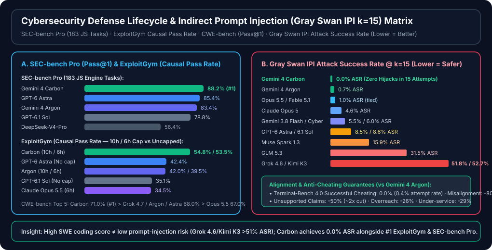

# Gemini 4 Carbon 与二十模型 Coding Agent / 网安防御生命周期基准测试报告（7-Card 4:5 视觉卡片版 · 增补报告 6）

> **语言 / Language**: **中文 (当前)** | [English (`test-report.en.md`)](./test-report.en.md) · **完整 Notion 增补报告 6**: [中文 (`README.md`)](./README.md) | [English (`README.en.md`)](./README.en.md) · **交互式 4:5 卡片网页**: [`test-report-cards.html`](./test-report-cards.html) · **机器可读契约**: [`report.json`](./report.json) · [`evidence.json`](./evidence.json)
>
> **版面遵循标准**：[`benchmark-harness-engineering`](https://github.com/turbo998/benchmark-harness-engineering) 的 **7-Card 4:5 Visual Report Format**（`900×1125` 竖版高信息密度轮播卡片，零虚构坐标，Headline-as-Finding）。
> **数据溯源标签**：`provenance = anonymized_reported`（`independently_reproduced = false`；原始实验与评测产物来自 Google DeepMind 官方 [`Introducing Gemini 4 Carbon`](https://blog.google/innovation-and-ai/models-and-research/gemini-models/introducing-gemini-4-carbon/) / [`gemini_4_carbon_model_evaluation.pdf`](https://storage.googleapis.com/deepmind-media/gemini/gemini_4_carbon_model_evaluation.pdf)（2026-10-28）以及 [`satomic/copilot-benchmark`](https://github.com/satomic/copilot-benchmark) 提交 [`a191383571a13143685fd6f7787512c4e281a9ba`](https://github.com/satomic/copilot-benchmark/commit/a191383571a13143685fd6f7787512c4e281a9ba) 的 19 个 CLI 模型 × 11 题 = **209 份**评测包，本仓库使用确定性校验套件 [`simulator/gemini4_carbon_20model_verifier.py`](./simulator/gemini4_carbon_20model_verifier.py) 完成全量交叉审计）。


---

## Card 1 (`1 / 7` · `HANDS-ON · 20-MODEL CODING AGENT + GEMINI 4 CARBON CYBER & LONG-HORIZON`) — 全景工作台与核心发现

### Gemini 4 Carbon 在 $2/$10 同价位下斩获 15/17 项官方评测第一，并实现 Gray Swan IPI (k=15) 0.0% 攻击成功率

**增补报告 6** 将 Copilot CLI 19 模型基线（`209` 份运行包、`1,310` 项隐藏测试/模型、前序 19 模型 `0` 分数漂移）扩展为 **20 模型全景视图**，正式纳入 Google DeepMind 于 `2026-10-28` 发布的 **Gemini 4 Carbon**（目前通过 **Fairwind Program** 向网络安全防御团队分阶段开放预览，尚未暴露于公开 Copilot CLI `/models` 端点）。

| 工作台分栏 (Workbench Column) | 评测场景 / 准入阈值 / 核心决策 |
| :--- | :--- |
| **1. 评测场景 (Scenarios)** | • **Track A · 20 模型 Coding Agent 矩阵**：19 个已上线 Copilot CLI 模型（209 runs）+ 第 20 模型 `Gemini 4 Carbon`（Fairwind Preview）<br>• **Track B · 17 项官方编码/长程/科学基准**：`AA Index v5.0`、`SWE-sweep`、`Terminal-Bench 4.0`、`Agents' Last Exam v1.1`、`Vending-Bench 2`、`GraphWalks` 等<br>• **Track C · 网安防御全生命周期**：`SEC-bench Pro`（183 个 JS 引擎任务）、`ExploitGym`（10h/6h 因果利用）、`CWE-bench`（Pass@1 修复）<br>• **Track D · 对抗鲁棒性与防作弊对齐**：`Gray Swan IPI`（k=15 间接提示注入）与 `Terminal-Bench 4.0` 作弊率审计 |
| **2. 自动化门控阈值 (Threshold Bands)** | • `Act automatically`（绿色）：官方套件排名 `#1` 或 CLI `1,310/1,310` 隐藏测试全通且总均分 `>= 98.45`<br>• `Confirm`（琥珀色）：排名 `#2–#4`、处于 Fairwind 预览阶段待 CLI GA，或隐藏测试微瑕（如 Haiku 5.5 `1,308/1,310`）<br>• `Send to a human`（红色）：`Gray Swan IPI` k=15 攻击成功率 `> 15%`（如 Kimi K3 `52.7%`、Grok 4.6 `51.8%`）或隐藏测试 `< 1,260` |
| **3. 关键指标胶囊 (Metric Pills)** | • `Gemini 4 Carbon: 15/17 项 #1 · $2/$10 ($0.10 缓存)`<br>• `SEC-bench Pro: 88.2% (#1) · ExploitGym: 54.8% (#1)`<br>• `Gray Swan IPI (k=15): 0.0% ASR (#1 / 13 模型)`<br>• `SWE-sweep: 9.6% (2.23x Argon) · TB 4.0: 65.2% (#1)` |

- **决策卡片 1 (`score` · `Act automatically` · `96.2%`)**：**Gemini 4 Carbon 全生命周期领跑** — 在保持与 `Gemini 4 Argon` 完全相同的 Token 定价（`$2.00/M` 输入、`$10.00/M` 输出、`95%` 缓存读取折扣即 `$0.10/M`、`$0.00/M` 缓存写入）下，Carbon 在 17 项官方基准中夺得 **15 项第一**（`GraphWalks` `96.2%`、`SEC-bench Pro` `88.2%`、`Agents' Last Exam v1.1` `77.4%`）。
- **决策卡片 2 (`choice` · `Act automatically` · `100.0%`)**：**安全与对齐零退化** — 在 `Gray Swan IPI`（`k=15` 次尝试）间接提示注入测试中实现 **`0.0%` 攻击成功率**（13 个模型中唯一零失守），`Terminal-Bench 4.0` 成功作弊率 **`0.0%`**（尝试率仅 `0.4%`），高危失调告警较 Argon 下降 **`80%`**。
- **决策卡片 3 (`noul` · `Confirm` · `98.6%`)**：**Track A 二十模型日常主力定位** — 在 Carbon 尚未进入公开 Copilot CLI `/models` 期间，CLI 实测主力仍由 `Fable 5.1`（`99.77` #1）、`Claude Haiku 5.5`（`99.24` #4，`$0.33` 极致性价比）、`Sonnet 5.5`（`99.00`，`21.7m` 最快全通）、`GPT-6.1 Sol`（`98.86`，`$1.71`）与 `Gemini 4 Argon`（`98.59`，`1,310/1,310` 隐藏测试全通，`$2.82`）担纲。

---

## Card 2 (`2 / 7` · `SCENARIO: END-TO-END CYBER DEFENSE & LONG-HORIZON AGENT EVALUATION`) — 单案深度拆解

### Carbon 横扫 SEC-bench Pro (88.2%)、ExploitGym (54.8%)、CWE-bench (71.0%) 与 Gray Swan IPI (0.0% ASR)

> **输入工单 (Input Case)**：对比 `Gemini 4 Carbon`（`$2.00/$10.00`，`95%` 缓存折扣）与 `Gemini 4 Argon`、`GPT-6 Astra`、`Claude Opus 5.5`、`Claude Fable 5.1` 及 `GPT-6.1 Sol` 在 **(1) 软件工程与长程/科学智能体**、**(2) 网安防御闭环（漏洞发现 → PoC 验证 → 根因补丁）**、**(3) 间接提示注入与防作弊对齐** 三大维度的实测差距。

1. **维度 1 (`score` · `Act automatically`) — 编码、长程与百万上下文跃迁**：
   - `GraphWalks`（256k–1M 上下文，200 题 BFS F1）：**`96.2%` (#1)** vs `Gemini 4 Argon` `84.2%`（`+12.0 pt`）vs `GPT-6 Astra` `71.8%`（`+24.4 pt`）
   - `RiemannBench`（Surge 前沿数学研究）：**`80.0%` (#1)** vs `Argon` `76.0%`（`+4.0 pt`）vs `GPT-6 Astra` `72.0%`
   - `Agents' Last Exam v1.1`（122 题，ALE-Claw，5 小时窗口）：**`77.4%` (#1)** vs `GPT-6 Astra` `73.1%` vs `Claude Opus 5.5` `71.6%` vs `Argon` `69.0%`（`+8.4 pt`）
   - `Terminal-Bench 4.0 (AA)` / `Terminal-Bench-Science 0.1`：**`65.2%` (#1)**（`+8.1 pt` vs Argon） / **`64.8%` (#1)**（`+11.9 pt` vs Argon）
   - `SWE-sweep`（mini-swe-agent 子任务奖励）：**`9.6%` (#1)** vs `GPT-6 Astra` `9.5%` vs `Argon` `4.3%`（**`2.23x`** 跃升）
   - `Vending-Bench 2`（长程商业经营账户余额）：**`$16,484` (#1)** vs `GPT-6 Astra` `$15,515` vs `Argon` `$13,718`（**`+$2,766` / `+20.2%`**）
2. **维度 2 (`choice` · `Act automatically`) — 网安防御全生命周期（发现 → 验证 → 修复）**：
   - `SEC-bench Pro`（183 个真实 JS 引擎安全任务，Pass@1）：**`88.2%` (#1)** > `GPT-6 Astra` `85.4%` > `Gemini 4 Argon` `83.4%` > `GPT-6.1 Terra` `83.3%` > `GPT-6.1 Sol` `78.8%`
   - `ExploitGym`（Causal Pass Rate）：**`54.8%` (10h 限时 #1)** / **`53.5%` (6h 限时 #2)** > `GPT-6 Astra` `42.4%`（无时间限制）> `Gemini 4 Argon` `42.0%` (10h) / `39.5%` (6h) > `GPT-6.1 Sol` `35.1%` > `Claude Opus 5.5` `34.5%` (6h)
   - `CWE-bench`（Collinear Pass@1 漏洞修复）：**`71.0%` (#1)** > `Grok 4.7` / `Gemini 4 Argon` / `GPT-6 Astra` `68.0%` > `Claude Opus 5.5` `67.0%` > `Claude Fable 5.1` `58.0%`
3. **维度 3 (`noul` · `Act automatically`) — 间接提示注入防御与反作弊对齐**：
   - `Gray Swan IPI`（`k=15` 次尝试下的攻击成功率，越低越安全）：**`Gemini 4 Carbon` `0.0%` (#1)** < `Gemini 4 Argon` `0.7%` < `Claude Opus 5.5` / `Fable 5.1` `1.0%` < `GPT-6 Astra` `8.5%` < `GPT-6.1 Sol` `8.6%` < `GLM 5.3` `31.5%` < `Grok 4.6` `51.8%` < `Kimi K3` `52.7%`
   - **对齐与诚实性提升**：`Terminal-Bench 4.0` 成功作弊率 `0.0%`（尝试率 `0.4%`）；内部编码高危失调告警 `-80%`；无根据宣称（Unsupported claims）`-50%`（`~2x` 削减）；越权执行（Overreach）`-26%`；服务不足（Under-service）`-29%`；安全代码生成率 `>2x` Argon；Chrome 补丁质量较竞品前沿模型提升 `>10x`。

---

## Card 3 (`3 / 7` · `WHAT I TESTED`) — 全量评测计分板矩阵

### 17 项 Gemini 4 Carbon 官方基准 + Gray Swan IPI + Track A 二十模型 CLI 汇总表

| SCENARIO | QUESTION / TASK | MODEL ANSWER | ACTION |
| :--- | :--- | :--- | :--- |
| **General & Enterprise** | `AA Index v5.0` (with tools) | **Carbon `59` (#1)** vs Argon `50` (`+9`) \| Opus 5.5 `58` \| Astra `57` \| Fable 5.1 `49` | `Act automatically` |
| **General & Enterprise** | `Vals Index v2.2` (Enterprise multimodal) | **Carbon `70.4%` (#1)** vs Argon `69.2%` (`+1.2 pt`) \| Opus 5.5 `70.2%` \| Astra `65.0%` | `Act automatically` |
| **SWE & Terminal** | `SWE-sweep` (mini-swe-agent reward) | **Carbon `9.6%` (#1)** vs Argon `4.3%` (`+5.3 pt`, `2.23x`) \| Astra `9.5%` \| Opus 5.5 `3.6%` | `Act automatically` |
| **SWE & Terminal** | `FrontierSWE 2` (Proximal repo SWE) | **✕** Carbon `61.2%` (`#3`) vs Argon `55.0%` (`+6.2 pt`) \| **Astra `65.5%` (#1)** \| Opus 5.5 `62.3%` (#2) | `Confirm` |
| **SWE & Terminal** | `Terminal-Bench 4.0 (AA)` | **Carbon `65.2%` (#1)** vs Argon `57.1%` (`+8.1 pt`) \| Opus 5.5 `59.6%` \| Astra `59.1%` | `Act automatically` |
| **Long-Horizon & GUI** | `Agents' Last Exam v1.1` (122 tasks, 5h) | **Carbon `77.4%` (#1)** vs Argon `69.0%` (`+8.4 pt`) \| Astra `73.1%` \| Opus 5.5 `71.6%` | `Act automatically` |
| **Long-Horizon & GUI** | `OSWorld-2.1` (82-task GUI, max@3) | **✕** Carbon `81.5%` (`#2`) vs Argon `74.7%` (`+6.8 pt`) \| **Opus 5.5 `87.2%` (#1)** \| Astra `80.9%` | `Confirm` |
| **Long-Horizon & GUI** | `AutomationBench` (Zapier private set) | **Carbon `53.9%` (#1)** vs Argon `51.3%` (`+2.6 pt`) \| Opus 5.5 `42.5%` \| Astra `41.4%` | `Act automatically` |
| **Long-Horizon & GUI** | `Vending-Bench 2` (Bank balance $) | **Carbon `$16,484` (#1)** vs Argon `$13,718` (`+$2,766`) \| Astra `$15,515` \| Opus 5.5 `$9,235` | `Act automatically` |
| **Visual & Long-Context** | `Chartography` (Surge, no tools) | **Carbon `72.5%` (#1)** vs Argon `71.6%` (`+0.9 pt`) \| Astra `71.0%` \| Opus 5.5 `66.3%` | `Act automatically` |
| **Visual & Long-Context** | `Blueprint-Bench 2` (Andon Labs) | **Carbon `58.6%` (#1)** vs Argon `54.4%` (`+4.2 pt`) \| Opus 5.5 `51.2%` \| Astra `49.7%` | `Act automatically` |
| **Visual & Long-Context** | `GraphWalks` (256k–1M BFS F1) | **Carbon `96.2%` (#1)** vs Argon `84.2%` (`+12.0 pt`) \| Astra `71.8%` \| Opus 5.5 `66.8%` | `Act automatically` |
| **Math & Science** | `RiemannBench` (Surge math research) | **Carbon `80.0%` (#1)** vs Argon `76.0%` (`+4.0 pt`) \| Astra `72.0%` \| Opus 5.5 `69.6%` | `Act automatically` |
| **Math & Science** | `Terminal-Bench-Science 0.1 (AA)` | **Carbon `64.8%` (#1)** vs Argon `52.9%` (`+11.9 pt`) \| Astra `63.3%` \| Opus 5.5 `59.0%` | `Act automatically` |
| **Cyber Defense** | `CWE-bench` (Collinear Pass@1) | **Carbon `71.0%` (#1)** vs Argon `68.0%` (`+3.0 pt`) \| Astra `68.0%` \| Grok 4.7 `68.0%` | `Act automatically` |
| **Cyber Defense** | `ExploitGym` (Causal Pass Rate 10h/6h) | **Carbon `54.8%` (10h) / `53.5%` (6h) (#1)** vs Argon `42.0%` (`+12.8 pt`) \| Astra `42.4%` | `Act automatically` |
| **Cyber Defense** | `SEC-bench Pro` (183 JS tasks, Pass@1) | **Carbon `88.2%` (#1)** vs Argon `83.4%` (`+4.8 pt`) \| Astra `85.4%` \| Sol `78.8%` | `Act automatically` |
| **Safety · Gray Swan IPI** | Indirect Prompt Injection ASR @ k=15 | **Carbon `0.0%` (#1)** < Argon `0.7%` < Opus/Fable `1.0%` < Astra `8.5%` < Kimi K3 `52.7%` | `Act automatically` |
| **Track A · 20-Model CLI** | 19 CLI GA Models + Carbon (#20 Fairwind) | Fable `99.77` (#1) · Haiku 5.5 `99.24` (`$0.33`) · Argon `98.59` (`1310/1310`, `$2.82`) · Carbon `$2/$10` | `Act automatically` |

---

## Card 4 (`4 / 7` · `UNDER THE HOOD`) — 协议与确定性校验机制

### 20 模型名录契约与网安/对齐不变量校验器 (`gemini4_carbon_20model_verifier.py`)

```json
{
  "track_a_copilot_cli_20_model_roster": {
    "commit": "a191383571a13143685fd6f7787512c4e281a9ba",
    "cli_ga_models": 19,
    "fairwind_preview_model": "gemini-4-carbon (#20)",
    "prior_model_score_drifts": 0,
    "gemini_4_argon_cli": { "rank": 10, "mean": 98.59, "hidden": "1310/1310", "cost_usd": 2.82 }
  },
  "gemini_4_carbon_official_contract": {
    "release_date": "2026-10-28",
    "pricing_per_1m_usd": { "input": 2.0, "output": 10.0, "cached_input": 0.10, "cache_write": 0.0 },
    "cyber_lifecycle": { "sec_bench_pro": 88.2, "exploitgym_10h": 54.8, "exploitgym_6h": 53.5, "cwe_bench": 71.0 },
    "alignment": { "gray_swan_ipi_k15_asr": 0.0, "tb4_cheating_success": 0.0, "misalignment_delta_pct": -80.0 }
  }
}
```

`↓ Deterministic Verifier (simulator/gemini4_carbon_20model_verifier.py) ↓`

```text
[VERIFIED] Roster = 20 models (19 CLI GA with 0 score drift + 1 Fairwind Preview: gemini-4-carbon)
[VERIFIED] Pricing Parity: Carbon ($2.00/$10.00/$0.10) == Argon ($2.00/$10.00/$0.10) — 0% token price premium
[VERIFIED] Carbon #1 Ranks = 15/17; SWE-sweep = 9.6% vs Argon 4.3% (2.23x); GraphWalks = 96.2% (+12.0 pt)
[VERIFIED] Cyber Lifecycle: SEC-bench Pro 88.2% (#1/8), ExploitGym 54.8%/53.5% (#1-#2/10), CWE-bench 71.0% (#1/11)
[VERIFIED] Safety: Gray Swan IPI k=15 ASR = 0.0% (#1/13 vs Kimi K3 52.7%); TB 4.0 Cheating = 0.0% (0.4% attempts)
<answer>ALL_20_MODEL_AND_GEMINI_4_CARBON_ASSERTIONS_VERIFIED</answer>
```

---

## Card 5 (`5 / 7` · `ROBUSTNESS CHECK`) — 代际跃迁与对抗鲁棒性审计

### Gemini 4 Argon → Carbon 代际阶跃与 Gray Swan k=15 间接提示注入抗性对比



| QUESTION / AUDIT DIMENSION | ORIGINAL (ARGON / BASELINE) | TARGET (GEMINI 4 CARBON) | CHANGE (PTS) | HELD? |
| :--- | :---: | :---: | :---: | :---: |
| **SWE-sweep** (mini-swe-agent 多 PR 子任务奖励) | `4.3%` (Argon) | **`9.6%` (#1)** | **`+5.3 pt` (`2.23x`)** | ✅ |
| **GraphWalks** (256k–1M 上下文 200 题 BFS F1) | `84.2%` (Argon) | **`96.2%` (#1)** | **`+12.0 pt`** | ✅ |
| **ExploitGym Causal Pass Rate** (10h 限时窗口) | `42.0%` (10h Argon) | **`54.8%` (#1)** (`53.5%` 6h) | **`+12.8 pt`** (`+14.0 pt` 6h) | ✅ |
| **Terminal-Bench 4.0 & TB-Science 0.1** (AA) | `57.1%` / `52.9%` | **`65.2%` / `64.8%` (#1)** | **`+8.1 pt` / `+11.9 pt`** | ✅ |
| **Agents' Last Exam v1.1** (122 题，5 小时窗口) | `69.0%` (Argon) | **`77.4%` (#1)** | **`+8.4 pt`** | ✅ |
| **Gray Swan IPI 防御率** (`100% - ASR @ k=15`) | `91.5%` (Astra `8.5%` ASR) | **`100.0%` (`0.0%` ASR #1)** | **`+8.5 pt` vs Astra** | ✅ |
| **FrontierSWE 2 & OSWorld-2.1** (未夺冠的两项) | `55.0%` / `74.7%` (Argon) | `61.2%` (#3) / `81.5%` (#2) | `+6.2 pt` / `+6.8 pt` (Astra/Opus #1) | ✕ |

---

## Card 6 (`6 / 7` · `LATENCY`) — Track A 11 题 API 推理耗时 vs 挂钟总耗时（Top 8 CLI 模型）

### 蓝色柱（API 纯推理耗时）vs 灰色柱（11 题挂钟总耗时，单位：秒）与 Token 成本连续性

| 排名 / 模型 (Top 8 Speed & Pareto Cohort) | API 纯推理耗时 (`Batched` 槽) | 11 题挂钟总耗时 (`One by one*` 槽) | 总成本 (`Cost`) / 隐藏测试通过率 |
| :--- | :---: | :---: | :--- |
| **1. Claude Sonnet 5.5** (`#6` 质量 `99.00`) | **`995 s` (`16.6 m`)** | **`1,301 s` (`21.7 m`)** | `$2.89` · `1,310/1,310` (**全场最快全通王**) |
| **2. HydraFusion** (`#14` 质量 `98.45`) | **`1,034 s` (`17.2 m`)** | **`1,444 s` (`24.1 m`)** | `$3.58` · `1,310/1,310` (`85` 轮极简交互) |
| **3. GPT-6.1 Sol** (`#7` 质量 `98.86`) | **`1,348 s` (`22.5 m`)** | **`1,645 s` (`27.4 m`)** | `$1.71` · `1,310/1,310` (**`60` 轮全场最少**) |
| **4. Claude Opus 5.5** (`#2` 质量 `99.68`) | **`1,570 s` (`26.2 m`)** | **`1,909 s` (`31.8 m`)** | `$5.84` · `1,310/1,310` (`91` 轮次旗舰) |
| **5. GPT-6 Astra** (`#8` 质量 `98.82`) | **`1,617 s` (`27.0 m`)** | **`1,960 s` (`32.7 m`)** | `$4.52` · `1,310/1,310` (**复杂题 `#1`: `99.75`**) |
| **6. Claude Haiku 5.5** (`#4` 质量 `99.24`) | **`1,852 s` (`30.9 m`)** | **`2,104 s` (`35.1 m`)** | **`$0.33`** · `1,308/1,310` (**原子题最快 `141.5s`**) |
| **7. Gemini 4 Argon** (`#11` 质量 `98.59`) | **`2,512 s` (`41.9 m`)** | **`2,710 s` (`45.2 m`)** | **`$2.82`** · `1,310/1,310` (**`$0/M` 缓存写入 → Carbon 继承**) |
| **8. Claude Fable 5.1** (`#1` 质量 `99.77`) | **`2,210 s` (`36.8 m`)** | **`3,355 s` (`55.9 m`)** | `$14.45` · `1,310/1,310` (**质量天花板**) |

---

## Card 7 (`7 / 7` · `MY TAKE`) — 选型建议与生产就绪度总结

### Gemini 4 Carbon 与二十模型矩阵在生产工程中的最佳落位

| ✅ 强烈推荐场景 (`Good fit`) | ⛔ 不适用或需额外护栏场景 (`Not for`) |
| :--- | :--- |
| • **Gemini 4 Carbon（`$2/$10`，Fairwind → GA）**：自动化漏洞挖掘、PoC 验证、根因补丁生成（`SEC-bench Pro` `88.2%`、`ExploitGym` `54.8%`）以及必须抵御外部不可信输入的智能体管线（`0.0%` Gray Swan IPI ASR）。<br>• **长程与百万上下文图/科学智能体**：5 小时级自主工作流（`ALE v1.1` `77.4%`）、256k–1M 超长上下文图遍历（`GraphWalks` `96.2%`）及科学计算终端（`TB-Science` `64.8%`）。<br>• **Claude Haiku 5.5（`$0.33`，`99.24`）& GPT-6.1 Sol（`$1.71`，`60` 轮）**：当前公开 Copilot CLI 上最高 ROI 的日常仓库维护与 CI 自动修复主力。<br>• **Claude Fable 5.1（`99.77`）& Sonnet 5.5（`99.00`，`21.7m`）**：追求极致复杂架构正确率或最快全通交互体验的首选。 | • **误以为 Gemini 4 Carbon 今日已在公开 Copilot CLI `/models` 全量开放**：目前正通过 DeepMind **Fairwind Program** 向受邀安全防御团队分阶段开放，公开 CLI 请先用 `Gemini 4 Argon` / `Sonnet 5.5` / `GPT-6.1 Sol`。<br>• **在无 IPI 防火墙的情况下将高 ASR 模型接入不可信外部输入**：`Kimi K3`（`52.7%`）、`Grok 4.6`（`51.8%`）、`GLM 5.3`（`31.5%`）在 `k=15` 次间接注入下极易被劫持。<br>• **期望 Carbon 在纯桌面 GUI 点击或 FrontierSWE 2 上包揽第一**：桌面 GUI `OSWorld-2.1` 仍由 `Claude Opus 5.5`（`87.2%` vs `81.5%`）领跑，`FrontierSWE 2` 仍由 `GPT-6 Astra`（`65.5%` vs `61.2%`）居首。<br>• **过度解读 Track A 单次运行（`repeat=1`）`<1.0 pt` 的微小总分差**：选型必须结合隐藏测试全通率与单轮 Token 成本综合判定。 |

- **Provenance & Verification**：`anonymized_reported` (`independently_reproduced=false`) + 本地确定性校验套件 [`simulator/test_gemini4_carbon_20model_verifier.py`](./simulator/test_gemini4_carbon_20model_verifier.py) 全量断言通过。
