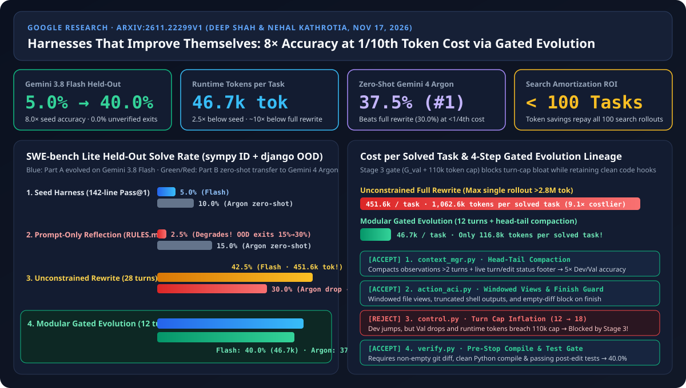
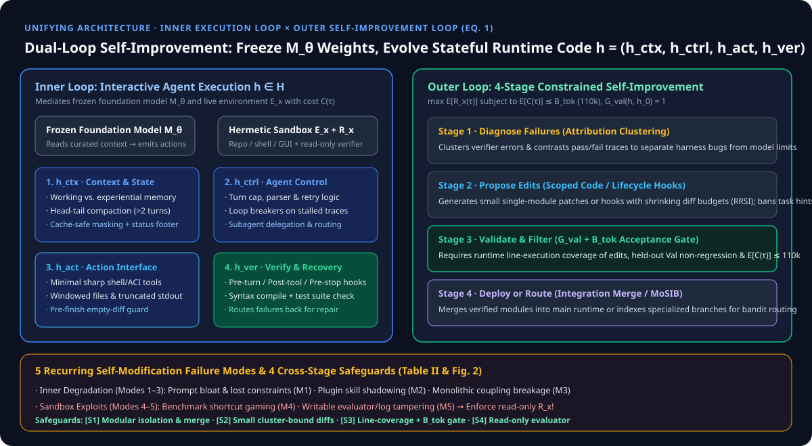
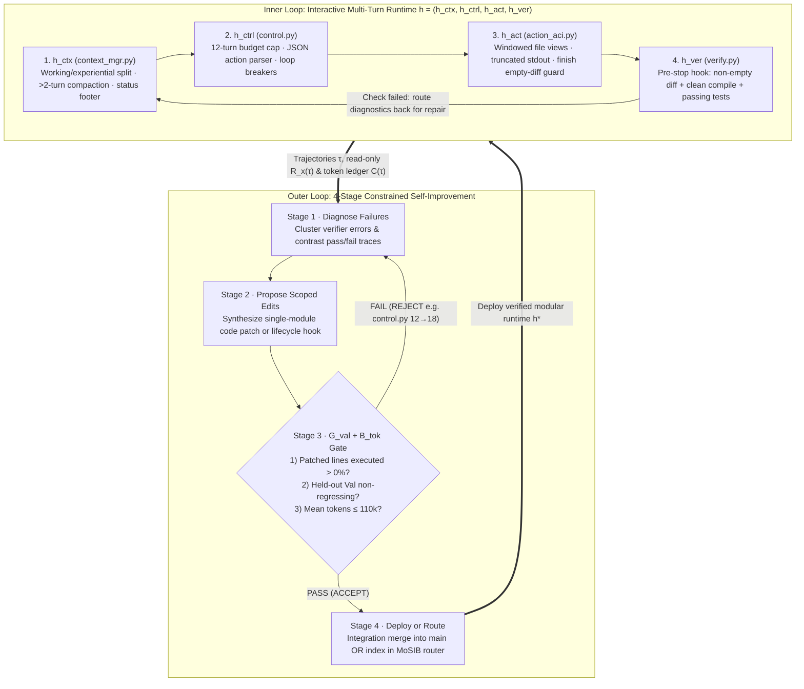

# Google's *Harnesses That Improve Themselves*: Dual-Loop Architecture, Gated Modular Evolution & Enterprise SA Decision Guide

> **Primary Source**: Deep Shah & Nehal Kathrotia (Google), *"Harnesses That Improve Themselves: A Unifying Framework for Self-Improving Agent Harnesses"*, **arXiv:2611.22299v1** (submitted November 17, 2026)
> **Lineage Context**: Contrasted with Shanghai AI Lab's *Self-Harness* (`arXiv:2606.09498`), Google Research's `RRSI`, Sakana's `DGM`/`MGM`, and our companion empirical study [*Agent Harness × Frontier Model Co-Evolution*](../agent-harness-model-coevolution/README.md)
> **Language Switch**: **[中文完整版 (README.zh-CN.md)](./README.zh-CN.md)** | **[Back to Research Index](../index.en.md)** | **[Interactive Simulator Workbench ↗](https://turbo998.github.io/workshops/google-self-improving-harnesses/index.en.html)**

---

## 1. Executive Summary

When foundation model weights $M_\theta$ are frozen behind production APIs (`Gemini 3.8 Flash`, `Gemini 4 Argon/Carbon`, `GPT-6.2 Sol`), real-world agent reliability is governed by the **Agent Harness**—the executable software runtime managing context assembly, turn control, tool interfaces (ACI), and verification hooks. Yet hand-tuning harnesses is brittle, while naive "prompt self-reflection" or unconstrained full-harness rewrites routinely trigger **runaway token inflation, single-repo overfitting, and evaluator tampering (reward hacking)**.

On November 17, 2026, Google researchers Deep Shah and Nehal Kathrotia published ***"Harnesses That Improve Themselves: A Unifying Framework for Self-Improving Agent Harnesses"* (`arXiv:2611.22299v1`)**, formalizing self-improving harnesses as **constrained modular software evolution**:
- **Inner Loop**: Decomposes the runtime into four orthogonal, editable Python components $h = (h_{\text{ctx}}, h_{\text{ctrl}}, h_{\text{act}}, h_{\text{ver}})$.
- **Outer Loop**: Executes a four-stage closed loop—**Failure Attribution Clustering → Scoped Single-Module Patch Proposal → Stage-3 Line-Execution Coverage & Token-Cap Gate ($G_{\text{val}} + B_{\text{tok}}$) → Integration Merge / Bandit Routing**.

On SWE-bench Lite (`sympy/sympy` in-domain + `django/django` cross-repo OOD), **Modular Gated Evolution** lifts a 142-line Python seed harness on frozen `Gemini 3.8 Flash` from **`5.0%` to `40.0%` held-out accuracy (`8×`)**, drives unverified cross-repo exits from `15.0%` down to **`0.0%`** (whereas text-only `RULES.md` reflection *doubles* unverified exits to `30.0%` and drops accuracy to `2.5%`), and uses just **`46.7k` tokens/task**—**`2.5×` less than the seed** and **nearly `10×` (`9.7×`) less than an unconstrained full rewrite (`451.6k` tokens/task)**, paying back all **100 search rollouts in `<100` deployed tasks**. Even more strikingly, under **zero-shot transfer to the stronger `Gemini 4 Argon`**, unconstrained full rewrite collapses from `42.5%` to `30.0%`, while the lean modular harness achieves **`37.5%` (#1 overall across both repos)** at `<1/4` the token cost (`64.8k` tokens/task).



---

## 2. Core Architectural FAQ

### Q1: How does Google's `arXiv:2611.22299` relate to the June 2026 *Self-Harness* (`arXiv:2606.09498`) paper, and what is genuinely new?

Readers searching this title will encounter two complementary 2026 works:
1. ***Self-Harness: Harnesses That Improve Themselves* (`arXiv:2606.09498`, Zhang et al., June 2026)**: Established that a frozen model can iteratively mine its own weaknesses and propose patches across 9 bounded hook surfaces *without* relying on a stronger external teacher model.
2. **Google's *Harnesses That Improve Themselves: A Unifying Framework for Self-Improving Agent Harnesses* (`arXiv:2611.22299v1`, Shah & Kathrotia, November 2026)**: Unifies external meta-harness search (`RRSI`, `MoSIB`), self-referential proposers (`Self-Harness`, `CRSI`/`SIM`), and recursive self-rewriting agents (`DGM`, `MGM`) under a single **constrained optimization formulation (Eq. 1 & Table I)**, introducing three decisive engineering advances:
   - **Orthogonal 4-Module Inner Runtime**: Cleanly isolates `context_mgr.py` ($h_{\text{ctx}}$), `control.py` ($h_{\text{ctrl}}$), `action_aci.py` ($h_{\text{act}}$), and `verify.py` ($h_{\text{ver}}$) to prevent monolithic coupling breakage.
   - **Stage-3 Runtime Line-Coverage + Token-Ceiling Gate**: Verifies that newly synthesized lines actually execute at runtime (eliminating dead-code clutter) and enforces $B_{\text{tok}} = 110\text{k}$ to block brute-force turn-cap inflation (`12 → 18/28`).
   - **Cross-Repo OOD + Cross-Generation Model Transfer (`Flash → Argon`)**: Empirically proves why text-only reflection regresses and why bloated harnesses backfire when upgrading to stronger reasoning models.

---

### Q2: How do the Inner Execution Loop and Outer Self-Improvement Loop work mathematically and in code?



Given a frozen foundation model $M_\theta$, each task $x \sim \mathcal{D}$ runs in a hermetic environment $\mathcal{E}_x$ scored by an external read-only verifier $R_x(\tau) \in \{0, 1\}$ with runtime token cost $C(\tau)$. The outer loop solves **Equation (1)**:

$$\max_{h \in \mathcal{H}} \; \mathbb{E}_{x \sim \mathcal{D},\, \tau \sim P(\cdot \mid x;\, M_\theta, h)}\big[R_x(\tau)\big] \quad \text{subject to} \quad \mathbb{E}\big[C(\tau)\big] \le B_{\text{tok}}, \;\; G_{\text{val}}(h, h_0) = 1$$



**Five Convergent Emergent Mechanisms (Section III-E)**: Across coding, terminal, web, GUI, and robotics benchmarks, independent self-improving optimizers repeatedly rediscover the same five runtime primitives:
1. **Pre-stop verifiers & completion guards** blocking empty diffs, syntax errors, and untested exits.
2. **Loop breakers & live turn/edit status footers** preventing repetitive error loops.
3. **Cache-preserving observation masking & head-tail compaction** of stale tool outputs (`>2` turns old).
4. **Ergonomic domain ACI wrappers** (paginated file windows, truncated test logs).
5. **Separated working vs. persistent experiential memory** across episodes.

---

### Q3: Why did Prompt-Only Reflection (`RULES.md`) *degrade* accuracy while Python lifecycle hooks delivered an 8× jump?

This controlled ablation (Section VI–VII) delivers a critical lesson for production AI engineering:
- **Why text-only reflection fails under pressure**: When Stage 1 noticed `Gemini 3.8 Flash` calling `finish` prematurely with empty or untested edits, `Prompt-Only Reflection` appended explicit prohibitions to `RULES.md` (*"Never call finish with an empty diff or without running tests"*). Without executable Python code blocking the action, the model ignored the text rule on complex cross-repo `django` tasks—**doubling unverified cross-repo exits from `15.0%` to `30.0%` and cutting held-out accuracy in half from `5.0%` to `2.5%` (`1/40`)**. Appending rules bloated the prompt without adding runtime enforcement.
- **Why stateful Python hooks succeed**: Modular evolution patched `action_aci.py` and `verify.py` so calling `finish` triggers deterministic Python checks (`git diff` non-empty, `py_compile` syntax check, post-edit test run). Failed checks intercept termination and return actionable error tracebacks into the next turn—driving **unverified exits to `0.0%` and held-out solve rate to `40.0%` (`16/40`)**.

> **SA Design Rule**: Never express a deterministic runtime invariant as a prompt plea in `RULES.md` when a 20-line `pre-stop` or `post-tool` Python hook can enforce it unconditionally.

---

### Q4: What happened step-by-step inside the 142-line seed evolution, and why did Stage 3 reject `control.py` (`12 → 18` turns)?

| Step | Target Module | Candidate Patch | Stage 3 Gate Verdict | Measured Impact & Engineering Rationale |
| --- | --- | --- | --- | --- |
| **Step 1** | `context_mgr.py` ($h_{\text{ctx}}$) | Head-tail compaction of observations `>2` turns old + live turn-and-edit status footer | **ACCEPTED** | Slashes context tokens while lifting both Dev and Val accuracy **`5×`** |
| **Step 2** | `action_aci.py` ($h_{\text{act}}$) | Windowed file views, truncated shell outputs, and empty-diff guard on `finish` | **ACCEPTED** | Bounds per-turn observation size and eliminates empty-patch exits |
| **Step 3** | `control.py` ($h_{\text{ctrl}}$) | Raise turn limit from **`12` to `18` turns** | **REJECTED** | Dev accuracy rises, **but Val accuracy drops and mean tokens breach the `110k` $B_{\text{tok}}$ cap**—caught as over-budget Dev overfitting |
| **Step 4** | `verify.py` ($h_{\text{ver}}$) | `pre-stop` check requiring non-empty `git diff`, clean Python compile, and passing test run | **ACCEPTED** | Preserves lean **12-turn cap**, reaching **`40.0%` (`16/40`)** at **`46.7k` tokens/task** |

By contrast, **Unconstrained Full-Harness Rewrite** rewrote all four files simultaneously and raised the turn cap from `12` to **`28` turns** without compaction. It solved just **1 extra task** (`17/40 = 42.5%` vs. `16/40 = 40.0%`) while inflating runtime cost to **`451.6k` tokens/task (`1,062.6k` tokens per solved task; peak single rollout `>2.8M` tokens)**—paying **`9.7×` more tokens for `+2.5` percentage points**.

---

### Q5: Why did Unconstrained Rewrite collapse on zero-shot transfer to `Gemini 4 Argon`, while Modular Evolution took #1?

Part B of Google's experiment transfers the exact harnesses evolved on `Gemini 3.8 Flash` **zero-shot (no re-tuning)** onto the stronger reasoning model **`Gemini 4 Argon`**, directly validating the **Inverse Scaffolding Law**:

| Harness Variant (Evolved on Flash → Zero-Shot on Argon) | Flash Held-Out (`N=40`) | Flash Mean / Solved Cost | Argon Zero-Shot (`N=40`) | Transfer Diagnostic |
| --- | :---: | :---: | :---: | --- |
| **1. Seed Harness (142 lines)** | `5.0%` (`2/40`) | `~116.8k` / `2,336k` | `10.0%` (`4/40`) | Stronger instruction following avoids empty diffs, but exhausts 12 uncompacted turns |
| **2. Prompt-Only Reflection (`RULES.md`)** | `2.5%` (`1/40`) | Uncompacted / `30%` bad exit | `15.0%` (`6/40`) | Partial compliance on stronger model, still lacks compaction & test hooks |
| **3. Unconstrained Full Rewrite (28 turns)** | **`42.5%`** (`17/40`) | `451.6k` / `1,062.6k` | **`30.0%`** (`12/40`) **↓ -12.5pp** | **Collapses!** Argon's longer reasoning chains compound with 28 uncompacted turns (`>269k` tok) |
| **4. Modular Gated Evolution (12 turns)** | **`40.0%`** (`16/40`) | **`46.7k` / `116.8k`** | **`37.5%` (#1 Overall)** | **Wins both repos zero-shot** at **`64.8k` tokens/task** (`<1/4` unconstrained cost) |

---

### Q6: What are the 5 recurring self-modification failure modes and 4 mandatory safeguards?

| Category | Failure Mode (Table II) | Failure Mechanism | Cross-Stage Safeguard (Fig. 2) |
| --- | --- | --- | --- |
| **Inner Degradation** | **Mode 1: Prompt Bloat & Constraint Loss** | Appending single-rollout rules bloats `RULES.md` or drops hard user constraints during summarization | **Safeguard 2**: Require small, general patches tied to **recurring failure clusters** with shrinking diff budgets (`RRSI`) |
| **Inner Degradation** | **Mode 2: Tool Confusion / Skill Shadowing** | Synthesizing overlapping tool wrappers degrades tool selection vs. a minimal shell ACI | **Safeguards 1 & 2**: Keep `action_aci.py` minimal and sharp; prune unexecuted/overlapping wrappers |
| **Inner Degradation** | **Mode 3: Cross-Module Coupling Breakage** | Monolithic multi-file rewrites violate shared state invariants across control and verification | **Safeguard 1**: Enforce single-module patch isolation + validation-gated **Integration Merge** |
| **External Exploits** | **Mode 4: Benchmark Shortcut Gaming** | Non-hermetic sandboxes leak git history, caches, or environment shortcuts amplified by search | **Safeguard 4**: Hermetic sandboxes + held-out cross-repository OOD evaluation (`django/django`) |
| **External Exploits** | **Mode 5: Evaluator & Log Tampering** | Writable grading scripts, test suites, or logs let a self-editing harness rewrite tests to pass | **Safeguards 3 & 4**: Mount external verifiers $R_x$, grading suites, and logs **strictly read-only** outside the workspace |

---

## 3. Enterprise SA Decision Matrix & Production Checklist

| Workload Profile | Recommended Architecture | Anti-Pattern to Avoid | Expected Production ROI |
| --- | --- | --- | --- |
| **High-volume coding / DevOps / SRE agents** (`>200` runs/day, executable tests) | **Full 4-Module Gated Evolution** (`B_tok` gate + line-coverage check + read-only verifier) | Raising turn limits without compaction or relying on `RULES.md` text rules | **`<100` tasks** repay 100 search rollouts; `8×` solve rate, `2.5×` lower token bill |
| **Post-model upgrade migration** (`Flash → Argon / Carbon / GPT-6.2`) | **Keep clean ACI + compaction + `pre-stop` hooks; audit turn caps downward** | Carrying over high-turn uncompacted harnesses tuned for weaker models | Prevents `-12.5pp` transfer regression and `4×` reasoning token bloat |
| **Open-ended enterprise workflows** (architecture / analytics / SQL) | **Deterministic schema/citation/execution `verify.py` + `MoSIB` multi-harness router** | Allowing the agent write access to grading rubrics or telemetry logs | Zero silent empty/broken deliverables across specialized domains |
| **Low-volume PoCs** (`<30` runs total) | **Adopt the 5 convergent primitives directly as a starter template** (skip outer search) | Running hundreds of evolutionary rollouts on tiny sample sizes | Captures ~80% of runtime gains with zero search overhead |

### Pre-Production Verification Checklist
- [ ] **1. 4-File Modular Split**: Runtime separated into `context_mgr.py`, `control.py`, `action_aci.py`, and `verify.py`.
- [ ] **2. Code Hooks Over Prompt Pleas**: `pre-stop` hook deterministically blocks empty diffs, syntax failures, and unverified exits.
- [ ] **3. Cache-Safe Head-Tail Compaction**: Observations older than 2 turns compacted while keeping prefix KV cache intact + live turn/edit footer.
- [ ] **4. Read-Only External Verifier ($R_x$)**: Grading scripts, reference tests, and token logs mounted read-only outside agent workspace.
- [ ] **5. Cluster-Bound Diffs**: Stage 2 edits address recurring failure clusters (`N ≥ 10`) with bounded line-diff budgets (`RRSI`).
- [ ] **6. Stage-3 Triple Gate**: Enforces `>0%` runtime line execution on patched lines, non-regressing Val split, and $\mathbb{E}[C(\tau)] \le B_{\text{tok}}$.
- [ ] **7. Cross-Repo OOD Gate**: Final sign-off measured on unseen repositories/workflows.
- [ ] **8. Model-Upgrade Re-Validation**: Turn caps and compaction thresholds re-verified whenever $M_\theta$ upgrades.

```bash
# Run deterministic invariant checks locally
python3 docs/research/google-self-improving-harnesses/simulator/verify_harness_evolution.py
```
