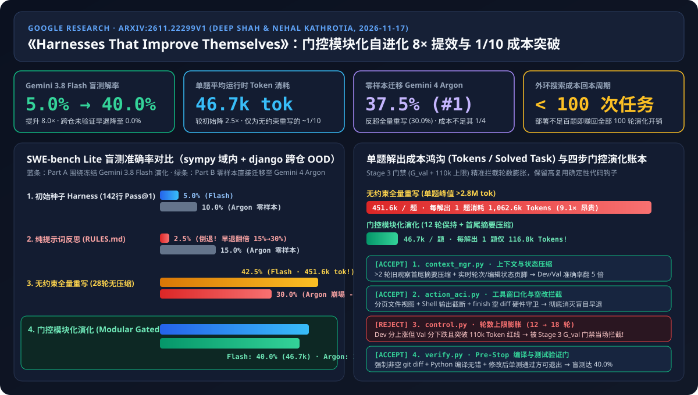

# Google《Harnesses That Improve Themselves》深度研究 · Self-Improving Agent Harnesses

> **Primary Paper**: Deep Shah & Nehal Kathrotia (Google), *"Harnesses That Improve Themselves: A Unifying Framework for Self-Improving Agent Harnesses"*, **arXiv:2611.22299v1** (2026-11-17) · Comparative Lineage: *Self-Harness* (`arXiv:2606.09498`), `google-research/rrsi`, `DGM`/`MGM`, `MoSIB`
> **Language / 语言导航**: **[中文完整版 FAQ 与架构决策指南 (README.zh-CN.md)](./README.zh-CN.md)** | **[Full English FAQ & Architecture Playbook (README.en.md)](./README.en.md)**
> **Live Interactive Deliverables**: [中文深度图解长文](https://turbo998.github.io/articles/google-self-improving-harnesses.html) · [English Illustrated Essay](https://turbo998.github.io/articles/google-self-improving-harnesses.en.html) · [4-Tab Interactive Evolution Simulator](https://turbo998.github.io/workshops/google-self-improving-harnesses/index.html) · [7-Card 4:5 Deck (ZH)](./cards.zh.html) · [7-Card 4:5 Deck (EN)](./cards.html)

---

## 核心结论速览 · Executive Snapshot

1. **范式跃迁（从调提示词到演化运行时代码）**：Google 将围绕冻结基座模型 $M_\theta$ 的可执行承载层形式化为四元组软件程序 $h = (h_{\text{ctx}}, h_{\text{ctrl}}, h_{\text{act}}, h_{\text{ver}}) \in \mathcal{H}$，证明**纯提示词反思（`RULES.md`）在 SWE-bench Lite 上不仅无法阻止空修改/未测试早退，反而使跨仓未验证退出率翻倍（`15.0% → 30.0%`）、盲测准确率倒退至 `2.5%`**；唯有状态化 Python 代码钩子才能强制拦截故障。
2. **门控模块化演化（8× 准确率 × 1/10 Token 成本）**：通过外环四阶段受约束优化（诊断聚类 → 单模块补丁提案 → **Stage 3 行执行覆盖 + `110k` Token 上限门禁 $G_{\text{val}}$** → 合并/路由），142 行种子 Harness 在冻结 `Gemini 3.8 Flash` 上盲测解率从 **`5.0%` 跃升至 `40.0%`（8×）**，单题均耗仅 **`46.7k` Tokens**（较种子降 `2.5×`，较无约束全量重写的 `451.6k` 降近 **`10×`**），**部署不足 100 题即赚回全部 100 轮外环搜索开销**。
3. **跨代模型零样本迁移（验证“反向脚手架定律”）**：将围绕 `Gemini 3.8 Flash` 演化的四套 Harness **零样本直接迁移至更强的 `Gemini 4 Argon`** 时，无约束 28 轮全量重写因长思维链叠加未压缩上下文而从 `42.5%` 崩塌至 `30.0%`；**门控模块化 Harness 以 `37.5%` 夺得双仓全场第一，且成本不足全量重写的 `1/4`（`64.8k` Tokens）**。

---

## 目录与交付物清单 · Artifact Manifest

| 交付物 (Artifact) | 说明 (Description) | 链接 (Path) |
| --- | --- | --- |
| **中文完整版 FAQ 与选型指南** | 6 大核心追问 Q&A、双环公式解析、5 类故障 × 4 道护栏、SA 落地核查清单 | [`README.zh-CN.md`](./README.zh-CN.md) |
| **English Full FAQ & Decision Guide** | Complete bilingual counterpart with SWE-bench Lite tables, taxonomy & SA checklist | [`README.en.md`](./README.en.md) |
| **可视化矢量架构图 (ZH / EN)** | 一图流战果总结 + 内外双环四模块门控架构 SVG | [`assets/svg/`](./assets/svg/) |
| **7 卡 4:5 基准测试视觉报告** | 严格遵循 `default-src 'none'` CSP 的中英双语 7 卡汇报页 | [`cards.zh.html`](./cards.zh.html) · [`cards.html`](./cards.html) |
| **密封证据账本与确定性校验套件** | 论文原始实验数据 JSON 账本 + Python 5 项不变量单元测试 | [`evidence/paper-benchmark-ledger.json`](./evidence/paper-benchmark-ledger.json) · [`simulator/verify_harness_evolution.py`](./simulator/verify_harness_evolution.py) |
