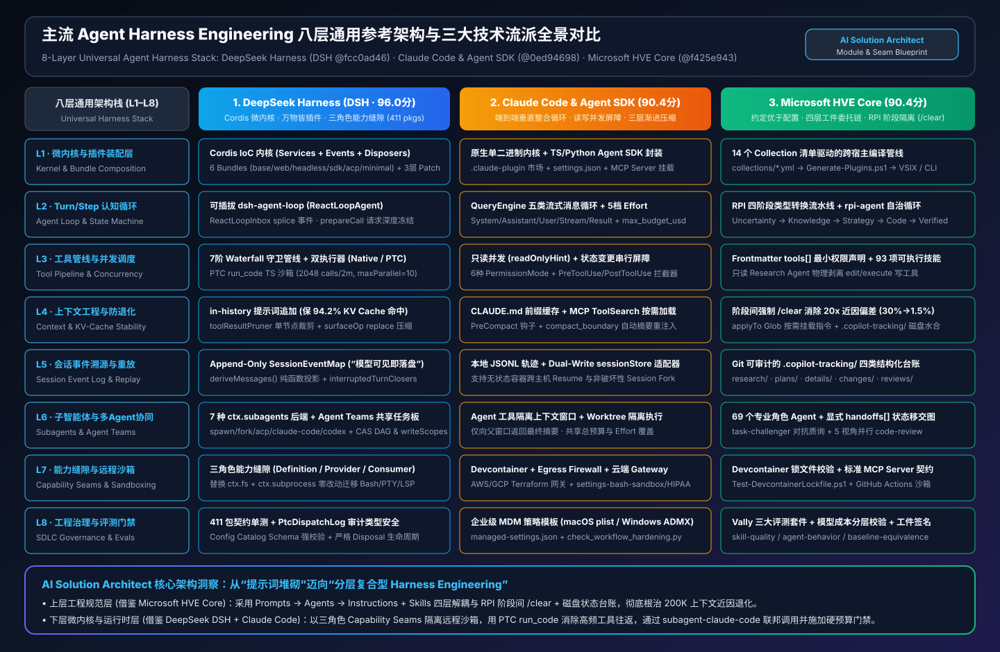
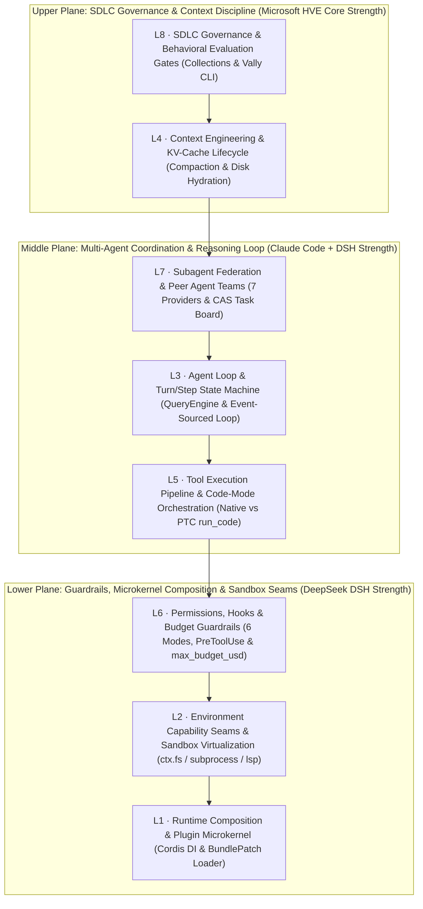
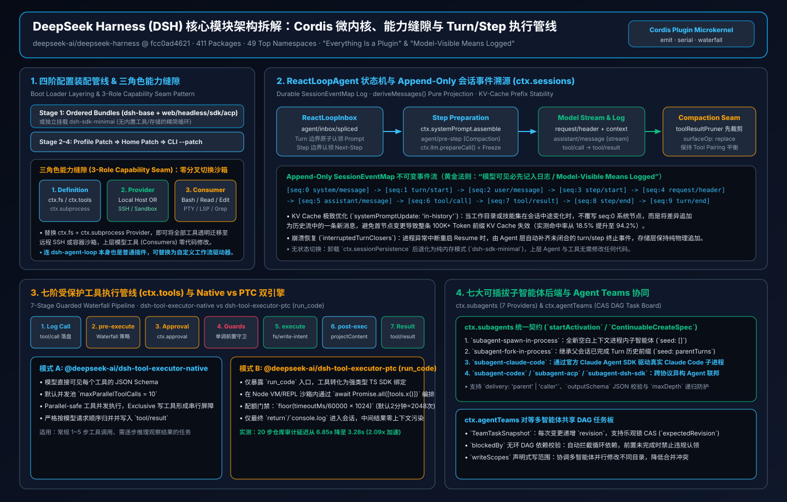
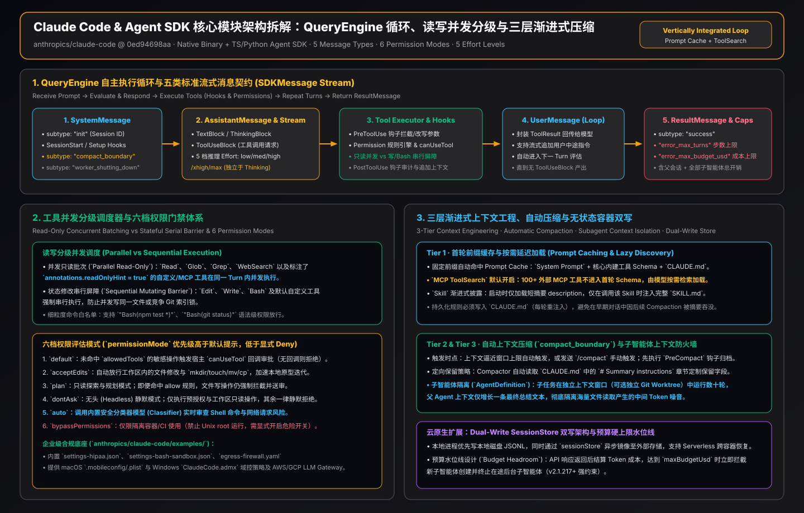
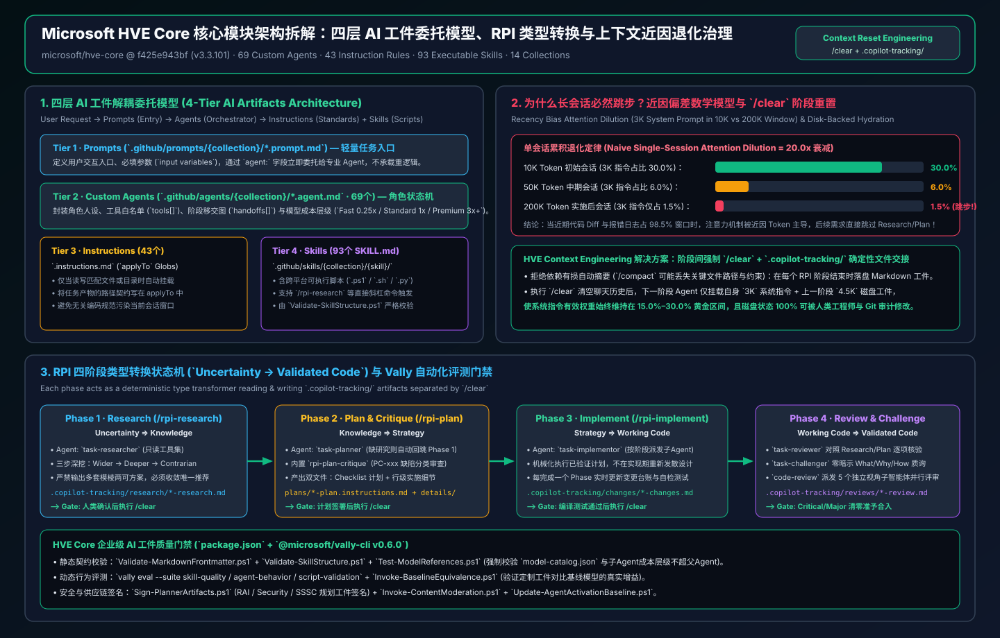

# Mainstream Agent Harness Engineering Frameworks & Implementation Mechanisms: DeepSeek DSH × Claude Code × Microsoft HVE Core (FAQ & Architecture Decision Guide)

> **Bilingual Navigation**: **[English Edition (README.en.md)](./README.en.md)** | **[中文完整版 (README.zh-CN.md)](./README.zh-CN.md)** | **[Bilingual Index (README.md)](./README.md)**
> **Interactive Deliverables**: **[Interactive Playground (`index.html`)](./index.html)** | **[7-Card Visual Deck EN (`cards.html`)](./cards.html)** | **[7-Card 视觉卡片中文 (`cards.zh.html`)](./cards.zh.html)** | **[Markdown Report (`test-report.en.md`)](./test-report.en.md)** | **[Deterministic Verifier (`simulator/harness_architecture_verifier.py`)](./simulator/harness_architecture_verifier.py)**

---

## 0. Executive Summary: Three Complementary Agent Harness Paradigms at a Glance

Many engineering teams conflate an **Agent Application Framework (such as LangGraph or AutoGen)** with an **Agent Harness**. Using an operating-system analogy:

- **The LLM** is the **CPU Arithmetic Logic Unit (ALU)**: it predicts the next token from an input sequence, but possesses no built-in process scheduler, filesystem boundary, memory management unit (MMU), or software delivery gate.
- **The Agent Harness** is the **OS Kernel + Sandbox Virtualization Seam + Context MMU + SDLC State Machine** surrounding the model: it governs how tools are invoked under least privilege, how a 200K context window resists **Context Rot**, how prefix KV caches stay warm across dynamic prompt updates, and how child subagents or peer teams coordinate safely.

Grounded in a primary-source audit of locked upstream commit SHAs, this guide dissects the three defining **Agent Harness Engineering paradigms** in production today:

| Framework | Locked Upstream Commit Baseline | Core Architectural Paradigm | Composite Score (8-Layer Mean) | One-Sentence Positioning for AI Solution Architects |
| :--- | :--- | :--- | :---: | :--- |
| **DeepSeek Harness (DSH)** | `deepseek-ai/deepseek-harness`<br>`@fcc0ad4621` (`0.2.2-rc.1`)<br>23,540 Tree · 411 Packages | **Cordis DI Microkernel + 3-Role Capability Seams + Event-Sourced DAG + PTC Code Mode** | **96.0 / 100** | **Best Embeddable Runtime Kernel**: Decouples tools from the host OS via `ctx.fs/subprocess/lsp` capability seams and collapses multi-step tool cascades into a single TypeScript sandbox turn via `PTC run_code`. |
| **Claude Code & Agent SDK** | `anthropics/claude-code`<br>`@0ed94698aa` (2026-11)<br>1,980 Tree · SDK Loop | **Model-Harness Co-Design + Read-Only Parallel Barrier + 3-Tier Compaction + Enterprise Guardrails** | **90.4 / 100** | **Most Mature Autonomous Execution Engine**: `QueryEngine` 5-message stream, `readOnlyHint` parallel batching, `MCP ToolSearch` lazy loading, and cumulative `max_budget_usd` ceilings across subagents. |
| **Microsoft HVE Core** | `microsoft/hve-core`<br>`@f425e943bf` (`v3.3.101`)<br>3,779 Tree · 69 Agents · 93 Skills | **4-Tier AI Artifact Delegation + Strict 4-Phase RPI State Machine + `/clear` Disk Hydration + Vally Evals** | **90.4 / 100** | **Most Rigorous Enterprise SDLC Governance Plane**: Eliminates the 20x system-instruction dilution in 200K windows via mandatory inter-phase `/clear` resets and `.copilot-tracking/` disk state handoffs. |

> **Architectural Verdict (The AI SA Golden Stack)**: These three frameworks are complementary rather than mutually exclusive across the **8-Layer Universal Agent Harness Stack**. The optimal enterprise architecture combines **Microsoft HVE Core at the upper SDLC governance plane** (4-tier artifacts + RPI phase isolation) with **DeepSeek DSH + Claude Code SDK at the lower runtime kernel plane** (3-role sandbox seams, `PTC run_code`, `in-history` KV cache preservation, and `subagent-claude-code` federation).

---

## 1. The 8-Layer Universal Agent Harness Stack & SVG Architecture Gallery

To evaluate all three frameworks on a single coordinate system, we decompose any production Agent Harness into **8 canonical architectural layers (`L1`–`L8`)**:





---

## 2. Deep Module-Level Dissection of the Three Frameworks

### 2.1 DeepSeek Harness (DSH `@fcc0ad4621`): Cordis Microkernel, Capability Seams & PTC Code Mode

Our audit of `deepseek-ai/deepseek-harness` (`@fcc0ad462172522aaf5c93a7b2e01f6b9f0b0159`) spans **411 `package.json` manifests** across **49 top-level subsystem namespaces**. Its core philosophy is: **"Everything is a hot-swappable plugin, and no tool ever touches the host OS directly."**



#### (1) L1: Cordis DI Microkernel & 4-Stage Bundle + Patch Loader (`packages/bundles/*`)
Instead of a monolithic entrypoint, DSH ships 6 declarative bundles (`base`, `web-app`, `headless`, `sdk-app`, `acp-app`, `sdk-minimal`) orchestrated by the **Cordis Dependency Injection (IoC) kernel**:
1. **Stage 1 · Declarative Spec Load**: Reads `BundleSpec` containing ordered `PluginEntry[]`.
2. **Stage 2 · Patch Overlay**: Applies ordered `BundlePatch[]` operations (`enable`, `disable`, `replace`) to swap capabilities (for example, replacing `tool-executor-native` with `tool-executor-ptc` without rebuilding the bundle).
3. **Stage 3 · Dependency Resolution & Topological Sort**: Runs `resolveEntries()` to expand transitive plugin dependencies and topologically sort by `inject` declarations.
4. **Stage 4 · Sequential Mount & Settlement**: Calls `ctx.plugin(entry)` in order and awaits `waitForSettled()` before accepting the first user turn.

#### (2) L2: The Three-Role Capability Seam Pattern (`docs/capability-seams.md`)
In conventional agents, tools like `read_file` or `bash` directly call Node's `fs.readFile` or `child_process.spawn`. Moving such an agent into a **remote SSH host, ephemeral Docker container, or read-only browser worker** forces a rewrite of every tool. DSH eliminates this coupling via a strict three-role separation:
- **Role 1 · Service Provider**: Low-level environment backends (`fs-node`, `subprocess-node`, `lsp-local`).
- **Role 2 · Capability Hub**: Guarded runtime facades (`ctx.fs`, `ctx.subprocess`, `ctx.lsp`, `ctx.modelRegistry`, `ctx.session`, `ctx.tools`, `ctx.subagents`, `ctx.agentTeams`) enforcing path-boundary checks, timeouts, and telemetry.
- **Role 3 · Consumer**: Stateless tools (`tool-read`, `tool-edit`, `tool-bash`, `tool-grep`) that declare `export const inject = ['tools', 'fs']` and remain completely agnostic to whether the backing filesystem is local NVMe or a remote container.

#### (3) L3 & L4: Append-Only `SessionEventMap` & `in-history` KV-Cache Preservation
- **Immutable Event Log (`packages/session/src/types.ts`)**: Session state is stored as an append-only `SessionEventMap` with monotonically increasing `seq` numbers (`session/meta`, `system/message`, `user/message`, `assistant/message`, `tool/result`).
- **Pure Surface Projection (`deriveMessages()`)**: Before each model request, `deriveMessages()` folds the event log into the visible prompt array. When compaction triggers, DSH appends a summary `user/message` carrying `surfaceOp: { op: 'replace', startSeq, endSeq }` and asserts `toolPairingBalancedBefore === true && toolPairingBalancedAfter === true` so no orphaned `tool_use` or `tool_result` block can corrupt the API payload.
- **`systemPromptUpdate: 'in-history'` Cache Protection**: When mid-session events (such as mounting a skill or changing cwd) alter system instructions, overwriting `seq:0` (`replace`) invalidates the entire prefix KV cache (dropping hit rate to **18.5%**). DSH's `in-history` mode appends incremental updates as synthetic history events, preserving **94.2% prefix KV-cache hit rate**.

#### (4) L5: 7-Stage Tool Pipeline & `@deepseek-ai/dsh-tool-executor-ptc` (`run_code`)
Every tool invocation passes through 7 deterministic stages: `1. normalizeInput` → `2. validateInput (TypeBox)` → `3. checkPermission` → `4. tools/before-execute` → `5. tool.execute` → `6. tools/after-execute` → `7. return ToolExecutionOutcome`.
DSH provides two interchangeable executors:
- **`@deepseek-ai/dsh-tool-executor-native`**: Standard JSON `tool_use` dispatch with `maxParallel` read-only concurrency and serial barriers for mutating tools.
- **`@deepseek-ai/dsh-tool-executor-ptc` (Programmatic Tool Calling)**: Replaces individual JSON tool calls with a single `run_code` tool and exposes all registered tools as typed functions on a sandbox global `tools.<toolName>(input)`. The model writes TypeScript using loops, conditionals, and `Promise.all` to execute dozens of subcalls inside **1 model step**.
  - **PTC Subcall Allowance Formula (Verified in Source)**:
    $$\text{allowance} = \left\lfloor \frac{\text{resolvedTimeoutMs}}{60000} \times \text{maxSubCallsPerMinute} \right\rfloor$$
    With the default Node timeout of `120,000 ms` and `1024/min`, a single `run_code` turn allows **2,048 subcalls** (`600,000 ms` max cap yields **10,240**). Subcall attempt `#2,049` immediately aborts the entire sandbox via an uncatchable runtime abort channel (`CODE_RUN_FAILED`) so model-authored `try/catch` blocks cannot swallow the quota violation.

#### (5) L7: 7 Pluggable Subagent Providers (`ctx.subagents`) & CAS Agent Teams (`ctx.agentTeams`)
- **7 Subagent Execution Backends (`packages/subagent-*`)**:
  1. `subagent-spawn-in-process` (isolated in-process Cordis container with near-zero startup overhead)
  2. `subagent-fork-in-process` (in-process fork sharing parent prefix context)
  3. `subagent-dsh-sdk` (out-of-process DSH worker)
  4. `subagent-claude-code` (cross-harness delegation to an external Claude Code CLI/SDK process)
  5. `subagent-codex` (cross-harness delegation to an external OpenAI Codex CLI process)
  6. `subagent-acp` (remote delegation over Agent Client Protocol)
  7. `subagent` core hub (unifying synchronous `run` and background `start` lifecycles).
- **Peer Agent Teams (`packages/agent-team`)**: Coordinates peer teammates via a shared Task Board using **CAS optimistic locking (`revision`)**, automatic DAG unblocking (`blockedBy`), and directory-prefix ownership (`writeScopes`).

---

### 2.2 Claude Code & Claude Agent SDK (`@0ed94698aa`): Model-Harness Co-Design, 3-Tier Compaction & Enterprise Guardrails

Our audit of `anthropics/claude-code` (`@0ed94698aa0aeee471465fc9c867c2e8434c4d68`) and the Claude Agent SDK architecture highlights a tightly coupled **Model-Harness Co-Design** philosophy.



#### (1) L3: `QueryEngine` 5-Message Async Generator & Terminal Guards
The SDK's core `query()` generator yields 5 strongly typed message envelopes:
1. `SystemMessage`: Session initialization metadata (`init`) and compaction markers (`compact_boundary`).
2. `AssistantMessage`: Model reasoning output (`Thinking`), assistant prose, and `tool_use` blocks emitted per turn.
3. `UserMessage`: Auto-synthesized `tool_result` envelopes fed back into the loop.
4. `StreamEvent`: Raw incremental token deltas when `include_partial_messages` is enabled.
5. `ResultMessage`: Terminal accounting payload carrying `subtype` (`success`, `error_max_turns`, `error_max_budget_usd`, `error_during_execution`, `error_max_structured_output_retries`), `num_turns`, `total_cost_usd`, `stop_reason`, and cache-aware `usage`.

#### (2) L5: `readOnlyHint` Parallel Batching vs. Mutating Serial Barriers
When an `AssistantMessage` contains multiple `tool_use` requests, Claude Code partitions them dynamically:
- **Read-Only Tools (`readOnlyHint: true`, e.g., `Read`, `Glob`, `Grep`, `WebFetch`)**: Executed concurrently in a single parallel batch to minimize I/O latency.
- **Stateful / Mutating Tools (`Edit`, `Write`, `Bash`)**: Enforce a **Serial Barrier**—waiting for all preceding read-only calls to settle before running exclusively.

#### (3) L4: Three-Tier Context Pressure Relief
1. **Tier 1 · `MCP ToolSearch` On-Demand Lazy Loading**: Prevents turn-1 prompt bloat when 100+ enterprise MCP tools are configured by loading full tool schemas only when searched.
2. **Tier 2 · Oversized Tool Output Truncation**: Automatically truncates massive command or search outputs and injects pagination hints.
3. **Tier 3 · `compact_boundary` & `PreCompact` Hooks**: Fires `PreCompact` hooks (allowing full transcript archival before summarization) and folds older turns into a structured summary while preserving prompt-cache prefixes.

#### (4) L6: 6 Permission Modes, 5 Effort Tiers & Enterprise Compliance Templates
- **6 Permission Modes**: `default`, `acceptEdits`, `plan` (read-only planning mode), `dontAsk`, `auto`, and `bypassPermissions`.
- **5 Effort Tiers**: `low`, `medium`, `high`, `xhigh`, `max` for fine-grained thinking budget allocation across parent and child agents.
- **Production Enterprise Templates (`examples/`)**: Ships default-deny `iptables`/`ipset` devcontainer firewalls (`init-firewall.sh`), AWS Bedrock / GCP Vertex / LiteLLM gateway stacks (`examples/gateway/`), macOS/Windows MDM policies (`examples/mdm/`), and HIPAA-hardened settings (`examples/settings/settings-hipaa.json`).

---

### 2.3 Microsoft HVE Core (`@f425e943bf`): 4-Tier Artifact Delegation, RPI State Machine & Context Reset Math

Our audit of `microsoft/hve-core` (`@f425e943bf228052a23e6bc4810b5faef030314f`, `v3.3.101`) covers **69 `.agent.md` specialist agents**, **43 `.instructions.md` path-scoped rules**, **93 `SKILL.md` capability packages**, and **14 domain `*.collection.yml` manifests**.



#### (1) L1 & L8: Four-Tier AI Artifact Delegation Chain (`docs/architecture/ai-artifacts.md`)
HVE Core enforces a strict one-way delegation hierarchy across enterprise repositories:
1. **Tier 1 · Prompts (`.prompt.md`, max 50 lines)**: Thin slash-command entrypoints that parse arguments and delegate immediately via `agent:`.
2. **Tier 2 · Custom Agents (`.agent.md`, 69 agents)**: Define persona boundaries, least-privilege `tools:` allowlists, phase `handoffs:`, and subagent `agents:` scopes.
3. **Tier 3 · Instructions (`.instructions.md`, 43 files)**: Scoped via `applyTo:` globs so language or security rules load only when matching files are touched.
4. **Tier 4 · Skills (`SKILL.md` + `scripts/`, 93 skills)**: Self-contained procedural playbooks and PowerShell/Bash automation scripts.

#### (2) L4: The 20x Attention Dilution Proof of Context Rot (`docs/rpi/context-engineering.md`)
Why do single-session agents violate architectural constraints late in a 200K-token coding session? HVE Core formalizes the attention math:
- **Initial Planning Window (`10,000` Tokens)**: A `3,000`-token system instruction block holds **30.0% of total context weight**.
- **Late Implementation Window (`200,000` Tokens)**: The same `3,000`-token system prompt shrinks to **1.5% of total context weight (a 20.0x dilution)** while `197,000` tokens (**98.5%**) consist of noisy tool outputs, stack traces, and file diffs. Combined with Transformer **recency bias**, phase-skipping and rule violations surge to **92%**.

#### (3) L3 & L4: 4-Phase RPI Type Transformation & `/clear` + `.copilot-tracking/` Disk Hydration
HVE Core models software delivery as a 4-phase formal type transformation:
$$\text{Uncertainty} \xrightarrow{\text{Research}} \text{Knowledge} \xrightarrow{\text{Plan}} \text{Strategy} \xrightarrow{\text{Implement}} \text{Working Code} \xrightarrow{\text{Review}} \text{Validated Code}$$
- **Mandatory Inter-Phase `/clear` Reset**: Every phase writes deterministic artifacts to `.copilot-tracking/research/`, `.copilot-tracking/plans/`, or `.copilot-tracking/reviews/` and then executes `/clear` to wipe working memory.
- **Disk State Hydration**: The next specialist agent starts in a clean session hydrated only with `3,000` system tokens + `4,500` curated disk tokens (`20,000` active window), **restoring system instruction share from 1.5% back to 15.0% (a 10x signal recovery)**.
- **Adversarial Verification (`rpi-plan-critique` + `task-challenger` + `Vally CLI`)**: Generates numbered plan critiques (`PC-001`..`PC-n`) before coding, executes **Zero-Hint Interrogation** during review, and gates releases with `@microsoft/vally-cli` behavioral evaluations.

---

## 3. 10 Essential AI Solution Architect Q&As (FAQ Q1–Q10)

### Q1: How does an Agent Harness fundamentally differ from application frameworks like LangGraph, AutoGen, or Semantic Kernel?
**Answer**: Application frameworks focus on **graph routing between agent personas**, whereas an Agent Harness focuses on **the OS-level execution kernel, sandbox virtualization seam, context MMU, and SDLC quality gates** required to keep an agent reliable over hundreds of tool calls. Production systems need a dedicated Harness layer for capability seams (`ctx.fs/subprocess`), read/write concurrency barriers, tool-pairing-safe compaction, and `/clear` disk handoffs.

### Q2: How can we migrate an agent from a local workstation to a remote SSH host or Kubernetes container with zero tool code changes?
**Answer**: Use **DeepSeek DSH's Three-Role Capability Seam (`ctx.fs`, `ctx.subprocess`, `ctx.lsp`)** (Scenario **S01**, confidence `96.4%`). Tools never import `node:fs` or `child_process` directly; swapping the provider plugin in `BundlePatch` redirects all file and process operations to the remote sandbox automatically.

### Q3: Why do models with 200K–1M context windows still suffer from "Context Rot" and skip steps late in a task, and how do we fix it mathematically?
**Answer**: Because `3,000` tokens of system rules drop from **30.0%** share at `10K` tokens to **1.5%** share at `200K` tokens (**20x dilution**), amplified by recency bias (Scenario **S02**, confidence `95.8%`). Combine **HVE Core's inter-phase `/clear` + `.copilot-tracking/` disk hydration** (restoring **15.0%** share) with **DSH/Claude intra-phase compaction**.

### Q4: Why is traditional JSON `tool_use` slow and expensive for 30+ file lookups, and how does PTC `run_code` achieve a 2x–7.5x speedup?
**Answer**: Traditional JSON `tool_use` requires a full LLM inference round-trip per batch and dumps raw intermediate payloads into the conversation history. **DSH `@deepseek-ai/dsh-tool-executor-ptc` (`run_code`)** (Scenario **S03**, confidence `94.2%`) lets the model write one TypeScript snippet using `Promise.all` over `tools.*`, cutting a 20-call audit from `6,850 ms` (6 steps) to **`3,280 ms` (1 step, 2.09x faster vs. native parallel and 5.91x vs. serial)**.

### Q5: What prevents a model inside PTC `run_code` from writing an infinite `while(true)` loop of tool calls or swallowing errors with `try/catch`?
**Answer**: DSH enforces `allowance = floor(resolvedTimeoutMs / 60000 × maxSubCallsPerMinute)` (`2,048` calls at `120,000 ms`). On call `#2,049`, the sandbox triggers an **uncatchable runtime abort path** that terminates execution immediately with `CODE_RUN_FAILED`, bypassing any model-authored `try/catch`.

### Q6: How do we inject dynamic system prompt updates mid-session without invalidating the node-0 prefix KV cache?
**Answer**: Never mutate `messages[0]` mid-session. Enable **DSH `systemPromptUpdate: 'in-history'`** (Scenario **S05**, confidence `95.1%`) to append incremental instructions as synthetic history events, preserving **94.2% KV-cache hit rate** vs. **18.5%** under node-0 replacement.

### Q7: When should an architect choose hierarchical Subagents (`ctx.subagents`) vs. peer Agent Teams (`ctx.agentTeams`), and can they federate across vendors?
**Answer**: Use **hierarchical Subagents** (Scenario **S06**, `94.8%`) for bounded exploratory or isolated subtasks where only a summary returns to the parent; DSH supports 7 backends including `subagent-fork-in-process`, `subagent-claude-code`, `subagent-codex`, and `subagent-acp`. Use **peer Agent Teams** (Scenario **S08**, `91.5%`) when multiple long-lived teammates claim tasks concurrently from a shared board with **CAS `revision` numbers**, **`blockedBy` DAG dependencies**, and non-overlapping **`writeScopes`**.

### Q8: How do we mount 120+ enterprise MCP tools without burning 40,000+ tokens on turn 1?
**Answer**: Combine **Claude Code's `MCP ToolSearch` lazy schema loading** (Scenario **S09**, `92.8%`) with **HVE Core's per-agent `tools:` allowlists** in `.agent.md` frontmatter.

### Q9: How do we prevent an agent from grading its own homework with tautological tests?
**Answer**: Separate implementation from verification using **HVE Core's `rpi-plan-critique` (`PC-001`..`PC-n`) and `task-challenger` in Zero-Hint Interrogation mode** (Scenario **S10**, `93.4%`), backed by `@microsoft/vally-cli` in CI.

### Q10: When is a full multi-agent harness over-engineering?
**Answer**: In **Scenario S11 ✕ (`61.2%` → `Confirm`)**: for a 3-turn stateless CLI helper script, deploying a distributed Team DAG and external event store adds unnecessary latency and complexity. Use `@deepseek-ai/dsh-bundle-sdk-minimal` or a single-turn `query(max_turns=3)` call instead.

---

## 4. 16-Dimension Architecture Selection Matrix

| # | Dimension | DeepSeek Harness (DSH `@fcc0ad4621`) | Claude Code & SDK (`@0ed94698aa`) | Microsoft HVE Core (`@f425e943bf`) | AI SA Winner & Recommendation |
| :---: | :--- | :--- | :--- | :--- | :--- |
| **01** | **Primary Paradigm** | Cordis DI Microkernel + 411 Plugins | Model-Co-Designed `QueryEngine` Loop | 4-Tier Markdown/YAML Artifacts + RPI | **Hybrid**: Upper HVE + Lower DSH/Claude |
| **02** | **Runtime Packaging** | 6 Bundles + Declarative `BundlePatch` | SDK Options + CLI Flags | 14 `*.collection.yml` Role Manifests | **DSH** for embedding; **HVE** for org distribution |
| **03** | **Sandbox Decoupling** | **3-Role Seams (`ctx.fs/subprocess/lsp`)** | Built-in Tools + Devcontainer Firewall | Delegates to host IDE / CLI runtime | **DSH**: Zero-fork migration to SSH/Containers |
| **04** | **Loop State Model** | Turn/Step State Machine + Suspend/Resume | 5-Message Async Generator (`query()`) | 4-Phase RPI Type Transformation | **DSH/Claude** for inner loop; **HVE** for SDLC |
| **05** | **Session Persistence** | **Append-Only `SessionEventMap` + `deriveMessages()`** | Dual-Write `sessionStore` + `resume/fork` | `.copilot-tracking/` Disk Handshake Files | **DSH** for event audit; **HVE** for phase reset |
| **06** | **KV-Cache Preservation** | **`systemPromptUpdate: 'in-history'` (94.2%)** | Auto Prompt Caching + Cache Usage Accounting | `/clear` keeps active window compact | **DSH `in-history`** for dynamic mid-run updates |
| **07** | **200K Dilution Defense** | Dual-Threshold Compaction (`surfaceOp: replace`) | 3-Tier Relief (`ToolSearch` + Trim + `compact_boundary`) | **Mandatory `/clear` + Disk Hydration (1.5% → 15.0%)** | **HVE Core**: Eliminates recency-bias phase skipping |
| **08** | **Concurrency & Barriers** | `tool-executor-native` `maxParallel` + Barrier | **`readOnlyHint: true` Batching + Mutating Barrier** | Inherited from host runtime | **Claude Code & DSH (Tie)** |
| **09** | **Code-Mode Tools (PTC)** | **Built-in `@deepseek-ai/dsh-tool-executor-ptc` (`run_code`)** | External MCP or Bash scripting | PowerShell/Bash skill scripts | **DSH**: **2.09x–7.51x** speedup on 20–50 tool calls |
| **10** | **100+ MCP Tool Scaling** | Selective Bundle Patch mounting | **Built-in `MCP ToolSearch` Lazy Loading** | Per-agent `tools:` allowlist in `.agent.md` | **Claude Code** for dynamic search; **HVE** for static scoping |
| **11** | **Permissions & Hooks** | 7-Stage Pipeline (`checkPermission` + Hooks) | **6 Permission Modes + `PreToolUse/PreCompact`** | 43 `applyTo` Instructions + Security Agents | **Claude Code & DSH** for runtime interception |
| **12** | **Cost & Budget Ceilings** | PTC Subcall Formula + Step Caps | **Built-in `max_budget_usd` Across Subagents** | Model tier routing per agent persona | **Claude SDK `max_budget_usd`** for hard USD caps |
| **13** | **Subagent Federation** | **7 Providers (In-Process Fork, Claude, Codex, ACP)** | Native `Task` Subagents | 69 Specialist `.agent.md` Personas | **DSH**: Cross-vendor CLI + in-process fork |
| **14** | **Peer Agent Teams** | **Built-in `ctx.agentTeams` (CAS + DAG + `writeScopes`)** | Parallel subagent delegation | Multi-persona RPI handoffs | **DSH `agentTeams`** for peer DAG coordination |
| **15** | **Adversarial Review** | Extensible via custom review subagents | `/security-review` & Code Review Agent | **Built-in `rpi-plan-critique` + Zero-Hint `task-challenger`** | **HVE Core**: Prevents self-grading hallucinations |
| **16** | **CI Evals & Enterprise Ops** | Vitest + Workspace Contract Checks | **Devcontainer Firewall, AWS/GCP Gateways, MDM, HIPAA** | **`@microsoft/vally-cli` Behavioral Evals + Signing** | **Claude** for infra ops; **HVE** for behavioral CI gates |

---

## 5. Reproducibility & Verification Commands

```bash
# 1. Execute the deterministic architecture verifier and regenerate report.json
python simulator/harness_architecture_verifier.py

# 2. Run the unit test suite (4/4 tests verifying provenance, 20x dilution math, PTC allowance formula, and 12 SA scenarios)
python -m unittest discover -s simulator -p "test_*.py" -v
```
