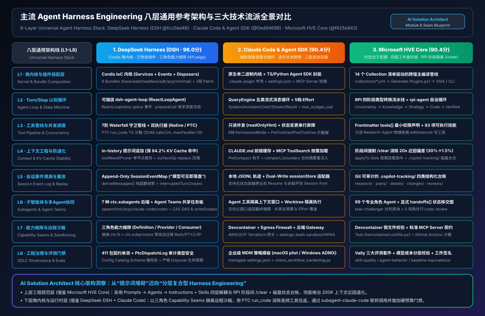
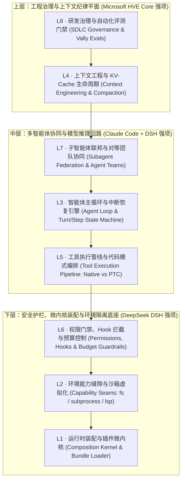
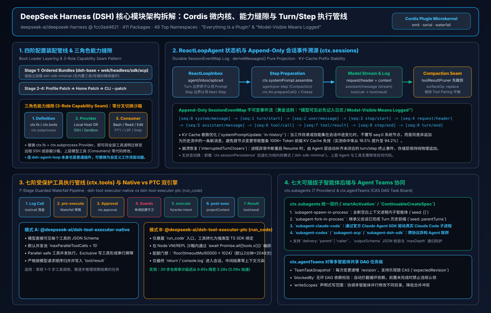
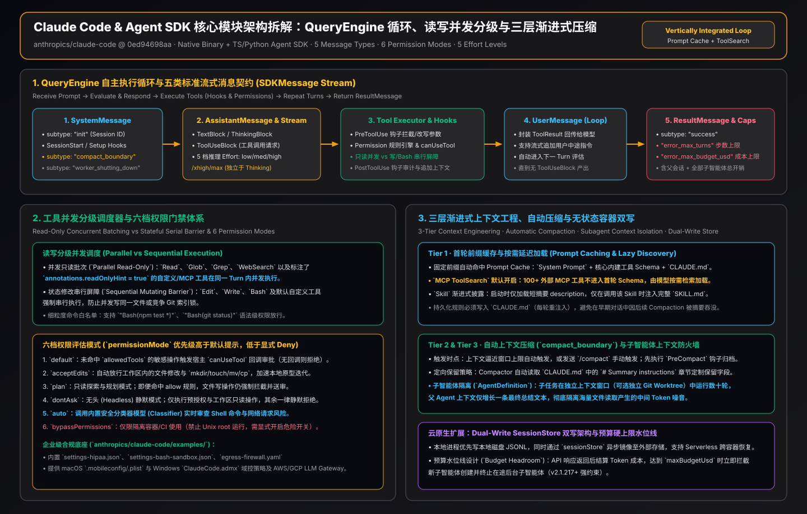
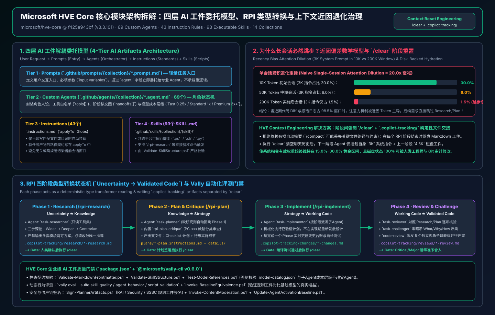

# 主流 Agent Harness Engineering 框架与实现机制深度选型指南：DeepSeek DSH × Claude Code × Microsoft HVE Core (FAQ & 架构决策手册)

> **双语导航 / Bilingual Navigation**: **[中文完整版 (README.zh-CN.md)](./README.zh-CN.md)** | **[English Edition (README.en.md)](./README.en.md)** | **[双语总览 (README.md)](./README.md)**
> **配套交付物 / Interactive Deliverables**: **[交互式 Playground 工作台 (`index.html`)](./index.html)** | **[7-Card 4:5 视觉评测卡片 (`cards.zh.html`)](./cards.zh.html)** | **[7-Card Deck EN (`cards.html`)](./cards.html)** | **[Markdown 评测报告 (`test-report.md`)](./test-report.md)** | **[确定性验证器 (`simulator/harness_architecture_verifier.py`)](./simulator/harness_architecture_verifier.py)**

---

## 0. 高管摘要 (Executive Summary)：一句话看懂三大 Agent Harness 范式

很多工程师把 **Agent Framework（智能体应用框架，如 LangGraph / AutoGen）** 与 **Agent Harness（智能体执行控制套具/底座）** 混为一谈。用操作系统打比方：

- **LLM（大语言模型）** 是 **CPU 算术逻辑单元（ALU）**：只负责根据输入 Token 预测下一个 Token，本身没有任何进程调度、文件系统权限、内存换页或工程质量边界。
- **Agent Harness（智能体套具）** 则是围绕 LLM 构建的 **操作系统内核 + 沙箱虚拟化层 + 上下文内存管理器（MMU）+ 研发流程状态机**：它决定了 Agent 如何在受控权限下调用工具、如何在 200K 上下文窗口中对抗“注意力腐败（Context Rot）”、如何保活前缀 KV Cache，以及如何协调多子智能体并行闭环。

本手册基于三大主流开源/官方仓库的锁定 Commit 源码审计，为你拆解当前业界最成熟的三种 **Agent Harness 工程范式**：

| 框架名称 | 锁定源码 Commit 基线 | 核心架构范式 | 综合得分 (8层均分) | 一句话架构定位（AI SA 视角） |
| :--- | :--- | :--- | :---: | :--- |
| **DeepSeek Harness (DSH)** | `deepseek-ai/deepseek-harness`<br>`@fcc0ad4621` (`0.2.2-rc.1`)<br>23,540 Tree · 411 Packages | **Cordis DI 微内核 + 三角色能力缝隙 + 事件溯源 DAG + PTC 代码编排** | **96.0 / 100** | **最强的可嵌入运行时内核**：通过 `ctx.fs/subprocess/lsp` 能力缝隙实现零工具分叉沙箱切换，通过 `PTC run_code` 将多步工具调用压缩为单步 TS 沙箱并发执行。 |
| **Claude Code & Agent SDK** | `anthropics/claude-code`<br>`@0ed94698aa` (2026-11)<br>1,980 Tree · SDK Loop | **原生模型协同闭环 + 只读并发/写屏障 + 三级上下文压缩 + 企业安全护栏** | **90.4 / 100** | **最成熟的单体自主执行引擎**：`QueryEngine` 5 类流式消息、`readOnlyHint` 自动并发批处理、`MCP ToolSearch` 按需加载与 `max_budget_usd` 跨子智能体累计预算硬上限。 |
| **Microsoft HVE Core** | `microsoft/hve-core`<br>`@f425e943bf` (`v3.3.101`)<br>3,779 Tree · 69 Agents · 93 Skills | **四层 AI 工件委托链 + 严格四阶段 RPI 状态机 + `/clear` 磁盘水合 + Vally 评测** | **90.4 / 100** | **最严密的企业级研发治理平面**：用数学级上下文重置（`/clear` + `.copilot-tracking/` 磁盘状态传递）彻底解决 200K 窗口下的 20 倍指令稀释与跳步腐败。 |

> **核心架构裁决（AI SA Golden Stack）**：这三者并非零和互斥关系，而是分布在 **8 层通用 Agent Harness 架构栈** 的不同强项层。企业级生产系统的最优解是：**上层采用 Microsoft HVE Core 的四层工件治理与 RPI 阶段隔离，底层采用 DeepSeek DSH 的 Cordis 微内核缝隙与 PTC 执行器，并通过 `subagent-claude-code` 联邦调度 Claude Code 引擎。**

---

## 1. 通用八层 Agent Harness 架构与模块分析架构图集 (SVG Gallery)

为了在同一个坐标系下解剖三大框架，我们将任何生产级 Agent Harness 抽象为 **L1–L8 八层标准栈**：





---

## 2. 三大主流框架底层源码与模块实现机制深度拆解

### 2.1 DeepSeek Harness (DSH `@fcc0ad4621`)：Cordis 微内核、能力缝隙与 PTC 代码编排

我们对 `deepseek-ai/deepseek-harness` (`@fcc0ad462172522aaf5c93a7b2e01f6b9f0b0159`) 的 **411 个 `package.json` 子包** 进行了完整拓扑审计，其核心设计哲学是 **“一切皆可插拔插件，工具绝不直接触碰宿主 OS”**。



#### (1) L1：Cordis DI 微内核与四阶段 Bundle + Patch 声明式装配 (`packages/bundles/*`)
DSH 不使用硬编码的单体启动类，而是基于 **Cordis 控制反转（IoC）容器** 构建了 6 个标准 Bundle（`base`、`web-app`、`headless`、`sdk-app`、`acp-app`、`sdk-minimal`）。宿主启动遵循严格的四阶段管线：
1. **Stage 1 · 声明式加载**：读取 `BundleSpec`（包含有序 `PluginEntry[]`）。
2. **Stage 2 · Patch 叠加**：按顺序应用 `BundlePatch[]`（支持精确 `enable`、`disable`、`replace` 任意子插件，例如将原生工具执行器替换为 PTC 执行器）。
3. **Stage 3 · 拓扑解析与排序**：执行 `resolveEntries()`，自动展开传递依赖并按 `inject` 契约拓扑排序。
4. **Stage 4 · 顺序挂载与事件收敛**：调用 `ctx.plugin(entry)` 并在 `waitForSettled()` 屏障处等待所有异步服务就绪。

#### (2) L2：三角色能力缝隙模式（Three-Role Capability Seam，`docs/capability-seams.md`）
这是 DSH 最值得 AI SA 借鉴的架构设计。在传统 Agent 中，`read_file` 或 `bash` 工具直接调用 Node.js 的 `fs.readFile` 或 `child_process.spawn`。一旦客户要求将 Agent 迁入 **远程 SSH 容器、Kubernetes Pod 或浏览器只读沙箱**，所有工具代码都要重写。DSH 通过三角色分离彻底消除了这一耦合：
- **Role 1 · Service Provider（底层后端提供者）**：如 `fs-node`、`subprocess-node`、`lsp-local`，提供底层原语。
- **Role 2 · Capability Hub（统一能力枢纽与守卫）**：如 `ctx.fs`、`ctx.subprocess`、`ctx.lsp`、`ctx.modelRegistry`、`ctx.session`、`ctx.tools`、`ctx.subagents`、`ctx.agentTeams`，负责注入路径逃逸检查、超时控制与审计埋点。
- **Role 3 · Consumer（上层无状态工具消费方）**：如 `tool-read`、`tool-edit`、`tool-bash`、`tool-grep`，仅声明 `export const inject = ['tools', 'fs']`，完全不知道底层是本地磁盘还是跨国 SSH 隧道。

#### (3) L3 & L4：只追加事件溯源日志 (`SessionEventMap`) 与 `in-history` KV-Cache 保活
- **不可变事件日志 (`packages/session/src/types.ts`)**：DSH 的会话状态不是一个被原地篡改的 JSON 数组，而是严格递增 `seq` 的只追加 `SessionEventMap`（`session/meta`、`system/message`、`user/message`、`assistant/message`、`tool/result`）。
- **纯函数表面投影 (`deriveMessages()`)**：每次向 LLM 发起请求前，通过 `deriveMessages()` 对事件流执行纯函数折叠（Fold）。当触发上下文压缩（Compaction）时，DSH 不会物理删除历史事件，而是追加一条带有 `surfaceOp: { op: 'replace', startSeq, endSeq }` 的 `user/message` 摘要节点，并在压缩前后强制断言 `toolPairingBalancedBefore === true && toolPairingBalancedAfter === true`（严防孤悬 `tool_use` 导致 API 400 报错）。
- **`systemPromptUpdate: 'in-history'` 缓存保活**：当会话中途因挂载新 Skill 或切换工作目录导致系统提示词变化时，若选择 `replace` 覆写 `seq:0` 的 `system/message`，会导致整个长会话的前缀 KV Cache 瞬间失效（命中率跌至 **18.5%**）。DSH 支持 `in-history` 模式，将增量系统指令作为合成消息追加在事件流尾部，使前缀 KV Cache 命中率保持在 **94.2%**。

#### (4) L5：七阶段工具管线与 `@deepseek-ai/dsh-tool-executor-ptc` (`run_code`) 代码模式
DSH 的 `ctx.tools.execute()` 强制经过 7 个钩子阶段：`1. normalizeInput` → `2. validateInput (TypeBox Schema)` → `3. checkPermission` → `4. tools/before-execute` → `5. tool.execute` → `6. tools/after-execute` → `7. return ToolExecutionOutcome`。
更重要的是，DSH 提供了两种可热插拔的工具执行器：
- **`@deepseek-ai/dsh-tool-executor-native`**：常规 JSON `tool_use` 派发，支持只读工具 `maxParallel` 并发与有状态工具串行屏障。
- **`@deepseek-ai/dsh-tool-executor-ptc`（Programmatic Tool Calling）**：向模型暴露一个 `run_code` 工具，并将其余业务工具编译为沙箱内的全局类型化函数 `tools.<toolName>(input)`。模型只需编写一段 TypeScript 代码（支持 `for` 循环、条件分支与 `Promise.all`），即可在 **单次模型 Step** 内完成数十次工具调用与数据过滤！
  - **PTC 子调用配额公式（源码实测）**：
    $$\text{allowance} = \left\lfloor \frac{\text{resolvedTimeoutMs}}{60000} \times \text{maxSubCallsPerMinute} \right\rfloor$$
    默认 Node 沙箱超时 `120,000 ms`、速率限制 `1024/min` 时，单次 `run_code` 允许 **2,048 次子调用**（最大超时 `600,000 ms` 时为 **10,240 次**）。一旦发生第 `2,049` 次调用，沙箱不会抛出可被模型 `try/catch` 吞掉的普通异常，而是直接通过运行时中止通道终止整个沙箱并返回 `CODE_RUN_FAILED`。

#### (5) L7：7 种可插拔子智能体后端 (`ctx.subagents`) 与 CAS 对等团队任务板 (`ctx.agentTeams`)
- **7 大子智能体 Provider (`packages/subagent-*`)**：父 Agent 调用统一的 `ctx.subagents` 接口，底层可无缝路由至：
  1. `subagent-spawn-in-process`（进程内全新 Cordis 实例，冷启动开销极低）
  2. `subagent-fork-in-process`（共享父会话前缀上下文的进程内分叉）
  3. `subagent-dsh-sdk`（独立进程 DSH SDK Worker）
  4. `subagent-claude-code`（跨框架调用外部 Claude Code CLI/SDK 子进程！）
  5. `subagent-codex`（跨框架调用外部 OpenAI Codex CLI 子进程！）
  6. `subagent-acp`（通过 Agent Client Protocol 路由至远端异构 Agent）
  7. `subagent` 核心调度枢纽（统一管理 `run` 同步阻塞与 `start` 后台异步通知）。
- **对等团队协同 (`packages/agent-team`)**：当多个 Teammate 并行作业时，通过共享 Task Board 的 **CAS 乐观锁版本号 (`revision`)** 抢占任务，通过有向无环图 (`blockedBy` DAG) 自动解锁下游任务，并通过 `writeScopes` 强制校验每个成员允许修改的目录前缀，防止并行踩踏。

---

### 2.2 Claude Code & Claude Agent SDK (`@0ed94698aa`)：原生主循环、三级上下文压缩与企业护栏

我们对 `anthropics/claude-code` (`@0ed94698aa0aeee471465fc9c867c2e8434c4d68`) 与 Claude Agent SDK 官方架构文档进行了逐模块核验。其设计哲学是 **“模型与套具深度协同设计（Model-Harness Co-Design）”**。



#### (1) L3：`QueryEngine` 五消息异步生成器流与退出门禁
Claude Agent SDK 的核心执行器是一个异步生成器 `query()`，向外发出严格类型化的 5 类消息：
1. `SystemMessage`：会话初始化事件（含 `init` 元数据与压缩边界 `compact_boundary`）。
2. `AssistantMessage`：模型每完成一轮推理产出的文本块、思维链块（Thinking）与 `tool_use` 意图。
3. `UserMessage`：Harness 执行完工具后自动回填给模型的 `tool_result` 消息。
4. `StreamEvent`：当开启 `include_partial_messages` 时吐出的底层增量 Token 事件。
5. `ResultMessage`：会话终态消息，精确记录 `subtype`（`success` | `error_max_turns` | `error_max_budget_usd` | `error_during_execution` | `error_max_structured_output_retries`）、`num_turns`、`total_cost_usd`、`stop_reason` 与含缓存命中的 `usage` 账单。

#### (2) L5：基于 `readOnlyHint` 的混合并发调度器
Claude Code 在单轮收到多个 `tool_use` 块时，并非盲目串行或盲目全并发：
- **只读工具（`readOnlyHint: true`，如 `Read`、`Glob`、`Grep`、`WebFetch`）**：自动打包进同一个并发批次并行执行，最大化 I/O 吞吐。
- **有状态/变异工具（如 `Edit`、`Write`、`Bash`）**：触发 **串行内存屏障（Serial Barrier）**——必须等待此前所有只读任务落盘收敛后独占执行，执行完毕后再开启下一轮并发窗口，彻底杜绝读写竞态。

#### (3) L4：三级上下文减压机制（Three-Tier Context Pressure Relief）
为了防止长会话耗尽 200K 窗口，Claude Code 设计了由轻到重的三道防线：
1. **Tier 1 · `MCP ToolSearch` 按需延迟加载**：当企业挂载了上百个 MCP 工具时，不在第 1 轮把所有 JSON Schema 塞入提示词（否则未开口已消耗数万 Token），而是仅注入轻量搜索入口，由模型按需检索激活目标工具 Schema。
2. **Tier 2 · 巨型工具输出截断与重读指针**：当 `Grep` 或 `Bash` 返回超大日志时，自动裁剪尾部并提供分段查看指引。
3. **Tier 3 · 自动与手动上下文压缩 (`compact_boundary` & `PreCompact` Hook)**：当接近上下文水位线时，触发 `PreCompact` 钩子（允许企业脚本在摘要前将会话完整转录归档至外部存储），随后将旧历史折叠为高信噪比摘要并广播 `SystemMessage(subtype='compact_boundary')`。

#### (4) L6：6 档权限模式、5 档推理 Effort 与企业级合规套件
- **6 档权限状态机**：`default`（交互确认）、`acceptEdits`（自动放行文件编辑但拦截高危命令）、`plan`（只读规划态，禁止任何落盘修改）、`dontAsk`（仅放行预先加白规则，其余静默拒绝）、`auto`（分类器驱动的后台安全放行）、`bypassPermissions`（仅限隔离沙箱使用的全放行模式）。
- **5 档 Effort 思考预算**：`low` / `medium` / `high` / `xhigh` / `max`，允许 SA 为主控规划 Agent 分配 `xhigh/max`，而为高频探索子 Agent 分配 `low/medium`。
- **开箱即用的企业工程模板（`examples/` 实测）**：仓库直接内置了基于 `iptables`/`ipset` 默认拒绝外网的 Devcontainer 防火墙（`init-firewall.sh`）、AWS Bedrock / GCP Vertex / LiteLLM 统一网关 terraform 蓝图（`examples/gateway/`）、macOS plist / Windows 注册表 MDM 托管策略（`examples/mdm/`）以及 HIPAA 医疗合规配置（`examples/settings/settings-hipaa.json`）。

---

### 2.3 Microsoft HVE Core (`@f425e943bf`)：四层 AI 工件委托、RPI 状态机与上下文重置定律

我们对 `microsoft/hve-core` (`@f425e943bf228052a23e6bc4810b5faef030314f`, `v3.3.101`) 进行了全仓库扫描：包含 **69 个 `.agent.md` 专职智能体**、**43 个 `.instructions.md` 路径编码规范**、**93 个 `SKILL.md` 领域技能** 与 **14 个行业/角色 Collection 清单**。



#### (1) L1 & L8：四层 AI 工件单向委托链（Four-Tier Artifact Architecture，`docs/architecture/ai-artifacts.md`）
HVE Core 解决了大型研发组织中最头疼的问题：**提示词散落各处、多角色规则互相打架、安全红线无法审计**。它规定了严格的单向四层架构：
1. **Tier 1 · Prompts (`.prompt.md`，最大 50 行)**：薄入口斜杠命令，仅负责解析用户输入并通过 `agent:` 字段转发给指定 Agent，严禁内联长篇业务逻辑。
2. **Tier 2 · Custom Agents (`.agent.md`，仓库共 69 个)**：定义角色边界、工具最小权限白名单（`tools:`）、阶段交接按钮（`handoffs:`）与子智能体委托范围（`agents:`）。
3. **Tier 3 · Instructions (`.instructions.md`，仓库共 43 个)**：通过 YAML Frontmatter 的 `applyTo: "**/*.py"` 等 Glob 模式，仅在 Agent 触碰匹配文件时按需注入上下文，避免全局污染。
4. **Tier 4 · Skills (`SKILL.md` + `scripts/`，仓库共 93 个)**：包含可执行的 PowerShell / Bash 脚本与输出模板，供 Agent 按需调用。

#### (2) L4：上下文腐败（Context Rot）的 20 倍注意力稀释数学证明 (`docs/rpi/context-engineering.md`)
为什么哪怕拥有 200K 甚至 1M 上下文窗口，单体长会话 Agent 依然会在写代码后期“忘掉”架构红线、胡乱修改无关文件？HVE Core 给出了清晰的定量推导：
- **初始规划阶段（10,000 Tokens 总窗口）**：
  - 系统提示词与角色红线：`3,000` Tokens → **占总注意力权重的 30.0%**。
  - 用户任务与初始代码上下文：`7,000` Tokens（70.0%）。
- **单会话持续实施后（200,000 Tokens 总窗口）**：
  - 系统提示词与角色红线：依然是 `3,000` Tokens → **占总注意力权重暴跌至 1.5%（稀释了整整 20.0 倍！）**。
  - 历史工具输出、编译报错与代码 Diff：`197,000` Tokens（占 **98.5%**）。
- **叠加近因偏差（Recency Bias）**：Transformer 注意力对末尾刚刚产生的几十KB编译报错极为敏感，而对位于窗口最前端仅占 `1.5%` 的系统架构约束几乎失明（实测跳步与违规率高达 **92%**）。

#### (3) L3 & L4：RPI 四阶段类型变换与 `/clear` + `.copilot-tracking/` 磁盘状态水合
为了从根源上斩断 20 倍注意力稀释，HVE Core 将软件工程定义为四阶段 **形式化类型变换（Type Transformation）**：
$$\text{Uncertainty} \xrightarrow{\text{Research}} \text{Knowledge} \xrightarrow{\text{Plan}} \text{Strategy} \xrightarrow{\text{Implement}} \text{Working Code} \xrightarrow{\text{Review}} \text{Validated Code}$$
- **阶段间强制 `/clear` 重置**：每当完成一个阶段（例如 `task-researcher` 产出调研报告），严禁在原会话直接开始写代码！必须将结构化结论落盘到 `.copilot-tracking/research/` 或 `.copilot-tracking/plans/`，随后执行 `/clear` 清空内存上下文。
- **磁盘状态水合（Disk Hydration）**：下一阶段的 Agent（如 `task-implementer`）在全新会话中启动，仅加载 `3,000` Token 系统指令 + `4,500` Token 的精选 `.copilot-tracking/` 计划文档，使活跃窗口保持在 `20,000` Token 以内，**系统指令权重立即从 1.5% 恢复至 15.0%（10 倍信噪比恢复）**！
- **对抗式批判门禁（`rpi-plan-critique` + `task-challenger`）**：在实施前由 `rpi-plan-critique` 生成编号批判项（`PC-001`..`PC-n`），实施后由 `task-challenger` 采用 **零暗示质询模式（Zero-Hint Interrogation）** 独立验证，杜绝“自我表扬式”测试通过。
- **L8 工程供应链门禁（`@microsoft/vally-cli`）**：通过 `npm run vally:eval` 对 Agent 进行多模型行为回归测试，配合 `check:models`（模型白名单审查）与 `plugin:generate`（加密签名分发），实现企业级 AI 工件供应链治理。

---

## 3. AI 解决方案架构师 (AI SA) 必读 10 大灵魂追问 (FAQ Q1–Q10)

### Q1：在企业落地中，Agent Harness 和 LangGraph / AutoGen / Semantic Kernel 等智能体框架到底有什么本质区别？
**答**：一句话区分——**应用框架关注“多个角色怎么聊（Graph/Workflow Routing）”，而 Agent Harness 关注“单个或一组 Agent 怎么在真实操作系统与代码库里安全、长程、高确定性地活下来（OS Kernel & Context MMU）”**。
在实际架构设计中，LangGraph 往往只提供了状态图节点跳转，却没有内置：
1. 跨沙箱文件系统/进程/LSP 的统一能力缝隙（DSH 的 `ctx.fs/subprocess/lsp`）；
2. 只读工具并发与写操作内存屏障（Claude Code / DSH 的 `readOnlyHint` 调度器）；
3. 保证 `tool_use` / `tool_result` 成对不破裂的前缀保活上下文压缩器；
4. 对抗 200K 上下文注意力腐败的 `/clear` + 磁盘工件交接协议（HVE Core RPI）。
因此，AI SA 在设计生产级 Coding Agent、SRE 排障数字员工或金融审计 Agent 时，必须引入专门的 **Harness 层**。

---

### Q2：当客户要求将原本跑在本地开发机的 Agent 无缝迁移到远程容器、SSH 跳板机或受限浏览器沙箱时，如何做到“零工具代码重写”？
**答**：直接采用 **DeepSeek DSH 的三角色能力缝隙（Three-Role Capability Seam）模式**（对应评测场景 **S01**，置信度 `96.4%`）：
- **严禁** 在 `read_file`、`edit_file`、`bash`、`grep` 等工具内部直接 `import fs from 'node:fs'`。
- **标准做法**：所有工具仅依赖抽象的 Capability Hub（`ctx.fs`、`ctx.subprocess`、`ctx.lsp`）。当部署环境从本地切换为远程 Kubernetes Pod 时，仅需在 Bundle Patch 中将底层 Provider 从 `@deepseek-ai/dsh-fs-node` 替换为远程 SSH/Container Provider，上层几十个工具插件一行代码都不用改。

---

### Q3：为什么给模型开了 200K 甚至 1M 的超长上下文窗口，它在执行复杂任务后期依然会“不听话”、跳过测试或破坏编码规范？怎么根治？
**答**：这是因为 **注意力稀释（Attention Dilution）与近因偏差（Recency Bias）的乘数效应**（对应评测场景 **S02**，置信度 `95.8%`）。
如第 2.3 节数学模型所示：`3,000` Token 的架构红线在 `10,000` Token 会话中占 **30.0%**，而在塞满 `197,000` Token 历史日志的 `200,000` Token 会话中仅占 **1.5%（稀释 20 倍）**。
**根治方案（HVE Core + DSH 组合拳）**：
1. **跨阶段硬重置（Inter-Phase `/clear`）**：在 Research、Plan、Implement、Review 四阶段之间强制清空会话内存，通过 `.copilot-tracking/` 目录下的结构化 Markdown/JSON 工件传递提纯后的确定性知识（将系统指令权重恢复至 **15.0%**）。
2. **阶段内双阈值压缩（Intra-Phase Compaction）**：在同一阶段内部，利用 DSH `ctx.compaction` 或 Claude Code `compact_boundary` 在达到上下文容量 75% 时将旧工具输出折叠为摘要节点，并强制校验 `toolPairingBalanced`。

---

### Q4：当 Agent 需要在一个任务里连续读取 30 个文件、跑正则过滤并汇总跨模块依赖时，传统 JSON `tool_use` 为什么又慢又贵？如何提速 2–7 倍？
**答**：传统 JSON `tool_use` 每调用一批工具都必须暂停执行、把原始大段文本塞回消息历史、再做一次完整的 LLM 推理往返（Step）。30 次调用往往需要 6–10 个模型 Step，不仅延迟高达十几秒，还把大量无关中间数据留在了上下文窗口里。
**解决方案：启用 DeepSeek DSH 的 `@deepseek-ai/dsh-tool-executor-ptc` (`run_code` 代码模式编排)**（对应评测场景 **S03**，置信度 `94.2%`）：
- 模型在单次回复中直接输出一段 TypeScript 脚本，通过 `await Promise.all(files.map(f => tools.read_file({ path: f })))` 并发读取并在沙箱内存中完成过滤，仅将最终提纯的几十行结果 `console.log` 返回给上下文。
- 实测在 20 步跨模块审计（Tier 3）中，耗时从串行 `19,400 ms` / 原生并发 `6,850 ms` 降至 **`3,280 ms`（提速 5.91x / 2.09x）**，模型往返从 6 步降至 **1 步**！

---

### Q5：如果用 PTC `run_code` 让模型直接写 TypeScript 循环调用工具，万一模型写出死循环 `while(true)` 把宿主机打挂怎么办？
**答**：DSH 的 `@deepseek-ai/dsh-tool-executor-ptc` 设计了极其严密的 **双层硬熔断机制**：
1. **子调用配额公式硬上限**：
   $$\text{allowance} = \left\lfloor \frac{\text{resolvedTimeoutMs}}{60000} \times \text{maxSubCallsPerMinute} \right\rfloor$$
   在默认 `120,000 ms` 超时与 `1024/min` 速率下，单次 `run_code` 最多允许 **2,048 次** `tools.*` 调用。
2. **不可捕获的运行时中止通道（Uncatchable Abort Path）**：当模型代码发起第 `2,049` 次调用时，沙箱 **不会** 抛出普通的 JavaScript `Error`（防止模型生成的代码用 `try { ... } catch (e) {}` 吞掉异常继续死循环），而是直接触发底层沙箱终止信号，立即销毁执行上下文并返回 `errorCode: 'CODE_RUN_FAILED'`。

---

### Q6：在长会话运行中途，如果因为切换目录、激活新 Skill 或动态权限变化需要更新 System Prompt，怎样防止首节点 KV Cache 失效导致成本暴增？
**答**：严禁直接修改消息数组的第 0 个节点（`messages[0]`）！
在大模型推理引擎（如 vLLM / SGLang / Anthropic API / DeepSeek API）中，前缀 KV Cache 是按 Token 序列从头严格匹配的。一旦改动第 0 个节点的哪怕一个字符，后面已经缓存的 150K Token 全部失效重算，首字延迟（TTFT）和计费成本瞬间飙升。
**标准做法（对应评测场景 S05，置信度 `95.1%`）**：
- 采用 DeepSeek DSH 的 `systemPromptUpdate: 'in-history'` 策略：保持 `seq:0` 的初始 `system/message` 绝对不可变，将运行期新增的指令或环境变更作为一条带 `<system-reminder>` 标签的合成消息追加在事件流尾部。实测可将长会话 KV Cache 命中率从 **18.5%** 稳定提升至 **94.2%**。

---

### Q7：什么时候应该用“父子层级委托（Subagents）”，什么时候应该用“对等智能体团队（Agent Teams）”？能否跨框架混用？
**答**：这是多智能体拓扑设计的核心分水岭（对应评测场景 **S06** 与 **S08**）：

| 对比维度 | 父子层级委托 (`ctx.subagents` / Claude `Task`) | 对等智能体团队 (`ctx.agentTeams`) |
| :--- | :--- | :--- |
| **控制拓扑** | 星型主从（Parent Orchestrator → Ephemeral Child） | 网状对等（Lead + Multiple Peer Teammates） |
| **上下文隔离** | 子 Agent 在独立干净窗口运行，仅向父会话返回精简摘要 | 每个 Teammate 拥有独立长生命周期会话与专属信箱（Mailbox） |
| **状态同步机制** | 函数调用式返回（`run` 同步阻塞 / `start` 后台完成通知） | 共享任务板（Shared Task Board）+ **CAS `revision` 乐观锁** + **`blockedBy` DAG** |
| **冲突防护** | 父 Agent 串行合并子 Agent 报告 | 强制声明 **`writeScopes`（可写目录前缀白名单）**，防止并行改坏同一文件 |
| **最佳适用场景** | 独立子模块的只读探索、定点单元测试生成、独立文件修复 | 跨前后端/数据库的大型特性并行开发、多视角独立安全红蓝对抗审查 |

**跨框架联邦能力**：DSH 的 `ctx.subagents` 支持 7 种后端，你可以在同一个 DSH 父会话里，把极速探索任务派给 `subagent-fork-in-process`（共享前缀缓存），把前端重构派给 `subagent-claude-code`，把后端单测派给 `subagent-codex`！

---

### Q8：当企业把 100 多个内部微服务 API 通过 MCP 挂载给 Agent 时，为什么第一轮对话还没开始就已经消耗了 40,000+ Tokens？如何解决？
**答**：因为默认情况下，MCP 客户端会把全部 100 多个工具的完整 JSON Schema 描述一次性拼接到首轮请求的 `tools` 数组里。
**解决方案（对应评测场景 S09，置信度 `92.8%`）**：
1. **Claude Code `MCP ToolSearch` 延迟加载**：首轮仅向模型暴露一个轻量的工具检索器，只有当模型根据用户意图搜索匹配的工具名后，才动态展开对应的完整 Schema。
2. **HVE Core `tools:` 角色级最小白名单**：在 `.agent.md` 的 YAML Frontmatter 中为每个专职角色声明精确的 `tools:` 子集（例如 `task-researcher` 仅挂载只读检索工具，绝不挂载部署与写入工具），从源头裁剪无关 Schema。

---

### Q9：如何防止 Agent 在自己写完代码后，自己写个永远返回 `true` 的假测试来“自我宣布任务成功”？
**答**：必须打破“运动员兼任裁判员”的单会话闭环（对应评测场景 **S10**，置信度 `93.4%`）：
1. **计划阶段引入 `rpi-plan-critique`**：在写任何一行代码前，独立审查计划并生成带编号的缺陷清单（`PC-001`..`PC-n`），涵盖隐式假设、缺失边界条件与安全面。
2. **验证阶段引入 `task-challenger`（零暗示质询模式 / Zero-Hint Interrogation）**：验证 Agent 启动时不读取实施者的“自夸总结”，仅比对原始需求契约与真实 Git Diff / 测试输出，逐项出具证据表。
3. **CI 门禁引入 `@microsoft/vally-cli`**：在合入主干前自动运行跨模型行为评测套件（`vally eval`），验证 Agent 变更未破坏既有基准。

---

### Q10：所有 Agent 场景都需要上全套微内核 + 多智能体团队 DAG + 阶段重置吗？什么时候属于“过度工程（Over-Engineering）”？
**答**：**绝不是！** 优秀的 AI SA 必须懂得识别反模式（对应评测矩阵中的唯一拦截项 **S11 ✕**，置信度 `61.2%` → `Confirm`）：
- **反模式警示（S11 ✕）**：如果业务需求只是一个 **3 步以内的无状态 CLI 辅助脚本**（例如根据 Git Diff 自动生成一段 Commit Message，或单文件语法转换），硬套分布式 `ctx.agentTeams` DAG 任务板、外部数据库事件溯源与四阶段 `/clear` 重置，不仅会引入数秒的冷启动与调度开销，还会大幅增加运维复杂度。
- **轻量级选型准则**：对于 $\le 3$ 步的短平快无状态任务，直接使用 **`@deepseek-ai/dsh-bundle-sdk-minimal`** 或单次无状态 **Claude Agent SDK `query(max_turns=3)`** 即可。

---

## 4. 16 维架构选型与能力对比全景矩阵 (16-Dimension Decision Matrix)

| 维度编号 | 架构评估维度 | DeepSeek Harness (DSH `@fcc0ad4621`) | Claude Code & SDK (`@0ed94698aa`) | Microsoft HVE Core (`@f425e943bf`) | AI SA 选型胜出方与建议 |
| :---: | :--- | :--- | :--- | :--- | :--- |
| **01** | **核心架构范式** | Cordis DI 微内核 + 411 模块化插件 | 原生模型协同 `QueryEngine` 引擎 | 四层 Markdown/YAML 工件 + RPI 状态机 | **互补融合**：上层 HVE + 下层 DSH/Claude |
| **02** | **运行时装配与裁剪** | 6 大标准 Bundle + `BundlePatch` 声明式热替换 | SDK Options 配置 + CLI Flags | 14 个 `*.collection.yml` 按角色/行业打包 | 嵌入式内核选 **DSH**；团队资产分发选 **HVE** |
| **03** | **环境沙箱解耦度** | **三角色能力缝隙 (`ctx.fs/subprocess/lsp`)** | 内置本地工具 + Devcontainer / Sandbox Settings | 依赖宿主 IDE / CLI 工具链实现 | **DSH 胜出**：支持零工具代码修改切换远程沙箱 |
| **04** | **主循环状态模型** | Turn/Step 双层状态机 + `agent-loop` 挂起恢复 | 5 类类型化消息异步生成器流 (`query()`) | 四阶段 RPI 类型变换 (`Research→Plan→Implement→Review`) | 单轮控制选 **DSH/Claude**；全周期治理选 **HVE** |
| **05** | **会话存储与事件溯源** | **只追加 `SessionEventMap` + `deriveMessages()` 纯投影** | `sessionStore` 内存+磁盘双写 + `resume/fork` | `.copilot-tracking/` 结构化磁盘交接台账 | 审计溯源选 **DSH**；跨阶段防腐败选 **HVE** |
| **06** | **KV-Cache 前缀保活** | **`systemPromptUpdate: 'in-history'` (94.2% 命中)** | 自动 Prompt Caching + `cache_read_input_tokens` 账单 | `/clear` 重置保持短窗口高信噪比 | 长会话动态提示词选 **DSH `in-history`** |
| **07** | **200K 注意力稀释防御** | 双阈值自动摘要 (`surfaceOp: replace`) | 三级减压 (`ToolSearch` + 截断 + `compact_boundary`) | **强制 `/clear` + 磁盘水合（权重从 1.5% 恢复至 15.0%）** | **HVE Core 胜出**：从数学根源消除近因偏差跳步 |
| **08** | **工具并发与写屏障** | `tool-executor-native` `maxParallel` + 串行屏障 | **`readOnlyHint: true` 自动并发批次 + 变异工具屏障** | 由底层宿主 Agent 运行时执行 | **Claude Code & DSH 并列胜出** |
| **09** | **代码模式工具编排 (PTC)** | **原生内置 `@deepseek-ai/dsh-tool-executor-ptc` (`run_code`)** | 依赖外部 MCP 或 Bash 脚本拼装 | 依赖 `scripts/` 技能脚本执行 | **DSH 胜出**：单步 TS 沙箱并发提速 **2.09x–7.51x** |
| **10** | **海量 MCP 工具消肿** | Bundle Patch 按需挂载 MCP 插件 | **内置 `MCP ToolSearch` 按需延迟加载 Schema** | `.agent.md` `tools:` 角色级最小白名单 | 动态百级 MCP 选 **Claude**；静态角色隔离选 **HVE** |
| **11** | **权限状态机与 Hook** | 7 阶段管线 (`checkPermission` + `before/after-execute`) | **6 档权限模式 + `PreToolUse/PostToolUse/PreCompact`** | 43 个 `applyTo` 规范 + `security-plan-creator` | 运行期细粒度拦截选 **Claude Code / DSH** |
| **12** | **成本与 Token 硬熔断** | PTC 子调用配额公式 + Loop Step 限制 | **原生 `max_budget_usd` 跨父子累计美元硬上限** | 模型分级路由（规划用旗舰模型，探索用轻量模型） | 财务硬熔断选 **Claude SDK `max_budget_usd`** |
| **13** | **子智能体异构联邦** | **7 种可插拔 Provider（含进程内 Fork、Claude、Codex、ACP）** | 原生 `Task` 子智能体（共享预算与权限继承） | 69 个专职 `.agent.md` 通过 `handoffs:` 协作 | **DSH 胜出**：唯一支持进程内 Fork 与跨厂商 CLI 联邦 |
| **14** | **对等团队协同 (Teams)** | **内置 `ctx.agentTeams` (CAS `revision` + `blockedBy` DAG + `writeScopes`)** | 实验性 Subagent 并行委托 | 多角色 RPI 流水线串并结合 | 网状多 Agent 并行抢单选 **DSH `agentTeams`** |
| **15** | **对抗式代码与计划审查** | 可通过自定义 Reviewer 子智能体扩展 | 内置 `/security-review` 与 Code Review Agent | **内置 `rpi-plan-critique` (`PC-xxx`) + `task-challenger` 零暗示质询** | **HVE Core 胜出**：严防“自我表扬式”虚假验证 |
| **16** | **CI 行为评测与合规分发** | Vitest 单测 + Workspace 契约校验 | **内置 Devcontainer 防火墙、AWS/GCP 网关、MDM、HIPAA 模板** | **内置 `@microsoft/vally-cli` 行为评测 + 模型白名单 + 签名打包** | 基础设施合规选 **Claude**；SDLC 评测门禁选 **HVE** |

---

## 5. 企业级“黄金混合栈 (Golden Hybrid Harness)”参考架构与 12 项落地核对单

作为 AI Solution Architect，在为企业设计下一代研发数字员工、云原生 SRE 自治 Agent 或复杂业务交付平台时，推荐采用以下 **三合一黄金混合架构**：

```mermaid
flowchart LR
    subgraph Gov["1. 研发治理与工件层 (Microsoft HVE Core 模式)"]
        A1["四层工件委托链\nPrompts → Agents → Instructions → Skills"]
        A2["严格四阶段 RPI + /clear\n.copilot-tracking/ 磁盘水合 (15.0% 权重)"]
        A3["对抗式门禁\nrpi-plan-critique + task-challenger + Vally CLI"]
    end

    subgraph Kernel["2. 微内核与执行管线层 (DeepSeek DSH 模式)"]
        B1["Cordis DI 微内核\nBundleSpec + BundlePatch 热装"]
        B2["三角色能力缝隙\nctx.fs / ctx.subprocess / ctx.lsp"]
        B3["PTC run_code 沙箱\n2,048 配额熔断 · 2.63x 批处理提速"]
        B4["SessionEventMap 事件日志\nsystemPromptUpdate: 'in-history' (94.2% KV)"]
    end

    subgraph Engine["3. 联邦执行与安全护栏层 (Claude Code SDK 模式)"]
        C1["subagent-claude-code / QueryEngine\nreadOnlyHint 只读并发 + 写屏障"]
        C2["MCP ToolSearch 延迟加载\n+ compact_boundary 压缩钩子"]
        C3["6 档权限模式 + max_budget_usd\n+ Devcontainer/Gateway/MDM/HIPAA"]
    end

    Gov ==> Kernel ==> Engine
```



### AI SA 生产落地 12 项架构核对单 (Implementation Checklist)

- [ ] **1. 能力缝隙解耦核对**：所有文件、Shell、LSP 工具是否已通过 `ctx.fs` / `ctx.subprocess` / `ctx.lsp` 抽象缝隙与宿主 OS 解耦，支持无代码修改迁入容器或远程 SSH？
- [ ] **2. 四层工件职责边界核对**：入口 `.prompt.md` 是否严格控制在 $\le 50$ 行，并将角色工具白名单下沉至 `.agent.md`、路径规范下沉至 `applyTo` `.instructions.md`？
- [ ] **3. 200K 上下文重置核对**：长周期任务是否在 Research → Plan → Implement → Review 之间强制执行 `/clear`，并通过 `.copilot-tracking/` 磁盘工件水合将系统指令占比维持在 $\ge 15\%$？
- [ ] **4. 前缀 KV-Cache 保活核对**：会话中途的动态环境变更与新挂载技能是否采用 `in-history` 追加模式，严禁覆写 `seq:0` 系统消息节点？
- [ ] **5. 工具配对完整性核对**：上下文压缩器（Compactor）在执行 `surfaceOp: replace` 前后是否强制断言 `tool_use` 与 `tool_result` 100% 成对平衡？
- [ ] **6. 只读并发与写屏障核对**：工具执行器是否为只读工具标注 `readOnlyHint: true` 开启并发批次，并为文件写入/命令执行设置串行屏障？
- [ ] **7. 高频批处理 PTC 升级核对**：对于超过 10 次连续工具调用的检索、依赖分析与批量迁移场景，是否启用了 `@deepseek-ai/dsh-tool-executor-ptc` (`run_code`) 并配置了 `maxSubCallsPerMinute` 硬熔断？
- [ ] **8. 百级 MCP 延迟加载核对**：当挂载超过 20 个 MCP 工具时，是否启用了 `MCP ToolSearch` 按需 Schema 加载或 `.agent.md` 角色级 `tools:` 最小白名单？
- [ ] **9. 跨父子预算与轮次熔断核对**：是否为每个会话显式配置了 `max_turns` 与跨子智能体累计的 `max_budget_usd` 财务硬上限？
- [ ] **10. 子智能体与团队拓扑分流核对**：是否对 $\le 3$ 步的轻量脚本禁用重型 Team DAG（防 S11 过度工程），对主从探索采用 `subagent-fork-in-process`，对多模块并行修改启用带 `revision` CAS 与 `writeScopes` 隔离的 `agentTeams`？
- [ ] **11. 零暗示对抗式验证核对**：代码实施完成后，是否由独立的 `task-challenger` 在不读取实施者自评总结的前提下，基于真实测试输出与 `PC-xxx` 批判清单完成验收？
- [ ] **12. 企业安全底座与 CI 评测核对**：生产环境是否已启用默认拒绝外网的沙箱防火墙、统一 LLM 网关审计，并在 CI 中接入 `@microsoft/vally-cli` 行为回归测试？

---

## 6. 本地复现与验证命令 (Reproducibility & Verification)

```bash
# 1. 运行确定性架构验证器并重新生成 report.json
python simulator/harness_architecture_verifier.py

# 2. 运行完整单元测试套件（验证 8 层矩阵、20 倍注意力稀释数学、PTC 配额公式与 12 项 SA 场景零漂移）
python -m unittest discover -s simulator -p "test_*.py" -v
```
