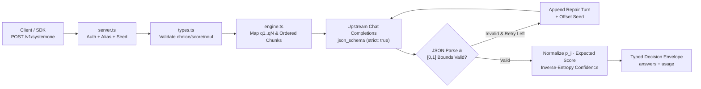

# LocalJev Architecture Audit: Typed Decision Bridge, Probability Semantics & Calibration Boundaries

> 🌐 **Language / 语言切换**: **[🇬🇧 English (README.en.md)](./README.en.md)** | **[🇨🇳 中文完整版 (README.md)](./README.md)**  
> **Audit Date**: `2026-09-27` · **Pinned Upstream**: `githubnext/localjev@3f23e36e1a3bff46c7e83e8e3781d3512bc82021`  
> **Evidence & Review**: [`evidence.json`](evidence.json) · [`review.md`](review.md)

---

## 1. Solution Architect Executive Summary

**What Enterprise AI Solution Architects should adopt from `LocalJev` is its *typed decision contract*, not the illusion that verbalized JSON numbers equal calibrated model probabilities.**

`LocalJev` is a lightweight TypeScript/Bun adapter (`5` source files) that translates Jev-style System-One decision calls (`POST /v1/systemone`: `state + questions → answers + usage`) into OpenAI-compatible Chat Completions (`response_format: json_schema`, `strict: true`).

### Four Critical Architectural Distinctions for SAs

| Architectural Dimension | What `LocalJev` Actually Does | SA Production Guardrail |
|---|---|---|
| **1. Wire Compatibility vs. Runtime Equivalence** | Accepts Jev-style `choice` (`2–128` labels), `score` (`2–10` levels), and `noul` (`[0, 1]` scalar) shapes over `/v1/systemone` | Caps `choice` at `128` (vs. TypeSafe's `255`) and chunks multi-question prompts sequentially — adding questions increases latency linearly rather than running in single-forward-pass constant time |
| **2. Verbalized JSON Floats vs. Token Logprobs** | Reads numeric scalars/arrays generated inside JSON text, validates `[0, 1]` bounds, and normalizes $p_i = x_i / \sum x_j$ | **Normalization $\neq$ Calibration.** Unlike `OpenJev` (`DiffusionGemma` reading constrained slot logprobs), verbalized probabilities require independent reliability-diagram / ECE calibration before gating automated actions |
| **3. Normalized Inverse Entropy (`confidence`) vs. Accuracy** | Computes $H(p) = -\sum p_i \ln p_i$ and $\text{confidence} = \text{clamp}(1 - H(p)/\ln K, 0, 1)$ | Measures distribution sharpness (`[0.5, 0.5, 0]` yields `0.369`, one-hot yields `1.0`), **not** empirical probability of correctness |
| **4. Adapter + Runner Coupling** | Routes all model aliases (`localjev-0.2`, `localjev-latest`, `jev-latest`, `jev-preview`) to one configured `LOCALJEV_UPSTREAM_MODEL` | Never extrapolate small-sample adapter benchmarks as universal foundation-model rankings |

---

## 2. Request Pipeline & Contract Architecture

| Source File | Verified Responsibility |
|---|---|
| `src/index.ts` | Entrypoint initializing configuration, `Engine`, and `Bun.serve` HTTP listener |
| `src/config.ts` | Environment binding, upstream `/v1` base URL, concurrency/chunk limits, and model alias mapping |
| `src/types.ts` | Deterministic request schema validation (`state`, `model`, `questions`, `choice`/`score`/`noul` bounds) |
| `src/server.ts` | Bearer token check, deterministic hash seed derivation, error envelopes, and `x-request-id` headers |
| `src/engine.ts` | Internal `q1..qN` remapping, semaphore admission, strict JSON Schema generation, bounded repair retries, and probability/entropy math |

---

## 3. Enterprise SA Adoption Verdict

- **✅ Recommended Pattern**: Wrap high-frequency classification, triage, and policy-routing steps behind a **System-One typed contract (`choice` / `score` / `noul`)** so downstream microservices never parse freeform prose.
- **⚠️ Production Prerequisite**: When driving automated execution (`Act automatically` vs. `Confirm` vs. `Escalate to human`), pair typed routing contracts with **forward calibration harnesses** (ECE, Brier score, and option-order reversal checks) or logprob-backed engines rather than trusting raw verbalized floats.

👉 For the full line-by-line source audit, edge-case math proofs, and upstream benchmark critique, see the **[Chinese Complete Report (`README.md`)](./README.md)**, **[`evidence.json`](evidence.json)**, and **[`review.md`](review.md)**.

[Back to Research Index (EN)](../index.en.md) · [中文索引](../index.md) · [Repository Home](../../../README.en.md)
