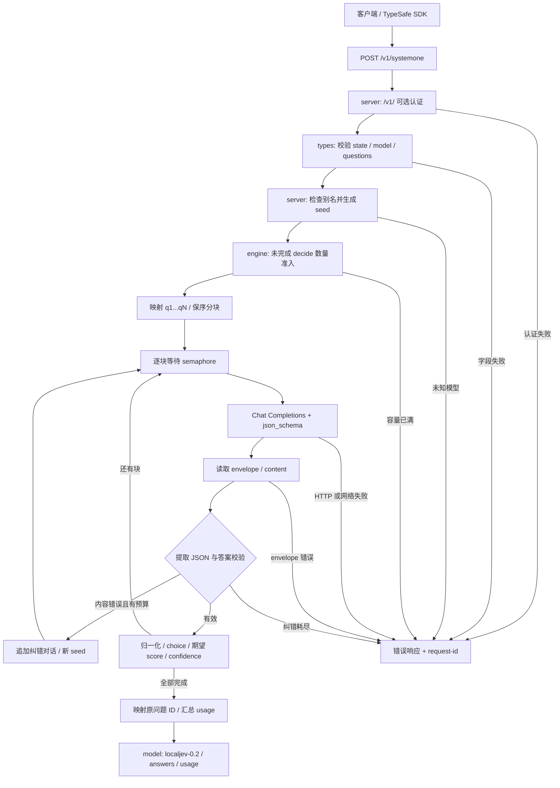

# LocalJev 源码研究：类型化决策桥、概率语义与评测边界

> 研究日期：2026-09-27；来源：**githubnext/localjev / LocalJev contributors**。  
> 固定 commit：`3f23e36e1a3bff46c7e83e8e3781d3512bc82021`；真实 tree：`95c4a7409e1f78ef036594a71c1b83d3fd380344`。  
> 方法：源码、测试意图、评测脚本及已提交汇总结果的静态阅读；本研究没有安装或运行 LocalJev、启动推理、下载模型/数据集、执行上游测试/评测或调用付费模型。  
> 归档：私有 GitHub；**本次未同步飞书**。这是 AI 辅助原创分析，不是人工认证、漏洞审计、法律意见或模型排名。见[证据台账](evidence.json)与[独立 AI 复核](review.md)。

## 1. 结论先行

**LocalJev 值得借鉴的是“把模型判断压缩成可校验的软件合同”，不是把普通生成模型变成了 Jev。** 它用 TypeScript/Bun 将 Jev 风格的 `POST /v1/systemone` 转成 OpenAI-compatible Chat Completions；概率来自模型生成的 JSON 数字，不是读取标签 logits。实现再校验、归一化、求期望分数与逆熵 confidence。[S1][S4][S5][S6]

关键区分有四个：**协议形状兼容不等于完整 API 行为兼容；归一化不等于校准；confidence 不等于预测正确概率；模型 + runner + LocalJev 的结果不等于孤立模型架构排名。** 例如 LocalJev 的 choice 上限为 128，而当期 TypeSafe 文档是 255；“任意 SDK 无改动完全兼容”不能从别名和响应形状推出。[S3][S4][W2]

上游 2026-09-18 小样本评测让 Gemma 4 26B-A4B 和 Qwen3.6 成为值得后续筛选的候选，但没有证明生产可用或可靠领先。另一项重要时效修正是：截至本次采集，OpenJev 已有进程内 MLX structured-read 实现，所引用的 vLLM 扩展 PR 也已合并；不能照抄 LocalJev 9 月 18 日 README 的旧状态。[S14][S15][O2][O3][W8]

全文使用四类标签：**源码事实**是固定文件可定位行为；**作者报告**是上游文档或运行工件所述，未独立重测；**研究推断**是由实现推导的解释与建议；**未验证**是缺乏运行、独立数据或稳定版本证据的部分。公式示例是数学推导，不是调用模型所得。

## 2. 定位、同类关系与非目标

| 对象 | 合同与概率来源 | 不应混同的部分 |
|---|---|---|
| TypeSafe 的 Jev | 厂商文档描述的 System One 模型；`state + questions → answers + usage`，支持 choice/score/noul，并声称决策专用训练、不生成文本后再解析。[W1][W2] | 本研究未取得其生产模型内部实现；不把厂商校准/速度宣称转移给 LocalJev。 |
| LocalJev | 单一配置模型的协议适配器；生成概率标量/数组，解析并校验，再构造类型化结果。[S2][S5][S6] | 不是 Jev 权重、训练算法、Agent 编排框架或独立模型服务器；不提供工具执行、记忆、规划或决策正确性保证。 |
| OpenJev 的 DiffusionGemma 路径 | 在固定答案槽读取标签 logprobs，再在标签集合上归一化；vLLM 请求带 seeded canvas/read-only 扩展，MLX 路径直接调用 decoder logits。[O1][O2][O3] | 不是模型“口述概率”；但直接 logits 也不自动等于业务校准。默认单步 read 还可能受重读策略影响，不能一概说每请求仅一次前向。 |
| 普通 structured-output 分类 | 可以只生成 enum 标签，也可生成分数/概率字段；schema 解决结构约束，JSON mode 只约束合法 JSON。[W5] | 若让模型生成概率数值，统计语义仍需单独验证；仅生成标签的方案没有天然完整概率分布。 |

**源码事实与时效边界。** OpenJev 对比独立固定在 `e4f72c49f3ba887dbd24dd9912ffa84db85fefd4`（2026-09-27），不假装它与 LocalJev 9 月 18 日快照同时发布。其 MLX 路径做 prefill、decoder logits、log-softmax 和标签读取；同时还声明其他 encoder/contrastive 后端，本文不逐一研究或排序。[O1][O3][O4] GitHub 元数据显示 **vllm-project/vllm#57250** 于 `2026-09-22T20:51:18Z` 合并；这只纠正“尚未合并”的历史描述，**不证明任意已发布 vLLM 包都具备可用实现**。[W8]

**作者报告。** LocalJev 针对 oMLX 的普通 Chat Completions 设计，默认模型为 `diffusiongemma-26B-A4B-it-4bit`。[S2][S7] **未验证：**9 月 27 日读取的 **lmstudio-ai/mlx-engine#336** 和 **lmstudio-ai/lmstudio-bug-tracker#2037** 仍为 open，报告过特定版本加载 `diffusion_gemma` 失败；没有逐版本运行或发布矩阵核验，不能推出“今天所有 LM Studio 配置都不支持”。即使普通生成能运行，也不能因此变成 structured-read 后端。[W6][W7]

## 3. 五个源文件如何组成完整请求链

### 3.1 职责与流程

| 文件 | 静态可证职责 |
|---|---|
| `src/index.ts` | 作为主入口加载设置、构造 Engine/App、调用 `Bun.serve`，注册退出处理；包声明版本 `0.2.0`，不是本研究确认的发布包版本。[S1][S22] |
| `src/config.ts` | 读取环境变量，建立默认配置、上游 `/v1` 基址、LocalJev 模型名与别名。[S2] |
| `src/types.ts` | 定义问题/答案类型；逐字段验证请求，重建可接受的问题对象。[S3] |
| `src/server.ts` | 认证、路由、JSON 解析、模型检查、seed、响应 envelope、错误与 request-id。[S4] |
| `src/engine.ts` | 内部问题映射、schema/prompt、分块、并发控制、模型请求、内容纠错、概率数学与 usage 汇总。[S5][S6] |

图中串行是**同一请求的块顺序**，不是整个服务串行。其他请求可以交错取得共享 slot；HTTP/envelope 失败不走图中的内容纠错环。[S6]

### 3.2 输入与响应合同

**源码事实。** 外层必须有 `state`（string/object/array，不能是 null/number/boolean）、`model` string 和非空 `questions` object。`instructions` 可以省略/null，或为 string/object/array。未知额外字段未被统一拒绝，而是重建时忽略；不存在本实现显式规定的总问题数上限，但不能由此推断运行时请求体无限大。[S3]

| 类型 | 请求 criteria | 内部模型输出 | 对外答案 |
|---|---|---|---|
| `choice` | object，**2–128** 个标签；描述可为 string/object/array/null | 与枚举顺序等长的数值数组 | `type, choice, probabilities, confidence`，概率 map 使用原标签 |
| `score` | array，**2–10** 个等级；实现保留各 JSON 元素 | 按等级索引排列的等长数组 | `type, score, legend, probabilities, confidence`；map 键为 `"0"` 等字符串 |
| `noul` | 可省略/null，或含 `true`/`false` 描述的 object；缺项为 null，其他键忽略 | 单个 `[0,1]` 数字 | `type, noul`；不是 boolean，**没有 confidence** |

模型只看到内部 `q1…qN`，对外按原 question ID 返回。choice 标签顺序来自 JavaScript 对象枚举，score 顺序来自数组；分块后内部 ID 不重新编号。成功 envelope 固定为 `{model:"localjev-0.2", answers, usage:{input_tokens,output_tokens}}`；两个响应头 `x-typesafe-request-id` / `x-request-id` 使用同一 ID。[S3][S4][S5]

可接受模型名是 `localjev-0.2`、`localjev-latest`、`jev-latest`、`jev-preview`，但 `/v1/models` 只列前两个。**所有别名仍指向同一个 `LOCALJEV_UPSTREAM_MODEL`**，不是按请求动态挑选五个评测模型；未知名称返回 404。[S2][S4] README 的 TypeSafe SDK 用法通过 `TYPESAFE_BASE_URL` 指向本地、配置一个 API-key 值；当期官方 SDK 文档也提供这两个环境入口。本研究未安装 SDK，不声称所有版本互操作通过。[S7][W4]

**研究推断。** 固定形状只是“兼容的一部分”：LocalJev 限制 choice 数量为 128、要求至少两项；当期 TypeSafe 文档最大 255，部分错误语义也不同。厂商关于多题独立、增加题目几乎不影响延迟的说法不能移植到 LocalJev 的多题同 prompt + 串行分块实现。[S3][S6][W1][W2]

### 3.3 模型合同不是协商协议

**源码事实。** Engine 将问题描述放入 system prompt；state 经 JSON 序列化、转义尖括号后放在 user message 的 document 边界内。请求固定使用 `response_format: json_schema`、`strict:true`、逐项 `[0,1]` 约束与精确数组长度，同时请求 `enable_thinking=false`、temperature、seed 和 max_tokens。[S5][S6]

没有 JSON Schema 不支持时自动退到 `json_object` 或纯文本的机制。存在的只是**响应文本容错提取**：去掉开头 fence，从首个 `{` 找到字符串/转义感知的完整对象；对象外文字或后续对象可以不进入解析。schema 的“sum to 1”描述不是运行时总和严格等于 1 的约束。[S5]

seed 来自排序后的 `[state,questions]` 序列化摘要；组和重试再偏移。**研究推断：**固定 seed 不保证不同 kernel、runner 或运行之间输出确定；seed 排序也不意味着 prompt 的问题/选项顺序已排序。[S4][S6] **未验证：**上游是否实际执行 schema、thinking、sampling 和 seed 要求；请求字段存在不能证明它们生效。

## 4. 概率、期望与 confidence 的精确语义

### 4.1 先校验每项，再归一化

**源码事实。** 模型输出根对象只能包含 `answers`；答案键数与所有预期 `qN` 必须匹配。choice/score 必须给数组且长度精确匹配；每项为有限 number、范围 `[0,1]`。随后检查总和 `s>0` 并计算 `pᵢ=xᵢ/s`；noul 只检查一个标量，不做向量归一化。[S5]

因此 `[1,1]` 可变为 `[0.5,0.5]`，但 `[2,1]` 不会被当作普通权重挽救；全零、负数、非数值、非有限数、缺项、多项或错误形状会失败。缺失/额外 ID 可检出；**重复 JSON 键已在 JSON.parse 后折叠，不能说原始重复键一定会被拒绝**。相同长度但语义位置颠倒也不是数值校验能识别的错误。[S4][S5]

### 4.2 三种值回答不同问题

| 输出 | 实现语义 | 边界 |
|---|---|---|
| `choice` | 选 `argmax pᵢ`，严格 `>` 更新 | 并列最大保留先枚举选项；不是抽样 |
| `score` | `Σ i·pᵢ`，i 为从 0 开始的**等级位置** | 范围 `[0,K−1]`；不是 argmax、四舍五入等级或 criteria 数值平均 |
| `noul` | 模型给出的 yes/true 倾向标量 | API 不自动按 0.5 二值化；0.5 阈值是评测脚本的选择 |
| `confidence` | choice/score 的归一化逆熵 | 表示分布集中程度，不能等同于正确概率 |

实现使用自然对数：

`H(p) = −Σ(pᵢ ln pᵢ), pᵢ>0`  
`confidence = clamp(1 − H(p)/ln K, 0, 1)`

K 包括零概率槽位。one-hot 得 1，K 项均匀分布约为 0；`[0.5,0.5,0]` 得 `1−ln2/ln3 ≈ 0.369`，不是 0。score 在同一三等级分布下为 0.5；均匀 K 等级分布的期望是 `(K−1)/2`。概率 map、期望和 confidence 使用同一组未显式舍入的浮点数，JSON 展示没有统一小数位修正。[S5]

**边界说明。** exported `confidence` helper 本身不做输入验证；空、单元素、全零等直接调用可出现不适用数值甚至 NaN。正常 HTTP choice/score 路径先保证 K≥2、有限概率与正总和，不能把 helper 异常输入误称为正常请求结果。[S3][S5]

**研究推断。** 完全集中的错误分布同样能产生 confidence=1。归一化只把数字放到概率单纯形上，并没有使用标注数据做 calibration；prompt 写着“calibrated”也不是训练或验证证据。TypeSafe 当期 confidence 页面把指标描述为分布统计量，交互 demo 明说其公式是近似；本研究不据此断言其生产公式和 LocalJev 相同。[W3] 若用结果决定 Agent 升级/降级，必须在独立业务标注集上评价错误成本与 coverage。

## 5. 运行控制、失败与成本：实现到底保证了什么

以下均是静态合同研究，不是暴露面扫描或利用测试。

| 机制 | 源码事实与重要边界 |
|---|---|
| 网络与认证 | 默认监听 `127.0.0.1:8080`，可改 host；默认客户端密钥为空即不检查。启用后所有 `/v1/` 路由受保护，缺认证头 403、格式/密钥不匹配 401；上游使用独立密钥。没有在本入口配置 TLS。[S1][S2][S4] |
| `/health` | 直接 200 `status:ok`，不触达模型。[S4] |
| `/ready` | 使用上游认证与 timeout 读取 `/v1/models`，检查配置的 ID 是否存在；成功 200，否则 503。**不是**模型驻留、schema 支持、推理成功或容量检查；该路径不走推理 semaphore。[S4][S6] |
| timeout | 默认每次上游 fetch 180 秒；取得 slot 后才新建 timeout signal。排队、后续串行块和纠错会增加总时长；无贯穿 `request.signal` 的整体 deadline/取消链。入口 `idleTimeout:255` 不等价于业务 deadline。[S1][S6] |
| 并发 | `maxInflight=2` 的 semaphore 包裹 fetch Promise；`response.json()` 在 slot 释放之后。依通常 fetch 语义，不能把它写成覆盖 body 下载、解析、验证全生命周期的严格并发上限；实际运行时行为未测。[S6][S23] |
| 准入/队列 | `maxQueue=64` 实际统计**所有未完成 decide**，包含活跃与等待，不是“64 等待 + 2 活跃”。达到上限立即 529 / Retry-After 1；semaphore waiter FIFO，但无队列等待 deadline。[S4][S6][S23] |
| 分块 | 默认每块最多 16 问、128 outcomes；choice/score 按槽位数计，noul 按 1 计；保序贪心、同请求逐块 await。单题不拆分，若配置 outcomes 预算低于该题大小，它仍单独成块，所以不是绝对硬上限。[S6] |
| 纠错 | 每块最多 `1 + malformedRetries` 次，默认 3 次总尝试；追加错误输出与纠错提示，保留 schema、更换 seed。只覆盖模型 content 提取/校验错误，无通用 HTTP retry/backoff，无 schema 降级。[S6] |
| 完整性 | 只在全部块成功后返回；后块失败会丢弃本次对外部分成功结果，也不返回已花费的部分 usage。[S6] |

**错误分层。** 非法请求 JSON 为 400；字段验证 422（detail 列表）；未知模型/路由 404；本地过载 529。上游非成功 HTTP（包括上游 429）或 fetch 失败被映射为 503 / Retry-After 2；envelope/body 解析失败或内容纠错耗尽为 502；其他异常记录日志并返回通用 500。因此同样是 timeout，发生在 fetch 还是后续 body 读取阶段可能进入不同错误路径；未动态复现各运行时阶段。[S4][S6]

**成本不为零，只是没有价格账本。** 合法 envelope 中的 token usage 会在内容校验前累计，因此最终纠错成功的结果包含失败内容尝试的 token；跨块成功也会求和。但 usage 来自上游，缺字段可记 0，数值检查不足以证明可靠计量，失败响应又不携带部分 usage。LocalJev 没有 tokenizer 复核、价格表或货币费用字段。[S6]

**研究推断。** 若有 G 个块，每块内容纠错最多 R 次，上游尝试上界是 `G×(1+R)`，前提是没有外部重试且没有提前失败；不等于同样比例的 token/耗时，因为纠错 prompt 会增长。SDK 或调用方再次重试整请求会进一步放大已完成块的成本。[W4] 默认本地地址也不是数据不外流的保证：配置的 upstream 可改变。对外开放、TLS/网关、配额和业务授权均需另行设计，本次未部署。

### 测试：读到了哪些意图

**未运行任何上游测试。** `test/engine.test.ts` 的 5 个用例针对归一化/答案形状、错误长度与 noul 越界、三个 confidence 示例、隐藏客户端 ID、mock 首次无效内容后纠错成功与 usage 累计；`test/server.test.ts` 的 4 个用例针对 fakeEngine 成功响应、成功端点、字段/模型错误、可选认证。[S8][S9]

`test/eval.test.ts` 的 10 个用例针对分层确定性抽样、保留 target 的加长输入、choice 标签重排、score argmax 与期望分离、已知概率指标、失败分母、token/延迟累计、空指标，以及部分报告与重复行拒绝。[S13] 这些是静态覆盖意图，不是测试通过记录。所读测试没有覆盖真实模型/SDK、socket、队列饱和、超时取消、跨块部分失败、所有非法概率组合或校准效果；尤其不能由 mock 成功推出 runner 兼容。

## 6. 2026-09-18 评测：可核查什么，不能推出什么

### 6.1 实验契约和数据

**源码事实。** `scripts/eval/run.ts` 直接调用生产 Engine，不经过 LocalJev HTTP App；一题一请求、同一时间一个请求。`eval/default.json` 配置 seed=20260918、每任务 40 例、两个输入条件、temperature=0、256 最大输出 token、最多 2 次纠错、单次上游 timeout 90 秒，每模型另有 2 次不计入指标的 warm-up。[S11][S19]

| 任务 | 固定数据源/切分 | 标签与题型 | 每模型每条件样本 |
|---|---|---|---|
| AG News | `fancyzhx/ag_news` test，数据卡 7,600 行 | World/Sports/Business/Sci-Tech，choice | 每类 10，共 40 |
| BoolQ | `google/boolq` validation，数据卡 3,270 行 | false/true → 0/1，noul | 每类 20，共 40 |
| SST-5 | `SetFit/sst5` test，上游报告 2,210 行（本研究未下载核数） | very negative → very positive，score 0–4 | 每类 8，共 40 |

数据 revision 与预期 SHA-256 固定在 `scripts/eval/data.ts`，每次运行会验证下载/缓存字节；本研究**只检查这些声明及数据卡，没有下载数据验证 checksum**。按 seed+row ID 的 SHA-256 排序做类内取样，交错任务、逐例打乱新闻选项且跨模型/条件保持一致；gold 和 row ID 不进入任务 prompt。[S10][S11][W9][W10][W11] manifest 的元数据检查得到 120 个唯一 ID，分层数量与表格一致；这不是重新生成抽样文本。

长输入在完整 TARGET 前后各加入一半无关 BoolQ train passage words，总计 **2,048 个额外词，不是 2,048 tokens**；去掉背景问题/标签并排除与 target 完全相同的文本。未修改模型最大上下文，也没有截断 target。它测试分心和 prefill 长度，不是真实新增长文档任务，更不是 128K/256K 上下文容量验收。[S10][S14]

### 6.2 模型与环境：只认已记录身份

五个实际配置 ID 是：

| 本文简称 | `eval/default.json` 的精确模型 ID |
|---|---|
| E2B | `gemma-4-E2B-it-UD-MLX-4bit` |
| E4B | `gemma-4-E4B-it-UD-MLX-4bit` |
| Gemma 26B | `gemma-4-26b-a4b-it-UD-MLX-4bit` |
| Qwen | `qwen3.6-35b-a3b-ud-mlx-4bit` |
| DiffusionGemma | `diffusiongemma-26B-A4B-it-4bit` |

**作者报告。** manifest/文档记载 Apple M5 Max、64 GiB RAM、AC、arm64、Bun 1.4.0、oMLX 0.6.4；manifest 开始时间与结束时间约相差 23.5 分钟，属于工件时间戳计算，不是本研究计时。[S24][S16] 全部为所安装的 4-bit checkpoints，但量化配方不相同。没有权重/分词器文件哈希，模型 ID 与 `/models` 上下文上限不能钉死真实权重版本。settings 白名单快照中若干模型是空对象；空白不能解释为默认设置已生效。[S19][S14][S16]

cacheMode 为 `bust-prefix`：首个 system message 前加每次不同且标明无关的 reference；同一个样例条件跨模型使用对应 reference。作者汇总的 cached input 为 0，**不是本研究清缓存或证实物理缓存完全未用**。正常 shared-prefix 是不同实验；模型顺序固定、条件交错，未反平衡热状态/模型顺序，也没有重复运行方差。[S11][S14][S15]

### 6.3 指标的分母

**源码事实。** `metrics.ts` 的 effective accuracy = correct / 所有尝试请求，失败算错；valid accuracy、macro F1、Brier、NLL、ECE、score MAE 仅使用有效结果。score accuracy 用 argmax level，MAE 用期望 score；noul 用 `p≥0.5` 判 yes。Brier 对 BoolQ 为二元平方误差，对多类为各类平方误差之和；NLL 将 gold 概率截到至少 `1e-12`。ECE 用十个等宽 bin 的**预测类概率**，不是 LocalJev confidence。[S11][S12]

全决策 elapsedMs 包含 Engine、上游 HTTP、响应解析与纠错，**不含 LocalJev HTTP 这一跳**，也不是 TTFT。失败和 timeout 留在 latency 分母；token 按所有 attempts 累计。分位数用排序后线性插值。Wilson 95% 区间是样本不确定性的提示，未修正分层/多重比较；paired context 只计两条件均有效的样例。[S11][S12][S20][S21]

### 6.4 已提交汇总结果，不是本研究实测

下表由固定 `report.md` 与 `summary.json` 的字段交叉核对，延迟单位秒；每行 120 次请求。任务准确率顺序为 **AG News / BoolQ / SST-5**。MAE 在 0–4 等级尺度上，且只对有效结果计算。[S15][S17]

| 模型 | 额外背景词 | 三任务准确率 % | 宏平均 % | SST-5 MAE | p50 / p95 秒 | 失败 |
|---|---:|---|---:|---:|---|---|
| E2B | 0 | 32.5 / 70.0 / 35.0 | 45.8 | 0.926 | 0.522 / 0.642 | 0/120 |
| E2B | 2048 | 27.5 / 80.0 / 15.0 | 40.8 | 1.625 | 0.698 / 2.076 | 3/120 |
| E4B | 0 | 65.0 / 75.0 / 50.0 | 63.3 | 0.611 | 0.543 / 0.714 | 0/120 |
| E4B | 2048 | 75.0 / 62.5 / 12.5 | 50.0 | 1.748 | 1.079 / 1.299 | 0/120 |
| Gemma 26B | 0 | 87.5 / 85.0 / 52.5 | 75.0 | 0.533 | 0.675 / 0.874 | 0/120 |
| Gemma 26B | 2048 | 85.0 / 85.0 / 37.5 | 69.2 | 0.648 | 1.750 / 2.108 | 0/120 |
| Qwen | 0 | 90.0 / 85.0 / 55.0 | 76.7 | 0.599 | 0.889 / 1.007 | 0/120 |
| Qwen | 2048 | 87.5 / 80.0 / 40.0 | 69.2 | 0.764 | 1.499 / 1.772 | 0/120 |
| DiffusionGemma | 0 | 87.5 / 87.5 / 47.5 | 74.2 | 0.603 | 1.207 / 1.897 | 0/120 |
| DiffusionGemma | 2048 | 82.5 / 87.5 / 25.0 | 65.0 | 0.937 | 2.050 / 3.139 | 0/120 |

**作者报告、汇总可核对。** 总计 1,200 measured requests，非 1,200 条不同样本；共有 120 个 target、重复用于模型与条件对照。E2B 长输入有 21/120 请求重试、28 次额外尝试、5 次 length-limited attempts，三次最终失败的汇总原因是零和分布；有效数分别为新闻 39、BoolQ 40、情感 38。其 MAE 分母是 38，不是 40；整组配对有效数为 117。[S15][S17]

**研究推断。** Qwen 短输入比 Gemma 26B 只多答对 2/120，不能据此宣布显著胜者；每任务一条就改变 2.5 个百分点。E4B 的长输入 sentiment MAE=1.748，差于平衡标签上恒返中值 2 的 MAE=1.2；但并非所有任务都随背景变差。DiffusionGemma 在这套单题短输出组合里较慢，不证明扩散架构普遍较慢：tokenizer、量化、输出长度、schema 执行机制都混在比较中。[S14][S15]

### 6.5 可复现关联与剩余证据缺口

manifest 写的是运行时 commit `91faea2e24fc418363675d8fff35e01c2badae53`，并标记 **`dirty:true`**，不能直接宣称在本文固定 commit 的干净 checkout 上完成评测。但本研究进行了纯元数据核对：manifest 的 7 项代码/锁文件 SHA-256（engine/types/config、bun.lock、common/data/run）及 summary 的 2 项报告代码 SHA-256（report/metrics），**全部与本次固定文件字节一致**。这是更精确的代码关联，而不是覆盖完整环境的证明。[S16][S17]

run 脚本会检查缺失模型、不默默跳过；resume 对 config、suite、样本数、代码哈希作一致性检查，已记录失败也算已完成 key；连续五次请求失败会停下；目录有单 writer lock；报告拒绝重复 result key。这些是源码机制，不是本研究验证过 crash recovery。[S11][S21]

没有下载 `results.jsonl` 或 `warmups.jsonl`，没有重算逐请求聚合、验真所有 telemetry 或重建输入；只核对了已提交 report、summary、manifest 的必要字段、数量、公式与代码哈希。因此“1,200/1,200 complete”仍是**上游工件所报告**，不是本研究的原始观测。公共 benchmark 可能进入预训练，业务先验又不同于平衡取样；权重 revision、实际 sampling、runner overrides、重复方差、并发吞吐和真实长上下文均未验证。

### 6.6 许可和署名边界

LocalJev 根 LICENSE 为 MIT，版权署名 `LocalJev contributors`。[S18] 本归档保留原创中文分析、小型事实表与固定来源链接，不提交上游源码正文或缓存；MIT 也不替模型、数据与第三方内容提供统一授权。

只读数据卡可确认：AG News 标 `unknown` 并描述研究/非商业用途；BoolQ 卡声明 CC BY-SA 3.0；SetFit SST5 短卡未声明许可，需要另外查原始 Stanford/电影评论来源条款。[W9][W10][W11] **本研究未下载数据、未给出商业再分发许可裁定。**

## 7. 对 Agent 研究的可迁移价值

**研究推断/建议，均未实施。** 最有价值的拆分是：模型做窄判断，程序保留权限、路由、组合与最终动作。适合将意图分流、候选 skill 选择、检索材料质量筛选、任务优先级、rubric 评分变成小而显式的问题；完整保留概率向量、错误和调用预算，而不是只保留一个 confidence。

| 可借鉴设计 | 适用条件 | 不适用或需另立实验 |
|---|---|---|
| choice 路由 + 确定性代码执行 | 有限、可描述候选集，错误可回退 | 开放式规划、长链推理、把高 confidence 当执行授权 |
| 分维度 score 再组合 | 业务明确各等级和权重，允许校准 | 未证明等距的等级直接当物理量；只看期望忽略双峰分布 |
| noul 与人工/强模型升级 | 有独立标注集和风险成本，测 coverage/错误率 | 不经验证固定 0.5 或 confidence 阈值用于高影响决策 |
| schema + 运行时数值验证 | runner 支持合同，并监测 first-pass validity | 以合法 JSON 代替语义正确；无条件重试隐藏系统性失败 |
| 证据型评测工件 | 固定版本、输入/代码哈希、失败分母和逐尝试 telemetry | 只保存成功例或把串行 latency 换算成饱和吞吐承诺 |

下一轮若另获批准，可依次做三类**尚未执行**的实验：同一私有标注集比较 enum-only、prompted probabilities 与 direct-logit/classifier；在独立校准集上选择风险/coverage 阈值并保留 untouched test；分开测题数、槽位数、prefix cache、队列并发与故障取消，记录端到端 p95、成功决策总成本和重试放大。先锁定数据权利、权重/runner、预算与停止条件，不用这次公开小样本同时调参与报分。

## 8. 证据入口与研究限制

本次包含全部五个核心 src 文件、三份测试文件、五个 eval 模块、必要文档/配置/许可，以及汇总工件的选定行段/字段。**完整性核验不等于全文语义阅读**：台账分别记录 commit/tree/blob/bytes、实际阅读行段、结构化字段投影和论断映射；bun.lock 仅校验字节/评测哈希，不冒称语义审读。网站/issue 状态是 2026-09-27 的可变一手快照，不伪造成 Git 固定 blob。

未执行安装、构建、测试、推理、评测、模型或数据下载、利用测试、付费实验、部署、公开发布或飞书同步；没有读取私人外部材料。本任务止于研究归档，不自动进入产品实现。

### 固定 LocalJev 来源

[S1]: https://github.com/githubnext/localjev/blob/3f23e36e1a3bff46c7e83e8e3781d3512bc82021/src/index.ts#L1-L32
[S2]: https://github.com/githubnext/localjev/blob/3f23e36e1a3bff46c7e83e8e3781d3512bc82021/src/config.ts#L18-L96
[S3]: https://github.com/githubnext/localjev/blob/3f23e36e1a3bff46c7e83e8e3781d3512bc82021/src/types.ts#L54-L191
[S4]: https://github.com/githubnext/localjev/blob/3f23e36e1a3bff46c7e83e8e3781d3512bc82021/src/server.ts#L23-L225
[S5]: https://github.com/githubnext/localjev/blob/3f23e36e1a3bff46c7e83e8e3781d3512bc82021/src/engine.ts#L77-L335
[S6]: https://github.com/githubnext/localjev/blob/3f23e36e1a3bff46c7e83e8e3781d3512bc82021/src/engine.ts#L341-L523
[S7]: https://github.com/githubnext/localjev/blob/3f23e36e1a3bff46c7e83e8e3781d3512bc82021/README.md#L96-L157
[S8]: https://github.com/githubnext/localjev/blob/3f23e36e1a3bff46c7e83e8e3781d3512bc82021/test/engine.test.ts#L35-L144
[S9]: https://github.com/githubnext/localjev/blob/3f23e36e1a3bff46c7e83e8e3781d3512bc82021/test/server.test.ts#L18-L106
[S10]: https://github.com/githubnext/localjev/blob/3f23e36e1a3bff46c7e83e8e3781d3512bc82021/scripts/eval/data.ts#L6-L128
[S11]: https://github.com/githubnext/localjev/blob/3f23e36e1a3bff46c7e83e8e3781d3512bc82021/scripts/eval/run.ts#L12-L202
[S12]: https://github.com/githubnext/localjev/blob/3f23e36e1a3bff46c7e83e8e3781d3512bc82021/scripts/eval/metrics.ts#L1-L70
[S13]: https://github.com/githubnext/localjev/blob/3f23e36e1a3bff46c7e83e8e3781d3512bc82021/test/eval.test.ts#L29-L126
[S14]: https://github.com/githubnext/localjev/blob/3f23e36e1a3bff46c7e83e8e3781d3512bc82021/docs/evaluation.md#L1-L261
[S15]: https://github.com/githubnext/localjev/blob/3f23e36e1a3bff46c7e83e8e3781d3512bc82021/eval/reports/2026-09-18-bakeoff/report.md#L1-L136
[S16]: https://github.com/githubnext/localjev/blob/3f23e36e1a3bff46c7e83e8e3781d3512bc82021/eval/reports/2026-09-18-bakeoff/manifest.json#L1585-L1667
[S17]: https://github.com/githubnext/localjev/blob/3f23e36e1a3bff46c7e83e8e3781d3512bc82021/eval/reports/2026-09-18-bakeoff/summary.json#L1-L1558
[S18]: https://github.com/githubnext/localjev/blob/3f23e36e1a3bff46c7e83e8e3781d3512bc82021/LICENSE#L1-L21
[S19]: https://github.com/githubnext/localjev/blob/3f23e36e1a3bff46c7e83e8e3781d3512bc82021/eval/default.json#L1-L18
[S20]: https://github.com/githubnext/localjev/blob/3f23e36e1a3bff46c7e83e8e3781d3512bc82021/scripts/eval/common.ts#L78-L124
[S21]: https://github.com/githubnext/localjev/blob/3f23e36e1a3bff46c7e83e8e3781d3512bc82021/scripts/eval/report.ts#L7-L108
[S22]: https://github.com/githubnext/localjev/blob/3f23e36e1a3bff46c7e83e8e3781d3512bc82021/package.json#L1-L22
[S23]: https://github.com/githubnext/localjev/blob/3f23e36e1a3bff46c7e83e8e3781d3512bc82021/src/engine.ts#L49-L68
[S24]: https://github.com/githubnext/localjev/blob/3f23e36e1a3bff46c7e83e8e3781d3512bc82021/eval/reports/2026-09-18-bakeoff/manifest.json#L1-L3

- [S1 入口][S1] · [S2 配置/别名][S2] · [S3 验证][S3] · [S4 HTTP][S4] · [S5 概率/解析][S5] · [S6 模型调用/分块][S6]
- [S8 Engine 测试意图][S8] · [S9 Server 测试意图][S9] · [S13 Eval 测试意图][S13]
- [默认矩阵](https://github.com/githubnext/localjev/blob/3f23e36e1a3bff46c7e83e8e3781d3512bc82021/eval/default.json#L1-L18) · [评测公共函数](https://github.com/githubnext/localjev/blob/3f23e36e1a3bff46c7e83e8e3781d3512bc82021/scripts/eval/common.ts#L78-L124) · [报告聚合](https://github.com/githubnext/localjev/blob/3f23e36e1a3bff46c7e83e8e3781d3512bc82021/scripts/eval/report.ts#L7-L108)
- [作者结果解释](https://github.com/githubnext/localjev/blob/3f23e36e1a3bff46c7e83e8e3781d3512bc82021/docs/evaluation-results-2026-09-18.md#L1-L118) · [包元数据](https://github.com/githubnext/localjev/blob/3f23e36e1a3bff46c7e83e8e3781d3512bc82021/package.json#L1-L22)

### 对比来源与可变文档

[O1]: https://github.com/razorback16/openjev/blob/e4f72c49f3ba887dbd24dd9912ffa84db85fefd4/README.md#L1-L170
[O2]: https://github.com/razorback16/openjev/blob/e4f72c49f3ba887dbd24dd9912ffa84db85fefd4/openjev/engine.py#L261-L308
[O3]: https://github.com/razorback16/openjev/blob/e4f72c49f3ba887dbd24dd9912ffa84db85fefd4/openjev/mlx_backend.py#L97-L145
[O4]: https://github.com/razorback16/openjev/blob/e4f72c49f3ba887dbd24dd9912ffa84db85fefd4/openjev/encoders.py#L1-L33
[W1]: https://docs.typesafe.ai/introduction.md
[W2]: https://docs.typesafe.ai/api.md
[W3]: https://docs.typesafe.ai/confidence
[W4]: https://docs.typesafe.ai/sdk/python/api/clients/sync.md
[W5]: https://developers.openai.com/api/docs/guides/structured-outputs
[W6]: https://github.com/lmstudio-ai/mlx-engine/issues/336
[W7]: https://github.com/lmstudio-ai/lmstudio-bug-tracker/issues/2037
[W8]: https://github.com/vllm-project/vllm/pull/57250
[W9]: https://huggingface.co/datasets/fancyzhx/ag_news/raw/eb185aade064a813bc0b7f42de02595523103ca4/README.md
[W10]: https://huggingface.co/datasets/google/boolq/raw/35b264d03638db9f4ce671b711558bf7ff0f80d5/README.md
[W11]: https://huggingface.co/datasets/SetFit/sst5/raw/e51bdcd8cd3a30da231967c1a249ba59361279a3/README.md

- [O1 OpenJev 定位][O1] · [O2 vLLM read][O2] · [O3 MLX logits][O3] · [O4 其他后端声明][O4]
- [OpenJev 重读与归一化](https://github.com/razorback16/openjev/blob/e4f72c49f3ba887dbd24dd9912ffa84db85fefd4/openjev/engine.py#L332-L355) · [标签分布与 confidence](https://github.com/razorback16/openjev/blob/e4f72c49f3ba887dbd24dd9912ffa84db85fefd4/openjev/engine.py#L421-L451)
- [W1 TypeSafe 定位][W1] · [W2 API][W2] · [W3 confidence][W3] · [W4 SDK][W4] · [W5 Structured Outputs][W5]
- [W6 MLX engine issue][W6] · [W7 LM Studio issue][W7] · [W8 vLLM PR][W8]：均为采集时状态；未检查评论全量或发布包。
- [W9 AG News 数据卡][W9] · [W10 BoolQ 数据卡][W10] · [W11 SST5 数据卡][W11]：revision 固定；不是数据文件下载回执。
