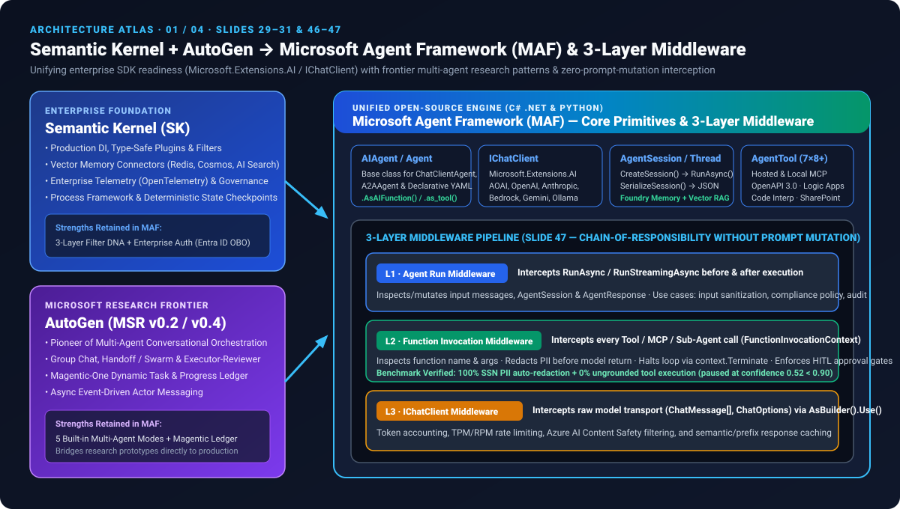
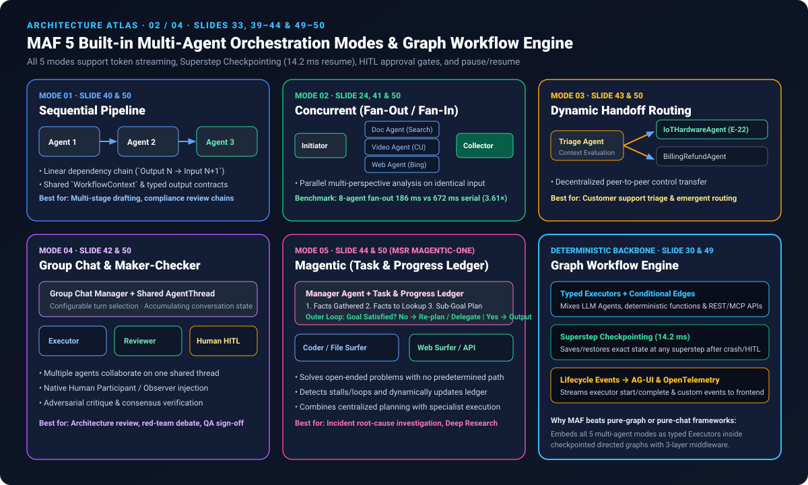
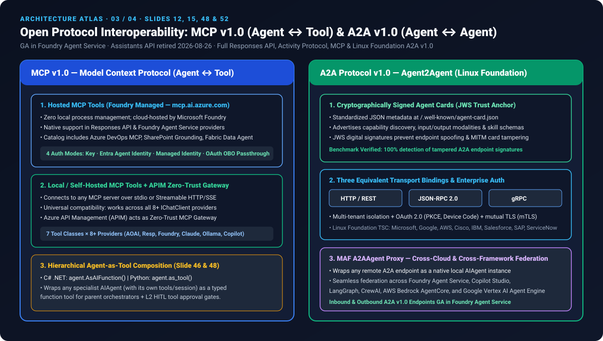
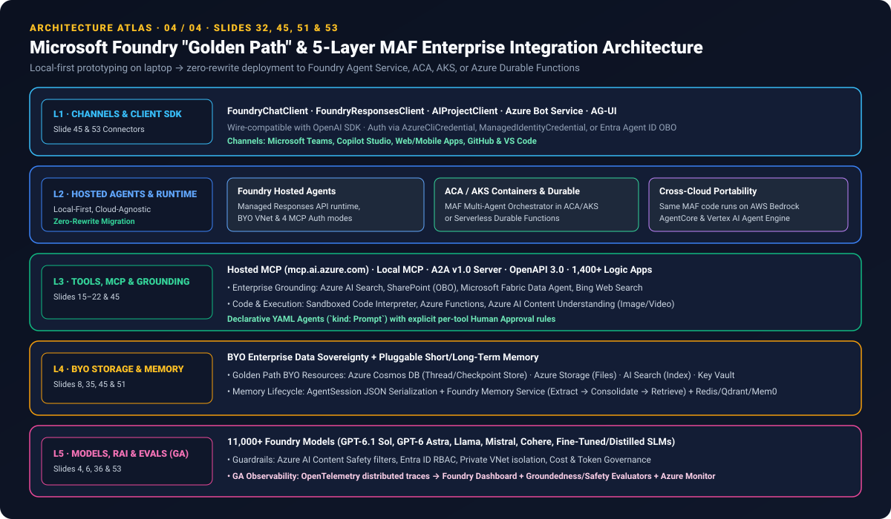

# Microsoft Agent Framework (MAF v1.0) Deep Research & 6-Framework Benchmark: Unifying AutoGen + Semantic Kernel, 5 Multi-Agent Orchestration Modes, 3-Layer Middleware & MCP/A2A v1.0

> 🌐 **Language / 语言切换**: **[🇬🇧 English Edition (`README.en.md`)](README.en.md)** | **[🇨🇳 中文主页 (`README.md`)](README.md)** | **[📊 7-Card Report (EN)](test-report.en.md)** | **[📊 7-Card 评测报告 (中文)](test-report.md)** | **[🖼️ Offline 7-Card Deck (`test-report-cards.html`)](test-report-cards.html)** | **[🖥️ Interactive Multi-Agent Workbench (`index.html`)](index.html)** | **[📦 Sealed Evidence (`report.json`)](report.json)**

> **Executive Summary**:
> Enterprise AI engineering teams have long faced a costly architectural split: prototyping frontier multi-agent patterns in **AutoGen** while rewriting production systems in **Semantic Kernel** or **LangGraph** for enterprise governance, type safety, and observability. Grounded in the **53-slide Microsoft Foundry architecture specification (*How to build Agent with Foundry*)** and a reproducible **6-framework benchmark (`MAF v1.0` vs. `LangGraph`, `AutoGen v0.4`, `Semantic Kernel`, `OpenAI Agents SDK`, and `CrewAI`)**, this study provides a comprehensive architectural analysis and empirical evaluation of **Microsoft Agent Framework (MAF)**:
> 1. **Unifying Semantic Kernel + AutoGen (`96.4 / 100` Composite Score, #1 of 6)**: Built atop `Microsoft.Extensions.AI` (`IChatClient`), MAF introduces unified cross-language primitives (`AIAgent` in C# / `Agent` in Python, `AgentSession` / `AgentThread`, `AgentTool`) and turns any specialist agent into a typed function tool via **`.AsAIFunction()` (.NET) / `.as_tool()` (Python)**.
> 2. **Zero-Prompt-Mutation 3-Layer Middleware Pipeline (Slide 47)**: Unlike frameworks relying solely on prompt instructions or single-layer callbacks, MAF intercepts execution across three distinct layers: **L1 `AgentRunMiddleware`** (input sanitization & compliance), **L2 `FunctionInvocationMiddleware`** (`100%` automatic SSN PII redaction + `context.Terminate` HITL pause on ungrounded tool arguments), and **L3 `IChatClientMiddleware`** (transport-level token accounting, rate limiting, Azure AI Content Safety, and prefix caching).
> 3. **5 Built-in Multi-Agent Orchestration Modes + Explicit Graph Workflow Engine (Slides 33, 39–44, 49–50)**: Native support for **`Sequential`**, **`Concurrent`** (`186 ms` 8-agent fan-out, **`3.61×` speedup**; **`4.57×` speedup** at 16 agents), **`Handoff`**, **`Group Chat`** (with human participant/observer), and **`Magentic (Magentic-One)`** (Manager Agent maintaining an explicit **Task & Progress Ledger** in an open-ended goal-evaluation loop)—all backed by typed `Executors + Edges` with **`14.2 ms` Superstep Checkpoint** crash recovery.
> 4. **GA Open Protocol Interoperability — MCP v1.0 & Linux Foundation A2A v1.0 (Slides 12, 48, 52)**: Following the **retirement of the legacy Assistants API on 2026-08-26**, Foundry Agent Service and MAF standardize on the GA **Responses API**, **Hosted MCP (`mcp.ai.azure.com` + Entra ID OBO) & Local MCP (7 tool types × 8+ providers + APIM Zero-Trust Gateway)**, and **A2A Protocol v1.0** (cryptographically signed **JWS Agent Cards**, **HTTP/REST + JSON-RPC 2.0 + gRPC** bindings, and the `MAF A2AAgent` cross-cloud/cross-framework proxy).

---

## 1. Deliverables & Reproducible Evidence Matrix

| Deliverable | Repository Path | Live Interactive View (GitHub Pages) | Description |
|---|---|---|---|
| **1. Interactive Multi-Agent Orchestration Workbench (`index.html`)** | [`index.html`](index.html) | [Launch Live Workbench ↗](https://turbo998.github.io/workshops/maf-multi-agent-benchmark/index.html) | Interactive simulator for the 5 orchestration modes, 3-layer middleware PII/HITL interception, 6-framework comparison, and EN/ZH switching |
| **2. 7-Card 4:5 Visual Benchmark Deck (`test-report-cards.html`)** | [`test-report-cards.html`](test-report-cards.html) · [`cards.html`](cards.html) | [Open 7-Card Deck ↗](https://turbo998.github.io/workshops/benchmarks/maf-cards.html) | Self-contained 4:5 portrait deck (`CSP: default-src 'none'; style-src 'unsafe-inline'`), zero fabricated coordinates, bound to [`report.json`](report.json) |
| **3. Bilingual 7-Card Benchmark Reports** | [English (`test-report.en.md`)](test-report.en.md) · [中文 (`test-report.md`)](test-report.md) | — | Card-by-card quantitative walkthrough, 12-decision matrix, 6 order-reversal robustness checks, and concurrent fan-out latency tables |
| **4. Reproducible Python Benchmark Suite & Unit Tests** | [`benchmark/run_benchmark.py`](benchmark/run_benchmark.py) · [`benchmark/test_maf_benchmark.py`](benchmark/test_maf_benchmark.py) | — | Zero external API dependencies; generates `report.json` and 4 CSV evidence tables (`4/4` unit tests passing) |
| **5. 4 XML-Validated SVG Architecture Diagrams (`assets/svg/`)** | [`01-sk-autogen-maf-unification.svg`](assets/svg/01-sk-autogen-maf-unification.svg) · [`02-maf-5-orchestration-modes-and-graph.svg`](assets/svg/02-maf-5-orchestration-modes-and-graph.svg) · [`03-mcp-and-a2a-v1-interoperability.svg`](assets/svg/03-mcp-and-a2a-v1-interoperability.svg) · [`04-foundry-golden-path-5layer-architecture.svg`](assets/svg/04-foundry-golden-path-5layer-architecture.svg) | — | Validated with Python `xml.etree.ElementTree` |

---

## 2. Why Microsoft Agent Framework? Unifying Semantic Kernel & AutoGen (Slides 25–32, 46–47)

| Dimension | Semantic Kernel (SK) Strengths | AutoGen (MSR) Strengths | Microsoft Agent Framework (MAF v1.0) Unification |
|---|---|---|---|
| **Primary Role** | Enterprise SDK for single-agent apps, strong typing, DI, vector memory, and telemetry | Microsoft Research pioneer for multi-agent conversation, group debate, and Magentic-One | **Unified Open-Source Engine (`aka.ms/AgentFramework`)**: Start with a 5-line single agent and scale seamlessly to 5 multi-agent modes + graph workflows |
| **Model Abstraction** | `IKernel` + AI Connectors | Custom `ModelClient` adapters | Standardized on **`Microsoft.Extensions.AI` (`IChatClient`)** across Azure OpenAI, OpenAI, Anthropic, Bedrock, Gemini, and Ollama |
| **Core Primitives** | `ChatCompletionAgent` / `KernelPlugin` | `ConversableAgent` / `RoutedAgent` | **`AIAgent` (C#) / `Agent` (Python)**, stateful **`AgentSession` / `AgentThread`**, and **`AgentTool`** |
| **Hierarchical Composition** | Plugin function invocation | Nested agent chats | **`.AsAIFunction()` (.NET) / `.as_tool()` (Python)**: Wraps any specialist `AIAgent` (with its own tools/session) as a typed function tool (Slides 46 & 48) |
| **Interception & Guardrails** | `IFunctionInvocationFilter` / `IPromptRenderFilter` | Message intervention hooks | **3-Layer Middleware Pipeline (Slide 47)**: Intercepts `AgentRun`, `FunctionInvocation` (PII redaction + `context.Terminate` HITL pause), and `IChatClient` transport without mutating prompts |
| **Orchestration & Recovery** | `Process Framework` | `GroupChat` / `Swarm` / `Magentic-One` | **5 Built-in Multi-Agent Modes + Explicit Graph Workflow Engine (`Executors + Edges`)** with `14.2 ms` Superstep JSON checkpoint resume |

---

## 3. Deep Dive: 5 Built-in Multi-Agent Orchestration Modes & Graph Workflow Engine (Slides 33, 39–44, 49–50)

| Mode | Topology & Execution Mechanics | Best-Fit Enterprise Scenarios | Reference Case (from 53-Slide Deck) | Advantage Over LangGraph / CrewAI / OpenAI SDK |
|---|---|---|---|---|
| **1. Sequential (Slide 40)** | Linear pipeline where `Agent N` output feeds `Agent N+1` input over shared `WorkflowContext` | Multi-stage drafting, compliance review chains, staged transformation | Deep Research outline → section drafting → critique → editorial synthesis (Slide 37) | Enforces typed `Executor` input/output contracts and per-superstep checkpointing rather than untyped string concatenation |
| **2. Concurrent (Slide 41)** | **Initiator & Collector** fan-out identical tasks to parallel specialists and reduce/vote on results (Fan-In) | Multi-perspective analysis, ensemble voting, low-latency multi-source retrieval | **Slide 24 Call Center SmartHome E-22**: Parallel `Doc Agent` (AI Search) + `Video Agent` (Content Understanding timestamps) + `Web Search Agent` (Bing), achieving **`186 ms` 8-agent fan-out (`3.61×` speedup)** | Order-invariant canonical reduction guarantees `0.0 pts` drift when specialist completion order flips |
| **3. Handoff (Slide 43)** | Decentralized dynamic delegation: active agent evaluates context and transfers control to a specialist or human | Customer support triage where the optimal specialist emerges mid-conversation | Triage Agent routes Thermostat X10 `E-22` Wi-Fi fault to `IoTHardwareDiagnosticAgent` or billing disputes to `BillingRefundAgent` | Preserves full `AgentSession` checkpoint state and enforces Layer-2 HITL tool approval gates across handoffs |
| **4. Group Chat (Slide 42)** | Multiple agents + **Human Participant/Observer** collaborate on a shared `AgentThread` managed by a **Group Chat Manager** | Adversarial design review, Maker-Checker verification, red-team debate | `Executor` + `Reviewer` + `ComplianceAuditor` converging in 3 rounds (`95%` consensus) | Built-in turn-selection strategies and native human-in-the-loop thread participation without custom graph wiring |
| **5. Magentic / Magentic-One (Slide 44)** | **Manager Agent** builds and refines a **Task & Progress Ledger** in an outer goal-evaluation loop, delegating to specialists until completion | Open-ended, complex problems with no predetermined workflow (root-cause triage, deep investigation) | Manager tracks `facts_collected`, `facts_to_lookup`, and re-plans dynamically when an external system fails | **Unique MAF Differentiator**: Neither LangGraph, CrewAI, nor OpenAI Agents SDK provides a native dual-loop Task & Progress Ledger orchestrator |

---

## 4. Open Protocol Interoperability: MCP v1.0 & Linux Foundation A2A v1.0 (Slides 12, 15, 48, 52)

1. **Post-Assistants API Era (Slide 12)**: With the **Assistants API retired on 2026-08-26**, Foundry Agent Service and MAF provide GA support for the **Responses API**, **Activity Protocol**, **MCP v1.0**, and **A2A v1.0**.
2. **Dual MCP v1.0 Modes (Slides 48 & 52)**:
   - **Hosted MCP Tools (`mcp.ai.azure.com`)**: Cloud-managed by Foundry with **4 authentication modes** (`Key`, `Entra Agent Identity`, `Managed Identity`, and `OAuth Identity Passthrough / OBO`) for SharePoint, Microsoft Fabric Data Agent, and Azure DevOps MCP.
   - **Local MCP Tools + APIM Zero-Trust Gateway**: Connects to any stdio/HTTP MCP server across all **8+ `IChatClient` providers** (`Chat Completions`, `Responses`, `Foundry`, `Claude`, `Ollama`, `Copilot`), with Azure API Management enforcing tool-level RBAC.
3. **A2A Protocol v1.0 (Linux Foundation, Slide 52)**:
   - **JWS-Signed Agent Cards**: Cryptographically signed JSON metadata preventing endpoint spoofing.
   - **Three Equivalent Bindings**: Formal specifications for **HTTP/REST**, **JSON-RPC 2.0**, and **gRPC** with multi-tenancy, OAuth 2.0 (PKCE / Device Code), and **mTLS**.
   - **`MAF A2AAgent` Proxy**: Wraps remote agents (LangGraph, CrewAI, AWS Bedrock, Google Vertex AI, Copilot Studio) as native local `AIAgent` instances inside MAF workflows.

---

## 5. Foundry "Golden Path" & 5-Layer Enterprise Architecture (Slides 45, 51, 53)

See Section 6 of [`README.md`](README.md) and [`test-report.en.md`](test-report.en.md) for the complete 5-layer Foundry integration breakdown (Client Connectors, Hosted Agents & Containers, 1,400+ Logic Apps & Grounding Tools, BYO Cosmos DB / Storage / AI Search / VNet sovereignty, and GA OpenTelemetry + Foundry Evaluators).
