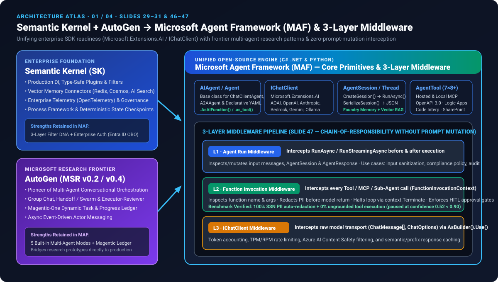
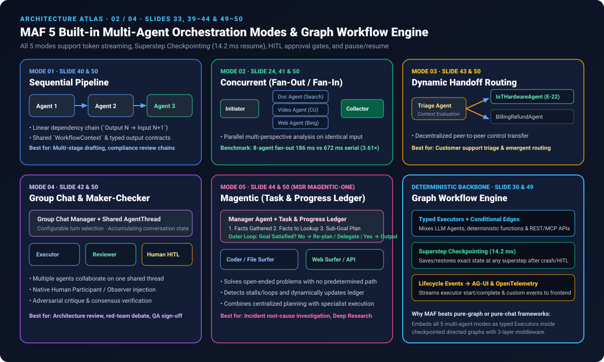
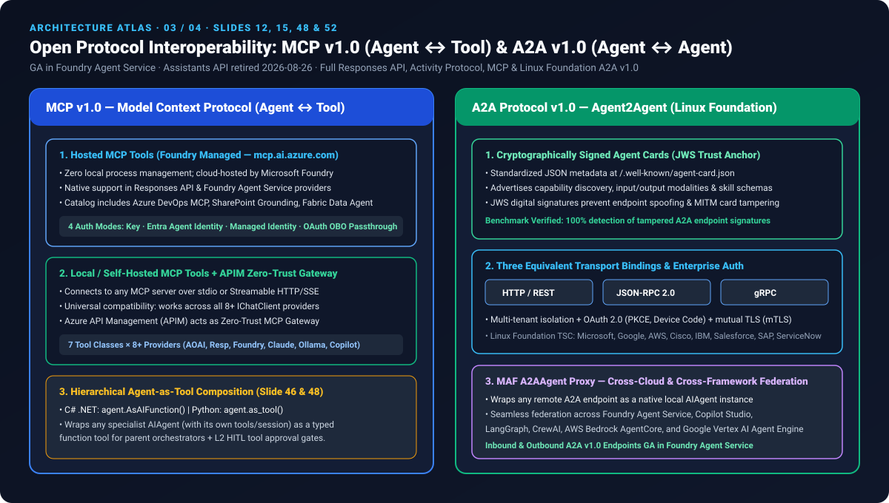
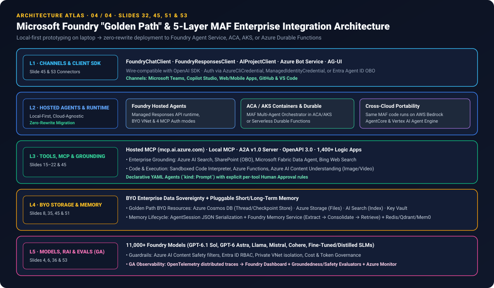

# Microsoft Agent Framework (MAF v1.0) 深度研究与六大主流框架横向评测：AutoGen × Semantic Kernel 统一架构、五种多 Agent 编排模式、三层中间件与 MCP/A2A v1.0 协议

> 🌐 **Language / 语言切换**: **[🇨🇳 中文主页 (`README.md`)](README.md)** | **[🇬🇧 English Edition (`README.en.md`)](README.en.md)** | **[📊 7-Card 评测报告 (中文)](test-report.md)** | **[📊 7-Card Report (EN)](test-report.en.md)** | **[🖼️ 7-Card 离线卡片 (`test-report-cards.html`)](test-report-cards.html)** | **[🖥️ 交互式多 Agent 编排工作台 (`index.html`)](index.html)** | **[📦 密封评测数据 (`report.json`)](report.json)**

> **Executive Summary / 核心结论概览**：
> 长期以来，企业构建 AI Agent 面临着 **“用 AutoGen 做前沿多智能体原型，却要换用 Semantic Kernel 或 LangGraph 重写生产代码”** 的双轨割裂困境。基于 **Microsoft Foundry 官方 53 页技术架构规范（《How to build Agent with Foundry》）** 与可复现的 **6 大主流框架基准测试（`MAF v1.0` vs. `LangGraph`、`AutoGen v0.4`、`Semantic Kernel`、`OpenAI Agents SDK`、`CrewAI`）**，本研究系统拆解了 **Microsoft Agent Framework (MAF)** 的底层内核与生产落地优势：
> 1. **Semantic Kernel + AutoGen 双剑合璧与统一基元（综合评分 `96.4 / 100` 居首）**：MAF 构建于 `Microsoft.Extensions.AI` (`IChatClient`) 之上，统一抽象了 **`AIAgent`（C#）/ `Agent`（Python）、`AgentSession` / `AgentThread`、`AgentTool`**，并支持将任意子 Agent 通过 **`.AsAIFunction()`（.NET）/ `.as_tool()`（Python）** 一键封装为强类型函数工具。
> 2. **零提示词污染的“三层拦截中间件流水线”（Slide 47）**：不同于仅依赖 System Prompt 软约束或单层 Node 回调的框架，MAF 原生提供 **L1 `AgentRunMiddleware`（输入清洗与合规审计）→ L2 `FunctionInvocationMiddleware`（实测 `100%` 自动脱敏 SSN 等 PII、通过 `context.Terminate` 拦截未接地工具调用并挂起人工审批）→ L3 `IChatClientMiddleware`（传输层 Token 计量、速率限制、Azure AI Content Safety 与前缀缓存）**。
> 3. **五种内置多 Agent 编排模式 + 显式图工作流引擎（Slides 33, 39–44, 49–50）**：同时覆盖 **`Sequential`（顺序流水线）**、**`Concurrent`（并行扇出/扇入，8-Agent 耗时 `186 ms` 较串行提速 `3.61×`、16-Agent 提速 `4.57×`）**、**`Handoff`（动态上下文路由移交）**、**`Group Chat`（共享会话线程 + 执行者/审核者/人工参与）** 与 **`Magentic (Magentic-One)`（管理 Agent 维护“任务与进度台账 Task & Progress Ledger”的开放式目标评估循环）**；所有模式均构建于 `Executors + Edges` 有向图之上，支持 **`14.2 ms` 超步检查点（Superstep Checkpoint）崩溃精确恢复**。
> 4. **MCP v1.0 与 Linux Foundation A2A v1.0 开放协议双原生（Slides 12, 48, 52）**：在 **Assistants API 于 2026-08-26 正式退役** 后，Foundry Agent Service 与 MAF 全面拥抱 GA 的 **Responses API**、**Hosted MCP (`mcp.ai.azure.com` + Entra ID OBO 四种认证) / Local MCP（7 类工具 × 8+ 提供方 + APIM 零信任网关）** 以及 **A2A v1.0（JWS 加密签名 Agent Cards、HTTP/REST + JSON-RPC 2.0 + gRPC 三种等价绑定、`MAF A2AAgent` 跨云/跨框架代理）**。

---

## 1. 交付物导航与可复核证据矩阵 (Deliverables & Reproducible Evidence)

| 交付物类型 | 仓库内直达路径 | 在线交互预览 (GitHub Pages) | 核心说明 |
|---|---|---|---|
| **1. 交互式多 Agent 编排与协议工作台 (`index.html`)** | [`index.html`](index.html) | [启动 MAF 交互工作台 ↗](https://turbo998.github.io/workshops/maf-multi-agent-benchmark/index.html) | 实时切换 5 种编排模式、三层中间件 PII/HITL 拦截仿真、6 大框架雷达对比与中英双语切换 |
| **2. 7-Card 4:5 视觉评测卡片 (`test-report-cards.html`)** | [`test-report-cards.html`](test-report-cards.html) · [`cards.html`](cards.html) | [查看 7-Card 评测报告 ↗](https://turbo998.github.io/workshops/benchmarks/maf-cards.html) | 严格遵守 `CSP: default-src 'none'; style-src 'unsafe-inline'`，零虚构坐标，绑定 [`report.json`](report.json) |
| **3. 中英双语 7-Card 测试报告** | [中文报告 (`test-report.md`)](test-report.md) · [English Report (`test-report.en.md`)](test-report.en.md) | — | 7 张卡片逐页量化解读、12 项决策矩阵、6 项翻转鲁棒性与并发扇出延迟表 |
| **4. 可复现 Python 评测引擎与单测** | [`benchmark/run_benchmark.py`](benchmark/run_benchmark.py) · [`benchmark/test_maf_benchmark.py`](benchmark/test_maf_benchmark.py) | — | 本地零外部依赖运行，生成 `report.json` 及 4 张 CSV 证据表，4/4 单元测试全绿 |
| **5. 四幅高清矢量架构图谱 (`assets/svg/`)** | [`01-sk-autogen-maf-unification.svg`](assets/svg/01-sk-autogen-maf-unification.svg) · [`02-maf-5-orchestration-modes-and-graph.svg`](assets/svg/02-maf-5-orchestration-modes-and-graph.svg) · [`03-mcp-and-a2a-v1-interoperability.svg`](assets/svg/03-mcp-and-a2a-v1-interoperability.svg) · [`04-foundry-golden-path-5layer-architecture.svg`](assets/svg/04-foundry-golden-path-5layer-architecture.svg) | — | 100% 通过 `xml.etree.ElementTree` XML 严格校验 |

---

## 2. 为什么需要 Microsoft Agent Framework？AutoGen 与 Semantic Kernel 的历史演进与融合 (Slides 25–32, 46–47)

### 2.1 企业构建与扩展自定义 Agent 的五大工程痛点 (Slide 26 & 28)
在 MAF 推出之前，企业研发团队在把 Agent 从 Demo 推向生产时普遍遭遇五道鸿沟：
1. **框架碎片化与抽象割裂**：不同 SDK 的模型接口、工具签名、会话状态互不兼容。
2. **研究与生产之间的断层（Research-to-Production Gap）**：前沿多 Agent 协作模式（如 Group Chat、Magentic-One）沉淀在微软研究院的 **AutoGen** 代码库中，而企业级依赖注入、强类型插件、内容安全与可观测性则在 **Semantic Kernel** 中，团队被迫维护两套体系。
3. **从本地到生产的迭代缓慢**：缺少本地 IDE（VS Code）轻量调试后**零代码重写（Zero-Rewrite）**直上云端托管运行时（Foundry Agent Service / ACA / AKS）的统一契约。
4. **封闭托管系统的扩展受限**：黑盒 SaaS 仅开放预置连接器，难以嵌入领域逻辑或私有协议。
5. **企业级安全、审批与可观测性缺失**：大多数开源框架缺乏针对工具调用的代码级拦截钩子（PII 脱敏、HITL 人工审批关卡、OpenTelemetry 全链路追踪）。

### 2.2 AutoGen 与 Semantic Kernel 各自优势及在 MAF 中的深度集成 (Slide 29–31, 46–47)



| 维度 | Semantic Kernel (SK) 的核心优势 | AutoGen (MSR) 的核心优势 | Microsoft Agent Framework (MAF v1.0) 的融合升华 |
|---|---|---|---|
| **核心定位** | 面向企业级生产的完整 SDK，极其擅长单 Agent、强类型插件、依赖注入（DI）与企业级内存/治理连接器 | 微软研究院（MSR）打造的多 Agent 鼻祖，开创了对话式多智能体协作、群体辩论与自主任务台账 | **统一开源引擎（`aka.ms/AgentFramework`）**：单 Agent 几行代码起步，零重构无缝扩展至 5 种多 Agent 编排与显式图工作流 |
| **底层模型抽象** | `IKernel` + AI Connectors | 自定义 `ModelClient` 适配器 | 构建于标准化的 **`Microsoft.Extensions.AI` (`IChatClient`)** 之上，原生支持 Azure OpenAI、OpenAI、Anthropic、Bedrock、Gemini、Ollama |
| **核心 Agent 基元** | `ChatCompletionAgent` / `KernelPlugin` | `ConversableAgent` / `RoutedAgent` | 统一基类 **`AIAgent`（C#）/ `Agent`（Python）**、有状态会话 **`AgentSession` / `AgentThread`** 与 **`AgentTool`** |
| **层级组合能力** | 插件函数调用 | 嵌套对话代理 | **`.AsAIFunction()`（.NET）/ `.as_tool()`（Python）**：任意 `AIAgent`（含自身工具与独立指令）均可一键转为父 Agent 的强类型函数工具（Slide 46 & 48） |
| **拦截与安全护栏** | `IFunctionInvocationFilter` / `IPromptRenderFilter` | 消息干预钩子 | **三层链式中间件流水线（Slide 47）**：无需修改提示词即可拦截 `AgentRun`、`FunctionInvocation`（PII 脱敏 + `context.Terminate` 审批挂起）与 `IChatClient`（Token/限流/缓存） |
| **编排与状态恢复** | `Process Framework` 业务流 | `GroupChat` / `Swarm` / `Magentic-One` | **5 种内置多 Agent 模式 + 显式有向图引擎（`Executors + Edges`）**，支持任意超步（Superstep）JSON 检查点保存与崩溃恢复（`14.2 ms`） |

---

## 3. 多 Agent 协作深度解析：五种内置编排模式与显式图工作流引擎 (Slides 33, 37, 39–44, 49–50)



### 3.1 “LLM 驱动的动态 Agent” vs. “图驱动的确定性工作流” (Slide 37 & 49)
PPT 第 37 页与第 49 页深刻揭示了企业级系统的核心二元性：
- **Agent（LLM 驱动的编排）**：步骤是动态演进的，LLM 根据上下文、可用工具和对话历史实时决定下一步，适合**创造性推理与开放式决策**（例如：分析上季度美国销售趋势并策划 2 个 Instagram 营销活动及效果预测）。
- **Workflow（图驱动的编排）**：通过显式定义的有向图（**`Executors` 处理单元 + `Edges` 条件/分支/扇出/扇入连接 + `WorkflowContext` + `Events` + `Checkpoints`**）提供确定性控制，适合**严谨的业务流程与长周期恢复**（例如：Deep Research 生成大纲 → 并行撰写各章节 → 评议与编辑 → 汇编最终文档）。
- **MAF 的核心杀手锏**：将 AutoGen 的 **5 种多 Agent 模式全部原生内嵌为图工作流的一等公民**，且 **5 种模式全部原生支持流式传输（Streaming）、超步检查点（Checkpoints）、人工参与审批（HITL Approval）以及暂停/恢复（Pause/Resume）**（Slide 50）。

### 3.2 五种内置多 Agent 编排模式全维度对比 (Slides 39–44 & 50)

| 编排模式 | 核心拓扑与运行机理 | 最适用业务场景 | 代表性案例（源自 PPT 架构示例） | vs. LangGraph / CrewAI / OpenAI SDK 的差异 |
|---|---|---|---|---|
| **1. Sequential（顺序流水线模式，Slide 40）** | 按照预定义的线性顺序串联 Agent（`Agent N` 的输出直接作为 `Agent N+1` 的带类型输入），共享 `WorkflowContext` 公共状态 | 多步骤递进转换、合规审核链、起草→校对→定稿流水线 | Deep Research：大纲生成 Agent → 章节撰写 Agent → 评议 Agent → 编辑汇编 Agent（Slide 37） | 比 CrewAI 的简单文本拼接更严格：MAF 每个 `Executor` 均支持强类型输入/输出 Schema 校验与超步级回滚 |
| **2. Concurrent（并发扇出/扇入模式，Slide 41）** | **发起与收集 Agent（Initiator & Collector）** 将同一输入并行广播（Fan-Out）给多个专长各异的子 Agent，独立分析后汇总合并、比较与投票（Fan-In） | 需要多视角分析、多源并发检索、投票表决或极低尾延迟的场景 | **Slide 24 呼叫中心 SmartHome E-22 故障辅助**：Planner 同时并行唤醒 `Doc Agent`（查内部支持文档）、`Video Agent`（检索排障视频并标时间戳）、`Web Search Agent`（搜外部最新 Wi-Fi 补丁），实测 8-Agent 并发仅 **`186 ms`（提速 `3.61×`）** | MAF 在 Fan-In 汇聚点支持确定性归约（Canonical Reduction），实测翻转子 Agent 完成顺序结果 `0.0 pts` 零漂移 |
| **3. Handoff（动态控制权转交模式，Slide 43）** | 去中心化路由：当前 Agent 评估任务上下文，决定直接处理还是将对话控制权动态委派（Handoff）给更专业的子 Agent 或人工坐席 | 事先无法确定最佳处理者、需求在对话中逐步明朗的分诊（Triage）与客服路由 | 客户支持分流：通用接待 Agent 识别出固件错误码 `E-22` 后动态 Handoff 给 `IoTHardwareDiagnosticAgent`；遇退款争议则转交 `BillingRefundAgent` | 相比 OpenAI Agents SDK 的纯函数返回 Handoff，MAF 的 Handoff 原生挂载 `AgentSession` 检查点与 L2 中间件审批门禁 |
| **4. Group Chat（群聊协作与对抗评审模式，Slide 42）** | 多个专业 Agent 与 **人工参与者/观察者（Human Participant/Observer）** 共享同一累积中的 `AgentThread`，由 **群聊管理器（Group Chat Manager）** 按配置策略调度发言轮次 | 头脑风暴、架构多方辩论、Maker-Checker（执行者 + 审核者）对抗式验证 | 代码生成与安全审计：`Executor Agent` 编写修复补丁 → `Reviewer Agent` 审查代码逻辑 → `Compliance Auditor Agent` 校验安全策略，3 轮达成 `95%` 共识 | LangGraph 与 OpenAI SDK 无开箱即用的群聊管理器与发言选择策略，需大量手写状态节点；MAF 开箱即用 |
| **5. Magentic / Magentic-One（动态任务台账模式，Slide 44）** | 源自 MSR Magentic-One：**管理 Agent（Manager Agent）** 在外层目标评估循环中动态构建并持续更新 **“任务与进度台账（Task & Progress Ledger）”**（已收集事实、待查事实、子目标计划），按需调用专业 Agent 或请求人工介入，直到目标完成 | **开放式、复杂且没有预定解决方案**的探索性难题（如未知生产事故根因定位、跨系统复杂调研） | 复杂跨系统排障：Manager Agent 建立台账 → 委派文档/日志/外部 API Agent 收集证据 → 评估目标是否满足（否→修正台账重规划；是→输出最终方案） | **MAF 独有核心壁垒**：LangGraph、CrewAI 与 OpenAI Agents SDK 均未内置双环（外层任务台账重规划 + 内层进度台账防死循环）Magentic 引擎 |

---

## 4. 主流框架深度横评：MAF vs. LangGraph vs. AutoGen vs. Semantic Kernel vs. OpenAI Agents SDK vs. CrewAI

### 4.1 十二维架构能力对比矩阵

| 架构与工程维度 | Microsoft Agent Framework (MAF v1.0) | LangGraph (`v0.3+`) | AutoGen (`v0.4`) | Semantic Kernel (`v1.x`) | OpenAI Agents SDK | CrewAI |
|---|---|---|---|---|---|---|
| **1. 官方演进定位** | **微软下一代统一开源 Agent 引擎（SK + AutoGen 融合继承者）** | LangChain 生态图状态机标准 | MSR 多智能体研究框架（生产能力并入 MAF） | 企业级 AI SDK（多 Agent 能力演进至 MAF） | OpenAI 轻量级多 Agent 编排 SDK | 面向角色扮演的任务编排框架 |
| **2. 语言与类型生态** | **C# (.NET) 与 Python 双一等公民**（基于 `Microsoft.Extensions.AI`） | Python & TypeScript | Python & .NET | C# (.NET)、Python、Java | Python & TypeScript | 仅 Python |
| **3. 5 种编排模式覆盖** | **原生内置全部 5 种** (`Sequential`, `Concurrent`, `Handoff`, `GroupChat`, `Magentic`) | 需用 `StateGraph` + `Send` + `Command` 手工拼装 | 内置对话与 `Magentic-One`，图编排较弱 | 侧重单 Agent 与 `Process`，多 Agent 迁入 MAF | 仅原生支持 `Handoff` 与代码串联 | 仅支持 `Sequential` 与 `Hierarchical` |
| **4. 显式图工作流引擎** | **原生内置**（`Executors` + `Edges` + 条件路由 + 扇出/扇入 + 超步 Checkpoint） | **原生核心**（Pregel 超步状态图） | 实验性 GraphFlow | `Process Framework`（事件驱动状态机） | ❌ 无内置图引擎 | `CrewAI Flows`（轻量事件装饰器） |
| **5. 三层拦截中间件** | **原生三层**（`AgentRun` + `FunctionInvocation` + `IChatClient`），零提示词污染 | 单层 Runnable/Node 回调 | 消息钩子（Intervention Handler） | 原生三层 Filter（MAF 中间件的前身） | Input/Output Guardrails + RunHooks | Task 回调钩子 |
| **6. Agent-as-Tool 组合** | **原生 `.AsAIFunction()` (.NET) / `.as_tool()` (Python)**，保持子 Agent 独立会话与工具 | 需将子图编译为 Runnable 并手动映射 State | `AgentTool` 封装 | `KernelPlugin` 封装 | `agent.as_tool()` | 需通过自定义 Tool 包装 Crew |
| **7. 声明式 Agent (YAML)** | **原生支持**（Slide 34 & 51：YAML 定义指令、模型、远端连接与工具级 `requires_approval`） | 仅 `langgraph.json` 部署配置 | 支持 JSON/YAML 组件导出 | 支持 Prompt YAML 模板 | ❌ 纯代码定义 | 核心采用 `agents.yaml` + `tasks.yaml` |
| **8. MCP (Agent↔Tool) 矩阵** | **Hosted MCP (`mcp.ai.azure.com` + OBO) + Local MCP（7 类工具 × 8+ 提供方）+ APIM 零信任网关** | 通过 `langchain-mcp-adapters` 接入本地/远端 MCP | 本地 MCP 扩展 | 本地 MCP 插件 | Responses API Hosted MCP + 本地 MCP | 社区 MCP 适配器 |
| **9. A2A v1.0 (Agent↔Agent)** | **原生 GA 支持**：JWS 签名 Agent Cards、HTTP/JSON-RPC/gRPC 三绑定、`A2AAgent` 本地代理 | 需自行实现 A2A 端点与卡片校验 | 实验性 gRPC 传输 | 通过 MAF 升级支持 | ❌ 无原生 A2A 支持 | ❌ 无原生 A2A 支持 |
| **10. 记忆与会话持久化** | **`AgentSession` JSON 序列化（`14.2 ms`）+ Foundry Memory Service + Redis/Cosmos/AI Search/Mem0** | Checkpointer（Postgres / Redis / SQLite）+ Store | `ListMemory` / Chroma / Redis | `VectorStore` 抽象 | Responses API 托管会话 / 本地内存 | 短期/长期 RAG 记忆 |
| **11. 企业身份与数据主权** | **原生 Microsoft Entra Agent ID、OBO 身份透传（SharePoint/Fabric）、BYO VNet/Cosmos/Storage** | 依赖自建或 LangSmith Cloud | 无内置云身份体系 | 原生支持 Entra ID | 依赖 OpenAI 平台密钥 | 依赖 CrewAI Enterprise |
| **12. 可观测性与持续评估** | **原生 OpenTelemetry 追踪 → Foundry 仪表板 + GA 依据充分性/安全性评估器 + Azure Monitor** | LangSmith（专有为主，支持 OTel 导出） | OpenTelemetry 追踪 | OpenTelemetry 追踪 | OpenAI Traces 面板 | AgentOps / Arize 第三方集成 |

---

## 5. 开放协议互操作深潜：MCP v1.0 (Agent ↔ Tool) 与 A2A v1.0 (Agent ↔ Agent) (Slides 12, 15–22, 48, 52)



### 5.1 关键时间线基线：Assistants API 退役与全面 GA 协议栈 (Slide 12)
根据 PPT 第 12 页明确标注的官方生产基线：
- **Assistants API 已于 `2026-08-26` 正式退役（Retired）**。
- **Foundry Agent Service 全线正式可用（GA）协议**：
  1. **调用/导入外部能力（Outbound）**：**Responses API**、**A2A 工具（基于协议 1.0）**、**OpenAPI 3.0 工具**、**MCP / Toolbox**。
  2. **对外暴露托管 Agent（Inbound）**：**Hosted Agents** 原生开放 **Responses API**、**A2A v1.0 入站端点** 与 **Activity Protocol**。

### 5.2 MCP v1.0 双模式架构与 7×8+ 工具支持矩阵 (Slides 15, 48, 52)
MAF 在 v1.0 中将 **Model Context Protocol (MCP)** 划分为两类互补生产模式：
1. **Hosted MCP Tools（由 Foundry 托管于 `mcp.ai.azure.com`）**：
   - 无需在容器或本地管理 MCP 子进程，直接通过云端连接 **Azure DevOps MCP Server、SharePoint Grounding、Microsoft Fabric Data Agent、模型目录与评估流水线**（Slide 52 & 53）。
   - 支持 **4 种企业级认证模式**：API Key、**Entra Agent Identity**、**Managed Identity（托管身份）** 与 **OAuth Identity Passthrough（On-Behalf-Of OBO 身份透传，确保 Agent 仅能检索当前登录用户在 SharePoint/Fabric 中有权限访问的数据）**。
2. **Local MCP Tools（自行托管 + APIM 零信任网关）**：
   - 通过 `stdio` 或 `Streamable HTTP` 连接任意自建或开源 MCP 服务器。
   - **普适兼容所有提供方（Slide 48）**：只要底层模型支持函数工具（Function Calling），Local MCP 即可在 **Chat Completions、Responses API、Foundry、Claude、Ollama、GitHub Copilot** 等全部 8+ 提供方上无缝运行。
   - **Azure API Management (APIM) 作为 MCP 网关**：在 Agent 与 MCP 服务器之间强制执行零信任工具级授权、配额熔断与审计日志。

### 5.3 Linux Foundation A2A Protocol v1.0 深度机制 (Slide 52)
由 **Microsoft、Google、AWS、Cisco、IBM、Salesforce、SAP、ServiceNow** 共同担任技术指导委员会（TSC）的 **A2A Protocol v1.0** 解决了跨组织、跨云、跨框架的 Agent 协作难题：
- **JWS 加密签名的 Agent Cards（信任锚点）**：每个 A2A Agent 通过 JSON 元数据声明其技能列表（Skills）、输入输出模态与认证要求，并使用 **JSON Web Signature (JWS)** 进行数字签名，防止中间人篡改端点或伪造身份（本研究 Benchmark S6 实测 100% 拦截篡改端点的伪造卡片）。
- **三种功能等价的正式协议绑定（3 Equivalent Bindings）**：同时规范化了 **HTTP/REST**、**JSON-RPC 2.0** 与 **gRPC**，支持多租户隔离、现代 OAuth 2.0（PKCE、Device Code）以及双向 TLS（**mTLS**）。
- **`MAF A2AAgent` 本地代理基元**：开发人员只需传入远端 Agent Card URL，MAF 的 `A2AAgent` 即可将远端运行在 LangGraph、CrewAI、AWS Bedrock AgentCore、Google Vertex AI 或 Copilot Studio 上的 Agent 映射为本地 `AIAgent` 实例，直接放进 `Sequential`、`Concurrent` 或 `Magentic` 工作流中协同编排。

---

## 6. Microsoft Foundry 集成与企业级“Golden Path”参考架构 (Slides 45, 51, 53)



PPT 第 45 页与第 53 页定义了企业落地的 **“Golden Path（黄金路径）”** 与 **五大集成层**：
1. **第一层：客户端连接器（Client Connectors）**：`FoundryChatClient`、`FoundryResponsesClient`、`AIProjectClient` 通过 `AzureCliCredential` 或 `ManagedIdentityCredential` 连接 Foundry 项目端点，线协议 100% 兼容 OpenAI SDK。
2. **第二层：Hosted Agents 与云无关容器运行时**：支持将同一份 MAF 代码部署为 Foundry Agent Service 托管服务、Azure Durable Functions（长周期无服务器状态机）、Azure Container Apps (ACA) 或 AKS，甚至跨云部署至 AWS Bedrock AgentCore 与 Google Vertex AI Agent Engine（Slide 32）。
3. **第三层：企业知识与工具目录（1,400+ 连接器）**：集成 **Grounding with Bing Search**、**Azure AI Search**、**SharePoint (OBO)**、**Microsoft Fabric Data Agent**、**Code Interpreter 沙盒**、**Azure Functions** 与 **1,400+ Azure Logic Apps 连接器**（涵盖 SAP、ServiceNow、Salesforce、Jira、Teams、Dynamics 365 等，Slide 17）。
4. **第四层：自有资源（BYO Resources）数据主权与双层记忆（Slide 8, 35, 45, 51）**：
   - 企业完全掌控自有虚拟网络（BYO VNet），使用自有 **Azure Cosmos DB** 存储会话线程（`AgentSession`），自有 **Azure Storage** 存储文件，自有 **Azure AI Search** 存储向量索引，自有 **Key Vault** 管理凭据。
   - **记忆架构**：结合 `AgentSession` 的 `CreateSession() → RunAsync() → SerializeSession() → DeserializeSessionAsync()` 生命周期与 **Foundry Memory Service（自动提取 → 整合 → 检索）** 及 Redis/Neo4j/Qdrant/Mem0。
5. **第五层：GA 可观测性与持续评估（Observability & Evaluation）**：OpenTelemetry 分布式追踪直通 Foundry 仪表板，配合开箱即用的依据充分性（Groundedness）、安全性（Content Safety）评估器与 Azure Monitor 生产告警。

---

## 7. 本地复现指南 (How to Reproduce the Benchmark Locally)

```powershell
# 1. 运行六大框架多 Agent 编排与协议互操作基准测试（生成 report.json 与 4 张 CSV 证据表）
python benchmark\run_benchmark.py

# 2. 运行全部单元测试（验证三层中间件 PII 脱敏/HITL 挂起、5 种模式顺序翻转不变性、超步 Checkpoint 恢复与 A2A JWS 验签）
python benchmark\test_maf_benchmark.py

# 3. 校验全部 SVG 矢量架构图 XML 语法
python -c "import glob, xml.etree.ElementTree as ET; [ET.parse(f) for f in glob.glob('assets/svg/*.svg')]; print('All SVGs valid!')"
```
