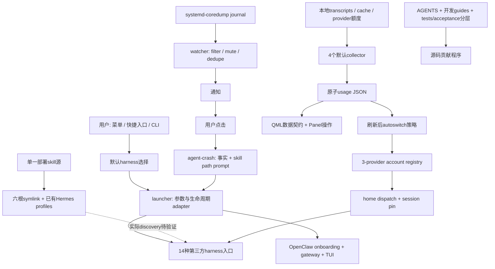

# Omarchy 的 agent 设计机制：把 agent 作为操作系统入口能力

## 主要结论

本研究将 **agentic OS** 定义为：操作系统的用户入口、技能知识、结构化事件、登录身份与用量观测，被接入多个第三方agent的启动和交互工作流。Omarchy在所研究的路径中不是自研LLM/runtime，也不是统一托管的多agent调度/安全平台。其创新在**系统集成与可理解的操作程序**，不是把不同harness的模型、权限和配额变成同一种制度。

固定公开版本：入口 `basecamp/omarchy`，API规范仓库 `omacom/omarchy`，commit `9480d1b6a98156314dbabe6bfef08f39f8b9cd07`。以下结论来自固定源码、上游文档和未运行tests；没有安装、真实agent、provider API、桌面或VM实验。入口与hash元数据见[source index](../evidence/source-index.md)。

| 专题 | 核心发现 | 最重要的边界 |
|---|---|---|
| [E1 Launcher](01-launcher.md) | 14个case适配argv；OpenClaw需gateway lifecycle；新session身份重选 | 选harness不是选模型；flag传参不证明权限等价 |
| [E2 Skills](02-skills.md) | 三个部署skill，六个根目标与已有Hermes profiles；程序性知识分层 | symlink存在不证明发现、调用或遵守 |
| [E3 Crash](03-crash-pipeline.md) | 新coredump JSON经filter/mute/dedupe，用户点击才诊断 | 通知不是自动agent；argv hardening不是prompt安全 |
| [E4 Accounts/Usage](04-accounts-usage.md) | 3个account provider、4个默认usage provider；session pin + collector snapshot | directory selection不是强身份隔离；stale/unknown不是同一状态 |
| [E5 Agent-native repo](05-agent-native-repo.md) | AGENTS/任务guide/reference/manual分层；headless与acceptance分开 | test/all不含图形acceptance；共同署名不等于使用率 |
| [E6 Trust](06-safety-model.md) | workflow、argv、prompt advice、credential home、sandbox分别分析 | Work/mute/plan-mode建议不是强安全边界 |

这些发现的assertion ID和精确范围位于[assertion index](../evidence/assertion-index.csv)。总览是上述证据的**分析综合**，不是额外实验。

## 架构与数据流

图中 skill discovery 虚线是缺证边，不保证所有14个harness都消费这些目录。OpenClaw分支不等于14之外第15个agent；Panel还有操作入口，不是纯只读renderer。开发guides与用户部署skill分开。

## 八种设计模式

| 模式 | Omarchy实例 | 可迁移的核心 | 不能照抄的部分 |
|---|---|---|---|
| Adapter / anti-corruption layer | 逐harness argv case | 把调用差异集中到明确表 | 把auto/yolo参数统一视作安全策略 |
| Lazy provisioning | mise wrapper，专用installer check/now | 成功准备后再激活选择 | 浮动binary版本、无人确认安装 |
| Single-source distribution | skill源 + symlinks + migrations | 版本化知识源避免多份漂移 | 无discovery测试、未来profile漏接 |
| Progressive context | SKILL → topic guide → reference | 按任务拉入程序性知识 | 把文本建议当强制权限 |
| Event-to-human-to-agent | crash→notification→click→prompt | 事件提供事实，人工接入任务 | 自动把异常视为修复授权 |
| Session-stable identity | selected account + home pin | identity selection与session identity分开 | sharedhome当tenant隔离 |
| Collector / snapshot / policy | provider collector→atomic JSON→autoswitch/UI | 采集、表示和决策分开 | JSON有效即数据可靠或账单准确 |
| Layered verification | focused tests、headless/skip、VM acceptance | 证据等级与环境前提明确 | 聚合runner替代端到端验收 |

对应证据分别为E1、E2、E3、E4、E5；模式命名和企业应用为本研究推断，不是上游宣称性能结果。

## 七项企业可复用设计

| 设计建议 | 继承的机制 | 企业需额外实现/验证 |
|---|---|---|
| 显式harness契约 | E1 adapter + lifecycle | 固定binary/version，分开argv、权限、failure和readiness tests |
| 版本化任务知识库 | E2单源与渐进阅读 | 发布签名/来源审核，按harness验证discover/invoke/obey，profile生命周期接入 |
| 事件admission与人工升级 | E3filter/去重/点击 | event identity、脱敏、事件存活验证、任务预算和权限门槛 |
| Credential broker + 稳定session identity | E4home/pin | 最小权限、tenant隔离、显式scope与允许的账号政策；不能靠换账号规避限额 |
| 统一但诚实的观测schema | E4collector→snapshot | measuredAt/fetchedAt、fresh/stale/unknown/partial/estimated，schema版本与completeness验证 |
| 模型外授权与隔离 | E6信任边界 | 工具级deny/approval、sandbox/network policy、独立凭据、外部写入门禁 |
| 分层验收与可审计工件 | E5指南/测试/计划 | 保留输入版本、判定与artifact；skip不升级passed，自查不冒充独立复核 |

这些是待实现设计，不是本库部署成果；此研究不创建新平台、机器人、自动化或云资源。

## 轻量平台比较

比较日期 **2026-10-12**。Omarchy列是固定源码；其余列是访问时的**官方在线文档声明**，未锁定产品binary/租户配置，不用于反推固定snapshot的真实flag语义。比较刻意区分OS集成、本地harness、可编程SDK与托管agent。

| 维度 | Omarchy集成层 | GitHub Copilot CLI（本地会话条件） | Claude Agent SDK（自己运营进程） | Copilot cloud agent（GitHub托管） |
|---|---|---|---|---|
| 模型选择 | 选14种harness，模型由各harness决定；未统一model flag | 官方列`/model`/`--model`；实际选择受账号政策；BYO provider需tool calling/streaming | 封装Claude Code loop而非多harness selector；本次不列可用模型清单 | 选择能力取决于task入口、计划与账号政策 |
| skill/tool分发 | 用户目录symlinks + 开发guides | custom instructions/agents/skills/hooks/MCP；目录和版本需单独验证 | filesystem setting sources、skills、plugins、MCP、built-in tools | delegated work有custom agents/skills/MCP/hooks；受repo配置与访问限制 |
| events | journal crash与点击；其他hooks文档 | CLI hooks，交互/程序入口；不是内建Omarchy journal adapter | agent lifecycle hooks；OS事件需应用自己接入 | repository自动化按事件/计划，资格与repo条件适用 |
| identity/quota | 本地3-provider home/pin，4-provider观测 | Copilot身份/AI credits；自有provider另有配置与计费 | 官方列API key auth，并限制未经批准向产品提供claude.ai登录/限额；SDK成本是估计 | plan/org/repo访问控制；使用额度不等同OS账号home |
| guard rails | 精确argv与prompt指南；不统一强sandbox | 工具approval与sandbox分开；trusted directory范围heuristic，自动批准有风险 | hooks/deny/ask/mode/allow/callback分层；callback不是所有工具必经 | 托管环境、分支/credential/触发者限制、firewall与人工review等官方mitigations |
| observability | 本地usage/status/cache与有限通知；非统一tool audit | context/model usage、session工具；无本轮性能数据 | message usage/result估计，需去重与正确session累计口径 | session logs/audit events、commit attribution；仍须用户review/testing |

来源：`W1`–`W7`，完整URL、读取范围、产品条件见[evidence.json](../evidence.json)。官网当前将coding agent称为cloud agent，旧URL有重定向；本表使用已读取的最终名称，未把它与本地CLI混同。

SDK的 `allowedTools`不是全工具集合的排他白名单；更早自动批准可跳过canUseTool，需PreToolUse等适当层实现全调用门禁。SDK的total_cost_usd不是权威账单，不能据此做对用户收费或金融决策。Cloud的内建mitigations也不是安全保证。这里比较的是可设计的控制面，不排名胜负、不推导效率/成本倍数。证据：`W2`、`W4`、`W7`。

## 研究局限

固定源码可核验材料身份和控制流，不能证明运行成功。14种CLI版本未冻结；skill实际discovery、crash真实字段/图形session、provider响应与用量准确性、账号pin在全部路径、sandbox和回滚效果都未实测。没有完整固定SHA祖先历史，所以不报告agent使用或共同署名比例。

上游skill/plan/注释与tests可能有不同口径；研究优先实现并显式记录差异，例如Panel“strict display”其实有操作入口、stale不dim、nearLimit有80%上限。没有把附件README无日志支撑的VM说法沿用为成果。归档自查不能替代独立复核；详见[review](../review.md)与[缺口](../evidence/blockers.md)。
