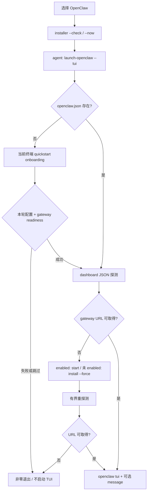

# E1 · Launcher：统一入口，不统一推理引擎

## 问题

用户按一个快捷入口，为什么能启动不同 agent？初始化、提示词、账号选择和常驻 gateway 的差异，在哪一层被吸收？

## 机制

**源码事实。** `omarchy-agent` 是 Bash 适配器，不实现模型推理循环。固定版本的 case 有 14 个 harness 分支；它从 `omarchy-default-agent` 读取用户选择，再构造 argv 数组。没有默认值时普通入口报错，`--pick` 才打开选择菜单；缺少命令、未知选择和意外参数都有拒绝分支。首次登录 hook 只邀请选择，不替用户选 agent。证据：`E1-01`、`E1-02`、`E1-03`，完整名单见[启动矩阵](../evidence/e1-launch-matrix.md)。

### 默认选择与安装事务

默认名保存在 `~/.config/omarchy/defaults/agent`；读取时允许未设置。选择入口把别名规范化，例如 `gemini`/`gemini-cli` 选择的是 `agy`，`oh-my-pi` 选择 `omp`，而不是增加一个独立 case。未安装时转入浮动终端执行 `--install`；安装/激活失败不会先改选择。成功才落盘，再启动 agent；安装中的启动使用 `--inline` 留在同一终端。`claude` 的浏览器扩展安装失败被显式容忍，不能把这一附属步骤当成选择事务的成功条件。证据：`E1-04`、`E1-05`。

`omarchy-mise-install` 写的是 lazy wrapper，不是已安装模型或已登录 agent。wrapper 首次执行时调用 `mise use -g --quiet`，成功再 `mise x ... -- <bin> "$@"`；设置 `MISE_MINIMUM_RELEASE_AGE=0`。生成前拒绝不安全的 command-name 形状，并用 shell quoting 保持 package/bin 为单个参数。`install/user/mise.sh` 关闭升级自动清理，避免删掉运行中进程所用的旧安装目录，并登记多个 wrapper。这里没有冻结每个 CLI 的版本；**固定 Omarchy commit 不等于固定实际 harness binary**。证据：`E1-06`、`E1-07`。

Hermes 与 OpenClaw 不走此 mise 安装路径。默认选择分别调用专用 installer 的 `--check`/`--now`；命令出现在 PATH 上不够，检查的是可运行、完整且与预期 runtime 一致的安装。Hermes 的相关 installer 还检查 desktop app、bootstrap marker 与 prompt-ready 条件；本研究只引用这些条件，未运行其安装和修复逻辑。证据：`E1-04`、`E1-08`。

### 工作目录、终端与提示词

| 边界 | 源码中的约定 | 不应外推的结论 |
|---|---|---|
| 当前目录 | 仅当 `PWD == HOME` 且 `~/Work` 已存在时 `cd`；不创建 Work，也不强制所有启动都在 Work | Work 是便利目录，不是权限隔离 |
| prompt route | `omarchy-agent-prompt` 把 `<prompt...>` 用 `$*` 合成一段文本，转为 `--prompt`；agent 主入口拒绝裸 prompt，避免遮蔽子命令 | 不是保留原始多参数边界的协议 |
| prompt adapter | 各 case 使用数组追加一个 prompt 值；Cursor 明确 `agent --`，Hermes 用 `--query=<整段文本>` | shell 字面传递不等于模型不会服从其中的指令 |
| 终端启动 | 非 inline 调 `omarchy-launch-tui --app-id=org.omarchy.agent`，后者经 `setsid`、`uwsm-app`、`xdg-terminal-exec` | app-id 是窗口归类，不是隔离用户身份 |
| inline | `exec "${command[@]}"` 替换当前进程 | 不附加不同安全策略 |

证据：`E1-01`、`E1-09`、`E1-10`、`E1-M01`–`E1-M14`。不同 case 的 auto/yolo/permission 参数只按**实际传参**列出，不能把名字看似相近的 flag 当成同一权限语义。

### 新会话账号 pin

只有 Claude/Codex/Grok 设置 provider home。若继承的显式 home 正好等于父会话 Omarchy pin，launcher 去掉该继承值与旧 pin，重新选择账号；若 home 是用户另行指定、与 pin 不同，则保留显式 override。需要重新选择时，把 `env -u <home-var> OMARCHY_AGENT_<PROVIDER>_HOME=<home>` 以及非空的 provider home 放进 **command argv**，而不是只 export 给 launcher：源码注释说明经 uwsm 启动的终端不继承本进程全部环境。空 home 也携带空 pin。详细优先级见[E4](04-accounts-usage.md)。证据：`E1-11`。

### OpenClaw：生命周期比参数适配更重要

此图综合两个源码入口，不表示已运行。installer 将 runtime 定位在用户拥有的 `~/.openclaw`，与 packaged seed 分离；检查命令所属、PATH 实际解析及外国 gateway，避免直接接管用户另一套运行时。迁移旧 package service 时记录 running/enabled 状态、停止、rehome 并尽量恢复原状态，失败给出 stopped-note。证据：`E1-12`。

launcher 无配置时先 onboarding；无论 wizard 退出码如何，配置不存在就不继续。dashboard JSON 每次有 10 秒 timeout；没有 URL 时按 unit enablement 决定 `gateway start`（60 秒）或 `install --force`（120 秒），最多 30 轮、间隔 1 秒重新探测，最终仍无 URL 则报错。每次探测本身也可能花 10 秒，因此**不能把总恢复时限写成 30 秒**。TUI 附着已有 gateway，而非 embedded `openclaw chat`。非 TUI 入口最终打开 webapp，不在图中混同成 CLI。证据：`E1-13`。

onboard wrapper 传入 quickstart/install-daemon/skip-ui。只有本轮配置已应用、dashboard `.ok`、监听端口 PID 与 user service `MainPID` 一致，才认为本轮完成，settle 后结束 wizard；旧配置或孤儿 gateway 不足以证明成功。默认 gateway deadline 是看到本轮配置后的 180 秒，用户回答 wizard 的时间不计入；INT/TERM/HUP trap 转发 TERM 给 wizard。源码关于 OpenClaw 2026.9.1 行为的解释属于**上游注释声明**，不是本轮版本匹配实验。证据：`E1-14`。

## 验证状态

已静态核对 14 个 case、prompt、终端、默认选择、mise 与 OpenClaw lifecycle 的实现。`default-agent-test` 声明逐元素 argv、无默认、安装失败保留选择等契约；OpenClaw tests 声明 stopped/never-enabled gateway、message 单参数、旧配置与孤儿进程不误判等契约。**这些测试未运行；不是 stub 输出。**证据：`T1-01`、`T1-02`、`T1-03`。

## 结论

Omarchy 统一的是「选择 → 准备 → 启动 → 可见入口」，而非模型、tool set 或权限。一般 CLI 用参数 adapter，长期运行 agent 要用 lifecycle adapter；新 session 的 identity selection 与已有 session pin 也不能混为一谈。

## 可复用设计

企业入口可借鉴显式 adapter 表、安装成功后才提交选择、有界 readiness 与 owning-process 校验。应额外固定实际 binary 版本、为每个 harness 分别做 argv 和权限契约验证，并在策略层实现授权，不直接复制无人确认的启动默认。

## 未解决

未安装/启动任何 harness；未核验其实际版本、权限语义、终端环境传播、账号登录或 gateway readiness。Work 目录与 app-id 的运行效果未实验验证。
