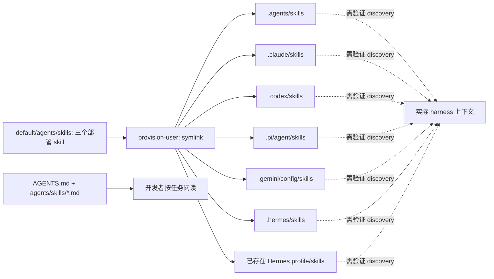

# E2 · Skills：单一源分发与渐进式上下文

## 问题

操作系统知识如何进入多个 agent？文件放到「skills」目录，是否就足以证明 agent 会加载、使用并遵守？

## 机制

**源码事实。** `omarchy-provision-user:84–104` 遍历 `default/agents/skills/*/`，把每个目录链接到六个根位置及**已存在**的 Hermes profiles。固定树实际只有 `omarchy`、`omarchy-app`、`diagnose-crash` 三个部署 skill；每个均含带 name/description 的 `SKILL.md`，参考文件与其同目录。不是把 `agents/skills/` 的开发指南一起部署。证据：`E2-01`–`E2-04`；完整目录见[skill map](../evidence/e2-skill-map.md)。

实线只表示源码里的文件部署；虚线不是已验证加载。`.agents` 是一个目标目录，不代表此版本的全部 14 个 harness 都共享其发现规则；`.gemini/config` 也不能误写成 launcher 仍有独立 Gemini case。

### 指令内容与停止条件

| Skill | 触发与最小上下文 | 按需深入 | 明确边界 |
|---|---|---|---|
| omarchy | 终端、主题、Hyprland、系统/用户配置；明确排除 Omarchy 源码开发 | 六份 topic guides | packaged `/usr/share/omarchy` 只读；用户目录编辑；reset 前确认；按是否有交互终端选择 sudo/pkexec |
| omarchy-app | 创建单用途 Qt Quick 桌面应用 | `templates.md` 的 build/test/theme/packaging 模板 | 用途不明先澄清；不改原始用户数据；原子保存；丢弃数据前确认；失败在窗口中说明 |
| diagnose-crash | core dump/崩溃证据诊断 | 判断为 Omarchy bug 后才读 `reporting.md` | 先证据后归因；诊断不修复；core 内存敏感且应临时提取清理；mute 需用户要求；上游发帖需明确同意 |

这些是**文档声明/给 agent 的行为指导**，不是执行时强制拦截器。证据：`E2-02`–`E2-05`、`E2-12`、`E2-13`。

`omarchy/SKILL.md` 提供粗粒度触发、系统布局和命令发现入口，细节由 guide 分流。Hyprland guide 要先查现有绑定并检查 configerrors，window-rule 语法要求查对应官网；plugins guide强调 long-lived unsandboxed shell 中的输入边界；themes guide区分用户 overlay、fork 和下载主题；hooks guide说明 event directories；capture guide说明采集与分享；contributing guide区分 verified bug、feature 与 support。**本研究只阅读这些 guide 本文，不执行其中命令，也不递归采集它们所有外链。**证据：`E2-06`–`E2-11`。

渐进式上下文是这些文档的组织策略：元数据定位任务 → 主 skill 约束 → 相关 guide → 必要源码/诊断材料。它减少「一次塞进全部系统知识」的需要，是否实际减少 token 或提高准确度是**分析推断、待测效果**，没有本轮测量。

### 更新并非全自动兼容

symlink 指向当前 `$OMARCHY_PATH`，既可 packaged tree，也可 dev-linked checkout；更新同一路径内容能让链接看到新文件，但仍须 harness 重新发现/重读。finalize-user 有完成 marker，不是每次登录重跑。新增 skill 或新增 harness 目录需要 provisioning/迁移；已有 Hermes profiles 被遍历，**后来创建的 profile 不由这一次循环自动覆盖**。证据：`E2-01`。

五个相关迁移分别修复 omarchy 的四个旧目录、补 diagnose-crash 与 watcher、增加 Antigravity 的 Gemini 目录、覆盖 Hermes existing profiles、补 omarchy-app。最后一个 `1790702606.sh` 对同名非 symlink 用户目录留在原处；不能把它的保护逻辑外推到每个迁移或所有 `ln -sfn` 情形。证据：`E2-14`–`E2-18`。

## 验证状态

三份 SKILL 与全部同目录参考文件已静态阅读。Hermes migration test 声明默认目录与已有 profile 的 link target、幂等、不得创建新 profile、source 缺失时 no-op；**未运行**。证据：`T2-01`。

2026-10-12 官方 Claude Agent SDK 页面说明 filesystem setting sources、metadata discovery 与按需全文加载，提供初始化 `skills` 观察口。但这是**当前 SDK 文档声明**，未绑定 Omarchy 实际安装的 Claude CLI；只能支持可选验证方法，不能证明此 snapshot 的 symlink 已生效。其他 harness 的安装版本和发现语义本轮未核验。证据：`W3`。

## 结论

最强证据是「可追溯的单一技能源与明确文件部署」，不是「14 个 agent 都已经学会操作系统」。Skill 是受版本管理的程序性知识，既包含能力，也包含停止、确认和责任归属。

## 可复用设计

企业技能仓库应分开用户操作技能与开发指南，按需分层，发布时记录源版本与目标适配。再为每个实际 harness 验证 discovery、调用与遵守三个层次；新增 profile/账号 home 需要生命周期接入，而不能只测符号链接存在。

## 未解决

未启动 harness 验证 skill loaded/invoked；未测自定义 provider home 是否影响技能目录，未核验新 Hermes profile 的部署时机。提示词指导的实际遵守率、更新缓存行为和 token 收益未验证。
