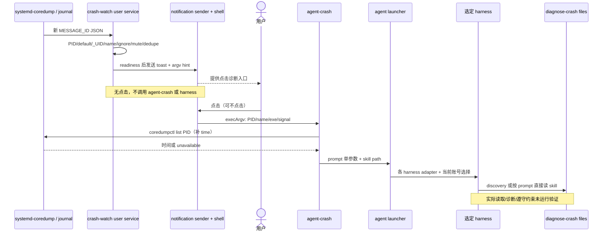

# E3 · Crash → 通知 → 人工选择 → 诊断

## 问题

OS 的结构化故障信号如何进入 agent？谁决定开始诊断，哪些过滤、去重与数据边界防止事件变成无限自治循环？

## 机制

**源码事实。** user unit 在 `graphical-session.target` 之后启动并随其结束；要求 `WAYLAND_DISPLAY`，检测全局 off flag，失败后 5 秒重启。首次登录的 enable-user-units 逐个 `enable --now`；旧用户 migration 增加 wants link 与有图形 session 时的 start。这是**通知服务**，不是 system-wide crash 自动修复 agent。证据：`E3-01`–`E3-03`。

### 事件过滤与生命周期

watcher 用 `journalctl -f -n 0 -o json MESSAGE_ID=fc2e22bc6ee647b6b90729ab34a250b1` 消费新 coredump 事件，不重放历史。字段为 `_UID`、`COREDUMP_COMM`、`COREDUMP_PID`、`COREDUMP_EXE`、`COREDUMP_SIGNAL_NAME`；缺失/空字段用 `-`，避免 tab/IFS 空位坍缩。注意源码检查的是 journal **`_UID`**，不是 `COREDUMP_UID`；本轮未实测目标 Linux/systemd 的真实事件字段。证据：`E3-04`。

处理顺序：PID 必须数字 → 每次查当前默认 agent，未选则跳过 → `_UID` 必须数字且等于 shell `$UID` → 用绝对 executable 的 basename 优先于 15 字符 comm → 再降为单个路径分量，空/`-`/`.`/`..` 用 unknown → ignore regex → 排除 `omarchy-crash-*`/`omarchy-agent-*` 自身 → per-program mute → 按程序名去重 → 尝试通知。默认 dedupe 60 秒，可用环境覆盖；`last_notified` 只在 `announce` 成功返回后更新，不是 journal 时间戳或跨进程持久状态。证据：`E3-04`、`E3-05`。

通知先等待 shell IPC 和 D-Bus server，默认最多 10 秒的 readiness 重试；发 critical toast，用默认 app-name `omarchy-action`（notification logic 让它通过 DND），点击 argv 为 `omarchy-agent-crash PID NAME EXE SIGNAL`。通知发送返回成功只代表调用成功，不是已证明用户看到或点击；停止期间漏掉的事件也不会因 `-n 0` 补回。证据：`E3-06`、`E3-07`、`E3-08`。

### 从 shell argv 到 prompt 的两条边界

`omarchy-notification-send --exec` 消费尾部离散 argv，以 NUL 分隔转成 JSON 字符串放 `omarchy-exec-argv` D-Bus hint；headline/body 是 typed string，不经 notify-send 的 option parser。Service 在 **invokePopupDefault** 才解析该 hint；结构有效后调用 `Util.execArgv`，后者使用常量 `exec "$@"` 与 bash positional parameters，而非把 crash name 插入 shell source。证据：`E3-08`–`E3-11`。

这只能证明特定 argv 流不重新求值 untrusted 字段；不能推出「同 UID 发来的任何通知都可信」。`parseExecArgv` 检查数组/string/program 形状，不检查命令意图，源码明确 well-formed shell command 仍可被接收。见[E6](06-safety-model.md)。证据：`E3-09`。

点击启动的 `agent-crash` 再校验数字 PID，补 comm/exe/signal 缺省 unknown，尝试实时 `coredumpctl list` 获得时间；core/journal 轮转或查询失败只使 time 为 unknown。它在固定模板里插入这些事实和 skill path，最后 `omarchy-agent --prompt`，没有在模板构造时运行事实字符串里的 shell 内容。**它并不在启动前提取整个 core，也不保证输入 PID 对应的事件仍可用。**证据：`E3-12`、[prompt contract](../evidence/e3-prompt-contract.md)。

### 静音不是修复

全局 `crash-capture-off` 同时被 unit ConditionPathExists 和 toggle helper 使用；当场 stop/start，后续登录仍读 flag。per-program mute 存于 `~/.local/state/omarchy/toggles/crash-ignore/<basename>`，支持 on/off/toggle 和列表，只算 regular files；命令降 basename、拒绝空/点分量和未知 action，写入失败不输出已静音。mute 不阻止 core 产生，也不修复程序。解释器 basename 会合并多个程序，不能误说某脚本得到了独立 identity。证据：`E3-13`–`E3-16`、`E2-04`。

diagnose-crash 给出的程序是事实 → OOM 排查 → 时间线/更新关联 → 多线程 stacks → 可符号化则符号化 → 分清证明与推断 → 诊断报告。指导要求临时 core 清理、诊断不修复、mute 只在用户要求时执行；上游报告另有确认门槛。这些是**文档声明**，不是模型外的只读权限。证据：`E2-04`、`E2-13`。

## 验证状态

`crash-capture-test` 用 fake HOME、stub journal、stub notifications 声明 toggle、mute、basename、路径降级、空字段、后续事件继续读取以及失败不报成功等契约。已静态阅读全文；未执行测试，未触发 segfault，未连接 Linux journal 或真实通知服务。证据：`T3-01`、`T3-02`。

## 结论

关键设计是 **OS 事件提供上下文，用户点击才授权开始诊断**。它不是从「出现异常」直接到「无人确认修复」的闭环。通知 argv hardening 与模型 prompt 信任是不同问题，不能用前者替代后者。

## 可复用设计

企业异常入口可以先用结构化事件过滤、去重和可逆静音，再提供带事实来源的人工入口。要增加 event identity/存活校验、敏感信息脱敏、最小读取权限和独立工具授权，不能只靠 “Diagnosis reads” 这句话。

## 未解决

图形 session、session bus、journal 可读性、systemd 字段与 core 保留都是实际运行前提。事件去重仅在 watcher 进程内；UID 过滤、DND、core 可读取、skill 遵守与报告质量均未实验验证。
