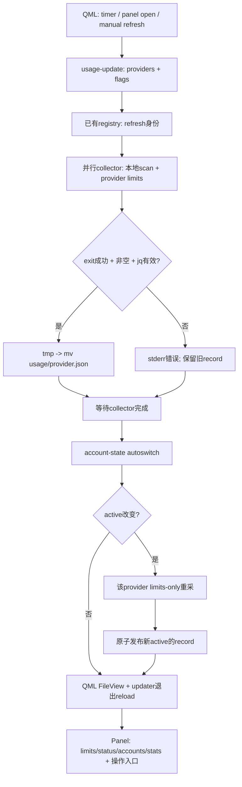

# E4 · Accounts / Usage：路由身份、观测额度、再决定切换

## 问题

多个登录如何与运行中 session 分离？一个统一 panel 如何呈现来源不同、更新频率不同、失败语义不同的额度？

## 机制

### 三个不同集合

| 集合 | 固定版本成员 | 不能混淆 |
|---|---|---|
| 可启动 harness | E1 的14个 case | 不等于14种账号切换支持 |
| Accounts provider | Claude、Codex、Grok | Fireworks不在registry provider表 |
| 默认 Usage provider | Claude、Codex、Grok、Fireworks | 是本commit内建集合，不是协议封闭枚举 |

updater发现可执行的 `omarchy-agent-usage-*`，排除自己；QML发现usage目录的JSON，因此可扩展不是靠写死四个UI实例。pi/omp/opencode会作为部分provider订阅消耗的补充历史来源，不因此成为Accounts provider。证据：`E4-01`、`E4-02`、`E4-20`、`E4-53`、`E4-54`。

### 身份与会话不随选择一起漂移

registry位于 `${XDG_STATE_HOME:-~/.local/state}/omarchy/agents/accounts/<provider>.json`，保存active、switch、threshold、alert及accounts。默认Main/manual/95%；threshold钳制50–100。registry目录0700，文件0600；read-modify-write按provider加flock，临时文件后os.replace。身份从各登录home读取并refresh，不把label当登录真相；Codex JWT payload解码不是签名验证。证据：`E4-03`–`E4-05`、`E4-55`、`E4-75`。

附加账号的credentials留在各自home，但projects/sessions、settings、skills等按provider配置共享到primary。Claude还复制指定MCP/trust/onboarding等设置。已有共享目标不覆盖。这是**登录数据分目录**，不是tenant、workspace或OS权限隔离。身份摘要可含email、plan、home，不是全部可公开的telemetry。证据：`E4-06`、`E4-07`、`E4-56`。

dispatch优先级是 **非空显式provider home → 存在的Omarchy pin（空也有效）→ registry active → 默认CLI home**。Main用空pin保持默认home隐式；附加账号用显式目录。mise系统配置给三种CLI挂account-exec wrapper；参数用argv传递，重新注入wrapper PATH让跨provider子命令也可路由。E1的新session launcher会主动移除父pin的继承选择，重新读当前active；普通子调用则保留pin。证据：`E4-08`、`E4-09`、`E4-57`、`E4-76`、`E1-11`。

Add先用provider自己登录，再验证identity并注册；use改active但不改运行中的session；rename改ID/label却不搬home；remove拒绝primary、用`/proc`环境检查正在使用的home，只删受控accounts子目录，不跟随共享link删目标。Linux进程权限/PID namespace下的完整性仍未测。证据：`E4-10`、`E4-11`、`E4-58`、`E4-59`。

### 四个 collector 的真实来源

以下是**代码如何采集/解释数据**，不是对真实provider API政策的认证；没有读取真实credentials或调用这些endpoint。

| Provider | 本地活动来源与schema | 限额/余额来源与schema | windows及核心失败语义 |
|---|---|---|---|
| Claude | projects JSONL的assistant message usage；按message ID取最大output的整条快照；空统计fallback stats-cache/history；补pi/omp的anthropic、opencode SQLite两个schema | Anthropic OAuth `/api/oauth/usage`；five_hour、优先seven_day_oauth_apps再seven_day、model-scoped limits；utilization尺度归一化 | 5h/7d及scoped Session/Weekly/Monthly；15s probe复用，失败保留cache，900s内可仍视current；过期token区分paused/expired |
| Codex | sessions/archived_sessions原生JSONL，mtime最近30天，model_provider筛openai；last_token_usage增量，cached从input扣除；补pi/omp openai-codex及opencode | 启动已安装真实Codex app-server，initialize → account/rateLimits/read；缺plan才account/read；primary/secondary、usedPercent、windowDurationMins、resetsAt、available reset credits | 分钟/小时/7d标签；无持久limits fallback cache；probe失败给空limits/status，不能用旧额度假冒本次成功 |
| Grok | sessions summary的num_messages + usage.turns的modelUsage；input扣cachedRead，cacheCreation另计；plan来自嵌套settings cache | Grok CLI billing credits endpoint；config.creditUsagePercent、currentPeriod.type/end；该home login key | Weekly或Monthly；60s正常复用；refreshable access过期可沿用cache并week roll-forward；该live不是刚成功请求的证明 |
| Fireworks | 账户级billingUsage的serverlessCosts，不是本机prompt日志；最近30个本地日期、SERVERLESS、model分组；最多20页 | billingUsage + 优先getBalance；失败时用fundedAmount减fundedAt后account costs，cost query再fallback billing summary；Money units/nanos | 无订阅limits窗口；balance区分actual/estimated；无cache；force/limits-only仅接口兼容；balance失败可保留tokens并标unavailable |

精确定位与字段细节见[状态/collector契约](../evidence/e4-state-contracts.md)。证据：`E4-19`–`E4-35`、`E4-60`–`E4-67`。Fireworks每轮解析一个account ID并生成其record；discovery恰好返回一个账号才自动选，否则要求配置ID。这是collector的选择规则，不意味着其API只能支持一个账号。输出 `scope: "account"` 与cost query的 `scope: "ACCOUNT"` 不是同一字段。证据：`E4-66`、`E4-67`、`E4-77`。

**不能合并的freshness语义：** `updatedAt`只是本record生成时间，不是额度测量时间。Claude/Grok有fetchedAt/缓存状态，Codex此版本没有同等measure timestamp；Grok的refreshable过期分支可把旧额度仍标live。Fireworks估算不是账单余额认证，其20页上限也没有truncation字段。只有做provider-specific freshness/complete检查才能把统一字段用于可靠决策。证据：`E4-22`、`E4-31`、`E4-33`、`E4-68`。

### 刷新 → 原子发布 → 切换 → 重采

updater只做成功exit/非空/JSON检查，**不是完整schema validator**。provider内部失败若被编码成valid unavailable JSON并返回0，仍会替换record；真正执行失败或非JSON则保留旧文件。之后autoswitch仍运行，可能使用旧cache/record，不能称fresh measurement事务。Agent.qml解析失败清空record；未变文本保留对象；updater退出时reload弥补atomic rename的file watch问题。证据：`E4-36`–`E4-39`、`E4-69`。

Panel不负责collector extraction，但可执行add/reauth/rename/use/mode/launch，不是绝对无动作的纯display。过期window显示为0，explicit title优先，stale在hover展示年龄而非变暗；README关于strict display、stale dimming需按此源码限定。UI对当前provider最高window告警90%，Fireworks需funded>0且remaining/funded≤10%才余额告警；两者不是默认autoswitch95%的触发值。证据：`E4-41`、`E4-50`、`E4-51`、`E4-70`、`E4-71`、`E4-78`、`E4-79`。

### Autoswitch不是「挑最低使用率」

account-state取所有未reset窗口的最高percent作为peak；全部已reset则0，未知仍unknown。active达到threshold才决策，不会因旧账号刚reset就切回。候选peak已知且低于threshold，排序依次为：是否接近threshold−15点 → 是否stale → usage → 较早next reset。stale不完全排除；fresh40可胜stale10，fresh94也可能输stale10。manual只发可点击建议；auto只更新新session active；alert去重。`Waiting for auth`被排除，不能外推所有认证异常都被排除。证据：`E4-12`–`E4-16`、`E4-43`。

默认QML周期900秒（配置下限30）；多账号active接近 `min(80%, threshold−15点)` 时最多180秒。threshold100时仍从80%开始；打开Panel做limits-only，手动做force；retryAdvised另触发30秒单次相关provider重试。这依赖shell组件运行，不是独立account daemon。所有账号均已知且超阈值才报告exhausted；一个账号恢复时间取阻塞窗口最晚reset，再在账号间选最早恢复者。证据：`E4-17`、`E4-18`、`E4-72`、`E4-73`。

跨设备snapshot只导出stats，不导出账号home/email、limits、balance或authHelp。device scope相加，account scope逐字段max以避免重复，activeDates取union；account scope仅按providerId分组，不能保证多个不同Fireworks账号混入时统计正确。证据：`E4-40`、`E4-74`。

## 验证状态

account helper、四个大型collector的数据源/cache/failure/window函数、updater与QML数据契约已静态阅读。测试fixtures声明pin/override、隔离登录与共享设置、ranking、token去重、scoped limits、Grok过期处理、Fireworks余额fallback、无效JSON与reload恢复等预期；**全部未运行**。证据：`E4-42`–`E4-50`、`T4-01`–`T4-04`。没有provider billing API调用、真实usage或panel视觉验证。

## 结论

这里统一的是身份路由和观测协议，不是模型配额制度。account provider、usage provider和harness必须分开；统计、限额、余额、freshness不能共享一个「成功/失败」语义。Autoswitch是本地便利策略，不是企业quota、支付或tenant治理。

## 可复用设计

企业可复用session-stable identity、collector adapter与原子snapshot，但需增加schema版本校验、measurement timestamp、freshness/completeness标记、account-level身份与集中凭据代理。自动切换必须服从组织允许的账号/合同/预算政策，不能当规避provider限额的办法。

## 未解决

未验证真实API响应、quota政策、CLI RPC副作用、token刷新、`/proc`覆盖、file watch及账号运行环境。未测统计准确性或同账号跨设备假设；当前cache/unknown/stale策略不能充当权威账单或金融决策依据。
