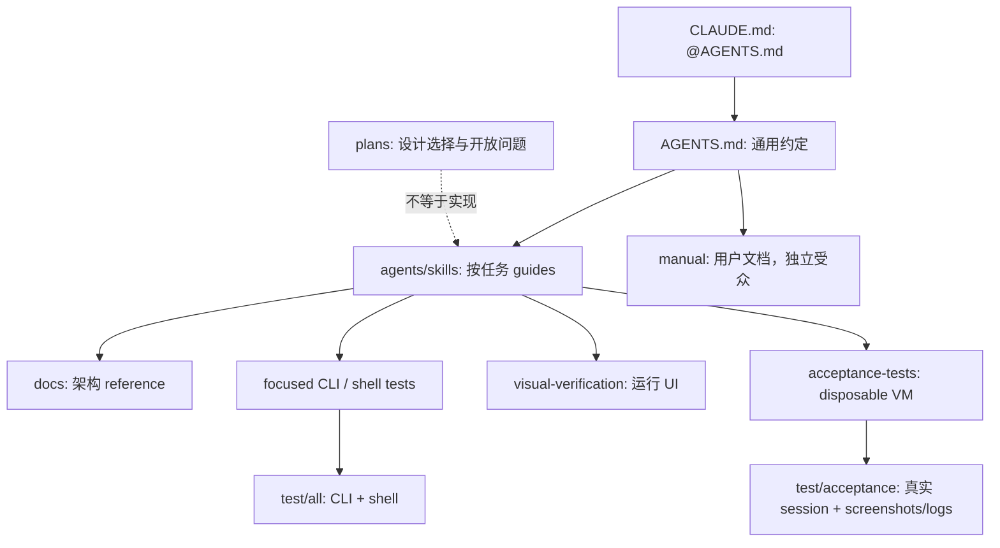

# E5 · Agent-native repository：把操作程序做成工程资产

## 问题

Omarchy 怎样让源码工作对 agent 可理解、可检查？共同署名、计划文本和测试脚本分别能证明到什么程度？

## 机制

### 指令与文档分层

`AGENTS.md` 先列任务 guides，再定义文档受众、Bash/命令规范、runtime env、helpers、事件优先后台工作、focused tests 与 visual verification。源码树区分 `agents/skills/` 的任务程序、`docs/` 的架构 reference、`manual/` 的 end-user 文档。`CLAUDE.md` 是普通文件，内容引用 `@AGENTS.md`，不是 link。这是**源码文件事实与上游指导声明**，不是本研究执行的要求。证据：`E5-01`、`E5-02`。

图中没有从 `test/all` 自动连到 acceptance；运行 UI、VM 层本轮都未执行。

### 程序性指南可检验

Command metadata guide 把 `omarchy:summary/args/aliases/...` 变成路由/help 的契约；install guide区分 root setup、用户 finalization 与 sourced leaves；shell-dev guide要求复用 IPC、file watch/push/event sources，明确 QML capability facades 不是 same-process sandbox；migrations guide要求 per-user completion、幂等与同步顺序，失败保留 pending，login notifier不静默运行修复。证据：`E5-03`–`E5-06`。

因此 agent-native 不是给仓库贴一个 AGENTS 文件而已：任务 guide 能定位到 helper、文件布局、输入/输出和测试入口。但能否被每个开发 harness 自动读取，仍须版本/运行证据；本轮只确认 repository 提供了这套程序。

### Headless tests 与 acceptance 的不同证明力

| 层 | 固定版本声明/实现 | 证据边界 |
|---|---|---|
| `test/cli` | CLI routing、help/metadata、部分 theme/stub coverage | runner 的存在不证明通过 |
| `test/shell` | 发现 `test/shell.d/*-test.sh`；各文件独立，失败继续汇总 | 名称 shell 不意味着一定无图形依赖 |
| `test/all` | 聚合 cli + shell，单 suite 失败不遮蔽另一 suite | 不含 acceptance |
| headless 合约 | fake HOME、real source path、stub binaries、plain JS/Node logic；不可达 compositor 用 skip 区分缺覆盖 | skip/无失败不等于每个 check 都通过 |
| acceptance | live Omarchy session，disposable VM；应用、配置临时改变，收集 screenshots/logs | 不应在用户活跃桌面执行 |
| visual verification | 自动测试之外查看 clipping/focus/stale state 等可见效果 | 有截图产物不等于已审阅截图 |

证据：`E5-07`–`E5-10`、`E5-13`。`test/shell` 也可能包含 compositor-gated checks，称为「非图形组织的 suites」比「全是纯 headless unit tests」准确。

### Plans 是设计证据，不是部署结果

`plans/backup.md` 的 revision 文本声称吸收 codex review，并写了 threat model、engine alternatives、secrets/partial success/restore 与开放问题；`plans/dots.md` 的 revision 声称 codex/grok review，区分 config history 与 sync，拒绝 raw git over HOME。这些能证明**固定版本里有此文档与其自述**，不能证明那些功能已实现、review独立或所有设计已验收。这里选取它们作为「有范围、替代方案与安全边界的设计工件」样本。证据：`E5-11`、`E5-12`。

共同署名应按唯一 commit 而非 trailer 行数统计；固定 SHA 祖先与日期/范围过滤才是有效分母。当前没有完整祖先 DAG acquisition，没有 numerator/denominator 或比例。Co-authored-by 既可漏记也可被手工加入，只证明记录，不能推出全部 agent 使用率、模型身份或代码贡献百分比。详细方法及缺口见[e5-methodology](../evidence/e5-methodology.md)。

## 验证状态

已静态读取 AGENTS/CLAUDE、testing、相关 guides、两份代表性计划的对应范围与 runner。未运行 tests、acceptance、UI 或观察实际开发 session；不沿用附件的 VM 结论。byte/hash 核验只证明材料身份，不把「获取完整」当成「研究全部历史」。

## 结论

Agent-native 的可复用部分是把隐含经验变成**有入口、分层、可验证、能说明失败的工程程序**。自动化测试、桌面验收和设计提案有不同证据等级，不能用一个 `test/all` 标签抹平它们。

## 可复用设计

企业 repo可采用通用指令 → 任务指南 → reference → focused contract test → 独立集成验收的层次。指南中要明确停止条件、临时状态清理与实际产物审阅；把 skip、partial 与 fail写成不同状态。Agent attribution应独立于功能验证。

## 未解决

固定 SHA 祖先全历史未采集；不报告共同署名比例。计划中的实现状态、实际 guide adoption、生产效率收益与独立复核均未取得。
