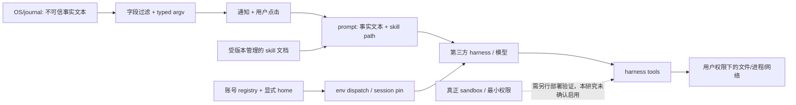

# E6 · 信任模型：便利层与强制隔离不是一回事

## 问题

系统事件、skill、账号与 agent 能力的交叉处有什么边界？哪些措施真正约束解析或进程状态，哪些只是给模型的建议？

## 机制

本章是基于 E1–E5 的**设计信任分析**，不是漏洞审计、权限语义认证或合规证明；没有执行攻击、真实工具、桌面或 provider 操作。

图中的实线是调用/数据流；虚线是企业所需而本 snapshot 集成路径尚未证明具备的额外 enforcement，不表示所有第三方 harness 都没有自己 sandbox。

### 四条主要信任边界

| 边界 | 已有证据 | 残余问题/不能声称 |
|---|---|---|
| OS data → prompt | PID/`_UID`/basename/ignore/mute/dedupe，notification typed argv，模板单 prompt 参数（E3） | shell-safe 不能抵抗模型把恶意事实当指令；core/journal 可能包含隐私 |
| skills → agent | 单源 symlink，指南的只读/确认/停止条件，crash直接读 path fallback（E2/E3） | skill是内容权限而非工具权限；加载与遵守未测 |
| account env → credential home | registry selection、显式 home、session pin（E1/E4） | home分目录不是进程/用户隔离；同用户的进程可能仍访问其他home；不是 credential broker |
| agent → system | launcher传入各 CLI flag，用户图形会话启动（E1） | 是否允许写/执行/联网由具体 harness、版本和策略决定，不能从 flag名外推 |

依据：`E1-11`、`E2-01`–`E2-05`、`E3-04`–`E3-12`、`E4-01`–`E4-10`。具体账号约束以[E4 状态契约](../evidence/e4-state-contracts.md)为准。

### 措施必须按作用分类

| 措施 | 类型 | 有效作用 | 不具备的保证 |
|---|---|---|---|
| 数字 PID、basename、JSON argv、常量 positional exec | 确定性输入/解析 hardening | 针对已追踪调用链保持字段与命令边界 | 任意工具意图安全、所有 prompt 无注入 |
| watcher默认选择与用户点击 | 工作流门槛 | 无点击不启动此次 agent诊断 | 开始后工具逐项授权 |
| diagnose-crash “不修复”、mute/发帖确认 | prompt advice | 描述期望行为和停止条件 | read-only OS权限 |
| launcher各 approval/auto/yolo flag | CLI 配置参数 | 精确确认 Omarchy传了什么 | 不同产品同等安全效果 |
| `~/Work` | cwd便利 | 避免在HOME重复信任提示的设计意图 | 防越目录读写、secret隔离 |
| provider home + pin | directory selection + session一致性 | 新 session选择与已有 session固定分开 | tenant强隔离、credential权限边界 |
| crash mute / global off | 事件可见性控制 | 减少通知，支持恢复 | 阻止crash、禁用core、修复软件 |
| Snapper/restore | 可恢复性 | 源码提供create/restore入口；manual说明root恢复 | tool sandbox、网络隔离、个人home备份 |

Snapper入口发现工具缺失时返回127，无配置时拒绝假称已创建；实际create遍历检测到的configs，不能把代码的支持范围说成硬编码root-only。**用户手册描述的常规restore只恢复root，不恢复/home及~/.config，且有Limine安装条件**。不能据此承诺能撤销任意 agent 操作。证据：`E6-01`、`E6-02`。

### 不把注释当权限认证

例如 Muse分支注释称 `--approval-mode never` 保留 Muse自己的sandbox；这是上游注释声明，当前无安装binary/version或匹配官方证据。本研究只确认该flag被传入。Pi/Ori无同类permission-skip flag，也不意味着它们默认强隔离；Claude此处是 `--permission-mode auto`，不能改写成与Grok的 `bypassPermissions` 等价。证据：`E1-M05`、`E1-M06`、`E1-M11`、`E1-M13`、`E1-M14`。

当前Copilot CLI官方文档把automatic approval与sandbox分开，说明trusted directories权限范围是heuristic；Claude SDK官方文档把hooks/deny/ask/mode/allow/callback分开。两者可支持企业设计对照，但**本 snapshot的未锁定CLI版本不能直接套用今天官网的flag实现**。证据：`W2`、`W5`。

notification结构检查也不是same-UID native程序sandbox：其源码明确结构合法的 `bash -c` 意图不会被该parser判定。QML shell-dev指南同样明示capability facade不构成same-process QML sandbox。它们是边界自述，不能扩成产品的绝对安全结论。证据：`E3-09`、`E5-05`。

## 验证状态

已逐边关联固定源索引与其他五章；没有执行上游tests、真实权限探测、prompt攻击或cloud实验。当前仅有文档归档自查，待独立复核。

## 结论

Omarchy把agent放进用户熟悉的OS工作流，换取低摩擦体验；它没有在所追踪的集成层统一建立最小权限、预算控制或强sandbox。真正的权限效果需看各harness及系统配置，不能从“agentic OS”名称推导。

## 可复用设计

企业落地应将事件 admission、数据脱敏、credential broker、tool authorization、sandbox、预算、审计与回滚分层。保留点击门槛和argv hardening，但把高风险工具的允许/拒绝放在模型外，按产品和版本验证，而不是依赖skill、Work或plan-mode建议。

## 未解决

未验证真实harness权限/sandbox、credential-home跨账号可见性、敏感core/provider数据外发、skill prompt遵守、session生命周期和回滚有效性。没有形成漏洞清单，也没有声称通过任何安全标准。
