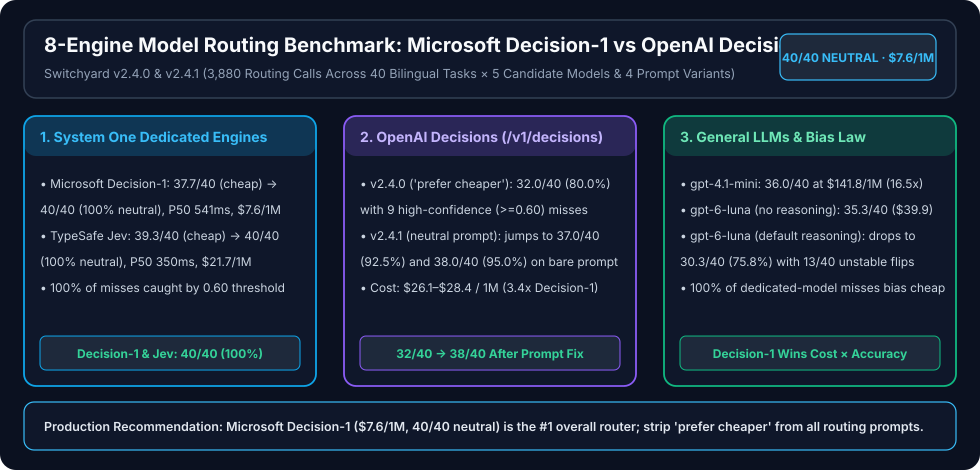

# OpenAI Decisions 加入实测，微软 Decision-1 依旧是首选：8 种多模型路由方案与指令敏感度全景评测（Switchyard v2.4.0 & v2.4.1）

> 🌐 **Language / 语言切换**: **[🇨🇳 中文版 (README.md)](README.md)** | **[🇬🇧 English (README.en.md)](README.en.md)**
> **分类归属**：`评测与治理` × `Agent 与编排` → **决策模型与多模型路由评测（Decision Models & Model Routing）**
> **关联基线专题**：[System One 专用决策模型与多模型路由横评（Decision-1 / Jev / OpenJev / Laya / Strands Decider 2B）](../decision-model-routing/README.md) · [LocalJev（OpenJev 27B 与 Laya 8B）开源协议与许可边界审计](../localjev/README.md)
> **7-Card 4:5 视觉评测报告**：[`test-report.md`](test-report.md) · [`test-report-cards.html`](test-report-cards.html) · **结构化数据**：[`report.json`](report.json) · **证据账本**：[`evidence.json`](evidence.json) · **治理审查**：[`review.md`](review.md)
> **数据属性（Provenance）**：`anonymized_reported`（`independently_reproduced=false`，基于开源路由器 [`satomic/model-router`](https://github.com/satomic/model-router) `v2.4.0` 与 `v2.4.1` 随附密封实测数据包 `summary8.json` / `summary241.json` / `rows8.json` / `rows241.json` 归档与交叉核验）

---

## 1. 核心结论（Executive Summary）

当 OpenAI 原生决策端点 **OpenAI Decisions API（`POST /v1/decisions`）** 与 **GPT-6-Luna**（关闭推理 `reasoning_effort="none"` vs 默认开启推理）加入开源多模型路由器 **Switchyard**（原 `satomic/model-router`）的 **40 题中英双语 × 5 候选后端模型** 基准测试后，评测矩阵扩展为 **8 种路由方案**，并先后完成了两轮核心实验（累计 **3,880 次路由决策调用**）：

1. **第一轮（`v2.4.0` 默认带省钱倾向指令 `cheap`，8 种方案 × 40 题 × 3 轮 = 960 次调用）**：
   - **TypeSafe Jev（`jev-latest`）**：**`39.3 / 40`（`98.3%`）**，P50 延迟 **`350 ms`**，每百万次决策 **`$21.7`**；全量 120 次调用仅 2 次失误（概率 `0.48–0.49`），被 `0.60` 置信度阈值 100% 拦截。
   - **Microsoft Decision-1（Azure AI Foundry）**：**`37.7 / 40`（`94.2%`）**，P50 延迟 **`541 ms`**，每百万次决策仅 **`$8.6`**（只计 1 个输出 token）；全部 7 次失误概率均 `<= 0.56`，同样被 `0.60` 阈值 **100% 拦截**。
   - **OpenJev 27B（本地 Apple M4 Pro 48GB，MLX 4-bit）**：**`37.0 / 40`（`92.5%`）**，40/40 跨轮稳定，API 费用 `$0`（但权重为 **CC BY-NC 4.0 非商用许可**），本地 P50 延迟 **`2,566 ms`**。
   - **通用 LLM 路由（`gpt-4.1-mini` / `gpt-6-luna`）**：`gpt-4.1-mini` 得 **`36.0 / 40`（`90.0%`）** 但成本高达 **`$141.8 / 1M`**（Decision-1 的 **16.5 倍**）；`gpt-6-luna` 关闭推理（`reasoning_effort="none"`）得 **`35.3 / 40`（`88.3%`）**（成本 `$39.9 / 1M`），而默认开启推理（`luna-default`）反而因“过度合理化”跌至 **`30.3 / 40`（`75.8%`）**，且 40 题中有 **13 题跨轮摇摆**（稳定度仅 `27/40`）。
   - **OpenAI Decisions API（`POST /v1/decisions`，固定底层 `gpt-6-luna`）**：仅得 **`32.0 / 40`（`80.0%`）**（显式 A 组 `18/20`，隐式 B 组仅 `14/20`），每百万次决策 **`$28.4`**（Decision-1 的 **3.3 倍**）；且全部 8 道错题（24 次调用）**100% 误判给最便宜的 `gpt-4.1-mini`**，其中 3 道题（9 次调用）错误置信度高达 `0.60–0.75`，直接穿透 `0.60` 兜底阈值。
2. **第二轮（`v2.4.1` 删去“简单请求优先选便宜模型”一句改为中性指令 `neutral`，并测试 4 种指令变体，共 2,760 次调用 + 160 次直连 API 诊断）**：
   - **删去一句省钱提示后，三款 System One / Jev 架构专用决策模型（`TypeSafe Jev`、`Microsoft Decision-1`、`OpenJev 27B`）同时达到 `40 / 40`（`100.0%`）满分且 `40 / 40` 跨轮全稳定**！其中 `Microsoft Decision-1` 每百万次决策成本降至 **`$7.6`**（输入均值从 205 tokens 降至 180 tokens）。
   - **OpenAI Decisions 准确率从 `32 / 40`（`80.0%`）跃升至 `37 / 40`（`92.5%`）**（在极简 7 词指令 `bare` 下达 `38 / 40` = `95.0%`），证明其在 `v2.4.0` 中的大幅掉分主要源于对指令中“prefer cheaper”字眼的过度顺从；但即便在中性指令下，它仍落后 `Decision-1` 与 `Jev` **7.5 个百分点**（漏掉 `B8` 硬币马尔可夫期望、`B9` 押韵婚礼祝酒词、`B14` PR 一句话总结），成本仍是 `Decision-1` 的 **3.4 倍**（`$26.1` vs `$7.6 / 1M`）。
   - **4 种指令变体（`neutral` / `cheap` / `strong` / `bare`）敏感度跨度**：`TypeSafe Jev` 仅差 **1 题**（`39–40 / 40`），`Microsoft Decision-1` 仅差 **2 题**（`38–40 / 40`），`OpenJev 27B` 差 **4 题**（`36–40 / 40`），而 `OpenAI Decisions` 跨度达 **6 题**（`32–38 / 40`）。
   - **单向省钱偏置定律**：在 4 种指令变体的全部 480 次调用/引擎中，`Jev`（3/3）、`Decision-1`（9/9）、`OpenJev`（18/18）和 `OpenAI Decisions`（48/48，其中 33 次向下、15 次从创意模型横向落入 `gpt-4.1-mini`）的**所有误判 100% 偏向最便宜的 `gpt-4.1-mini`，哪怕在明确要求“拿不准就选更强模型”的 `strong` 指令下也从未发生过一次向上过度升级（Over-escalation）**。唯一会发生向上过度升级的是通用 LLM `gpt-4.1-mini`（4 道错题全部选了更贵的模型）。

> **一句话选型结论**：在生产级多模型路由场景中，**Microsoft Decision-1 依旧是综合首选**（中性指令下 `100%` 准确率、带省钱偏置指令下 `94.2%` 准确率、`$7.6–$8.6 / 1M` 最低云端成本、`0.60` 概率阈值可信）；若追求极致的抗指令措辞干扰与最低云端延迟（`~330 ms` P50）且接受约 3 倍成本（`$21.7–$24.1 / 1M`），选 **TypeSafe Jev**；若团队只有 OpenAI 1P API Key，可使用 **OpenAI Decisions**，但**必须删除路由指令中的省钱引导词**，并将能力边界写进候选模型描述（`description`）中。

---

## 2. 协议与架构对比：OpenAI `/v1/decisions` vs System One `/v1/systemone`

OpenAI Decisions API 与 TypeSafe Jev / Microsoft Decision-1（System One 协议）解决的是同一类 **结构化快速决策（System 1 Decision Making）** 问题：一次请求可同时提出多个结构化问题，模型不输出自由文本，而是直接返回离散答案与概率分布。但两者在字段结构、问题类型、概率精度、模型绑定与计费方式上存在显著工程差异：

| 维度 | OpenAI Decisions API (`POST /v1/decisions`) | Microsoft Decision-1 (`POST /providers/microsoft/v1/systemone`) | TypeSafe Jev (`POST /v1/systemone`) |
|---|---|---|---|
| **服务商与端点可用性** | 仅 OpenAI 官方 1P API（`api.openai.com/v1/decisions`）；**Azure AI Foundry 调 `/openai/v1/decisions` 返回 HTTP 404** | Azure AI Foundry 原生托管（如 `eastus2` 区域 `/providers/microsoft/v1/systemone`） | TypeSafe 官方云服务（`api.typesafe.ai/v1/systemone`）；同协议兼容本地 `OpenJev` / `Laya` |
| **底层模型字段** | 固定填 `"model": "gpt-6-luna"`（官方文档声明填其他模型报错） | `"model": "msft-decision-1"`（基于 `OpenJev` 27B 架构托管服务） | `"model": "jev-latest"` |
| **输入与问题结构** | `"input"`（字符串或 `messages` 数组）+ `"questions"`（**JSON 数组**，每项含 `name`） | `"state"`（结构化 JSON 字典，如 `{"user_request": "..."}`）+ `"questions"`（**按问题名索引的字典**） | 与 Decision-1 完全相同的 System One 协议格式 |
| **候选选项格式** | `"choices": [{"value": "...", "description": "..."}]`（数组） | `"criteria": {"<option>": "<description>"}`（键值字典） | `"criteria": {"<option>": "<description>"}`（键值字典） |
| **支持的问题类型** | `choice`（多选一）、`score`（区间打分）、`predicate`（布尔判断） | `choice`（多选一）、`score`（整数区间打分）、`noul`（Yes/No 二元判断） | `choice`、`score`、`noul` |
| **返回概率精度** | `probabilities` 数组，概率值**保留两位小数**（如 `0.34`、`0.60`） | `probabilities` 字典，**完整双精度浮点数**（如 `0.9961`、`0.558`） | `probabilities` 字典，完整浮点数 |
| **Token 计费机制** | **只收输入 token，输出 token 免费**（`completion_tokens = 0`）：`$0.10 / 1M` input tokens | 输入输出同价 **`$0.042 / 1M` tokens**，且每次仅计 **1 个输出 token**（`~180–205 in + 1 out`） | 输入输出同价 **`$0.042 / 1M` tokens**，额外计入 **~82 个内部推理 token**（`~493–518 in + 82 out`） |
| **单次 5 选 1 路由成本** | **`$26.1–$28.4 / 百万次决策`**（`261–284` prompt tokens × `$0.10`） | **`$7.6–$8.6 / 百万次决策`**（成本最低，仅为 OpenAI 的 **29%–30%**） | **`$21.7–$24.1 / 百万次决策`**（约为 Decision-1 的 **2.8–3.2 倍**） |

---

## 3. Switchyard `v2.4.0` 工程排障发现：为什么推理模型做 LLM 路由会静默失效？

在将 `gpt-6-luna` 作为通用 LLM 路由器（走 `/v1/chat/completions`）接入 Switchyard `v2.4.0` 的过程中，实测暴露了一个极具代表性的生产级隐患：

1. **故障现象**：最初将 `gpt-6-luna` 配置为 LLM 路由器时，40 道测试题耗时全部显示为 `0 ms`，且 100% 路由到了默认模型 `gpt-4.1-mini`。
2. **根因定位**：OpenAI 推理模型（Reasoning Models，包括 `gpt-6-luna`、`gpt-5.4` 等）在 `/v1/chat/completions` 接口上**拒绝传统的 `max_tokens` 参数**（要求改用 `max_completion_tokens`），且在启用推理（reasoning active）时**拒绝传 `temperature` 参数**，直接返回 `HTTP 400 Bad Request`。路由器捕获异常后静默触发了 fallback 逻辑（落回默认模型 `gpt-4.1-mini`），从而掩盖了 API 报错。
3. **修复与新配置项（Switchyard `v2.4.0` commit `3408c39c`）**：
   - 将 Chat Completions 路由调用统一改为 `max_completion_tokens`，并在启用推理时不传 `temperature`。
   - 新增 `ai_router.decision_reasoning_effort` 配置项（支持 `"none"`、`"minimal"`、`"low"`、`"medium"`、`"high"`），从而可以直接对比 **`gpt-6-luna` 关闭推理（`luna-none`）** 与 **默认推理（`luna-default`）** 的真实路由表现。

---

## 4. 实验一：Switchyard `v2.4.0` 默认省钱偏置指令下的 8 种方案横评（960 次调用）

### 4.1 测试集与候选模型定义

测试使用与前两篇基准完全一致的 **40 道单轮请求**（每题跑 3 轮，温度 `0`）：
- **A 组（20 题：10 英 + 10 中）**：意图显式，题面特征直接对应各档模型描述（每种目标模型 4 题）。
- **B 组（20 题：10 英 + 10 中）**：意图隐式或处于边界，题面往往很短但背后需要代码推理、数学推导或创意写作（每种目标模型 4 题）。
- **5 个候选后端模型目录（Catalog）**：
  - `gpt-4.1-mini`：`Cheapest and fastest. Greetings, chit-chat, trivial one-line questions, simple translation.`
  - `gpt-4o`：`Fast general-purpose model. Summaries, rewriting, format conversion, short everyday answers.`
  - `gpt-4.1`：`Solid coding model. Everyday programming, writing and explaining code, moderate debugging.`
  - `gpt-5.4`：`Strongest reasoning model. Hard algorithms, mathematical proofs, complex system design, deep multi-step analysis.`
  - `gpt-6-luna`：`Creative long-form writing: stories, poems, marketing copy, storytelling.`

在 `v2.4.0` 中，路由器默认向决策模型发送带省钱引导的指令（即后续 `v2.4.1` 中命名的 `cheap` 变体）：
> *"Which backend model should handle this request? Pick the option whose description best matches what the request needs. **Prefer a cheaper, faster model when the request is simple, and a stronger model only when the request needs it.**"*

### 4.2 `v2.4.0` 八种方案核心指标汇总表（`summary8.json`）

| 排名 | 路由方案（Engine） | 总准确率（均值/40） | A 组显式（/20，3轮） | B 组隐式（/20，3轮） | 英文（/20，3轮） | 中文（/20，3轮） | 3 轮全一致题数 | 延迟 P50 / P95 | 错题数（/120） | 错题最高概率 | 错题 `p>=0.6` | 对题 `p<0.6` | 平均 Tokens（入/出） | 每百万次决策成本 |
|---:|---|---:|---:|---:|---:|---:|---:|---:|---:|---:|---:|---:|---:|---:|
| **1** | **TypeSafe Jev** (`jev-latest`) | **`39.33 / 40` (`98.3%`)** | `20 / 20 / 20` | `19 / 19 / 20` | `19 / 19 / 20` | `20 / 20 / 20` | `39 / 40` | `350 / 720 ms` | `2` | `0.490` | **`0`** | `1` | `518 / 82` | `$21.7` |
| **2** | **Microsoft Decision-1** (`Foundry`) | **`37.67 / 40` (`94.2%`)** | `19 / 18 / 19` | `19 / 19 / 19` | `20 / 19 / 20` | `18 / 18 / 18` | `39 / 40` | `541 / 1,251 ms` | `7` | `0.560` | **`0`** | `5` | `205 / 1` | **`$8.6`** |
| **3** | **OpenJev 27B** (`MLX 4-bit` 本地) | **`37.00 / 40` (`92.5%`)** | `19 / 19 / 19` | `18 / 18 / 18` | `18 / 18 / 18` | `19 / 19 / 19` | `40 / 40` | `2,566 / 3,030 ms` | `9` | `0.717` | `6` | `6` | `237 / —` | `$0.0` (非商用) |
| **4** | **LLM: `gpt-4.1-mini`** (`Foundry`) | **`36.00 / 40` (`90.0%`)** | `18 / 18 / 18` | `18 / 18 / 18` | `18 / 18 / 18` | `18 / 18 / 18` | `40 / 40` | `1,427 / 2,090 ms` | `12` | — | — | — | `214 / 35` | `$141.8` |
| **5** | **LLM: `gpt-6-luna` (`reasoning=none`)** | **`35.33 / 40` (`88.3%`)** | `18 / 17 / 17` | `17 / 18 / 19` | `17 / 17 / 17` | `18 / 18 / 19` | `37 / 40` | `1,714 / 2,578 ms` | `14` (含1超时) | — | — | — | `213 / 37` | `$39.9` |
| **6** | **OpenAI Decisions** (`/v1/decisions`) | **`32.00 / 40` (`80.0%`)** | `18 / 18 / 18` | `14 / 14 / 14` | `17 / 17 / 17` | `15 / 15 / 15` | `40 / 40` | `369 / 759 ms` | `24` | `0.750` | `9` | `15` | `284 / 0` | `$28.4` |
| **7** | **LLM: `gpt-6-luna` (默认推理)** | **`30.33 / 40` (`75.8%`)** | `14 / 15 / 18` | `15 / 14 / 15` | `14 / 14 / 16` | `15 / 15 / 17` | `27 / 40` | `2,132 / 3,045 ms` | `29` | — | — | — | `213 / 82` | `$62.4` |
| **8** | **Self-hosted Laya `0.3.20`** (本地) | **`20.00 / 40` (`50.0%`)** | `12 / 12 / 12` | `8 / 8 / 8` | `12 / 12 / 12` | `8 / 8 / 8` | `40 / 40` | **`127 / 143 ms`** | `60` | `0.913` | `9` | `48` | — | `$0.0` (Apache-2.0) |

### 4.3 `v2.4.0` 关键失误剖析

1. **为什么 OpenAI Decisions 在 `v2.4.0` 只拿到 `32 / 40`（`80.0%`）？**
   - 它的 **8 道错题（24 次调用）无一例外全部选了最便宜的 `gpt-4.1-mini`**：
     - **A 组漏 2 题**：`A9`（英文十四行诗，应选 `gpt-6-luna`，以 `p=0.51` 选 `mini`）、`A15`（中文 JSON 转 YAML，应选 `gpt-4o`，以 `p=0.62` 选 `mini`）。
     - **B 组漏 6 题**：`B5`（正则回溯死循环排查，应选 `gpt-4.1`，`p=0.56` 选 `mini`）、`B8`（`HTHT` 硬币期望步数，应选 `gpt-5.4`，`p=0.34` 选 `mini`）、`B9`（押韵婚礼祝酒词，应选 `gpt-6-luna`，`p=0.65` 选 `mini`）、`B13`（委婉重写 PR 评语，应选 `gpt-4o`，`p=0.75` 选 `mini`）、`B14`（一句话总结 PR，应选 `gpt-4o`，`p=0.60` 选 `mini`）、`B20`（雨水生锈意象短文，应选 `gpt-6-luna`，`p=0.57` 选 `mini`）。
   - 更棘手的是置信度校准：在 `A15`（`0.62`）、`B9`（`0.65`）、`B13`（`0.75`）、`B14`（`0.60`）上，OpenAI Decisions 以 **`>= 0.60` 的高置信度给出错误答案**；同时在 5 道答对的题（15 次调用，如 `B6` `0.56`、`B15` `0.57`、`B17` `0.57`）上概率却低于 `0.60`。这意味着 `0.60` 阈值对 OpenAI Decisions 既漏放错题、又误杀对题。
2. **为什么 `gpt-6-luna` 开启推理（`luna-default`）反而比关闭推理（`luna-none`）低 5 道题（`75.8%` vs `88.3%`）？**
   - `luna-default` 每次决策额外消耗约 `45` 个内部 reasoning tokens（输出均值 `82` vs `luna-none` 的 `37`），成本高出 `56%`（`$62.4` vs `$39.9 / 1M`），P50 延迟慢 `418 ms`（`2,132 ms` vs `1,714 ms`）。
   - 在链式思考过程中，模型反复权衡“这道题 `gpt-4.1-mini` 是不是也能勉强答出来”，结果在 `A7`、`A14`、`A16`、`B3`、`B8`、`B13`、`B15`、`B18`、`B19`、`B20` 等本应交给 `gpt-4o` / `gpt-4.1` / `gpt-5.4` / `gpt-6-luna` 的题目上摇摆不定，3 轮全一致题数从 `37/40` 暴跌至 `27/40`。**路由分类本质上是典型的 System 1 直觉匹配任务，强行开启 System 2 慢思考只会引发过度合理化（Over-rationalization）**。

---

## 5. 实验二：Switchyard `v2.4.1` 中性指令重测与 4 种指令敏感度研究（2,760 次调用）

### 5.1 为什么做这项补充实验？

在 `v2.4.0` 评测后，一个核心假设浮出水面：**各家的错题高度集中在“错选成最便宜的 `gpt-4.1-mini`”，是不是因为路由器默认指令里那句 `"Prefer a cheaper, faster model when the request is simple..."` 诱导了模型？**

为此，Switchyard 发布 `v2.4.1`（commit `8a20a7b6`），做出两项关键改进：
1. **去掉各决策引擎各自硬编码的提示词，统一收敛为干净的中性默认指令（`neutral`）**，并在管理界面开放自定义编辑。
2. **设计 4 种指令变体（Variants）**，对全部 8 种方案在 `neutral` 下重跑 3 轮（`8 × 40 × 3 = 960` 次），并对 5 款专用决策引擎（`Jev`、`Decision-1`、`OpenAI Decisions`、`OpenJev`、`Laya`）额外跑完其余 3 种指令变体的各 3 轮（`5 × 3 × 40 × 3 = 1,800` 次），合计 **2,760 次路由决策调用**：

| 变体代号 | 英文指令原文（System One 会将 `this request` 替换为 `` `user_request` ``） | 设计目的 |
|---|---|---|
| **`neutral`**（`v2.4.1` 默认） | `Which backend model should handle this request? Pick the option whose description best matches what the request needs.` | **完全中性**：只要求按候选模型描述做最佳匹配，不带任何成本或能力档位倾向 |
| **`cheap`**（`v2.4.0` 默认） | `neutral` + ` Prefer a cheaper, faster model when the request is simple, and a stronger model only when the request needs it.` | **省钱倾向**：复现 `v2.4.0` 默认指令，检验模型对“优先选便宜模型”提示的顺从度 |
| **`strong`** | `neutral` + ` When in doubt, prefer the stronger, more capable model rather than risking a weak answer.` | **求稳倾向**：反向施压，检验模型是否会因为“宁可高配”而把简单题误判给高档模型 |
| **`bare`** | `Pick the backend model for this request.` | **极简 7 词指令**：去掉“对照描述匹配”的引导，检验模型仅靠选项描述本身能做到什么程度 |

### 5.2 中性指令（`neutral`）下 8 种方案重测总表（`summary241.json`）

| 排名 | 路由方案（Engine） | `v2.4.0 cheap` 准确率 | **`v2.4.1 neutral` 准确率** | 准确率变化 | A 组 / B 组（neutral） | 英 / 中（neutral） | 3 轮稳定 | P50 / P95 延迟（neutral） | 对题平均概率 `p_right` | 错题数（/120） | 错题 `p>=0.6` | 对题 `p<0.6` | 平均 Tokens（入/出） | 每百万次成本（neutral） |
|---:|---|---:|---:|---:|---:|---:|---:|---:|---:|---:|---:|---:|---:|---:|
| **1** | **Microsoft Decision-1** (`Foundry`) | `37.67 / 40` (`94.2%`) | **`40.00 / 40` (`100.0%`)** | **`+2.33` (`+5.8%`)** | `20 / 20` | `20 / 20` | `40 / 40` | `597 / 1,344 ms` | `0.962` | **`0`** | **`0`** | `1` | `180 / 1` | **`$7.6`** |
| **1** | **TypeSafe Jev** (`jev-latest`) | `39.33 / 40` (`98.3%`) | **`40.00 / 40` (`100.0%`)** | **`+0.67` (`+1.7%`)** | `20 / 20` | `20 / 20` | `40 / 40` | **`326 / 643 ms`** | **`0.972`** | **`0`** | **`0`** | **`0`** | `493 / 82` | `$24.1` |
| **1** | **OpenJev 27B** (`MLX 4-bit` 本地) | `37.00 / 40` (`92.5%`) | **`40.00 / 40` (`100.0%`)** | **`+3.00` (`+7.5%`)** | `20 / 20` | `20 / 20` | `40 / 40` | `2,276 / 2,597 ms` | `0.920` | **`0`** | **`0`** | `3` | — | `$0.0` (非商用) |
| **4** | **OpenAI Decisions** (`/v1/decisions`) | `32.00 / 40` (`80.0%`) | **`37.00 / 40` (`92.5%`)** | **`+5.00` (`+12.5%`)** | `20 / 17` | `18 / 19` | `40 / 40` | `417 / 804 ms` | `0.927` | `9` | `3` (max `0.66`) | **`0`** | `261 / 0` | `$26.1` |
| **5** | **LLM: `gpt-6-luna` (`reasoning=none`)** | `35.33 / 40` (`88.3%`) | **`36.33 / 40` (`90.8%`)** | `+1.00` (`+2.5%`) | `19.7 / 16.7` | `18.3 / 18` | `36 / 40` | `1,739 / 2,731 ms` | — | `11` | — | — | `213 / 37` | `$39.8` |
| **6** | **LLM: `gpt-4.1-mini`** (`Foundry`) | `36.00 / 40` (`90.0%`) | **`36.00 / 40` (`90.0%`)** | `0.00` (`0.0%`) | `19 / 17` | `18 / 18` | `40 / 40` | `1,608 / 2,510 ms` | — | `12` | — | — | `214 / 35` | `$141.4` |
| **7** | **LLM: `gpt-6-luna` (默认推理)** | `30.33 / 40` (`75.8%`) | **`29.00 / 40` (`72.5%`)** | `-1.33` (`-3.3%`) | `15.7 / 13.3` | `15 / 14` | `29 / 40` | `2,079 / 3,538 ms` | — | `33` (含1超时) | — | — | `213 / 84` | `$63.1` |
| **8** | **Self-hosted Laya `0.3.20`** (本地) | `20.00 / 40` (`50.0%`) | **`19.00 / 40` (`47.5%`)** | `-1.00` (`-2.5%`) | `11 / 8` | `11 / 8` | `40 / 40` | `111 / 491 ms` | `0.493` | `63` | `6` (max `0.911`) | `45` | — | `$0.0` (Apache-2.0) |

### 5.3 五款专用决策引擎在 4 种指令变体下的完整敏感度矩阵（480 次调用/引擎）

| 专用决策引擎 | `neutral`（中性） | `cheap`（偏便宜） | `strong`（偏强） | `bare`（极简7词） | 4 变体跨度（Spread） | 480 次总错题数 | 错题方向分布（Cheaper / Sideways / Stronger） | 错题 `p>=0.6`（穿透阈值） | 对题 `p<0.6`（误触发回退） | 错题最高概率 `wrong_pmax` |
|---|---:|---:|---:|---:|---:|---:|---|---:|---:|---:|
| **TypeSafe Jev** (`jev-latest`) | **`40 / 40`** (`p=0.972`) | `39 / 40` (`p=0.903`) | **`40 / 40`** (`p=0.967`) | **`40 / 40`** (`p=0.946`) | **`1 题` (`2.5%`)** | `3 / 480` | `3 cheaper` / `0 side` / **`0 stronger`** | **`0 / 3` (`0%`)** | **`0 / 477` (`0%`)** | `0.450` |
| **Microsoft Decision-1** (`Foundry`) | **`40 / 40`** (`p=0.962`) | `38 / 40` (`p=0.923`) | **`40 / 40`** (`p=0.946`) | `39 / 40` (`p=0.958`) | **`2 题` (`5.0%`)** | `9 / 480` | `9 cheaper` / `0 side` / **`0 stronger`** | **`3 / 9`** (仅 `cheap` 变体 `B14`) | `11 / 471` (`2.3%`) | `0.642` (非 `cheap` 仅 `0.580`) |
| **OpenJev 27B** (`MLX 4-bit`) | **`40 / 40`** (`p=0.920`) | `36 / 40` (`p=0.892`) | `39 / 40` (`p=0.925`) | `39 / 40` (`p=0.909`) | **`4 题` (`10.0%`)** | `18 / 480` | `18 cheaper` / `0 side` / **`0 stronger`** | `6 / 18` (`33%`) | `9 / 462` (`1.9%`) | `0.751` |
| **OpenAI Decisions** (`gpt-6-luna`) | `37 / 40` (`p=0.927`) | `32 / 40` (`p=0.822`) | `37 / 40` (`p=0.918`) | **`38 / 40`** (`p=0.880`) | **`6 题` (`15.0%`)** | `48 / 480` | `33 cheaper` / `15 side` (全落入 `mini`) / **`0 stronger`** | **`24 / 48` (`50%`)** | `27 / 432` (`6.3%`) | `0.780` |
| **Self-hosted Laya `0.3.20`** | `19 / 40` (`p=0.493`) | `21 / 40` (`p=0.474`) | `20 / 40` (`p=0.495`) | `21 / 40` (`p=0.472`) | `2 题` (`5.0%`) | `237 / 480` | `126 cheaper` / `54 side` / `57 stronger` | `24 / 237` (`10%`) | `192 / 243` (`79%`) | `0.911` |

### 5.4 四大深度发现

1. **为什么一句“简单请求优先选便宜模型”会让所有专用模型掉分？**
   - 候选目录中 `gpt-4.1-mini` 的描述本身已经写了 `"Cheapest and fastest. Greetings, chit-chat, trivial one-line questions, simple translation."`。
   - 当路由指令里再叠加上一句 `"Prefer a cheaper, faster model when the request is simple"` 时，等于对 `gpt-4.1-mini` 进行了**双重加权（Double-counting）**。一旦遇到字面简短但实质需要高阶能力的隐式请求（如 `B14`“一句话总结这个 PR”字面带“一句话”，`B13`“把这句话改得礼貌一点”字面只有一句话，`B5` 一行正则死循环），模型就会被“simple → cheaper”拉向 `gpt-4.1-mini`。
2. **非对称响应：为什么 `strong` 指令不会引发反向的“过度高配”？**
   - 在 `strong` 指令（*“拿不准时宁可选更强的模型”*）下，`Jev` 和 `Decision-1` 依然保持 **`40 / 40`（`100%`）**，`OpenJev` 拿 `39 / 40`，`OpenAI Decisions` 拿 `37 / 40`。
   - 更惊人的是：**四款可用专用模型在全部 480 次调用中的每一次失误（`Jev` 3 次、`Decision-1` 9 次、`OpenJev` 18 次、`OpenAI Decisions` 48 次），100% 都是往便宜模型（尤其是 `gpt-4.1-mini`）方向偏，没有任何一次把低档题误判给高档模型**。这是因为各档候选描述中只有 `gpt-4.1-mini` 带有鲜明的“低门槛兜底”语义，而高档模型（`gpt-4.1` 代码、`gpt-5.4` 复杂推理、`gpt-6-luna` 创意长文）都有严格的领域限定词。
3. **为什么 OpenAI Decisions 在 `bare`（仅 7 个词）下反而拿到最高分 `38 / 40`（`95.0%`）？**
   - 在 `bare`（`"Pick the backend model for this request."`）下，OpenAI Decisions 连 `B8`（`HTHT` 硬币马尔可夫期望步数）也以 `p=0.57` 选对了 `gpt-5.4`，只剩 `B9`（婚礼祝酒词，以 `p=0.78` 选 `mini`）和 `B14`（PR 一句话总结，以 `p=0.63` 选 `mini`）两道顽固错题。
   - 相比之下，当指令变成 `neutral` 或 `strong`（增加了 `"Pick the option whose description best matches..."`）时，OpenAI Decisions 反而认为 `B8` 只是一道简短的硬币问题而落回 `gpt-4.1-mini`（`p=0.38 / 0.45`）。这说明 OpenAI Decisions 底层对指令措辞极其敏感：**给它的路由指令越短、越少修饰词，表现反而越好**。
4. **`0.60` 置信度兜底阈值（Confidence Gate）的含金量对比**：
   - **TypeSafe Jev**：480 次调用中仅错 3 次（`cheap` 下的 `B16`，概率 `0.41–0.45`），`0.60` 阈值 **100% 拦截全部错题，且对 477 次正确调用 0 误伤**。
   - **Microsoft Decision-1**：在 `neutral`、`strong`、`bare` 三种指令（360 次调用）下，唯一错的 `B14`（`bare` 下概率 `0.580`）**100% 低于 `0.60` 阈值**；仅在 `cheap` 变体下 `B14` 的错误概率略过线（`0.612–0.642`），471 次正确调用仅 11 次低于 `0.60`（`2.3%`）。
   - **OpenAI Decisions**：48 次错误调用中有 **24 次（正好一半）概率 `>= 0.60`**（最高达 `0.78`），且在 432 次正确调用中有 27 次低于 `0.60`。因此 **不能依赖 `0.60` 阈值来为 OpenAI Decisions 兜底**。

---

## 6. 40 道中英双语评测题逐题结果对照表（`v2.4.0 cheap` → `v2.4.1 neutral`）

说明：单元格格式为 `v2.4.0 结果`（若 `v2.4.1 neutral` 发生变化则记为 `v2.4.0 → **v2.4.1**`）。`✓` 表示 3 轮全对，`✗` 表示 3 轮全错，`1/3` 或 `2/3` 表示跨轮不一致。模型缩写：`mini` = `gpt-4.1-mini`，`4o` = `gpt-4o`，`4.1` = `gpt-4.1`，`5.4` = `gpt-5.4`，`luna` = `gpt-6-luna`。

| 题号 (语种) | 测试请求原文（节选） | 期望模型 | TypeSafe Jev | Microsoft Decision-1 | OpenAI Decisions | OpenJev 27B | Luna (`none`) | Luna (`default`) | LLM (`4.1-mini`) | Laya `0.3.20` |
|---|---|---|---|---|---|---|---|---|---|---|
| `A1` (EN) | hi there, how are you today? | `mini` | ✓ mini | ✓ mini | ✓ mini | ✓ mini | ✓ mini | ✓ mini | ✓ mini | ✗ 4o |
| `A2` (EN) | What's the capital of Australia? | `mini` | ✓ mini | ✓ mini | ✓ mini | ✓ mini | ✓ mini | ✓ mini | ✗ 4o | ✗ 4o |
| `A3` (EN) | Summarise this paragraph in two sentences: the meeting ... | `4o` | ✓ 4o | ✓ 4o | ✓ 4o | ✓ 4o | ✓ 4o | 2/3 (4o×2) → **1/3 (mini×2)** | ✓ 4o | ✓ 4o |
| `A4` (EN) | Convert this CSV row to JSON: name,age,city / Alice,30,... | `4o` | ✓ 4o | 2/3 (4o×2) → **✓ 4o** | ✗ mini → **✓ 4o** | ✗ mini → **✓ 4o** | ✓ 4o | 1/3 (mini×2) | ✓ 4o | ✓ 4o |
| `A5` (EN) | Implement a thread-safe LRU cache with TTL expiry in Py... | `4.1` | ✓ 4.1 | ✓ 4.1 | ✓ 4.1 | ✓ 4.1 | 1/3 (5.4×2) → **2/3 (4.1×2)** | ✓ 4.1 | ✓ 4.1 | ✓ 4.1 |
| `A6` (EN) | Why does this Go code deadlock? `func main(){ ch := mak... | `4.1` | ✓ 4.1 | ✓ 4.1 | ✓ 4.1 | ✓ 4.1 | 0/3 (4o×2) → **0/3 (mini×2)** | 2/3 (4.1×2) → **1/3 (4o×1)** | ✓ 4.1 | ✓ 4.1 |
| `A7` (EN) | Prove that there are infinitely many primes of the form... | `5.4` | ✓ 5.4 | ✓ 5.4 | ✓ 5.4 | ✓ 5.4 | ✓ 5.4 | 1/3 (4o×2) | ✓ 5.4 | ✓ 5.4 → **✗ 4o** |
| `A8` (EN) | Design a globally distributed, strongly consistent paym... | `5.4` | ✓ 5.4 | ✓ 5.4 | ✓ 5.4 | ✓ 5.4 | ✓ 5.4 | ✓ 5.4 | ✓ 5.4 | ✓ 5.4 |
| `A9` (EN) | Write a whimsical bedtime story about a dragon who is a... | `luna` | ✓ luna | ✓ luna | ✓ luna | ✓ luna | ✓ luna | ✓ luna | ✓ luna | ✓ luna |
| `A10` (EN) | Write punchy marketing copy for the launch of a new ele... | `luna` | ✓ luna | ✓ luna | ✓ luna | ✓ luna | ✓ luna | ✓ luna | ✓ luna | ✗ 4o |
| `A11` (ZH) | 你好，今天怎么样？ | `mini` | ✓ mini | ✓ mini | ✓ mini | ✓ mini | ✓ mini | ✓ mini → **✗ mini** | ✓ mini | ✓ mini |
| `A12` (ZH) | 澳大利亚的首都是哪里？ | `mini` | ✓ mini | ✓ mini | ✓ mini | ✓ mini | ✓ mini | ✓ mini | ✗ 4o | ✓ mini |
| `A13` (ZH) | 用两句话总结这段话：会议讨论了第三季度预算、两名新员工和办公室搬迁。 | `4o` | ✓ 4o | ✗ mini → **✓ 4o** | ✓ 4o | ✓ 4o | ✓ 4o | 2/3 (4o×2) → **✓ 4o** | ✓ 4o | ✗ mini |
| `A14` (ZH) | 把这行 CSV 转成 JSON：name,age,city / Alice,30,Paris | `4o` | ✓ 4o | ✓ 4o | ✗ mini → **✓ 4o** | ✓ 4o | ✓ 4o | 1/3 (mini×2) → **2/3 (4o×2)** | ✓ 4o | ✓ 4o |
| `A15` (ZH) | 用 Python 实现一个线程安全、支持 TTL 过期的 LRU 缓存，并写 pytest 测试。 | `4.1` | ✓ 4.1 | ✓ 4.1 | ✓ 4.1 | ✓ 4.1 | ✓ 4.1 | ✓ 4.1 | ✓ 4.1 | ✗ 4o |
| `A16` (ZH) | 这段 Go 代码为什么会死锁？`func main(){ ch := make(chan int); ch <... | `4.1` | ✓ 4.1 | ✓ 4.1 | ✓ 4.1 | ✓ 4.1 | ✗ mini → **0/3 (mini×2)** | 1/3 (4o×1) → **0/3 (mini×2)** | ✓ 4.1 | ✓ 4.1 |
| `A17` (ZH) | 证明存在无穷多个形如 4k+3 的素数。 | `5.4` | ✓ 5.4 | ✓ 5.4 | ✓ 5.4 | ✓ 5.4 | ✓ 5.4 | 1/3 (4.1×1) → **1/3 (4o×2)** | ✓ 5.4 | ✗ 4o → **✓ 5.4** |
| `A18` (ZH) | 设计一个全球分布、强一致的支付账本系统，并分析它的故障模式和取舍。 | `5.4` | ✓ 5.4 | ✓ 5.4 | ✓ 5.4 | ✓ 5.4 | ✓ 5.4 | ✓ 5.4 | ✓ 5.4 | ✗ mini |
| `A19` (ZH) | 写一个关于害怕黑夜的小龙的睡前童话故事。 | `luna` | ✓ luna | ✓ luna | ✓ luna | ✓ luna | ✓ luna | ✓ luna | ✓ luna | ✗ 4.1 |
| `A20` (ZH) | 为一款新电动自行车的发布写一段有冲击力的营销文案。 | `luna` | ✓ luna | ✓ luna | ✓ luna | ✓ luna | ✓ luna | ✓ luna | ✓ luna | ✓ luna |
| `B1` (EN) | ok cool, thanks a lot! | `mini` | ✓ mini | ✓ mini | ✓ mini | ✓ mini | ✓ mini | ✓ mini | ✓ mini | ✗ 4o |
| `B2` (EN) | How many days are there in a leap year? | `mini` | ✓ mini | ✓ mini | ✓ mini | ✓ mini | ✗ mini → **✓ mini** | ✓ mini | ✗ 4o | ✗ 4o |
| `B3` (EN) | Make this commit message sound more professional: 'fixe... | `4o` | ✓ 4o | ✓ 4o | ✓ 4o | ✗ mini → **✓ 4o** | ✓ 4o | ✓ 4o → **1/3 (mini×2)** | ✓ 4o | ✓ 4o |
| `B4` (EN) | Turn these notes into a bulleted list: met with design,... | `4o` | ✓ 4o | ✓ 4o | ✓ 4o | ✓ 4o | ✓ 4o | 1/3 (mini×2) | ✓ 4o | ✓ 4o |
| `B5` (EN) | My React useEffect runs twice in development. Why, and ... | `4.1` | ✓ 4.1 | ✓ 4.1 | ✓ 4.1 | ✓ 4.1 | ✗ 4o | ✗ 4o → **1/3 (4o×2)** | ✓ 4.1 | ✓ 4.1 |
| `B6` (EN) | Add type hints to this function: def merge(a, b): retur... | `4.1` | 1/3 (mini×2) → **✓ 4.1** | ✓ 4.1 | ✓ 4.1 | ✓ 4.1 | ✓ 4.1 | ✗ mini | ✓ 4.1 | ✓ 4.1 |
| `B7` (EN) | We see about 0.1% duplicate charges when a client retri... | `5.4` | ✓ 5.4 | ✓ 5.4 | ✓ 5.4 | ✓ 5.4 | ✓ 5.4 | ✓ 5.4 | ✓ 5.4 | ✗ 4.1 |
| `B8` (EN) | What is the expected number of fair coin flips until th... | `5.4` | ✓ 5.4 | ✓ 5.4 | ✗ mini | ✓ 5.4 | ✓ 5.4 | 1/3 (5.4×1) → **0/3 (4o×2)** | ✓ 5.4 | ✓ 5.4 → **✗ 4o** |
| `B9` (EN) | Give me a fun, rhyming toast for my sister's wedding. | `luna` | ✓ luna | ✓ luna | ✗ mini | ✓ luna | ✓ luna | ✓ luna | ✓ luna | ✗ 4o |
| `B10` (EN) | Write the opening scene of a noir mystery set on a Mars... | `luna` | ✓ luna | ✓ luna | ✓ luna | ✓ luna | ✓ luna | ✓ luna | ✓ luna | ✗ 4o |
| `B11` (ZH) | 谢谢，搞定了！ | `mini` | ✓ mini | ✓ mini | ✓ mini | ✓ mini | ✓ mini | ✓ mini | ✓ mini | ✓ mini |
| `B12` (ZH) | 一年有多少个星期？ | `mini` | ✓ mini | ✓ mini | ✓ mini | ✓ mini | ✓ mini | ✓ mini | ✗ 4o | ✗ luna |
| `B13` (ZH) | 把这句话改得礼貌一点：“你这个 PR 写得太烂了，重写。” | `4o` | ✓ 4o | ✓ 4o | ✗ mini → **✓ 4o** | ✓ 4o | ✓ 4o | 2/3 (4o×2) → **✓ 4o** | ✓ 4o | ✗ 4.1 |
| `B14` (ZH) | 一句话概括：这个 PR 把日志库从 logrus 换成了 slog，删掉了 3 个废弃接口，并更新了 README。 | `4o` | ✓ 4o | ✗ mini → **✓ 4o** | ✗ mini | ✗ mini → **✓ 4o** | 1/3 (mini×2) → **2/3 (4o×2)** | 2/3 (4o×2) → **✗ mini** | ✓ 4o | ✗ mini |
| `B15` (ZH) | 这条 SQL 为什么这么慢？SELECT * FROM orders WHERE YEAR(created_a... | `4.1` | ✓ 4.1 | ✓ 4.1 | ✓ 4.1 | ✓ 4.1 | ✓ 4.1 | 2/3 (4.1×2) → **✓ 4.1** | ✓ 4.1 | ✗ 4o |
| `B16` (ZH) | 帮我给这个 Express 路由加上参数校验：app.post('/users', (req, res) =>... | `4.1` | ✓ 4.1 | ✓ 4.1 | ✓ 4.1 | ✓ 4.1 | ✓ 4.1 | ✓ 4.1 | ✓ 4.1 | ✗ 5.4 → **✗ 4o** |
| `B17` (ZH) | 我们的服务每隔 17 分钟出现一次 P99 延迟尖峰，CPU 和 GC 都正常。帮我系统地列出可能原因，并设计... | `5.4` | ✓ 5.4 | ✓ 5.4 | ✓ 5.4 | ✓ 5.4 | ✓ 5.4 | ✓ 5.4 | ✓ 5.4 | ✗ mini |
| `B18` (ZH) | n×n 网格从左上角走到右下角，只能向右或向下，且路径不能越过主对角线，一共有多少条路径？请给出推导。 | `5.4` | ✓ 5.4 | ✓ 5.4 | ✗ mini → **✓ 5.4** | ✓ 5.4 | ✓ 5.4 | ✗ 4o | ✓ 5.4 | ✗ mini |
| `B19` (ZH) | 帮新开的社区咖啡店写一段有温度的品牌故事。 | `luna` | ✓ luna | ✓ luna | ✓ luna | ✓ luna | ✓ luna | ✓ luna | ✓ luna | ✓ luna |
| `B20` (ZH) | 以一只老猫的视角，写一段关于搬家的独白。 | `luna` | ✓ luna | ✓ luna | ✗ mini → **✓ luna** | ✓ luna | ✓ luna | ✓ luna | ✓ luna | ✓ luna |

---

## 7. 生产落地与选型指南（Selection Playbook）

| 业务场景与约束条件 | 首选方案 | 次选 / 备选方案 | 关键配置与工程建议 |
|---|---|---|---|
| **企业生产环境默认多模型路由（追求高准确率 + 最低成本 + 阈值可信）** | **Microsoft Decision-1**（Azure AI Foundry） | TypeSafe Jev | 1. 使用 **`v2.4.1` 中性指令（`neutral`）**，准确率可达 **`100%`（`40/40`）**，成本仅 **`$7.6 / 1M`**。 2. 开启 `min_confidence = 0.60` 阈值回退（Fallback to `gpt-4o`），可拦截低置信度边界请求。 |
| **对云端延迟（`~330 ms` P50）和抗指令干扰要求极高、对路由成本不敏感** | **TypeSafe Jev**（`jev-latest`） | Microsoft Decision-1 | 4 种指令变体下准确率稳定在 `97.5%–100%`（480 次仅错 3 次且概率 `<0.45`），`0.60` 阈值 **0 漏放、0 误拦**。 |
| **仅有 OpenAI 官方 1P API Key，不希望引入新供应商账号** | **OpenAI Decisions**（`POST /v1/decisions`） | `gpt-6-luna`（`reasoning_effort="none"`） | 1. **切勿在 `instructions` 中写“简单问题选便宜模型”**，应使用 `neutral`（`92.5%`）或极简 `bare`（`95.0%`）指令。 2. 把各档模型边界清晰写进 `choices[].description`，且不要依赖 `0.60` 概率阈值兜底。 |
| **数据不出域 / 离线内网环境（仅限非商业研究或内部非商用原型）** | **OpenJev 27B**（MLX 4-bit / vLLM） | 通用开源 LLM（关闭思考） | 中性指令下可达 `40/40`（`100%`），但需注意 **CC BY-NC 4.0 非商用许可证限制**，且在 M4 Pro 上单次延迟约 `2.3s–2.6s`。 |
| **没有专用决策 API，只能用现有 Chat Completions 模型做路由** | **`gpt-6-luna`（显式设置 `reasoning_effort="none"`）** | `gpt-4.1-mini` | 1. **必须关闭推理（`reasoning_effort="none"`）**，否则开启默认推理会导致准确率暴跌 `15–18%` 并出现跨轮抖动。 2. 调用时使用 `max_completion_tokens` 且避免在推理开启时传 `temperature`。 |

---

## 8. 自测问题（Self-Test Q&A）

1. **为什么 OpenAI Decisions 在 `v2.4.0` 默认指令下只有 `80.0%`（`32/40`），而在 `v2.4.1` 中性指令下回升到 `92.5%`（`37/40`）？**
   - **答**：`v2.4.0` 默认指令包含 `"Prefer a cheaper, faster model when the request is simple..."`，与 `gpt-4.1-mini` 选项描述中的 `"Cheapest and fastest..."` 叠加放大了省钱偏置，导致 OpenAI Decisions 将 8 道表面简短但需要代码、总结或创意能力的题目全部判给 `gpt-4.1-mini`。删去该句后（`v2.4.1 neutral`），`A9`、`A15`、`B5`、`B13`、`B20` 五道题全部恢复正确，准确率提升 `+12.5` 个百分点。
2. **为什么 Microsoft Decision-1 与 TypeSafe Jev 单价同为 `$0.042 / 1M tokens`，但每百万次决策成本却相差约 3 倍（`$7.6–$8.6` vs `$21.7–$24.1`）？**
   - **答**：两者的计费 token 构成不同。`Microsoft Decision-1` 每次请求仅计 `~180–205` 个输入 tokens 和 **固定 `1` 个输出 token**；而 `TypeSafe Jev` 每次请求计 `~493–518` 个输入 tokens 以及 **平均 `82` 个内部推理输出 tokens**。
3. **在 `v2.4.1` 的中性指令下，OpenAI Decisions 仍然答错的 3 道题（`B8`、`B9`、`B14`）反映了什么底层特性？**
   - **答**：反映了其对短文本表面特征的依赖与向 `gpt-4.1-mini` 的强引力：`B8`（`HTHT` 硬币马尔可夫期望）因表面像简单概率题被判给 `mini`（`p=0.38`）；`B9`（押韵婚礼祝酒词）在全部 4 种指令下均以 `0.65–0.78` 的高置信度被判给 `mini`；`B14`（一句话总结 PR）因题面含“一句话”触发 `mini` 描述中的 `"trivial one-line questions"` 而被判给 `mini`。

---

## 9. 证据与边界（Evidence & Boundaries）

- **数据来源与归档属性**：本专题归档自开源项目 [`satomic/model-router`](https://github.com/satomic/model-router)（Switchyard `v2.3.0` commit `b58bfd31`、`v2.4.0` commit `3408c39c`、`v2.4.1` commit `8a20a7b6`）随附的完整实测数据集（`summary8.json`、`summary241.json`、`rows8.json`、`rows241.json`、`sensitivity.json`、`sensitivity-systemone.json`）。所有指标标记为 `provenance: "anonymized_reported"`、`independently_reproduced: false`（已在本地对原始 JSON 明细做完整聚合重算核验，未重新发起付费云端 API 调用）。
- **样本边界**：测试集为 **40 道单轮中英双语提示词**（5 个目标模型 × 2 种难度 × 2 种语言 × 2 道题），不包含多轮长对话上下文、工具调用链（Tool-use Traces）或超高并发吞吐压测。
- **网络与硬件边界**：云端延迟（`326–597 ms` P50）测自中国大陆客户端直连各云端端点（含跨境 TLS/RTT 开销，同机房内网调用延迟会更低）；本地模型（`OpenJev 27B`、`Laya 0.3.20`）测自 `Apple M4 Pro 48GB` 统一内存环境。
- **合规与脱敏说明**：归档文件已彻底剥离外部文章作者个人署名、私人 Notion 链接与内部测试资源主机名（统一脱敏为 `https://<resource>.services.ai.azure.com/...`），仅保留可公开验证的协议规范、开源仓库提交与统计事实。
