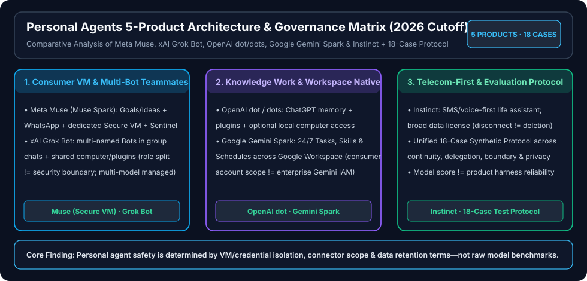

# Personal Agents: Five Products, Public Benchmarks & Unified 18-Case Evaluation Protocol

> 🌐 **Language / 语言切换**: **[🇬🇧 English (README.en.md)](README.en.md)** | **[🇨🇳 中文完整报告 (README.md)](README.md)** | **[↩ Back to Research Index (`../index.md`)](../index.md)**

> **Executive Summary**:
> The defining shift in **Personal Agents** is not better single-turn chat, but **persistent background execution, cross-app delivery, long-horizon memory retention, and explicit human-in-the-loop escalation at high-risk boundaries**. This study audits five flagship personal agent products (**Meta Muse**, **xAI Grok Bot**, **OpenAI dot/dots**, **Google Gemini Spark**, and **Instinct**, research cutoff `2026-10-11`) and defines a **18-case synthetic evaluation protocol** ([`benchmark.md`](benchmark.md) / [`cases.json`](cases.json)):
> 1. **Base Model Scores Do Not Equal Product Reliability**: Each product operates under a distinct execution harness, sandbox boundary, and permission scope—ranging from **Meta Muse's dedicated Secure VM + Sentinel** to **Grok Bot's shared workspace computer across multiple named Bots** and **OpenAI dot's optional local computer mount**.
> 2. **Role Separation Is Not Security Isolation**: In **Grok Bot**, multiple named Bots collaborate in group chats but share the same account-level computer and plugins; **Gemini Spark** targets consumer Google accounts rather than enterprise Workspace IAM; **Instinct** offers frictionless SMS/voice access, but disconnecting an integration does not automatically delete retained user data.

---

## 1. Five-Product Identity & Architecture Matrix

| Product | Verified Identity & Entrypoint | Proactive Loop & Long-Term Memory | Computer, Tools & Connectors | Best-Fit Scenarios | High-Risk Boundaries (Do Not Blindly Delegate) |
|---|---|---|---|---|---|
| **1. Meta Muse** (`Muse Spark` model) | Meta personal AI agent across web & WhatsApp (`2026-09` announcement) | `Goals` / `Ideas` proactive cards + cross-session memory | **Dedicated Secure VM** + **Sentinel** safety monitor + browser/app actions | Consumer life goals, travel/shopping research, WhatsApp follow-ups | US rollout & paid tier limits; separate marketing roadmap from live GA |
| **2. xAI Grok Bot** | Always-on AI teammates in group chats & Cursor/workspace docs (`2026-08-11`) | Multi-named Bots with async handoffs & persistent threads | Shared cloud computer & plugins across Bots in the same account (multi-model managed) | Multi-role team brainstorming, async code/research handoffs | **Role separation != security isolation**; all Bots in an account share tool privileges |
| **3. OpenAI dot / dots** | Personal & specialist AI agent (`introducing-dots`, `2026-09-29`) | Deep ChatGPT memory reuse + proactive read-only research digests | ChatGPT plugins + **optional local computer access** | Continuous knowledge work, document synthesis, local workflow assistance | Proactive research is read-only, but interactive dot actions can mutate state; custom rules cannot override safety gates |
| **4. Google Gemini Spark** | 24/7 personal AI agent in Gemini Apps | `Tasks` / `Skills` / `Schedules` recurring automation | Native Google Workspace apps (Gmail, Calendar, Drive, Docs) | Personal Google ecosystem scheduling & inbox/document triage | Consumer account requirement; does **not** inherit enterprise Gemini IAM/DLP guarantees |
| **5. Instinct** (`instinct.com`) | SMS / phone-call-first personal assistant | Black-box conversational & contact memory across calls/texts | Telecom gateway + calendar/email/web delegation | Zero-UI voice/text assistance on the go | Broad Terms data license; **disconnecting an account != data deletion**; benchmark restriction clause |

---

## 2. Deliverable Entrypoints

- **Full 39 KB Chinese Deep-Dive Report**: [`README.md`](README.md)
- **Unified 18-Case Benchmark Protocol**: [`benchmark.md`](benchmark.md) · [`cases.json`](cases.json)
- **Primary Source Evidence Ledger & Audit Review**: [`evidence.json`](evidence.json) · [`review.md`](review.md)
