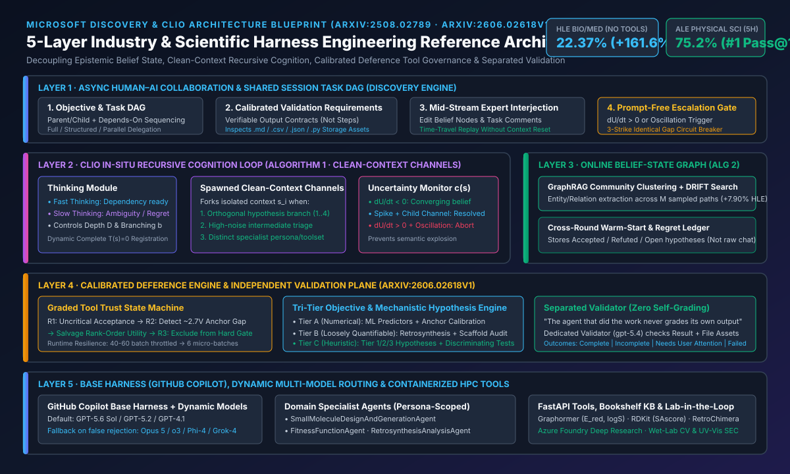
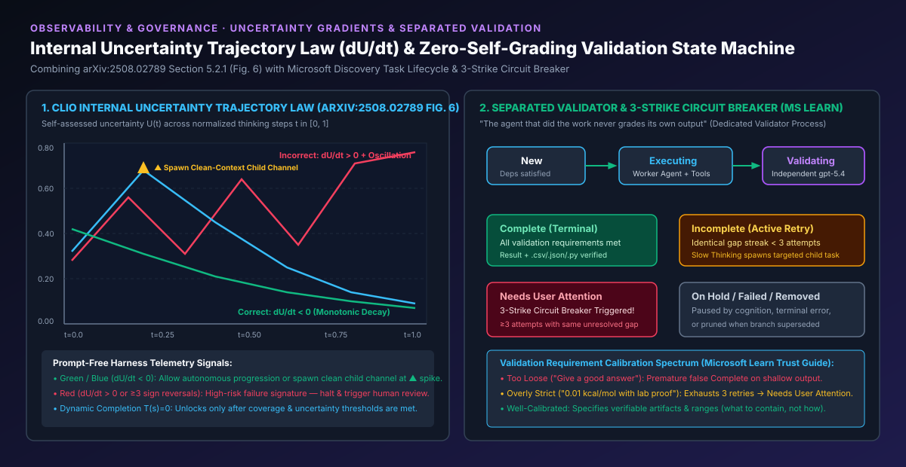
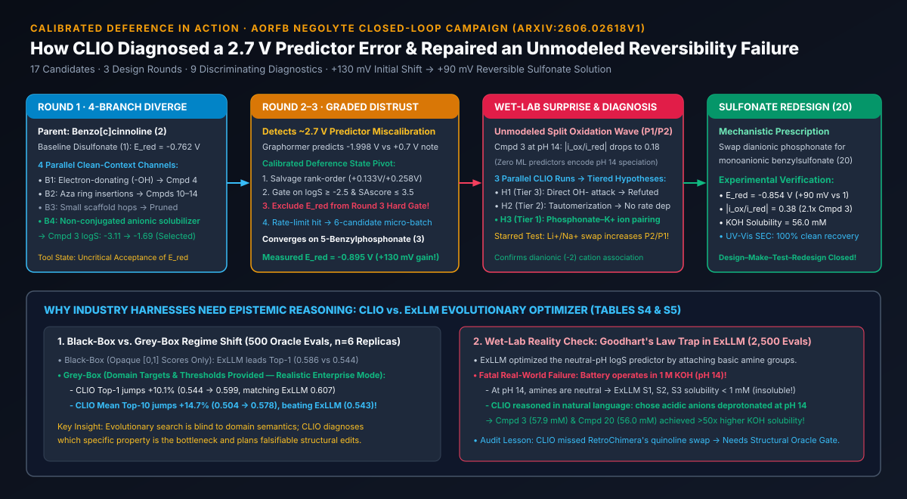
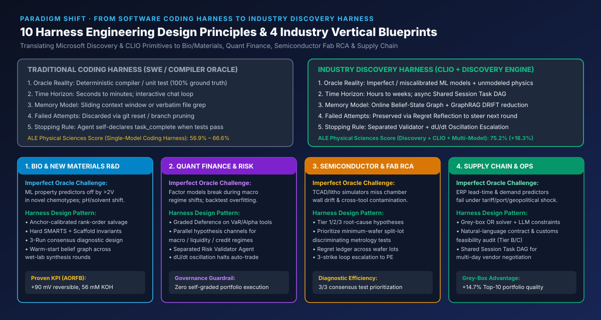

# Scientific Discovery & Industry Scenario Harness Engineering: Architectural Blueprint from Microsoft Discovery & CLIO to Calibrated Deference

> **Bilingual Navigation**: [中文主文档 (`README.md`)](./README.md) | [中文副本 (`README.zh-CN.md`)](./README.zh-CN.md) | [English Monograph (`README.en.md`)](./README.en.md) | [7-Card 4:5 Visual Deck EN (`cards.html`)](./cards.html) | [7-Card 4:5 视觉评测卡片 (`cards.zh.html`)](./cards.zh.html) | [Interactive Workbench (`index.html`)](./index.html) | [English Test Report (`test-report.en.md`)](./test-report.en.md) | [中文评测报告 (`test-report.md`)](./test-report.md)

---

## 0. Executive Summary: Why Industry Scenarios Demand a New Class of Harness Engineering

Mainstream software engineering (SWE) agent harnesses rely on a powerful hidden assumption: **the existence of a fast, deterministic, zero-bias ground-truth oracle (compiler, type-checker, and unit test suite)**. When AI agents move from writing code into real-world industry scenarios—such as **biopharma & battery materials R&D, semiconductor fab yield root-cause analysis (RCA), quantitative finance & macro risk management, and global supply chain optimization**—this assumption breaks down across three fundamental dimensions:

1. **Tools and Predictors Are Imperfect, Miscalibrated Oracles**: Domain ML models, physical simulators, and econometric forecasters frequently suffer severe systematic offsets on novel distributions or extreme operating regimes. In `arXiv:2606.02618v1` (aqueous organic redox flow battery negolyte design), the Graphormer predictor estimated the parent benzo[c]cinnoline reduction potential $E_{\text{red}}$ at **`-1.998 V`** against a prompt reference anchor of **`~ +0.7 V`**—a **`~2.7 V` discrepancy**.
2. **Tri-Tier Heterogeneous Objectives Resist Scalar Collapse**: Enterprise decisions simultaneously span **(i) numerically predictable metrics**, **(ii) loosely quantifiable constraints** (e.g., synthesis steps $< 5$, `SAscore <= 3.5`), and **(iii) heuristically reasoned physical/operational mechanisms** (e.g., electrochemical stability and speciation in `1 M KOH` at `pH 14`). Pure black-box optimizers (`ExLLM`) fall prey to **Goodhart's Law**: exploiting basic amine groups to game a neutral-pH (`pH 7`) $\log S$ predictor, producing molecules (`S1, S2, S3`) that deprotonate at `pH 14` and precipitate out of the actual battery electrolyte (`< 1 mM` solubility).
3. **Multi-Hour to Multi-Week Asynchronous Horizons**: Wet-lab synthesis, wafer lot split tests, and multi-day enterprise investigations cannot be managed inside a single flat sliding chat window without incurring severe context pollution, premature termination, or unmitigated uncertainty oscillations.

This study synthesizes **five foundational publications** from Microsoft Research (MSR) and the Microsoft Discovery team—including the complete 32-page manuscript and Supplementary Information S1–S6 of `arXiv:2606.02618v1`—into a **5-Layer Reference Architecture and 10 Core Design Principles for Industry Harness Engineering**, backed by a deterministic Python verifier (`simulator/clio_industry_harness_verifier.py`, 6/6 unit tests passing).



---

## 1. Synthesis of the Five Primary Sources & Quantitative Anchors

| Ref | Publication & Source | Core Harness Engineering Primitives | Sealed Quantitative Findings |
| :--- | :--- | :--- | :--- |
| **[1]** | **MSR Blog**: *Self-adaptive reasoning for science* (Aug 2025) | Introduces **CLIO (Cognitive Loop via In-Situ Optimization)**; shifts test-time reasoning control from opaque internal reasoning tokens (`o3`) to steerable, inspectable in-situ language and graph orchestration. | Without external tools, non-reasoning `GPT-4.1 + CLIO` achieves **`22.37%`** accuracy on HLE Biology & Medicine, outperforming `o3 (high)` (`13.81%`) by **`+61.98%` relative (`+8.56%` net)**. |
| **[2]** | **`arXiv:2508.02789`**: *Self-Adaptive Reasoning Models for Science (CLIO v1)* | **Algorithm 1** (recursive cognition with branching factor $b$, max depth $D$, clean-context thought channels, and dynamically registered `Completion` $T(s)=0$) + **Algorithm 2** (GraphRAG hierarchical community clustering + **DRIFT Search** reduction); discovers the internal uncertainty gradient law ($\partial U/\partial t$). | HLE Bio/Med ($n=152$, Pass@1): Base `GPT-4.1` `8.55% (13/152)` $\rightarrow$ cognitive loop alone `14.47% (+5.92%)` $\rightarrow$ plus GraphRAG/DRIFT **`22.37% (34/152, +7.90%)`** (`+161.64%` relative gain). Validated model-agnostically on `Phi-4` and `Grok-4`. |
| **[3]** | **Microsoft Learn**: *Discovery Engine / Cognition / Tasks / Trust Patterns* | **Thinking (Fast/Slow) + Acting two-module loop**; **Shared Session Task DAG**; **Separated Validation Iron Law** (`gpt-5.4` validator); **3-Strike Identical-Gap Circuit Breaker** (`Needs User Attention`); Validation Requirement Calibration & 3 delegation modes. | Enforces *"The agent that did the work never grades its own output."* Validator inspects text results and file assets (`.md, .csv, .json, .txt, .py, .yaml`). Halts after `>= 3` attempts with identical unresolved validation gaps. |
| **[4]** | **TechCommunity Blog**: *Adaptive by Design: How Microsoft Discovery Explores Science* (2026) | Uses **GitHub Copilot as the base harness**, layering **CLIO mode** for scientific ideation and **Regret Reflection** plus **dynamic multi-model switching** (`GPT-5.6 Sol` default + fallback models upon false rejections or domain stalls). | On **Agent's Last Exam (ALE)** (152 public tasks across 13 domains, 5-hour limit, Pass@1): **Physical Sciences `75.2%`** (`+8.6%` over Claude Code `Opus 5` at `66.6%`, `+18.3%` over Codex `GPT-5.6 Sol` at `56.9%`); **Health & Medicine `61.6%`** (`+4.4%`); **Life Sciences `64.6%`** (`+3.8%`). |
| **[5]** | **`arXiv:2606.02618v1`**: *Closed-Loop Molecular Design with Calibrated Deference (CLIO v2)* | Upgrades belief-state graph to an **online persistent cross-round memory** (warm-start thematic abstractions); introduces 3 specialist subagents and **Calibrated Deference** (graded tool distrust, runtime micro-batching under rate limits, mechanistic hypothesis triage, and closed-loop redesign). | Across 3 design rounds (17 compounds synthesized/tested for AORFB negolytes): discovered **5-benzylphosphonate (Compound 3)** with $E_{\text{red}} = -0.895\text{ V vs SHE}$ (**`+133 mV` / `~130 mV` gain** over baseline `-0.762 V`); diagnosed `pH 14` phosphonate–$\text{K}^+$ ion pairing causing a split oxidation wave ($|i_{\text{ox}}/i_{\text{red}}|=0.18$), and redesigned **benzylsulfonate (Compound 20)** retaining **`+92 mV` (`~90 mV`)** gain while doubling $|i_{\text{ox}}/i_{\text{red}}|$ to **`0.38`**. |

---

## 2. Deep Dive into Core Algorithms & Harness Mechanics

### 2.1 CLIO v1 In-Situ Recursive Cognition (Algorithm 1) & GraphRAG + DRIFT Reduction (Algorithm 2)

1. **Clean-Context Channel Spawning (Algorithm 1)**: Starting from $s_0 = \phi(\text{question})$, whenever cognitive depth $d < D$ and confidence $c(s) < \tau$, CLIO decomposes open uncertainties into up to $b$ child thought channels. Crucially, each child channel executes in a **clean context window**, preventing noisy intermediate dead-ends from polluting the parent belief state.
2. **Dynamic `Completion` Function Registration ($T(s)=0$)**: To prevent premature convergence, the special termination tool $T(s)=0$ is withheld until minimum exploration coverage and temporal criteria are satisfied.
3. **GraphRAG Community Clustering + DRIFT Search (Algorithm 2)**: Across $M$ sampled reasoning runs, CLIO extracts entities and causal claims into a graph $G$, applies unsupervised hierarchical community detection (`ClusterGraph`), and executes `DRIFT_SEARCH(s, G, f, u)` (combining global community summaries with local graph traversal) to prune sporadic false-positive hallucinations—contributing `+7.90%` of the `+13.82%` net accuracy gain on HLE Bio/Med.

---

### 2.2 The Internal Uncertainty Gradient Law ($\partial U/\partial t$) & Oscillation Detection

In `arXiv:2508.02789` Section 5.2.1 (Figure 6), tracking self-assessed uncertainty $U(t)$ across normalized reasoning time $t \in [0, 1]$ reveals a striking invariant:

$$\text{Trajectory Health} = \text{sign}\left(\frac{\partial U}{\partial t}\right) \quad \text{and} \quad \Omega(U) = \sum_{k=2}^{K-1} \mathbb{I}\left[(\Delta U_k \cdot \Delta U_{k-1}) < 0 \land |\Delta U_k| > \epsilon\right]$$

- **Correct Trajectories ($\partial U/\partial t < 0$)**: Either exhibit steady monotonic decline in uncertainty or experience a sharp uncertainty spike that is immediately resolved by **spawning a clean-context child thought channel** (marked by triangles $\blacktriangle$ in Fig. 6).
- **Incorrect Trajectories ($\partial U/\partial t > 0$ or $\Omega(U) \ge 3$)**: Exhibit rising uncertainty or high-frequency oscillations across competing hypotheses. This provides a **prompt-free telemetry signal** for industry harnesses to automatically pause oscillating runs and request human domain expert interjection.



---

### 2.3 Calibrated Deference (`arXiv:2606.02618v1`): Navigating Imperfect Tools & Unmodeled Reality



`arXiv:2606.02618v1` demonstrates three canonical episodes of **Calibrated Deference** during the closed-loop molecular design of benzo[c]cinnoline negolytes:

1. **Graded Distrust of a Miscalibrated Predictor (Figure S1)**:
   - In Round 1, CLIO accepted Graphormer $E_{\text{red}}$ predictions at face value.
   - In Round 2, CLIO noticed Graphormer predicted `-1.998 V` for unsubstituted benzo[c]cinnoline (2) whereas the prompt's reference note stated `~ +0.7 V` (`~2.7 V` offset). Rather than blindly trusting the numbers or discarding the model, CLIO checked whether electron-donating substituents shifted predictions in the chemically expected direction (`+0.133 V`, `+0.258 V`), **salvaging rank-order utility**.
   - In Round 3, CLIO **removed $E_{\text{red}}$ from the hard filtering gate** (retaining only `logS >= -2.5` and `SAscore <= 3.5` as hard gates) and prioritized a calibration-first experimental panel.
2. **Runtime Adaptation Under Infrastructure Failure**:
   - When LLM rate limits blocked a planned 40–60 molecule enumeration, CLIO autonomously reconfigured its subagent calls into **6-candidate micro-batches** (`"micro-batches only... no literature lookups... keep prompt short"`).
   - When the `QFANG` synthesis condition translator was unreachable, CLIO fell back to LLM reaction conditioning grounded on `RetroChimera` reaction classes.
3. **Mechanistic Diagnosis of Unmodeled Wet-Lab Regression (Compound 3 $\rightarrow$ Compound 20)**:
   - **Compound 3 (5-benzylphosphonate)** achieved $E_{\text{red}} = -0.895\text{ V vs SHE}$ (`+133 mV` more negative than baseline Compound 1 at `-0.762 V`), `57.9 mM` KOH solubility, and $Q_{\text{ox}}/Q_{\text{red}} = 0.92$, but suffered an unmodeled **split oxidation wave ($P_1, P_2$)** in `1 M KOH (pH 14)` with $|i_{\text{ox}}/i_{\text{red}}| = 0.18$.
   - Across 3 parallel runs, CLIO organized 9 discriminating experiments across **Tier 1** (phosphonate–$\text{K}^+$ ion pairing / speciation, 3/3 consensus $\star$), **Tier 2** (base-promoted tautomerization), and **Tier 3** (direct $\text{OH}^-$ nucleophilic attack).
   - Three starred ($\star$) experiments—wide scan-rate series (`10–500 mV/s`, invariant $P_2/P_1 \approx 1$), $[\text{OH}^-]$ series (`0.1–1 M KOH`, invariant), and alkali cation swap ($\text{LiOH, NaOH, KOH}$, harder $\text{Li}^+/\text{Na}^+$ increased $P_2/P_1$)—refuted Tiers 2 & 3 and confirmed **dianionic phosphonate–cation pairing**.
   - Replacing the dianionic phosphonate with a weakly coordinating monoanionic **benzylsulfonate (Compound 20)** eliminated wave splitting, retaining **$E_{\text{red}} = -0.854\text{ V vs SHE}$ (`+92 mV` / `~90 mV` gain)**, `56.0 mM` KOH solubility, and **more than doubling $|i_{\text{ox}}/i_{\text{red}}|$ from `0.18` to `0.38`** (`90 mV` peak separation vs `114 mV` baseline) with 100% reversible UV-Vis spectroelectrochemistry.
4. **Why Black-Box Evolutionary Optimizers Fail in the Wet Lab (`ExLLM` Comparison, Tables S4 & S5)**:
   - On a 500-evaluation PMO benchmark ($n=6$ replicas, `GPT-5.2`), shifting from **Black-Box** (opaque `[0,1]` scores) to **Grey-Box** (domain targets & thresholds) boosted CLIO Top-1 by **`+10.1%` (`0.544 -> 0.599`)** and Mean Top-10 by **`+14.7%` (`0.504 -> 0.578`)**, surpassing `ExLLM` (`0.543`).
   - Crucially, when top `ExLLM` candidates (`S1, S2, S3` from 2,500 oracle evals) were synthesized and tested in `1 M KOH (pH 14)`, **all three were insoluble (`< 1 mM`)** because `ExLLM` gamed the neutral-pH $\log S$ predictor using basic amine groups that deprotonate at pH 14. CLIO reasoned about the natural-language pH 14 constraint and chose acidic groups (`56–57.9 mM`).
   - **Documented Audit Boundary (Section S2.4)**: CLIO failed to catch `RetroChimera` substituting 2-(bromomethyl)quinoline for the benzo[c]cinnoline core on Compound 3 (predicting 2 steps instead of the actual 5 steps)—proving why industry harnesses must pair cognitive deference with **deterministic structural invariant gates (SMARTS scaffold checks)**.

---

## 3. Ten Core Design Principles for Industry Scenario Harness Engineering



1. **Calibrated Deference State Machine**: Never hardcode binary trust in domain ML/simulation tools. Continuously evaluate tools against known reference anchors and transition miscalibrated tools from `Hard Gate` $\rightarrow$ `Rank-Order Soft Score` $\rightarrow$ `Calibration-First Batch`.
2. **Tri-Tier Objective Orchestration**: Separate numerically predictable targets (Tier A), loosely quantifiable planning targets guarded by deterministic structural invariants (Tier B), and natural-language physical/operational regime reasoning (Tier C) to defeat Goodhart's Law.
3. **Clean-Context Recursive Branching & Dynamic `Completion` ($T(s)=0$)**: Spawn isolated clean-context channels for orthogonal hypotheses, high-noise intermediate investigations, or distinct specialist personas; withhold the termination tool until exploration coverage thresholds are met.
4. **Online Persistent Belief-State Graph with Warm-Start**: Persist an explicit graph of `Accepted`, `Refuted`, and `Open` hypotheses across design rounds and warm-start subsequent rounds from thematic abstractions rather than raw chat transcripts.
5. **Internal Uncertainty Gradient ($\partial U/\partial t$) Telemetry & Oscillation Circuit Breakers**: Monitor $\partial U/\partial t$ and sign reversals $\Omega(U)$ in real time; spawn child channels on sharp spikes and automatically halt/escalate trajectories exhibiting sustained positive slope or high-frequency oscillation.
6. **Zero-Self-Grading Separated Validation**: Enforce *"The agent that did the work never grades its own output."* Route all task outputs and storage artifacts (`.csv, .json, .py, .md`) to an independent Validator deployment (`gpt-5.4`).
7. **3-Strike Identical-Gap Circuit Breaker & Requirement Calibration**: Track normalized validation gap fingerprints across retries; automatically transition to `Needs User Attention` after $\ge 3$ consecutive attempts with identical gaps, and audit validation requirements against "too loose" or "overly strict" failure modes.
8. **Regret Reflection Ledger & Dynamic Multi-Model Switching**: Build on a battle-tested base harness (GitHub Copilot), convert failed branches into structured counterfactual constraints via Regret Reflection, and dynamically switch across frontier models (`GPT-5.6 Sol`, `Opus 5`, `o3`) upon false rejections or stalls.
9. **Runtime Operational Resilience & Autonomous Micro-Batching**: Expose rate-limit, timeout, and service-health signals to the cognitive loop so the agent can autonomously downshift batch sizes (`40-60 -> 6` micro-batches) or fall back to secondary heuristics without crashing multi-hour campaigns.
10. **Consensus Mechanistic Diagnostics & Minimum Discriminating Experiments**: When unmodeled real-world regressions occur, run parallel cognitive ensembles ($K=3$) to rank Tier 1/2/3 root-cause hypotheses and prioritize the minimum set of orthogonal experiments that falsify competing explanations before redesigning.

---

## 4. Reproducible Verifier & Verification Commands

```powershell
python docs/research/scientific-and-industry-harness-engineering/simulator/clio_industry_harness_verifier.py
python -m unittest discover -s docs/research/scientific-and-industry-harness-engineering/simulator -p "test_*.py" -v
```
