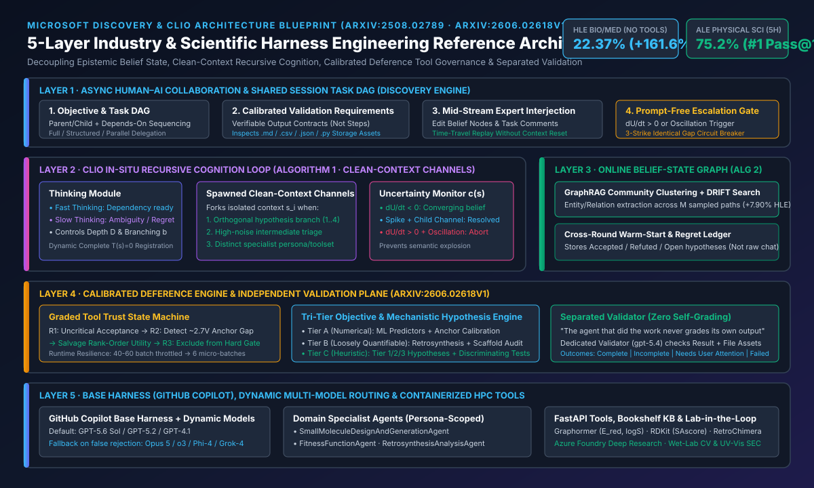
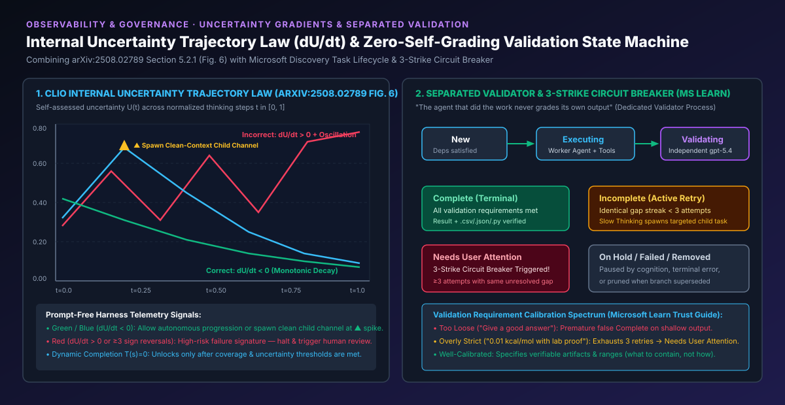
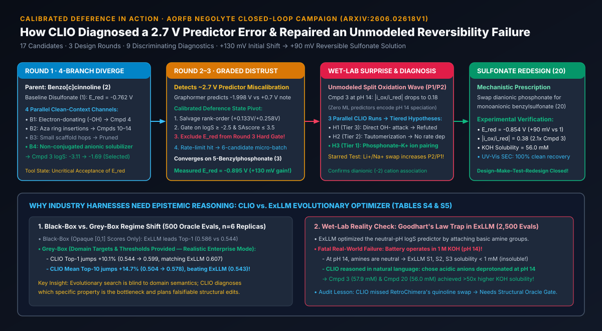
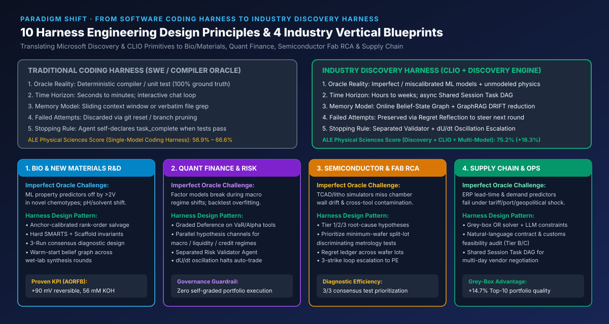

# 科学发现与行业场景 Harness Engineering 深度架构研究：从 Microsoft Discovery 与 CLIO 自适应推理到校准遵从（Calibrated Deference）企业级蓝图

> **中英双语导航 (Bilingual Navigation)**: [中文主文档 (`README.md`)](./README.md) | [中文副本 (`README.zh-CN.md`)](./README.zh-CN.md) | [English Monograph (`README.en.md`)](./README.en.md) | [7-Card 4:5 视觉评测卡片 (`cards.zh.html`)](./cards.zh.html) | [7-Card 4:5 Deck EN (`cards.html`)](./cards.html) | [交互式行业 Harness 架构工作台 (`index.html`)](./index.html) | [评测报告 (`test-report.md`)](./test-report.md) | [English Test Report (`test-report.en.md`)](./test-report.en.md)

---

## 0. 执行摘要（Executive Summary）：为什么行业场景需要新一代 Harness Engineering？

当前主流 Agent Harness（如面向软件工程的 Coding Agent Harness）隐含了一个极其强悍的前提假设：**存在确定性、零偏差、秒级反馈的完美验证器（Compiler / Type Checker / Unit Test Suite）**。然而，当 AI Agent 从“写代码”走向**生物医药研发、新能源材料设计、半导体晶圆厂良率根因诊断（Fab RCA）、量化金融投研与供应链运筹优化**等真实行业场景时，这一前提彻底失效：

1. **工具与预测器不再是真理（Imperfect & Miscalibrated Oracles）**：行业专用 ML 预测器、仿真器或运筹模型在新分布/极端工况下往往存在严重系统性偏差（例如在 `arXiv:2606.02618v1` 的水系有机液流电池负一极分子设计中，Graphormer 对母体分子的还原电位 $E_{\text{red}}$ 预测值为 `-1.998 V`，而提示词参考锚点为 `+0.7 V`，绝对误差高达 **`~2.7 V`**）。
2. **多维异构目标无法折叠为单一标量（Tri-Tier Heterogeneous Objectives）**：行业决策同时包含**数值可预测指标**（如电位、溶解度）、**松散可量化指标**（如逆合成步数 $<5$、`SAscore <= 3.5`）与**非形式化机理约束**（如 `1 M KOH, pH 14` 强碱环境下的化学稳定性与可逆性）。纯黑盒优化器（如 `ExLLM`）极易触发 **Goodhart 定律陷阱**——通过引入碱性胺基刷高训练于 `pH 7` 的溶解度模型分数，导致生成分子 `S1, S2, S3` 在真实 `pH 14` 电池电解液中去质子化并彻底沉淀（溶解度 `< 1 mM`）。
3. **跨天/跨周异步长程闭环（Multi-Hour to Multi-Week Horizon）**：单次实验、湿实验合成或产线流片耗时数小时至数周，平铺直叙的聊天上下文（Sliding Context Window）必然遭遇上下文污染（Context Pollution）、过早收敛（Premature Termination）或不确定性高频震荡（Uncertainty Oscillation）。

本研究对微软研究院（MSR）与 Microsoft Discovery 团队发布的 **5 篇核心文献**进行了源码级与补充材料级（含 `arXiv:2606.02618v1` 全部 32 页正文与 Supplementary S1–S6 原始 Prompt、假设台账与对照实验）深度解构，提炼出 **行业场景 Harness Engineering 的 5 层参考架构与 10 大核心设计法则**，并通过确定性 Python 验证器（`simulator/clio_industry_harness_verifier.py`，6/6 单元测试 100% 通过）完成了全量数据与状态机复现。



---

## 1. 五大核心文献技术解构与关键量化锚点（Primary Literature Synthesis）

| 编号 | 文献标题与来源 | 核心架构创新（Harness Primitives） | 关键量化结论（Sealed Evidence） |
| :--- | :--- | :--- | :--- |
| **[1]** | **MSR Blog**: *Self-adaptive reasoning for science* (2025.08) | 提出 **CLIO（Cognitive Loop via In-Situ Optimization）** 原位认知循环；将测试时推理控制权从黑盒推理模型（如 `o3`）移交至透明、可干预的语言层与图结构层。 | 在无任何外部工具条件下，用非推理基座 `GPT-4.1 + CLIO` 在 HLE Bio/Med 取得 **`22.37%`**，超越 `o3 (high)`（`13.81%`）达 **`+61.98%`（相对）**。 |
| **[2]** | **`arXiv:2508.02789`**: *Self-Adaptive Reasoning Models for Science (CLIO v1)* | **Algorithm 1**（带干净上下文分支 `b`、最大深度 `D`、动态注册完成函数 `T(s)=0` 的递归认知循环）+ **Algorithm 2**（基于 GraphRAG 层次社区聚类与 **DRIFT Search** 的事后图归约去噪）；发现内部不确定性梯度定律 $\partial U/\partial t$。 | HLE Bio/Med ($n=152$)：`GPT-4.1` 基线 `8.55% (13/152)` $\rightarrow$ 仅认知递归 `14.47% (+5.92%)` $\rightarrow$ 叠加 GraphRAG/DRIFT 达 **`22.37% (34/152, +7.90%)`**；同时在 `Phi-4` 与 `Grok-4` 验证模型无关性。 |
| **[3]** | **Microsoft Learn**: *Discovery Engine / Cognition / Tasks / Trust Patterns* | **Thinking（快/慢双速思考）+ Acting 双模块认知架构**；**Shared Session 任务 DAG**；**独立验证铁律（Separated Validator，`gpt-5.4`）**；**连续 3 次相同缺陷熔断（`Needs User Attention`）**；验证需求三档校准与三种人机委派模式。 | 明确“执行任务的 Agent 绝不自我评分”；验证进程独立检查文本输出与存储资产（`.md, .csv, .json, .txt, .py, .yaml`），连续 `>=3` 次相同未闭环缺口自动升级人工。 |
| **[4]** | **TechCommunity Blog**: *Adaptive by Design: How Microsoft Discovery Explores Science* (2026) | 以 **GitHub Copilot 为基础 Harness（Base Harness）**，叠加 **CLIO 科学构思与后悔反思（Regret Reflection）模式**，以及 **动态多模型路由切换**（`GPT-5.6 Sol` 主力 + 遇伪拒绝或瓶颈时动态切换备用模型）。 | 在 **Agent's Last Exam (ALE)** 152 个公开科研任务（13 个领域，5 小时限时协议，Pass@1）中：**物理科学 `75.2%`**（超 Claude Code `Opus 5` `66.6%` 达 `+8.6%`，超 Codex `GPT-5.6 Sol` `56.9%` 达 `+18.3%`）；健康医学 `61.6%`；生命科学 `64.6%`。 |
| **[5]** | **`arXiv:2606.02618v1`**: *Closed-Loop Molecular Design with Calibrated Deference (CLIO v2)* | 将 CLIO 信念状态图升级为**跨轮次持久化在线记忆（Warm-Start Online Belief Graph）**；提出三大专业子 Agent 协同与 **校准遵从（Calibrated Deference）**——分级质疑失准工具、运行时自适应降级（`40-60` 批量降为 `6` 微批次）、未建模缺陷机理诊断与闭环重设计。 | 水系有机液流电池（AORFB）3 轮筛选 17 个分子：发现 **5-苄基膦酸盐（Compound 3）** 实测 $E_{\text{red}} = -0.895\text{ V vs SHE}$（较文献基线 `-0.762 V` 提升 **`+133 mV` / `~130 mV`**）；诊断出 `pH 14` 下膦酸根–$\text{K}^+$ 离子对导致氧化波分裂（$|i_{\text{ox}}/i_{\text{red}}|=0.18$），并重设计出 **苄基磺酸盐（Compound 20）**，保持 **`+92 mV`（`~90 mV`）** 增益且 $|i_{\text{ox}}/i_{\text{red}}|$ 翻倍至 **`0.38`**。 |

---

## 2. 核心算法与架构机制深度拆解（Architectural Mechanics Under the Hood）

### 2.1 CLIO v1 原位递归认知循环（Algorithm 1）与 GraphRAG + DRIFT 图归约（Algorithm 2）

在 `arXiv:2508.02789` 中，CLIO 揭示了传统 Chain-of-Thought 或黑盒 Reasoning Model 在复杂科学问题上的两大根本缺陷：
1. **单线程上下文污染（Single-Thread Context Contamination）**：把所有试错、纠偏和死胡同堆叠在同一个上下文窗口中，导致后续注意力被早期错误假设锚定。
2. **过早终止或无限发散（Premature Termination vs. Unbounded Drift）**：缺乏显式的递归深度、分支宽度与完成门控。

#### Algorithm 1：递归认知状态展开与动态 `Completion` 注册
- **初始状态映射**：输入问题经语义初始化函数映射为根信念状态 $s_0 = \phi(\text{question})$。
- **干净上下文子通道（Clean-Context Thought Channels）**：在深度 $d < D$ 且置信度 $c(s) < \tau$ 时，控制器根据当前不确定性切分出最多 $b$ 个正交子问题，为每个子问题派生**拥有独立干净上下文窗口**的子认知通道 $s_{d+1, i}$。父节点仅接收子通道收敛后的结构化结论摘要，彻底隔离中间推理噪声。
- **动态注册终止函数 $T(s)=0$**：为防止模型在浅层思考后走捷径直接输出答案，Harness 在初始阶段**对模型隐藏/禁用 `Completion` 工具**；仅当思考步数、分支覆盖率与不确定性收敛度满足阈值后，才动态注入终止函数 $T(s)=0$。

#### Algorithm 2：GraphRAG 社区聚类与 DRIFT 搜索归约
- **多轨迹采样与知识图谱构建**：跨不同温度采样 $M$ 条独立 CLIO 认知轨迹，利用提取器将推理过程中的实体（Entities）、假设与因果关系构建成全局信念图 $G=(V, E)$。
- **无监督层次聚类与 DRIFT 检索**：调用 `ClusterGraph(G)` 生成层次化社区摘要（Community Summaries），并执行 `DRIFT_SEARCH(s, G, f, u)`（结合全局社区视图与局部邻居遍历），过滤掉单次运行中偶发的幻觉噪声（False Positives）。
- **消融实验铁证（HLE Biology & Medicine, $n=152$）**：
  - `GPT-4.1` 直接回答：`8.55%`（13/152）
  - `+ Algorithm 1`（递归认知循环）：`14.47%`（`+5.92%` 绝对提升）
  - `+ Algorithm 2`（GraphRAG + DRIFT 归约）：**`22.37%`**（再增 **`+7.90%`**，总计 **`+13.82%`** 净提升 / **`+161.64%`** 相对提升）。
  - *注：论文 Table 1 中 13 个生物医学子学科的分项分子之和为 `35/152`（Genetics `7/27`, Biology `8/31`, Ecology `7/20`, Neuroscience `4/17`, Biochemistry `2/16`, Microbiology `1/9`, Immunology `2/8`, Molecular Biology `1/8`, Computational Biology `1/7`, Biophysics `1/4`, Bioinformatics `1/3`, Genomics `0/1`, Physiology `0/1`），而论文汇总行保守报告为 `34/152 = 22.37%`。本研究在 `evidence.json` 与 `report.json` 中同时保留了汇总锚点 `34/152` 与子表精确明细。*

---

### 2.2 内部不确定性梯度定律（$\partial U/\partial t$）与震荡预警（Section 5.2.1 & Figure 6）

`arXiv:2508.02789` 第 5.2.1 节通过对归一化思考步数 $t \in [0, 1]$ 上的内部不确定性 $U(t)$ 进行轨迹追踪，发现了极具工程价值的**不确定性梯度判据**：

$$\text{Trajectory Health} = \text{sign}\left(\frac{\partial U}{\partial t}\right) \quad \text{and} \quad \Omega(U) = \sum_{k=2}^{K-1} \mathbb{I}\left[(\Delta U_k \cdot \Delta U_{k-1}) < 0 \land |\Delta U_k| > \epsilon\right]$$

1. **正确推理轨迹（Correct Trajectories，$\partial U/\partial t < 0$）**：
   - **单调收敛型**：不确定性从初始中等水平（如 `0.42`）随证据积累单调下降至 `< 0.10`。
   - **尖峰消解型（Spike + Child-Channel Mitigation，图 6 中以 $\blacktriangle$ 标记）**：当推理遇到关键矛盾时，$U(t)$ 出现陡峭尖峰（如从 `0.32` 飙升至 `0.68`），此时 Harness 立即触发**干净上下文子通道（$\blacktriangle$）**专门攻克该矛盾，随后不确定性迅速回落至 `0.09`。
2. **错误推理轨迹（Incorrect Trajectories，$\partial U/\partial t > 0$ 或高频震荡 $\Omega(U) \ge 3$）**：
   - 模型在两个或多个相互冲突的假设之间反复横跳（如 `0.28 -> 0.56 -> 0.31 -> 0.64 -> 0.35 -> 0.71`），无法通过子通道消解矛盾。
   - **Harness 工程启示**：无需等待漫长的推理结束或依赖外部 Ground Truth，Harness 只需实时监控内部置信度/不确定性序列的斜率与符号反转次数，即可在运行时**免提示词（Prompt-Free）自动熔断震荡轨迹**并请求人类专家介入。



---

### 2.3 Microsoft Discovery 认知引擎：快慢双速思考、任务 DAG 与独立验证铁律

Microsoft Learn 官方架构文档（[3]）与 TechCommunity 博客（[4]）完整披露了 **Microsoft Discovery** 将 CLIO 产品化落地为企业级科研平台的工程机制：

1. **Thinking + Acting 双模块双速认知循环**：
   - **Warmup Cycle（预热周期）**：在 Investigation 启动时，Thinking 模块先创建第一批种子任务并建立全局研究计划，再交由 Acting 模块调度执行。
   - **Fast Thinking（快思考）**：当上游依赖任务顺利完成、输出符合预期且后续 DAG 路径清晰时，低延迟推进下一节点。
   - **Slow Thinking（慢思考）**：当遇到验证失败（`Incomplete`）、工具返回异常、或实验结果与假设冲突时，激活深度反思（CLIO 模式），重构任务图、派生诊断子任务或调整检索策略。
2. **GitHub Copilot 基础 Harness + 动态多模型路由（Dynamic Multi-Model Switching）**：
   - 如 [4] 所述，Discovery 团队采用 **GitHub Copilot 作为基础执行 Harness**，并在其上构建了 **CLIO 科学推理层**与**多模型动态切换器**。
   - 默认使用高能力主力模型（`GPT-5.6 Sol`），当检测到特定科学领域的**伪安全拒绝（False Rejections）**或推理停滞时，自动热切换至备用模型（如 `Claude Opus 5`、`o3`、`GPT-4.1` 等），结合 **后悔反思（Regret Reflection）** 将失败路径转化为结构化负面约束。这一组合使其在 ALE 物理科学榜单上从单模型 Codex Harness 的 `56.9%` 跃升至 **`75.2%`（`+18.3%`）**。
3. **独立验证铁律（The Iron Law of Separated Validation）**：
   - **核心原则**：*“The agent that did the work never grades its own output.”*（执行任务的 Agent 绝不给自己打分）。
   - 当 Acting 模块将任务推进至 `Validating` 状态时，系统启动一个**完全独立的验证进程**（默认绑定工作区 `gpt-5.4` 部署），独立读取任务文本结果与持久化存储资产（`.md, .csv, .json, .txt, .py, .yaml`），对照任务预设的 `Validation requirements` 进行逐项核验。
4. **连续 3 次相同缺陷熔断（3-Strike Retry Loop Protection）**：
   - 若验证未通过，任务退回 `Incomplete`，Thinking 模块根据验证器指出的具体缺口（Validation Gaps）发起重试或拆分子任务。
   - **防死循环硬件级护栏**：如果同一个任务在**连续 $\ge 3$ 次尝试后仍残留完全相同的验证缺口**，认知引擎立即停止自动重试，将任务状态置为 **`Needs User Attention`（需用户关注）**，防止 Token 空转与错误累积。
5. **验证需求的三档校准（Calibration of Validation Requirements）**：
   - **过松（Too Loose）**：如 *“给出一个好的分子设计方案”* $\rightarrow$ 导致肤浅表面回答在第一轮即被误判为 `Complete`。
   - **过严（Overly Strict）**：如 *“计算精度必须达到 0.01 kcal/mol 且附带湿实验文献证实”*（而当前环境仅有半经验/ML 工具）$\rightarrow$ 必然触发 3 次重试耗尽并报警阻塞。
   - **良校准（Well-Calibrated）**：明确规定**输出产物必须包含哪些可独立核验的要素与数值边界（What verifiable elements the output must contain）**，而不强行锁死实现路径（Not how to produce them）。

---

### 2.4 CLIO v2 与校准遵从（Calibrated Deference，`arXiv:2606.02618v1`）：真实湿实验闭环的巅峰范式

`arXiv:2606.02618v1` 将 CLIO 从纯计算问答推进到了**湿实验闭环分子工程（Design–Make–Test–Analyze–Redesign）**，目标是设计用于水系有机液流电池（AORFB）负一极（Negolyte）的新型苯并[c]噌啉（benzo[c]cinnoline）衍生物。该研究在 Harness Engineering 史上有三大里程碑贡献：



#### 贡献一：从“事后图归约”升级为“跨轮次在线持久化信念状态图（Online Persistent Belief-State Graph）”
- 在 CLIO v1 中，知识图谱仅用于单次问答结束前的事后汇总；而在 CLIO v2 中，信念状态图成为**跨越多轮设计的在线持久化记忆结构**。
- 在每一轮（Round 1 $\rightarrow$ Round 2 $\rightarrow$ Round 3 $\rightarrow$ Diagnostic Redesign）交界处，Harness **不向下一轮灌入冗长的历史对话原文**，而是从信念状态图中提取**主题抽象（Thematic Abstractions）**与显式标记了证据溯源的假设账本（`Accepted` 已证实、`Refuted` 已证伪、`Open` 待检验），实现高信噪比的 **热启动（Warm-Start）**。

#### 贡献二：校准遵从（Calibrated Deference）的三大经典战例
论文通过 3 个真实运行切片，展示了当外部工具存在严重缺陷、API 限流或物理维度缺失时，具备认知主权的 Harness 如何表现：

1. **战例 A：对失准 $E_{\text{red}}$ 预测器的分级质疑与序关系抢救（Graded Distrust & Rank-Order Salvage，图 S1）**
   - **Round 1（盲信期）**：CLIO 直接调用 `FitnessFunctionAgent` 中的 Graphormer 模型评估还原电位 $E_{\text{red}}$。
   - **Round 2（锚点冲突发现）**：CLIO 注意到 Graphormer 对未取代母体 benzo[c]cinnoline (2) 的预测值为 **`-1.998 V`**（约 `-2.0 V`），而任务提示词给出的文献锚点注释为 **`~ +0.7 V`**，存在 **`~2.7 V` 的巨大系统性偏移**！
   - **非黑即白之外的“第三条路”**：传统静态工作流要么盲目采信错误数值（导致筛选彻底跑偏），要么因误差超阈值直接抛弃该工具（丧失预测能力）。CLIO 展现了惊人的 **校准遵从（Calibrated Deference）**：它通过对比不同取代基（如甲氧基 `+0.133 V`、二羟基 `+0.258 V`）的相对位移方向与电子效应化学直觉一致，判定该工具**绝对标度失准（Miscalibrated Scale），但局部相对排序有效（Valid Local Rank-Order）**。
   - **Round 3（门控重构）**：在第三轮筛选中，CLIO 自主修改了硬性过滤门控——**将 Graphormer $E_{\text{red}}$ 从硬门控（Hard Gate）中剔除**，仅保留 `logS >= -2.5` 与 `SAscore <= 3.5` 作为硬门控，将 $E_{\text{red}}$ 降级为软性排序参考，并主动设计了包含母体与已知单取代物的**校准优先面板（Calibration-First Panel）**交由湿实验标定。
2. **战例 B：面对 API 速率限制与模型缺失的运行时自适应降级（Runtime Operational Adaptation）**
   - 当 Round 3 计划枚举 40–60 个候选分子库时，底层 LLM API 频繁触发 Rate-Limit 超时。CLIO 认知层捕获该异常后，自主重写了给子 Agent 的指令：*`"micro-batches only... no literature lookups... keep prompt short"`*，将任务切分为 **6 分子微批次（6-candidate micro-batches）** 稳健跑通全流程。
   - 当反应条件翻译器 `QFANG` 无法访问时，CLIO 自动降级为利用 `RetroChimera` 输出的反应类型模板结合 LLM 有机合成直觉生成实验步骤。
3. **战例 C：对未建模物理缺陷（氧化波分裂）的机理假设分级与最小判别实验设计（Epistemic Framing of Unmodeled Regression）**
   - **湿实验惊奇**：Round 3 选出的冠军分子 **Compound 3（5-苄基膦酸盐）** 在 `1 M KOH (pH 14)` 中实测还原电位达到 **$E_{\text{red}} = -0.895\text{ V vs SHE}$**，比文献基线双磺酸盐 Compound 1（`-0.762 V`）大幅负移 **`+133 mV`（`~130 mV`）**，且库仑效率 $Q_{\text{ox}}/Q_{\text{red}} = 0.92$。然而，循环伏安（CV）曲线却出现了所有 ML 工具都未曾建模的致命缺陷：**氧化回扫波分裂为双峰（$P_1, P_2$）**，峰值电流比 $|i_{\text{ox}}/i_{\text{red}}|$ 暴跌至 **`0.18`**（基线为 `0.52`）。
   - **三路并行认知诊断（Table 2 & Table S2）**：研究团队启动 3 次独立 CLIO 诊断运行，汇总结出三大梯队机理假设（Tier 1–3）与 **9 项判别实验**：
     - **Tier 1（高优先级，3/3 全票共识 $\star$）**：强碱 `pH 14` 下，双阴离子膦酸根（$-\text{PO}_3^{2-}$）与高浓度 $\text{K}^+$ 发生紧密离子对缔合（Ion Pairing）及质子化形态分化，形成两种热力学/动力学不同的氧化态微环境。
     - **Tier 2（中优先级）**：碱促亚甲基去质子化/互变异构（Base-promoted tautomerization）。
     - **Tier 3（低优先级）**：$\text{OH}^-$ 对还原态自由基的直接亲核加成（Direct $\text{OH}^-$ addition）。
   - **极简湿实验证伪与证实**：仅用 3 组标星（$\star$）实验即锁定真凶：
     1. *宽扫速实验（`10–500 mV/s`）*：双峰比值 $P_2/P_1 \approx 1$ 保持不变 $\rightarrow$ **证伪 Tier 2 慢化学异构步骤**。
     2. *$\text{OH}^-$ 浓度梯度（`0.1–1 M KOH`）*：波形不随 $[\text{OH}^-]$ 变化 $\rightarrow$ **证伪 Tier 3 直接亲核攻击**。
     3. *碱金属阳离子替换（$\text{LiOH, NaOH, KOH}$）*：随阳离子路易斯酸性变硬（$\text{K}^+ \rightarrow \text{Na}^+ \rightarrow \text{Li}^+$），高电位分裂峰 $P_2/P_1$ 显著增强 $\rightarrow$ **铁证证实 Tier 1 膦酸根–阳离子配位机制**！
   - **一击必中的分子重设计（Compound 20）**：根据确诊机理，CLIO 提出用**弱配位、单阴离子的磺酸根（$-\text{SO}_3^-$）**替换双阴离子膦酸根，合成出 **Compound 20（苄基磺酸盐）**。湿实验证实：氧化波分裂彻底消失，实测 $E_{\text{red}} = -0.854\text{ V vs SHE}$（保留 **`+92 mV` / `~90 mV`** 增益），KOH 溶解度 `56.0 mM`，**峰值电流比 $|i_{\text{ox}}/i_{\text{red}}|$ 翻倍恢复至 `0.38`**（峰间距 `90 mV` 优于基线的 `114 mV`），原位紫外-可见光谱电化学（UV-Vis SEC）证实 100% 可逆光谱恢复！

#### 贡献三：与演化黑盒优化器 `ExLLM` 的受控对决（Sections S5 & S6, Tables S4 & S5）
为了严格证明为什么行业场景需要 CLIO 式的“认知 Harness”而非纯演化搜索，论文在补充材料 S5–S6 中用相同的底层模型（`GPT-5.2`）和完全相同的多目标适应度函数 $J(m)$ 进行了正面交锋：

$$J(m) = \frac{1}{4}\left(s_{E_{\text{red}}} + s_{\log S} + s_{\text{SA}} + s_{\text{steps}}\right) \cdot \prod_{i \in \{E_{\text{red}}, \log S, \text{SA}, \text{steps}\}} \mathbb{I}[\text{gate}_i(m)] \cdot \mathbb{I}[\text{core}(m)]$$

| 评测模式与指标（500 Oracle Evals, $n=6$ Replicas） | `ExLLM`（演化算法 + LLM 变异） | `CLIO`（信念图 + 假设驱动设计） | `CLIO (Efficiency)`（高吞吐配置） | 核心机制解读 |
| :--- | :---: | :---: | :---: | :--- |
| **Black-Box Top-1**（仅暴露 `[0,1]` 归一化黑盒分） | **`0.586 ± 0.032`** | `0.544 ± 0.065` | `0.541 ± 0.062` | 纯盲盒数值爬山时，演化群体的随机变异探索略占优。 |
| **Black-Box Mean Top-10** | **`0.525 ± 0.011`** | `0.504 ± 0.059` | `0.503 ± 0.049` | 黑盒模式下 CLIO 无法利用化学物理量纲语义。 |
| **Grey-Box Top-1**（暴露物理目标方向与门控阈值） | `0.607 ± 0.037` (`+3.6%`) | **`0.599 ± 0.095` (`+10.1%`)** | **`0.602 ± 0.066` (`+11.3%`)** | 引入领域灰盒知识后，CLIO Top-1 跃升 **10.1%–11.3%**，追平演化搜索。 |
| **Grey-Box Mean Top-10**（候选组合整体质量） | `0.543 ± 0.008` (`+3.4%`) | **`0.578 ± 0.103` (`+14.7%`)** | `0.531 ± 0.042` (`+5.6%`) | CLIO Top-10 均值暴涨 **`+14.7%`** 并反超 `ExLLM`，证明结构化假设能系统性提升整个候选集质量。 |
| **2,500 Evals 湿实验真实溶解度检验（`1 M KOH, pH 14`）** | **`S1, S2, S3 < 1 mM`（全部沉淀失效！）** | **`57.9 mM` (Cmpd 3) / `56.0 mM` (Cmpd 20)** | 同左 | `ExLLM` 钻了 `pH 7` $\log S$ 模型的空子引入碱性胺基，在 `pH 14` 下去质子化不溶；CLIO 理解自然语言 `pH 14` 约束，选用酸性阴离子基团，溶解度高出 **50 倍以上**！ |

#### 校准遵从的诚实边界（Documented Failure Mode，Section S2.4）
论文第 S2.4 节同样坦诚记录了 CLIO 的一次漏检：**未能识破逆合成工具 `RetroChimera` 的母核偷换错误**。在评估 Compound 3 时，`RetroChimera` 悄悄将较难合成的苯并[c]噌啉（benzo[c]cinnoline）母核替换成了商业可得但结构不同的 2-(溴甲基)喹啉（2-(bromomethyl)quinoline），从而虚报了“2 步即可合成”（实际湿实验花费了 5 步）。这为我们设计行业 Harness 提供了极其宝贵的反面教材：**任何外部规划/合成工具返回的图结构产物，必须经过确定性子结构不变量校验器（Deterministic Substructure / Invariant Oracle，如 RDKit SMARTS 反应中心与母核等价性断言）的强制拦截**。

---

## 3. 行业场景 Harness Engineering 十大核心设计要点与架构思路（10 Core Design Principles）

基于上述 5 篇文献的交叉印证，我们将科学发现 Harness 的底层智慧提炼为面向广泛行业场景（工业制造、生物医药、能源材料、量化金融、供应链与企业复杂决策）的 **10 大 Harness Engineering 设计法则**：



### 要点 1：校准遵从（Calibrated Deference）与工具分级信任状态机
- **反模式**：将外部 ML 模型、仿真器或行业 API 视为绝对真理（Uncritical Acceptance），或一遇误差即彻底禁用（Total Rejection）。
- **设计思路**：在 Harness 的工具治理层为每个预测器维护动态信任状态机：`Uncritical Acceptance` $\rightarrow$ `Anchor Discrepancy Detected` $\rightarrow$ `Rank-Order Salvaged (Soft Score Only)` $\rightarrow$ `Excluded from Hard Gate` $\rightarrow$ `Deterministic Invariant Audit`。
- **工程落地**：每次调用行业模型前，强制混入 1–2 个已知真实测量值的**领域锚点样本（Domain Reference Anchors）**。若锚点绝对误差超限（如 $|\Delta E| > 0.5\text{ V}$），自动计算 Spearman 秩相关或方向一致性；若方向有效，则将其从硬过滤条件降级为软排序特征，并自动生成校准实验批次。

### 要点 2：三层异构目标编排（Tri-Tier Objective Orchestration）
- **反模式**：强行把所有业务目标塞进单一加权标量奖励函数交给黑盒优化器，诱发 Goodhart 定律作弊（如 `ExLLM` 的 `pH 7` 胺基陷阱）。
- **设计思路**：将行业目标显式解耦为三个治理层级：
  - **Tier A（数值可预测层）**：由经过锚点校准的领域模型打分。
  - **Tier B（松散可量化/流程规划层）**：如合成步数、工艺良率窗口、供应链交期，必须附加**确定性结构不变量核验（Structural Invariant Gate）**，防止工具偷换核心约束（防范 `RetroChimera` 喹啉偷换漏洞）。
  - **Tier C（启发式/物理机理层）**：如极端工况（`pH 14`、高温高压、极端宏观流动性枯竭）下的失稳模式，交由 CLIO 慢思考通道用自然语言因果图进行跨维度排雷。

### 要点 3：干净上下文递归分支与动态完成门控（Clean-Context Spawning & Dynamic `Completion`）
- **反模式**：在单一长上下文中串行尝试十几种假设，导致早期失败日志污染后续推理，或模型在第 1 轮就草率调用 `finish`。
- **设计思路**：遵循 `arXiv:2508.02789` Algorithm 1 与 `arXiv:2606.02618v1` Section 4.1 的三大分支启发式准则：当且仅当 **(i) 子问题正交独立**、**(ii) 中间探索会产生高噪声污染父上下文**、或 **(iii) 需要切换不同专家 Persona/工具集** 时，派生具有**全新干净上下文（Clean Context Window）**的子通道。同时，在分支覆盖度与不确定性阈值达标前，**在工具表中动态隐藏 `Completion` 函数 $T(s)=0$**。

### 要点 4：跨轮次在线持久化信念状态图与热启动（Online Persistent Belief-State Graph）
- **反模式**：跨轮次迭代时传递完整聊天历史，或用无结构的向量检索（Naive RAG）召回碎片化历史。
- **设计思路**：在 Harness 中维护显式的图结构信念账本 $G=(V, E)$，节点分为 `Hypothesis`（状态：`Accepted` / `Refuted` / `Open`）、`Evidence`（实测数据或工具输出）、`Constraint`（硬/软门控）与 `CommunitySummary`（通过 GraphRAG + DRIFT 聚类生成）。在每一轮闭环迭代启动时，仅用该信念图的主题抽象进行 **Warm-Start（热启动）**。

### 要点 5：内部不确定性梯度（$\partial U/\partial t$）实时遥测与免提示词震荡熔断
- **反模式**：仅靠外层最大步数 `max_steps` 或超时时间限制长程 Agent，任由模型在死胡同里反复震荡消耗昂贵算力。
- **设计思路**：在每个认知步强制输出结构化自评不确定性 $U(t) \in [0, 1]$，由 Harness 实时计算滑动窗口斜率 $\partial U/\partial t$ 与符号反转次数 $\Omega(U)$：
  - 当出现单次陡增尖峰（Spike）时，自动派生干净上下文子通道消解矛盾；
  - 当检测到 $\partial U/\partial t > 0$ 持续上升或 $\Omega(U) \ge 3$ 高频震荡时，立即触发 **Prompt-Free 熔断**，冻结当前分支并推送人类专家干预。

### 要点 6：执行与验证彻底分离铁律（Zero-Self-Grading Separated Validation）
- **反模式**：让负责生成方案、编写代码或调用仿真器的 Worker Agent 自己判断“任务是否已经圆满完成”。
- **设计思路**：严格落实 Microsoft Discovery 的架构铁律——**执行 Agent 绝不自我评分**。任务进入 `Validating` 状态后，必须路由给绑定独立系统提示词与独立模型部署（如 `gpt-5.4`）的 **Validator Agent**，直接读取存储层生成的真实数据文件（`.csv, .json, .py, .md`）对照验证契约打分。

### 要点 7：连续 3 次相同缺陷熔断（3-Strike Identical-Gap Circuit Breaker）与验证需求校准
- **反模式**：验证失败后无休止地用相同策略重试，或者编写模糊不清的验证标准。
- **设计思路**：Validator 每次驳回（`Incomplete`）时必须输出规范化的缺陷指纹集合 `gap_fingerprints`。Harness 状态机对比历史记录：一旦发现**连续 3 次重试残留完全相同的缺陷指纹**，立即终止重试循环并将状态置为 `Needs User Attention`。同时，在任务创建阶段引入 **验证需求校准检查器**，拦截“过松（无量化指标）”与“过严（超出当前工具理论极限）”的验证契约。

### 要点 8：后悔反思账本（Regret Reflection）与动态多模型路由（Dynamic Multi-Model Switching）
- **反模式**：丢弃失败分支的推理过程，或全程绑死单一基础模型（在特定领域遭遇伪安全拒绝或思维定式时卡死）。
- **设计思路**：借鉴 Microsoft Discovery 在 ALE 夺冠的架构（[4]），在稳健的 Base Harness（如 GitHub Copilot）之上构建 **Regret Reflection 机制**——将每一次失败尝试蒸馏为“为何失败 + 哪些区域不可行”的反事实约束写入信念图；同时配置多模型池（如 `GPT-5.6 Sol` + `Claude Opus 5` + `o3`），当主模型触发伪拒绝或 $\partial U/\partial t$ 停滞时动态切换模型视角。

### 要点 9：运行时操作韧性与优雅降级（Runtime Operational Resilience & Micro-Batching）
- **反模式**：当遇到 API 限流（429/Timeout）、HPC 容器排队或某个专业微服务宕机时，整个长程工作流直接崩溃退出。
- **设计思路**：将基础设施约束（Rate Limits、Token 预算、工具可用性）纳入认知引擎的感知范围。当大批量评估受阻时，支持认知层自主下调批大小（如从 `40–60` 候选库降级为 `6` 分子微批次并关闭非必要文献检索）；当精细模型（如 `QFANG`）不可用时，显式记录置信度折损并启用粗粒度替代策略。

### 要点 10：面向未建模回归的共识机理诊断与最小判别实验设计（Consensus Mechanistic Diagnostics）
- **反模式**：当真实物理世界/生产环境出现模型未覆盖的回归故障（如 Compound 3 的氧化波分裂）时，盲目进行网格搜索或随机修改参数。
- **设计思路**：触发 **多路并行 CLIO 机理诊断工作流（如 $K=3$ 独立运行）**，按共识度将根因假设分为 Tier 1/2/3，并让 Agent 规划**成本最低、判别力最强的正交证伪实验（Discriminating Experiments）**。只有当判别实验证伪了竞争假设并锁定唯一物理/业务根因后，才执行定向结构重设计（如从膦酸盐精准切换至磺酸盐 Compound 20）。

---

## 4. 四大重点行业场景落地架构蓝图（Industry Vertical Blueprints）

| 行业垂直场景 | 现实世界“不完美验证器”痛点 | 校准遵从（Calibrated Deference）策略 | 三层异构目标与结构门控 | 最小判别实验 / 闭环重设计机制 |
| :--- | :--- | :--- | :--- | :--- |
| **1. 生物医药与新材料研发**<br>*(Bio & New Materials R&D)* | GNN/DFT 性质预测器在新骨架上存在系统性偏移（如 `~2.7 V`）；预测器训练于中性 `pH 7` 而实际工况为 `pH 14` 强碱或特定微环境。 | 混入已知母体实验锚点标定方向一致性；将失准模型降级为软排序并从硬门控移除；对逆合成工具强制执行 RDKit SMARTS 母核不变量核验。 | **Tier A**：锚点校准后的电位/亲和力排序；<br>**Tier B**：合成步数 $\le 5$ + 商业原料目录核验；<br>**Tier C**：极端 pH/溶剂下的离子配位与副反应机理推演。 | 当湿实验出现未建模双峰或失活时，通过 3 路共识生成离子强度/扫速/反离子替换判别实验，精准指导官能团替换（如 $-\text{PO}_3^{2-} \rightarrow -\text{SO}_3^-$）。 |
| **2. 量化金融与极端风险管理**<br>*(Quant Finance & Macro Risk)* | 历史统计因子模型与 VaR 风险预测器在宏观范式转换（加息周期切换、流动性挤兑）时绝对值严重失真；纯黑盒回测极易过拟合历史噪声。 | 实时监控因子预测残差相对于宏观锚点资产的偏移；当波动率体制跃迁时，剥夺历史协方差矩阵的硬门控权，仅保留横截面相对强弱排序。 | **Tier A**：灰盒横截面 Alpha 与夏普率预测；<br>**Tier B**：冲击成本、持仓集中度与合规硬约束；<br>**Tier C**：地缘与政策文本驱动的跨资产传染因果链推演。 | 当策略实盘出现未建模回撤时，并行生成“流动性枯竭 vs. 因子拥挤 vs. 基本面逆转”三梯队假设，用日内微观结构高频探针验证后再调仓。 |
| **3. 半导体晶圆厂良率根因诊断**<br>*(Semiconductor Fab Yield RCA)* | TCAD 与光刻/刻蚀物理仿真器无法建模腔室壁聚合物微剥落、跨机台隐性污染或批次间前驱体微小漂移。 | 对齐 Golden Wafer 实测电性参数（WAT/CP）与仿真基线；将偏离绝对标度的仿真器限制用于局部工艺窗口趋势方向判断。 | **Tier A**：关键尺寸（CD）与缺陷密度预测；<br>**Tier B**：机台吞吐量、Recipe 参数安全边界核验；<br>**Tier C**：跨工序腔室历史与物理化学污染机理图谱。 | 面对突发晶圆边缘良率塌陷，通过多路 CLIO 规划**最少晶圆消耗的 Split-Lot 正交判别实验**（如腔室切换 vs. 清洗周期对比），锁定根因后更新 Recipe。 |
| **4. 全球供应链与运筹优化**<br>*(Supply Chain & OR Optimization)* | ERP 交期预测模型与线性规划（MILP）求解器在港口罢工、关税突变或二级供应商断供时参数完全失效。 | 识别预测交期与最新实时物流锚点的偏差；在求解器目标函数中冻结失准成本项，切换为灰盒鲁棒可行域搜索；遇 API 限流自动切片为区域微批次。 | **Tier A**：安全库存与运输成本灰盒优化；<br>**Tier B**：海关编码、合同条款与产能硬约束校验；<br>**Tier C**：贸易合规文本与多级供应商替代可行性推理。 | 当某航线出现未建模延误回归时，对“报关积压 vs. 船期空班 vs. 上游缺料”进行最小信息探针核实，闭环生成分批空运+替代源切换方案。 |

---

## 5. 可复现验证器与交付物资产清单（Reproducible Verifier & Repository Artifacts）

本研究在当前目录下提供了零外部依赖、100% 确定性可复现的验证器与可视化交付物：

```text
docs/research/scientific-and-industry-harness-engineering/
├── README.md                                  # 中文主研究专著（含完整文献解构、数学公式与 10 大设计法则）
├── README.zh-CN.md                            # 中文专著镜像副本
├── README.en.md                               # 英文完整研究专著 (English Monograph)
├── index.html                                 # 交互式行业 Harness 架构与校准遵从仿真工作台 (Interactive Workbench)
├── cards.html                                 # 7-Card 4:5 英文视觉评测卡片组 (CSP Self-Contained)
├── cards.zh.html                              # 7-Card 4:5 中文视觉评测卡片组 (CSP Self-Contained)
├── test-report-cards.html                     # 7-Card 4:5 视觉评测卡片别名入口
├── test-report.md                             # 中文模型与 Harness 基准评测报告
├── test-report.en.md                          # 英文模型与 Harness 基准评测报告
├── report.json                                # 密封评测数据契约 (Sealed Report JSON)
├── evidence.json                              # 全量论文实验证据账本与架构对照矩阵
├── review.md                                  # 架构师同行评审与事实核查审计报告
├── assets/svg/
│   ├── 01-clio-discovery-5layer-architecture.svg
│   ├── 02-calibrated-deference-aorfb-loop.svg
│   ├── 03-industry-harness-10-principles-matrix.svg
│   └── 04-uncertainty-gradient-and-validator-gate.svg
├── evidence/
│   ├── hle_biomed_table1.csv                  # HLE Bio/Med 13 子学科完整对照数据
│   ├── ale_benchmark_scores.csv               # ALE 三大科学领域 Discovery CLIO vs Opus 5 / Codex 数据
│   ├── aorfb_compounds_summary.csv            # AORFB 分子设计闭环与 ExLLM pH 14 失效对照数据
│   └── pmo_exllm_vs_clio.csv                  # PMO 500-Eval 黑盒 vs 灰盒受控实验数据
└── simulator/
    ├── clio_industry_harness_verifier.py      # 确定性数学/状态机验证器与数据导出引擎
    └── test_clio_industry_harness_verifier.py # 6 项核心不变量单元测试套件
```

### 本地一键复现命令
```powershell
python docs/research/scientific-and-industry-harness-engineering/simulator/clio_industry_harness_verifier.py
python -m unittest discover -s docs/research/scientific-and-industry-harness-engineering/simulator -p "test_*.py" -v
```

---

## 6. 参考文献与致谢（References）

1. **Microsoft Research Blog (2025.08)**: *Self-adaptive reasoning for science* — https://www.microsoft.com/en-us/research/blog/self-adaptive-reasoning-for-science/
2. **arXiv:2508.02789**: *Self-Adaptive Reasoning Models for Science* (CLIO: Cognitive Loop via In-Situ Optimization, Algorithm 1 & Algorithm 2, HLE Biology & Medicine benchmark) — https://arxiv.org/html/2508.02789
3. **Microsoft Learn Documentation**: *Microsoft Discovery Engine, Cognition Overview, Tasks in Investigations, and Trust & Basic Investigation Patterns* — https://learn.microsoft.com/en-us/azure/microsoft-discovery/concept-discovery-engine
4. **Microsoft TechCommunity Discovery Blog (2026)**: *Adaptive by Design: How Microsoft Discovery Explores Science* (GitHub Copilot Base Harness + CLIO Mode + Dynamic Multi-Model Switching on Agent's Last Exam) — https://techcommunity.microsoft.com/blog/microsoft-discovery-blog/adaptive-by-design-how-microsoft-discovery-explores-science/4552705
5. **arXiv:2606.02618v1**: *Closed-Loop Molecular Design with Calibrated Deference* (CLIO v2 Online Persistent Belief-State Graph, Calibrated Deference Episodes, AORFB Benzo[c]cinnoline Wet-Lab Campaign, and ExLLM Black-Box vs. Grey-Box Comparisons) — https://arxiv.org/abs/2606.02618v1
