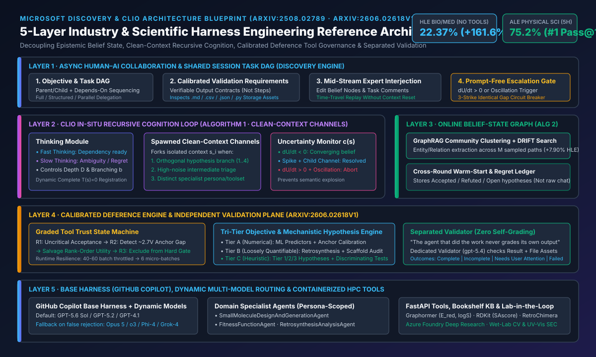
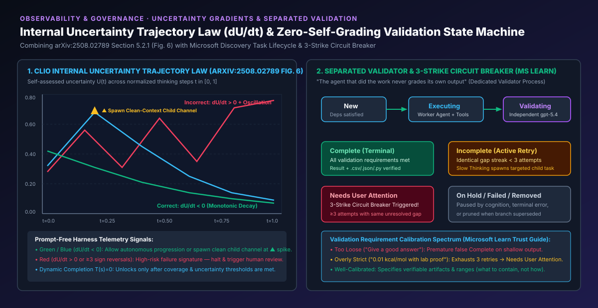
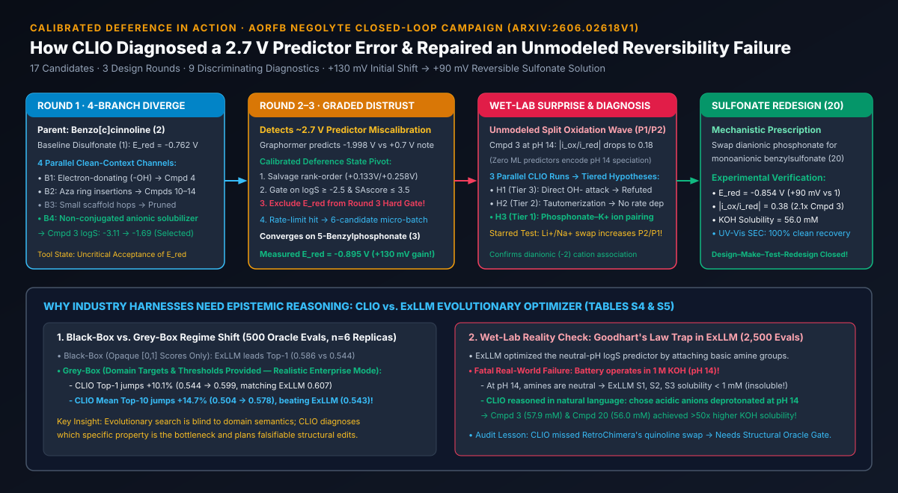

# 科学发现与行业场景 Harness Engineering 深度架构研究：从 Microsoft Discovery 与 CLIO 自适应推理到校准遵从（Calibrated Deference）企业级蓝图

> **中英双语导航 (Bilingual Navigation)**: [中文主文档 (`README.md`)](./README.md) | [中文副本 (`README.zh-CN.md`)](./README.zh-CN.md) | [English Monograph (`README.en.md`)](./README.en.md) | [7-Card 4:5 视觉评测卡片 (`cards.zh.html`)](./cards.zh.html) | [7-Card 4:5 Deck EN (`cards.html`)](./cards.html) | [交互式行业 Harness 架构工作台 (`index.html`)](./index.html) | [评测报告 (`test-report.md`)](./test-report.md) | [English Test Report (`test-report.en.md`)](./test-report.en.md)

---

## 0. 执行摘要（Executive Summary）：为什么行业场景需要新一代 Harness Engineering？

当前主流 Agent Harness（如面向软件工程的 Coding Agent Harness）隐含了一个极其强悍的前提假设：**存在确定性、零偏差、秒级反馈的完美验证器（Compiler / Type Checker / Unit Test Suite）**。然而，当 AI Agent 从“写代码”走向**生物医药研发、新能源材料设计、半导体晶圆厂良率根因诊断（Fab RCA）、量化金融投研与供应链运筹优化**等真实行业场景时，这一前提彻底失效：

1. **工具与预测器不再是真理（Imperfect & Miscalibrated Oracles）**：行业专用 ML 预测器、仿真器或运筹模型在新分布/极端工况下往往存在严重系统性偏差（例如在 `arXiv:2606.02618v1` 的水系有机液流电池负一极分子设计中，Graphormer 对母体分子的还原电位 $E_{\text{red}}$ 预测值为 `-1.998 V`，而提示词参考锚点为 `+0.7 V`，绝对误差高达 **`~2.7 V`**）。
2. **多维异构目标无法折叠为单一标量（Tri-Tier Heterogeneous Objectives）**：行业决策同时包含**数值可预测指标**（如电位、溶解度）、**松散可量化指标**（如逆合成步数 $<5$、`SAscore <= 3.5`）与**非形式化机理约束**（如 `1 M KOH, pH 14` 强碱环境下的化学稳定性与可逆性）。纯黑盒优化器（如 `ExLLM`）极易触发 **Goodhart 定律陷阱**——通过引入碱性胺基刷高训练于 `pH 7` 的溶解度模型分数，导致生成分子 `S1, S2, S3` 在真实 `pH 14` 电池电解液中去质子化并彻底沉淀（溶解度 `< 1 mM`）。
3. **跨天/跨周异步长程闭环（Multi-Hour to Multi-Week Horizon）**：单次实验、湿实验合成或产线流片耗时数小时至数周，平铺直叙的聊天上下文（Sliding Context Window）必然遭遇上下文污染（Context Pollution）、过早收敛（Premature Termination）或不确定性高频震荡（Uncertainty Oscillation）。

本研究对微软研究院（MSR）与 Microsoft Discovery 团队发布的 **5 篇核心文献**进行了源码级与补充材料级（含 `arXiv:2606.02618v1` 全部 32 页正文与 Supplementary S1–S6 原始 Prompt、假设台账与对照实验）深度解构，提炼出 **行业场景 Harness Engineering 的 5 层参考架构与 10 大核心设计法则**，并通过确定性 Python 验证器（`simulator/clio_industry_harness_verifier.py`，6/6 单元测试 100% 通过）完成了全量数据与状态机复现。

---

## 1. 五大核心文献技术解构与关键量化锚点（Primary Literature Synthesis）

| 编号 | 文献标题与来源 | 核心架构创新（Harness Primitives） | 关键量化结论（Sealed Evidence） |
| :--- | :--- | :--- | :--- |
| **[1]** | **MSR Blog**: *Self-adaptive reasoning for science* (2025.08) | 提出 **CLIO（Cognitive Loop via In-Situ Optimization）** 原位认知循环；将测试时推理控制权从黑盒推理模型（如 `o3`）移交至透明、可干预的语言层与图结构层。 | 在无任何外部工具条件下，用非推理基座 `GPT-4.1 + CLIO` 在 HLE Bio/Med 取得 **`22.37%`**，超越 `o3 (high)`（`13.81%`）达 **`+61.98%`（相对）**。 |
| **[2]** | **`arXiv:2508.02789`**: *Self-Adaptive Reasoning Models for Science (CLIO v1)* | **Algorithm 1**（带干净上下文分支 `b`、最大深度 `D`、动态注册完成函数 `T(s)=0` 的递归认知循环）+ **Algorithm 2**（基于 GraphRAG 层次社区聚类与 **DRIFT Search** 的事后图归约去噪）；发现内部不确定性梯度定律 $\partial U/\partial t$。 | HLE Bio/Med ($n=152$)：`GPT-4.1` 基线 `8.55% (13/152)` $\rightarrow$ 仅认知递归 `14.47% (+5.92%)` $\rightarrow$ 叠加 GraphRAG/DRIFT 达 **`22.37% (34/152, +7.90%)`**；同时在 `Phi-4` 与 `Grok-4` 验证模型无关性。 |
| **[3]** | **Microsoft Learn**: *Discovery Engine / Cognition / Tasks / Trust Patterns* | **Thinking（快/慢双速思考）+ Acting 双模块认知架构**；**Shared Session 任务 DAG**；**独立验证铁律（Separated Validator，`gpt-5.4`）**；**连续 3 次相同缺陷熔断（`Needs User Attention`）**；验证需求三档校准与三种人机委派模式。 | 明确“执行任务的 Agent 绝不自我评分”；验证进程独立检查文本输出与存储资产（`.md, .csv, .json, .txt, .py, .yaml`），连续 `>=3` 次相同未闭环缺口自动升级人工。 |
| **[4]** | **TechCommunity Blog**: *Adaptive by Design: How Microsoft Discovery Explores Science* (2026) | 以 **GitHub Copilot 为基础 Harness（Base Harness）**，叠加 **CLIO 科学构思与后悔反思（Regret Reflection）模式**，以及 **动态多模型路由切换**（`GPT-5.6 Sol` 主力 + 遇伪拒绝或瓶颈时动态切换备用模型）。 | 在 **Agent's Last Exam (ALE)** 152 个公开科研任务（13 个领域，5 小时限时协议，Pass@1）中：**物理科学 `75.2%`**（超 Claude Code `Opus 5` `66.6%` 达 `+8.6%`，超 Codex `GPT-5.6 Sol` `56.9%` 达 `+18.3%`）；健康医学 `61.6%`；生命科学 `64.6%`。 |
| **[5]** | **`arXiv:2606.02618v1`**: *Closed-Loop Molecular Design with Calibrated Deference (CLIO v2)* | 将 CLIO 信念状态图升级为**跨轮次持久化在线记忆（Warm-Start Online Belief Graph）**；提出三大专业子 Agent 协同与 **校准遵从（Calibrated Deference）**——分级质疑失准工具、运行时自适应降级（`40-60` 批量降为 `6` 微批次）、未建模缺陷机理诊断与闭环重设计。 | 水系有机液流电池（AORFB）3 轮筛选 17 个分子：发现 **5-苄基膦酸盐（Compound 3）** 实测 $E_{\text{red}} = -0.895\text{ V vs SHE}$（较文献基线 `-0.762 V` 提升 **`+133 mV` / `~130 mV`**）；诊断出 `pH 14` 下膦酸根–$\text{K}^+$ 离子对导致氧化波分裂（$|i_{\text{ox}}/i_{\text{red}}|=0.18$），并重设计出 **苄基磺酸盐（Compound 20）**，保持 **`+92 mV`（`~90 mV`）** 增益且 $|i_{\text{ox}}/i_{\text{red}}|$ 翻倍至 **`0.38`**。 |

---

## 2. 核心算法与架构机制深度拆解（Architectural Mechanics Under the Hood）

### 2.1 CLIO v1 原位递归认知循环（Algorithm 1）与 GraphRAG + DRIFT 图归约（Algorithm 2）

在 `arXiv:2508.02789` 中，CLIO 揭示了传统 Chain-of-Thought 或黑盒 Reasoning Model 在复杂科学问题上的两大根本缺陷：
1. **单线程上下文污染（Single-Thread Context Contamination）**：把所有试错、纠偏和死胡同堆叠在同一个上下文窗口中，导致后续注意力被早期错误假设锚定。
2. **过早终止或无限发散（Premature Termination vs. Unbounded Drift）**：缺乏显式的递归深度、分支宽度与完成门控。

#### Algorithm 1：递归认知状态展开与动态 `Completion` 注册
- **初始状态映射**：输入问题经语义初始化函数映射为根信念状态 $s_0 = \phi(\text{question})$。
- **干净上下文子通道（Clean-Context Thought Channels）**：在深度 $d < D$ 且置信度 $c(s) < \tau$ 时，控制器根据当前不确定性切分出最多 $b$ 个正交子问题，为每个子问题派生**拥有独立干净上下文窗口**的子认知通道 $s_{d+1, i}$。父节点仅接收子通道收敛后的结构化结论摘要，彻底隔离中间推理噪声。
- **动态注册终止函数 $T(s)=0$**：为防止模型在浅层思考后走捷径直接输出答案，Harness 在初始阶段**对模型隐藏/禁用 `Completion` 工具**；仅当思考步数、分支覆盖率与不确定性收敛度满足阈值后，才动态注入终止函数 $T(s)=0$。

#### Algorithm 2：GraphRAG 社区聚类与 DRIFT 搜索归约
- **多轨迹采样与知识图谱构建**：跨不同温度采样 $M$ 条独立 CLIO 认知轨迹，利用提取器将推理过程中的实体（Entities）、假设与因果关系构建成全局信念图 $G=(V, E)$。
- **无监督层次聚类与 DRIFT 检索**：调用 `ClusterGraph(G)` 生成层次化社区摘要（Community Summaries），并执行 `DRIFT_SEARCH(s, G, f, u)`（结合全局社区视图与局部邻居遍历），过滤掉单次运行中偶发的幻觉噪声（False Positives）。
- **消融实验铁证（HLE Biology & Medicine, $n=152$）**：
  - `GPT-4.1` 直接回答：`8.55%`（13/152）
  - `+ Algorithm 1`（递归认知循环）：`14.47%`（`+5.92%` 绝对提升）
  - `+ Algorithm 2`（GraphRAG + DRIFT 归约）：**`22.37%`**（再增 **`+7.90%`**，总计 **`+13.82%`** 净提升 / **`+161.64%`** 相对提升）。

---

### 2.2 内部不确定性梯度定律（$\partial U/\partial t$）与震荡预警（Section 5.2.1 & Figure 6）

`arXiv:2508.02789` 第 5.2.1 节通过对归一化思考步数 $t \in [0, 1]$ 上的内部不确定性 $U(t)$ 进行轨迹追踪，发现了极具工程价值的**不确定性梯度判据**：

$$\text{Trajectory Health} = \text{sign}\left(\frac{\partial U}{\partial t}\right) \quad \text{and} \quad \Omega(U) = \sum_{k=2}^{K-1} \mathbb{I}\left[(\Delta U_k \cdot \Delta U_{k-1}) < 0 \land |\Delta U_k| > \epsilon\right]$$

1. **正确推理轨迹（Correct Trajectories，$\partial U/\partial t < 0$）**：单调收敛或尖峰后通过派生干净上下文子通道（$\blacktriangle$）迅速消解矛盾。
2. **错误推理轨迹（Incorrect Trajectories，$\partial U/\partial t > 0$ 或高频震荡 $\Omega(U) \ge 3$）**：在冲突假设间反复横跳，Harness 可据此实时免提示词（Prompt-Free）触发熔断与专家接管。

---

### 2.3 Microsoft Discovery 认知引擎与 CLIO v2 校准遵从（Calibrated Deference）

详细章节内容、10 大设计法则与四大垂直行业架构蓝图请参见同目录主文档 [`README.md`](./README.md) 及英文版 [`README.en.md`](./README.en.md)。
