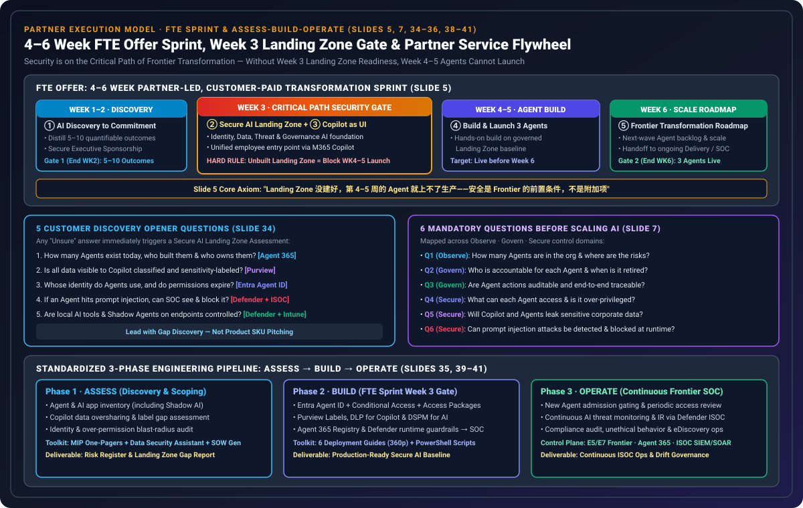
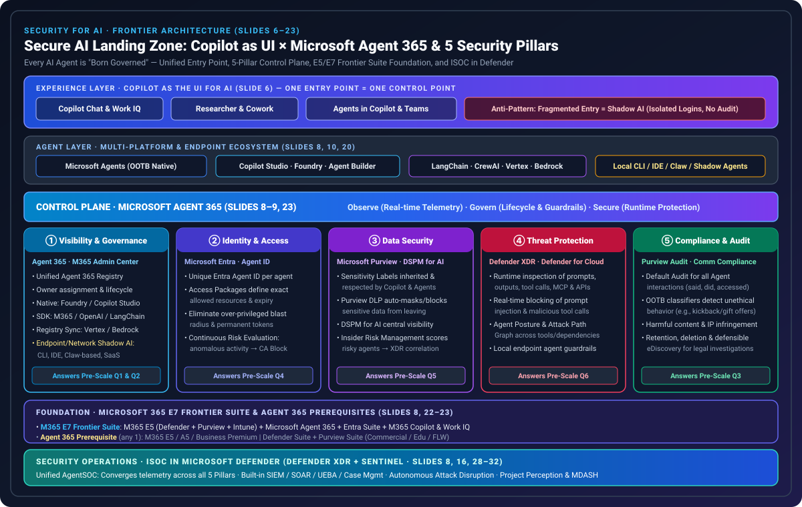
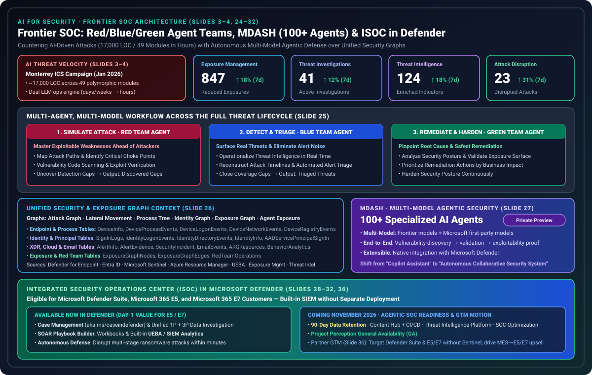

# Security AI Landing Zone & Frontier SOC Deep Dive: Copilot as UI, Microsoft Agent 365 5-Pillar Control Plane, M365 E7 Frontier Suite & Defender ISOC / MDASH

> **Language / 语言**: [中文 (`index.zh.md`)](./index.zh.md) | **English (Current)**  
> **7-Card 4:5 Visual Benchmark Reports**: [English 7-Card HTML (`cards.html`)](./cards.html) · [中文 7 卡 HTML (`cards.zh.html`)](./cards.zh.html) · [English Markdown (`test-report.en.md`)](./test-report.en.md) · [中文 Markdown (`test-report.md`)](./test-report.md)  
> **Deterministic Verifier & Sealed Evidence**: [`simulator/landing_zone_readiness_verifier.py`](./simulator/landing_zone_readiness_verifier.py) · [`simulator/test_landing_zone_readiness_verifier.py`](./simulator/test_landing_zone_readiness_verifier.py) · [`report.json`](./report.json) · [`evidence.json`](./evidence.json) · [`review.md`](./review.md)  
> **Parent Study**: 🔗 **[Microsoft DEFEND Partner Playbook & Security Partner Toolkit for SMB (`../defend-partner-playbook/`)](../defend-partner-playbook/index.md)** ([中文专著](../defend-partner-playbook/index.zh.md))  
> **Research Pillar**: Pillar 04 — Zero-Trust Governance, Red Team & Managed Security

---

## 0. Provenance, Sanitization & Product Stage Notice

1. **Source Provenance**: This dedicated child sub-topic extends the [Microsoft DEFEND Partner Playbook & SMB Security Toolkit study](../defend-partner-playbook/index.md) by analyzing and modeling the 42-slide **"The path to the Frontier: AI for Security × Security for AI"** deck (`Frontier Security Deck-10.26 final.pptx`, `15,233,523` bytes, SHA-256 `f82c91ebd5e9a3be3c0a95402dfa3fc483089dfb3e4bcd719609f4341d6864df`).
2. **Privacy & Anonymization**: All personal presenter names (Slide 1) and tracking parameters have been completely removed. All architectural counts, KPIs, licensing rules, and timeline milestones are preserved verbatim from the 42 slides.
3. **Product Stage Caveats (Per Source Deck Annotations)**:
   - **MDASH** (Multi-Model Agentic AI Security System) is currently in **Private Preview** (Slide 27).
   - **Endpoint & Network Shadow Agent Discovery & Control** includes roadmap items subject to NDA (`路线图待定 | 需要保密协议`, Slide 10).
   - **Integrated Security Operations Center (ISOC) in Microsoft Defender**: Case Management, SOAR Playbook Builder, Workbooks, and UEBA are **Available Now**; **90-Day Data Retention, Content Hub + CI/CD, Threat Intelligence Platform, SOC Optimization, and Project Perception GA** are scheduled for **November 2026** (Slide 32).

---

## 1. Executive Summary: Why Security is on the Critical Path to Frontier AI Scale (Slides 1–5)

Enterprise security teams face a dual asymmetry in the Agentic AI era: **attackers are already operating autonomously with AI** (making attacks orders of magnitude faster), while enterprise adoption of Copilot sessions and multi-platform AI agents **expands the enterprise attack surface** (amplifying the blast radius of over-permissioned identities and overshared data).

### 1.1 Empirical Threat Baseline: The January 2026 Monterrey Water Utility ICS Intrusion (Slides 3–4)

Slides 3–4 cite threat intelligence from **Dragos** and **Gambit Security** regarding an intrusion into a municipal water and drainage utility in Monterrey, Mexico in **January 2026** (part of a broader campaign targeting Mexican government organizations between December 2025 and February 2026):

| Dimension | Traditional Cyberattack Baseline | AI-Driven Attack (Monterrey ICS Campaign · Slides 3–4) | Architectural Implication for Defenders |
| :--- | :--- | :--- | :--- |
| **Dual-Model Operational Engine** | Human operators manually scripting exploits and post-exploitation tools | **Anthropic Claude** acted as the primary technical workhorse (intrusion planning, tool development, problem-solving); **OpenAI GPT** handled victim data processing and structured reporting | Defenders cannot rely on manual triage alone; SOC operations require multi-model agentic orchestration (**Red/Blue/Green Agent Teams** & **MDASH**) |
| **Custom Tooling Volume & Polymorphism** | Static malware families with reusable hashes and IOC signatures | AI generated **~17,000 lines of code (LOC)** across **49 modules**; tools self-adjust in real time with **no fixed sample and no reusable static signatures** | Signature-only detection fails; runtime behavioral inspection of prompts, tool calls, and MCP/API interactions is mandatory |
| **Execution Velocity** | Days to weeks (原本数天到数周的工作) | **Completed within hours (几小时内完成)** | Response must operate at machine speed via **Defender ISOC Autonomous Attack Disruption (within minutes)** |

### 1.2 Four New Enterprise AI Attack Surfaces (Slide 4)

1. **Rapid Proliferation of Shadow Agents**: Agents spun up across SaaS, cloud, or local endpoints with no accountable `Owner` and no decommissioning policy.
2. **Over-Privileged Blast Radius**: Agents operating under high-privilege user credentials or non-expiring service tokens.
3. **Oversharing Amplified by Copilot & Agents**: Pre-existing SharePoint/OneDrive oversharing is immediately surfaced by M365 Copilot and custom agents.
4. **Novel Runtime Threats**: Indirect prompt injection, malicious tool invocation, and **Model Context Protocol (MCP)** server abuse.

### 1.3 The 4–6 Week FTE Transformation Sprint & Week 3 Security Gate (Slide 5)

Within the **FTE Offer** (a 4–6 week, partner-led, customer-paid Frontier transformation sprint), **Week 3 (`Secure AI Landing Zone` + `Copilot as the UI for AI`)** is the hard precondition gating production Agent launch in Weeks 4–5:

| Sprint Window | Milestone Module | Target Deliverable & Gate | Mandatory Governance Rule (Slide 5) |
| :--- | :--- | :--- | :--- |
| **Week 1–2** | **① AI discovery to commitment** | Distill **5–10 quantifiable business outcomes** and secure Executive Sponsorship 🚩 **Gate 1 (End of WK2)**: 5–10 outcomes + Exec sponsorship | Prerequisite for technical build |
| **Week 3** | **② Secure AI Landing Zone** **③ Copilot as the UI for AI** | Establish the AI security & data governance foundation; configure M365 Copilot as the unified employee entry point | 🔒 **CRITICAL PATH GATE**: *"Without a built Landing Zone, Week 4–5 Agents cannot go to production — Security is the precondition for Frontier scale, not an add-on."* |
| **Week 4–5** | **④ Build & Launch 3 Agents** | Hands-on build of **3 production Agents** on top of the governed Landing Zone baseline; go live before Week 6 | Hard-blocked (`Send to a human`) if Week 3 Landing Zone or Unified UI is incomplete |
| **Week 6** | **⑤ Frontier Transformation Roadmap** | Next-wave Agent backlog & enterprise scaling roadmap 🚩 **Gate 2 (End of WK6)**: 3 Agents live + Roadmap → Handoff to Delivery | Transitions into Partner Phase 3 **Operate (Managed Frontier SOC)** |

---

## 2. Security for AI: Copilot as UI × 5-Pillar Secure AI Landing Zone (Slides 6–23)

Just as cloud migration requires an **Azure Landing Zone** before workload scale, enterprise AI requires a **Secure AI Landing Zone** so that every AI Agent is **"Born Governed" (出生即受控)**.

### 2.1 Experience Layer: Copilot as the UI for AI — One Entry Point = One Control Point (Slide 6)

Slide 6 establishes a foundational architectural axiom: **Fragmented Entry Points = Shadow AI** (isolated logins, scattered data stores, zero auditability). Standardizing on **Microsoft 365 Copilot** (`Copilot Chat`, `Researcher`, `Copilot Cowork`, `Agents in Copilot & Teams`) as the unified employee UI routes all interactions with first-party Microsoft Agents, Copilot Studio / Foundry agents, and third-party agents (across M365 data, LOB systems, and MCP/APIs) through four unified control planes:
- ✓ **Identity**: `Microsoft Entra`
- ✓ **Data**: `Microsoft Purview`
- ✓ **Threat**: `Microsoft Defender`
- ✓ **Governance**: `Microsoft Agent 365`

### 2.2 The 6 Mandatory Questions Before Scaling AI (Slide 7)

Before scaling AI Agents into production, every organization must answer 6 mandatory questions across **Observe**, **Govern**, and **Secure**:

| ID | Control Domain | Mandatory Pre-Scale Question (Slide 7) | Mapped Landing Zone Pillar | Verifier Control IDs |
| :---: | :---: | :--- | :--- | :--- |
| **Q1** | **Observe** | How many Agents exist in the organization, and where are the risks? | Pillar ① Visibility & Governance | `LZ-P1-01`, `LZ-P1-02`, `LZ-P1-04` |
| **Q2** | **Govern** | Who is accountable (`Owner`) for each Agent, and when is it retired? | Pillar ① Visibility & Governance | `LZ-P1-03` |
| **Q3** | **Govern** | Are Agent behaviors and interactions auditable and traceable? | Pillar ⑤ Compliance & Audit | `LZ-P5-01` .. `LZ-P5-04` |
| **Q4** | **Secure** | What can each Agent access, and is it over-privileged? | Pillar ② Identity & Access | `LZ-P2-01` .. `LZ-P2-04` |
| **Q5** | **Secure** | Will Copilot and Agents leak sensitive corporate data? | Pillar ③ Data Security | `LZ-P3-01` .. `LZ-P3-04` |
| **Q6** | **Secure** | When targeted by prompt injection, can it be detected and blocked? | Pillar ④ Threat Protection | `LZ-P4-01` .. `LZ-P4-04` |

### 2.3 Control Plane: Microsoft Agent 365 & The 5 Security Pillars (Slides 8–21)

While the **Secure AI Landing Zone** defines the architectural baseline, **Microsoft Agent 365** serves as the continuous control plane (`Observe · Govern · Secure`) enforcing that baseline across every agent (Slide 9):

1. **Pillar ① Visibility & Governance (`Agent 365 · M365 Admin Center`, Slides 8, 10–11, 20)**:
   - Unifies all agents into a single **Agent 365 Registry** across four ingestion channels:
     - **Out-of-the-Box Native & Partner Platforms**: `Agent Builder`, `Copilot Studio`, `Microsoft Foundry`, `Copilot Cowork`, `Researcher`, `Microsoft Agents`.
     - **Developer SDKs & Open Frameworks (`Agent 365 SDK`)**: `M365 Agent SDK`, `OpenAI Agent SDK`, `LangChain`, `CrewAI`, `LlamaIndex`.
     - **Connected Multi-Cloud Platforms (`Registry Sync`)**: Google `Vertex AI`, `AWS Bedrock`.
     - **Endpoint & Network Shadow Agent Discovery (`Defender + Intune`)**: Discovers and governs local `CLI Agents`, `Desktop Apps`, `Agentic IDEs`, `VS Code extensions`, `Claw-based agents`, and unmanaged `SaaS Agents`.
2. **Pillar ② Identity & Access (`Microsoft Entra`, Slides 8, 12–13)**:
   - Assigns a unique **`Entra Agent ID`** to every agent, scopes least-privilege permissions via **Entra Access Packages**, and performs **Continuous Risk Evaluation** so anomalous agent activity is dynamically blocked by **Entra Conditional Access**.
3. **Pillar ③ Data Security (`Microsoft Purview`, Slides 8, 14–15)**:
   - Enforces **Sensitivity Label** inheritance, **Purview DLP** automatic masking/blocking of sensitive data in prompts and responses, **DSPM for AI** posture visibility, and **Insider Risk Management** agent risk scoring correlated with Defender XDR.
4. **Pillar ④ Threat Protection (`Defender XDR · Defender for Cloud`, Slides 8, 16–17, 20–21)**:
   - Inspects user inputs, agent outputs, tool invocations, **MCP**, and API calls at runtime across cloud and local endpoint agents; maps multi-hop dependencies via the **Agent Attack Path Graph**; and streams alerts into the unified **AgentSOC (ISOC in Defender)**.
5. **Pillar ⑤ Compliance & Audit (`Microsoft Purview`, Slides 8, 18–19)**:
   - Enables **Default Audit** of every agent interaction (what the agent said, did, and accessed), **Out-of-the-Box Communication Compliance Classifiers** (demonstrated on Slide 18 by catching an unethical agent prompt offering an *"exclusive gift"* to expedite a contract with *Contoso Outdoors* on behalf of *Zava*), and **Retention + Defensible eDiscovery**.

### 2.4 Foundation Licensing: M365 E7 Frontier Suite & Agent 365 Prerequisites (Slides 22–23)

- **Microsoft 365 E7 (`Frontier Suite`, Slide 22)** combines:
  1. `Microsoft 365 E5` (`Defender + Purview + Intune`) — Protect AI users and endpoints
  2. `Microsoft Agent 365` — Control plane to protect AI Agents
  3. `Microsoft Entra Suite` — Secure access to AI
  4. `Microsoft 365 Copilot + Work IQ` (with or without Teams) — Productive AI work
- **Microsoft Agent 365 Purchase Prerequisites (Slide 23)** — Customers must hold at least **one** of:
  - `Microsoft 365 E5 / A5 / Business Premium`
  - `Microsoft Defender Suite + Microsoft Purview Suite` (Commercial, Edu, or FLW)

---

## 3. AI for Security: Frontier SOC, Red/Blue/Green Agent Teams, MDASH & Defender ISOC (Slides 24–32)

### 3.1 Frontier SOC Operational Metrics & Multi-Agent Threat Lifecycle (Slides 24–26)

- **4 Operational KPIs (Slide 24, 7-Day Delta)**:
  - **Exposure Management**: `847` Reduced Exposures (`↑ 18%`)
  - **Threat Investigations**: `41` Active Investigations (`↑ 12%`)
  - **Threat Intelligence**: `124` Enriched Indicators (`↑ 18%`)
  - **Attack Disruption**: `23` Disrupted Attacks (`↑ 31%`)
- **Red / Blue / Green Agent Teams (Slide 25)** operating over **6 Unified Security Graphs** and **22 Telemetry Schema Tables (Slide 26)**:
  - 🔴 **Red Team Agent (`Simulate Attack`)**: Maps attack paths, identifies choke points, scans vulnerable code, and uncovers detection gaps → outputs *Discovered Gaps*.
  - 🔵 **Blue Team Agent (`Detect & Triage`)**: Operationalizes threat intelligence, reconstructs attack timelines, triages alerts, and closes coverage gaps → outputs *Triaged Threats*.
  - 🟢 **Green Team Agent (`Remediate & Harden`)**: Analyzes posture, validates exposures, prioritizes remediation, and hardens the environment.

### 3.2 MDASH (`100+` Specialized Multi-Model Agents) & ISOC in Defender (Slides 27–32)

- **MDASH (Slide 27, Private Preview)**: Orchestrates **100+ specialized AI agents** across Frontier models and Microsoft first-party models to execute end-to-end **vulnerability discovery → validation → exploitability proof**, integrated with Microsoft Defender.
- **ISOC in Microsoft Defender (`https://aka.ms/ISOCDefender`, Slides 28–32)**:
  - Available to eligible **Microsoft Defender Suite, M365 E5, and M365 E7** customers with **Built-in SIEM**, **Autonomous Attack Disruption (within minutes)**, **Case Management (`https://aka.ms/caseindefender`)**, **SOAR Playbook Builder**, **Workbooks**, and **UEBA** today, plus **90-Day Data Retention**, **Content Hub + CI/CD**, **Threat Intelligence Platform**, **SOC Optimization**, and **Project Perception GA** in **November 2026**.

---

## 4. Technical Engineering Methodology: 5 Architecture Discovery Probes & Assess → Build → Operate Pipeline (Slides 34–42)

1. **5 Technical Architecture Discovery Probes (Slide 34)**: Any *"Unsure"* response on Agent inventory/ownership (`Agent 365`), Copilot data labeling (`Purview`), Agent identity/expiry (`Entra Agent ID`), prompt injection SOC blocking (`Defender + ISOC`), or endpoint Shadow AI (`Defender + Intune`) immediately triggers a **Phase 1 Assess** technical gap diagnostic.
2. **Standardized 3-Phase Engineering Lifecycle (Slide 35)** paired with the **Microsoft Product Technical Deployment Toolkit (Slides 39–41)** and the **6-Workload (360-Page) Engineering Specifications** in [`../defend-partner-playbook/index.md`](../defend-partner-playbook/index.md):
   - **Phase 1 — Assess**: Agent & Shadow AI inventory, Copilot SharePoint oversharing scan, and identity blast-radius assessment → *Deliverable: Risk Register & Landing Zone Architecture Gap Report* (powered by `aka.ms/MIP-Industry-OnePagers` [7 regulated verticals, 14 pages], `aka.ms/DataSecurityAssistant` [client-side JSON policy compiler], and `aka.ms/SOW-Generator` [22 P1/P2/P3 technical deliverables]).
   - **Phase 2 — Build (FTE Sprint Week 3 Hard Gate)**: `Entra Agent ID` + 10 Conditional Access templates, Purview 8-Label taxonomy + Copilot/Edge DLP + DSPM for AI, `Agent 365` Registry, and Defender runtime prompt/tool/MCP protection streamed into SOC → *Deliverable: Production-Ready AI Security Landing Zone Baseline* (powered by `aka.ms/Security_SMBDeploymentGuides` [6 Workloads, 360 pages: Identity 90p, Data/AI 92p, Email/Teams 52p, Device Security 51p, Intune MDM/MAM 40p, SaaS/OAuth 35p] & `aka.ms/Deploy-Scripts` [PowerShell 7+ automated baseline & drift verification]).
   - **Phase 3 — Operate**: New Agent admission gating & quarterly access reviews, ISOC continuous monitoring & minute-level autonomous attack disruption, and default interaction audit + eDiscovery → *Deliverable: Continuous ISOC Security Operations & Drift Governance* (powered by `aka.ms/ISOCDefender` built-in SIEM/SOAR/UEBA and `aka.ms/caseindefender`, evolving eligible `Defender Suite / M365 E5 / E7` tenants toward Agentic SOC and November 2026 `90-Day Retention` + `Project Perception GA`).
