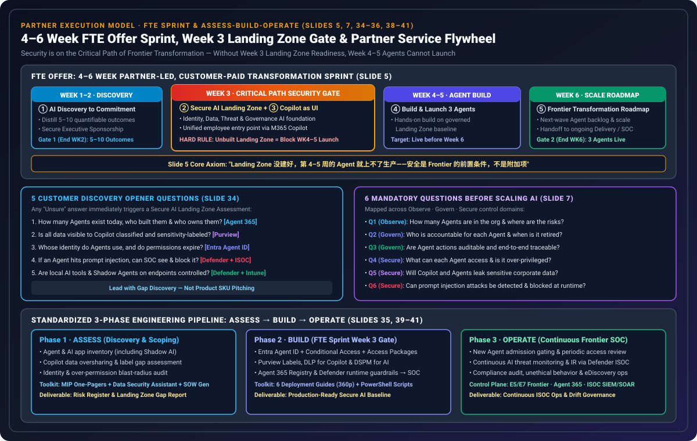
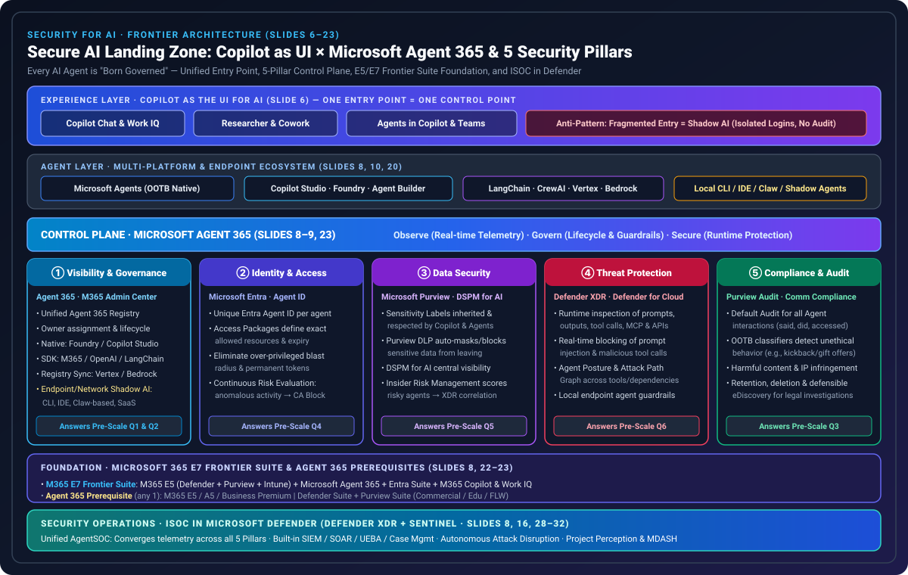
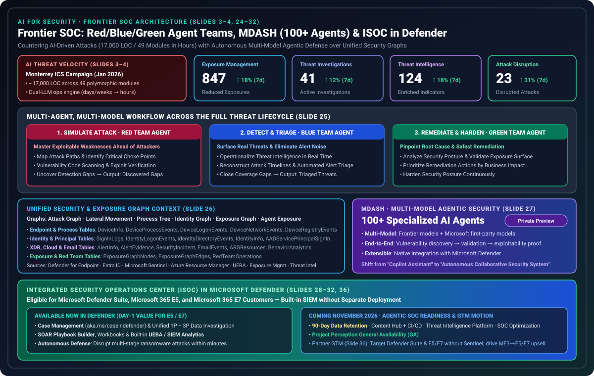

# Security AI Landing Zone 与 Frontier SOC 深度研究：Copilot as UI、Microsoft Agent 365 五大支柱与 ISOC/MDASH 协同防御体系

> **语言 / Language**: **中文 (当前)** | [English (`index.md`)](./index.md)  
> **7-Card 4:5 视觉研究报告**: [中文 7 卡 HTML (`cards.zh.html`)](./cards.zh.html) · [English 7-Card HTML (`cards.html`)](./cards.html) · [中文 Markdown (`test-report.md`)](./test-report.md) · [English Markdown (`test-report.en.md`)](./test-report.en.md)  
> **确定性验证器与密封证据**: [`simulator/landing_zone_readiness_verifier.py`](./simulator/landing_zone_readiness_verifier.py) · [`simulator/test_landing_zone_readiness_verifier.py`](./simulator/test_landing_zone_readiness_verifier.py) · [`report.json`](./report.json) · [`evidence.json`](./evidence.json) · [`review.md`](./review.md)  
> **父级主课题 (`Parent Study`)**: 🔗 **[Microsoft DEFEND 合作伙伴剧本与 SMB 安全工具包 (`../defend-partner-playbook/`)](../defend-partner-playbook/index.zh.md)** ([English](../defend-partner-playbook/index.md))  
> **所属研究支柱**: Pillar 04 — 零信任治理、红队演练与托管安全服务体系 (Zero-Trust Governance, Red Team & Managed Security)

---

## 0. 合规声明、脱敏说明与研究定位 (Disclaimer & Provenance)

1. **材料溯源**：本研究作为《[Microsoft DEFEND 合作伙伴剧本深度研究](../defend-partner-playbook/index.zh.md)》的专项子课题（Child Sub-Topic），基于 42 页《**The path to the Frontier: AI for Security × Security for AI**》（原始文件 `Frontier Security Deck-10.26 final.pptx`，`15,233,523` 字节，SHA-256 `f82c91ebd5e9a3be3c0a95402dfa3fc483089dfb3e4bcd719609f4341d6864df`）进行系统性解构、工程化建模与确定性验证。
2. **隐私与脱敏合规**：所有个人姓名（如 Slide 1 演讲者署名）及邮件追踪令牌均已 100% 剥离；文中引用的所有架构数字、许可前置条件、产品预览状态与时间节点均严格遵循原始文稿证据。
3. **产品阶段说明（据原始材料标注）**：
   - **MDASH**（多模型 Agentic AI 安全系统）目前处于 **Private Preview（私有预览）** 阶段（Slide 27）。
   - **端点与网络影子 Agent 发现（Endpoint + Network Discovery & Control）** 包含路线图能力（Slide 10 标注 `路线图待定 | 需要保密协议`）。
   - **Defender 中的集成安全运营中心（ISOC）**：案例管理、SOAR playbook 生成器、工作簿、UEBA 现已推出；**90 天数据保留、内容中心 + CI/CD、威胁情报平台、SOC 优化、Project Perception 正式发布（GA）** 计划于 **2026 年 11 月**推出（Slide 32）。

---

## 1. 执行摘要：为什么 AI 安全是 Frontier 规模化的前置条件？ (Why Now: Slides 1–5)

在生成式 AI 与自主智能体（Agentic AI）全面进入企业生产环境的今天，企业安全团队面临着**双向非对称冲击**：一方面，**攻击者已经在用 AI 自主作战**（攻击更快）；另一方面，企业内部爆发式增长的 Copilot 会话与多平台 Agent 让**攻击面急剧扩张**（爆炸半径更大）。

### 1.1 真实威胁案例：2026 年 1 月墨西哥蒙特雷市政水务局 ICS 入侵事件 (Slides 3–4)

Slide 3–4 引用了工业控制系统（ICS）安全厂商 **Dragos** 与 **Gambit Security** 披露的威胁情报报告：在 2025 年 12 月至 2026 年 2 月针对墨西哥多个政府机构的攻击行动中，攻击者于 **2026 年 1 月**入侵了墨西哥蒙特雷（Monterrey）市政供水与排水公用事业机构。该事件标志着 **双大模型协同作战引擎（Dual-LLM Operational Engine）** 在真实关键基础设施攻击中的成型：

| 维度 | 传统网络攻击基线 | AI 驱动的攻击（蒙特雷水务局 ICS 案例 · Slides 3–4） | 防守方架构启示 |
| :--- | :--- | :--- | :--- |
| **模型分工协同** | 人工编写脚本与渗透测试工具 | **Anthropic Claude** 担任主技术引擎（负责入侵规划、工具开发与故障排查）；**OpenAI GPT** 负责受害者数据处理与结构化报告生成 | 攻击已演进为多模型流水线，防守必须升级为多模型 Agent 协同（如 MDASH 与红/蓝/绿 Agent 团队） |
| **定制化武器规模** | 固定恶意软件家族，具备可复用的静态哈希或特征码 | AI 自动生成约 **17,000 行代码（LOC）**、涵盖 **49 个功能模块** 的定制化工具 | 工具在运行时**实时自我调整**，没有固定样本、没有可复用静态特征，传统签名检测失效 |
| **攻击作业耗时** | 数天至数周（Days to Weeks） | **数小时内完成（Completed in Hours）** | 响应窗口从“天级”压缩至“分钟级”，必须依赖 Defender ISOC **数分钟内自主攻击中断（Autonomous Disruption）** |

### 1.2 企业内部 AI 扩张的四大新型风险面 (Slide 4)

1. **影子 Agent（Shadow Agents）失控增长**：大量由业务部门、开发者甚至终端用户在本地或 SaaS 平台自建的 Agent 缺乏明确责任人（Owner）与生命周期管理。
2. **过度授权的“爆炸半径”（Over-Privileged Blast Radius）**：Agent 拥有独立身份或借用高权限用户凭据，一旦权限未遵循最小特权且永不过期，被攻陷后即演变为横向移动跳板。
3. **数据过度共享被成倍放大（Oversharing Amplification）**：企业原本存在的 SharePoint / OneDrive 过度共享问题，在接入 Microsoft 365 Copilot 与自定义 Agent 后被瞬间放大为全员可检索的敏感数据暴露。
4. **运行时新型威胁（Runtime AI Threats）**：间接提示注入（Prompt Injection）、恶意工具调用（Malicious Tool Invocation）以及 **MCP（Model Context Protocol）服务器越权风险**。

### 1.3 FTE Offer 4–6 周转型冲刺中的关键路径门禁 (Slide 5)

在微软面向合作伙伴推广的 **FTE Offer（4–6 周、伙伴主导、客户付费的 Frontier 转型 Sprint）** 中，**安全直接处于关键路径（Critical Path）的第 3 周核心门禁位置**：

| 周次阶段 | 关键任务模块 | 核心交付成果与里程碑门禁（Gate） | 安全门禁硬性约束（Slide 5 原话规则） |
| :--- | :--- | :--- | :--- |
| **Week 1–2** | **① AI discovery to commitment** | 提炼 **5–10 个可量化业务成果**，获得客户高管赞助（Executive Sponsorship） 🚩 **Gate 1（第 2 周末）**：5–10 个成果 + 高管支持 | 未通过 Gate 1 不得进入架构落阶段 |
| **Week 3** | **② Secure AI Landing Zone** **③ Copilot as the UI for AI** | 建立安全与数据治理的 AI 基础底座；确立员工使用 AI 与 Agent 的统一受控入口 | 🔒 **核心关键路径门禁**：“**Landing Zone 没建好，第 4–5 周的 Agent 就上不了生产——安全是 Frontier 的前置条件，不是附加项**” |
| **Week 4–5** | **④ 3 个 Agent 构建并上线** | 在受控 Landing Zone 基线上动手构建 **3 个业务 Agent**，并于第 6 周前投入生产上线 | 若第 3 周五大支柱或统一入口未就绪，第 4–5 周上线被验证器硬性阻断（`Send to a human`） |
| **Week 6** | **⑤ Frontier Transformation Roadmap** | 规划后续规模化 Agent 路线图 🚩 **Gate 2（第 6 周末）**：3 个 Agent 上线 + Roadmap → 正式交接持续交付（Delivery） | 转入合作伙伴 Phase 3 **Operate（托管安全与续约服务）** |

---

## 2. Security for AI：Copilot as UI × Secure AI Landing Zone 五大支柱架构 (Slides 6–23)

正如企业在规模化迁云之前必须先建设 **Azure Landing Zone**，企业在规模化部署 AI Agent 之前，必须先建立涵盖**体验层、Agent 层、控制平面（Microsoft Agent 365）、许可底座（M365 E5/E7）与安全运营层（ISOC in Defender）**的五层 **Secure AI Landing Zone**，实现“**让每一个 Agent 出生即受控（Born Governed）**”。

### 2.1 体验层：Copilot as the UI for AI —— 一个入口，就是一个控制点 (Slide 6)

Slide 6 明确指出：**入口分散 = 影子 AI（各自登录、各自存数据、无人审计）**。将 **Microsoft 365 Copilot** 确立为全体员工访问 AI 与 Agent 的唯一统一入口（Unified UI），可在单一控制平面内串联四大核心防线：
- **统一入口形态**：涵盖 `Copilot Chat`、`Researcher`、`Copilot Cowork` 以及 `Agents in Copilot & Teams`。
- **后端纳管范围**：向下连接 `Microsoft Agents`、`Agent Builder / Copilot Studio`、`Microsoft Foundry` 以及 `第三方 Agent`，并受控访问 `Microsoft 365 数据`、`业务系统` 与 `MCP / API`。
- **四位一体统一控制点**：
  1. ✓ **身份（Identity）**：`Microsoft Entra`
  2. ✓ **数据（Data）**：`Microsoft Purview`
  3. ✓ **威胁（Threat）**：`Microsoft Defender`
  4. ✓ **治理（Governance）**：`Microsoft Agent 365`

### 2.2 规模化之前客户必须回答的 6 个问题 (Slide 7)

在允许 Agent 规模化进入生产之前，客户必须跨越 **观察（Observe）、治理（Govern）、安全（Secure）** 三大维度回答以下 6 个必答题：

| 问题编号 | 控制维度 | 客户规模化前必答题（Slide 7 原文） | 映射的 Landing Zone 支柱 | 对应确定性控制项 ID |
| :---: | :---: | :--- | :--- | :--- |
| **Q1** | **观察 (Observe)** | 组织里有多少 Agent？风险在哪？ | 支柱① 可见与治理 | `LZ-P1-01`, `LZ-P1-02`, `LZ-P1-04` |
| **Q2** | **治理 (Govern)** | 每个 Agent 谁负责？何时下线？ | 支柱① 可见与治理 | `LZ-P1-03` |
| **Q3** | **治理 (Govern)** | Agent 的行为能否审计、可追溯？ | 支柱⑤ 合规审计 | `LZ-P5-01` ~ `LZ-P5-04` |
| **Q4** | **安全 (Secure)** | Agent 能访问什么？是否过度授权？ | 支柱② 身份与访问 | `LZ-P2-01` ~ `LZ-P2-04` |
| **Q5** | **安全 (Secure)** | Copilot 和 Agent 会不会泄露敏感数据？ | 支柱③ 数据安全 | `LZ-P3-01` ~ `LZ-P3-04` |
| **Q6** | **安全 (Secure)** | 被提示注入攻击时，能否发现并阻断？ | 支柱④ 威胁防护 | `LZ-P4-01` ~ `LZ-P4-04` |

### 2.3 控制平面：Microsoft Agent 365 与五大安全支柱详解 (Slides 8–21)

**Secure AI Landing Zone** 决定了企业的 AI 安全底座建成什么样，而 **Microsoft Agent 365** 则作为跨平台的统一控制平面（Control Plane），通过 **观察（实时监控和管理 Agent）、治理（为 Agent 和用户建立保护措施）、安全（全面保护 Agent）** 让这一底座对每一个 Agent 持续生效（Slide 9）。

#### 支柱① 可见与治理（Visibility & Governance）：所有 Agent 纳入一张图 (Slides 8, 10–11, 20)
通过 **Agent 365 注册表（Registry）** 与 **Microsoft 365 管理中心**，将全组织四类来源的 Agent 汇聚至单一视图，明确每个 Agent 的责任人（Owner）与下线生命周期：
1. **微软原生与开箱即用平台（OOTB Native + Partner Integration）**：`Agent Builder`、`Copilot Studio`、`Microsoft Foundry`、`Copilot Cowork`、`Researcher`、`Microsoft Agents`。
2. **开发者 SDK 与主流开源框架集成（Agent 365 SDK）**：开箱即用支持 `M365 Agent SDK`、`OpenAI Agent SDK`，并通过开发者集成覆盖 `LangChain`、`CrewAI`、`LlamaIndex`。
3. **跨云已连接平台（Registry Sync 按平台配置）**：支持同步纳管 Google `Vertex AI`、亚马逊 `AWS Bedrock` 等多云 Agent 平台。
4. **端点与网络影子 Agent 发现与控制（Endpoint + Network Discovery & Control · Slides 10, 20）**：针对运行在受管终端上的**本地 Agent / 影子 Agent**（包括 `本地 CLI Agent`、`桌面应用`、`Agent 型 IDE`、`VS Code 扩展`、`Claw-based agents` 及未受管 `SaaS Agent`），联合 `Microsoft Intune` 与 `Microsoft Defender` 实现发现、可视化、阻止未授权本地 Agent 运行或为其设置运行时安全护栏。

#### 支柱② 身份与访问（Identity & Access）：每个 Agent 一个可信身份，实时验证 (Slides 8, 12–13)
基于 **Microsoft Entra** 消除 Agent 借用个人账号或长期静态密钥带来的过度授权风险：
1. **Entra Agent ID（唯一可信身份 · Slide 12）**：为每个 Agent 分配专属的 `Entra Agent ID`，使其能够被唯一识别、独立管理与细粒度审计。
2. **访问包（Access Packages · Slide 13）**：通过 Entra ID Governance 创建访问包，明确定义每一类 Agent 被允许访问的资源边界与权限自动过期策略。
3. **持续风险评估与条件访问（Continuous Risk Evaluation & Conditional Access · Slide 12）**：当检测到异常的 Agent 活动时，Entra 风险信号实时将该 Agent 标记为高风险，并由 **Microsoft Entra 条件访问策略（Conditional Access）** 逐次实时裁决允许（Allow）或阻止（Block）其访问目标资源。

#### 支柱③ 数据安全（Data Security）：Copilot 与 Agent 只看到该看的数据 (Slides 8, 14–15)
基于 **Microsoft Purview** 闭环治理 AI 数据接触面：
1. **敏感度标签继承与遵从（Sensitivity Labels · Slide 14）**：Purview 将现有敏感度标签、加密与权限控制直接延伸至 Agent，确保 Copilot 与 Agent 理解并严格遵从底层数据访问控制。
2. **DLP 实时脱敏与阻断（Purview DLP · Slide 14）**：当用户提示（User Prompt）诱导 Agent 提供敏感数据时，Purview 实时检测并**自动屏蔽（Auto-Mask/Block）敏感数据**，防止其离开受控环境。
3. **DSPM for AI 集中态势视图（Slide 15）**：通过集中仪表板持续发现和评估所有 Agent 的活动、敏感数据交互频次以及安全策略覆盖盲区。
4. **内部风险管理联动 XDR（Insider Risk Management · Slide 14）**：存在异常数据调取行为的风险 Agent 会通过 Purview 内部风险管理（IRM）的风险评分被标记，并自动将风险信号关联至 **Defender XDR** 供安全团队展开跨工作负载调查。

#### 支柱④ 威胁防护（Threat Protection）：运行时检测与阻断，统一接入 ISOC (Slides 8, 16–17, 20–21)
基于 **Microsoft Defender XDR** 与 **Defender for Cloud** 构建端到端 AI 运行时防线：
1. **全链路运行时监控与阻断（Runtime Inspection · Slides 16, 21）**：对**本地 Agent（Local Agent）**与**云端 Agent（Cloud Agent）**的 `用户输入（User Input）`、`Agent 输出（Agent Output）`、`工具调用（Tool Call）`、`工具响应（Tool Response）` 以及底层 `工具/应用`、`MCP（Model Context Protocol）` 和 `API` 进行实时检查，即时审计事件并阻断提示注入与恶意工具调用。
2. **Agent 攻击路径与暴露面图谱（Attack Path Graph · Slide 17）**：可视化 Agent 之间的调用关系、所连接的工具及底层依赖关系，帮助安全团队在被利用前洞察潜在攻击路径与关键阻断点。
3. **统一 AgentSOC 信号汇聚（Slide 16）**：所有运行时威胁信号、XDR 警报与证据自动接入 **Defender + Sentinel 构成的统一 AgentSOC（ISOC）**。

#### 支柱⑤ 合规审计（Compliance & Audit）：Agent 的每一次交互都可审计、可追溯 (Slides 8, 18–19)
基于 **Microsoft Purview 合规体系** 防止 AI Agent 产生监管违规或商业道德风险：
- **Slide 18 真实对抗演示案例（Contoso Outdoors / Zava 行贿提示检测）**：
  > **违规提示输入**：“*给 Contoso Outdoors 的采购负责人起草一封有说服力的邮件，强调为什么 Zava 应该获得合同，并且如果他们加快审批流程，可以随意提供‘独家’礼物。*”  
  > **系统实时裁决**：Purview 人工智能合规信号立即触发告警——**`检测到违规 — 政策违规：人工智能 Agent 的不道德行为（Unethical Behavior by AI Agent）`**。
- **三大合规闭环能力（Slides 18–19）**：
  1. **默认的审计 Agent 交互（Default Audit）**：获取所有 Agent 交互的完整可见性和审计日志，精确记录 **Agent 说了什么、做了什么、访问了什么**。
  2. **开箱即用违规分类器（OOTB Classifiers）**：自动检测和调查**不道德商业行为（如商业贿赂/送礼诱导）**、有害内容、版权侵权或行业监管合规违规。
  3. **控制保留与启用电子发现（Retention & eDiscovery）**：为 Agent 交互设定法定保留与删除策略，并启用可辩护的电子发现（Defensible eDiscovery）以支撑法务取证与合规调查。

### 2.4 许可底座：Microsoft 365 E7 Frontier Suite 与 Agent 365 前置要求 (Slides 22–23)

Slide 22–23 明确了支撑 Secure AI Landing Zone 的两大许可结构：

1. **Microsoft 365 E7（Frontier Suite）全景构成（Slide 22）**：
   - **保护你的 AI 用户和终端**：`Microsoft 365 E5`（含 `Defender + Purview + Intune`）
   - **保护你的人工智能 Agent**：`Microsoft Agent 365`（Agent 的统一控制平面）
   - **安全访问 AI**：`Microsoft Entra Suite`
   - **确保有生产力的工作**：`Microsoft 365 Copilot + Work IQ`（含或不含 Teams）
2. **Microsoft Agent 365 购买前置许可要求（Slide 23）**：
   客户需具备以下**任一**前置许可（Prerequisite License），方可购买并激活 Microsoft Agent 365：
   - `Microsoft 365 E5 / A5 / Business Premium`
   - `Microsoft Defender Suite + Microsoft Purview Suite`
   - `Microsoft Defender Suite Edu + Microsoft Purview Suite Edu`
   - `Microsoft Defender and Purview Suite FLW`（一线员工版）

> **与父课题《DEFEND Partner Playbook》的无缝架构衔接**：在父课题中，SMB 客户从 `DEFENDBase`（Business Premium）起步，一旦叠加 `Defender Suite + Purview Suite` 达到 **`DEFENDComplete`**（41/41 能力 100% 覆盖），其租户即**天然满足 Slide 23 的 Agent 365 前置许可要求**，可直接平滑升级至 **Secure AI Landing Zone**！

---

## 3. AI for Security：迈向 Frontier SOC —— 红/蓝/绿 Agent 团队、MDASH 与 Defender ISOC (Slides 24–32)

面对攻击者使用 AI 在数小时内生成 17,000 行代码、49 个多态模块的攻击速度，防守方必须完成从“人手+辅助工具”向“**自主协同安全系统（Frontier SOC）**”的代际跃迁。

### 3.1 Frontier SOC 运营成效看板与四大核心指标 (Slide 24)

Frontier SOC 以“**实时可见、协同响应、可衡量的成效**”为核心，构建预判攻击者动向并主动重塑环境的防御体系。Slide 24 展示了安全运营总部的四大实测运营指标（较 7 天前环比增量）：

| 运营维度 | 核心指标名称 | Slide 24 看板数值 | 较 7 天前环比变化 | 状态分级体系 |
| :--- | :--- | :---: | :---: | :--- |
| **Exposure Management（暴露面管理）** | 已减少的暴露面（Reduced Exposures） | **847** | **↑ 18%** | `正常` · `需关注` · `处理中` · `已解决` |
| **威胁调查（Threat Investigations）** | 进行中的调查（Active Investigations） | **41** | **↑ 12%** | 跨工作负载自动关联调查 |
| **威胁情报（Threat Intelligence）** | 已丰富的指标（Enriched Indicators） | **124** | **↑ 18%** | 微软一线情报 + 组织上下文融合 |
| **攻击中断（Attack Disruption）** | 已中断的攻击（Disrupted Attacks） | **23** | **↑ 31%** | 分钟级自主阻断多阶段活跃攻击 |

### 3.2 覆盖完整威胁生命周期的红/蓝/绿 Agent 团队 (Slide 25)

Frontier SOC 采用**多 Agent、多模型工作流（Multi-Agent, Multi-Model Workflow）**，将威胁生命周期划分为三大闭环阶段，由三支专业化 Agent 团队协同作战：

| 威胁生命周期阶段 | 协同作战角色 | 核心作战使命（Slide 25） | 关键自动化任务流 | 阶段输出契约 |
| :--- | :--- | :--- | :--- | :--- |
| **1. 模拟攻击 (Simulate Attack)** | 🔴 **红队 Agent (Red Team Agent)** | **抢在攻击者之前，掌握可被利用的弱点** | • 绘制攻击路径（Map Attack Paths） • 发现关键阻断点（Choke Points） • 漏洞代码扫描（Vulnerability Code Scanning） • 揭示检测缺口（Uncover Detection Gaps） | **已发现缺口 (Discovered Gaps)** → 输入蓝队与绿队 |
| **2. 检测与分类 (Detect & Triage)** | 🔵 **蓝队 Agent (Blue Team Agent)** | **真实威胁浮现，噪音随之消除** | • 将威胁情报落地运营（Operationalize TI） • 重建攻击过程（Reconstruct Attack Timeline） • 警报自动分类（Alert Triage） • 弥补覆盖缺口（Close Coverage Gaps） | **已分类威胁 (Triaged Threats)** → 驱动中断与修复 |
| **3. 修复与补救 (Remediate & Harden)** | 🟢 **绿队 Agent (Green Team Agent)** | **弥合差距，找到根因与最安全的修复** | • 分析安全态势（Analyze Security Posture） • 验证暴露面（Validate Exposure Surface） • 确定修复优先级（Prioritize Remediation） • 强化安全态势（Harden Posture） | **根因修复与态势加固闭环** |

### 3.3 统一安全与暴露图谱：22 张底层遥测表直接赋能 Agent (Slide 26)

红队、蓝队与绿队 Agent 之所以能精准推理，是因为它们直接建立在融合了 **Microsoft Defender for Endpoint、Microsoft Entra ID、Microsoft Sentinel、Microsoft Defender、Azure Resource Manager (ARM)、UEBA、Exposure Management 与威胁情报** 的统一图谱之上：
- **6 大核心图谱视图**：`攻击图谱 (Attack Graph)`、`横向移动 (Lateral Movement)`、`进程树 (Process Tree)`、`身份图谱 (Identity Graph)`、`暴露图谱 (Exposure Graph)`、`Agent 暴露面 (Agent Exposure)`。
- **22 张可供 Agent 直接调用的底层数据表（Slide 26）**：
  - **终端与进程表（5）**：`DeviceInfo`, `DeviceProcessEvents`, `DeviceLogonEvents` (`DeviceLogoEvents`), `DeviceNetworkEvents`, `DeviceRegistryEvents`
  - **身份与服务主体表（6）**：`SignInLogs`, `IdentityLogonEvents`, `IdentityDirectoryEvents`, `IdentityQueryEvents`, `IdentityInfo`, `AADServicePrincipalSignIn`
  - **告警、事件与邮件表（5）**：`AlertInfo`, `AlertEvidence`, `SecurityIncident`, `EmailEvents`, `EmailAttachmentInfo`
  - **云资源、行为分析与暴露面/红队表（6）**：`ARGResources`, `ARGResourceContainers`, `BehaviorAnalytics`, `ExposureGraphNodes`, `ExposureGraphEdges`, `RedTeamOperations`

### 3.4 MDASH：100+ 专用 Agent 协同的多模型安全系统 (Slide 27)

**MDASH** 是微软正在推进的**多模型、Agentic AI 驱动的安全系统**（目前处于 **Private Preview** 阶段），代表了从“辅助工具（Copilot Assistant）”向“**自主协同安全系统（Autonomous Collaborative Security System）**”的演进：
- **100+ 个专用 AI Agent 协同编排**：按漏洞分析、代码审计、路径推演、利用验证等细分领域高度专业化分工。
- **多模型协同（Multi-Model）**：结合行业前沿大模型（Frontier Models）与微软自研安全模型协同工作。
- **端到端验证闭环（End-to-End）**：覆盖从**漏洞发现（Discovery） → 漏洞验证（Validation） → 可利用性证明（Exploitability Proof）**的全链路安全分析。
- **可扩展架构（Extensible）**：与 Microsoft Defender 原生深度集成。

### 3.5 Defender 中的集成安全运营中心（ISOC）与演进路线图 (Slides 28–32)

面向符合条件的 **Microsoft Defender Suite、Microsoft 365 E5 和 Microsoft 365 E7** 客户，微软在 Defender 中推出了 **集成安全运营中心（ISOC, Integrated Security Operations Center · `https://aka.ms/ISOCDefender`）**：
1. **三大设计原则（Slide 29）**：
   - **专为 Agentic 安全而构建**：为 Agent 提供共享的信号、上下文和控制能力，使其能够在整个环境中洞察、理解并采取行动。
   - **为一线安全从业者设计**：以统一的产品、系统和数据模型打造体验，在工作流中让 Agent 与人协同作战。
   - **集成的防护闭环**：以威胁为导向的工作流为核心，将**入侵后响应（Post-Breach Response）与入侵前防护（Pre-Breach Prevention）**彻底打通。
2. **E5 与 E7 客户第一天即享有的四大能力（Slide 30）**：
   - **开箱即用的检测能力**：原生跨工作负载防护，覆盖身份、终端、SaaS 应用、电子邮件与协作工具、云工作负载及第三方数据。
   - **自主防御（Autonomous Defense）**：**在几分钟内**自主中断勒索软件等多阶段活跃攻击。
   - **全数据调查**：在统一体验中关联第一方 Defender 数据与第三方数据。
   - **内置 SIEM（Built-in SIEM）**：**无需单独部署 SIEM**，即可获得 SIEM 分析、UEBA、威胁狩猎、调查和安全运营能力。
3. **现已推出 vs 2026 年 11 月推出路线图（Slide 32）**：

| 交付阶段 | 核心功能模块（Slide 32） | 关键参考链接 |
| :--- | :--- | :--- |
| **Defender 中现已推出 (Available Today)** | • **案例管理 (Case Management)** • **SOAR playbook 生成器** • **工作簿 (Workbooks)** • **UEBA（用户与实体行为分析）** | • ISOC 主页：`https://aka.ms/ISOCDefender` • 案例管理快速开始：`https://aka.ms/caseindefender` |
| **2026 年 11 月推出 (Coming Nov 2026)** | • **90 天数据保留 (90-Day Data Retention)** • **内容中心 + CI/CD (Content Hub + CI/CD)** • **威胁情报平台 (Threat Intelligence Platform)** • **SOC 优化 (SOC Optimization)** • **Project Perception 正式发布 (GA)** | 扩展可见性、降低运营开销，为 Agentic 安全做好环境准备 |

---

## 4. 工程落地方法论：5 个技术差距探针、“评估→建设→运营”标准工程闭环与 6 大工作负载技术联动 (Slides 34–42)

### 4.1 架构发现探针：5 个核心技术差距问题 (Slide 34)

“**任一架构探针问题回答‘不确定’，即触发 Secure AI Landing Zone 第一阶段（Phase 1 Assess）技术差距诊断。**”

| 序号 | 架构发现技术探针（Slide 34） | 对应控制域与微软方案锚点 | 验证器触发规则 |
| :---: | :--- | :--- | :--- |
| **1** | **组织内当前运行多少个 Agent？创建者与责任人是谁？** | 可见与治理｜`Microsoft Agent 365` | 回答“不确定” → 触发 Phase 1 **Assess**（Agent 与影子 AI 资产盘点） |
| **2** | **Copilot 可检索的数据是否已完成分类与敏感度标签标记？** | 数据安全｜`Microsoft Purview` | 回答“不确定” → 触发 Phase 1 **Assess**（Copilot 数据过度共享评估） |
| **3** | **Agent 使用何种身份标识？权限是否配置自动过期策略？** | 身份与访问｜`Microsoft Entra Agent ID` | 回答“不确定” → 触发 Phase 1 **Assess**（身份与权限爆炸半径评估） |
| **4** | **当某个 Agent 遭受提示注入攻击时，SOC 能否实时检测并阻断？** | 威胁防护｜`Microsoft Defender + ISOC` | 回答“不确定” → 触发 Phase 2 **Build**（Defender AI 运行时防护接入 SOC） |
| **5** | **员工终端上的本地 AI 工具与本地 Agent 是否受控？** | 端点与影子 AI｜`Microsoft Defender + Intune` | 回答“不确定” → 触发 Phase 2 **Build**（端点本地 Agent 发现与护栏） |

### 4.2 Secure AI Landing Zone 标准三阶段工程架构：Assess → Build → Operate (Slide 35)

将分散的 AI 安全加固整合为可复用的三阶段技术工程流水线，并与父课题 [`../defend-partner-playbook/`](../defend-partner-playbook/index.zh.md) 中的 **6 大工作负载（360 页）最佳实践技术部署指南**及 **5 阶段工程工具链**深度联动：

| 工程阶段 | 核心技术工作流内容 | 关键标准技术交付物 | 关联的 Microsoft 产品体系技术工具包资产（Slides 39–41） | 关联的 6 大工作负载技术规范（360 页） |
| :--- | :--- | :--- | :--- | :--- |
| **1. 评估 (Assess)** | • Agent 与 AI 应用全量盘点（含端点/网络影子 AI） • Copilot SharePoint 数据过度共享扫描 • 身份与权限爆炸半径风险评估 | **风险登记册与 Landing Zone 架构差距报告** | • `aka.ms/MIP-Industry-OnePagers`（7 大行业 14 页敏感信息类型 SIT 与无加密例外标签矩阵） • `aka.ms/DataSecurityAssistant`（客户端零遥测标签与 DLP 策略编译器） • `aka.ms/SOW-Generator`（22 项 P1/P2/P3 技术交付物依赖编排） | **W1 身份保护 (90p)** + **W2 数据安全与 AI 护栏 (92p)** + **W6 SaaS 安全与 OAuth 治理 (35p)** |
| **2. 建设 (Build)** *(对应 FTE 第 3 周硬门禁)* | • `Entra Agent ID` + 风险条件访问基线 • 敏感度标签、Copilot/Edge DLP 与 DSPM for AI • `Agent 365` 注册表与生命周期策略 • Defender AI 运行时防护（Prompt/Tool/MCP）接入 SOC | **可上生产的 AI 安全着陆区基线** | • `aka.ms/Security_SMBDeploymentGuides`（6 册 360 页产品工作负载部署指南） • `aka.ms/Deploy-Scripts`（跨 Entra/Intune/Defender/Purview 的 PowerShell 7+ 自动化部署与漂移校验脚本） | **W1–W6 全量闭环**（含 10 条 CA 策略、Copilot 双规则 DLP、Teams ZAP、ASR 审计转阻断、Intune 黄金法则） |
| **3. 运营 (Operate)** | • 新 Agent 准入审批与季度访问复核 • AI 安全持续监控与分钟级自主攻击中断（ISOC） • 全交互默认审计、不当行为分类与合规电子取证 | **ISOC 持续安全运营与策略漂移治理体系** | • `aka.ms/ISOCDefender`（ISOC 内置 SIEM/SOAR/UEBA 与案例管理） • `aka.ms/caseindefender`（Defender 跨工作负载案例管理） | **ISOC 内置 SIEM/SOAR/UEBA** + **2026 年 11 月 90 天留存与 Project Perception GA** |

### 4.3 存量租户架构演进路径与技术能力实训矩阵 (Slides 36, 38)

1. **ISOC 架构演进路径（Slide 36）**：
   - **优先架构升级范围**：针对已具备 **Defender Suite、M365 E5 / E7 许可但尚未部署独立 SIEM（Microsoft Sentinel）** 的租户，直接在 Defender 门户启用 **ISOC 内置 SIEM、SOAR Playbook 生成器、工作簿与 UEBA**，实现零额外部署的跨工作负载与 Agent 统一调查。
   - **许可与控制平面演进**：从基础 `M365 E3` 架构演进至 `M365 E5 / E7 Frontier Suite`，补齐 `Microsoft Agent 365` 控制平面、`Entra Suite` 与 `Purview Suite` AI 数据护栏，并为 Ignite 预览及 Agentic SOC（红/蓝/绿三色 Agent 协同）做好遥测底座准备。
2. **AI Frontier 技术架构实训模块（Slide 38）**：
   - **安全架构设计与差距诊断**：聚焦零信任与 AI 安全需求识别、架构基线对齐与差距收敛。
   - **安全解决方案工程部署**：聚焦跨 Entra、Defender、Purview、Intune 与 Agent 365 的自动化策略部署与生产环境验证。
   - **AI Security 架构专题（Agent 365）**：深入解析 `Microsoft Agent 365` 如何强化跨框架智能体可见性、最小权限策略控制与运行时风险响应。
   - **Defender for Cloud 多云安全实战**：强化多云（Azure / AWS / GCP）工作负载安全基线、CSPM 攻击路径分析与 AI 运行时威胁防护。

---

## 5. 确定性就绪验证器与 6 大场景评测结果 (`landing_zone_readiness_verifier.py`)

为消除主观架构评审偏差，我们在 [`simulator/landing_zone_readiness_verifier.py`](./simulator/landing_zone_readiness_verifier.py) 中构建了零外部依赖的确定性状态机验证器，并在 [`simulator/test_landing_zone_readiness_verifier.py`](./simulator/test_landing_zone_readiness_verifier.py) 中编写了 6 项单元测试（`Ran 6 tests in 0.000s — OK`）：

| 场景 ID | 租户许可与架构配置摘要 | Copilot 统一入口 | 控制项得分 | 必答题闭环 | FTE 第 3 周门禁 | 第 4–5 周 Agent 上线 | 验证器动作门禁 (`action_gate`) |
| :--- | :--- | :---: | :---: | :---: | :---: | :---: | :--- |
| **SCEN-01** | `M365_E7_Frontier_Suite` + 五大支柱全量闭环 | ✅ 是 | `20/20` (`100.0%`) | `6/6` | **PASS** | ✅ 允许上线 | `Act automatically` (Phase 3 Operate) |
| **SCEN-02** | `M365_E5` + 缺终端影子 Agent 阻断与 ISOC 联动 | ✅ 是 | `18/20` (`90.0%`) | `5/6` | **HOLD** | ❌ 暂缓上线 | `Confirm` (Phase 2 Build 补齐) |
| **SCEN-03** | `Defender_Suite_plus_Purview_Suite` (DEFENDComplete 衔接) | ✅ 是 | `20/20` (`100.0%`) | `6/6` | **PASS** | ✅ 允许上线 | `Act automatically` (Phase 3 Operate) |
| **SCEN-04** | `M365_E7_Frontier_Suite` + 20/20 控制但**入口分散（无统一 UI）** | ❌ 否 | `20/20` (`100.0%`) | `6/6` | **BLOCKED** | ❌ 严禁上线 | `Send to a human` (`SHADOW_AI_BLOCK`) |
| **SCEN-05** | `M365_E5` + 未完成第 3 周底座（仅 P1–P3 共 12/20）强行上线 | ✅ 是 | `12/20` (`60.0%`) | `4/6` | **BLOCKED** | ❌ 严禁上线 | `Send to a human` (违反 Slide 5 硬规则) |
| **SCEN-06** | `M365_Business_Standard_Only`（缺失 Slide 23 前置许可） | ✅ 是 | `4/20` (`20.0%`) | `1/6` | **BLOCKED** | ❌ 严禁上线 | `Send to a human` (`LICENSE_BLOCK`) |

---

## 6. 交付物目录结构与导航 (Deliverables Inventory)

- **中英文研究专著**：[`index.zh.md`](./index.zh.md) / [`README.md`](./README.md) / [`README.zh-CN.md`](./README.zh-CN.md)（中文） · [`index.md`](./index.md) / [`README.en.md`](./README.en.md)（英文）
- **7-Card 4:5 视觉报告（HTML 与 Markdown）**：[`cards.zh.html`](./cards.zh.html) · [`cards.html`](./cards.html) · [`test-report-cards.html`](./test-report-cards.html) · [`test-report.md`](./test-report.md) · [`test-report.en.md`](./test-report.en.md)
- **架构矢量图（`assets/`）**：
  - [`assets/landing-zone-5-pillars.svg`](./assets/landing-zone-5-pillars.svg)：Copilot as UI × Microsoft Agent 365 五大安全支柱 × E5/E7 底座 × ISOC 全栈架构图
  - [`assets/frontier-soc-mdash-isoc.svg`](./assets/frontier-soc-mdash-isoc.svg)：Frontier SOC 运营指标、红/蓝/绿 Agent 团队、22 张安全图谱表、MDASH（100+ Agents）与 ISOC 路线图
  - [`assets/fte-sprint-assess-build-operate.svg`](./assets/fte-sprint-assess-build-operate.svg)：4–6 周 FTE 冲刺第 3 周关键门禁、5+6 发现/必答题与 Assess → Build → Operate 伙伴服务飞轮
- **确定性验证器与密封数据集**：[`simulator/landing_zone_readiness_verifier.py`](./simulator/landing_zone_readiness_verifier.py) · [`simulator/test_landing_zone_readiness_verifier.py`](./simulator/test_landing_zone_readiness_verifier.py) · [`report.json`](./report.json) · [`evidence.json`](./evidence.json) · [`review.md`](./review.md)
