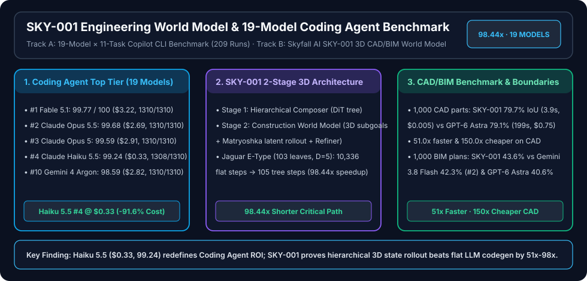

# SKY-001 Engineering World Model & 19-Model Coding Agent Benchmark (Permanent Alias Redirect)

> 🌐 **Language / 语言切换**: **[🇬🇧 English (README.en.md)](README.en.md)** | **[🇨🇳 中文版 (README.md)](README.md)** | **[📚 Full English Report (`../sky-001-and-coding-agent-19-model-benchmark/README.en.md`)](../sky-001-and-coding-agent-19-model-benchmark/README.en.md)** | **[📚 完整中文报告 (`../sky-001-and-coding-agent-19-model-benchmark/README.md`)](../sky-001-and-coding-agent-19-model-benchmark/README.md)**

> **Executive Summary**:
> This directory provides a permanent alias for `sky-001-coding-agent-benchmark` to ensure external links never 404. The full bilingual analysis and 7-Card visual benchmark deck reside at **[`../sky-001-and-coding-agent-19-model-benchmark/README.en.md`](../sky-001-and-coding-agent-19-model-benchmark/README.en.md)**:
> 1. **`Claude Haiku 5.5` Redefines Lightweight Coding Agent ROI (Rank #4 Overall, `99.24` Mean, `$0.33`)**: Across 19 models × 11 Python tasks (`209` serial CLI runs, `1,310` hidden `pytest` assertions per model), `Haiku 5.5` scores **`99.24 / 100`** at just **`$0.33`** (`91.6%` cheaper than `Haiku 4.5`), trailing only `Fable 5.1` (`99.77`), `Opus 5.5` (`99.68`), and `Opus 5` (`99.59`).
> 2. **`Gemini 4 Argon` Passes `1,310 / 1,310` (`100%`) Hidden Assertions (Rank #10, `98.59` Mean, `$2.82`)**: Eliminates all 34 hidden test failures of `Gemini 3.8 Flash` while cutting wall-clock time by `47.1%`.
> 3. **Skyfall AI `SKY-001` Engineering World Model**: Uses a two-stage `Hierarchical Composer + Construction World Model` to compress the critical path on `Jaguar E-Type Roadster` ($L=103$ leaves, depth $D=5$) from `10,336` flat sequential steps to **`105` steps (`98.44x` speedup)**, and reaches **`79.7%` IoU at `3.9s/case` and `$0.005/case`** on the 1,000-part CAD benchmark (**`51.0x` faster and `150.0x` cheaper** than `GPT-6 Astra`).

| Track / Model | Score / IoU | Latency / Critical Path | Cost | Direct Link |
|---|---|---|---|---|
| **Track A · #1 `Fable 5.1`** | **`99.77 / 100`** (`1,310/1,310`) | `10,031s` (`167.2m`) | `$3.22` | [Full English Report](../sky-001-and-coding-agent-19-model-benchmark/README.en.md) |
| **Track A · #2 `Claude Opus 5.5`** | **`99.68 / 100`** (`1,310/1,310`) | `4,877s` (`81.3m`) | `$2.69` | [中文主报告](../sky-001-and-coding-agent-19-model-benchmark/README.md) |
| **Track A · #4 `Claude Haiku 5.5`** | **`99.24 / 100`** (`1,308/1,310`) | `3,167s` (`52.8m`) | **`$0.33`** (`-91.6%`) | [7-Card Report (EN)](../sky-001-and-coding-agent-19-model-benchmark/test-report.en.md) |
| **Track A · #10 `Gemini 4 Argon`** | **`98.59 / 100`** (`1,310/1,310`) | `2,710s` (`45.2m`) | `$2.82` | [7-Card HTML Visual Deck](../sky-001-and-coding-agent-19-model-benchmark/test-report-cards.html) |
| **Track B · `SKY-001` (1,000 CAD)** | **`79.7%` IoU** (vs Astra `79.1%`) | **`3.9s/case`** (`51.0x` faster) | **`$0.005/case`** (`150x` cheaper) | [Offline Verifier (`simulator/`)](../sky-001-and-coding-agent-19-model-benchmark/simulator/sky001_and_19model_verifier.py) |
