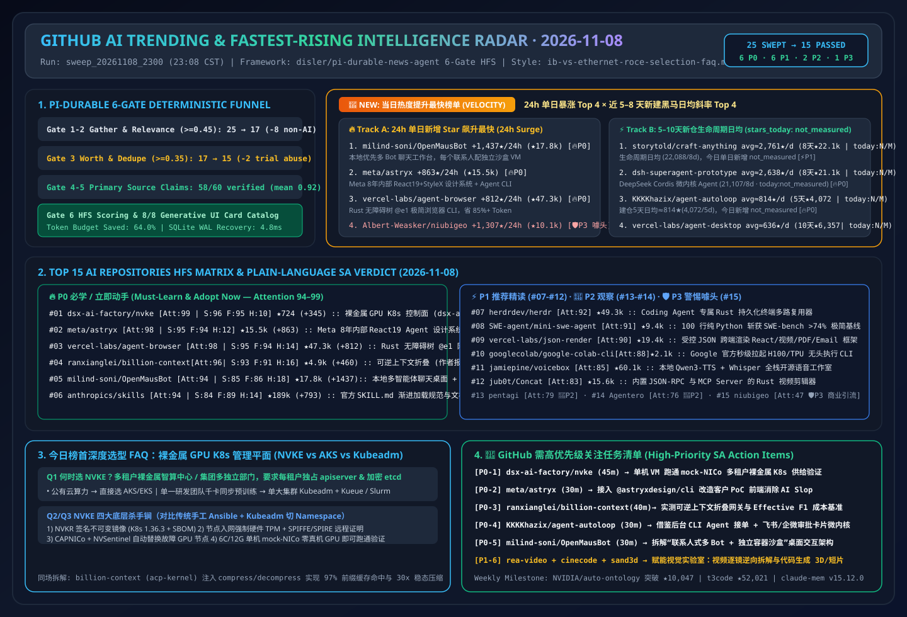

> 🌐 **Language / 语言切换**: **[🇨🇳 中文完整报告 (README.md)](README.md)** | **[🇬🇧 English Full Report (README.en.md)](README.en.md)** | **[📅 2026-11-18 Latest Digest (EN)](daily/2026-11-18.en.md)** | **[📅 2026-11-18 最新日报 (中文)](daily/2026-11-18.md)** | **[📅 2026-11-17 Daily Digest (EN)](daily/2026-11-17.en.md)** | **[📅 2026-11-17 历史日报 (中文)](daily/2026-11-17.md)** | **[📅 2026-11-16 Daily Digest (EN)](daily/2026-11-16.en.md)** | **[📅 2026-11-16 历史日报 (中文)](daily/2026-11-16.md)** | **[📅 2026-11-15 Daily Digest (EN)](daily/2026-11-15.en.md)** | **[📅 2026-11-15 历史日报 (中文)](daily/2026-11-15.md)** | **[📅 2026-11-13 Latest Digest (EN)](daily/2026-11-13.en.md)** | **[📅 2026-11-13 最新日报 (中文)](daily/2026-11-13.md)** | **[📅 2026-11-12 Daily Digest (EN)](daily/2026-11-12.en.md)** | **[📅 2026-11-12 历史日报 (中文)](daily/2026-11-12.md)** | **[📅 2026-11-11 Daily Digest (EN)](daily/2026-11-11.en.md)** | **[📅 2026-11-11 历史日报 (中文)](daily/2026-11-11.md)** | **[📅 2026-11-09 Daily Digest (EN)](daily/2026-11-09.en.md)** | **[📅 2026-11-09 历史日报 (中文)](daily/2026-11-09.md)** | **[📅 2026-11-08 Daily Digest (EN)](daily/2026-11-08.en.md)** | **[📅 2026-11-08 每日归档日报 (中文)](daily/2026-11-08.md)** | **[📅 2026-11-05 Archive (EN)](daily/2026-11-05.en.md)** | **[📅 2026-11-04 Archive (EN)](daily/2026-11-04.en.md)** | **[📅 2026-11-03 Archive (EN)](daily/2026-11-03.en.md)** | **[📅 2026-11-02 Archive (EN)](daily/2026-11-02.en.md)** | **[📅 2026-11-01 Archive (EN)](daily/2026-11-01.en.md)** | **[📡 Live Interactive Radar (EN)](https://turbo998.github.io/github-radar.html)** | **[📡 在线交互式雷达面板 (中文)](https://turbo998.github.io/zh-github-radar.html)** | **[📊 7-Card 4:5 Benchmark Deck](cards.en.html)** | **[📦 Sealed Telemetry (`report.json`)](report.json)**

# AI Solution Architect Proactive News Desk & GitHub AI Trending Radar (2026-11-08 Deep Research Report)

## 1. Architectural Philosophy: From Reactive Chatbots to Proactive Durable Intelligence Agents

In an era where hundreds of AI repositories launch daily amid relentless social media clickbait, **the scarcest asset for an AI Solution Architect (SA) is not raw information access, but verified, high-signal engineering attention**.

This column adapts and extends the proactive agent architecture pioneered by IndyDevDan (`disler/pi-durable-news-agent`), now permanently featuring the **🚀 Fastest-Rising / Highest Velocity AI Leaderboard** and **🚨 High-Priority SA Action Items**:

$$\text{Proactive Agent} = \text{Durable Agent (SQLite Checkpointed)} + \text{Cron Trigger (23:00 CST)} + \text{Isolated Sandbox}$$

### 1.1 The 6-Gate Jev Deterministic Pipeline (The Agent Decides, The Task Runs)

| Stage | Gate Name | Threshold / Rule | 2026-11-08 Sealed Batch Telemetry |
| :--- | :--- | :--- | :--- |
| **Gate 01** | **Cron Tick & SQLite WAL Init** | Triggered daily at `23:00 CST`, step-level idempotency | `run_id = sweep_20261108_2300`, `4.9ms` checkpoint recovery |
| **Gate 02** | **Multi-Source Gather** | Sweeps GitHub Trending Daily/Weekly + language feeds + 10-day breakout repos | Captured **25** raw candidate repositories with full velocity metadata |
| **Gate 03** | **Jev Relevance & Worth Gate** | `relevance >= 0.45` and `worth_attention >= 0.35` | **Rejected 10 noisy/non-AI/grey-hat repos** (`termux-app`, `valkey`, `OpenList`, `Stirling-PDF`, `pocketbase`, `glance`, `cockpit`, `hoppscotch`, `Google_AI_Pro_2Year_ZeroCost_Auto`, `nvzhuang`), **15 passed** |
| **Gate 04** | **Same-Story Dedupe** | `same_story >= 0.75` clustered into comparison groups | Clustered "Bare-Metal AI Factory K8s Control Plane (`nvke v0.23.1`)", "Model-Driven Reversible Context Compression (`billion-context v0.1.213`)", "Agent-First Design Systems & Generative UI (`meta/astryx v0.7.11` + `json-render v0.22.0`)", and "Multi-Sandbox Agent Workbench & A11y Execution (`OpenMausBot` + `agent-browser` + `herdr`)" |
| **Gate 05** | **Importance × Taste Rank** | `importance × topic_weight × source_weight × freshness` | Prioritized across 6 SA domain weights with 24h freshness factor (`1.0`) |
| **Gate 06** | **Claim-Support Subagents** | Parallel `news-researcher` subagents verify 4 claims/repo | Audited **60 concrete claims** against primary source trees (59/60 supported `>= 0.70`, mean support `0.92`) |
| **Gate 07** | **HFS Tri-Axial Scoring** | Independent `Signal`, `Facts`, `Hype` scores (0–100) | `Attention = round(0.50*Signal + 0.35*Facts - 0.25*Hype + 0.40*Relevance)` |
| **Gate 08** | **Generative UI Card Render** | Maps to 8 generative card types + 4-pillar SA playbook | 100% coverage across `headline`, `signal_alert`, `fact_check`, `hype_watch`, `release`, `thread_pulse`, `quote`, `brief` |

---

## 2. 🚀 Fastest-Rising / Highest Velocity AI Leaderboard (2026-11-08)

> **📘 Multi-Round Standalone 6-Part Selection FAQs & Sealed Evidence**:
> - **Round 1 FAQ**: [Bare-Metal GPU Cluster Control-Plane Selection FAQ: NVKE vs. Managed Cloud K8s (AKS/EKS) vs. DIY Kubeadm/Slurm (`docs/nvke-vs-aks-gpu-cluster-selection-faq.en.md`)](docs/nvke-vs-aks-gpu-cluster-selection-faq.en.md) ([ZH](docs/nvke-vs-aks-gpu-cluster-selection-faq.md))
> - **Round 2 FAQ**: [Long-Horizon Coding Agent Context Architecture Selection FAQ: `billion-context` Reversible Folding vs. `/compact` vs. Chunked Vector RAG (`docs/context-folding-vs-compact-rag-selection-faq.en.md`)](docs/context-folding-vs-compact-rag-selection-faq.en.md) ([ZH](docs/context-folding-vs-compact-rag-selection-faq.md) · [Round 2 SVG](../../assets/github-ai-radar-2026-11-08-r2-context-folding.svg))
> - **Round 3 FAQ**: [AI-Assisted Frontend Engineering Selection FAQ: `meta/astryx` CLI vs. `pbakaus/impeccable` Anti-Slop Harness vs. Raw Tailwind/shadcn (`docs/agent-ui-design-system-vs-raw-tailwind-selection-faq.en.md`)](docs/agent-ui-design-system-vs-raw-tailwind-selection-faq.en.md) ([ZH](docs/agent-ui-design-system-vs-raw-tailwind-selection-faq.md) · [Round 3 SVG](../../assets/github-ai-radar-2026-11-08-r3-agent-ui-harness.svg))
> - **Round 4 FAQ**: [Multi-Agent VM Workbench vs. Headless Event Autoloop Kernel vs. Single-Terminal CLI Selection FAQ: `OpenMausBot` vs. `agent-autoloop` (`docs/multi-agent-sandbox-workbench-vs-cli-selection-faq.en.md`)](docs/multi-agent-sandbox-workbench-vs-cli-selection-faq.en.md) ([ZH](docs/multi-agent-sandbox-workbench-vs-cli-selection-faq.md) · [Round 4 SVG](../../assets/github-ai-radar-2026-11-08-r4-sandbox-autoloop.svg))
> - **Round 5 FAQ**: [Browser & Desktop Computer-Use Architecture Selection FAQ: `agent-browser` + `agent-desktop` Accessibility-Tree CLI vs. Raw Playwright DOM / Vision Screenshot CUA (`docs/agent-browser-desktop-a11y-vs-playwright-vision-selection-faq.en.md`)](docs/agent-browser-desktop-a11y-vs-playwright-vision-selection-faq.en.md) ([ZH](docs/agent-browser-desktop-a11y-vs-playwright-vision-selection-faq.md) · [Round 5 SVG](../../assets/github-ai-radar-2026-11-08-r5-browser-desktop-a11y.svg))
> - **Round 6 FAQ**: [Autonomous SuperAgent Micro-Kernels & Cross-Session Memory Selection FAQ: `dsh-superagent-prototype` + `claude-mem` vs. Heavy Workflow Graph Frameworks (`docs/superagent-microkernel-memory-vs-langgraph-selection-faq.en.md`)](docs/superagent-microkernel-memory-vs-langgraph-selection-faq.en.md) ([ZH](docs/superagent-microkernel-memory-vs-langgraph-selection-faq.md) · [Round 6 SVG](../../assets/github-ai-radar-2026-11-08-r6-superagent-memory.svg))
> - **Round 7 FAQ**: [Guardrailed Generative UI Component Catalogs & Declarative Managed Agent Blueprints Selection FAQ: `vercel-labs/json-render` + `anthropics/claude-quickstarts` vs. Raw LLM React Code Streaming (`docs/generative-ui-catalog-vs-raw-code-streaming-selection-faq.en.md`)](docs/generative-ui-catalog-vs-raw-code-streaming-selection-faq.en.md) ([ZH](docs/generative-ui-catalog-vs-raw-code-streaming-selection-faq.md) · [Round 7 SVG](../../assets/github-ai-radar-2026-11-08-r7-generative-ui-catalog.svg))
> - **Round 8 FAQ**: [Clean-Room Software Rebuild & Binary Probe Architecture Selection FAQ: `storytold/craft-anything` Pure-Rust 320 Probes vs. Blind Screenshot Prompting & Raw Decompiler Dumps (`docs/craft-anything-rust-probe-vs-decompile-selection-faq.en.md`)](docs/craft-anything-rust-probe-vs-decompile-selection-faq.en.md) ([ZH](docs/craft-anything-rust-probe-vs-decompile-selection-faq.md) · [Round 8 SVG](../../assets/github-ai-radar-2026-11-08-r8-craft-anything-probe.svg))
> - **Round 9 FAQ**: [On-Device Android Virtual-Display Agent vs. ADB & Cloud-Phone Selection FAQ: `wangzan101/Mika` vs. USB ADB/Appium Scripts & Pure-Vision Cloud-Phone CUA (`docs/mika-android-virtual-display-agent-vs-adb-selection-faq.en.md`)](docs/mika-android-virtual-display-agent-vs-adb-selection-faq.en.md) ([ZH](docs/mika-android-virtual-display-agent-vs-adb-selection-faq.md) · [Round 9 SVG](../../assets/github-ai-radar-2026-11-08-r9-mika-android-agent.svg))
> - **Round 10 FAQ**: [Shot-by-Shot Video Forensics & Hybrid Remake Routing Selection FAQ: `JuneYaooo/rea-video` vs. Blind All-Diffusion Remake & Manual Timeline Scrubbing (`docs/rea-video-shot-forensics-vs-diffusion-remake-selection-faq.en.md`)](docs/rea-video-shot-forensics-vs-diffusion-remake-selection-faq.en.md) ([ZH](docs/rea-video-shot-forensics-vs-diffusion-remake-selection-faq.md) · [Round 10 SVG](../../assets/github-ai-radar-2026-11-08-r10-rea-video-forensics.svg))
> - **Round 11 FAQ**: [Embodied AI Physics Simulation & Agent-Assisted Modeling Selection FAQ: `google-deepmind/mujoco` 4.0 vs. GPU-Only Simulators & Raw MJCF Prompting (`docs/mujoco-4-hybrid-sim-agent-skills-selection-faq.en.md`)](docs/mujoco-4-hybrid-sim-agent-skills-selection-faq.en.md) ([ZH](docs/mujoco-4-hybrid-sim-agent-skills-selection-faq.md) · [Round 11 SVG](../../assets/github-ai-radar-2026-11-08-r11-mujoco4-sim-skills.svg))
> - **Round 12 FAQ**: [Agent-Driven Cloud Architecture Diagramming Selection FAQ: `caru-ini/stack-diagram` vs. Raw LLM SVG Generation & Mermaid/Draw.io (`docs/stack-diagram-official-icons-vs-mermaid-svg-selection-faq.en.md`)](docs/stack-diagram-official-icons-vs-mermaid-svg-selection-faq.en.md) ([ZH](docs/stack-diagram-official-icons-vs-mermaid-svg-selection-faq.md) · [Round 12 SVG](../../assets/github-ai-radar-2026-11-08-r12-stack-diagram-icons.svg))
> - **Round 13 FAQ**: [Interactive 3D Machine Simulator Skill Selection FAQ: `elvarofficial/teardown` v1.0.0 vs. Freehand Three.js & Blender Pre-Render (`docs/teardown-3d-machine-simulator-vs-freehand-threejs-selection-faq.en.md`)](docs/teardown-3d-machine-simulator-vs-freehand-threejs-selection-faq.en.md) ([ZH](docs/teardown-3d-machine-simulator-vs-freehand-threejs-selection-faq.md) · [Round 13 SVG](../../assets/github-ai-radar-2026-11-08-r13-teardown-3d-sim.svg))
> - **2026-11-09 Round 1 FAQ (Round 14)**: [Agent Brain & Hybrid Graph Memory Selection FAQ: `garrytan/gbrain` (pgvector HNSW + BM25 + Page-Level RRF + Zero-LLM Deterministic Graph Walk) vs. Naive Vector RAG vs. Static `MEMORY.md` (`docs/gbrain-hybrid-graph-memory-vs-vector-rag-selection-faq.en.md`)](docs/gbrain-hybrid-graph-memory-vs-vector-rag-selection-faq.en.md) ([ZH](docs/gbrain-hybrid-graph-memory-vs-vector-rag-selection-faq.md) · [2026-11-09 Daily Digest](daily/2026-11-09.en.md) · [2026-11-09 SVG](../../assets/github-ai-radar-2026-11-09.svg))
> - **2026-11-09 Round 2 FAQ (Round 15)**: [Enterprise Semantic Ontology & Text-to-SQL Selection FAQ: `NVIDIA/auto-ontology` (Postgres Semantic Catalog + Governed Metrics + NIM Model Triplets + MCP/Skills) vs. Raw Schema Text-to-SQL vs. Legacy BI Cubes (`docs/auto-ontology-semantic-sql-vs-raw-text2sql-selection-faq.en.md`)](docs/auto-ontology-semantic-sql-vs-raw-text2sql-selection-faq.en.md) ([ZH](docs/auto-ontology-semantic-sql-vs-raw-text2sql-selection-faq.md) · [Round 2 SVG](../../assets/github-ai-radar-2026-11-09-r2-auto-ontology.svg))
> - **2026-11-09 Round 3 FAQ (Round 16)**: [Multi-Phase Agent Security Audit Selection FAQ: `cloudflare/security-audit-skill` (6-Phase Coverage Ledger + Adversarial Disproval Subagents + 3-State Verdicts) vs. Static SAST vs. Single-Prompt Code Review (`docs/security-audit-skill-ledger-vs-sast-prompt-selection-faq.en.md`)](docs/security-audit-skill-ledger-vs-sast-prompt-selection-faq.en.md) ([ZH](docs/security-audit-skill-ledger-vs-sast-prompt-selection-faq.md) · [Round 3 SVG](../../assets/github-ai-radar-2026-11-09-r3-security-audit-skill.svg))
> - **2026-11-09 Round 4 FAQ (Round 17)**: [Parallel Coding-Agent Worktree & HITL Plan-Review Selection FAQ: `max-sixty/worktrunk` + `backnotprop/plannotator` vs. Raw `git worktree` Commands & Terminal Scrollback Review (`docs/worktrunk-plannotator-hitl-vs-raw-git-worktree-selection-faq.en.md`)](docs/worktrunk-plannotator-hitl-vs-raw-git-worktree-selection-faq.en.md) ([ZH](docs/worktrunk-plannotator-hitl-vs-raw-git-worktree-selection-faq.md) · [Round 4 SVG](../../assets/github-ai-radar-2026-11-09-r4-worktrunk-plannotator.svg))
> - **2026-11-09 Round 5 FAQ (Round 18)**: [Tokenizer-Free Diffusion-Autoregressive TTS Selection FAQ: `OpenBMB/VoxCPM2` (2B + AudioVAE V2 48kHz + vLLM-Omni `RTF ~0.13`) vs. Discrete-Codec TTS vs. Commercial Cloud TTS APIs (`docs/voxcpm2-tokenizer-free-tts-vs-discrete-codec-selection-faq.en.md`)](docs/voxcpm2-tokenizer-free-tts-vs-discrete-codec-selection-faq.en.md) ([ZH](docs/voxcpm2-tokenizer-free-tts-vs-discrete-codec-selection-faq.md) · [Round 5 SVG](../../assets/github-ai-radar-2026-11-09-r5-voxcpm2-tts.svg))
> - **2026-11-09 Round 6 FAQ (Round 19)**: [Camera-Free WiFi CSI Spatial Sensing & Smart-Space MCP Selection FAQ: `ruvnet/RuView` + `homeassistant-ai/ha-mcp` vs. Vision VLM Cameras vs. Legacy IoT Rule Engines (`docs/ruview-wifi-csi-ha-mcp-vs-camera-iot-selection-faq.en.md`)](docs/ruview-wifi-csi-ha-mcp-vs-camera-iot-selection-faq.en.md) ([ZH](docs/ruview-wifi-csi-ha-mcp-vs-camera-iot-selection-faq.md) · [Round 6 SVG](../../assets/github-ai-radar-2026-11-09-r6-ruview-ha-mcp.svg))
> - **2026-11-09 Round 7 FAQ (Round 20)**: [Interactive Codebase Mapping & Anti-Slop UI Refactoring Selection FAQ: `haydenschmitty/floorplan` + `heydamir/unslop` vs. Static AST Dependency Graphs & Freeform UI Prompting (`docs/floorplan-unslop-codebase-map-vs-static-uml-selection-faq.en.md`)](docs/floorplan-unslop-codebase-map-vs-static-uml-selection-faq.en.md) ([ZH](docs/floorplan-unslop-codebase-map-vs-static-uml-selection-faq.md) · [Round 7 SVG](../../assets/github-ai-radar-2026-11-09-r7-floorplan-unslop.svg))
> - **2026-11-09 Round 8 FAQ (Round 21)**: [Agent-Native Adaptive Tutoring & On-Device Android Privacy Audit Selection FAQ: `HKUDS/DeepTutor` + `Verlintas/NOIR` vs. Generic Chat RAG & Full-APK Decompile Dumps (`docs/deeptutor-noir-adaptive-agent-selection-faq.en.md`)](docs/deeptutor-noir-adaptive-agent-selection-faq.en.md) ([ZH](docs/deeptutor-noir-adaptive-agent-selection-faq.md) · [Round 8 SVG](../../assets/github-ai-radar-2026-11-09-r8-deeptutor-noir.svg))
> - **2026-11-09 Round 9 FAQ (Round 22)**: [Cloud-Native Multiplayer Agent OS & Remote Control Surface Selection FAQ: `kortix-ai/CompanyOS` + `pingdotgg/t3code` vs. Single-Machine Local CLIs & 24/7 Always-On Cloud VMs (`docs/companyos-t3code-control-surface-vs-local-cli-selection-faq.en.md`)](docs/companyos-t3code-control-surface-vs-local-cli-selection-faq.en.md) ([ZH](docs/companyos-t3code-control-surface-vs-local-cli-selection-faq.md) · [Round 9 SVG](../../assets/github-ai-radar-2026-11-09-r9-companyos-t3code.svg))
> - **2026-11-09 Round 10 FAQ (Round 23)**: [Enterprise Plugin Marketplace Governance & Procedural VFX Skill Selection FAQ: `anthropics/claude-plugins-official` + `patch-gg/pixelfx` vs. Unpinned Third-Party MCPs & Blind Sprite Diffusion (`docs/claude-plugins-pixelfx-skill-bundle-selection-faq.en.md`)](docs/claude-plugins-pixelfx-skill-bundle-selection-faq.en.md) ([ZH](docs/claude-plugins-pixelfx-skill-bundle-selection-faq.md) · [Round 10 SVG](../../assets/github-ai-radar-2026-11-09-r10-claude-plugins-pixelfx.svg))
> - **2026-11-09 Round 11 FAQ (Round 24)**: [Adaptive Web Extraction & Single-Call Compressed PR Review Selection FAQ: `D4Vinci/Scrapling` + `The-PR-Agent/pr-agent` vs. Fragile CSS Selectors & Multi-Turn Diff Loops (`docs/scrapling-pr-agent-adaptive-extraction-selection-faq.en.md`)](docs/scrapling-pr-agent-adaptive-extraction-selection-faq.en.md) ([ZH](docs/scrapling-pr-agent-adaptive-extraction-selection-faq.md) · [Round 11 SVG](../../assets/github-ai-radar-2026-11-09-r11-scrapling-pr-agent.svg))
> - **2026-11-09 Round 12 FAQ (Round 25)**: [Rust GPU-Accelerated Native UI & Local 3D Gaussian Splatting Selection FAQ: `longbridge/gpui-kit` + `ooolabdev/ooosplat` vs. Electron Memory Bloat & Cloud 3DGS SaaS (`docs/gpui-kit-ooosplat-rust-native-3dgs-selection-faq.en.md`)](docs/gpui-kit-ooosplat-rust-native-3dgs-selection-faq.en.md) ([ZH](docs/gpui-kit-ooosplat-rust-native-3dgs-selection-faq.md) · [Round 12 SVG](../../assets/github-ai-radar-2026-11-09-r12-gpui-kit-ooosplat.svg))
> - **2026-11-09 Round 13 FAQ (Round 26)**: [Financial Research Agents & Deterministic Post-LLM Guardrails Selection FAQ: `virattt/dexter` + `ZhuLinsen/daily_stock_analysis` vs. Uncompacted ReAct Loops & Unchecked Stock Bots (`docs/dexter-daily-stock-finagent-guardrail-selection-faq.en.md`)](docs/dexter-daily-stock-finagent-guardrail-selection-faq.en.md) ([ZH](docs/dexter-daily-stock-finagent-guardrail-selection-faq.md) · [Round 13 SVG](../../assets/github-ai-radar-2026-11-09-r13-dexter-daily-stock.svg))
> - **2026-11-09 Round 14 FAQ (Round 27)**: [Spatial Infinite-Canvas Multimodal Orchestration & Local-First NLE Video Editing Selection FAQ: `basketikun/infinite-canvas` + `OpenCut-app/OpenCut` vs. Linear Chat Prompting & Cloud Video SaaS (`docs/opencut-infinite-canvas-video-spatial-selection-faq.en.md`)](docs/opencut-infinite-canvas-video-spatial-selection-faq.en.md) ([ZH](docs/opencut-infinite-canvas-video-spatial-selection-faq.md) · [Round 14 SVG](../../assets/github-ai-radar-2026-11-09-r14-opencut-infinite-canvas.svg))
> - **2026-11-09 Round 15 FAQ (Round 28)**: [Cross-Platform GUI Agent Automation Selection FAQ: `vercel-labs/agent-browser` (`@e1` A11y Snapshots) + `wangzan101/Mika` (Android Background `VirtualDisplay`) vs. Vision Pixel-Guessing & Foreground Phone Farms (`docs/mika-agent-browser-gui-automation-selection-faq.en.md`)](docs/mika-agent-browser-gui-automation-selection-faq.en.md) ([ZH](docs/mika-agent-browser-gui-automation-selection-faq.md) · [Round 15 SVG](../../assets/github-ai-radar-2026-11-09-r15-mika-agent-browser.svg))
> - **2026-11-09 Round 16 FAQ (Round 29)**: [Shot-by-Shot Video Forensics & Contact Physics Simulation Selection FAQ: `JuneYaooo/rea-video` (`v0.1.0`) + `google-deepmind/mujoco` (`v4.0.1`) vs. Dense VLM Video Uploads & Blind Video Diffusion (`docs/mujoco-rea-video-physics-video-forensics-selection-faq.en.md`)](docs/mujoco-rea-video-physics-video-forensics-selection-faq.en.md) ([ZH](docs/mujoco-rea-video-physics-video-forensics-selection-faq.md) · [Round 16 SVG](../../assets/github-ai-radar-2026-11-09-r16-mujoco-rea-video.svg))
> - **2026-11-09 Round 17 FAQ (Round 30)**: [Managed Agent Reference Blueprints & Local-First Multi-Model Bot Gateway Selection FAQ: `anthropics/claude-quickstarts` (`managed-agents`) + `modelflare-ai/AnyModelBot` (`v0.1.30`) vs. Repeated Raw-Corpus RAG & Multi-Vendor Seat Lock-In (`docs/claude-quickstarts-anymodelbot-managed-harness-selection-faq.en.md`)](docs/claude-quickstarts-anymodelbot-managed-harness-selection-faq.en.md) ([ZH](docs/claude-quickstarts-anymodelbot-managed-harness-selection-faq.md) · [Round 17 SVG](../../assets/github-ai-radar-2026-11-09-r17-claude-quickstarts-anymodelbot.svg))
> - **2026-11-09 Round 18 FAQ (Round 31)**: [Programmatic Code-Driven Video & 2.5D Story Shorts Selection FAQ: `mromidev/claude-animated-shorts` + `sarpstar/cinecode` vs. Diffusion Video Slot-Machines & Manual After-Effects (`docs/animated-shorts-cinecode-programmatic-video-selection-faq.en.md`)](docs/animated-shorts-cinecode-programmatic-video-selection-faq.en.md) ([ZH](docs/animated-shorts-cinecode-programmatic-video-selection-faq.md) · [Round 18 SVG](../../assets/github-ai-radar-2026-11-09-r18-animated-shorts-cinecode.svg))
> - **2026-11-09 Round 19 FAQ (Round 32)**: [Bot-Free System-Audio Simultaneous Interpreting & Point-in-Time Git Statutory Law Selection FAQ: `wquguru/cicada` (`v1.7.0`) + `lexifina/global-law` vs. Intrusive Meeting Bots & Unversioned Legal RAG (`docs/cicada-global-law-interpreting-git-law-selection-faq.en.md`)](docs/cicada-global-law-interpreting-git-law-selection-faq.en.md) ([ZH](docs/cicada-global-law-interpreting-git-law-selection-faq.md) · [Round 19 SVG](../../assets/github-ai-radar-2026-11-09-r19-cicada-global-law.svg))
> - **2026-11-09 Round 20 FAQ (Round 33)**: [Layered Fact-Intent Multi-Agent Swarm & Deterministic OSINT Reconnaissance Selection FAQ: `N1nEmAn/sapper-v2` (`nvwabase`) + `sherlock-project/sherlock` (`v0.16.2`) vs. Flat Shared-Memory Swarms & LLM Browser Probing (`docs/sapper-v2-sherlock-fact-intent-swarm-selection-faq.en.md`)](docs/sapper-v2-sherlock-fact-intent-swarm-selection-faq.en.md) ([ZH](docs/sapper-v2-sherlock-fact-intent-swarm-selection-faq.md) · [Round 20 SVG](../../assets/github-ai-radar-2026-11-09-r20-sapper-v2-sherlock.svg))
> - **2026-11-09 Round 21 FAQ (Round 34)**: [Exit-While-Waiting CLI Agent Microkernel & Socratic Mastery Verification Selection FAQ: `KKKKhazix/agent-autoloop` + `janestreet/agent_skills` vs. Terminal Babysitting & Lecture-Style Prompts (`docs/agent-autoloop-janestreet-skills-selection-faq.en.md`)](docs/agent-autoloop-janestreet-skills-selection-faq.en.md) ([ZH](docs/agent-autoloop-janestreet-skills-selection-faq.md) · [Round 21 SVG](../../assets/github-ai-radar-2026-11-09-r21-autoloop-janestreet.svg))
> - **2026-11-09 Round 22 FAQ (Round 35)**: [Local LLM VRAM/KV-Cache Profiling & 2.55ms Rust Container Runtime Selection FAQ: `shanselman/gputaskman` (`v0.3.4`) + `libracoder/kiri` (`v0.2.0`) vs. Blind `nvidia-smi` & Heavy Docker Desktop (`docs/gputaskman-kiri-vram-container-runtime-selection-faq.en.md`)](docs/gputaskman-kiri-vram-container-runtime-selection-faq.en.md) ([ZH](docs/gputaskman-kiri-vram-container-runtime-selection-faq.md) · [Round 22 SVG](../../assets/github-ai-radar-2026-11-09-r22-gputaskman-kiri.svg))
> - **2026-11-09 Round 23 FAQ (Round 36)**: [LLM-Native 3D CAD Modeling & Headless Rust/Slang VFX Engine Selection FAQ: `Sandflow-ai/sand3d` + `voyager-so/vork` (`v0.3.0`) vs. Raw Blender `bpy` Coordinate Scripting & Heavy GUI Renderers (`docs/sand3d-vork-agent-3d-vfx-engine-selection-faq.en.md`)](docs/sand3d-vork-agent-3d-vfx-engine-selection-faq.en.md) ([ZH](docs/sand3d-vork-agent-3d-vfx-engine-selection-faq.md) · [Round 23 SVG](../../assets/github-ai-radar-2026-11-09-r23-sand3d-vork.svg))
> - **2026-11-09 Round 24 FAQ (Round 37)**: [Virtual-Clock UI Motion Reverse-Engineering & 6-Step Multi-Reference Audio-Video Inference Selection FAQ: `NiazMorshed2007/reanimate` + `Pika-Labs/Pika-H3-Flex` (`v0.1.0`) vs. Blind Screenshot Coding & 50-Step Silent Video Diffusion (`docs/reanimate-pika-h3-flex-motion-video-selection-faq.en.md`)](docs/reanimate-pika-h3-flex-motion-video-selection-faq.en.md) ([ZH](docs/reanimate-pika-h3-flex-motion-video-selection-faq.md) · [Round 24 SVG](../../assets/github-ai-radar-2026-11-09-r24-reanimate-pika-h3.svg))
> - **2026-11-09 Round 25 FAQ (Round 38)**: [Zero-Knowledge Inference Proofs & Region-Verified Document OCR Selection FAQ: `anthropics/FlashProve` (`v0.16.0`) + `OpenBMB/MiniCPM-OCR` (`1.0` + `Jev`) vs. Blind API Trust & Full-Page Manual Spot-Checks (`docs/flashprove-minicpm-ocr-verifiable-ai-selection-faq.en.md`)](docs/flashprove-minicpm-ocr-verifiable-ai-selection-faq.en.md) ([ZH](docs/flashprove-minicpm-ocr-verifiable-ai-selection-faq.md) · [Round 25 SVG](../../assets/github-ai-radar-2026-11-09-r25-flashprove-minicpm-ocr.svg))
> - **2026-11-09 Round 26 FAQ (Round 39)**: [Zero-GPU 284B CPU MoE Inference & 1-RTT Satellite TCP Multiplexing Selection FAQ: `synchopate/llama-modchip` (`v2.4.0`) + `Th0rgal/satmux` vs. Multi-GPU Cloud Clusters & Raw `:443` Cabin Links (`docs/llama-modchip-satmux-cpu-moe-satellite-selection-faq.en.md`)](docs/llama-modchip-satmux-cpu-moe-satellite-selection-faq.en.md) ([ZH](docs/llama-modchip-satmux-cpu-moe-satellite-selection-faq.md) · [Round 26 SVG](../../assets/github-ai-radar-2026-11-09-r26-llama-modchip-satmux.svg))
> - **2026-11-09 Round 27 FAQ (Round 40)**: [Gateway-Enforced Phone HITL MCP & Real-iPhone Loopback Selection FAQ: `DIYgod/pinky` + `JosssphZhou/poki` (`v0.1.1`) vs. Cloud Device Farms & Unprotected Appium Scripts (`docs/pinky-poki-mobile-hitl-mcp-selection-faq.en.md`)](docs/pinky-poki-mobile-hitl-mcp-selection-faq.en.md) ([ZH](docs/pinky-poki-mobile-hitl-mcp-selection-faq.md) · [Round 27 SVG](../../assets/github-ai-radar-2026-11-09-r27-pinky-poki.svg))
> - **2026-11-09 Round 28 FAQ (Round 41)**: [30KB Zero-Dependency WebGL2 2.5D Character Player & Single-Server Bicameral AI Livestream Host Selection FAQ: `livliv-dev/player` (`v0.3.0`) + `jacke-pp/open-yoki` (`v150`) vs. Cloud Pixel-Streaming & Heavy OBS Workstations (`docs/livliv-player-open-yoki-avatar-livestream-selection-faq.en.md`)](docs/livliv-player-open-yoki-avatar-livestream-selection-faq.en.md) ([ZH](docs/livliv-player-open-yoki-avatar-livestream-selection-faq.md) · [Round 28 SVG](../../assets/github-ai-radar-2026-11-09-r28-livliv-open-yoki.svg))
> - **2026-11-09 Round 29 FAQ (Round 42)**: [Single-Image `<2s` 1M-Gaussian 3DGS & Spring-Bone VRM Hair-Card Modeling Selection FAQ: `speridlabs/idol-sdk` + `hyz317/HairDeck` (`arXiv:2610.40599`) vs. Cloud 3D APIs & Manual Hair Rigging (`docs/idol-sdk-hairdeck-single-image-3d-vrm-selection-faq.en.md`)](docs/idol-sdk-hairdeck-single-image-3d-vrm-selection-faq.en.md) ([ZH](docs/idol-sdk-hairdeck-single-image-3d-vrm-selection-faq.md) · [Round 29 SVG](../../assets/github-ai-radar-2026-11-09-r29-idol-hairdeck.svg))
> - **2026-11-09 Round 30 FAQ (Round 43)**: [Rendererless Firefox JS Engine & 120FPS QUIC Remote Desktop Console Selection FAQ: `cutetailbud/ff-ruyijs` (`v0.3.6`) + `sqlpxc/airhand` (`v0.2.2`) vs. Heavy Headless Chromium & Legacy VNC (`docs/ruyijs-airhand-rendererless-browser-quic-desktop-selection-faq.en.md`)](docs/ruyijs-airhand-rendererless-browser-quic-desktop-selection-faq.en.md) ([ZH](docs/ruyijs-airhand-rendererless-browser-quic-desktop-selection-faq.md) · [Round 30 SVG](../../assets/github-ai-radar-2026-11-09-r30-ruyijs-airhand.svg))
> - **2026-11-09 Round 31 FAQ (Round 44)**: [Articulatory FDTD Vocal Synthesis & 341-Style Deterministic Code Animation Selection FAQ: `jamesondh/chimera-vocal-synth` + `XiaoyeCodes/code-animation-prompts` vs. Cloud Voice/SFX APIs & Real-Time Screen Recording (`docs/chimera-code-animation-vocal-synth-deterministic-video-selection-faq.en.md`)](docs/chimera-code-animation-vocal-synth-deterministic-video-selection-faq.en.md) ([ZH](docs/chimera-code-animation-vocal-synth-deterministic-video-selection-faq.md) · [Round 31 SVG](../../assets/github-ai-radar-2026-11-09-r31-chimera-code-anim.svg))
> - **2026-11-09 Round 32 FAQ (Round 45)**: [Self-Hosted Foreman AI Coworker Board & Three-Axis Animated Visual Factory Selection FAQ: `rerun-build/rerun` + `WoYun520/gif-factory` vs. Vertical SaaS Seat Sprawl & Ad-Hoc GIF Rework (`docs/rerun-gif-factory-coworker-board-three-axis-gif-selection-faq.en.md`)](docs/rerun-gif-factory-coworker-board-three-axis-gif-selection-faq.en.md) ([ZH](docs/rerun-gif-factory-coworker-board-three-axis-gif-selection-faq.md) · [Round 32 SVG](../../assets/github-ai-radar-2026-11-09-r32-rerun-giffactory.svg))
> - **2026-11-11 Round 1 FAQ (Round 46)**: [AI Coding Agent Planner-Executor Split & SDLC Quality Gate Selection FAQ: `shadcn/improve` + `addyosmani/agent-skills` (`v0.6.15`) vs. Monolithic Single-Model Vibe Coding (`docs/shadcn-improve-addyosmani-agent-skills-sdlc-selection-faq.en.md`)](docs/shadcn-improve-addyosmani-agent-skills-sdlc-selection-faq.en.md) ([ZH](docs/shadcn-improve-addyosmani-agent-skills-sdlc-selection-faq.md) · [2026-11-11 Daily Digest](daily/2026-11-11.en.md) · [2026-11-11 SVG](../../assets/github-ai-radar-2026-11-11.svg))
> - **2026-11-11 Round 2 FAQ (Round 47)**: [AI Code Security Scanning, Third-Party Alert Triage & Automated Patching Selection FAQ: `openai/codex-security` (`npm-v0.9.1`) vs. `cloudflare/security-audit-skill` vs. Legacy SAST/SCA (`docs/codex-security-vs-audit-skill-sast-selection-faq.en.md`)](docs/codex-security-vs-audit-skill-sast-selection-faq.en.md) ([ZH](docs/codex-security-vs-audit-skill-sast-selection-faq.md) · [Round 2 SVG](../../assets/github-ai-radar-2026-11-11-r2-codex-security.svg))
> - **2026-11-11 Round 3 FAQ (Round 48)**: [Browser-Stewarded Modern Web Platform Skills, Client-Side `WebMCP` (`document.modelContext`) & Built-in AI Selection FAQ: `GoogleChrome/modern-web-guidance-src` vs. Legacy JS Polyfills & Brittle DOM Scraping (`docs/modern-web-guidance-webmcp-vs-legacy-polyfills-selection-faq.en.md`)](docs/modern-web-guidance-webmcp-vs-legacy-polyfills-selection-faq.en.md) ([ZH](docs/modern-web-guidance-webmcp-vs-legacy-polyfills-selection-faq.md) · [Round 3 SVG](../../assets/github-ai-radar-2026-11-11-r3-modern-web-guidance.svg))
> - **2026-11-11 Round 4 FAQ (Round 49)**: [Agent-Native 4-Platform UI Runtime & AWS Trainium2 1M-Context Inference Engine Selection FAQ: `expo/exact` + `RunanywhereAI/trnrt` vs. React Native/Electron & Commercial Cloud APIs (`docs/expo-exact-trnrt-agent-ui-trainium-inference-selection-faq.en.md`)](docs/expo-exact-trnrt-agent-ui-trainium-inference-selection-faq.en.md) ([ZH](docs/expo-exact-trnrt-agent-ui-trainium-inference-selection-faq.md) · [Round 4 SVG](../../assets/github-ai-radar-2026-11-11-r4-expo-exact-trnrt.svg))
> - **2026-11-11 Round 5 FAQ (Round 50)**: [Differentiable World-Model Humanoid Tracking & Live Coding-Agent Spatial Observability / Cross-Agent Experience Recall Selection FAQ: `HybridRobotics/supermimic` (`arXiv:2610.28480`) + `alexeyw/lot-map` & `vzroslieigry/maxagent` (`docs/supermimic-lotmap-maxagent-world-model-observability-selection-faq.en.md`)](docs/supermimic-lotmap-maxagent-world-model-observability-selection-faq.en.md) ([ZH](docs/supermimic-lotmap-maxagent-world-model-observability-selection-faq.md) · [Round 5 SVG](../../assets/github-ai-radar-2026-11-11-r5-supermimic-lotmap.svg))
> - **2026-11-11 Round 6 FAQ (Round 51)**: [Industrial P&ID Diagram-to-Knowledge-Graph Extraction & Aerospace ASD-STE100 Controlled-English Writing Selection FAQ: `ScottDuncanAI/PID-to-Knowledge-Graph` + `Dodaios/ste80-humanizer` (`docs/pid-knowledge-graph-ste80-humanizer-selection-faq.en.md`)](docs/pid-knowledge-graph-ste80-humanizer-selection-faq.en.md) ([ZH](docs/pid-knowledge-graph-ste80-humanizer-selection-faq.md) · [Round 6 SVG](../../assets/github-ai-radar-2026-11-11-r6-pid-kg-ste80.svg))
> - **2026-11-11 Round 7 FAQ (Round 52)**: [Chrome 153+ Native Shared-Memory 120FPS AV1 Tab Recording & Zero-Dependency Biomechanical SVG Line-Art Animation Selection FAQ: `paulirish/chrome-capture` + `JDhruv14/line-art-animation` (`docs/chrome-capture-line-art-animation-selection-faq.en.md`)](docs/chrome-capture-line-art-animation-selection-faq.en.md) ([ZH](docs/chrome-capture-line-art-animation-selection-faq.md) · [Round 7 SVG](../../assets/github-ai-radar-2026-11-11-r7-chrome-capture-lineart.svg))
> - **2026-11-11 Round 8 FAQ (Round 53)**: [Disposable Windows 11 Agent Sandboxes & Zero-Copy CoW Folder Checkouts Selection FAQ: `shanselman/sandbox-mcp` (`v1.2.0`) + `stencil-hq/ovnfs` (`v0.2.3`) (`docs/sandbox-mcp-ovnfs-cow-checkout-selection-faq.en.md`)](docs/sandbox-mcp-ovnfs-cow-checkout-selection-faq.en.md) ([ZH](docs/sandbox-mcp-ovnfs-cow-checkout-selection-faq.md) · [Round 8 SVG](../../assets/github-ai-radar-2026-11-11-r8-sandbox-ovnfs.svg))
> - **2026-11-11 Round 9 FAQ (Round 54)**: [Camera-Calibrated 3D Sculpting & Consistent Procedural Agent Icons / Avatars Selection FAQ: `gokayfem/image-to-sculpt` + `kubai087/kubai-icons` & `DominikScholz/open-bot-avatar` (`docs/image-to-sculpt-kubai-icons-avatar-selection-faq.en.md`)](docs/image-to-sculpt-kubai-icons-avatar-selection-faq.en.md) ([ZH](docs/image-to-sculpt-kubai-icons-avatar-selection-faq.md) · [Round 9 SVG](../../assets/github-ai-radar-2026-11-11-r9-image-sculpt-kubai.svg))
> - **2026-11-11 Round 10 FAQ (Round 55)**: [Pure-Go Zero-CGO GPU Desktop UI Kit & On-Device iOS SwiftUI + Python 3.15 / `libgit2` Agent Runtime Selection FAQ: `lobehub/lobe-mygo` + `imsai-sh/fish-pocket` (`docs/lobe-mygo-fish-pocket-native-go-ios-agent-selection-faq.en.md`)](docs/lobe-mygo-fish-pocket-native-go-ios-agent-selection-faq.en.md) ([ZH](docs/lobe-mygo-fish-pocket-native-go-ios-agent-selection-faq.md) · [Round 10 SVG](../../assets/github-ai-radar-2026-11-11-r10-lobe-mygo-fish-pocket.svg))
> - **2026-11-11 Round 11 FAQ (Round 56)**: [Serverless SQLite Semantic Ontology MCP & Multi-Track Verified Archiving Selection FAQ: `gogoymh/auto-ontology-mcp` + `nengong/download-anything` (`docs/auto-ontology-mcp-download-anything-selection-faq.en.md`)](docs/auto-ontology-mcp-download-anything-selection-faq.en.md) ([ZH](docs/auto-ontology-mcp-download-anything-selection-faq.md) · [Round 11 SVG](../../assets/github-ai-radar-2026-11-11-r11-auto-ontology-mcp-da.svg))
> - **2026-11-11 Round 12 FAQ (Round 57)**: [Cloud Blackwell 98GB 4-Tier PCIe Gen5 DMA Studio & GPT Image Fish-Scale Denoising Selection FAQ: `designfuchen/worldforge` + `CXP-2024/gpt-anime-denoise` (`docs/worldforge-gpt-anime-denoise-selection-faq.en.md`)](docs/worldforge-gpt-anime-denoise-selection-faq.en.md) ([ZH](docs/worldforge-gpt-anime-denoise-selection-faq.md) · [Round 12 SVG](../../assets/github-ai-radar-2026-11-11-r12-worldforge-denoise.svg))
> - **2026-11-11 Round 13 FAQ (Round 58)**: [On-Device WebAssembly (`wllama` + `PLaMo-3-0.8B`) Zero-Egress Browser Translation & SEC-Grounded Supply-Chain Shock Propagation Selection FAQ: `jammaru/sakutto` + `zandy700/Ultimate-Tracker` (`scsm`) (`docs/sakutto-wllama-plamo-supply-chain-shock-selection-faq.en.md`)](docs/sakutto-wllama-plamo-supply-chain-shock-selection-faq.en.md) ([ZH](docs/sakutto-wllama-plamo-supply-chain-shock-selection-faq.md) · [Round 13 SVG](../../assets/github-ai-radar-2026-11-11-r13-sakutto-shockmap.svg))
> - **2026-11-11 Round 14 FAQ (Round 59)**: [Multi-Agent Research Evidence-Chain Whiteboards & Autonomous Lossless Speculative Decoding Selection FAQ: `chutingyean/Agent-Cockpit` + `StargazerX0/SpecPilot` (`arXiv:2611.02501`) (`docs/agent-cockpit-specpilot-evidence-speculative-decoding-selection-faq.en.md`)](docs/agent-cockpit-specpilot-evidence-speculative-decoding-selection-faq.en.md) ([ZH](docs/agent-cockpit-specpilot-evidence-speculative-decoding-selection-faq.md) · [Round 14 SVG](../../assets/github-ai-radar-2026-11-11-r14-cockpit-specpilot.svg))
> - **2026-11-11 Round 15 FAQ (Round 60)**: [Heterogeneous Tactile Foundation Models (5D-RoPE Tactile JEPA) & Arbitrary-Scale Feed-Forward 3DGS (Gaussian Spacing Normalization) Selection FAQ: `Robbyant/lingbot-touch` (`arXiv:2611.12806`) + `zju3dv/SplatAnything` (`arXiv:2611.08264`) (`docs/lingbot-touch-splatanything-tactile-jepa-3dgs-selection-faq.en.md`)](docs/lingbot-touch-splatanything-tactile-jepa-3dgs-selection-faq.en.md) ([ZH](docs/lingbot-touch-splatanything-tactile-jepa-3dgs-selection-faq.md) · [Round 15 SVG](../../assets/github-ai-radar-2026-11-11-r15-lingbot-splatanything.svg))
> - **2026-11-11 Round 16 FAQ (Round 61)**: [13.7B 6-Step Joint Video+Audio Flow Distillation & Multi-Shot Cross-Angle Visual Memory Studio Selection FAQ: `Video-Rebirth/hyperflow-h3-flash` + `KadoBOT/ComfyUI-H3-Continuity-Studio` (`docs/hyperflow-h3-flash-continuity-studio-video-audio-selection-faq.en.md`)](docs/hyperflow-h3-flash-continuity-studio-video-audio-selection-faq.en.md) ([ZH](docs/hyperflow-h3-flash-continuity-studio-video-audio-selection-faq.md) · [Round 16 SVG](../../assets/github-ai-radar-2026-11-11-r16-hyperflow-continuity.svg))
> - **2026-11-11 Round 17 FAQ (Round 62)**: [Word-Exact Code-Built Documentary Rendering (Python Skia) & Zero-Dependency Browser Hand Gesture Engine Selection FAQ: `Moh4696/cinematic-skill` + `abouchedidxcode/open-source-hands` (`docs/cinematic-skill-open-source-hands-code-film-gesture-selection-faq.en.md`)](docs/cinematic-skill-open-source-hands-code-film-gesture-selection-faq.en.md) ([ZH](docs/cinematic-skill-open-source-hands-code-film-gesture-selection-faq.md) · [Round 17 SVG](../../assets/github-ai-radar-2026-11-11-r17-cinematic-hands.svg))
> - **2026-11-11 Round 18 FAQ (Round 63)**: [Local Multi-Harness Channel Squads & ACP Cross-Model Maker-Checker Engineering Hub Selection FAQ: `eduwxyz/tucano` + `mdiri-ai/SoduWork` (`docs/tucano-soduwork-multi-harness-team-governance-selection-faq.en.md`)](docs/tucano-soduwork-multi-harness-team-governance-selection-faq.en.md) ([ZH](docs/tucano-soduwork-multi-harness-team-governance-selection-faq.md) · [Round 18 SVG](../../assets/github-ai-radar-2026-11-11-r18-tucano-soduwork.svg))
> - **2026-11-11 Round 19 FAQ (Round 64)**: [Principal-Worker Quota Multiplication (-63% Opus Tokens) & Session Tempo Hook Gates Selection FAQ: `muaaz9329/cheap-ag` + `danyuchn/claude-work-mode` (`docs/cheap-ag-claude-work-mode-quota-routing-selection-faq.en.md`)](docs/cheap-ag-claude-work-mode-quota-routing-selection-faq.en.md) ([ZH](docs/cheap-ag-claude-work-mode-quota-routing-selection-faq.md) · [Round 19 SVG](../../assets/github-ai-radar-2026-11-11-r19-cheapag-workmode.svg))
> - **2026-11-11 Round 20 FAQ (Round 65)**: [7.29 MiB Zero-Dependency Go Stdlib Harness & Bidirectional JSON-Schema AST Protocol Bridge Selection FAQ: `Balanov/shim` + `sksarvesh007/antiglaude` (`docs/shim-antiglaude-zero-dep-harness-protocol-gateway-selection-faq.en.md`)](docs/shim-antiglaude-zero-dep-harness-protocol-gateway-selection-faq.en.md) ([ZH](docs/shim-antiglaude-zero-dep-harness-protocol-gateway-selection-faq.md) · [Round 20 SVG](../../assets/github-ai-radar-2026-11-11-r20-shim-antiglaude.svg))
> - **2026-11-11 Round 21 FAQ (Round 66)**: [Glass-Box Agent Harness Engineering (1,400-Line Terminal-Bench #3 & 18-Lesson Context Inspector) Selection FAQ: `phuryn/mini-harness` + `aa1143/NamiAgent` (`docs/namiagent-mini-harness-glassbox-agent-engineering-selection-faq.en.md`)](docs/namiagent-mini-harness-glassbox-agent-engineering-selection-faq.en.md) ([ZH](docs/namiagent-mini-harness-glassbox-agent-engineering-selection-faq.md) · [Round 21 SVG](../../assets/github-ai-radar-2026-11-11-r21-nami-miniharness.svg))
> - **2026-11-11 Round 22 FAQ (Round 67)**: [Shared-Memory Guest macOS Virtualization & Fail-Closed Cross-OS Agent Workbench Selection FAQ: `govijr/terminal-mac` + `Lee-xeo/Claude-Cage` (`docs/terminal-mac-claude-cage-computer-use-vm-isolation-selection-faq.en.md`)](docs/terminal-mac-claude-cage-computer-use-vm-isolation-selection-faq.en.md) ([ZH](docs/terminal-mac-claude-cage-computer-use-vm-isolation-selection-faq.md) · [Round 22 SVG](../../assets/github-ai-radar-2026-11-11-r22-claudecage-terminalmac.svg))
> - **2026-11-11 Round 23 FAQ (Round 68)**: [Counter-REA Software Shield (Poison-Exhaust-Entangle) & Evidence-Driven EASM Engine Selection FAQ: `qybaihe/bla` + `hevnsnt/CVEngine` v1.3 (`docs/bla-cvengine-counter-rea-shield-attack-surface-mcp-selection-faq.en.md`)](docs/bla-cvengine-counter-rea-shield-attack-surface-mcp-selection-faq.en.md) ([ZH](docs/bla-cvengine-counter-rea-shield-attack-surface-mcp-selection-faq.md) · [Round 23 SVG](../../assets/github-ai-radar-2026-11-11-r23-bla-cvengine.svg))
> - **2026-11-11 Round 24 FAQ (Round 69)**: [Ultra-Lean 4.7 MB Rust Agent Kanban (10–60 Tokens/Reply) & Local OCR/Semantic Search MCP Selection FAQ: `emanuele-em/kanzo` + `yjid/kensaku` (`docs/kanzo-kensaku-rust-agent-kanban-local-ocr-search-mcp-selection-faq.en.md`)](docs/kanzo-kensaku-rust-agent-kanban-local-ocr-search-mcp-selection-faq.en.md) ([ZH](docs/kanzo-kensaku-rust-agent-kanban-local-ocr-search-mcp-selection-faq.md) · [Round 24 SVG](../../assets/github-ai-radar-2026-11-11-r24-kanzo-kensaku.svg))
> - **2026-11-11 Round 25 FAQ (Round 70)**: [Zero-WebView Native Go SSH/VNC Workbench (Secret Redaction & `mcp-serve`) & Cloud iPhone/Android Bridge Selection FAQ: `t8y2/motty` + `phone-harness/mcp` (`docs/motty-phone-harness-native-ssh-mobile-mcp-selection-faq.en.md`)](docs/motty-phone-harness-native-ssh-mobile-mcp-selection-faq.en.md) ([ZH](docs/motty-phone-harness-native-ssh-mobile-mcp-selection-faq.md) · [Round 25 SVG](../../assets/github-ai-radar-2026-11-11-r25-motty-phoneharness.svg))
> - **2026-11-11 Round 26 FAQ (Round 71)**: [Judge-Audited GitHub Issue RAG (Interval & Fabrication Paradox) & Decision-Gated Knowledge Graphs Selection FAQ: `zaxiu88888/issue-rag` + `Dongbumlee/ontosmith` (`docs/issue-rag-ontosmith-judge-audited-rag-governed-kg-selection-faq.en.md`)](docs/issue-rag-ontosmith-judge-audited-rag-governed-kg-selection-faq.en.md) ([ZH](docs/issue-rag-ontosmith-judge-audited-rag-governed-kg-selection-faq.md) · [Round 26 SVG](../../assets/github-ai-radar-2026-11-11-r26-issuerag-ontosmith.svg))
> - **2026-11-11 Round 27 FAQ (Round 72)**: [42px Patch-Aligned Live Screen Vision (222-Token Contact Sheets) & Real-Browser Handoff MCP Selection FAQ: `SAOS-3624/dsh-see-now` + `anomalyco/browse` (`docs/dsh-see-now-anomaly-browse-screen-vision-browser-mcp-selection-faq.en.md`)](docs/dsh-see-now-anomaly-browse-screen-vision-browser-mcp-selection-faq.en.md) ([ZH](docs/dsh-see-now-anomaly-browse-screen-vision-browser-mcp-selection-faq.md) · [Round 27 SVG](../../assets/github-ai-radar-2026-11-11-r27-dshseenow-browse.svg))
> - **2026-11-11 Round 28 FAQ (Round 73)**: [Proactive HITL Agent Workbenches (Masked Secrets & Outbound DLP) & Digital-Human Video Production Pipelines Selection FAQ: `CopilotKit/OpenDuet` + `andyhuo520/digital-human-koubo` (`docs/openduet-digital-human-koubo-proactive-agent-video-mcp-selection-faq.en.md`)](docs/openduet-digital-human-koubo-proactive-agent-video-mcp-selection-faq.en.md) ([ZH](docs/openduet-digital-human-koubo-proactive-agent-video-mcp-selection-faq.md) · [Round 28 SVG](../../assets/github-ai-radar-2026-11-11-r28-openduet-koubo.svg))
> - **2026-11-11 Round 29 FAQ (Round 74)**: [12-Stage 55-Gate Reproducible Scientific Workbench & Open-Source C++20 3D Sculpting/Gaussian-Splatting Engine Selection FAQ: `yzlin286-wq/Deepscient` + `islandmed/SculptForge` v0.8 (`docs/deepscient-sculptforge-scientific-workbench-3d-sculpt-mcp-selection-faq.en.md`)](docs/deepscient-sculptforge-scientific-workbench-3d-sculpt-mcp-selection-faq.en.md) ([ZH](docs/deepscient-sculptforge-scientific-workbench-3d-sculpt-mcp-selection-faq.md) · [Round 29 SVG](../../assets/github-ai-radar-2026-11-11-r29-deepscient-sculptforge.svg))
> - **2026-11-11 Round 30 FAQ (Round 75)**: [Rootless On-Device Android JNI Agent (Virtual Display) & Safety-Audited Offline RAG (Citation Sanitizer) Selection FAQ: `jackwener/DSH-Android` + `anonnerdfrenzy/survival-llm` (`docs/dsh-android-survival-llm-on-device-agent-offline-rag-selection-faq.en.md`)](docs/dsh-android-survival-llm-on-device-agent-offline-rag-selection-faq.en.md) ([ZH](docs/dsh-android-survival-llm-on-device-agent-offline-rag-selection-faq.md) · [Round 30 SVG](../../assets/github-ai-radar-2026-11-11-r30-dshandroid-survivalllm.svg))
> - **2026-11-11 Round 31 FAQ (Round 76)**: [Reusable 25-Agent Beat-Synced Video Templates (0.1s Deconstruction) & Local 6-Step Video Extension OAuth Bridge Selection FAQ: `actionow-ai/vvv` + `andrew-babo/muse4ai` (`docs/vvv-muse4ai-reusable-video-template-local-media-mcp-selection-faq.en.md`)](docs/vvv-muse4ai-reusable-video-template-local-media-mcp-selection-faq.en.md) ([ZH](docs/vvv-muse4ai-reusable-video-template-local-media-mcp-selection-faq.md) · [Round 31 SVG](../../assets/github-ai-radar-2026-11-11-r31-muse4ai-vvv.svg))
> - **2026-11-11 Round 32 FAQ (Round 77)**: [Industrial B2B Evidence-Gated Workbench (285-Case Offline Eval) & Conflict-Aware Team Memory MCP Selection FAQ: `Luciferutts/partspilot` + `dodo-labs-ai/mem-forge` (`docs/partspilot-mem-forge-b2b-evidence-workbench-team-memory-selection-faq.en.md`)](docs/partspilot-mem-forge-b2b-evidence-workbench-team-memory-selection-faq.en.md) ([ZH](docs/partspilot-mem-forge-b2b-evidence-workbench-team-memory-selection-faq.md) · [Round 32 SVG](../../assets/github-ai-radar-2026-11-11-r32-partspilot-memforge.svg))
> - **2026-11-11 Round 33 FAQ (Round 78)**: [Sub-0.1s Claude Code + Codex Shared Memory & Multimodal Retrieval Ablation (Qwen LoRA vs. EmbeddingGemma 2 InfoNCE) Selection FAQ: `saksham10arora-dotcom/everything-claude-codex` + `liangjianshu/multimodal-image-retrieval` (`docs/everything-claude-codex-multimodal-retrieval-infonce-selection-faq.en.md`)](docs/everything-claude-codex-multimodal-retrieval-infonce-selection-faq.en.md) ([ZH](docs/everything-claude-codex-multimodal-retrieval-infonce-selection-faq.md) · [Round 33 SVG](../../assets/github-ai-radar-2026-11-11-r33-ecx-multimodal.svg))
> - **2026-11-11 Round 34 FAQ (Round 79)**: [Autonomous PR Lifecycle Skills (3-Model Council & CI Babysitter) & Idiomatic 5-Guide Rust Skills Selection FAQ: `t3dotgg/tstack` + `morganlinton/BeautifulRust` (`docs/tstack-beautifulrust-pr-lifecycle-idiomatic-rust-skills-selection-faq.en.md`)](docs/tstack-beautifulrust-pr-lifecycle-idiomatic-rust-skills-selection-faq.en.md) ([ZH](docs/tstack-beautifulrust-pr-lifecycle-idiomatic-rust-skills-selection-faq.md) · [Round 34 SVG](../../assets/github-ai-radar-2026-11-11-r34-tstack-beautifulrust.svg))
> - **2026-11-11 Round 35 FAQ (Round 80)**: [Cinematic Web Self-Screenshotting Skills (55+ Motion Recipes) & 21-Skill No-Xcode-GUI Native Mac Factory Selection FAQ: `Motionsites-AI/claude-skill` + `daveebbelaar/bama` (`docs/motionsites-bama-cinematic-web-native-mac-app-skills-selection-faq.en.md`)](docs/motionsites-bama-cinematic-web-native-mac-app-skills-selection-faq.en.md) ([ZH](docs/motionsites-bama-cinematic-web-native-mac-app-skills-selection-faq.md) · [Round 35 SVG](../../assets/github-ai-radar-2026-11-11-r35-motionsites-bama.svg))
> - **2026-11-11 Round 36 FAQ (Round 81)**: [Compute-Matched (±1% FLOPs) Next-Gen Transformer Benchmark & 12-Agent Hidden-Holdout AutoResearch System Selection FAQ: `Interactive-Active-AI/NextTransformer` + `zzp1221/Research-Assistant-Agent` (`docs/nexttransformer-research-assistant-agent-compute-matched-autoresearch-selection-faq.en.md`)](docs/nexttransformer-research-assistant-agent-compute-matched-autoresearch-selection-faq.en.md) ([ZH](docs/nexttransformer-research-assistant-agent-compute-matched-autoresearch-selection-faq.md) · [Round 36 SVG](../../assets/github-ai-radar-2026-11-11-r36-nexttransformer-research-agent.svg))
> - **2026-11-11 Round 37 FAQ (Round 82)**: [Browser-Exploration Full-Stack Website Reconstruction (46,916 Hidden Cases) & Long-Horizon Visual Search Selection FAQ: `TIGER-AI-Lab/WebsiteBench` + `antins-labs/VisSearch-Bench-v1` (`docs/websitebench-vissearch-bench-browser-exploration-visual-search-selection-faq.en.md`)](docs/websitebench-vissearch-bench-browser-exploration-visual-search-selection-faq.en.md) ([ZH](docs/websitebench-vissearch-bench-browser-exploration-visual-search-selection-faq.md) · [Round 37 SVG](../../assets/github-ai-radar-2026-11-11-r37-websitebench-vissearch.svg))
> - **2026-11-11 Round 38 FAQ (Round 83)**: [0.25s Full-Duplex Paralinguistic Voice Models & Zero-Twilio Self-Hosted VoIP Agent Telephony Selection FAQ: `adventists-ai/sophon-realtime` + `mutonby/agentring` (`docs/sophon-realtime-agentring-full-duplex-voice-voip-mcp-selection-faq.en.md`)](docs/sophon-realtime-agentring-full-duplex-voice-voip-mcp-selection-faq.en.md) ([ZH](docs/sophon-realtime-agentring-full-duplex-voice-voip-mcp-selection-faq.md) · [Round 38 SVG](../../assets/github-ai-radar-2026-11-11-r38-sophon-agentring.svg))
> - **2026-11-11 Round 39 FAQ (Round 84)**: [Open-World Household Robot Autonomy (1,470 Saved States) & VLA Process-Safety Benchmark (IROS 2026) Selection FAQ: `AetherLabsAI/RobotAgentBench` + `tuotuoLyu/ForesightSafety-VLA` (`docs/robotagentbench-foresightsafety-vla-household-autonomy-safety-selection-faq.en.md`)](docs/robotagentbench-foresightsafety-vla-household-autonomy-safety-selection-faq.en.md) ([ZH](docs/robotagentbench-foresightsafety-vla-household-autonomy-safety-selection-faq.md) · [Round 39 SVG](../../assets/github-ai-radar-2026-11-11-r39-robotagentbench-foresightsafety.svg))
> - **2026-11-11 Round 40 FAQ (Round 85)**: [9+ Coding Agent Persona Hot-Swap Governance & Self-Hosted 3-Tier Memory Control Room Selection FAQ: `ZiChuanLan/agent-purge` + `makushingu/harness-maxxing` (`docs/agent-purge-harness-maxxing-persona-governance-control-room-selection-faq.en.md`)](docs/agent-purge-harness-maxxing-persona-governance-control-room-selection-faq.en.md) ([ZH](docs/agent-purge-harness-maxxing-persona-governance-control-room-selection-faq.md) · [Round 40 SVG](../../assets/github-ai-radar-2026-11-11-r40-agentpurge-harnessmaxxing.svg))
> - **2026-11-11 Round 41 FAQ (Round 86)**: ["Build, Don't Play" Rust Strategy Gym (960 Tasks) & 74-Board Whisper-Synced Motion Graphics Selection FAQ: `MCG-NJU/AutoTavern` + `sirioberati/YouTube-AI-Motion-Graphics` (`docs/autotavern-youtube-ai-motion-graphics-strategy-gym-gsap-skills-selection-faq.en.md`)](docs/autotavern-youtube-ai-motion-graphics-strategy-gym-gsap-skills-selection-faq.en.md) ([ZH](docs/autotavern-youtube-ai-motion-graphics-strategy-gym-gsap-skills-selection-faq.md) · [Round 41 SVG](../../assets/github-ai-radar-2026-11-11-r41-autotavern-ytmotion.svg))
> - **2026-11-11 Round 42 FAQ (Round 87)**: [Jailbreak-Free AirPlay + Bluetooth HID iPhone Control & CoreDevice MCP iOS Automation Platform Selection FAQ: `lxe/phoneuse` + `swipt-automation/swipt` (`docs/phoneuse-swipt-airplay-bluetooth-hid-coredevice-ios-agent-selection-faq.en.md`)](docs/phoneuse-swipt-airplay-bluetooth-hid-coredevice-ios-agent-selection-faq.en.md) ([ZH](docs/phoneuse-swipt-airplay-bluetooth-hid-coredevice-ios-agent-selection-faq.md) · [Round 42 SVG](../../assets/github-ai-radar-2026-11-11-r42-phoneuse-swipt.svg))
> - **2026-11-11 Round 43 FAQ (Round 88)**: [Per-Project Auto-Toolchain VM Sandbox & Headed XFCE + CDP/AT-SPI Desktop VM Selection FAQ: `devvmhq/devvm` + `tobi/wrapvm` (`docs/devvm-wrapvm-per-project-vm-xfce-agent-desktop-selection-faq.en.md`)](docs/devvm-wrapvm-per-project-vm-xfce-agent-desktop-selection-faq.en.md) ([ZH](docs/devvm-wrapvm-per-project-vm-xfce-agent-desktop-selection-faq.md) · [Round 43 SVG](../../assets/github-ai-radar-2026-11-11-r43-devvm-wrapvm.svg))
> - **2026-11-11 Round 44 FAQ (Round 89)**: [44-Skill End-to-End Product Shipping Suite & Deterministic Policy-to-Decision Data Compiler Selection FAQ: `phuryn/product-engineering` + `Juneo-Lab/decision-forge` (`docs/product-engineering-decision-forge-44-skills-policy-compiler-selection-faq.en.md`)](docs/product-engineering-decision-forge-44-skills-policy-compiler-selection-faq.en.md) ([ZH](docs/product-engineering-decision-forge-44-skills-policy-compiler-selection-faq.md) · [Round 44 SVG](../../assets/github-ai-radar-2026-11-11-r44-producteng-decisionforge.svg))
> - **2026-11-11 Round 45 FAQ (Round 90)**: [Lossless 837-Line Go Agent Harness & Agent-Native Full-Stack Performance Profiler Selection FAQ: `Balanov/uncut` + `anomalyco/strobe` (`docs/uncut-strobe-lossless-headless-harness-agent-profiler-selection-faq.en.md`)](docs/uncut-strobe-lossless-headless-harness-agent-profiler-selection-faq.en.md) ([ZH](docs/uncut-strobe-lossless-headless-harness-agent-profiler-selection-faq.md) · [Round 45 SVG](../../assets/github-ai-radar-2026-11-11-r45-uncut-strobe.svg))
> - **2026-11-11 Round 46 FAQ (Round 91)**: [Bitemporal 6-Variable Decay AI Memory & Zero-Dependency 44-Chart Pure-SVG MCP Selection FAQ: `gh9ko8y/graphmemory` + `Junhan2/ztd-charts` (`docs/graphmemory-ztd-charts-bitemporal-decay-memory-svg-mcp-selection-faq.en.md`)](docs/graphmemory-ztd-charts-bitemporal-decay-memory-svg-mcp-selection-faq.en.md) ([ZH](docs/graphmemory-ztd-charts-bitemporal-decay-memory-svg-mcp-selection-faq.md) · [Round 46 SVG](../../assets/github-ai-radar-2026-11-11-r46-graphmemory-ztdcharts.svg))
> - **2026-11-11 Round 47 FAQ (Round 92)**: [Dual-Model Photoreal Blender 3D Scene Builder & Echo Show Hardware Voice/Vision Agent Terminal Selection FAQ: `apekshik/anyscene` + `majorminorlabs/hermes-voice` (`docs/anyscene-hermes-voice-blender-3d-scene-echo-show-agent-selection-faq.en.md`)](docs/anyscene-hermes-voice-blender-3d-scene-echo-show-agent-selection-faq.en.md) ([ZH](docs/anyscene-hermes-voice-blender-3d-scene-echo-show-agent-selection-faq.md) · [Round 47 SVG](../../assets/github-ai-radar-2026-11-11-r47-anyscene-hermesvoice.svg))
> - **2026-11-11 Round 48 FAQ (Round 93)**: [32-Skill Clinical & Medical Paper Workflow & Local-First DeepSeek Harness Literature Vault Selection FAQ: `duyunzhoudyz/dyz-med-paper-skills` + `poco-ai/agentero-dsh-plugin` (`docs/dyz-med-paper-skills-agentero-dsh-clinical-research-vault-selection-faq.en.md`)](docs/dyz-med-paper-skills-agentero-dsh-clinical-research-vault-selection-faq.en.md) ([ZH](docs/dyz-med-paper-skills-agentero-dsh-clinical-research-vault-selection-faq.md) · [Round 48 SVG](../../assets/github-ai-radar-2026-11-11-r48-medpaper-agentero.svg))
> - **2026-11-11 Round 49 FAQ (Round 94)**: [Weight-Space Programming Logs (1,125 Audited Turns) & In-Weights Compiled RISC-V Vector NPU Selection FAQ: `RikiyaT/lm_understand-logs` + `divagr18/QwenPU` (`docs/lm-understand-logs-qwenpu-weight-space-programming-in-weights-npu-selection-faq.en.md`)](docs/lm-understand-logs-qwenpu-weight-space-programming-in-weights-npu-selection-faq.en.md) ([ZH](docs/lm-understand-logs-qwenpu-weight-space-programming-in-weights-npu-selection-faq.md) · [Round 49 SVG](../../assets/github-ai-radar-2026-11-11-r49-weightspace-qwenpu.svg))
> - **2026-11-11 Round 50 FAQ (Round 95)**: [301-Tool Clean-Room Reverse-Engineering DSH Bridge & 5-Layer Provider-Neutral Persona Memory SDK Selection FAQ: `Fanqi89/dsh-craft-anything` + `tavern-labs-ai/persona-ai-sdk` (`docs/dsh-craft-anything-persona-ai-sdk-cleanroom-reverse-persona-runtime-selection-faq.en.md`)](docs/dsh-craft-anything-persona-ai-sdk-cleanroom-reverse-persona-runtime-selection-faq.en.md) ([ZH](docs/dsh-craft-anything-persona-ai-sdk-cleanroom-reverse-persona-runtime-selection-faq.md) · [Round 50 SVG](../../assets/github-ai-radar-2026-11-11-r50-dshcraft-personasdk.svg))
> - **2026-11-11 Round 51 FAQ (Round 96)**: [Deterministic Script-First Growth SOPs & 50-Agent Persistent Mineflayer Harness Selection FAQ: `Pluviobyte/saas-growth-agents` + `yc-software/minecraft-agent-harness` (`docs/saas-growth-agents-minecraft-agent-harness-deterministic-sop-50-agent-teams-selection-faq.en.md`)](docs/saas-growth-agents-minecraft-agent-harness-deterministic-sop-50-agent-teams-selection-faq.en.md) ([ZH](docs/saas-growth-agents-minecraft-agent-harness-deterministic-sop-50-agent-teams-selection-faq.md) · [Round 51 SVG](../../assets/github-ai-radar-2026-11-11-r51-saasgrowth-minecraft.svg))
> - **2026-11-11 Round 52 FAQ (Round 97)**: [CJK-First Zero-Model-Call Agent Memory (PrecisionMemBench 42/43) & 25-Server Agent Memory MCP Matrix Selection FAQ: `SparkofSpike/Brain4Agent` + `Glen-Web-App/best-agent-memory-mcp` (`docs/brain4agent-best-agent-memory-mcp-cjk-bm25-precisionmembench-selection-faq.en.md`)](docs/brain4agent-best-agent-memory-mcp-cjk-bm25-precisionmembench-selection-faq.en.md) ([ZH](docs/brain4agent-best-agent-memory-mcp-cjk-bm25-precisionmembench-selection-faq.md) · [Round 52 SVG](../../assets/github-ai-radar-2026-11-11-r52-brain4agent-memorymcp.svg))
> - **2026-11-11 Round 53 FAQ (Round 98)**: [iOS/Android Multi-Phone Agent Fleet Controller & Per-Request Dynamic Alignment Engine Selection FAQ: `mylea1/phongent` + `Aevonix/FlashAlign` (`docs/phongent-flashalign-multi-phone-fleet-per-request-alignment-selection-faq.en.md`)](docs/phongent-flashalign-multi-phone-fleet-per-request-alignment-selection-faq.en.md) ([ZH](docs/phongent-flashalign-multi-phone-fleet-per-request-alignment-selection-faq.md) · [Round 53 SVG](../../assets/github-ai-radar-2026-11-11-r53-phongent-flashalign.svg))
> - **2026-11-11 Round 54 FAQ (Round 99)**: [Live CVE `/fix/<CVE>` Runbook MCP & Parameter-Arbitrated Live2D Agent Runtime Selection FAQ: `yorkeccak/globalhackmap` + `tequed232/DSH-L2D` (`docs/globalhackmap-dsh-l2d-cve-fix-runbooks-live2d-arbitration-selection-faq.en.md`)](docs/globalhackmap-dsh-l2d-cve-fix-runbooks-live2d-arbitration-selection-faq.en.md) ([ZH](docs/globalhackmap-dsh-l2d-cve-fix-runbooks-live2d-arbitration-selection-faq.md) · [Round 54 SVG](../../assets/github-ai-radar-2026-11-11-r54-globalhackmap-dshl2d.svg))
> - **2026-11-12 Round 1 FAQ (Round 100)**: [Open-Source Omni-Channel Coding Agent & 12-Harness × 61-Provider Token-Optimized Gateway Selection FAQ: `QwenLM/qwen-code` (`1.0 Preview` + `sdk-typescript-v0.1.32`) + `Alishahryar1/free-claude-code` (`v6.19.11`, RTK + Headroom `-90%` Token Compression & PR #2362 Complete Tool-Call Buffering) (`docs/qwen-code-free-claude-code-multi-harness-coding-agent-selection-faq.en.md`)](docs/qwen-code-free-claude-code-multi-harness-coding-agent-selection-faq.en.md) ([ZH](docs/qwen-code-free-claude-code-multi-harness-coding-agent-selection-faq.md) · [2026-11-12 Daily Digest](daily/2026-11-12.en.md) · [2026-11-12 SVG](../../assets/github-ai-radar-2026-11-12.svg))
> - **2026-11-12 Round 2 FAQ (Round 101)**: [Pure-Zig Cross-Vendor Inference Engine & Low-VRAM Model-Agnostic Calibrated Quantization Selection FAQ: `ashhart/TensorFold` (`v1.2.7` + `ATC`) + `huawei-csl/MACaQ` (`arXiv:2611.10649` + `MACaQ-R`) (`docs/tensorfold-macaq-zig-cross-gpu-inference-calibrated-gguf-quantization-selection-faq.en.md`)](docs/tensorfold-macaq-zig-cross-gpu-inference-calibrated-gguf-quantization-selection-faq.en.md) ([ZH](docs/tensorfold-macaq-zig-cross-gpu-inference-calibrated-gguf-quantization-selection-faq.md) · [Round 2 SVG](../../assets/github-ai-radar-2026-11-12-r2-tensorfold-macaq.svg))
> - **2026-11-12 Round 3 FAQ (Round 102)**: [Self-Hosted Multiplayer Human+Agent Slack Alternative & Governed Enterprise AI Coworker Workspace Selection FAQ: `agentes-chat/agentes-chat` + `CopilotKit/OpenBot` (`v1.0.2`) (`docs/agentes-chat-openbot-multiplayer-agent-slack-coworker-workspace-selection-faq.en.md`)](docs/agentes-chat-openbot-multiplayer-agent-slack-coworker-workspace-selection-faq.en.md) ([ZH](docs/agentes-chat-openbot-multiplayer-agent-slack-coworker-workspace-selection-faq.md) · [Round 3 SVG](../../assets/github-ai-radar-2026-11-12-r3-agentes-openbot.svg))
> - **2026-11-12 Round 4 FAQ (Round 103)**: [Event-Driven Reactive Agent Harness & Human-Led AI Team Collaboration Skills Selection FAQ: `pmndrs/pine` + `dabingfy-dot/solo-to-team-skills` (`docs/pine-solo-to-team-skills-reactive-event-harness-human-led-ai-teams-selection-faq.en.md`)](docs/pine-solo-to-team-skills-reactive-event-harness-human-led-ai-teams-selection-faq.en.md) ([ZH](docs/pine-solo-to-team-skills-reactive-event-harness-human-led-ai-teams-selection-faq.md) · [Round 4 SVG](../../assets/github-ai-radar-2026-11-12-r4-pine-solototeam.svg))
> - **2026-11-12 Round 5 FAQ (Round 104)**: [Session-Transcript SFT Distillation & 12GB-VRAM 125B Local Personal Agent Selection FAQ: `drost-ai/tinker-ai-skill` + `simplexai-labs/linger` (`PolyStrata`) (`docs/tinker-ai-skill-linger-polystrata-session-distillation-local-125b-agent-selection-faq.en.md`)](docs/tinker-ai-skill-linger-polystrata-session-distillation-local-125b-agent-selection-faq.en.md) ([ZH](docs/tinker-ai-skill-linger-polystrata-session-distillation-local-125b-agent-selection-faq.md) · [Round 5 SVG](../../assets/github-ai-radar-2026-11-12-r5-tinker-linger.svg))
> - **2026-11-12 Round 6 FAQ (Round 105)**: [Bot-Free Local Private AI Meeting Notes & Zero-npm-Dependency 10-Skill Omni-Media Publishing Suite Selection FAQ: `FrigadeHQ/yogurt` + `threerocks/article2media` (`v2.3.1`) (`docs/yogurt-article2media-botfree-private-meeting-notes-zero-dep-media-skills-selection-faq.en.md`)](docs/yogurt-article2media-botfree-private-meeting-notes-zero-dep-media-skills-selection-faq.en.md) ([ZH](docs/yogurt-article2media-botfree-private-meeting-notes-zero-dep-media-skills-selection-faq.md) · [Round 6 SVG](../../assets/github-ai-radar-2026-11-12-r6-yogurt-article2media.svg))
> - **2026-11-12 Round 7 FAQ (Round 106)**: [16-Megapixel Open-Weight Image Generation, Browser 3D Action Game Skill & Lossless Neural Frame-Gen Recorder Selection FAQ: `MiniMax-AI/MiniMax-H3-Image` + `op7418/guizang-game-skill` + `apex-compute/ANR` (`nr-record`) (`docs/minimax-h3-image-guizang-game-skill-anr-16mp-3d-action-neural-rendering-selection-faq.en.md`)](docs/minimax-h3-image-guizang-game-skill-anr-16mp-3d-action-neural-rendering-selection-faq.en.md) ([ZH](docs/minimax-h3-image-guizang-game-skill-anr-16mp-3d-action-neural-rendering-selection-faq.md) · [Round 7 SVG](../../assets/github-ai-radar-2026-11-12-r7-h3image-guizang-anr.svg))
> - **2026-11-12 Round 8 FAQ (Round 107)**: [Open-Source Chromium 157 Fingerprint Browser Workspaces & Shared-Computer Multi-Screen Hermes Agent HQ Selection FAQ: `aronhy/pibrowse` (`v0.5.5`) + `nickvasilescu/bot-hq` (`docs/pibrowse-bot-hq-chromium157-fingerprint-workspaces-multi-screen-hermes-selection-faq.en.md`)](docs/pibrowse-bot-hq-chromium157-fingerprint-workspaces-multi-screen-hermes-selection-faq.en.md) ([ZH](docs/pibrowse-bot-hq-chromium157-fingerprint-workspaces-multi-screen-hermes-selection-faq.md) · [Round 8 SVG](../../assets/github-ai-radar-2026-11-12-r8-pibrowse-bothq.svg))
> - **2026-11-12 Round 9 FAQ (Round 108)**: [Zero-Dependency Rust Live JIT Compiler & 4-Layer ACL Self-Hosted Pi Agent Workbench Selection FAQ: `makepad/relax` + `2SinceJuly/SkyDot` (`docs/makepad-relax-skydot-rust-live-jit-multi-dot-pi-agent-workbench-selection-faq.en.md`)](docs/makepad-relax-skydot-rust-live-jit-multi-dot-pi-agent-workbench-selection-faq.en.md) ([ZH](docs/makepad-relax-skydot-rust-live-jit-multi-dot-pi-agent-workbench-selection-faq.md) · [Round 9 SVG](../../assets/github-ai-radar-2026-11-12-r9-relax-skydot.svg))
> - **2026-11-12 Round 10 FAQ (Round 109)**: [Fast Classifier Forward-Testing Harness & Read-Only Martingale/Grid Risk Auditor Selection FAQ: `zadescoxp/calibrain-harness` (`Kairos` / `Jev`) + `tigerogijzooav/Hyperliquid-Trade-Bot` (`docs/calibrain-harness-hyperliquid-trade-bot-fast-classifier-forward-test-risk-audit-selection-faq.en.md`)](docs/calibrain-harness-hyperliquid-trade-bot-fast-classifier-forward-test-risk-audit-selection-faq.en.md) ([ZH](docs/calibrain-harness-hyperliquid-trade-bot-fast-classifier-forward-test-risk-audit-selection-faq.md) · [Round 10 SVG](../../assets/github-ai-radar-2026-11-12-r10-calibrain-hyperliquid.svg))
> - **2026-11-12 Round 11 FAQ (Round 110)**: [Zero-Dependency Book-to-Skill Compiler & Proof-Based Anti-Agent De-Blinding MCP Selection FAQ: `bookleme/bookleme` + `pktq/lasik` (`v0.3`, `1,262×` Token Reduction) (`docs/bookleme-lasik-book-to-skill-compiler-static-deblinding-mcp-selection-faq.en.md`)](docs/bookleme-lasik-book-to-skill-compiler-static-deblinding-mcp-selection-faq.en.md) ([ZH](docs/bookleme-lasik-book-to-skill-compiler-static-deblinding-mcp-selection-faq.md) · [Round 11 SVG](../../assets/github-ai-radar-2026-11-12-r11-bookleme-lasik.svg))
> - **2026-11-12 Round 12 FAQ (Round 111)**: [Distributed-Transaction Cognitive SRE Runtime & Zero-Password-Exposure SSH Headless Bootstrap Skill Selection FAQ: `rainyZhou2/SreAgentHarness` + `kunchenguid/headless` (`docs/sre-agent-harness-headless-recoverable-sre-transactions-zero-password-ssh-selection-faq.en.md`)](docs/sre-agent-harness-headless-recoverable-sre-transactions-zero-password-ssh-selection-faq.en.md) ([ZH](docs/sre-agent-harness-headless-recoverable-sre-transactions-zero-password-ssh-selection-faq.md) · [Round 12 SVG](../../assets/github-ai-radar-2026-11-12-r12-sreharness-headless.svg))
> - **2026-11-12 Round 13 FAQ (Round 112)**: [Three-Tier Chief-Manager-Worker Worktree Hierarchy & Multiplayer Script-First BIM Engine Selection FAQ: `stevenmichaelthomas/numbrone` + `permitzip/mutinybim` (`bim-mcp`) (`docs/numbrone-mutinybim-chief-manager-worktree-hierarchy-multiplayer-bim-mcp-selection-faq.en.md`)](docs/numbrone-mutinybim-chief-manager-worktree-hierarchy-multiplayer-bim-mcp-selection-faq.en.md) ([ZH](docs/numbrone-mutinybim-chief-manager-worktree-hierarchy-multiplayer-bim-mcp-selection-faq.md) · [Round 13 SVG](../../assets/github-ai-radar-2026-11-12-r13-numbrone-mutinybim.svg))
> - **2026-11-12 Round 14 FAQ (Round 113)**: [Single-Image to Code-Built 3D Exploding Cutaway Skill & 19-Layer Character Art PSD Segmentation Skill Selection FAQ: `Nyxera0x/cutaway` + `link-ding/image-to-psd` (`docs/cutaway-image-to-psd-code-built-3d-exploding-sim-19-layer-psd-skill-selection-faq.en.md`)](docs/cutaway-image-to-psd-code-built-3d-exploding-sim-19-layer-psd-skill-selection-faq.en.md) ([ZH](docs/cutaway-image-to-psd-code-built-3d-exploding-sim-19-layer-psd-skill-selection-faq.md) · [Round 14 SVG](../../assets/github-ai-radar-2026-11-12-r14-cutaway-imagetopsd.svg))
> - **2026-11-12 Round 15 FAQ (Round 114)**: [Heterogeneous-Batch Robot Manipulation Physics Solver & On-Device Multi-Person 3D Video Motion Capture Suite Selection FAQ: `skild-ai/steel` (`Newton` + `steel-webgpu`) + `xiaoerofficial021-collab/FlowHMR-Windows` (`docs/skild-steel-flowhmr-windows-heterogeneous-robot-physics-multiperson-mocap-selection-faq.en.md`)](docs/skild-steel-flowhmr-windows-heterogeneous-robot-physics-multiperson-mocap-selection-faq.en.md) ([ZH](docs/skild-steel-flowhmr-windows-heterogeneous-robot-physics-multiperson-mocap-selection-faq.md) · [Round 15 SVG](../../assets/github-ai-radar-2026-11-12-r15-steel-flowhmr.svg))
> - **2026-11-12 Round 16 FAQ (Round 115)**: [Zero-Dependency Read-Only Node Health & $3 Arduino Hardware-in-the-Loop ECU Diagnostic Agent Selection FAQ: `ValidatorStack/solana-vigil` (`CGO_ENABLED=0`) + `MZULALI/xj-scanner` (`docs/solana-vigil-xj-scanner-zero-dep-readonly-node-health-arduino-ecu-agent-selection-faq.en.md`)](docs/solana-vigil-xj-scanner-zero-dep-readonly-node-health-arduino-ecu-agent-selection-faq.en.md) ([ZH](docs/solana-vigil-xj-scanner-zero-dep-readonly-node-health-arduino-ecu-agent-selection-faq.md) · [Round 16 SVG](../../assets/github-ai-radar-2026-11-12-r16-vigil-xjscanner.svg))
> - **2026-11-12 Round 17 FAQ (Round 116)**: [Hybrid-State Agentic LLM Inference Engine & Single-Binary Go 155-Provider AI Router Selection FAQ: `FutureMLS-Lab/FlashStates` (`87%` Cache Hit) + `yanstd888/9routerx` (`docs/flashstates-9routerx-hybrid-state-agentic-inference-go-ai-router-selection-faq.en.md`)](docs/flashstates-9routerx-hybrid-state-agentic-inference-go-ai-router-selection-faq.en.md) ([ZH](docs/flashstates-9routerx-hybrid-state-agentic-inference-go-ai-router-selection-faq.md) · [Round 17 SVG](../../assets/github-ai-radar-2026-11-12-r17-flashstates-9routerx.svg))
> - **2026-11-12 Round 18 FAQ (Round 117)**: [Source-Built Backdoor-Free Security Agent & Provenance-Verified Analytics MCP Selection FAQ: `failsafe-security/artex` (`v0.3.15`) + `DevCrabs-Inc/yandex-metrika-mcp` (`v1.0.0`) (`docs/failsafe-artex-yandex-metrika-mcp-supply-chain-hardened-secagent-verified-analytics-selection-faq.en.md`)](docs/failsafe-artex-yandex-metrika-mcp-supply-chain-hardened-secagent-verified-analytics-selection-faq.en.md) ([ZH](docs/failsafe-artex-yandex-metrika-mcp-supply-chain-hardened-secagent-verified-analytics-selection-faq.md) · [Round 18 SVG](../../assets/github-ai-radar-2026-11-12-r18-artex-metrikamcp.svg))
> - **2026-11-12 Round 19 FAQ (Round 118)**: [Zero-Asset Procedural 3D World Portals & Greybox-Verified 2D/3D/Game Creative Skill Pack Selection FAQ: `emollick/ai-portals` (471 Worlds, `1.4M` LOC JS) + `codepawl/creator-generalist` (`docs/ai-portals-creator-generalist-zero-asset-procedural-3d-worlds-greybox-verified-creative-skills-selection-faq.en.md`)](docs/ai-portals-creator-generalist-zero-asset-procedural-3d-worlds-greybox-verified-creative-skills-selection-faq.en.md) ([ZH](docs/ai-portals-creator-generalist-zero-asset-procedural-3d-worlds-greybox-verified-creative-skills-selection-faq.md) · [Round 19 SVG](../../assets/github-ai-radar-2026-11-12-r19-aiportals-creatorgen.svg))
> - **2026-11-12 Round 20 FAQ (Round 119)**: [Resident Bidirectional `stream-json` Pipeline & Xcode 27 Dual-`exec` ACP Isolator Selection FAQ: `Saekisui/claude-p-pipeline` + `yusuke-114/claude-xcode-agent` (`docs/claude-p-pipeline-claude-xcode-agent-resident-stream-json-dual-exec-acp-selection-faq.en.md`)](docs/claude-p-pipeline-claude-xcode-agent-resident-stream-json-dual-exec-acp-selection-faq.en.md) ([ZH](docs/claude-p-pipeline-claude-xcode-agent-resident-stream-json-dual-exec-acp-selection-faq.md) · [Round 20 SVG](../../assets/github-ai-radar-2026-11-12-r20-claudep-xcodeacp.svg))
> - **2026-11-12 Round 21 FAQ (Round 120)**: [Rootless Android Background Virtual Display & DOM-Native Financial Charts MCP Selection FAQ: `kilolonion/agent-vscreen` (`v1.2.0`) + `funnest-xyz/funnest-charts` (`docs/agent-vscreen-funnest-charts-android-virtual-display-financial-charts-mcp-selection-faq.en.md`)](docs/agent-vscreen-funnest-charts-android-virtual-display-financial-charts-mcp-selection-faq.en.md) ([ZH](docs/agent-vscreen-funnest-charts-android-virtual-display-financial-charts-mcp-selection-faq.md) · [Round 21 SVG](../../assets/github-ai-radar-2026-11-12-r21-vscreen-funnestcharts.svg))
> - **2026-11-12 Round 22 FAQ (Round 121)**: [Persistent 3-Role Multi-Model Research Team & Zero-Dependency Deterministic-First Intent Agent Selection FAQ: `wanshuiyin/SuperARIS` + `lawandrorder/mate` (`docs/superaris-mate-persistent-3role-research-team-deterministic-intent-shopping-agent-selection-faq.en.md`)](docs/superaris-mate-persistent-3role-research-team-deterministic-intent-shopping-agent-selection-faq.en.md) ([ZH](docs/superaris-mate-persistent-3role-research-team-deterministic-intent-shopping-agent-selection-faq.md) · [Round 22 SVG](../../assets/github-ai-radar-2026-11-12-r22-superaris-mate.svg))
> - **2026-11-12 Round 23 FAQ (Round 122)**: [Agent-Scale `567 Pushes/s` Object-Storage Git Server & Zero-FFI Pure-Rust 15-Tool Eval Orchestrator Selection FAQ: `reason-machines/aspen` + `TechTideOhio/binnacle` (`docs/aspen-binnacle-agent-scale-git-server-pure-rust-15tool-eval-orchestrator-selection-faq.en.md`)](docs/aspen-binnacle-agent-scale-git-server-pure-rust-15tool-eval-orchestrator-selection-faq.en.md) ([ZH](docs/aspen-binnacle-agent-scale-git-server-pure-rust-15tool-eval-orchestrator-selection-faq.md) · [Round 23 SVG](../../assets/github-ai-radar-2026-11-12-r23-aspen-binnacle.svg))
> - **2026-11-12 Round 24 FAQ (Round 123)**: [Cross-Machine Agent Mycelium Hub & Gateway-First SSH-Less Operations Plane Selection FAQ: `chenhg5/myco` + `symansun/doops` (`docs/myco-doops-cross-machine-agent-mycelium-hub-sshless-reverse-ops-gateway-selection-faq.en.md`)](docs/myco-doops-cross-machine-agent-mycelium-hub-sshless-reverse-ops-gateway-selection-faq.en.md) ([ZH](docs/myco-doops-cross-machine-agent-mycelium-hub-sshless-reverse-ops-gateway-selection-faq.md) · [Round 24 SVG](../../assets/github-ai-radar-2026-11-12-r24-myco-doops.svg))
> - **2026-11-12 Round 25 FAQ (Round 124)**: [Visual Canvas-to-Python Agent Compiler & 1-Demo World In-Context Learning Selection FAQ: `YT-Proteus-bot/MineAgent` + `ArcheOne-AI/RoboScript` (`arXiv:2611.12885`) (`docs/mineagent-roboscript-canvas-to-python-agent-compiler-world-in-context-robot-learning-selection-faq.en.md`)](docs/mineagent-roboscript-canvas-to-python-agent-compiler-world-in-context-robot-learning-selection-faq.en.md) ([ZH](docs/mineagent-roboscript-canvas-to-python-agent-compiler-world-in-context-robot-learning-selection-faq.md) · [Round 25 SVG](../../assets/github-ai-radar-2026-11-12-r25-mineagent-roboscript.svg))
> - **2026-11-12 Round 26 FAQ (Round 125)**: [Physical AI Quota/Permission Desk Panel & "The Human Always Pays" (`ADR-0001`) Retail MCP Selection FAQ: `ersinkoc/phonebox` + `NJohansen/handle-mcp` (`docs/phonebox-handle-mcp-physical-ai-quota-permission-panel-human-always-pays-mcp-selection-faq.en.md`)](docs/phonebox-handle-mcp-physical-ai-quota-permission-panel-human-always-pays-mcp-selection-faq.en.md) ([ZH](docs/phonebox-handle-mcp-physical-ai-quota-permission-panel-human-always-pays-mcp-selection-faq.md) · [Round 26 SVG](../../assets/github-ai-radar-2026-11-12-r26-phonebox-handlemcp.svg))
> - **2026-11-12 Round 27 FAQ (Round 126)**: [Safe-Zone Code-Rendered Reel Skills & Executed-Oracle Technical Interview Skills Selection FAQ: `artemnovitckii/claude-animation-skills` + `nishant-Tiwari24/cracked` (`docs/claude-animation-skills-cracked-safezone-code-reels-executed-oracle-interview-skills-selection-faq.en.md`)](docs/claude-animation-skills-cracked-safezone-code-reels-executed-oracle-interview-skills-selection-faq.en.md) ([ZH](docs/claude-animation-skills-cracked-safezone-code-reels-executed-oracle-interview-skills-selection-faq.md) · [Round 27 SVG](../../assets/github-ai-radar-2026-11-12-r27-animskills-cracked.svg))
> - **2026-11-12 Round 28 FAQ (Round 127)**: [70M-Record Local Open-Data MCP Compiler & Anti-Poisoning Dual-Memory Self-Extending Agent Selection FAQ: `wendersoon/radar-cnpj-mcp` + `shany9200/Three` (`docs/radar-cnpj-mcp-three-70m-local-opendata-mcp-antipoisoning-dual-memory-agent-selection-faq.en.md`)](docs/radar-cnpj-mcp-three-70m-local-opendata-mcp-antipoisoning-dual-memory-agent-selection-faq.en.md) ([ZH](docs/radar-cnpj-mcp-three-70m-local-opendata-mcp-antipoisoning-dual-memory-agent-selection-faq.md) · [Round 28 SVG](../../assets/github-ai-radar-2026-11-12-r28-radarcnpj-three.svg))
> - **2026-11-12 Round 29 FAQ (Round 128)**: [Statutory Code-Line Compliance Scanner & Morphosyntactic Anti-Slop Skill Selection FAQ: `mhfed/vn-law-check` + `yucezerey/turkish-anti-ai-skill` (`docs/vn-law-check-turkish-anti-ai-skill-statutory-code-compliance-morphosyntactic-antislop-selection-faq.en.md`)](docs/vn-law-check-turkish-anti-ai-skill-statutory-code-compliance-morphosyntactic-antislop-selection-faq.en.md) ([ZH](docs/vn-law-check-turkish-anti-ai-skill-statutory-code-compliance-morphosyntactic-antislop-selection-faq.md) · [Round 29 SVG](../../assets/github-ai-radar-2026-11-12-r29-vnlaw-turkishantiai.svg))
> - **2026-11-13 Round 1 FAQ (Round 129)**: [Deterministic Engineering × Agent Hybrid Code Review (`~1/9` Token Cost + Zero-Key Delegation) & Live Chrome DevTools Performance/Source-Map Debugging MCP Selection FAQ: `alibaba/open-code-review` (`v1.13.9`, Daily Trending DOM `#1`) + `ChromeDevTools/chrome-devtools-mcp` (`v1.13.0`, Daily Trending DOM `#12`) (`docs/open-code-review-chrome-devtools-mcp-deterministic-review-runtime-debug-selection-faq.en.md`)](docs/open-code-review-chrome-devtools-mcp-deterministic-review-runtime-debug-selection-faq.en.md) ([ZH](docs/open-code-review-chrome-devtools-mcp-deterministic-review-runtime-debug-selection-faq.md) · [2026-11-13 Daily Digest](daily/2026-11-13.en.md) · [2026-11-13 SVG](../../assets/github-ai-radar-2026-11-13.svg))
> - **2026-11-13 Round 2 FAQ (Round 130)**: [Sovereign Signed-Event Human+Agent Workspace & Zero-Refactor Multi-Cloud Cloudflare Workers/Durable Objects Runtime Selection FAQ: `block/buzz` (`★37,204`) + `rivet-dev/open-orange` (`v1.0.2`, `4.8×` Compute / `8.7×` Storage Savings) (`docs/buzz-open-orange-sovereign-signed-event-workspace-multicloud-workers-selection-faq.en.md`)](docs/buzz-open-orange-sovereign-signed-event-workspace-multicloud-workers-selection-faq.en.md) ([ZH](docs/buzz-open-orange-sovereign-signed-event-workspace-multicloud-workers-selection-faq.md) · [Round 2 SVG](../../assets/github-ai-radar-2026-11-13-r2-buzz-openorange.svg))
> - **2026-11-13 Round 3 FAQ (Round 131)**: [Official DeepSeek Zero-Backend Static Chat Workbench & 7.5Hz Single-Position Full-Duplex Continuous-Audio Model Selection FAQ: `deepseek-ai/chat-demo` (`v0.1.1`) + `higurashi-ai/Haru` (`Haru-4B`, `133ms` 1-Step MeanFlow) (`docs/deepseek-chat-demo-haru-4b-zero-backend-chat-full-duplex-meanflow-speech-selection-faq.en.md`)](docs/deepseek-chat-demo-haru-4b-zero-backend-chat-full-duplex-meanflow-speech-selection-faq.en.md) ([ZH](docs/deepseek-chat-demo-haru-4b-zero-backend-chat-full-duplex-meanflow-speech-selection-faq.md) · [Round 3 SVG](../../assets/github-ai-radar-2026-11-13-r3-deepseek-haru.svg))
> - **2026-11-13 Round 4 FAQ (Round 132)**: [Validator-Enforced Risk-Gated Trading Workflows & DirectX 12 Dual-SR Node-Graph Neural Video Workbench Selection FAQ: `tradermonty/claude-trading-skills` (`--strict-workflows`) + `Likely7/Veyra-NRVideo` (`v2.1.5`) (`docs/claude-trading-skills-veyra-nrvideo-risk-gated-workflows-dx12-neural-video-selection-faq.en.md`)](docs/claude-trading-skills-veyra-nrvideo-risk-gated-workflows-dx12-neural-video-selection-faq.en.md) ([ZH](docs/claude-trading-skills-veyra-nrvideo-risk-gated-workflows-dx12-neural-video-selection-faq.md) · [Round 4 SVG](../../assets/github-ai-radar-2026-11-13-r4-trading-veyra.svg))
> - **2026-11-13 Round 5 FAQ (Round 133)**: [Dual-Persona 3-View 3D Printing Workbench & 257-Episode Full-Subtitle Game-Feel Review Skill Selection FAQ: `AFangTeam/PrintLab` (`v0.4.0`) + `kociden/sakurai-skill` (`001–259` Full Subtitles) (`docs/printlab-sakurai-skill-3d-printing-workbench-257-video-game-feel-skill-selection-faq.en.md`)](docs/printlab-sakurai-skill-3d-printing-workbench-257-video-game-feel-skill-selection-faq.en.md) ([ZH](docs/printlab-sakurai-skill-3d-printing-workbench-257-video-game-feel-skill-selection-faq.md) · [Round 5 SVG](../../assets/github-ai-radar-2026-11-13-r5-printlab-sakurai.svg))
> - **2026-11-13 Round 6 FAQ (Round 134)**: [Cross-Machine Agent Fleet Console & Full-Screen Worktree TUI with `secret-paths` Gates Selection FAQ: `IluvatarLabs/sitrep` + `ELU-Labs/elu` (`v0.1.12`) (`docs/sitrep-elu-cross-machine-agent-fleet-console-worktree-tui-selection-faq.en.md`)](docs/sitrep-elu-cross-machine-agent-fleet-console-worktree-tui-selection-faq.en.md) ([ZH](docs/sitrep-elu-cross-machine-agent-fleet-console-worktree-tui-selection-faq.md) · [Round 6 SVG](../../assets/github-ai-radar-2026-11-13-r6-sitrep-elu.svg))
> - **2026-11-13 Round 7 FAQ (Round 135)**: [Edge IP-Verified Agent Traffic Classifier & Drop-Resilient ACP-over-HTTP Transport Selection FAQ: `mintlify/agent-traffic` (`loadIpRanges`) + `varops/actp` (`v0.1.0`) (`docs/agent-traffic-actp-ip-verified-agent-classifier-acp-over-http-selection-faq.en.md`)](docs/agent-traffic-actp-ip-verified-agent-classifier-acp-over-http-selection-faq.en.md) ([ZH](docs/agent-traffic-actp-ip-verified-agent-classifier-acp-over-http-selection-faq.md) · [Round 7 SVG](../../assets/github-ai-radar-2026-11-13-r7-agenttraffic-actp.svg))
> - **2026-11-13 Round 8 FAQ (Round 136)**: [`<0.05%` Gate-Projection Deletion Tuning & 65-Row Gradient-Free Robot Weight Surgery Selection FAQ: `agentic-learning-ai-lab/deleting-weights` (NeurIPS 2026) + `jushengzhang/robot-weight-debugging` (`86.3%→92.0%`) (`docs/deleting-weights-robot-weight-debugging-posttraining-vla-weight-surgery-selection-faq.en.md`)](docs/deleting-weights-robot-weight-debugging-posttraining-vla-weight-surgery-selection-faq.en.md) ([ZH](docs/deleting-weights-robot-weight-debugging-posttraining-vla-weight-surgery-selection-faq.md) · [Round 8 SVG](../../assets/github-ai-radar-2026-11-13-r8-deletingweights-robotweight.svg))
> - **2026-11-13 Round 9 FAQ (Round 137)**: [Point-in-Time News Backtesting Trading Agents & BIS 7-Stage Macroeconometric Research Companion Selection FAQ: `jackson-cmd/risk-aware-trading-agents` (`v0.7.2`) + `bis-med-it/marco-BIS` (BIS WP 1395) (`docs/risk-aware-trading-agents-marco-bis-point-in-time-backtest-central-bank-econometrics-selection-faq.en.md`)](docs/risk-aware-trading-agents-marco-bis-point-in-time-backtest-central-bank-econometrics-selection-faq.en.md) ([ZH](docs/risk-aware-trading-agents-marco-bis-point-in-time-backtest-central-bank-econometrics-selection-faq.md) · [Round 9 SVG](../../assets/github-ai-radar-2026-11-13-r9-riskaware-marcobis.svg))
> - **2026-11-13 Round 10 FAQ (Round 138)**: [Cross-Device Second-Clone Verified Facts MCP & Orderable KiCad 10 ERC/DRC PCB Design MCP Selection FAQ: `siwen-121/agent-shared-facts` + `claynicholson/copper-kicad-mcp` (`v1.1.0`) (`docs/agent-shared-facts-copper-kicad-mcp-cross-device-ssot-orderable-pcb-selection-faq.en.md`)](docs/agent-shared-facts-copper-kicad-mcp-cross-device-ssot-orderable-pcb-selection-faq.en.md) ([ZH](docs/agent-shared-facts-copper-kicad-mcp-cross-device-ssot-orderable-pcb-selection-faq.md) · [Round 10 SVG](../../assets/github-ai-radar-2026-11-13-r10-sharedfacts-copperkicad.svg))
> - **2026-11-13 Round 11 FAQ (Round 139)**: [7-Step 4-Tier Agent Architecture Design Skill & Cross-CLI PM/Dev/QA Project OS Selection FAQ: `geniusjia666/agent-system-design-cn` + `ferhatcore/claude-codex-project-os` (`docs/agent-system-design-cn-claude-codex-project-os-architecture-gate-pm-dev-qa-selection-faq.en.md`)](docs/agent-system-design-cn-claude-codex-project-os-architecture-gate-pm-dev-qa-selection-faq.en.md) ([ZH](docs/agent-system-design-cn-claude-codex-project-os-architecture-gate-pm-dev-qa-selection-faq.md) · [Round 11 SVG](../../assets/github-ai-radar-2026-11-13-r11-agentsysdesign-projectos.svg))
> - **2026-11-13 Round 12 FAQ (Round 140)**: [Streaming JSON Whiteboard AI Tutor & Single-Painting Spine 2D Rig Animation Skill Selection FAQ: `molly554/whiteboard-ai-tutor` (`$0.0277`/Lesson) + `enoch3712/spine-hero-skill` (`docs/whiteboard-ai-tutor-spine-hero-skill-json-stroke-protocol-2d-rig-animation-selection-faq.en.md`)](docs/whiteboard-ai-tutor-spine-hero-skill-json-stroke-protocol-2d-rig-animation-selection-faq.en.md) ([ZH](docs/whiteboard-ai-tutor-spine-hero-skill-json-stroke-protocol-2d-rig-animation-selection-faq.md) · [Round 12 SVG](../../assets/github-ai-radar-2026-11-13-r12-whiteboard-spinehero.svg))
> - **2026-11-13 Round 13 FAQ (Round 141)**: [127-Test Traceable RAG/PromptLens/NL2SQL Suite & 39,000 Real-World-Sized Free 3D Assets MCP Selection FAQ: `8hjkkwikl8/ai-portfolio` (127 Tests) + `kanaworksai-hue/sozai-search-mcp` (39k 3D Assets) (`docs/ai-portfolio-sozai-search-mcp-traceable-rag-nl2sql-39k-3d-assets-selection-faq.en.md`)](docs/ai-portfolio-sozai-search-mcp-traceable-rag-nl2sql-39k-3d-assets-selection-faq.en.md) ([ZH](docs/ai-portfolio-sozai-search-mcp-traceable-rag-nl2sql-39k-3d-assets-selection-faq.md) · [Round 13 SVG](../../assets/github-ai-radar-2026-11-13-r13-aiportfolio-sozai.svg))
> - **2026-11-13 Round 14 FAQ (Round 142)**: [Cross-CLI Transcript Correction Distillation & 450KB Native Rust Multi-Account Taskbar Quota Monitor Selection FAQ: `assassin808/learn-from-lessons` + `AbdoSarmini/claude-usage-widget-for-windows-taskbar` (`docs/learn-from-lessons-claude-usage-widget-transcript-correction-graph-rust-taskbar-selection-faq.en.md`)](docs/learn-from-lessons-claude-usage-widget-transcript-correction-graph-rust-taskbar-selection-faq.en.md) ([ZH](docs/learn-from-lessons-claude-usage-widget-transcript-correction-graph-rust-taskbar-selection-faq.md) · [Round 14 SVG](../../assets/github-ai-radar-2026-11-13-r14-learnfrom-taskbarwidget.svg))
> - **2026-11-13 Round 15 FAQ (Round 143)**: [Editable VFML Viral Video Studio & Budget-Capped Autonomous 3D FPS Repro Selection FAQ: `fendouai/ViralForge` (`v0.1.0`) + `wquguru/fable52-fps-repro` (`$15.96` 73 Turns) (`docs/viralforge-fable52-fps-repro-vfml-video-studio-budget-capped-3d-fps-selection-faq.en.md`)](docs/viralforge-fable52-fps-repro-vfml-video-studio-budget-capped-3d-fps-selection-faq.en.md) ([ZH](docs/viralforge-fable52-fps-repro-vfml-video-studio-budget-capped-3d-fps-selection-faq.md) · [Round 15 SVG](../../assets/github-ai-radar-2026-11-13-r15-viralforge-fable52fps.svg))
> - **2026-11-13 Round 16 FAQ (Round 144)**: [Self-Hosted Cloudflare Channel-Computer AI Workspace & 34-Skill Self-Verifying Agent Workflow Guide Selection FAQ: `gitcommit90/1Helm` + `nevertoday/xxd-pstack` (`pstack` 34 Skills) (`docs/1helm-xxd-pstack-cloudflare-channel-computer-self-verifying-agent-skills-selection-faq.en.md`)](docs/1helm-xxd-pstack-cloudflare-channel-computer-self-verifying-agent-skills-selection-faq.en.md) ([ZH](docs/1helm-xxd-pstack-cloudflare-channel-computer-self-verifying-agent-skills-selection-faq.md) · [Round 16 SVG](../../assets/github-ai-radar-2026-11-13-r16-1helm-xxdpstack.svg))
> - **2026-11-13 Round 17 FAQ (Round 145)**: [`agy + claude + codex` Tri-Agent Orchestrator & Zero-Cloud-API Optical-Flow/Vision Talking-Head Video Skills Selection FAQ: `abhigyan6/tri-agent-orchestrator` + `QQTangBa/cangshu-koubo-video-skills` (`docs/tri-agent-orchestrator-cangshu-koubo-video-skills-agy-claude-codex-local-nle-selection-faq.en.md`)](docs/tri-agent-orchestrator-cangshu-koubo-video-skills-agy-claude-codex-local-nle-selection-faq.en.md) ([ZH](docs/tri-agent-orchestrator-cangshu-koubo-video-skills-agy-claude-codex-local-nle-selection-faq.md) · [Round 17 SVG](../../assets/github-ai-radar-2026-11-13-r17-triagent-cangshukoubo.svg))
> - **2026-11-13 Round 18 FAQ (Round 146)**: [Agent-Adaptive Online LLM Serving (`arXiv:2611.12304`) & 321B FP8 Multimodal CUA Model Selection FAQ: `mit-han-lab/EvolvingInfra` (`14×` P95 TTFT, `2.7×` Throughput) + `sii-nex/Nex-N2.6` (`83.0` OSWorld, `16.0%→1.6%` Repetition) (`docs/evolving-infra-nex-n2-6-agent-adaptive-serving-321b-fp8-cua-model-selection-faq.en.md`)](docs/evolving-infra-nex-n2-6-agent-adaptive-serving-321b-fp8-cua-model-selection-faq.en.md) ([ZH](docs/evolving-infra-nex-n2-6-agent-adaptive-serving-321b-fp8-cua-model-selection-faq.md) · [Round 18 SVG](../../assets/github-ai-radar-2026-11-13-r18-evolvinginfra-nexn26.svg))
> - **2026-11-13 Round 19 FAQ (Round 147)**: [Disposable-Twin Incident Auto-Remediation & Harbor Eval-Driven Agent Improvement Loop Selection FAQ: `spacesky-cell/TwinFix` (`v0.1 alpha`) + `relai-ai/agent-eval-loop` (`EvalsWiki` + Harbor) (`docs/twinfix-agent-eval-loop-disposable-twin-incident-remediation-harbor-eval-driven-agents-selection-faq.en.md`)](docs/twinfix-agent-eval-loop-disposable-twin-incident-remediation-harbor-eval-driven-agents-selection-faq.en.md) ([ZH](docs/twinfix-agent-eval-loop-disposable-twin-incident-remediation-harbor-eval-driven-agents-selection-faq.md) · [Round 19 SVG](../../assets/github-ai-radar-2026-11-13-r19-twinfix-agenteval.svg))
> - **2026-11-13 Round 20 FAQ (Round 148)**: [Observation-Aligned Multi-Teacher Visual Reasoning (`arXiv:2611.12886`) & Training-Free Sparse Reading Control Plane (`arXiv:2608.22237`) Selection FAQ: `EliYuan30/Reframe` (HR-Bench 8K SOTA, `75.53` Obs Dep) + `Liuzedooong/SparseReading` (`v0.1.3`, `92.9%` Token Cut) (`docs/reframe-sparsereading-observation-aligned-visual-rl-sparse-evidence-reading-layer-selection-faq.en.md`)](docs/reframe-sparsereading-observation-aligned-visual-rl-sparse-evidence-reading-layer-selection-faq.en.md) ([ZH](docs/reframe-sparsereading-observation-aligned-visual-rl-sparse-evidence-reading-layer-selection-faq.md) · [Round 20 SVG](../../assets/github-ai-radar-2026-11-13-r20-reframe-sparsereading.svg))
> - **2026-11-13 Round 21 FAQ (Round 149)**: [Serverless Team-Voted Agent Behavior Governance & 5-Layer Antigravity Process-Hook Guardrails Selection FAQ: `aryehlev/PeerHarness` (`v0.5.0`) + `anyu0804/antigravity-agent-rules` (194/242 Self-Checks) (`docs/peerharness-antigravity-agent-rules-team-voted-agent-governance-process-hook-guardrails-selection-faq.en.md`)](docs/peerharness-antigravity-agent-rules-team-voted-agent-governance-process-hook-guardrails-selection-faq.en.md) ([ZH](docs/peerharness-antigravity-agent-rules-team-voted-agent-governance-process-hook-guardrails-selection-faq.md) · [Round 21 SVG](../../assets/github-ai-radar-2026-11-13-r21-peerharness-antigravity.svg))
> - **2026-11-13 Round 22 FAQ (Round 150)**: [7-Stage 23-Skill Hardware Fab Gates & Cycles-Solved 3D PBR Scene Skill Selection FAQ: `makoshan/vibehw-stack` (6,197-Board DB) + `gokayfem/blockout-to-real` (`LPIPS 0.463→0.134`) (`docs/vibehw-stack-blockout-to-real-7stage-hardware-fab-gates-cycles-solved-pbr-scene-skill-selection-faq.en.md`)](docs/vibehw-stack-blockout-to-real-7stage-hardware-fab-gates-cycles-solved-pbr-scene-skill-selection-faq.en.md) ([ZH](docs/vibehw-stack-blockout-to-real-7stage-hardware-fab-gates-cycles-solved-pbr-scene-skill-selection-faq.md) · [Round 22 SVG](../../assets/github-ai-radar-2026-11-13-r22-vibehw-blockouttoreal.svg))
> - **2026-11-13 Round 23 FAQ (Round 151)**: [Multi-Pane `herdr` Attention Board & Zero-Subscription 16-Harness Native iOS/Watch `tmux` Remote Selection FAQ: `fivetaku/whosup` (`:4790` Board) + `gettogo/togo` (16-Harness iOS/Watch Remote) (`docs/whosup-togo-herdr-multipane-attention-board-16-harness-ios-watch-tmux-remote-selection-faq.en.md`)](docs/whosup-togo-herdr-multipane-attention-board-16-harness-ios-watch-tmux-remote-selection-faq.en.md) ([ZH](docs/whosup-togo-herdr-multipane-attention-board-16-harness-ios-watch-tmux-remote-selection-faq.md) · [Round 23 SVG](../../assets/github-ai-radar-2026-11-13-r23-whosup-togo.svg))
> - **2026-11-13 Round 24 FAQ (Round 152)**: [4-Stage Behavior-Verified Deobfuscation Skill & 12-Tool Scope-Gated Terminal OSINT Agent Selection FAQ: `memcpython/deobf` (`extract→decode→lift→verify`) + `RouteInferno/shamus-osint-ai-agent` (`v1.4.0`) (`docs/deobf-shamus-osint-behavior-verified-deobfuscation-terminal-osint-agent-selection-faq.en.md`)](docs/deobf-shamus-osint-behavior-verified-deobfuscation-terminal-osint-agent-selection-faq.en.md) ([ZH](docs/deobf-shamus-osint-behavior-verified-deobfuscation-terminal-osint-agent-selection-faq.md) · [Round 24 SVG](../../assets/github-ai-radar-2026-11-13-r24-deobf-shamus.svg))
> - **2026-11-13 Round 25 FAQ (Round 153)**: [Quote-Verified Multi-Agent Resume Screening & Agent-First Postgres/Isolate Documentation Framework Selection FAQ: `punit2911/Hirepanel` (`"No Quote, No Credit"`) + `maniculehq/margin` (Postgres/Isolate Agent Docs) (`docs/hirepanel-margin-quote-verified-multiagent-recruiting-postgres-isolate-agent-docs-selection-faq.en.md`)](docs/hirepanel-margin-quote-verified-multiagent-recruiting-postgres-isolate-agent-docs-selection-faq.en.md) ([ZH](docs/hirepanel-margin-quote-verified-multiagent-recruiting-postgres-isolate-agent-docs-selection-faq.md) · [Round 25 SVG](../../assets/github-ai-radar-2026-11-13-r25-hirepanel-margin.svg))
> - **2026-11-13 Round 26 FAQ (Round 154)**: [`17×` Ultrafast Zero-Dependency Streaming Markdown & 105k-Review Mobile UX Anti-Slop Skill Selection FAQ: `localixai/flowdown` (`0.14 s` / `32 KB`) + `erkamyaman/unslopovich` (105,027 Reviews) (`docs/flowdown-unslopovich-17x-streaming-markdown-engine-105k-review-mobile-ux-audit-selection-faq.en.md`)](docs/flowdown-unslopovich-17x-streaming-markdown-engine-105k-review-mobile-ux-audit-selection-faq.en.md) ([ZH](docs/flowdown-unslopovich-17x-streaming-markdown-engine-105k-review-mobile-ux-audit-selection-faq.md) · [Round 26 SVG](../../assets/github-ai-radar-2026-11-13-r26-flowdown-unslopovich.svg))
> - **2026-11-13 Round 27 FAQ (Round 155)**: [15-ADE Open Benchmark & 22-Agent Persistent Undoable Obsidian Terminals Selection FAQ: `zqkra/ademark` (15 ADEs vs Bare CLI) + `AgriciDaniel/obsidian-herdr` (22 Agents + Undo) (`docs/ademark-obsidian-herdr-15-ade-benchmark-persistent-undoable-obsidian-agent-terminals-selection-faq.en.md`)](docs/ademark-obsidian-herdr-15-ade-benchmark-persistent-undoable-obsidian-agent-terminals-selection-faq.en.md) ([ZH](docs/ademark-obsidian-herdr-15-ade-benchmark-persistent-undoable-obsidian-agent-terminals-selection-faq.md) · [Round 27 SVG](../../assets/github-ai-radar-2026-11-13-r27-ademark-obsidianherdr.svg))
> - **2026-11-13 Round 28 FAQ (Round 156)**: [Target-Tree Team Agent Skills & Leader+ACP Shared TUI Session Architecture Selection FAQ: `QiYueran-source/weave-your-work` (`waymark` Tree) + `Pyruslili/tmux-shared-session-notes` (Leader+ACP Shared Session) (`docs/weave-your-work-tmux-shared-session-target-tree-team-skills-acp-shared-tui-selection-faq.en.md`)](docs/weave-your-work-tmux-shared-session-target-tree-team-skills-acp-shared-tui-selection-faq.en.md) ([ZH](docs/weave-your-work-tmux-shared-session-target-tree-team-skills-acp-shared-tui-selection-faq.md) · [Round 28 SVG](../../assets/github-ai-radar-2026-11-13-r28-weaveyourwork-tmuxshared.svg))
> - **2026-11-13 Round 29 FAQ (Round 157)**: [ESP32-S3 Glass Prism Claude Companion & Self-Hosted WebRTC CUA Human Takeover Selection FAQ: `joebentham/desk-buddy` (`$20` ESP32-S3 Prism) + `yolilin642-byte/screen-handoff` (WebRTC Takeover Mutex) (`docs/desk-buddy-screen-handoff-esp32-prism-companion-webrtc-cua-human-takeover-selection-faq.en.md`)](docs/desk-buddy-screen-handoff-esp32-prism-companion-webrtc-cua-human-takeover-selection-faq.en.md) ([ZH](docs/desk-buddy-screen-handoff-esp32-prism-companion-webrtc-cua-human-takeover-selection-faq.md) · [Round 29 SVG](../../assets/github-ai-radar-2026-11-13-r29-deskbuddy-screenhandoff.svg))
> - **2026-11-13 Round 30 FAQ (Round 158)**: [Deterministic Three.js 3D Story Shorts & 5-Min Swift SceneKit iOS App Promo Skills Selection FAQ: `thuann-vn/claude-3d-animated-shorts` (Three.js 3D Rig) + `huypham85/app-3d-video-skill` (SceneKit 20s Promo) (`docs/claude-3d-animated-shorts-app-3d-video-skill-threejs-rig-swift-scenekit-promo-selection-faq.en.md`)](docs/claude-3d-animated-shorts-app-3d-video-skill-threejs-rig-swift-scenekit-promo-selection-faq.en.md) ([ZH](docs/claude-3d-animated-shorts-app-3d-video-skill-threejs-rig-swift-scenekit-promo-selection-faq.md) · [Round 30 SVG](../../assets/github-ai-radar-2026-11-13-r30-3dshorts-app3dvideo.svg))
> - **2026-11-13 Round 31 FAQ (Round 159)**: [Anti-Cheat Formal Verification Stack & `-30.7%` Cache-Safe Context Deduplication Selection FAQ: `hao-ai-lab/vstack` (TLA+/Apalache/TLAPS/Z3) + `Neal006/deja` (`dejactx` `-30.7%`) (`docs/vstack-deja-anticheat-formal-verification-stack-cache-safe-context-dedup-selection-faq.en.md`)](docs/vstack-deja-anticheat-formal-verification-stack-cache-safe-context-dedup-selection-faq.en.md) ([ZH](docs/vstack-deja-anticheat-formal-verification-stack-cache-safe-context-dedup-selection-faq.md) · [Round 31 SVG](../../assets/github-ai-radar-2026-11-13-r31-vstack-deja.svg))
> - **2026-11-13 Round 32 FAQ (Round 160)**: [9-Catalog License-Gated UI MCP & Microsoft Fabric `PlanV1` 20-Schema Skill Selection FAQ: `Faixiang/UI-Kit-Aggregator-MCP` (9 Catalogs + 4-State Gate) + `tmdaidevs/fabric-planning-skill` (`PlanV1` 20-Schema) (`docs/ui-kit-aggregator-mcp-fabric-planning-skill-9catalog-license-gate-fabric-planv1-selection-faq.en.md`)](docs/ui-kit-aggregator-mcp-fabric-planning-skill-9catalog-license-gate-fabric-planv1-selection-faq.en.md) ([ZH](docs/ui-kit-aggregator-mcp-fabric-planning-skill-9catalog-license-gate-fabric-planv1-selection-faq.md) · [Round 32 SVG](../../assets/github-ai-radar-2026-11-13-r32-uikitmcp-fabricplan.svg))
> - **2026-11-13 Round 33 FAQ (Round 161)**: [Self-Reshaping ACP Browser Desktop & 7-Stage Local Voice-Cloning Skill Selection FAQ: `latent-spaces/codesk` (ACP Desktop) + `syydaniel/kaikou` (7-Stage Local Voice) (`docs/codesk-kaikou-self-reshaping-acp-browser-desktop-7stage-local-voice-cloning-selection-faq.en.md`)](docs/codesk-kaikou-self-reshaping-acp-browser-desktop-7stage-local-voice-cloning-selection-faq.en.md) ([ZH](docs/codesk-kaikou-self-reshaping-acp-browser-desktop-7stage-local-voice-cloning-selection-faq.md) · [Round 33 SVG](../../assets/github-ai-radar-2026-11-13-r33-codesk-kaikou.svg))
> - **2026-11-13 Round 34 FAQ (Round 162)**: [Poincaré Conjecture in HOL Light & Kitty-Protocol Terminal Chrome Browser Selection FAQ: `hol-light-family/Poincare` (3-Axiom HOL Light Proof) + `graiz/kittybrowser` (`kb` Terminal Browser) (`docs/poincare-kittybrowser-hol-light-perelman-formalization-terminal-pane-chrome-browser-selection-faq.en.md`)](docs/poincare-kittybrowser-hol-light-perelman-formalization-terminal-pane-chrome-browser-selection-faq.en.md) ([ZH](docs/poincare-kittybrowser-hol-light-perelman-formalization-terminal-pane-chrome-browser-selection-faq.md) · [Round 34 SVG](../../assets/github-ai-radar-2026-11-13-r34-poincare-kittybrowser.svg))
> - **2026-11-13 Round 35 FAQ (Round 163)**: [In-Process Live Game Runtime MCP & Unreal Engine Automated Testing MCP Selection FAQ: `Krixx1337/ReAgentLive` (`touches`/`trial`) + `SternI/FortniteMCP` (Game-Thread `ProcessEvent`) (`docs/reagentlive-fortnitemcp-inprocess-game-runtime-inspection-ue-testing-mcp-selection-faq.en.md`)](docs/reagentlive-fortnitemcp-inprocess-game-runtime-inspection-ue-testing-mcp-selection-faq.en.md) ([ZH](docs/reagentlive-fortnitemcp-inprocess-game-runtime-inspection-ue-testing-mcp-selection-faq.md) · [Round 35 SVG](../../assets/github-ai-radar-2026-11-13-r35-reagentlive-fortnitemcp.svg))
> - **2026-11-13 Round 36 FAQ (Round 164)**: [Cross-Project `CLAUDE.md`/`AGENTS.md` Auditor & Self-Hosted Scoped Mail Hub MCP Selection FAQ: `disinfeqt/rulebook` (5-State Rule Auditor) + `gopkg-dev/damail` (Self-Hosted Mail MCP) (`docs/rulebook-damail-claude-agents-md-auditor-selfhosted-scoped-mail-mcp-selection-faq.en.md`)](docs/rulebook-damail-claude-agents-md-auditor-selfhosted-scoped-mail-mcp-selection-faq.en.md) ([ZH](docs/rulebook-damail-claude-agents-md-auditor-selfhosted-scoped-mail-mcp-selection-faq.md) · [Round 36 SVG](../../assets/github-ai-radar-2026-11-13-r36-rulebook-damail.svg))
> - **2026-11-13 Round 37 FAQ (Round 165)**: [9-Tool Local Shared Memory & Exact-N-Triangle Low-Poly 3D Skill Selection FAQ: `rjcuff/Woolly` (`.woolly/` Shared Memory) + `gokayfem/image-to-lowpoly` (4-Way Triangle Check) (`docs/woolly-image-to-lowpoly-local-cross-tool-memory-exact-triangle-budget-3d-skill-selection-faq.en.md`)](docs/woolly-image-to-lowpoly-local-cross-tool-memory-exact-triangle-budget-3d-skill-selection-faq.en.md) ([ZH](docs/woolly-image-to-lowpoly-local-cross-tool-memory-exact-triangle-budget-3d-skill-selection-faq.md) · [Round 37 SVG](../../assets/github-ai-radar-2026-11-13-r37-woolly-imagetolowpoly.svg))
> - **2026-11-13 Round 38 FAQ (Round 166)**: [5-Level Progressive `VIDEO.md` Spec & Rust `tmux` Single-Card Attention Queue Selection FAQ: `videomd/videomd` (`L0–L4` `VIDEO.md`) + `nodo-labs-uk/attention-queue` (`aq` Queue) (`docs/videomd-attention-queue-5level-progressive-video-spec-rust-tmux-attention-queue-selection-faq.en.md`)](docs/videomd-attention-queue-5level-progressive-video-spec-rust-tmux-attention-queue-selection-faq.en.md) ([ZH](docs/videomd-attention-queue-5level-progressive-video-spec-rust-tmux-attention-queue-selection-faq.md) · [Round 38 SVG](../../assets/github-ai-radar-2026-11-13-r38-videomd-attentionqueue.svg))
> - **2026-11-13 Round 39 FAQ (Round 167)**: [GitHub Next OP-1 Quadknob Skill & Live-Cloud-to-Terraform Architecture Map MCP Selection FAQ: `githubnext/quadknob-skill` (`<quadknob-panel>`) + `Askrike/desprawl` (Live Cloud ⇄ Terraform MCP) (`docs/quadknob-skill-desprawl-op1-visual-parameter-knobs-live-cloud-to-terraform-map-selection-faq.en.md`)](docs/quadknob-skill-desprawl-op1-visual-parameter-knobs-live-cloud-to-terraform-map-selection-faq.en.md) ([ZH](docs/quadknob-skill-desprawl-op1-visual-parameter-knobs-live-cloud-to-terraform-map-selection-faq.md) · [Round 39 SVG](../../assets/github-ai-radar-2026-11-13-r39-quadknob-desprawl.svg))
> - **2026-11-13 Round 40 FAQ (Round 168)**: [`8.5 MiB` Rust Arena-DOM Web Engine & Windows ConPTY 3-CLI Workbench Selection FAQ: `DhanushNehru/GhostWalk` (`8.5 MiB` Arena DOM) + `qianshuixia/Shoal` (Windows 3-CLI Workbench) (`docs/ghostwalk-shoal-rust-arena-dom-web-engine-windows-conpty-multi-cli-workbench-selection-faq.en.md`)](docs/ghostwalk-shoal-rust-arena-dom-web-engine-windows-conpty-multi-cli-workbench-selection-faq.en.md) ([ZH](docs/ghostwalk-shoal-rust-arena-dom-web-engine-windows-conpty-multi-cli-workbench-selection-faq.md) · [Round 40 SVG](../../assets/github-ai-radar-2026-11-13-r40-ghostwalk-shoal.svg))
> - **2026-11-13 Round 41 FAQ (Round 169)**: [Zero-Copy Git for Postgres Data & Bit-Exact Cross-GPU LLM Alignment Skill Selection FAQ: `bitsinfra/gnomon` (Postgres Data Git) + `lifeiteng/fitskills` (`/fit-bitexact` 2.3B 0-Bit Diff) (`docs/gnomon-fitskills-postgres-data-git-branching-bitexact-cross-gpu-llm-alignment-selection-faq.en.md`)](docs/gnomon-fitskills-postgres-data-git-branching-bitexact-cross-gpu-llm-alignment-selection-faq.en.md) ([ZH](docs/gnomon-fitskills-postgres-data-git-branching-bitexact-cross-gpu-llm-alignment-selection-faq.md) · [Round 41 SVG](../../assets/github-ai-radar-2026-11-13-r41-gnomon-fitskills.svg))
> - **2026-11-13 Round 42 FAQ (Round 170)**: [Zero-WDA Real iPhone CoreDevice MCP & Zero-Dependency Statcheck Research Verifier Selection FAQ: `HyunSeob/iphone-cli` (`iph` CoreDevice MCP) + `ItsShreyamHere/warrant` (2,063 Recomputed p-Values & `13×` Evidence Cards) (`docs/iphone-cli-warrant-zero-wda-real-iphone-mcp-statcheck-research-claim-verifier-selection-faq.en.md`)](docs/iphone-cli-warrant-zero-wda-real-iphone-mcp-statcheck-research-claim-verifier-selection-faq.en.md) ([ZH](docs/iphone-cli-warrant-zero-wda-real-iphone-mcp-statcheck-research-claim-verifier-selection-faq.md) · [Round 42 SVG](../../assets/github-ai-radar-2026-11-13-r42-iphone-cli-warrant.svg))
> - **2026-11-13 Round 43 FAQ (Round 171)**: [Remote-Brain Local-Tool SSH Claude Proxy & Element-Pinned MCP Review Wall Selection FAQ: `oshinop/claudette` (Split SSH Claude Proxy) + `dungnguyenv/pinwall` (DOM-Pinned OAuth MCP Review Wall) (`docs/claudette-pinwall-remote-ssh-local-tool-claude-proxy-element-pinned-mcp-review-wall-selection-faq.en.md`)](docs/claudette-pinwall-remote-ssh-local-tool-claude-proxy-element-pinned-mcp-review-wall-selection-faq.en.md) ([ZH](docs/claudette-pinwall-remote-ssh-local-tool-claude-proxy-element-pinned-mcp-review-wall-selection-faq.md) · [Round 43 SVG](../../assets/github-ai-radar-2026-11-13-r43-claudette-pinwall.svg))
> - **2026-11-13 Round 44 FAQ (Round 172)**: [Read-Only SQL Caller/Plan Audit Skill & Closed-Lid MacBook Agent Thermal Watchdog Selection FAQ: `kbdevs/query-tune` (`543ms→25.2ms` Read-Only SQL Audit) + `delef/ClamDown` (Closed-Lid Fan Curve & Watchdog) (`docs/query-tune-clamdown-readonly-sql-caller-audit-skill-closed-lid-macbook-fan-watchdog-selection-faq.en.md`)](docs/query-tune-clamdown-readonly-sql-caller-audit-skill-closed-lid-macbook-fan-watchdog-selection-faq.en.md) ([ZH](docs/query-tune-clamdown-readonly-sql-caller-audit-skill-closed-lid-macbook-fan-watchdog-selection-faq.md) · [Round 44 SVG](../../assets/github-ai-radar-2026-11-13-r44-query-tune-clamdown.svg))
> - **2026-11-13 Round 45 FAQ (Round 173)**: [Cache-Priced Reversible Context Folding Proxy & Per-Process AI Egress Guard Selection FAQ: `jeremiebergel/context-manager-intelligence` (`CMI` `-30%` to `-49%` Tokens) + `in-devp/MySafeAI` (AI Process Egress Guard) (`docs/cmi-mysafeai-cache-priced-reversible-context-folding-per-process-ai-egress-guard-selection-faq.en.md`)](docs/cmi-mysafeai-cache-priced-reversible-context-folding-per-process-ai-egress-guard-selection-faq.en.md) ([ZH](docs/cmi-mysafeai-cache-priced-reversible-context-folding-per-process-ai-egress-guard-selection-faq.md) · [Round 45 SVG](../../assets/github-ai-radar-2026-11-13-r45-cmi-mysafeai.svg))
> - **2026-11-13 Round 46 FAQ (Round 174)**: [Zero-Dependency Native HTTP/2 Gemini Gateway & T3 Code Worktree Kanban Orchestrator Selection FAQ: `ShawTim/gemini-app2api` (0-Dep HTTP/2 Gateway) + `ApostPap/yardmaster` (T3 Code Worktree Kanban) (`docs/gemini-app2api-yardmaster-zero-dep-http2-gemini-gateway-t3code-worktree-kanban-selection-faq.en.md`)](docs/gemini-app2api-yardmaster-zero-dep-http2-gemini-gateway-t3code-worktree-kanban-selection-faq.en.md) ([ZH](docs/gemini-app2api-yardmaster-zero-dep-http2-gemini-gateway-t3code-worktree-kanban-selection-faq.md) · [Round 46 SVG](../../assets/github-ai-radar-2026-11-13-r46-gemini-app2api-yardmaster.svg))
> - **2026-11-13 Round 47 FAQ (Round 175)**: [Evidenced 3D Codebase City (`.drawio`/Mermaid) & 4-Second Safe-Flag Reboot Agent Resumer Selection FAQ: `azerturk/kodyurd` (`v0.6.0` 3D Code City & `.drawio`) + `Heretikio/herdr-wake` (`4s` Reboot Resume & `--yolo` Filter) (`docs/kodyurd-herdr-wake-evidenced-3d-code-city-drawio-safe-flag-reboot-agent-resumer-selection-faq.en.md`)](docs/kodyurd-herdr-wake-evidenced-3d-code-city-drawio-safe-flag-reboot-agent-resumer-selection-faq.en.md) ([ZH](docs/kodyurd-herdr-wake-evidenced-3d-code-city-drawio-safe-flag-reboot-agent-resumer-selection-faq.md) · [Round 47 SVG](../../assets/github-ai-radar-2026-11-13-r47-kodyurd-herdr-wake.svg))
> - **2026-11-13 Round 48 FAQ (Round 176)**: [Codex-First 8-Skill Governance Playbook & Dynamic MoE VRAM Windows Agent Selection FAQ: `WeiBeta/skill-forge-public` (8-Skill Codex Playbook) + `IsValorum/V-Agent` (`Strata` Dynamic MoE VRAM Agent) (`docs/skill-forge-public-v-agent-8skill-codex-governance-dynamic-moe-vram-windows-agent-selection-faq.en.md`)](docs/skill-forge-public-v-agent-8skill-codex-governance-dynamic-moe-vram-windows-agent-selection-faq.en.md) ([ZH](docs/skill-forge-public-v-agent-8skill-codex-governance-dynamic-moe-vram-windows-agent-selection-faq.md) · [Round 48 SVG](../../assets/github-ai-radar-2026-11-13-r48-skill-forge-v-agent.svg))
> - **2026-11-13 Round 49 FAQ (Round 177)**: [`~1 ms/Frame` Rust Genome Viewer MCP & `file:line`-Verified Patent/Clearance MCP Selection FAQ: `DylanCosto/ggv` (`~1ms` Genome Viewer & MCP) + `ckaico/patty` (`patty_check` Patent & Clearance MCP) (`docs/ggv-patty-1ms-rust-genome-viewer-mcp-file-line-verified-patent-clearance-mcp-selection-faq.en.md`)](docs/ggv-patty-1ms-rust-genome-viewer-mcp-file-line-verified-patent-clearance-mcp-selection-faq.en.md) ([ZH](docs/ggv-patty-1ms-rust-genome-viewer-mcp-file-line-verified-patent-clearance-mcp-selection-faq.md) · [Round 49 SVG](../../assets/github-ai-radar-2026-11-13-r49-ggv-patty.svg))
> - **2026-11-13 Round 50 FAQ (Round 178)**: [Rust Zero-Trust AI Agent IdP/Gateway & OBD-II Real/Virtual Car Diagnostic Skill Selection FAQ: `IanuaIDP/ianua` (Rust Zero-Trust Agent IdP/Gateway) + `october-dev/car-use` (OBD-II & Virtual Car Skill) (`docs/ianua-car-use-rust-zero-trust-agent-idp-gateway-obd2-virtual-car-diagnostic-skill-selection-faq.en.md`)](docs/ianua-car-use-rust-zero-trust-agent-idp-gateway-obd2-virtual-car-diagnostic-skill-selection-faq.en.md) ([ZH](docs/ianua-car-use-rust-zero-trust-agent-idp-gateway-obd2-virtual-car-diagnostic-skill-selection-faq.md) · [Round 50 SVG](../../assets/github-ai-radar-2026-11-13-r50-ianua-car-use.svg))
> - **2026-11-13 Round 51 FAQ (Round 179)**: [`32.5 GB` 122B Multimodal GGUF/W4A4 Quantization & Zero-Dependency Book-to-Skill Compiler Selection FAQ: `huawei-csl/MACaQ` (`arXiv:2611.10649` `MACaQ` & `MACaQ-R`) + `bookleme/bookleme` (`S0–S9` Book-to-Skill Compiler) (`docs/macaq-bookleme-32gb-122b-multimodal-gguf-quantization-zero-dep-book-to-skill-compiler-selection-faq.en.md`)](docs/macaq-bookleme-32gb-122b-multimodal-gguf-quantization-zero-dep-book-to-skill-compiler-selection-faq.en.md) ([ZH](docs/macaq-bookleme-32gb-122b-multimodal-gguf-quantization-zero-dep-book-to-skill-compiler-selection-faq.md) · [Round 51 SVG](../../assets/github-ai-radar-2026-11-13-r51-macaq-bookleme.svg))
> - **2026-11-13 Round 52 FAQ (Round 180)**: [`3.8×–13×` Heterogeneous GPU Robot Physics Solver & Reactive Event-Driven Agent Harness Selection FAQ: `skild-ai/steel` (Newton `3.8×–13×` GPU Solver) + `pmndrs/pine` (Reactive Event Agent Harness) (`docs/steel-pine-13x-heterogeneous-robot-physics-solver-reactive-event-driven-agent-harness-selection-faq.en.md`)](docs/steel-pine-13x-heterogeneous-robot-physics-solver-reactive-event-driven-agent-harness-selection-faq.en.md) ([ZH](docs/steel-pine-13x-heterogeneous-robot-physics-solver-reactive-event-driven-agent-harness-selection-faq.md) · [Round 52 SVG](../../assets/github-ai-radar-2026-11-13-r52-steel-pine.svg))
> - **2026-11-13 Round 53 FAQ (Round 181)**: [125B MoE on 12GB GPU Personal Agent (`45.5 tok/s`) & 4-Screen Hermes Bot HQ Selection FAQ: `simplexai-labs/linger` (`PolyStrata` 125B Local MoE) + `nickvasilescu/bot-hq` (4-Screen Hermes Bot HQ) (`docs/linger-bot-hq-125b-moe-on-12gb-gpu-personal-agent-4screen-orgo-hermes-bot-hq-selection-faq.en.md`)](docs/linger-bot-hq-125b-moe-on-12gb-gpu-personal-agent-4screen-orgo-hermes-bot-hq-selection-faq.en.md) ([ZH](docs/linger-bot-hq-125b-moe-on-12gb-gpu-personal-agent-4screen-orgo-hermes-bot-hq-selection-faq.md) · [Round 53 SVG](../../assets/github-ai-radar-2026-11-13-r53-linger-bot-hq.svg))
> - **2026-11-13 Round 54 FAQ (Round 182)**: [Zero-Dependency Read-Only Validator Ops (`solana-vigil`) & `$3` Arduino OBD-I Agent Bridge Selection FAQ: `ValidatorStack/solana-vigil` (0-Dep Read-Only Validator Ops) + `MZULALI/xj-scanner` (`$3` Nano OBD-I Bridge & Claude Skills) (`docs/solana-vigil-xj-scanner-readonly-alpenglow-validator-ops-3dollar-arduino-obd1-agent-skill-selection-faq.en.md`)](docs/solana-vigil-xj-scanner-readonly-alpenglow-validator-ops-3dollar-arduino-obd1-agent-skill-selection-faq.en.md) ([ZH](docs/solana-vigil-xj-scanner-readonly-alpenglow-validator-ops-3dollar-arduino-obd1-agent-skill-selection-faq.md) · [Round 54 SVG](../../assets/github-ai-radar-2026-11-13-r54-solana-vigil-xj-scanner.svg))
> - **2026-11-13 Round 55 FAQ (Round 183)**: [System-One Classifier Forward-Testing Harness & 143 Link-Verified Fable 5.2 Corpus Selection FAQ: `zadescoxp/calibrain-harness` (`Kairos`/`Jev` Forward-Tester) + `fengyiqicoder/awesome-fable-5.2` (143 Verified Playable Works) (`docs/calibrain-harness-awesome-fable-5-2-systemone-forward-testing-143-verified-live-artifacts-selection-faq.en.md`)](docs/calibrain-harness-awesome-fable-5-2-systemone-forward-testing-143-verified-live-artifacts-selection-faq.en.md) ([ZH](docs/calibrain-harness-awesome-fable-5-2-systemone-forward-testing-143-verified-live-artifacts-selection-faq.md) · [Round 55 SVG](../../assets/github-ai-radar-2026-11-13-r55-calibrain-fable52.svg))
> - **2026-11-14 Daily Digest**: [`daily/2026-11-14.en.md`](daily/2026-11-14.en.md) ([中文日报](daily/2026-11-14.md) · [2026-11-14 Panorama SVG](../../assets/github-ai-radar-2026-11-14.svg))
> - **2026-11-14 Daytime Round 1 FAQ (Round 184)**: [Embedded Single-Binary Cypher-25 Graph DB & 5,000-Screen WebGPU Live DOM Canvas Selection FAQ: `relatedb/relate` (`v1.0.2` `.rl` Embedded Graph Engine) + `berkantay/gpucanvas` (WebGPU 5,000-Screen Canvas & `agentView`) (`docs/relate-gpucanvas-embedded-cypher25-graph-db-webgpu-5000-live-dom-canvas-selection-faq.en.md`)](docs/relate-gpucanvas-embedded-cypher25-graph-db-webgpu-5000-live-dom-canvas-selection-faq.en.md) ([ZH](docs/relate-gpucanvas-embedded-cypher25-graph-db-webgpu-5000-live-dom-canvas-selection-faq.md) · [Daytime R1 SVG](../../assets/github-ai-radar-2026-11-14-r1-relate-gpucanvas.svg))
> - **2026-11-14 Daytime Round 2 FAQ (Round 185)**: [Unified Robot-Use Agent Harness (`uni-robot-agent`) & Perceptive Humanoid Motion (`HALO`) Selection FAQ: `Open-RUA/uni-robot-agent` (`v0.2.0` Robot-Use Harness) + `apple-aiml-research/ml-halo` (`arXiv:2611.06908` Apple Perceptive Humanoid) (`docs/uni-robot-agent-ml-halo-unified-robot-use-harness-perceptive-humanoid-motion-selection-faq.en.md`)](docs/uni-robot-agent-ml-halo-unified-robot-use-harness-perceptive-humanoid-motion-selection-faq.en.md) ([ZH](docs/uni-robot-agent-ml-halo-unified-robot-use-harness-perceptive-humanoid-motion-selection-faq.md) · [Daytime R2 SVG](../../assets/github-ai-radar-2026-11-14-r2-uni-robot-halo.svg))
> - **2026-11-14 Daytime Round 3 FAQ (Round 186)**: [Zero-Plaintext Hardware-Vault Agent Secrets (`good-door`) & Agent Failure Replay RCA (`agentcase-lab`) Selection FAQ: `dreamers-laboratory/good-door` (`elbab` Hardware Secret Vault) + `TngSHoO/agentcase-lab` (7-Category Failure RCA) (`docs/good-door-agentcase-lab-hardware-vault-agent-secrets-failure-replay-rca-selection-faq.en.md`)](docs/good-door-agentcase-lab-hardware-vault-agent-secrets-failure-replay-rca-selection-faq.en.md) ([ZH](docs/good-door-agentcase-lab-hardware-vault-agent-secrets-failure-replay-rca-selection-faq.md) · [Daytime R3 SVG](../../assets/github-ai-radar-2026-11-14-r3-good-door-agentcase.svg))
> - **2026-11-14 Daytime Round 4 FAQ (Round 187)**: [`119 ms` / `52 MB` Rust 1GB-File Editor (`Winc`) & 3D Looped Multi-View Solver (`Solv3R`) Selection FAQ: `DEEIX-AI/Winc` (`220ms` 1GB Rust Editor) + `ubc-vision/solv3r` (`arXiv:2611.02857` 3D Looped Solver) (`docs/winc-solv3r-119ms-52mb-rust-1gb-editor-3d-looped-transformer-multiview-solver-selection-faq.en.md`)](docs/winc-solv3r-119ms-52mb-rust-1gb-editor-3d-looped-transformer-multiview-solver-selection-faq.en.md) ([ZH](docs/winc-solv3r-119ms-52mb-rust-1gb-editor-3d-looped-transformer-multiview-solver-selection-faq.md) · [Daytime R4 SVG](../../assets/github-ai-radar-2026-11-14-r4-winc-solv3r.svg))
> - **2026-11-14 Daytime Round 5 FAQ (Round 188)**: [1GB-RAM 16B / Phone 80B Flash-Paged LLM (`smolmaxxing`) & `3.38-Min` Unitree G1 Tracker (`BlinkMimic`) Selection FAQ: `hyperionaidev/smolmaxxing` (1GB 16B / Phone 80B Flash LLM) + `fuyichen0725/blinkmimic` (`3.38m` Single-GPU G1 Tracker) (`docs/smolmaxxing-blinkmimic-1gb-ram-16b-phone-80b-flash-llm-3min-g1-motion-tracking-selection-faq.en.md`)](docs/smolmaxxing-blinkmimic-1gb-ram-16b-phone-80b-flash-llm-3min-g1-motion-tracking-selection-faq.en.md) ([ZH](docs/smolmaxxing-blinkmimic-1gb-ram-16b-phone-80b-flash-llm-3min-g1-motion-tracking-selection-faq.md) · [Daytime R5 SVG](../../assets/github-ai-radar-2026-11-14-r5-smolmaxxing-blinkmimic.svg))
> - **2026-11-14 Daytime Round 6 FAQ (Round 189)**: [Zero-GenAI Note-Level Music Composer Skill (`music-skill`) & Stroke-Editable Agent Painting Studio (`klad`) Selection FAQ: `owoevan-dev/music-skill` (`v0.6.0` Symbolic Multi-Stem Composer) + `klad-app/klad` (Stroke-Editable Agent Painting Studio) (`docs/music-skill-klad-symbolic-note-composer-skill-stroke-editable-agent-painting-studio-selection-faq.en.md`)](docs/music-skill-klad-symbolic-note-composer-skill-stroke-editable-agent-painting-studio-selection-faq.en.md) ([ZH](docs/music-skill-klad-symbolic-note-composer-skill-stroke-editable-agent-painting-studio-selection-faq.md) · [Daytime R6 SVG](../../assets/github-ai-radar-2026-11-14-r6-music-skill-klad.svg))
> - **2026-11-14 Daytime Round 7 FAQ (Round 190)**: [5-Builder + Director Headless Blender Film Pipeline (`escapement`) & Zero-WebView Rust `wgpu` UI (`AntiWebUI`) Selection FAQ: `Leonxlnx/escapement` (5+1 Agent Headless Blender Film Pipeline) + `bea4dev/AntiWebUI` (Zero-WebView Rust `wgpu` UI) (`docs/escapement-antiwebui-5agent-headless-blender-film-pipeline-zero-webview-rust-wgpu-ui-selection-faq.en.md`)](docs/escapement-antiwebui-5agent-headless-blender-film-pipeline-zero-webview-rust-wgpu-ui-selection-faq.en.md) ([ZH](docs/escapement-antiwebui-5agent-headless-blender-film-pipeline-zero-webview-rust-wgpu-ui-selection-faq.md) · [Daytime R7 SVG](../../assets/github-ai-radar-2026-11-14-r7-escapement-antiwebui.svg))
> - **2026-11-14 Daytime Round 8 FAQ (Round 191)**: [AI Coding Plan vs API Token FinOps Guide (`awesome-coding-plan`) & 2–4 Agent Real-Run Comparison Plugin (`dsh-agent-compare`) Selection FAQ: `supercli-site/awesome-coding-plan` (`TokenPlan` 8-Provider FinOps Matrix) + `lijiaqi-AI-Product-Manager/dsh-agent-compare` (DSH 2–4 Agent Real-Run Arena) (`docs/awesome-coding-plan-dsh-agent-compare-ai-coding-subscription-finops-2to4-agent-real-run-arena-selection-faq.en.md`)](docs/awesome-coding-plan-dsh-agent-compare-ai-coding-subscription-finops-2to4-agent-real-run-arena-selection-faq.en.md) ([ZH](docs/awesome-coding-plan-dsh-agent-compare-ai-coding-subscription-finops-2to4-agent-real-run-arena-selection-faq.md) · [Daytime R8 SVG](../../assets/github-ai-radar-2026-11-14-r8-coding-plan-agent-compare.svg))
> - **2026-11-14 Daytime Round 9 FAQ (Round 192)**: [Agentic YAML-to-SVG Network Topology (`homelab-diagram`) & Rust 9-AI Quota Dynamic Island (`xiaotang-daozai`) Selection FAQ: `Goblinmine/homelab-diagram` (`inventory.yaml` Redacted SVG/PNG) + `Renly1994/xiaotang-daozai` (Rust + `egui` 9-AI Quota Island) (`docs/homelab-diagram-xiaotang-daozai-agentic-yaml-network-svg-rust-windows-9ai-quota-island-selection-faq.en.md`)](docs/homelab-diagram-xiaotang-daozai-agentic-yaml-network-svg-rust-windows-9ai-quota-island-selection-faq.en.md) ([ZH](docs/homelab-diagram-xiaotang-daozai-agentic-yaml-network-svg-rust-windows-9ai-quota-island-selection-faq.md) · [Daytime R9 SVG](../../assets/github-ai-radar-2026-11-14-r9-homelab-diagram-daozai.svg))
> - **2026-11-14 Daytime Round 10 FAQ (Round 193)**: [Offline-Voice + `HY-MT` Linux/macOS IME (`WowType`) & Zero-Dependency Spring-Physics Morphing Toast (`ding`) Selection FAQ: `Gloridust/WowType` (`v0.3.12` Offline-Voice & `HY-MT` IME) + `YusufCeng1z/ding` (0-Dep Spring Morphing Toast) (`docs/wowtype-ding-linux-macos-offline-voice-hymt-ime-zero-dep-spring-morphing-toast-selection-faq.en.md`)](docs/wowtype-ding-linux-macos-offline-voice-hymt-ime-zero-dep-spring-morphing-toast-selection-faq.en.md) ([ZH](docs/wowtype-ding-linux-macos-offline-voice-hymt-ime-zero-dep-spring-morphing-toast-selection-faq.md) · [Daytime R10 SVG](../../assets/github-ai-radar-2026-11-14-r10-wowtype-ding.svg))
> - **2026-11-14 Daytime Round 11 FAQ (Round 194)**: [`5.5 GB` VRAM Semi-Local Live2D Companion (`OpenAmika`) & 10-Tool Self-Playtesting 2D/3D Game Studio (`dsh-game-studio`) Selection FAQ: `zeekk0/OpenAmika` (`5.5 GB` VRAM Semi-Local Companion) + `ZSeven-W/dsh-game-studio` (10-Tool `__autoplay` Game Studio) (`docs/openamika-dsh-game-studio-5gb-vram-semilocal-live2d-companion-10tool-autoplay-game-studio-selection-faq.en.md`)](docs/openamika-dsh-game-studio-5gb-vram-semilocal-live2d-companion-10tool-autoplay-game-studio-selection-faq.en.md) ([ZH](docs/openamika-dsh-game-studio-5gb-vram-semilocal-live2d-companion-10tool-autoplay-game-studio-selection-faq.md) · [Daytime R11 SVG](../../assets/github-ai-radar-2026-11-14-r11-openamika-game-studio.svg))
> - **2026-11-14 Daytime Round 12 FAQ (Round 195)**: [`$0.70` WeChat Sticker Pack Agent Skill (`ray-sticker-shop`) & AirPods 3 `RemoteHID` Linux Head Tracker (`mousepods`) Selection FAQ: `imraywang/ray-sticker-shop` (`$0.70` WeChat Sticker Pack Skill) + `starman-tech/mousepods` (AirPods 3 `RemoteHID` Linux Head Tracker) (`docs/ray-sticker-shop-mousepods-70cent-wechat-sticker-pack-skill-airpods3-remotehid-linux-head-tracker-selection-faq.en.md`)](docs/ray-sticker-shop-mousepods-70cent-wechat-sticker-pack-skill-airpods3-remotehid-linux-head-tracker-selection-faq.en.md) ([ZH](docs/ray-sticker-shop-mousepods-70cent-wechat-sticker-pack-skill-airpods3-remotehid-linux-head-tracker-selection-faq.md) · [Daytime R12 SVG](../../assets/github-ai-radar-2026-11-14-r12-sticker-shop-mousepods.svg))
> - **2026-11-14 Daytime Round 13 FAQ (Round 196)**: [5-Stage Eyeline + `seek(t)` JSON Video Pipeline (`youtube-ai-video-editing-system`) & 24 Failure-Aware Claude Skills (`simcraft`) Selection FAQ: `dhruvthakur11/youtube-ai-video-editing-system` (5-Stage `Eyeline` + `seek(t)` Video Relay) + `dotslashsimran/simcraft` (24 Failure-Aware Claude Skills) (`docs/youtube-ai-video-editing-system-simcraft-5stage-eyeline-json-video-pipeline-24-claude-skills-selection-faq.en.md`)](docs/youtube-ai-video-editing-system-simcraft-5stage-eyeline-json-video-pipeline-24-claude-skills-selection-faq.en.md) ([ZH](docs/youtube-ai-video-editing-system-simcraft-5stage-eyeline-json-video-pipeline-24-claude-skills-selection-faq.md) · [Daytime R13 SVG](../../assets/github-ai-radar-2026-11-14-r13-youtube-video-simcraft.svg))
> - **2026-11-14 Daytime Round 14 FAQ (Round 197)**: [Aircraft Doppler + Grid `ENF` Audio Geolocation Scrubber (`flyover-scrub`) & Stock iOS 5-Layer Forensic Auditor (`iOS-NOIR`) Selection FAQ: `lizTheDeveloper/flyover-scrub` (`61–134 m` Doppler & ENF Scrubber) + `arnold117/iOS-NOIR` (No-Jailbreak iOS 5-Layer & `.ips` Auditor) (`docs/flyover-scrub-ios-noir-aircraft-doppler-enf-audio-scrubber-unjailbroken-ios-forensic-auditor-selection-faq.en.md`)](docs/flyover-scrub-ios-noir-aircraft-doppler-enf-audio-scrubber-unjailbroken-ios-forensic-auditor-selection-faq.en.md) ([ZH](docs/flyover-scrub-ios-noir-aircraft-doppler-enf-audio-scrubber-unjailbroken-ios-forensic-auditor-selection-faq.md) · [Daytime R14 SVG](../../assets/github-ai-radar-2026-11-14-r14-flyover-scrub-ios-noir.svg))
> - **2026-11-14 Daytime Round 15 FAQ (Round 198)**: [Rust + `GPUI` Local-First File Manager (`atlas-filemanager`) & 5 Interactive MLOps / Agentic Eval Simulators (`interactive-ai-ml-tools`) Selection FAQ: `neondeex/atlas-filemanager` (Rust + `GPUI` 5-View File Manager) + `Future-Proof-DS/interactive-ai-ml-tools` (5 MLOps & Agent Eval Simulators) (`docs/atlas-filemanager-interactive-ai-ml-tools-rust-gpui-filemanager-mlops-agentic-eval-simulators-selection-faq.en.md`)](docs/atlas-filemanager-interactive-ai-ml-tools-rust-gpui-filemanager-mlops-agentic-eval-simulators-selection-faq.en.md) ([ZH](docs/atlas-filemanager-interactive-ai-ml-tools-rust-gpui-filemanager-mlops-agentic-eval-simulators-selection-faq.md) · [Daytime R15 SVG](../../assets/github-ai-radar-2026-11-14-r15-atlas-interactive-ml-tools.svg))
> - **2026-11-14 Daytime Round 16 FAQ (Round 199)**: [Browser DevTools Console React Framework (`Text.js`) & 12-Agent UI/UX Inspection CLI (`flawless-ui-ux`) Selection FAQ: `anomalyco/textjs` (Browser Console React Framework) + `smokeeaasd/flawless-ui-ux` (12-Agent UI/UX Inspection CLI) (`docs/textjs-flawless-ui-ux-browser-console-react-framework-12agent-ui-ux-inspection-cli-selection-faq.en.md`)](docs/textjs-flawless-ui-ux-browser-console-react-framework-12agent-ui-ux-inspection-cli-selection-faq.en.md) ([ZH](docs/textjs-flawless-ui-ux-browser-console-react-framework-12agent-ui-ux-inspection-cli-selection-faq.md) · [Daytime R16 SVG](../../assets/github-ai-radar-2026-11-14-r16-textjs-flawless-ui-ux.svg))
> - **2026-11-14 Daytime Round 17 FAQ (Round 200)**: [1,000-Line Cordis Plugin Agent Kernel (`NamiDSH`) & Receipt-Hardened Live2D Voice Worker (`Lingbo-Desk`) Selection FAQ: `aa1143/NamiDSH` (680-Line Mini Cordis + 11 DSH Packages) + `liguozheng-ac/Lingbo-Desk` (`v0.3.5` Receipt-Hardened Voice Worker) (`docs/namidsh-lingbo-desk-1000line-cordis-plugin-agent-kernel-receipt-hardened-live2d-voice-worker-selection-faq.en.md`)](docs/namidsh-lingbo-desk-1000line-cordis-plugin-agent-kernel-receipt-hardened-live2d-voice-worker-selection-faq.en.md) ([ZH](docs/namidsh-lingbo-desk-1000line-cordis-plugin-agent-kernel-receipt-hardened-live2d-voice-worker-selection-faq.md) · [Daytime R17 SVG](../../assets/github-ai-radar-2026-11-14-r17-namidsh-lingbo-desk.svg))
> - **2026-11-14 Daytime Round 18 FAQ (Round 201)**: [Zero-Idle-CU On-Demand Colab GPU Studio (`colab-gpu-studio`) & Zero-Clone Repo Setup MCP (`gitmanual`) Selection FAQ: `TizenryA/colab-gpu-studio` (`v0.3.1` Ephemeral Colab L4 ComfyUI Workbench) + `zainudinnoori/gitmanual` (3-API Zero-Clone Setup Manual & MCP) (`docs/colab-gpu-studio-gitmanual-ephemeral-colab-comfyui-workbench-zero-clone-repo-setup-mcp-selection-faq.en.md`)](docs/colab-gpu-studio-gitmanual-ephemeral-colab-comfyui-workbench-zero-clone-repo-setup-mcp-selection-faq.en.md) ([ZH](docs/colab-gpu-studio-gitmanual-ephemeral-colab-comfyui-workbench-zero-clone-repo-setup-mcp-selection-faq.md) · [Daytime R18 SVG](../../assets/github-ai-radar-2026-11-14-r18-colab-gpu-studio-gitmanual.svg))
> - **2026-11-14 Daytime Round 19 FAQ (Round 202)**: [Calibrated-Jury Evolutionary Idea Board (`idea-generator-2`) & Native macOS `GPUI` ACP Screen Studio (`Capwise`) Selection FAQ: `fltman/idea-generator-2` (Calibrated Jury & Evolution Autopilot) + `joeseesun/capwise` (macOS `GPUI` Screen & ACP Studio) (`docs/idea-generator-2-capwise-calibrated-jury-evolution-board-macos-gpui-bilingual-screen-studio-selection-faq.en.md`)](docs/idea-generator-2-capwise-calibrated-jury-evolution-board-macos-gpui-bilingual-screen-studio-selection-faq.en.md) ([ZH](docs/idea-generator-2-capwise-calibrated-jury-evolution-board-macos-gpui-bilingual-screen-studio-selection-faq.md) · [Daytime R19 SVG](../../assets/github-ai-radar-2026-11-14-r19-idea-generator-capwise.svg))
> - **2026-11-14 Daytime Round 20 FAQ (Round 203)**: [Fact-Gated 160-Shot Remotion Promo Kit (`shorts-kit`) & `5.06 ms` 1M-Char `GPUI` Feishu DocxXML Editor (`Quiet.md`) Selection FAQ: `howznguyen/shorts-kit` (Fact-Gated 160-Shot Remotion Kit) + `s1dashu/quiet-md` (Rust+`GPUI` `5.06ms` Feishu DocxXML Editor) (`docs/shorts-kit-quiet-md-fact-gated-160shot-remotion-agent-kit-5ms-rust-gpui-feishu-docxxml-editor-selection-faq.en.md`)](docs/shorts-kit-quiet-md-fact-gated-160shot-remotion-agent-kit-5ms-rust-gpui-feishu-docxxml-editor-selection-faq.en.md) ([ZH](docs/shorts-kit-quiet-md-fact-gated-160shot-remotion-agent-kit-5ms-rust-gpui-feishu-docxxml-editor-selection-faq.md) · [Daytime R20 SVG](../../assets/github-ai-radar-2026-11-14-r20-shorts-kit-quiet-md.svg))
> - **2026-11-14 Daytime Round 21 FAQ (Round 204)**: [Self-Hosted Multi-Server MCP Control Plane (`serveroshq/panel`) & 4-State React Dynamic Island (`islandcn`) Selection FAQ: `serveroshq/panel` (`serverosd` Multi-Server MCP Panel) + `opencoredev/islandcn` (`shadcn` 4-State React Dynamic Island) (`docs/serveros-panel-islandcn-selfhosted-multiserver-mcp-control-plane-4state-react-dynamic-island-selection-faq.en.md`)](docs/serveros-panel-islandcn-selfhosted-multiserver-mcp-control-plane-4state-react-dynamic-island-selection-faq.en.md) ([ZH](docs/serveros-panel-islandcn-selfhosted-multiserver-mcp-control-plane-4state-react-dynamic-island-selection-faq.md) · [Daytime R21 SVG](../../assets/github-ai-radar-2026-11-14-r21-serveros-panel-islandcn.svg))
> - **2026-11-14 Daytime Round 22 FAQ (Round 205)**: [Single-Binary Go + DuckDB Web Analytics (`tinytraffic`) & Pure Go `MyGo` Native GPU Editor (`ArcMD`) Selection FAQ: `egoist/tinytraffic` (Single-Binary Go + DuckDB Analytics) + `Ciao1019/ArcMD` (Pure Go + `MyGo` Native GPU Editor) (`docs/tinytraffic-arcmd-single-binary-duckdb-web-analytics-pure-go-mygo-native-gpu-markdown-editor-selection-faq.en.md`)](docs/tinytraffic-arcmd-single-binary-duckdb-web-analytics-pure-go-mygo-native-gpu-markdown-editor-selection-faq.en.md) ([ZH](docs/tinytraffic-arcmd-single-binary-duckdb-web-analytics-pure-go-mygo-native-gpu-markdown-editor-selection-faq.md) · [Daytime R22 SVG](../../assets/github-ai-radar-2026-11-14-r22-tinytraffic-arcmd.svg))
> - **2026-11-14 Daytime Round 23 FAQ (Round 206)**: [4-Desktop Orgo + Composio Grok Team (`grokbot-clone`) & Blender 4× Seamless PBR Texture Forge (`ai-texture-forge`) Selection FAQ: `nickvasilescu/grokbot-clone` (4-Desktop Orgo + Composio Grok Team) + `linknimiball1974/ai-texture-forge` (Blender 4.2+ Seamless PBR & Depth Projection) (`docs/grokbot-clone-ai-texture-forge-4desktop-orgo-composio-grok-team-blender-seamless-pbr-projection-selection-faq.en.md`)](docs/grokbot-clone-ai-texture-forge-4desktop-orgo-composio-grok-team-blender-seamless-pbr-projection-selection-faq.en.md) ([ZH](docs/grokbot-clone-ai-texture-forge-4desktop-orgo-composio-grok-team-blender-seamless-pbr-projection-selection-faq.md) · [Daytime R23 SVG](../../assets/github-ai-radar-2026-11-14-r23-grokbot-clone-texture-forge.svg))
> - **2026-11-14 Daytime Round 24 FAQ (Round 207)**: [`5.5×` Faster Pure-Rust Download Engine (`misterdownloadmanager`) & 2,727-Outfit AI Garment Try-On Corpus (`nvzhuang`) Selection FAQ: `anefzaoui/misterdownloadmanager` (`5.5×` Faster Rust HTTP+Torrent Engine) + `paipiange/nvzhuang` (`COSTUME-DB-01` 2,727 Outfits & Try-On) (`docs/misterdownloadmanager-nvzhuang-5x-faster-rust-download-manager-2727-ai-garment-tryon-corpus-selection-faq.en.md`)](docs/misterdownloadmanager-nvzhuang-5x-faster-rust-download-manager-2727-ai-garment-tryon-corpus-selection-faq.en.md) ([ZH](docs/misterdownloadmanager-nvzhuang-5x-faster-rust-download-manager-2727-ai-garment-tryon-corpus-selection-faq.md) · [Daytime R24 SVG](../../assets/github-ai-radar-2026-11-14-r24-misterdownloadmanager-nvzhuang.svg))
> - **2026-11-14 Daytime Round 25 FAQ (Round 208)**: [Local-OCR X Timeline Rewind (`rewind-for-x`) & 421-Paper Compiled AstroAI Skill Catalog (`Awesome-AI-for-Astronomy`) Selection FAQ: `yetone/rewind-for-x` (Local-OCR X Timeline Rewind) + `Xin-YuXiao/Awesome-AI-for-Astronomy` (421-Paper AstroAI Skill Catalog) (`docs/rewind-for-x-awesome-ai-astronomy-local-ocr-x-timeline-rewind-421paper-astroai-skill-selection-faq.en.md`)](docs/rewind-for-x-awesome-ai-astronomy-local-ocr-x-timeline-rewind-421paper-astroai-skill-selection-faq.en.md) ([ZH](docs/rewind-for-x-awesome-ai-astronomy-local-ocr-x-timeline-rewind-421paper-astroai-skill-selection-faq.md) · [Daytime R25 SVG](../../assets/github-ai-radar-2026-11-14-r25-rewind-for-x-astro-ai.svg))
> - **2026-11-14 Daytime Round 26 FAQ (Round 209)**: [Rust+SwiftUI `SQLCipher` FinTS/PSD2 Vault (`GiroCrab`) & Portable 2-File Lossless Video Trimmer + CLI Generator (`FFmpeg-GUI-Editor-Windows`) Selection FAQ: `GiroCrab/GiroCrab` (`v0.6.3` `SQLCipher` FinTS/PSD2 Vault) + `DevedevT/FFmpeg-GUI-Editor-Windows` (Portable 2-File Lossless Cutter & CLI Generator) (`docs/girocrab-ffmpeg-gui-editor-windows-rust-swiftui-sqlcipher-fints-vault-portable-lossless-video-trimmer-selection-faq.en.md`)](docs/girocrab-ffmpeg-gui-editor-windows-rust-swiftui-sqlcipher-fints-vault-portable-lossless-video-trimmer-selection-faq.en.md) ([ZH](docs/girocrab-ffmpeg-gui-editor-windows-rust-swiftui-sqlcipher-fints-vault-portable-lossless-video-trimmer-selection-faq.md) · [Daytime R26 SVG](../../assets/github-ai-radar-2026-11-14-r26-girocrab-ffmpeg-gui.svg))
> - **2026-11-14 Daytime Round 27 FAQ (Round 210)**: [ARCore + COLMAP Dual-Plane 3D Scanner (`ScanDot`) & Supervised 3-Role Blender Agent Lab (`blender-ai-copilot-lab`) Selection FAQ: `faizfahmi77/ScanDot` (ARCore + COLMAP 3D Scanner) + `precygtrucqui1981/blender-ai-copilot-lab` (Supervised 3-Role Blender Agent Lab) (`docs/scandot-blender-ai-copilot-lab-arcore-colmap-3d-scanner-supervised-manager-worker-reviewer-blender-mcp-selection-faq.en.md`)](docs/scandot-blender-ai-copilot-lab-arcore-colmap-3d-scanner-supervised-manager-worker-reviewer-blender-mcp-selection-faq.en.md) ([ZH](docs/scandot-blender-ai-copilot-lab-arcore-colmap-3d-scanner-supervised-manager-worker-reviewer-blender-mcp-selection-faq.md) · [Daytime R27 SVG](../../assets/github-ai-radar-2026-11-14-r27-scandot-blender-copilot-lab.svg))
> - **2026-11-14 Daytime Round 28 FAQ (Round 211)**: [12,022-Image 3-in-1 ComfyUI Character Studio (`ai-pose-gallery-zh`) & 8-Hour 1-Prompt Fable 5.2 3D FPS (`saltline-fable-5.2`) Selection FAQ: `anhao/ai-pose-gallery-zh` (12,022-Image ComfyUI Character Studio) + `realcodebear/saltline-fable-5.2` (8-Hour 1-Prompt Fable 5.2 FPS) (`docs/ai-pose-gallery-zh-saltline-fable-5-2-12022image-comfyui-character-studio-8hr-1prompt-3d-fps-selection-faq.en.md`)](docs/ai-pose-gallery-zh-saltline-fable-5-2-12022image-comfyui-character-studio-8hr-1prompt-3d-fps-selection-faq.en.md) ([ZH](docs/ai-pose-gallery-zh-saltline-fable-5-2-12022image-comfyui-character-studio-8hr-1prompt-3d-fps-selection-faq.md) · [Daytime R28 SVG](../../assets/github-ai-radar-2026-11-14-r28-pose-gallery-saltline.svg))
> - **2026-11-14 Daytime Round 29 FAQ (Round 212)**: [Single-Container 16.1 MB Media Automation Engine (`HolyArrs`) & QQ Native Session to OneBot v11 + MCP Runtime (`SnowLuma`) Selection FAQ: `HolyArrs/HolyArrs` (16.1MB / 95MiB Single-Container `*arr` Replacement) + `TomyJan/SnowLuma` (QQ to OneBot v11 + SDK + MCP Runtime) (`docs/holyarrs-snowluma-single-container-16mb-arr-media-stack-qq-onebot11-mcp-runtime-selection-faq.en.md`)](docs/holyarrs-snowluma-single-container-16mb-arr-media-stack-qq-onebot11-mcp-runtime-selection-faq.en.md) ([ZH](docs/holyarrs-snowluma-single-container-16mb-arr-media-stack-qq-onebot11-mcp-runtime-selection-faq.md) · [Daytime R29 SVG](../../assets/github-ai-radar-2026-11-14-r29-holyarrs-snowluma.svg))
> - **2026-11-14 Daytime Round 30 FAQ (Round 213)**: [Zero-Idle-CPU Rust Wayland Desktop Shell (`shoji-bar-4`) & Optical-Size Variable Rounded UI Typeface (`Intern`) Selection FAQ: `bea4dev/shoji-bar-4` (`0%` Idle CPU Wayland Desktop Shell) + `bvvst/intern` (`Intern[opsz,wght].woff2` Variable Rounded UI Font) (`docs/shoji-bar-4-intern-zero-idle-cpu-rust-wayland-shell-optical-size-variable-rounded-inter-font-selection-faq.en.md`)](docs/shoji-bar-4-intern-zero-idle-cpu-rust-wayland-shell-optical-size-variable-rounded-inter-font-selection-faq.en.md) ([ZH](docs/shoji-bar-4-intern-zero-idle-cpu-rust-wayland-shell-optical-size-variable-rounded-inter-font-selection-faq.md) · [Daytime R30 SVG](../../assets/github-ai-radar-2026-11-14-r30-shoji-bar-4-intern.svg))
> - **2026-11-14 Daytime Round 31 FAQ (Round 214)**: [Quad-Protocol QQ Agent Runtime (`SnowCatQQ`) & 10-Way Claude Persistent Memory Architecture (`claude-memory`) Selection FAQ: `DandanLLab/SnowCatQQ` (V8 Injection + OneBot v12/v11/Milky 1.3 + `/mcp`) + `claudememory/claude-memory` (10-Way Claude Memory Benchmark) (`docs/snowcatqq-claude-memory-v8-onebot12-milky-mcp-qq-client-10way-persistent-memory-architecture-selection-faq.en.md`)](docs/snowcatqq-claude-memory-v8-onebot12-milky-mcp-qq-client-10way-persistent-memory-architecture-selection-faq.en.md) ([ZH](docs/snowcatqq-claude-memory-v8-onebot12-milky-mcp-qq-client-10way-persistent-memory-architecture-selection-faq.md) · [Daytime R31 SVG](../../assets/github-ai-radar-2026-11-14-r31-snowcatqq-claude-memory.svg))
> - **2026-11-14 Daytime Round 32 FAQ (Round 215)**: [Zero-Dependency Hertzian AudioWorklet Turntable (`rauchg/vinyl`) & 317.9-Hour Distilled Agent Skill Router (`xuehui-shortvideo-skill`) Selection FAQ: `rauchg/vinyl` (Zero-Dep Hertzian AudioWorklet Turntable) + `zhangkunlv-ship-it/xuehui-shortvideo-skill` (317.9h Video Corpus Distilled Skill Router) (`docs/vinyl-xuehui-shortvideo-skill-zero-dep-hertzian-audioworklet-turntable-318hr-distilled-agent-skill-selection-faq.en.md`)](docs/vinyl-xuehui-shortvideo-skill-zero-dep-hertzian-audioworklet-turntable-318hr-distilled-agent-skill-selection-faq.en.md) ([ZH](docs/vinyl-xuehui-shortvideo-skill-zero-dep-hertzian-audioworklet-turntable-318hr-distilled-agent-skill-selection-faq.md) · [Daytime R32 SVG](../../assets/github-ai-radar-2026-11-14-r32-vinyl-xuehui-skill.svg))
> - **2026-11-14 Daytime Round 33 FAQ (Round 216)**: [Zero-Metadata End-to-End Encrypted Community Platform (`Orwell`) & Zero-Fee Cloudflare Idempotent Fiscal Issuer (`emissor-nfse-nacional`) Selection FAQ: `magnuslab-sudo/Orwell` (Zero-Metadata + Per-Frame E2EE Community) + `gabrielbuzziv/emissor-nfse-nacional` (Zero-Fee Cloudflare Idempotent NFS-e Issuer) (`docs/orwell-emissor-nfse-nacional-zero-metadata-e2ee-community-webrtc-cloudflare-idempotent-tax-issuer-selection-faq.en.md`)](docs/orwell-emissor-nfse-nacional-zero-metadata-e2ee-community-webrtc-cloudflare-idempotent-tax-issuer-selection-faq.en.md) ([ZH](docs/orwell-emissor-nfse-nacional-zero-metadata-e2ee-community-webrtc-cloudflare-idempotent-tax-issuer-selection-faq.md) · [Daytime R33 SVG](../../assets/github-ai-radar-2026-11-14-r33-orwell-nfse.svg))
> - **2026-11-14 Daytime Round 34 FAQ (Round 217)**: [Fail-Close Container Sandbox for Claude Code (`blackhole`) & Local 4-Bit MLX Proxy with Guardrails (`mightyCode`) Selection FAQ: `tommy0103/blackhole` (`$PWD` Container Sandbox + `net-watch` Kill-Switch) + `shi3z/mightyCode` (Local 4.7GB MLX + EoCC Compaction + `guard.py`) (`docs/blackhole-mightycode-colima-failclose-claude-code-sandbox-local-mlx-4bit-anthropic-proxy-guard-selection-faq.en.md`)](docs/blackhole-mightycode-colima-failclose-claude-code-sandbox-local-mlx-4bit-anthropic-proxy-guard-selection-faq.en.md) ([ZH](docs/blackhole-mightycode-colima-failclose-claude-code-sandbox-local-mlx-4bit-anthropic-proxy-guard-selection-faq.md) · [Daytime R34 SVG](../../assets/github-ai-radar-2026-11-14-r34-blackhole-mightycode.svg))
> - **2026-11-14 Daytime Round 35 FAQ (Round 218)**: [Zero-Asset Single-HTML 90s 3D Film (`crimson-loong`) & 460k-Grain WebGL2 Sand Simulator with Idle-Frame Probe (`safe-sand`) Selection FAQ: `ChetasLua/crimson-loong` (Zero-Asset Single-HTML 90s 3D Film) + `av/safe-sand` (460k-Grain WebGL2 + Idle-Frame Probe Governor) (`docs/crimson-loong-safe-sand-zero-asset-single-html-threejs-film-460k-grain-webgl2-sand-physics-selection-faq.en.md`)](docs/crimson-loong-safe-sand-zero-asset-single-html-threejs-film-460k-grain-webgl2-sand-physics-selection-faq.en.md) ([ZH](docs/crimson-loong-safe-sand-zero-asset-single-html-threejs-film-460k-grain-webgl2-sand-physics-selection-faq.md) · [Daytime R35 SVG](../../assets/github-ai-radar-2026-11-14-r35-crimson-loong-safe-sand.svg))
> - **2026-11-14 Daytime Round 36 FAQ (Round 219)**: [Claude Fable 5.2 76-Study SHA-256 Visual Gallery (`Claude-Fable-5.2-HTML-Files`) & Omarchy Zero-Crawl Tailnet File Manager (`omacom/folio`) Selection FAQ: `MiaAI-Lab/Claude-Fable-5.2-HTML-Files` (76 Fable 5.2 Studies + Dual-SHA256 Cache) + `omacom/folio` (Zero-Crawl Qt Quick + Tailnet SFTP File Manager) (`docs/claude-fable-5-2-html-files-omacom-folio-76study-sha256-playwright-gallery-zero-crawl-qtquick-tailnet-filemanager-selection-faq.en.md`)](docs/claude-fable-5-2-html-files-omacom-folio-76study-sha256-playwright-gallery-zero-crawl-qtquick-tailnet-filemanager-selection-faq.en.md) ([ZH](docs/claude-fable-5-2-html-files-omacom-folio-76study-sha256-playwright-gallery-zero-crawl-qtquick-tailnet-filemanager-selection-faq.md) · [Daytime R36 SVG](../../assets/github-ai-radar-2026-11-14-r36-fable52-html-folio.svg))
> - **2026-11-14 Daytime Round 37 FAQ (Round 220 Milestone)**: [Offline 5-Language Real-Time Meeting Speech Translator (`tinglongWu`) & Self-Hosted Rust/Pi Personal AI Companion (`tomorrow-ai`) Selection FAQ: `sunososobro-hub/tinglongwu` (100% Offline 5-Lang 2-Way Call Translator) + `lihailong00/tomorrow-ai` (Rust Axum Governance + TS Pi Self-Hosted AI Companion) (`docs/tinglongwu-tomorrow-ai-offline-5lang-meeting-speech-translator-rust-axum-pi-selfhosted-ai-companion-selection-faq.en.md`)](docs/tinglongwu-tomorrow-ai-offline-5lang-meeting-speech-translator-rust-axum-pi-selfhosted-ai-companion-selection-faq.en.md) ([ZH](docs/tinglongwu-tomorrow-ai-offline-5lang-meeting-speech-translator-rust-axum-pi-selfhosted-ai-companion-selection-faq.md) · [Daytime R37 SVG](../../assets/github-ai-radar-2026-11-14-r37-tinglongwu-tomorrow-ai.svg))
> - **2026-11-14 Daytime Round 38 FAQ (Round 221)**: [Honest Civic Transit Telemetry (`Paradero`) & MAC-Merged 9,200-OUI OpenWrt Control Plane (`luci-theme-carbon`) Selection FAQ: `croma-labs/paradero` (1-Block Privacy + Honest Telemetry Digital Public Good) + `mrjoechen/luci-theme-carbon` (MAC-Merged 9,200-OUI OpenWrt Dashboard) (`docs/paradero-luci-theme-carbon-wcag22-civic-transit-telemetry-mac-merged-9200oui-openwrt-dashboard-selection-faq.en.md`)](docs/paradero-luci-theme-carbon-wcag22-civic-transit-telemetry-mac-merged-9200oui-openwrt-dashboard-selection-faq.en.md) ([ZH](docs/paradero-luci-theme-carbon-wcag22-civic-transit-telemetry-mac-merged-9200oui-openwrt-dashboard-selection-faq.md) · [Daytime R38 SVG](../../assets/github-ai-radar-2026-11-14-r38-paradero-luci-carbon.svg))
> - **2026-11-14 Daytime Round 39 FAQ (Round 222)**: [2x Faster Agent I/O & Allowlist Rules (`agy-fast-io`) & Stream-Synchronized Inline Reasoning Arcade (`dsh-think-game`) Selection FAQ: `oil-oil/agy-fast-io` (~50% Fewer Agent Turns & Cloud Review Gate Rules) + `NorthGateChat/dsh-think-game` (7-Game Auto-Pause Inline Reasoning Arcade) (`docs/agy-fast-io-dsh-think-game-50pct-fewer-agent-turns-allowlist-io-rules-inline-reasoning-arcade-selection-faq.en.md`)](docs/agy-fast-io-dsh-think-game-50pct-fewer-agent-turns-allowlist-io-rules-inline-reasoning-arcade-selection-faq.en.md) ([ZH](docs/agy-fast-io-dsh-think-game-50pct-fewer-agent-turns-allowlist-io-rules-inline-reasoning-arcade-selection-faq.md) · [Daytime R39 SVG](../../assets/github-ai-radar-2026-11-14-r39-agy-fast-io-dsh-think-game.svg))
> - **2026-11-14 Daytime Round 40 FAQ (Round 223)**: [Self-Hosted SIP Realtime AI Agent PBX (`DeskVoice`) & Per-Bot Linux Sandbox + Persistent Drive Platform (`MatiSolina/busy`) Selection FAQ: `DeskLabs-OpenSource/DeskVoice` (380MiB Self-Hosted SIP Realtime PBX) + `MatiSolina/busy` (Per-Bot Linux Sandbox & Persistent Drive) (`docs/deskvoice-busy-selfhosted-sip-realtime-agent-pbx-per-bot-linux-sandbox-drive-platform-selection-faq.en.md`)](docs/deskvoice-busy-selfhosted-sip-realtime-agent-pbx-per-bot-linux-sandbox-drive-platform-selection-faq.en.md) ([ZH](docs/deskvoice-busy-selfhosted-sip-realtime-agent-pbx-per-bot-linux-sandbox-drive-platform-selection-faq.md) · [Daytime R40 SVG](../../assets/github-ai-radar-2026-11-14-r40-deskvoice-busy.svg))
> - **2026-11-14 Daytime Round 41 FAQ (Round 224)**: [Zero-Loss Local/API Windows AI Companion (`CapriCore`) & Out-of-Image Shim Automotive HMI Emulator (`IDEmu`) Selection FAQ: `CapriChooms/CapriCore` (Windows Lazy-Load Hybrid AI Companion) + `herrbimmer/IDEmu` (Out-of-Image Shim iDrive QEMU Suite) (`docs/capricore-idemu-openclaw-windows-desktop-companion-qemu-idrive-qnx-linux-emulator-selection-faq.en.md`)](docs/capricore-idemu-openclaw-windows-desktop-companion-qemu-idrive-qnx-linux-emulator-selection-faq.en.md) ([ZH](docs/capricore-idemu-openclaw-windows-desktop-companion-qemu-idrive-qnx-linux-emulator-selection-faq.md) · [Daytime R41 SVG](../../assets/github-ai-radar-2026-11-14-r41-capricore-idemu.svg))
> - **2026-11-14 Daytime Round 42 FAQ (Round 225)**: [Closed-Loop Luau Playtest Agent (`Studsmith`) & Native Rust `wgpu`+`rapier3d` Roblox Studio (`rustudio`) Selection FAQ: `RapidSailorFreeze/studsmith` (Diff Review + Playtest Loop Luau Agent) + `rippelz/rustudio` (Native Rust `wgpu`+`rapier3d` Studio) (`docs/studsmith-rustudio-luau-playtest-loop-agent-native-rust-wgpu-rapier3d-roblox-studio-selection-faq.en.md`)](docs/studsmith-rustudio-luau-playtest-loop-agent-native-rust-wgpu-rapier3d-roblox-studio-selection-faq.en.md) ([ZH](docs/studsmith-rustudio-luau-playtest-loop-agent-native-rust-wgpu-rapier3d-roblox-studio-selection-faq.md) · [Daytime R42 SVG](../../assets/github-ai-radar-2026-11-14-r42-studsmith-rustudio.svg))
> - **2026-11-14 Daytime Round 43 FAQ (Round 226)**: [5MB 8-OEM Laptop EC/WMI Thermal & Battery Controller (`Fanatic`) & Root-Free Shizuku Android Auto VirtualDisplay Projector (`AnyAuto`) Selection FAQ: `Avalanchevonproxy69/fanatic-laptop-control` (5MB 8-OEM Thermal & Battery Controller) + `GitMag/AnyAuto` (Root-Free Shizuku Android Auto VirtualDisplay) (`docs/fanatic-laptop-control-anyauto-5mb-8oem-ec-wmi-controller-shizuku-android-auto-virtualdisplay-selection-faq.en.md`)](docs/fanatic-laptop-control-anyauto-5mb-8oem-ec-wmi-controller-shizuku-android-auto-virtualdisplay-selection-faq.en.md) ([ZH](docs/fanatic-laptop-control-anyauto-5mb-8oem-ec-wmi-controller-shizuku-android-auto-virtualdisplay-selection-faq.md) · [Daytime R43 SVG](../../assets/github-ai-radar-2026-11-14-r43-fanatic-anyauto.svg))
> - **2026-11-14 Daytime Round 44 FAQ (Round 227)**: [Canonical Single-Source Operations Reviewer (`KonaklamaFlow`) & Deterministic WPF/MSIX Window-Handoff Launcher (`AstralCodex`) Selection FAQ: `erenariel/konaklamaflow` (`--check` Canonical 20-View Projection) + `bohuis686-creator/AstralCodex` (`8.25s/9.90s` WPF Window-Handoff Launcher) (`docs/konaklamaflow-astralcodex-canonical-projection-reviewer-wpf-msix-window-handoff-launcher-selection-faq.en.md`)](docs/konaklamaflow-astralcodex-canonical-projection-reviewer-wpf-msix-window-handoff-launcher-selection-faq.en.md) ([ZH](docs/konaklamaflow-astralcodex-canonical-projection-reviewer-wpf-msix-window-handoff-launcher-selection-faq.md) · [Daytime R44 SVG](../../assets/github-ai-radar-2026-11-14-r44-konaklamaflow-astralcodex.svg))
> - **2026-11-14 Daytime Round 45 FAQ (Round 228)**: [Zero-Demonstration Sim-to-Real Robotic RL Engine (MIT HAN Lab `PEAR`) & Recursive Self-Improving Training Infrastructure (`InfraRSI`) Selection FAQ: `mit-han-lab/pear` (Zero-Demo 27B Robotic RL + `LMCache` + `RTX 5090` Megakernels) + `TokenRhythm/InfraRSI` (`1.83×` Geomean Speedup · MFU `17.4%->30.0%`) (`docs/mit-han-lab-pear-infrarsi-zero-demo-sim-robotic-rl-183x-mfu-recursive-training-infra-selection-faq.en.md`)](docs/mit-han-lab-pear-infrarsi-zero-demo-sim-robotic-rl-183x-mfu-recursive-training-infra-selection-faq.en.md) ([ZH](docs/mit-han-lab-pear-infrarsi-zero-demo-sim-robotic-rl-183x-mfu-recursive-training-infra-selection-faq.md) · [Daytime R45 SVG](../../assets/github-ai-radar-2026-11-14-r45-pear-infrarsi.svg))
> - **2026-11-14 Daytime Round 46 FAQ (Round 229)**: [Exact Multi-Vendor GPU Rust GGUF Engine (`Veloresearch/kinetic`) & Repo-Grounded "Depth" Prompt Rewriter (`nicobailon/pi-better`) Selection FAQ: `Veloresearch/kinetic` (1-Binary NVIDIA/AMD/Intel Exact GGUF Engine) + `nicobailon/pi-better` (Read-Only Repo-Grounded `/better` Prompt Rewriter) (`docs/kinetic-pi-better-exact-multivendor-rust-gguf-engine-repo-grounded-depth-prompt-rewriter-selection-faq.en.md`)](docs/kinetic-pi-better-exact-multivendor-rust-gguf-engine-repo-grounded-depth-prompt-rewriter-selection-faq.en.md) ([ZH](docs/kinetic-pi-better-exact-multivendor-rust-gguf-engine-repo-grounded-depth-prompt-rewriter-selection-faq.md) · [Daytime R46 SVG](../../assets/github-ai-radar-2026-11-14-r46-kinetic-pi-better.svg))
> - **2026-11-14 Daytime Round 47 FAQ (Round 230 Milestone)**: [Route-Executing Agentic Whiteboard (`hermes-whiteboard`) & Patch-Gated Apple Silicon Isometric City Builder (`isometric-cities`) Selection FAQ: `Adolanium/hermes-whiteboard` (3-Cursor Route Executor & Idempotent Kanban Whiteboard) + `Statecraft-Labs/isometric-cities` (1-Patch-Gated Apple Silicon Isometric City Builder) (`docs/hermes-whiteboard-isometric-cities-route-executing-agent-board-apple-silicon-isometric-city-builder-selection-faq.en.md`)](docs/hermes-whiteboard-isometric-cities-route-executing-agent-board-apple-silicon-isometric-city-builder-selection-faq.en.md) ([ZH](docs/hermes-whiteboard-isometric-cities-route-executing-agent-board-apple-silicon-isometric-city-builder-selection-faq.md) · [Daytime R47 SVG](../../assets/github-ai-radar-2026-11-14-r47-hermes-whiteboard-isometric-cities.svg))
> - **2026-11-14 Daytime Round 48 FAQ (Round 231)**: [4-Stage Spoken-Video & 148 HTML/GSAP Effects Skill (`chaojifeng-video-content-creator`) & 57-Source 4-Stage Funnel AI Intelligence Radar (`freebie-radar`) Selection FAQ: `mileson/chaojifeng-video-content-creator` (Word-Level Spoken Cleanup + 148 HTML/GSAP Video Skill) + `ZiChuanLan/freebie-radar` (57-Source 4-Stage Funnel AI Radar) (`docs/chaojifeng-video-creator-freebie-radar-148gsap-video-skill-57source-ai-triage-radar-selection-faq.en.md`)](docs/chaojifeng-video-creator-freebie-radar-148gsap-video-skill-57source-ai-triage-radar-selection-faq.en.md) ([ZH](docs/chaojifeng-video-creator-freebie-radar-148gsap-video-skill-57source-ai-triage-radar-selection-faq.md) · [Daytime R48 SVG](../../assets/github-ai-radar-2026-11-14-r48-chaojifeng-freebie-radar.svg))
> - **2026-11-14 Daytime Round 49 FAQ (Round 232)**: [Blender-Ergonomic Rust IFC4 BIM Modeller (`CreaBIM`) & 5.85M-Roundtrip/s 74-Tool Pure-Rust AD Protocol Suite (`Impacket-RS`) Selection FAQ: `chopinregis/CreaBIM` (Rust Single-Model `IFC4` BIM Modeller) + `nestho/impacket-rs` (`<2ms` 74-Tool Pure-Rust AD Suite) (`docs/creabim-impacket-rs-blender-style-rust-ifc4-bim-585m-roundtrip-74tool-ad-protocol-suite-selection-faq.en.md`)](docs/creabim-impacket-rs-blender-style-rust-ifc4-bim-585m-roundtrip-74tool-ad-protocol-suite-selection-faq.en.md) ([ZH](docs/creabim-impacket-rs-blender-style-rust-ifc4-bim-585m-roundtrip-74tool-ad-protocol-suite-selection-faq.md) · [Daytime R49 SVG](../../assets/github-ai-radar-2026-11-14-r49-creabim-impacket-rs.svg))
> - **2026-11-14 Daytime Round 50 FAQ (Round 233)**: [12,000-Page Adversarial Manuscript Discovery Engine (`Project Lighthouse`) & 50,400-Blob Differentiable Gradient Renderer (`gradient-descent-for-a-face`) Selection FAQ: `professorsolderin/project-lighthouse` (12,000-Page Adversarial Manuscript AI) + `sirioberati/gradient-descent-for-a-face` (50,400-Blob Differentiable Renderer) (`docs/project-lighthouse-gradient-descent-face-12000page-adversarial-manuscript-ai-50400blob-differentiable-renderer-selection-faq.en.md`)](docs/project-lighthouse-gradient-descent-face-12000page-adversarial-manuscript-ai-50400blob-differentiable-renderer-selection-faq.en.md) ([ZH](docs/project-lighthouse-gradient-descent-face-12000page-adversarial-manuscript-ai-50400blob-differentiable-renderer-selection-faq.md) · [Daytime R50 SVG](../../assets/github-ai-radar-2026-11-14-r50-lighthouse-gradient-face.svg))
> - **2026-11-14 Daytime Round 51 FAQ (Round 234)**: [Plain-Folder MCP Markdown Editor (`bjarneo/quire`) & Source-Verified HTML/CSS Magazine Card Skill (`su-zine`) Selection FAQ: `bjarneo/quire` (Plain-Folder `.md` + Built-In MCP + Per-Note Encrypted S3 Sync) + `doublesq97-ui/su-zine` (Source-Verified HTML/CSS Magazine Card Skill) (`docs/quire-su-zine-rust-rune-mcp-markdown-editor-source-verified-html-magazine-card-skill-selection-faq.en.md`)](docs/quire-su-zine-rust-rune-mcp-markdown-editor-source-verified-html-magazine-card-skill-selection-faq.en.md) ([ZH](docs/quire-su-zine-rust-rune-mcp-markdown-editor-source-verified-html-magazine-card-skill-selection-faq.md) · [Daytime R51 SVG](../../assets/github-ai-radar-2026-11-14-r51-quire-su-zine.svg))
> - **2026-11-14 Daytime Round 52 FAQ (Round 235)**: [100% Read-Only iOS Mach-O & Sandbox Escape Auditor (`WQGuard`) & 2.9MB Pure-C11 Zero-GPU Client Architecture (`Astra DS`) Selection FAQ: `Kianuni/WQGuard` (Read-Only iOS Mach-O/Sandbox Auditor · 681 Tests) + `Flaim92/astra-ds` (`~2.9MB` Pure C11 Zero-GPU Client) (`docs/wqguard-astra-ds-readonly-ios-macho-sandbox-auditor-29mb-c11-zero-gpu-discord-client-selection-faq.en.md`)](docs/wqguard-astra-ds-readonly-ios-macho-sandbox-auditor-29mb-c11-zero-gpu-discord-client-selection-faq.en.md) ([ZH](docs/wqguard-astra-ds-readonly-ios-macho-sandbox-auditor-29mb-c11-zero-gpu-discord-client-selection-faq.md) · [Daytime R52 SVG](../../assets/github-ai-radar-2026-11-14-r52-wqguard-astra-ds.svg))
> - **2026-11-14 Daytime Round 53 FAQ (Round 236 Finale)**: [5-OS `libghostty-vt`+`Skia` E2EE SSH Terminal (`localtonet/elio`) & `BirdNET-Go` 1800s Ornithological Plate Visualizer (`birdsong`) Selection FAQ: `localtonet/elio` (5-OS `libghostty-vt`+`Skia` Terminal & Self-Hosted E2EE Sync) + `dopeytree/birdsong` (`v0.42` 1800s Acoustic Plate Visualizer) (`docs/elio-birdsong-libghostty-skia-5os-e2ee-ssh-terminal-birdnet-go-1800s-plate-visualizer-selection-faq.en.md`)](docs/elio-birdsong-libghostty-skia-5os-e2ee-ssh-terminal-birdnet-go-1800s-plate-visualizer-selection-faq.en.md) ([ZH](docs/elio-birdsong-libghostty-skia-5os-e2ee-ssh-terminal-birdnet-go-1800s-plate-visualizer-selection-faq.md) · [Daytime R53 SVG](../../assets/github-ai-radar-2026-11-14-r53-elio-birdsong.svg))
> - **2026-11-14 Night Round 54 FAQ (Round 237)**: [3-Stage Pre-Harness Tool-Call Interception Proxy (`huggingface/safeagents`) & Empirical Cost-per-Solved-Task Benchmark (`garrytan/g-harness-evals`) Selection FAQ: `huggingface/safeagents` (`atif-scan` + Reasoning-Blind Judge Across 13 Harnesses) + `garrytan/g-harness-evals` (Cost-per-Solved-Task & `30/30` vs. `0/30` Rule Placement Law) (`docs/safeagents-g-harness-evals-preharness-atif-tool-proxy-cost-per-solved-task-benchmark-selection-faq.en.md`)](docs/safeagents-g-harness-evals-preharness-atif-tool-proxy-cost-per-solved-task-benchmark-selection-faq.en.md) ([ZH](docs/safeagents-g-harness-evals-preharness-atif-tool-proxy-cost-per-solved-task-benchmark-selection-faq.md) · [Night R54 SVG](../../assets/github-ai-radar-2026-11-14-r54-safeagents-gharnessevals.svg))
> - **2026-11-14 Night Round 55 FAQ (Round 238)**: [3-Layer Long-Horizon Human-in-the-Loop Cowork OS (`RUC-NLPIR/CoworkOS`) & PID-Locked Worktree CLI Delegation Skill (`Luminousyyh/skill-wb-exec`) Selection FAQ: `RUC-NLPIR/CoworkOS` (`arXiv:2611.03178` 3-Layer Runtime & RSI Post-Training) + `Luminousyyh/skill-wb-exec` (`owned_paths` + OS PID Path-Locked Delegation) (`docs/coworkos-skill-wb-exec-3layer-hitl-cowork-runtime-pid-locked-worktree-delegation-selection-faq.en.md`)](docs/coworkos-skill-wb-exec-3layer-hitl-cowork-runtime-pid-locked-worktree-delegation-selection-faq.en.md) ([ZH](docs/coworkos-skill-wb-exec-3layer-hitl-cowork-runtime-pid-locked-worktree-delegation-selection-faq.md) · [Night R55 SVG](../../assets/github-ai-radar-2026-11-14-r55-coworkos-wbexec.svg))
> - **2026-11-14 Night Round 56 FAQ (Round 239)**: [Remote-Model Local-Tool ACP Adapter (`AkaraChen/cc-remote`) & Locked-Benchmark Atomic Hill-Climbing Skill (`Bil0000/Hill-Climb`) Selection FAQ: `AkaraChen/cc-remote` (Remote SSH Model + Local Tools/OAuth MCP) + `Bil0000/Hill-Climb` (SHA-256 Locked-Test Atomic Climb) (`docs/cc-remote-hill-climb-remote-ssh-local-tool-acp-locked-benchmark-atomic-climb-selection-faq.en.md`)](docs/cc-remote-hill-climb-remote-ssh-local-tool-acp-locked-benchmark-atomic-climb-selection-faq.en.md) ([ZH](docs/cc-remote-hill-climb-remote-ssh-local-tool-acp-locked-benchmark-atomic-climb-selection-faq.md) · [Night R56 SVG](../../assets/github-ai-radar-2026-11-14-r56-ccremote-hillclimb.svg))
> - **2026-11-14 Night Round 57 FAQ (Round 240 Milestone)**: [4-Axis Virtual-Clock UI Clone Verification Skill (`albertirgi/replica`) & Zero-Key Screen-Studio Walkthrough MCP (`gmpetrov/agent-screenplay`) Selection FAQ: `albertirgi/replica` (4-Axis Virtual-Clock UI Gate) + `gmpetrov/agent-screenplay` (`check/record/render` Demo Filmmaker MCP) (`docs/replica-agent-screenplay-4axis-virtual-clock-ui-clone-scorer-screen-studio-mcp-selection-faq.en.md`)](docs/replica-agent-screenplay-4axis-virtual-clock-ui-clone-scorer-screen-studio-mcp-selection-faq.en.md) ([ZH](docs/replica-agent-screenplay-4axis-virtual-clock-ui-clone-scorer-screen-studio-mcp-selection-faq.md) · [Night R57 SVG](../../assets/github-ai-radar-2026-11-14-r57-replica-screenplay.svg))
> - **2026-11-14 Night Round 58 FAQ (Round 241)**: [Zero-DB Fingerprint-Verified Git-Markdown Work Tracker (`QiYueran-source/waymark`) & Reactive Terminal/Agent Spreadsheet (`sshah03/recalc`) Selection FAQ: `QiYueran-source/waymark` (`work/` Git-Markdown Tracker & `waymark-mcp`) + `sshah03/recalc` (Reactive Terminal/Agent Spreadsheet) (`docs/waymark-recalc-git-markdown-work-tracker-mcp-reactive-agent-terminal-spreadsheet-selection-faq.en.md`)](docs/waymark-recalc-git-markdown-work-tracker-mcp-reactive-agent-terminal-spreadsheet-selection-faq.en.md) ([ZH](docs/waymark-recalc-git-markdown-work-tracker-mcp-reactive-agent-terminal-spreadsheet-selection-faq.md) · [Night R58 SVG](../../assets/github-ai-radar-2026-11-14-r58-waymark-recalc.svg))
> - **2026-11-14 Night Round 59 FAQ (Round 242)**: [Long-Horizon Desktop/Web CUA Harness (`beipo-ai/NorthCUA`) & 12-Step Gate KiCad/CadQuery Hardware-in-the-Loop System (`Kemerd/claude-hardware-in-the-loop`) Selection FAQ: `beipo-ai/NorthCUA` (`arXiv:2611.02102` SOTA CUA Harness) + `Kemerd/claude-hardware-in-the-loop` (12-Step KiCad 10 HIL & Chain Mode) (`docs/northcua-claude-hardware-in-the-loop-sota-desktop-web-cua-harness-12step-kicad-cadquery-hil-selection-faq.en.md`)](docs/northcua-claude-hardware-in-the-loop-sota-desktop-web-cua-harness-12step-kicad-cadquery-hil-selection-faq.en.md) ([ZH](docs/northcua-claude-hardware-in-the-loop-sota-desktop-web-cua-harness-12step-kicad-cadquery-hil-selection-faq.md) · [Night R59 SVG](../../assets/github-ai-radar-2026-11-14-r59-northcua-claudehil.svg))
> - **2026-11-14 Night Round 60 FAQ (Round 243)**: [JDK 25 Per-Request Spring Boot Agent Harness (`sinabs/spring-agent-scope`) & 5-CLI Per-Turn Snapshot Neovim Review Harness (`alpcanaydin/rexmod`) Selection FAQ: `sinabs/spring-agent-scope` (`Yoke` JDK 25 Ephemeral Harness & Redis Isolation) + `alpcanaydin/rexmod` (`Last Turn` Diff Snapshot & Neovim `Space r` Review) (`docs/spring-agent-scope-rexmod-jdk25-ephemeral-agent-harness-5cli-neovim-review-loop-selection-faq.en.md`)](docs/spring-agent-scope-rexmod-jdk25-ephemeral-agent-harness-5cli-neovim-review-loop-selection-faq.en.md) ([ZH](docs/spring-agent-scope-rexmod-jdk25-ephemeral-agent-harness-5cli-neovim-review-loop-selection-faq.md) · [Night R60 SVG](../../assets/github-ai-radar-2026-11-14-r60-springagentscope-rexmod.svg))
> - **2026-11-14 Night Round 61 FAQ (Round 244)**: [Persistent Peer-Messaging Multi-Agent Plugin (`Burns1028/moa-plus`) & Frozen-4B Cross-Hook Harness Evolution (`HuangShengZeBlueSky/dsh-harness-evolution`) Selection FAQ: `Burns1028/moa-plus` (Peer Worker Messaging & OS Containment) + `HuangShengZeBlueSky/dsh-harness-evolution` (`Scope C` Frozen-4B Evolution `95.41%`/`70.56%`) (`docs/moa-plus-dsh-harness-evolution-persistent-peer-workers-frozen-4b-scope-c-harness-evolution-selection-faq.en.md`)](docs/moa-plus-dsh-harness-evolution-persistent-peer-workers-frozen-4b-scope-c-harness-evolution-selection-faq.en.md) ([ZH](docs/moa-plus-dsh-harness-evolution-persistent-peer-workers-frozen-4b-scope-c-harness-evolution-selection-faq.md) · [Night R61 SVG](../../assets/github-ai-radar-2026-11-14-r61-moaplus-dshevolution.svg))
> - **2026-11-14 Night Round 62 FAQ (Round 245)**: [20-Law UX Motion & Polish Skill Suite (`LemonFace0309/charles-skills`) & Half-Float Surface-Class 3D Tilt-Shift ASCII Shader (`JDhruv14/ascii-diorama`) Selection FAQ: `LemonFace0309/charles-skills` (10-Skill UI/Motion/Explainer Suite) + `JDhruv14/ascii-diorama` (Half-Float Alpha 3D Tilt-Shift ASCII Shader) (`docs/charles-skills-ascii-diorama-20law-ux-motion-polish-halffloat-3d-tiltshift-ascii-shader-selection-faq.en.md`)](docs/charles-skills-ascii-diorama-20law-ux-motion-polish-halffloat-3d-tiltshift-ascii-shader-selection-faq.en.md) ([ZH](docs/charles-skills-ascii-diorama-20law-ux-motion-polish-halffloat-3d-tiltshift-ascii-shader-selection-faq.md) · [Night R62 SVG](../../assets/github-ai-radar-2026-11-14-r62-charlesskills-asciidiorama.svg))
> - **2026-11-14 Night Round 63 FAQ (Round 246)**: [`~2 MB` Pure-Zig Cross-OS Raycast-Compatible Launcher (`justrach/nanolight`) & 15M-Step Simulator-Verified Zig Tiling Window Manager (`gakonst/tatami`) Selection FAQ: `justrach/nanolight` (`~2 MB` Zig 3-OS Launcher & `@raycast/api`) + `gakonst/tatami` (Pure-State-Machine Zig Tiling WM) (`docs/nanolight-tatami-2mb-zig-cross-os-raycast-launcher-pure-state-machine-macos-tiling-wm-selection-faq.en.md`)](docs/nanolight-tatami-2mb-zig-cross-os-raycast-launcher-pure-state-machine-macos-tiling-wm-selection-faq.en.md) ([ZH](docs/nanolight-tatami-2mb-zig-cross-os-raycast-launcher-pure-state-machine-macos-tiling-wm-selection-faq.md) · [Night R63 SVG](../../assets/github-ai-radar-2026-11-14-r63-nanolight-tatami.svg))
> - **2026-11-14 Night Round 64 FAQ (Round 247)**: [Production Backend Guardrail Skills (`globalmpc/backendskills`) & 9-Domain Pre-Launch Readiness Audit (`globalmpc/vibe-preflight`) Selection FAQ: `globalmpc/backendskills` (`25/150 -> 2/150` Critical Mistakes) + `globalmpc/vibe-preflight` (9-Domain Launch Audit) (`docs/backendskills-vibe-preflight-production-backend-guardrails-9area-launch-readiness-audit-selection-faq.en.md`)](docs/backendskills-vibe-preflight-production-backend-guardrails-9area-launch-readiness-audit-selection-faq.en.md) ([ZH](docs/backendskills-vibe-preflight-production-backend-guardrails-9area-launch-readiness-audit-selection-faq.md) · [Night R64 SVG](../../assets/github-ai-radar-2026-11-14-r64-backendskills-vibepreflight.svg))
> - **2026-11-14 Night Round 65 FAQ (Round 248)**: [Per-App In-Sandbox SQLite Wasm Host (`michaelmagan/spared`) & Atomic K8s CRD Reliability Control Plane (`TargetReconciliationService`) Selection FAQ: `michaelmagan/spared` (In-Sandbox SQLite Wasm Host) + `TargetReconciliationService` (Atomic K8s CRD Rollback Control Plane) (`docs/spared-target-reconciliation-service-wasm-in-sandbox-sqlite-host-atomic-k8s-crd-rollback-selection-faq.en.md`)](docs/spared-target-reconciliation-service-wasm-in-sandbox-sqlite-host-atomic-k8s-crd-rollback-selection-faq.en.md) ([ZH](docs/spared-target-reconciliation-service-wasm-in-sandbox-sqlite-host-atomic-k8s-crd-rollback-selection-faq.md) · [Night R65 SVG](../../assets/github-ai-radar-2026-11-14-r65-spared-targetreconciliation.svg))
> - **2026-11-14 Night Round 66 FAQ (Round 249)**: [Fresh-Critic 3D Blender Shorts Pipeline (`nocodehack/make-short`) & 6-Mouth Word-Keyed 60fps Explainer Skill (`brewed-ops/talking-explainer`) Selection FAQ: `nocodehack/make-short` (Fresh Critic `4.2 -> 7.9` & `CONTRACT.md`) + `brewed-ops/talking-explainer` (6-Mouth Lip-Sync & Re-Transcribed 60fps Proof) (`docs/make-short-talking-explainer-fresh-critic-blender-shorts-6mouth-word-timed-explainer-selection-faq.en.md`)](docs/make-short-talking-explainer-fresh-critic-blender-shorts-6mouth-word-timed-explainer-selection-faq.en.md) ([ZH](docs/make-short-talking-explainer-fresh-critic-blender-shorts-6mouth-word-timed-explainer-selection-faq.md) · [Night R66 SVG](../../assets/github-ai-radar-2026-11-14-r66-makeshort-talkingexplainer.svg))
> - **2026-11-14 Night Round 67 FAQ (Round 250 Milestone)**: [Zero-Search 6.6M Entity-Transformer RL with Failure Restarts (`HalfVulpes/sts2ai`) & `3200×1800@60fps` UI Redline Morphing Skill (`rjmahesh/ui-redline-walkthrough`) Selection FAQ: `HalfVulpes/sts2ai` (`arXiv:2611.12088` 6.6M Zero-Search RL & Headless `.NET 9` Host) + `rjmahesh/ui-redline-walkthrough` (`measure.py` Pixel Boxes & `3200×1800@60fps` Redline Morph) (`docs/sts2ai-ui-redline-walkthrough-6m-zero-search-failure-restart-rl-3200p60-redline-morph-skill-selection-faq.en.md`)](docs/sts2ai-ui-redline-walkthrough-6m-zero-search-failure-restart-rl-3200p60-redline-morph-skill-selection-faq.en.md) ([ZH](docs/sts2ai-ui-redline-walkthrough-6m-zero-search-failure-restart-rl-3200p60-redline-morph-skill-selection-faq.md) · [Night R67 SVG](../../assets/github-ai-radar-2026-11-14-r67-sts2ai-uiredline.svg))
> - **2026-11-14 Night Round 68 FAQ (Round 251)**: [Self-Programming DAG-Context Python Agent Classes (`FuzzyKuji/OpenProgram`) & 95-Line Glass-Box Loop with Gated Memory (`DAgogo04/gogo-agent`) Selection FAQ: `FuzzyKuji/OpenProgram` (Self-Programming Python Classes & DAG Context) + `DAgogo04/gogo-agent` (`~95`-Line Glass-Box Loop & Gated Memory) (`docs/openprogram-gogo-agent-self-programming-dag-classes-95line-glassbox-gated-memory-harness-selection-faq.en.md`)](docs/openprogram-gogo-agent-self-programming-dag-classes-95line-glassbox-gated-memory-harness-selection-faq.en.md) ([ZH](docs/openprogram-gogo-agent-self-programming-dag-classes-95line-glassbox-gated-memory-harness-selection-faq.md) · [Night R68 SVG](../../assets/github-ai-radar-2026-11-14-r68-openprogram-gogoagent.svg))
> - **2026-11-14 Night Round 69 FAQ (Round 252)**: [Command-Kernel Local WebCodecs Video Editor (`PansaLegrand/dojo-video-harness`) & Pi-Durable Monitor Primitives (`ebetica/recurse`) Selection FAQ: `PansaLegrand/dojo-video-harness` (Local WebCodecs NLE & Command Kernel) + `ebetica/recurse` (Pi-Durable `Monitor` Primitives) (`docs/dojo-video-harness-recurse-local-webcodecs-nle-command-kernel-pi-durable-monitor-primitives-selection-faq.en.md`)](docs/dojo-video-harness-recurse-local-webcodecs-nle-command-kernel-pi-durable-monitor-primitives-selection-faq.en.md) ([ZH](docs/dojo-video-harness-recurse-local-webcodecs-nle-command-kernel-pi-durable-monitor-primitives-selection-faq.md) · [Night R69 SVG](../../assets/github-ai-radar-2026-11-14-r69-dojovideo-recurse.svg))
> - **2026-11-14 Night Round 70 FAQ (Round 253)**: [Quota-Guarded Colab GPU MiniMax H3 Skill (`dseditor/h3-colab-skill`) & 4-Sheet 6-Platform Animated Sticker Studio (`fantuan-lab/animated-sticker-studio`) Selection FAQ: `dseditor/h3-colab-skill` (`0.5`-Unit L4 Batching & 15m Watchdog) + `fantuan-lab/animated-sticker-studio` (4-Call 6-Platform 24-Pack) (`docs/h3-colab-skill-animated-sticker-studio-quota-guarded-colab-h3-4sheet-6platform-sticker-pack-selection-faq.en.md`)](docs/h3-colab-skill-animated-sticker-studio-quota-guarded-colab-h3-4sheet-6platform-sticker-pack-selection-faq.en.md) ([ZH](docs/h3-colab-skill-animated-sticker-studio-quota-guarded-colab-h3-4sheet-6platform-sticker-pack-selection-faq.md) · [Night R70 SVG](../../assets/github-ai-radar-2026-11-14-r70-h3colab-stickerstudio.svg))
> - **2026-11-14 Night Round 71 FAQ (Round 254)**: [Epistemic Supply-Chain Research Harness (`Aeternitasoo/Aeternitas`) & TubeLab MCP 6-Role Video Intelligence Skills (`TubeLabHQ/youtube-research-skills`) Selection FAQ: `Aeternitasoo/Aeternitas` (4-Tier Epistemic Separation & SHA-Pinned Skills) + `TubeLabHQ/youtube-research-skills` (TubeLab MCP 6-Role Agency) (`docs/aeternitas-youtube-research-skills-epistemic-supply-chain-harness-tubelab-mcp-video-intelligence-selection-faq.en.md`)](docs/aeternitas-youtube-research-skills-epistemic-supply-chain-harness-tubelab-mcp-video-intelligence-selection-faq.en.md) ([ZH](docs/aeternitas-youtube-research-skills-epistemic-supply-chain-harness-tubelab-mcp-video-intelligence-selection-faq.md) · [Night R71 SVG](../../assets/github-ai-radar-2026-11-14-r71-aeternitas-tubelabskills.svg))
> - **2026-11-14 Night Round 72 FAQ (Round 255)**: [Agent UI Behavior Primitives (`vercel-labs/ui`) & Workflow SDK Durable Coding-Agent Harness (`vercel-labs/durable-harness`) Selection FAQ: `vercel-labs/ui` (`@ui-sdk/core` 5-Framework Primitives) + `vercel-labs/durable-harness` (Workflow SDK Durable Agents) (`docs/vercel-ui-durable-harness-agent-behavior-primitives-workflow-sdk-durable-coding-agents-selection-faq.en.md`)](docs/vercel-ui-durable-harness-agent-behavior-primitives-workflow-sdk-durable-coding-agents-selection-faq.en.md) ([ZH](docs/vercel-ui-durable-harness-agent-behavior-primitives-workflow-sdk-durable-coding-agents-selection-faq.md) · [Night R72 SVG](../../assets/github-ai-radar-2026-11-14-r72-vercelui-durableharness.svg))
> - **2026-11-14 Night Round 73 FAQ (Round 256)**: [8 KB Zero-MCP Reverse-Engineering Skill (`aicodeking/leanrea`) & 5,191-Resource Structured REA Corpus (`reacher-z/Awesome-REA`) Selection FAQ: `aicodeking/leanrea` (8 KB Skill Replacing 207 MCP Tools: `-60%` Tokens) + `reacher-z/Awesome-REA` (5,191-Resource JSON Corpus) (`docs/leanrea-awesome-rea-8kb-zero-mcp-reverse-engineering-skill-5191-resource-corpus-selection-faq.en.md`)](docs/leanrea-awesome-rea-8kb-zero-mcp-reverse-engineering-skill-5191-resource-corpus-selection-faq.en.md) ([ZH](docs/leanrea-awesome-rea-8kb-zero-mcp-reverse-engineering-skill-5191-resource-corpus-selection-faq.md) · [Night R73 SVG](../../assets/github-ai-radar-2026-11-14-r73-leanrea-awesomerea.svg))
> - **2026-11-14 Night Round 74 FAQ (Round 257)**: [Cognitive Knowledge-Graph Learning Harness (`amosblomqvist/learnharness`) & Causal Predict-Try-Explain Interactive Figure Skill (`ywEdAi/teachable-figures`) Selection FAQ: `amosblomqvist/learnharness` (4-Phase Cognitive Graph) + `ywEdAi/teachable-figures` (Predict-Try-Explain Interactive Figures) (`docs/learnharness-teachable-figures-cognitive-knowledge-graph-harness-causal-predict-try-explain-skill-selection-faq.en.md`)](docs/learnharness-teachable-figures-cognitive-knowledge-graph-harness-causal-predict-try-explain-skill-selection-faq.en.md) ([ZH](docs/learnharness-teachable-figures-cognitive-knowledge-graph-harness-causal-predict-try-explain-skill-selection-faq.md) · [Night R74 SVG](../../assets/github-ai-radar-2026-11-14-r74-learnharness-teachablefigures.svg))
> - **2026-11-14 Night Round 75 FAQ (Round 258)**: [End-to-End Encrypted P2P Team Agent Mesh (`reason-machines/reason-network`) & Mid-Turn Auto-Wake Agent Instant Messaging (`Bearisbug/imbo`) Selection FAQ: `reason-machines/reason-network` (E2EE P2P Team Mesh) + `Bearisbug/imbo` (Mid-Turn Wake IM) (`docs/reason-network-imbo-e2ee-p2p-team-agent-mesh-mid-turn-wake-instant-messaging-selection-faq.en.md`)](docs/reason-network-imbo-e2ee-p2p-team-agent-mesh-mid-turn-wake-instant-messaging-selection-faq.en.md) ([ZH](docs/reason-network-imbo-e2ee-p2p-team-agent-mesh-mid-turn-wake-instant-messaging-selection-faq.md) · [Night R75 SVG](../../assets/github-ai-radar-2026-11-14-r75-reasonnetwork-imbo.svg))
> - **2026-11-14 Night Round 76 FAQ (Round 259)**: [Self-Hosted Rust Metasearch MCP (`sahenjp/RustXNG`) & 918-Token Outline-First Web Reader with Numeric Loss Guard (`fatsearch/fatsearch`) Selection FAQ: `sahenjp/RustXNG` (Rust Metasearch MCP) + `fatsearch/fatsearch` (918-Token Reader & Numeric Loss Guard) (`docs/rustxng-fatsearch-self-hosted-rust-metasearch-mcp-918-token-outline-loss-guard-web-reader-selection-faq.en.md`)](docs/rustxng-fatsearch-self-hosted-rust-metasearch-mcp-918-token-outline-loss-guard-web-reader-selection-faq.en.md) ([ZH](docs/rustxng-fatsearch-self-hosted-rust-metasearch-mcp-918-token-outline-loss-guard-web-reader-selection-faq.md) · [Night R76 SVG](../../assets/github-ai-radar-2026-11-14-r76-rustxng-fatsearch.svg))
> - **2026-11-14 Night Round 77 FAQ (Round 260 Milestone)**: [Dogwood Temporal OS Sandbox (`strands-agents/box`) & Supervised Rust Agent Pipeline Runtime (`joydle/borg`) Selection FAQ: `strands-agents/box` (Dogwood Temporal Sandbox) + `joydle/borg` (Supervised Rust Runtime) (`docs/strands-box-borg-dogwood-temporal-os-sandbox-supervised-rust-agent-pipeline-runtime-selection-faq.en.md`)](docs/strands-box-borg-dogwood-temporal-os-sandbox-supervised-rust-agent-pipeline-runtime-selection-faq.en.md) ([ZH](docs/strands-box-borg-dogwood-temporal-os-sandbox-supervised-rust-agent-pipeline-runtime-selection-faq.md) · [Night R77 (R260) SVG](../../assets/github-ai-radar-2026-11-14-r77-strandsbox-borg.svg))
> - **2026-11-14 Night Round 78 FAQ (Round 261)**: [10x Faster Rust Incremental Code Graph (`Graphicle-AI/graphicle`) & #1 THOL Lossless Token Compaction Proxy (`pi-infected/tokenade`) Selection FAQ: `Graphicle-AI/graphicle` (3m20s K8s Graph) + `pi-infected/tokenade` (#1 THOL -39% Bill) (`docs/graphicle-tokenade-rust-incremental-code-graph-thol-top1-token-compaction-proxy-selection-faq.en.md`)](docs/graphicle-tokenade-rust-incremental-code-graph-thol-top1-token-compaction-proxy-selection-faq.en.md) ([ZH](docs/graphicle-tokenade-rust-incremental-code-graph-thol-top1-token-compaction-proxy-selection-faq.md) · [Night R78 SVG](../../assets/github-ai-radar-2026-11-14-r78-graphicle-tokenade.svg))
> - **2026-11-14 Night Round 79 FAQ (Round 262)**: [Quota-Aware Multi-Agent Router & Review Council (`Sheernox/cedr`) & Notch/Watch 27-Agent Quota & Approval HUD (`jazzenchen/agent-hud-open`) Selection FAQ: `Sheernox/cedr` (Headroom Router & Review Council) + `jazzenchen/agent-hud-open` (Notch/Watch Quota HUD) (`docs/cedr-agent-hud-open-quota-aware-multi-agent-router-council-notch-watch-approval-hud-selection-faq.en.md`)](docs/cedr-agent-hud-open-quota-aware-multi-agent-router-council-notch-watch-approval-hud-selection-faq.en.md) ([ZH](docs/cedr-agent-hud-open-quota-aware-multi-agent-router-council-notch-watch-approval-hud-selection-faq.md) · [Night R79 SVG](../../assets/github-ai-radar-2026-11-14-r79-cedr-agenthud.svg))
> - **2026-11-14 Night Round 80 FAQ (Round 263)**: [108/108 Native Windows Rust Agent Bash (`lemonadesaltbagel/sill`) & 20x Faster Rust Document/Web Ingestion Engine (`YOLOW92/pagesift`) Selection FAQ: `lemonadesaltbagel/sill` (`108/108` Windows Bash) + `YOLOW92/pagesift` (`20.08x` PDF/Web Engine) (`docs/sill-pagesift-native-windows-rust-agent-bash-20x-pdf-office-web-markdown-engine-selection-faq.en.md`)](docs/sill-pagesift-native-windows-rust-agent-bash-20x-pdf-office-web-markdown-engine-selection-faq.en.md) ([ZH](docs/sill-pagesift-native-windows-rust-agent-bash-20x-pdf-office-web-markdown-engine-selection-faq.md) · [Night R80 SVG](../../assets/github-ai-radar-2026-11-14-r80-sill-pagesift.svg))
> - **2026-11-14 Night Round 81 FAQ (Round 264)**: [Accessibility-First Browser & Computer-Use MCP (`ctoldigital/axuse`) & Self-Hosted RBAC Agent Remote Control (`wiva-hq/CodeRail`) Selection FAQ: `ctoldigital/axuse` (Accessibility-Diff CUA MCP) + `wiva-hq/CodeRail` (Self-Hosted RBAC Remote) (`docs/axuse-coderail-accessibility-first-browser-computer-use-mcp-self-hosted-rbac-agent-remote-selection-faq.en.md`)](docs/axuse-coderail-accessibility-first-browser-computer-use-mcp-self-hosted-rbac-agent-remote-selection-faq.en.md) ([ZH](docs/axuse-coderail-accessibility-first-browser-computer-use-mcp-self-hosted-rbac-agent-remote-selection-faq.md) · [Night R81 SVG](../../assets/github-ai-radar-2026-11-14-r81-axuse-coderail.svg))
> - **2026-11-14 Night Round 82 FAQ (Round 265)**: [Local Stable Audio 3 Studio MCP (`kanaworksai-hue/audio-studio-mcp`) & Browserless Rust GPU Programmatic Video Engine (`0xS4N4TG/kinetograph`) Selection FAQ: `kanaworksai-hue/audio-studio-mcp` (Local Stable Audio 3 MCP) + `0xS4N4TG/kinetograph` (Browserless Rust GPU Video Engine) (`docs/audio-studio-mcp-kinetograph-local-stable-audio-3-mcp-browserless-rust-gpu-video-engine-selection-faq.en.md`)](docs/audio-studio-mcp-kinetograph-local-stable-audio-3-mcp-browserless-rust-gpu-video-engine-selection-faq.en.md) ([ZH](docs/audio-studio-mcp-kinetograph-local-stable-audio-3-mcp-browserless-rust-gpu-video-engine-selection-faq.md) · [Night R82 SVG](../../assets/github-ai-radar-2026-11-14-r82-audiostudiomcp-kinetograph.svg))
> - **2026-11-14 Night Round 83 FAQ (Round 266)**: [Evidence-Cited GTM Teardown Engine (`dansugc/reverse-engineer-marketing`) & 130-Token SaaS Build-Kit Skill (`alextnetto/res`) Selection FAQ: `dansugc/reverse-engineer-marketing` (Evidence-Cited GTM Teardown) + `alextnetto/res` (130-Token SaaS `BUILD.md` Kit) (`docs/reverse-engineer-marketing-res-evidence-cited-gtm-teardown-130-token-saas-build-kit-selection-faq.en.md`)](docs/reverse-engineer-marketing-res-evidence-cited-gtm-teardown-130-token-saas-build-kit-selection-faq.en.md) ([ZH](docs/reverse-engineer-marketing-res-evidence-cited-gtm-teardown-130-token-saas-build-kit-selection-faq.md) · [Night R83 SVG](../../assets/github-ai-radar-2026-11-14-r83-rem-res.svg))
> - **2026-11-14 Night Round 84 FAQ (Round 267)**: [Turn-Level Swarm Communication Protocol (`scphq/scp`) & Extension-API Multi-Device Pi Session Mirror (`Xpropel/Pi-Remote`) Selection FAQ: `scphq/scp` (`scp/1` Swarm Protocol) + `Xpropel/Pi-Remote` (`pi` Extension Mirror) (`docs/scp-pi-remote-turn-level-swarm-communication-protocol-extension-api-pi-session-mirror-selection-faq.en.md`)](docs/scp-pi-remote-turn-level-swarm-communication-protocol-extension-api-pi-session-mirror-selection-faq.en.md) ([ZH](docs/scp-pi-remote-turn-level-swarm-communication-protocol-extension-api-pi-session-mirror-selection-faq.md) · [Night R84 SVG](../../assets/github-ai-radar-2026-11-14-r84-scp-piremote.svg))
> - **2026-11-14 Night Round 85 FAQ (Round 268)**: [Unified Harness, Inference & Kernel Evaluation Framework (`ARSI-LAB/ARSI-Evaluator`) & Bilingual Multi-Turn Multi-Speaker Speech Benchmark (`ASLP-lab/DRAMA-Eval`) Selection FAQ: `ARSI-LAB/ARSI-Evaluator` (Ember Ray Evaluator) + `ASLP-lab/DRAMA-Eval` (3-Tier Multi-Speaker Speech Benchmark) (`docs/arsi-evaluator-drama-eval-unified-harness-inference-kernel-eval-bilingual-multi-speaker-speech-benchmark-selection-faq.en.md`)](docs/arsi-evaluator-drama-eval-unified-harness-inference-kernel-eval-bilingual-multi-speaker-speech-benchmark-selection-faq.en.md) ([ZH](docs/arsi-evaluator-drama-eval-unified-harness-inference-kernel-eval-bilingual-multi-speaker-speech-benchmark-selection-faq.md) · [Night R85 SVG](../../assets/github-ai-radar-2026-11-14-r85-arsievaluator-dramaeval.svg))
> - **2026-11-14 Night Round 86 FAQ (Round 269)**: [Polyglot Compiler-Semantic Agent Harness (`tencentmusic/modus`) & Self-Hosted Enterprise DeepSeek Harness Platform (`knowflow-ai/KnowWork`) Selection FAQ: `tencentmusic/modus` (`openmodus` Polyglot Semantics) + `knowflow-ai/KnowWork` (Enterprise DSH RBAC Platform) (`docs/modus-knowwork-polyglot-compiler-semantic-harness-enterprise-deepseek-harness-rbac-platform-selection-faq.en.md`)](docs/modus-knowwork-polyglot-compiler-semantic-harness-enterprise-deepseek-harness-rbac-platform-selection-faq.en.md) ([ZH](docs/modus-knowwork-polyglot-compiler-semantic-harness-enterprise-deepseek-harness-rbac-platform-selection-faq.md) · [Night R86 SVG](../../assets/github-ai-radar-2026-11-14-r86-modus-knowwork.svg))
> - **2026-11-14 Night Round 87 FAQ (Round 270 Milestone)**: [Multi-Machine Agent Workspace Hub (`LumaryLabsLLC/muxin`) & Self-Hosted Chrome with 1-Click Human Takeover MCP (`julianosig/easi.run`) Selection FAQ: `LumaryLabsLLC/muxin` (Multi-Machine Fleet & Pausing Boxes) + `julianosig/easi.run` (Self-Hosted Chrome Takeover MCP) (`docs/muxin-easi-run-multi-machine-agent-workspace-hub-self-hosted-chrome-human-takeover-mcp-selection-faq.en.md`)](docs/muxin-easi-run-multi-machine-agent-workspace-hub-self-hosted-chrome-human-takeover-mcp-selection-faq.en.md) ([ZH](docs/muxin-easi-run-multi-machine-agent-workspace-hub-self-hosted-chrome-human-takeover-mcp-selection-faq.md) · [Night R87 (R270) SVG](../../assets/github-ai-radar-2026-11-14-r87-muxin-easirun.svg))
> - **2026-11-14 Night Round 88 FAQ (Round 271)**: [6.9x-Leaner Payment-Gated Phone MCP (`hridaya423/phonedriver`) & 1-Second Studio-Free Compose Preview Engine (`kakao/prevue`) Selection FAQ: `hridaya423/phonedriver` (6.9x-Leaner Phone MCP + Payment Gate) + `kakao/prevue` (1s Studio-Free Compose Preview) (`docs/phonedriver-prevue-6-9x-leaner-payment-gated-phone-mcp-1s-studio-free-compose-preview-selection-faq.en.md`)](docs/phonedriver-prevue-6-9x-leaner-payment-gated-phone-mcp-1s-studio-free-compose-preview-selection-faq.en.md) ([ZH](docs/phonedriver-prevue-6-9x-leaner-payment-gated-phone-mcp-1s-studio-free-compose-preview-selection-faq.md) · [Night R88 SVG](../../assets/github-ai-radar-2026-11-14-r88-phonedriver-prevue.svg))
> - **2026-11-14 Night Round 89 FAQ (Round 272)**: [18MB 90%-Cache-Hit Rust Coding Agent (`timwuhaotian/killi`) & Web-Mined Post-Cutoff RL Environment Builder (`browser-use/rl-env-use`) Selection FAQ: `timwuhaotian/killi` (18MB RAM & 70–90% Cache Hits) + `browser-use/rl-env-use` (Post-Cutoff Web RL Environments) (`docs/killi-rl-env-use-18mb-rust-prompt-cache-coding-agent-automated-post-cutoff-rl-environment-builder-selection-faq.en.md`)](docs/killi-rl-env-use-18mb-rust-prompt-cache-coding-agent-automated-post-cutoff-rl-environment-builder-selection-faq.en.md) ([ZH](docs/killi-rl-env-use-18mb-rust-prompt-cache-coding-agent-automated-post-cutoff-rl-environment-builder-selection-faq.md) · [Night R89 SVG](../../assets/github-ai-radar-2026-11-14-r89-killi-rlenvuse.svg))
> - **2026-11-14 Night Round 90 FAQ (Round 273)**: [6-Platform Hardware-Event CUA Team (`ComputerUseAgent/AutoCua`) & Alibaba Local-First Signed-In Chrome Agent (`alibaba/qz-browser-agent`) Selection FAQ: `ComputerUseAgent/AutoCua` (6.1s 6-OS CUA Team) + `alibaba/qz-browser-agent` (Alibaba Local Signed-In Chrome MCP) (`docs/autocua-qz-browser-agent-6-os-hardware-event-cua-team-alibaba-local-first-signed-in-chrome-mcp-selection-faq.en.md`)](docs/autocua-qz-browser-agent-6-os-hardware-event-cua-team-alibaba-local-first-signed-in-chrome-mcp-selection-faq.en.md) ([ZH](docs/autocua-qz-browser-agent-6-os-hardware-event-cua-team-alibaba-local-first-signed-in-chrome-mcp-selection-faq.md) · [Night R90 SVG](../../assets/github-ai-radar-2026-11-14-r90-autocua-qzbrowser.svg))
> - **2026-11-14 Night Round 91 FAQ (Round 274)**: [45k-LOC Rust Self-Evolving Agentic OS (`miuuyy/Octopus-SI-OS`) & Pure-Rust Multiphysics CAE/FEA MCP (`tangency-labs/fieldcraft`) Selection FAQ: `miuuyy/Octopus-SI-OS` (45k-LOC Rust Agentic OS) + `tangency-labs/fieldcraft` (Pure-Rust CAE/FEA MCP) (`docs/octopus-si-os-fieldcraft-45k-loc-rust-self-evolving-agent-os-pure-rust-cae-fea-mcp-selection-faq.en.md`)](docs/octopus-si-os-fieldcraft-45k-loc-rust-self-evolving-agent-os-pure-rust-cae-fea-mcp-selection-faq.en.md) ([ZH](docs/octopus-si-os-fieldcraft-45k-loc-rust-self-evolving-agent-os-pure-rust-cae-fea-mcp-selection-faq.md) · [Night R91 SVG](../../assets/github-ai-radar-2026-11-14-r91-octopusos-fieldcraft.svg))
> - **2026-11-14 Night Round 92 FAQ (Round 275)**: [46-Source SSVC Vulnerability Remediation Lab MCP (`Fazmin/cve-intel`) & Durable Kafka/Outbox AIOps Platform (`kkjiangk/agent-py`) Selection FAQ: `Fazmin/cve-intel` (46-Source SSVC CVE MCP) + `kkjiangk/agent-py` (Durable Outbox AIOps) (`docs/cve-intel-agent-py-46-source-ssvc-remediation-lab-mcp-durable-kafka-outbox-aiops-selection-faq.en.md`)](docs/cve-intel-agent-py-46-source-ssvc-remediation-lab-mcp-durable-kafka-outbox-aiops-selection-faq.en.md) ([ZH](docs/cve-intel-agent-py-46-source-ssvc-remediation-lab-mcp-durable-kafka-outbox-aiops-selection-faq.md) · [Night R92 SVG](../../assets/github-ai-radar-2026-11-14-r92-cveintel-agentpy.svg))
> - **2026-11-14 Night Round 93 FAQ (Round 276)**: [OpenAI Clean-Room SQLite Benchmark (`openai/MultiLangBench`) & AI2 LLM Novelty Judge Instability Study (`allenai/novelty-eval`) Selection FAQ: `openai/MultiLangBench` (272-Test Clean-Room SQLite Eval) + `allenai/novelty-eval` (AI2 Novelty Judge Perturbation Audit) (`docs/multilangbench-novelty-eval-openai-clean-room-sqlite-benchmark-ai2-llm-novelty-judge-instability-selection-faq.en.md`)](docs/multilangbench-novelty-eval-openai-clean-room-sqlite-benchmark-ai2-llm-novelty-judge-instability-selection-faq.en.md) ([ZH](docs/multilangbench-novelty-eval-openai-clean-room-sqlite-benchmark-ai2-llm-novelty-judge-instability-selection-faq.md) · [Night R93 SVG](../../assets/github-ai-radar-2026-11-14-r93-multilangbench-noveltyeval.svg))
> - **2026-11-14 Night Round 94 FAQ (Round 277)**: [Faster-Than-Realtime React/TS GPU Render Engine (`shinyobjectz/raea`) & Frame-Synced SVG+GSAP Motion Rebuild Skill (`lovisdotio/motion2code`) Selection FAQ: `shinyobjectz/raea` (React/TS Local GPU Engine) + `lovisdotio/motion2code` (Frame-Synced SVG+GSAP Rebuild) (`docs/raea-motion2code-react-gpu-render-anything-engine-frame-synced-svg-gsap-motion-rebuild-selection-faq.en.md`)](docs/raea-motion2code-react-gpu-render-anything-engine-frame-synced-svg-gsap-motion-rebuild-selection-faq.en.md) ([ZH](docs/raea-motion2code-react-gpu-render-anything-engine-frame-synced-svg-gsap-motion-rebuild-selection-faq.md) · [Night R94 SVG](../../assets/github-ai-radar-2026-11-14-r94-raea-motion2code.svg))
> - **2026-11-14 Night Round 95 FAQ (Round 278)**: [Zero-Model Beat-Synced Code Video Skill (`Moessif/code-video-showcase`) & 8-Skill 3D Web & Exploded-View Suite (`Moh4696/open-3d-skills`) Selection FAQ: `Moessif/code-video-showcase` (Zero-Model 120 BPM Code Video) + `Moh4696/open-3d-skills` (8-Skill 3D & Exploded Views) (`docs/code-video-showcase-open-3d-skills-zero-model-beat-synced-film-pipeline-8-skill-3d-web-suite-selection-faq.en.md`)](docs/code-video-showcase-open-3d-skills-zero-model-beat-synced-film-pipeline-8-skill-3d-web-suite-selection-faq.en.md) ([ZH](docs/code-video-showcase-open-3d-skills-zero-model-beat-synced-film-pipeline-8-skill-3d-web-suite-selection-faq.md) · [Night R95 SVG](../../assets/github-ai-radar-2026-11-14-r95-codevideoshowcase-open3dskills.svg))
> - **2026-11-14 Night Round 96 FAQ (Round 279)**: [7-Stage Zero-Context Critic Visual Build Loop (`Leonxlnx/cook`) & 20-Role Brain-Routed Java/Spring Boot Workflow (`Lanqiao-Luca/ai-java-workflow`) Selection FAQ: `Leonxlnx/cook` (7-Stage Critic Cook Loop) + `Lanqiao-Luca/ai-java-workflow` (20-Role Spring Boot Workflow) (`docs/cook-ai-java-workflow-7-stage-zero-context-critic-loop-20-role-brain-routed-spring-boot-workflow-selection-faq.en.md`)](docs/cook-ai-java-workflow-7-stage-zero-context-critic-loop-20-role-brain-routed-spring-boot-workflow-selection-faq.en.md) ([ZH](docs/cook-ai-java-workflow-7-stage-zero-context-critic-loop-20-role-brain-routed-spring-boot-workflow-selection-faq.md) · [Night R96 SVG](../../assets/github-ai-radar-2026-11-14-r96-cook-aijavaworkflow.svg))
> - **2026-11-14 Night Round 97 FAQ (Round 280 Milestone)**: [Chromium 158 Developer Browser with Built-In MCP (`lucianodiisouza/flecha-browser`) & Zed + Pi 1.3.0 Native AI Workspace (`tony3liu/eido`) Selection FAQ: `lucianodiisouza/flecha-browser` (Chromium 158 Dev Browser MCP) + `tony3liu/eido` (Zed + pi 1.3.0 Workspace) (`docs/flecha-browser-eido-chromium-158-dev-browser-mcp-zed-pi-ultrafast-agent-workspace-selection-faq.en.md`)](docs/flecha-browser-eido-chromium-158-dev-browser-mcp-zed-pi-ultrafast-agent-workspace-selection-faq.en.md) ([ZH](docs/flecha-browser-eido-chromium-158-dev-browser-mcp-zed-pi-ultrafast-agent-workspace-selection-faq.md) · [Night R97 (R280) SVG](../../assets/github-ai-radar-2026-11-14-r97-flechabrowser-eido.svg))
> - **2026-11-14 Night Round 98 FAQ (Round 281)**: [ABC Score-First & Point-to-Edit Launch Film Studio (`alchaincyf/huashu-motion`) & 51 Face-Tracked Talking-Head Reels Effects (`Vibha-Ramprakash/claude-video-effects`) Selection FAQ: `alchaincyf/huashu-motion` (ABC Score + Point-to-Edit Film Studio) + `Vibha-Ramprakash/claude-video-effects` (51 Face-Aware Effects) (`docs/huashu-motion-claude-video-effects-abc-score-point-to-edit-launch-films-51-face-tracked-reels-selection-faq.en.md`)](docs/huashu-motion-claude-video-effects-abc-score-point-to-edit-launch-films-51-face-tracked-reels-selection-faq.en.md) ([ZH](docs/huashu-motion-claude-video-effects-abc-score-point-to-edit-launch-films-51-face-tracked-reels-selection-faq.md) · [Night R98 SVG](../../assets/github-ai-radar-2026-11-14-r98-huashumotion-claudevideoeffects.svg))
> - **2026-11-14 Night Round 99 FAQ (Round 282)**: [Cloud Replay Browser Agent (`outcrawlai/scout`) & Signed-In Tab-Group MCP Browser (`jackwener/Kaze`) Selection FAQ: `outcrawlai/scout` (Cloud Replay Browser Agent) + `jackwener/Kaze` (Signed-In Tab-Group MCP Browser) (`docs/outcrawl-scout-kaze-cloud-replay-browser-agent-signed-in-tab-group-mcp-browser-selection-faq.en.md`)](docs/outcrawl-scout-kaze-cloud-replay-browser-agent-signed-in-tab-group-mcp-browser-selection-faq.en.md) ([ZH](docs/outcrawl-scout-kaze-cloud-replay-browser-agent-signed-in-tab-group-mcp-browser-selection-faq.md) · [Night R99 SVG](../../assets/github-ai-radar-2026-11-14-r99-outcrawlscout-kaze.svg))
> - **2026-11-14 Night Round 100 Milestone FAQ (Round 283)**: [GPU-Aware Local AI Browser Stack (`amurgola/LumaBrowser`) & Phone-Resident Android DeepSeek Harness Agent (`moonoops/Droy`) Selection FAQ: `amurgola/LumaBrowser` (GPU-Aware Local AI Browser + MCP) + `moonoops/Droy` (Phone-Resident Android Agent) (`docs/lumabrowser-droy-gpu-aware-local-ai-browser-mcp-phone-resident-android-deepseek-harness-selection-faq.en.md`)](docs/lumabrowser-droy-gpu-aware-local-ai-browser-mcp-phone-resident-android-deepseek-harness-selection-faq.en.md) ([ZH](docs/lumabrowser-droy-gpu-aware-local-ai-browser-mcp-phone-resident-android-deepseek-harness-selection-faq.md) · [Night R100 SVG](../../assets/github-ai-radar-2026-11-14-r100-lumabrowser-droy.svg))
> - **2026-11-14 Night Round 101 FAQ (Round 284)**: [Single-Player to Co-op Reverse-Engineering MCP (`cranebeaker/coop-anything`) & Multi-Agent Game Engine IDE with Autonomous Playtesting (`genex-games/genex-desktop`) Selection FAQ: `cranebeaker/coop-anything` (Co-op RE MCP + Bot Test) + `genex-games/genex-desktop` (Multi-Agent Game Studio) (`docs/coop-anything-genex-desktop-singleplayer-to-coop-mcp-multi-agent-game-engine-playtest-selection-faq.en.md`)](docs/coop-anything-genex-desktop-singleplayer-to-coop-mcp-multi-agent-game-engine-playtest-selection-faq.en.md) ([ZH](docs/coop-anything-genex-desktop-singleplayer-to-coop-mcp-multi-agent-game-engine-playtest-selection-faq.md) · [Night R101 SVG](../../assets/github-ai-radar-2026-11-14-r101-coopanything-genexdesktop.svg))
> - **2026-11-14 Night Round 102 FAQ (Round 285)**: [One-Stop CapCut Pro Draft Short-Video Skill (`konlu/story-studio`) & 59-Style Source-Code Video Design Methodology (`mileson/chaojifeng-video-design`) Selection FAQ: `konlu/story-studio` (sherpa-onnx + pyJianYingDraft) + `mileson/chaojifeng-video-design` (Source Explainer + 59 Film Styles) (`docs/story-studio-chaojifeng-video-design-jianying-draft-sherpa-onnx-59-film-styles-selection-faq.en.md`)](docs/story-studio-chaojifeng-video-design-jianying-draft-sherpa-onnx-59-film-styles-selection-faq.en.md) ([ZH](docs/story-studio-chaojifeng-video-design-jianying-draft-sherpa-onnx-59-film-styles-selection-faq.md) · [Night R102 SVG](../../assets/github-ai-radar-2026-11-14-r102-storystudio-chaojifengvideo.svg))
> - **2026-11-14 Night Round 103 FAQ (Round 286)**: [7-Step One-Person Company AI Startup Router (`huaxialucaicaizi/ai-startup-skills`) & Altitude-Depth-Range Verification Skill (`robonuggets/be-ambitious`) Selection FAQ: `huaxialucaicaizi/ai-startup-skills` (7-Step OPC Router) + `robonuggets/be-ambitious` (Altitude/Depth/Range Check) (`docs/ai-startup-skills-be-ambitious-7-step-opc-router-altitude-depth-range-verification-selection-faq.en.md`)](docs/ai-startup-skills-be-ambitious-7-step-opc-router-altitude-depth-range-verification-selection-faq.en.md) ([ZH](docs/ai-startup-skills-be-ambitious-7-step-opc-router-altitude-depth-range-verification-selection-faq.md) · [Night R103 SVG](../../assets/github-ai-radar-2026-11-14-r103-aistartupskills-beambitious.svg))
> - **2026-11-14 Night Round 104 FAQ (Round 287)**: [6.1 MiB Rust Agent-Native Home Automation Hub (`rudy-io/moli-os`) & Zero-Key Rust Stock Market CLI/JSON/MCP Engine (`fzn0x/idx`) Selection FAQ: `rudy-io/moli-os` (6.1 MiB Rust IoT Hub + MCP) + `fzn0x/idx` (Keyless IDX CLI/JSON/MCP) (`docs/moli-os-idx-rust-6mib-agent-home-automation-mcp-keyless-stock-market-cli-mcp-selection-faq.en.md`)](docs/moli-os-idx-rust-6mib-agent-home-automation-mcp-keyless-stock-market-cli-mcp-selection-faq.en.md) ([ZH](docs/moli-os-idx-rust-6mib-agent-home-automation-mcp-keyless-stock-market-cli-mcp-selection-faq.md) · [Night R104 SVG](../../assets/github-ai-radar-2026-11-14-r104-molios-idx.svg))
> - **2026-11-14 Night Round 105 FAQ (Round 288)**: [Rust `wgpu` Native `.fig` Editor & 8-Language Codegen MCP (`jangtrinh/design-os-studio`) & 61 KB Zero-Engine WebGPU FFT Ocean Renderer (`Noniv/web-ocean`) Selection FAQ: `jangtrinh/design-os-studio` (Rust wgpu .fig MCP) + `Noniv/web-ocean` (61 KB WebGPU FFT Ocean) (`docs/design-os-studio-web-ocean-rust-wgpu-fig-mcp-61kb-webgpu-fft-cdlod-ocean-selection-faq.en.md`)](docs/design-os-studio-web-ocean-rust-wgpu-fig-mcp-61kb-webgpu-fft-cdlod-ocean-selection-faq.en.md) ([ZH](docs/design-os-studio-web-ocean-rust-wgpu-fig-mcp-61kb-webgpu-fft-cdlod-ocean-selection-faq.md) · [Night R105 SVG](../../assets/github-ai-radar-2026-11-14-r105-designos-webocean.svg))
> - **2026-11-14 Night Round 106 FAQ (Round 289)**: [$7 ESP32 AirPlay+HID Real-iPhone Agent (`onehumanbeing/esp32-iphone-agent`) & CPU-Only Audio Critic & Code-Synth SFX MCP (`Leonxlnx/earshot`) Selection FAQ: `onehumanbeing/esp32-iphone-agent` ($7 ESP32 iPhone Agent) + `Leonxlnx/earshot` (CPU Audio Critic + 252 Code SFX MCP) (`docs/esp32-iphone-agent-earshot-7usd-airplay-hid-ios-agent-cpu-audio-critic-forge-mcp-selection-faq.en.md`)](docs/esp32-iphone-agent-earshot-7usd-airplay-hid-ios-agent-cpu-audio-critic-forge-mcp-selection-faq.en.md) ([ZH](docs/esp32-iphone-agent-earshot-7usd-airplay-hid-ios-agent-cpu-audio-critic-forge-mcp-selection-faq.md) · [Night R106 SVG](../../assets/github-ai-radar-2026-11-14-r106-esp32iphone-earshot.svg))
> - **2026-11-14 Night Round 107 FAQ (Round 290 Milestone)**: [Non-Custodial x402 USDC API Buyer Vault (`vAPI-Network/vapi-network`) & Day-1 AI Term Discovery Radar MCP (`zhuyansen/new-term-radar`) Selection FAQ: `vAPI-Network/vapi-network` (x402 USDC Buyer Vault) + `zhuyansen/new-term-radar` (Day-1 AI Term Radar MCP) (`docs/vapi-network-new-term-radar-x402-usdc-base-buyer-vault-day1-ai-term-mcp-radar-selection-faq.en.md`)](docs/vapi-network-new-term-radar-x402-usdc-base-buyer-vault-day1-ai-term-mcp-radar-selection-faq.en.md) ([ZH](docs/vapi-network-new-term-radar-x402-usdc-base-buyer-vault-day1-ai-term-mcp-radar-selection-faq.md) · [Night R107 (R290) SVG](../../assets/github-ai-radar-2026-11-14-r107-vapinetwork-newtermradar.svg))
> - **2026-11-14 Night Round 108 FAQ (Round 291)**: [Self-Hosted Camoufox/Chrome Anti-Detect Browser MCP (`chienbm98/foxprofile`) & Rust GPUI Multi-VPS SSH/SFTP Orchestration MCP (`weidu12123/vps-switch`) Selection FAQ: `chienbm98/foxprofile` (Camoufox/Chrome Anti-Detect MCP) + `weidu12123/vps-switch` (Rust GPUI VPS & SFTP MCP) (`docs/foxprofile-vps-switch-camoufox-antidetect-browser-mcp-rust-gpui-vps-ssh-sftp-mcp-selection-faq.en.md`)](docs/foxprofile-vps-switch-camoufox-antidetect-browser-mcp-rust-gpui-vps-ssh-sftp-mcp-selection-faq.en.md) ([ZH](docs/foxprofile-vps-switch-camoufox-antidetect-browser-mcp-rust-gpui-vps-ssh-sftp-mcp-selection-faq.md) · [Night R108 SVG](../../assets/github-ai-radar-2026-11-14-r108-foxprofile-vpsswitch.svg))
> - **2026-11-14 Night Round 109 FAQ (Round 292)**: [Agentic-Era Rust GPUI Native+WASM Framework (`1bye/rake`) & Engine-Free Browser-to-Unity Game UI Framework (`LumioGames/LGUI`) Selection FAQ: `1bye/rake` (Rust GPUI Native+WASM Framework) + `LumioGames/LGUI` (Browser-to-Unity Game UI) (`docs/rake-lgui-rust-gpui-native-wasm-agent-framework-engine-free-browser-unity-game-ui-selection-faq.en.md`)](docs/rake-lgui-rust-gpui-native-wasm-agent-framework-engine-free-browser-unity-game-ui-selection-faq.en.md) ([ZH](docs/rake-lgui-rust-gpui-native-wasm-agent-framework-engine-free-browser-unity-game-ui-selection-faq.md) · [Night R109 SVG](../../assets/github-ai-radar-2026-11-14-r109-rake-lgui.svg))
> - **2026-11-14 Night Round 110 Milestone FAQ (Round 293)**: [128-Bit Binary Programming Language for AI Agents (`rul-lang/rul`) & 20 Evidence-Verified Rust Creative/CAD Suite Skills (`midasmatterhorn/artcraft-skills`) Selection FAQ: `rul-lang/rul` (128-Bit Binary Agent Language) + `midasmatterhorn/artcraft-skills` (20 ArtCraft Rust Suite Skills) (`docs/rul-artcraft-skills-128bit-binary-agent-language-20-rust-creative-cad-suite-mcp-skills-selection-faq.en.md`)](docs/rul-artcraft-skills-128bit-binary-agent-language-20-rust-creative-cad-suite-mcp-skills-selection-faq.en.md) ([ZH](docs/rul-artcraft-skills-128bit-binary-agent-language-20-rust-creative-cad-suite-mcp-skills-selection-faq.md) · [Night R110 SVG](../../assets/github-ai-radar-2026-11-14-r110-rul-artcraftskills.svg))
> - **2026-11-14 Night Round 111 FAQ (Round 294)**: [Experience-Driven Coding Agent Cost Control (`microsoft/TokenEconomizer`) & API Relay Fingerprint Arena & Switch (`Folkbench/folkbench`) Selection FAQ: `microsoft/TokenEconomizer` (-30.9% SWE-Bench Cost Control) + `Folkbench/folkbench` (API Fingerprint Arena & Switch) (`docs/tokeneconomizer-folkbench-experience-driven-agent-cost-control-api-relay-fingerprint-switch-selection-faq.en.md`)](docs/tokeneconomizer-folkbench-experience-driven-agent-cost-control-api-relay-fingerprint-switch-selection-faq.en.md) ([ZH](docs/tokeneconomizer-folkbench-experience-driven-agent-cost-control-api-relay-fingerprint-switch-selection-faq.md) · [Night R111 SVG](../../assets/github-ai-radar-2026-11-14-r111-tokeneconomizer-folkbench.svg))
> - **2026-11-14 Night Round 112 FAQ (Round 295)**: [Interactive Isometric SVG+WebGL Explainer Skill (`wheresryan22/anatomy`) & Pure-Rust Parametric 3D CAD with Built-In MCP (`tangency-labs/solidcraft`) Selection FAQ: `wheresryan22/anatomy` (★ 27.2k Isometric SVG+WebGL Skill) + `tangency-labs/solidcraft` (★ 16.2k Rust 3D CAD MCP) (`docs/anatomy-solidcraft-isometric-svg-webgl-physical-explainer-rust-parametric-3d-cad-mcp-selection-faq.en.md`)](docs/anatomy-solidcraft-isometric-svg-webgl-physical-explainer-rust-parametric-3d-cad-mcp-selection-faq.en.md) ([ZH](docs/anatomy-solidcraft-isometric-svg-webgl-physical-explainer-rust-parametric-3d-cad-mcp-selection-faq.md) · [Night R112 SVG](../../assets/github-ai-radar-2026-11-14-r112-anatomy-solidcraft.svg))
> - **2026-11-14 Night Round 113 FAQ (Round 296)**: [`frame(t)` Bidirectional AI Video Studio & NLE Exporter (`openfilm/openfilm`) & `90.6x` Faster Rust `wgpu` Manim Engine (`academa-labs/manimgx`) Selection FAQ: `openfilm/openfilm` (frame(t) Studio + NLE Export) + `academa-labs/manimgx` (90.6x Rust wgpu Manim) (`docs/openfilm-manimgx-frame-t-studio-nle-timeline-90x-rust-wgpu-manim-engine-selection-faq.en.md`)](docs/openfilm-manimgx-frame-t-studio-nle-timeline-90x-rust-wgpu-manim-engine-selection-faq.en.md) ([ZH](docs/openfilm-manimgx-frame-t-studio-nle-timeline-90x-rust-wgpu-manim-engine-selection-faq.md) · [Night R113 SVG](../../assets/github-ai-radar-2026-11-14-r113-openfilm-manimgx.svg))
> - **2026-11-14 Night Round 114 FAQ (Round 297)**: [11-Stage Clean-Room App Cloner (`Jakeschincariol/replica-skill`) & 100-Buyer-Agent Pre-Launch Business Simulator (`Jakeschincariol/founder-skill`) Selection FAQ: `Jakeschincariol/replica-skill` (★ 9.3k 11-Skill Clean-Room Cloner) + `Jakeschincariol/founder-skill` (★ 3.6k Board + 100 Buyer Agents) (`docs/replica-skill-founder-skill-11-stage-clean-room-app-clone-100-buyer-agent-board-selection-faq.en.md`)](docs/replica-skill-founder-skill-11-stage-clean-room-app-clone-100-buyer-agent-board-selection-faq.en.md) ([ZH](docs/replica-skill-founder-skill-11-stage-clean-room-app-clone-100-buyer-agent-board-selection-faq.md) · [Night R114 SVG](../../assets/github-ai-radar-2026-11-14-r114-replicaskill-founderskill.svg))
> - **2026-11-14 Night Round 115 FAQ (Round 298)**: [35-Style & 9-Grammar Code Animation Skill (`alchaincyf/huashu-art-motion`) & `8x` Fewer Output Tokens Visual HTML Q&A CLI (`QingYunA/answer-me-with-html`) Selection FAQ: `alchaincyf/huashu-art-motion` (35 Art Styles + 9 Grammars) + `QingYunA/answer-me-with-html` (8x Fewer Tokens Visual HTML CLI) (`docs/huashu-art-motion-answer-me-with-html-35-art-styles-9-explainer-grammars-8x-fewer-tokens-html-cli-selection-faq.en.md`)](docs/huashu-art-motion-answer-me-with-html-35-art-styles-9-explainer-grammars-8x-fewer-tokens-html-cli-selection-faq.en.md) ([ZH](docs/huashu-art-motion-answer-me-with-html-35-art-styles-9-explainer-grammars-8x-fewer-tokens-html-cli-selection-faq.md) · [Night R115 SVG](../../assets/github-ai-radar-2026-11-14-r115-huashuartmotion-answerhtml.svg))
> - **2026-11-14 Night Round 116 FAQ (Round 299)**: [1-Image 2D Mesh Avatar Rigging Studio (`shinshin86/mesh-avatar-studio`) & 86 Blind-Benchmarked AI Short-Drama Skills (`UnderleveledBuilder/awesome-short-drama-skills`) Selection FAQ: `shinshin86/mesh-avatar-studio` (2D Mesh Avatar Studio) + `awesome-short-drama-skills` (86 Benchmarked Short-Drama Skills) (`docs/mesh-avatar-studio-awesome-short-drama-skills-2d-mesh-rigging-agent-86-benchmarked-drama-skills-selection-faq.en.md`)](docs/mesh-avatar-studio-awesome-short-drama-skills-2d-mesh-rigging-agent-86-benchmarked-drama-skills-selection-faq.en.md) ([ZH](docs/mesh-avatar-studio-awesome-short-drama-skills-2d-mesh-rigging-agent-86-benchmarked-drama-skills-selection-faq.md) · [Night R116 SVG](../../assets/github-ai-radar-2026-11-14-r116-meshavatar-shortdramaskills.svg))
> - **2026-11-14 Night Round 117 FAQ (Round 300 Milestone)**: [Multi-Agent Defensive Security Graph (`jiwoochris/artex-global`) & Fail-Closed Egress Verifier Skill (`DUNHKpcc/Claude-Guardian`) Selection FAQ: `jiwoochris/artex-global` (Multi-Agent Defensive Security Graph) + `DUNHKpcc/Claude-Guardian` (Fail-Closed Egress Verifier) (`docs/artex-global-claude-guardian-multi-agent-defensive-security-graph-fail-closed-egress-verifier-selection-faq.en.md`)](docs/artex-global-claude-guardian-multi-agent-defensive-security-graph-fail-closed-egress-verifier-selection-faq.en.md) ([ZH](docs/artex-global-claude-guardian-multi-agent-defensive-security-graph-fail-closed-egress-verifier-selection-faq.md) · [Night R117 (R300) SVG](../../assets/github-ai-radar-2026-11-14-r117-artexglobal-claudeguardian.svg))
> - **2026-11-14 Night Round 118 FAQ (Round 301)**: [Evidence-First Archival CSV Register Skill (`DenisSergeevitch/ex-ussr-kinship-research`) & Task-Routed Reverse-Engineering Matrix (`morluto/awesome-reverse-engineering`) Selection FAQ: `ex-ussr-kinship-research` (Evidence CSV Registers) + `awesome-reverse-engineering` (Task-Routed RE Matrix) (`docs/ex-ussr-kinship-research-awesome-reverse-engineering-evidence-csv-registers-task-routed-re-matrix-selection-faq.en.md`)](docs/ex-ussr-kinship-research-awesome-reverse-engineering-evidence-csv-registers-task-routed-re-matrix-selection-faq.en.md) ([ZH](docs/ex-ussr-kinship-research-awesome-reverse-engineering-evidence-csv-registers-task-routed-re-matrix-selection-faq.md) · [Night R118 SVG](../../assets/github-ai-radar-2026-11-14-r118-kinshipresearch-awesomere.svg))
> - **2026-11-14 Night Round 119 FAQ (Round 302)**: [React Faux-Product-UI & Self-Filming Skill (`benjitaylor/skills` Stageshow) & Keyless Web-Chat-to-VS-Code/MCP Bridge (`herdodp/snapgent-connector`) Selection FAQ: `benjitaylor/skills` (Stageshow React Product UI) + `herdodp/snapgent-connector` (Web-Chat-to-VS-Code/MCP Bridge) (`docs/benjitaylor-skills-snapgent-connector-stageshow-react-product-ui-film-verifier-mv3-vscode-mcp-bridge-selection-faq.en.md`)](docs/benjitaylor-skills-snapgent-connector-stageshow-react-product-ui-film-verifier-mv3-vscode-mcp-bridge-selection-faq.en.md) ([ZH](docs/benjitaylor-skills-snapgent-connector-stageshow-react-product-ui-film-verifier-mv3-vscode-mcp-bridge-selection-faq.md) · [Night R119 SVG](../../assets/github-ai-radar-2026-11-14-r119-benjitaylorskills-snapgent.svg))
> - **2026-11-15 Night Round 1 FAQ (Round 303)**: [Multi-CLI Coding-Agent SOP Delivery Workbench (`Tencent/LoopForge`) & 3-Tier Harbor Skill Impact Evaluation (`NVIDIA/SkillEvaluator`) Selection FAQ: `Tencent/LoopForge` (`v0.3.9-rc.1` 10-CLI Orchestration, 5 SOP Node Types, Docker Sandboxes & `loopforge-cli` Local Mode) + `NVIDIA/SkillEvaluator` (`v0.9.0` Tier 1 `86.2/100` Static Score + `SkillSpector`+`Gitleaks` Fail-Closed, Tier 2 `--catalog` Dedup & Tier 3 `Harbor` Live A/B Eval) (`docs/loopforge-skillevaluator-multi-cli-sop-delivery-3tier-harbor-skill-eval-selection-faq.en.md`)](docs/loopforge-skillevaluator-multi-cli-sop-delivery-3tier-harbor-skill-eval-selection-faq.en.md) ([ZH](docs/loopforge-skillevaluator-multi-cli-sop-delivery-3tier-harbor-skill-eval-selection-faq.md) · [2026-11-15 Digest](daily/2026-11-15.en.md) · [Night R1 SVG](../../assets/github-ai-radar-2026-11-15-r1-loopforge-skillevaluator.svg))
> - **2026-11-15 Night Round 2 FAQ (Round 304)**: [Agent-User Interaction Protocol (`ag-ui-protocol/ag-ui`) & Bidirectional Google Stitch Design/Build Skills (`google-labs-code/stitch-skills`) Selection FAQ: `ag-ui-protocol/ag-ui` (`~16` Event Types Across 20+ Agent Frameworks for `shared_state` & Generative UI) + `google-labs-code/stitch-skills` (`v1.0` 3 Plugins / 16 Skills Bridging `code-to-design`, `DESIGN.md`, React/RN/`shadcn-ui` & Remotion Video) (`docs/ag-ui-stitch-skills-agent-user-interaction-protocol-bidirectional-design-build-skills-selection-faq.en.md`)](docs/ag-ui-stitch-skills-agent-user-interaction-protocol-bidirectional-design-build-skills-selection-faq.en.md) ([ZH](docs/ag-ui-stitch-skills-agent-user-interaction-protocol-bidirectional-design-build-skills-selection-faq.md) · [Night R2 SVG](../../assets/github-ai-radar-2026-11-15-r2-agui-stitchskills.svg))
> - **2026-11-15 Night Round 3 FAQ (Round 305 Milestone)**: [Programmable AI Office SDK (`dream-num/univer`) & 681-Pattern External Red-Team Skill Bundle (`elementalsouls/Claude-BugHunter`) Selection FAQ: `dream-num/univer` (`v1.5.0` Daily Trending `#1`, `univerAPI` Facade, Deterministic Formula Engine, Cross-Feature Undo & Headless Node.js) + `elementalsouls/Claude-BugHunter` (`v2.1` 83 Skills, 681 Disclosed Patterns, 7-Question Gate & 5-Harness Installer) (`docs/univer-claude-bughunter-programmable-ai-office-sdk-681-pattern-redteam-skill-bundle-selection-faq.en.md`)](docs/univer-claude-bughunter-programmable-ai-office-sdk-681-pattern-redteam-skill-bundle-selection-faq.en.md) ([ZH](docs/univer-claude-bughunter-programmable-ai-office-sdk-681-pattern-redteam-skill-bundle-selection-faq.md) · [Night R3 (R305) SVG](../../assets/github-ai-radar-2026-11-15-r3-univer-bughunter.svg))
> - **2026-11-15 Night Round 4 FAQ (Round 306)**: [60fps Hardware Ray-Traced Three.js (`meshy-dev/ThreeRT`) & 100% On-Device AI Media Provenance Extension (`hikaku-io/hikaku-extension`) Selection FAQ: `meshy-dev/ThreeRT` (Rust + `wgpu` Ray Queries, Bistro Night `15.5 ms / 60 fps` at `ΔE = 3.4`) + `hikaku-io/hikaku-extension` (`v0.1.0` C2PA/IPTC/ComfyUI Parser, WebGPU `SwinV2` & `23 MB` 2nd-Opinion Model) (`docs/threert-hikaku-extension-hardware-raytraced-threejs-ondevice-ai-media-provenance-selection-faq.en.md`)](docs/threert-hikaku-extension-hardware-raytraced-threejs-ondevice-ai-media-provenance-selection-faq.en.md) ([ZH](docs/threert-hikaku-extension-hardware-raytraced-threejs-ondevice-ai-media-provenance-selection-faq.md) · [Night R4 SVG](../../assets/github-ai-radar-2026-11-15-r4-threert-hikaku.svg))
> - **2026-11-15 Night Round 5 FAQ (Round 307)**: [Self-Hosted Live-Stream AI Clipper (`haziqahmedqasmi/PeakCut`) & Short-Drama `VIDEO.md` Shot Forensics Skill (`JuneYaooo/rea-toon`) Selection FAQ: `haziqahmedqasmi/PeakCut` (`~480 MB` Local STT, Rolling-Buffer Live Clipping, `~4` LLM Calls/Hr & 0-Key Loudness Fallback) + `JuneYaooo/rea-toon` (`Study | Script | Shot script` 3-View Verifiable HTML/PDF & Layered `VIDEO.md`) (`docs/peakcut-rea-toon-selfhosted-live-stream-clipper-short-drama-videomd-forensics-selection-faq.en.md`)](docs/peakcut-rea-toon-selfhosted-live-stream-clipper-short-drama-videomd-forensics-selection-faq.en.md) ([ZH](docs/peakcut-rea-toon-selfhosted-live-stream-clipper-short-drama-videomd-forensics-selection-faq.md) · [Night R5 SVG](../../assets/github-ai-radar-2026-11-15-r5-peakcut-reatoon.svg))
> - **2026-11-15 Night Round 6 FAQ (Round 308)**: [190-Line Pure-JAX DeepSeek-V3 (`Vaibhaav-Tiwari/deepseek-v3-jax`) & Single-RTX-5090 `Qwen3.8-27B` Inference Engine (`yasakani-dev/yasakani`) Selection FAQ: `deepseek-v3-jax` (`v1.0` 190-Line Pure JAX MLA `480→144`, Aux-Loss-Free Balancing `5.7%–6.9%` & MTP) + `yasakani` (`v0.1.4` 64-Token Copy Check `1.67×–2.04×` Speedup & `229,376`-Token Follow-Up TTFT `116 s → 0.37 s`) (`docs/deepseek-v3-jax-yasakani-190line-pure-jax-mla-moe-rtx5090-qwen38-27b-engine-selection-faq.en.md`)](docs/deepseek-v3-jax-yasakani-190line-pure-jax-mla-moe-rtx5090-qwen38-27b-engine-selection-faq.en.md) ([ZH](docs/deepseek-v3-jax-yasakani-190line-pure-jax-mla-moe-rtx5090-qwen38-27b-engine-selection-faq.md) · [Night R6 SVG](../../assets/github-ai-radar-2026-11-15-r6-deepseekjax-yasakani.svg))
> - **2026-11-15 Night Round 7 FAQ (Round 309)**: [4.5M-Param `$9.56` From-Scratch TTS (`n4ze3m/tiny-voca`) & 9.2MB `20×` Faster Browser WASM Distillation (`loanhviet/kokoro-vietnamese-distill`) Selection FAQ: `tiny-voca` (`4.5M` Params / `18 MB`, `~70×` Real-Time on 4 CPU Threads, `$9.56` Total Cost) + `kokoro-vietnamese-distill` (`326 MB → 9.2 MB int8`, 1-Thread WASM `RTF 1.50 → 0.075`) (`docs/tiny-voca-kokoro-vietnamese-distill-4m-9dollar-tts-9mb-20x-wasm-browser-distillation-selection-faq.en.md`)](docs/tiny-voca-kokoro-vietnamese-distill-4m-9dollar-tts-9mb-20x-wasm-browser-distillation-selection-faq.en.md) ([ZH](docs/tiny-voca-kokoro-vietnamese-distill-4m-9dollar-tts-9mb-20x-wasm-browser-distillation-selection-faq.md) · [Night R7 SVG](../../assets/github-ai-radar-2026-11-15-r7-tinyvoca-kokorodistill.svg))
> - **2026-11-15 Night Round 8 FAQ (Round 310 Milestone)**: [Non-Destructive AI Video Editor (`Forward-Future/scarlet`) & Hermes Budget-Gated 39-Model Multimodal Studio (`nickvasilescu/parallax`) Selection FAQ: `Scarlet` (Tauri v2, `/dialogue-pass`, `\` Key Splice Auditioning & DaVinci Resolve `.otio` Export) + `Parallax` (Node 22.13 Built-In SQLite, 39 Models w/ Upfront Pricing, `TREG_DAILY_BUDGET_USD` Cap & Hermes MCP Approval Cards) (`docs/scarlet-parallax-nondestructive-ai-video-editor-hermes-budget-gated-multimodal-studio-selection-faq.en.md`)](docs/scarlet-parallax-nondestructive-ai-video-editor-hermes-budget-gated-multimodal-studio-selection-faq.en.md) ([ZH](docs/scarlet-parallax-nondestructive-ai-video-editor-hermes-budget-gated-multimodal-studio-selection-faq.md) · [Night R8 (R310) SVG](../../assets/github-ai-radar-2026-11-15-r8-scarlet-parallax.svg))
> - **2026-11-15 Night Round 9 FAQ (Round 311)**: [4,500-Hour 3-Stage Coding Review Workflow (`vaibhav-space/my-ai-coding-workflow`) & Test-Gated Atomic Rollback MCP (`OnlyTerp/turnpack`) Selection FAQ: `my-ai-coding-workflow` (10 Principles, Fresh-Context Critic & `Ponytail`/`Superpowers`) + `turnpack` (0-Dep Node 22+ MCP Folding Round-Trips `6 → 3`, `23.4s → 12.7s` w/ Byte-for-Byte Test Rollback) (`docs/my-ai-coding-workflow-turnpack-3stage-critic-pipeline-test-gated-atomic-rollback-mcp-selection-faq.en.md`)](docs/my-ai-coding-workflow-turnpack-3stage-critic-pipeline-test-gated-atomic-rollback-mcp-selection-faq.en.md) ([ZH](docs/my-ai-coding-workflow-turnpack-3stage-critic-pipeline-test-gated-atomic-rollback-mcp-selection-faq.md) · [Night R9 SVG](../../assets/github-ai-radar-2026-11-15-r9-codingworkflow-turnpack.svg))
> - **2026-11-15 Night Round 10 FAQ (Round 312)**: [98.9%-Leaner Batched Playwright MCP (`Tthanh2k6/turbo-browser-mcp`) & Multi-Profile Tab-Group Chrome MCP (`214140846/browser-hands`) Selection FAQ: `turbo-browser-mcp` (`v0.5.0` 407 Tests, `56`-Tok Delta DOM, 1-Turn 10-Field `smart_fill_form` `-98.9%` Tokens & `85`-Tok Disk Uploads) + `browser-hands` (`~450 KB` Local MCP, Per-Agent Tab Groups, Multi-Profile Switching & `stopBefore` Guards) (`docs/turbo-browser-mcp-browser-hands-delta-dom-batching-multi-profile-tabgroup-chrome-mcp-selection-faq.en.md`)](docs/turbo-browser-mcp-browser-hands-delta-dom-batching-multi-profile-tabgroup-chrome-mcp-selection-faq.en.md) ([ZH](docs/turbo-browser-mcp-browser-hands-delta-dom-batching-multi-profile-tabgroup-chrome-mcp-selection-faq.md) · [Night R10 SVG](../../assets/github-ai-radar-2026-11-15-r10-turbobrowser-browserhands.svg))
> - **2026-11-15 Night Round 11 FAQ (Round 313)**: [Counterexample-First Go Patch Verifier (`rainyZhou2/PatchProof`) & Zero-Dependency Deterministic CI Log Triage (`brunnojob/devrescue`) Selection FAQ: `PatchProof` (6-Engine Diff Fuzzing, CAS Counterexamples & Ed25519 Merkle Offline Reports) + `DevRescue` (0-Dep Node 22+ Local Signature Triage, Secret Redaction & `doctor .`) (`docs/patchproof-devrescue-counterexample-go-patch-verifier-zero-dep-ci-log-triage-selection-faq.en.md`)](docs/patchproof-devrescue-counterexample-go-patch-verifier-zero-dep-ci-log-triage-selection-faq.en.md) ([ZH](docs/patchproof-devrescue-counterexample-go-patch-verifier-zero-dep-ci-log-triage-selection-faq.md) · [Night R11 SVG](../../assets/github-ai-radar-2026-11-15-r11-patchproof-devrescue.svg))
> - **2026-11-15 Night Round 12 FAQ (Round 314)**: [3-Mode Heterogeneous Resource Orchestration (`AgenticOrgLab/ExecOrchestra`) & Herdr 3-Delegate Fleet Manager (`petekp/coordinator`) Selection FAQ: `ExecOrchestra` (`Direct`/`Localized`/`Extended` Modes + `CoEvoke` Dataset) + `coordinator` (`<= 3` Concurrent Worktree Delegates, `fleet_watch.py` PR Wakeups & `fleet-sweep` Loss-Safe Cleanup) (`docs/execorchestra-coordinator-3mode-heterogeneous-routing-herdr-worktree-fleet-manager-selection-faq.en.md`)](docs/execorchestra-coordinator-3mode-heterogeneous-routing-herdr-worktree-fleet-manager-selection-faq.en.md) ([ZH](docs/execorchestra-coordinator-3mode-heterogeneous-routing-herdr-worktree-fleet-manager-selection-faq.md) · [Night R12 SVG](../../assets/github-ai-radar-2026-11-15-r12-execorchestra-coordinator.svg))
> - **2026-11-15 Night Round 13 FAQ (Round 315)**: [SHA-256-Bound Agent Plan/Diff Review Companion (`ineedfoundmyway/planrelay`) & 17-Tool Terminal Diagram/Wireframe Renderer (`allen-hsu/claude-code-sketch`) Selection FAQ: `planrelay` (0-Dep Node 22 `:4387` Workspace, `blocker` Hard Gate & `--plan-sha256` Lock) + `claude-code-sketch` (17 CJK-Aligned Terminal Diagram, Chart & Wireframe Tools) (`docs/planrelay-claude-code-sketch-sha256-plan-diff-review-companion-17tool-terminal-diagram-selection-faq.en.md`)](docs/planrelay-claude-code-sketch-sha256-plan-diff-review-companion-17tool-terminal-diagram-selection-faq.en.md) ([ZH](docs/planrelay-claude-code-sketch-sha256-plan-diff-review-companion-17tool-terminal-diagram-selection-faq.md) · [Night R13 SVG](../../assets/github-ai-radar-2026-11-15-r13-planrelay-claudecodesketch.svg))
> - **2026-11-15 Night Round 14 FAQ (Round 316)**: [Anti-Mode-Collapse Creative Skill (`mankidev/antialgorithm`) & Empirical Claude API/Relay Failure Atlas (`Cheiineeey/api-where-it-breaks`) Selection FAQ: `antialgorithm` (`seed.py` Outside Seeds, `rough.py` SVG Jitter & `check.py` Full/64px Icon QA) + `api-where-it-breaks` (`[实测]/[倒推]` Provenance & 0-Dep `api/stream/tool-check.mjs` Probes) (`docs/antialgorithm-api-where-it-breaks-anti-mode-collapse-skill-claude-api-relay-diagnostic-selection-faq.en.md`)](docs/antialgorithm-api-where-it-breaks-anti-mode-collapse-skill-claude-api-relay-diagnostic-selection-faq.en.md) ([ZH](docs/antialgorithm-api-where-it-breaks-anti-mode-collapse-skill-claude-api-relay-diagnostic-selection-faq.md) · [Night R14 SVG](../../assets/github-ai-radar-2026-11-15-r14-antialgorithm-apiwhereitbreaks.svg))
> - **2026-11-15 Night Round 15 FAQ (Round 317 Milestone)**: [AI Container Supply-Chain Backdoor Forensics (`darkfibr/artex-forensics`) & Rust Memory-Mapped AD/OT Attack-Graph Choke-Point Engine (`BenTheCyberOne/Copperhound`) Selection FAQ: `artex-forensics` (`0x8d5bc0` `!` RCE Disassembly, Stripped `guard.go` Symbol Diff & YARA Rules) + `Copperhound` (Rust `memmap2` Graph Engine, Purdue OT L0–5 & Dominator Choke-Point Planner) (`docs/artex-forensics-copperhound-ai-container-backdoor-disassembly-rust-ad-ot-attack-graph-selection-faq.en.md`)](docs/artex-forensics-copperhound-ai-container-backdoor-disassembly-rust-ad-ot-attack-graph-selection-faq.en.md) ([ZH](docs/artex-forensics-copperhound-ai-container-backdoor-disassembly-rust-ad-ot-attack-graph-selection-faq.md) · [Night R15 SVG](../../assets/github-ai-radar-2026-11-15-r15-artexforensics-copperhound.svg))
> - **2026-11-15 Night Round 16 FAQ (Round 318)**: [Model Checkpoint GPU SM-Count Forensics (`macrogrants/checkpoint-forensics`) & AMD MI355X FlyDSL Day-0 vLLM Kernel Suite (`Inferact/amd-kernels`) Selection FAQ: `checkpoint-forensics` (Philox Stride `G = 2048 × SMs` Untouched Embedding Verification for H100/B200/GB200) + `amd-kernels` (100% FlyDSL `gfx950` Kernels, Single `reference.py` Contract & `warm_up.entry` Pre-Compilation) (`docs/checkpoint-forensics-amd-kernels-philox-sm-gpu-fingerprint-mi355x-flydsl-vllm-selection-faq.en.md`)](docs/checkpoint-forensics-amd-kernels-philox-sm-gpu-fingerprint-mi355x-flydsl-vllm-selection-faq.en.md) ([ZH](docs/checkpoint-forensics-amd-kernels-philox-sm-gpu-fingerprint-mi355x-flydsl-vllm-selection-faq.md) · [Night R16 SVG](../../assets/github-ai-radar-2026-11-15-r16-checkpointforensics-amdkernels.svg))
> - **2026-11-15 Night Round 17 FAQ (Round 319)**: [Qwen3-TTS 417 Paralinguistic Neuron Steering (`areu01or00/qwen-tts-neuron-mapping`) & Wan2.2 One-Step Streaming Video Super-Resolution (`PedroMarinhoDev/ComfyUI-ReCaVSR`) Selection FAQ: `qwen-tts-neuron-mapping` (Zero-LoRA L17–27 417-Neuron Breathing/Laughing/Whispering Steering) + `ComfyUI-ReCaVSR` (1-Step `21+8` Block KV-Cached Streaming Video SR & `FlashDecoder`, `8GB` @ 1440p / `24GB` @ 4K) (`docs/qwen-tts-neuron-mapping-comfyui-recavsr-417-speech-neuron-steering-1step-streaming-vsr-selection-faq.en.md`)](docs/qwen-tts-neuron-mapping-comfyui-recavsr-417-speech-neuron-steering-1step-streaming-vsr-selection-faq.en.md) ([ZH](docs/qwen-tts-neuron-mapping-comfyui-recavsr-417-speech-neuron-steering-1step-streaming-vsr-selection-faq.md) · [Night R17 SVG](../../assets/github-ai-radar-2026-11-15-r17-qwenttsneurons-recavsr.svg))
> - **2026-11-15 Night Round 18 FAQ (Round 320 Milestone)**: [4GB Pascal GPU Z-Image-Turbo Engine (`alexturkey/z-image-turbo-pascal-4gb`) & Unified Semantic/Property Graph Lab (`mdhabibi/one-graph-two-worlds`) Selection FAQ: `z-image-turbo-pascal-4gb` (`4GB` GTX 1050 Ti `sm_61` Running `768x1344` `Q8_0 GGUF` with Pixel-Exact Seed Determinism) + `one-graph-two-worlds` (`RDF/OWL 2 DL/SPARQL/SHACL/HermiT` vs `Neo4j 5.26.30/Cypher` Dual-Fixture GraphRAG Lab) (`docs/z-image-turbo-pascal-4gb-one-graph-two-worlds-sm61-gguf-diffusion-rdf-shacl-neo4j-graphrag-selection-faq.en.md`)](docs/z-image-turbo-pascal-4gb-one-graph-two-worlds-sm61-gguf-diffusion-rdf-shacl-neo4j-graphrag-selection-faq.en.md) ([ZH](docs/z-image-turbo-pascal-4gb-one-graph-two-worlds-sm61-gguf-diffusion-rdf-shacl-neo4j-graphrag-selection-faq.md) · [Night R18 SVG](../../assets/github-ai-radar-2026-11-15-r18-zimageturbo4gb-onegraphtwoworlds.svg))
> - **2026-11-15 Night Round 19 FAQ (Round 321)**: [Code-First 3D Game Factory (`msveshnikov/claude-game-pipeline`) & Agent-Driven Blender 60fps 3D Video Template (`amirmushichge/shred-kit`) Selection FAQ: `claude-game-pipeline` (OpenCV ECC Alignment + 10k-LoC Headless Blender glTF/JSON + Godot 4 Screenshot Tours) + `shred-kit` (`AGENTS.md` Blender 5.2 `1080x1920@60fps` Paper-Shredder Loop & `-14 LUFS` Audio) (`docs/claude-game-pipeline-shred-kit-headless-blender-godot-3d-game-agent-video-template-selection-faq.en.md`)](docs/claude-game-pipeline-shred-kit-headless-blender-godot-3d-game-agent-video-template-selection-faq.en.md) ([ZH](docs/claude-game-pipeline-shred-kit-headless-blender-godot-3d-game-agent-video-template-selection-faq.md) · [Night R19 SVG](../../assets/github-ai-radar-2026-11-15-r19-gamepipeline-shredkit.svg))
> - **2026-11-15 Night Round 20 FAQ (Round 322)**: [Zero-MitM Apple Intelligence/PCC OHTTP Split-Tunnel (`Kianuni/AppleFlow`) & Scored-Shortlist Vertical Shorts Skill (`lowdevco/Clip-Forge`) Selection FAQ: `AppleFlow` (100% Zero-MitM Routing Fixing iOS 27.2 Cert Pinning, Siri `198.18.x.x` Fake-IP & PCC `Code=32033`) + `Clip-Forge` (`0–100` Scored Shortlist Gate & 9:16 Punch-In Vertical Shorts Skill) (`docs/appleflow-clip-forge-zero-mitm-pcc-ohttp-routing-scored-shortlist-vertical-shorts-selection-faq.en.md`)](docs/appleflow-clip-forge-zero-mitm-pcc-ohttp-routing-scored-shortlist-vertical-shorts-selection-faq.en.md) ([ZH](docs/appleflow-clip-forge-zero-mitm-pcc-ohttp-routing-scored-shortlist-vertical-shorts-selection-faq.md) · [Night R20 SVG](../../assets/github-ai-radar-2026-11-15-r20-appleflow-clipforge.svg))
> - **2026-11-15 Night Round 21 FAQ (Round 323)**: [30-Minute Single-RTX-5090 Differentiable World-Model Humanoid AMP (`RoboticsResearchHubVN/InstantAMP`) & Physically Functional MuJoCo World Benchmark (`PranaLabs/3DSceneBench`) Selection FAQ: `InstantAMP` (JAX + `MuJoCo Warp` 48-Step BPTT & Dual WGAN-GP Priors for Unitree G1 Locomotion/Get-Up) + `3DSceneBench` (49 Scenes / 36,871 Hidden Tests Grading Appearance, Geometry & Functionality) (`docs/instantamp-3dscenebench-30min-rtx5090-world-model-amp-mujoco-functional-scene-benchmark-selection-faq.en.md`)](docs/instantamp-3dscenebench-30min-rtx5090-world-model-amp-mujoco-functional-scene-benchmark-selection-faq.en.md) ([ZH](docs/instantamp-3dscenebench-30min-rtx5090-world-model-amp-mujoco-functional-scene-benchmark-selection-faq.md) · [Night R21 SVG](../../assets/github-ai-radar-2026-11-15-r21-instantamp-3dscenebench.svg))
> - **2026-11-15 Night Round 22 FAQ (Round 324)**: [Resource-Safe Zero-Copy Rust Inference Bindings (`Edwardssss/ncnn.rust`) & 5.4x Faster Rust 3D Gaussian Splat Reconstruction Engine (`voyager-so/vauss`) Selection FAQ: `ncnn.rust` (`10.9µs` Zero-Copy Request Path, Graph-Bound Tokens, `continue_session()` KV Cache & Vulkan) + `vauss` (`5.4x` Faster than `gsplat-MCMC`, `~50%` VRAM, `3–6m` Training & 5 Exports incl. Voxels/Blender 5.3/Unity) (`docs/ncnn-rust-vauss-zero-copy-vulkan-inference-bindings-5x-gaussian-splat-trainer-selection-faq.en.md`)](docs/ncnn-rust-vauss-zero-copy-vulkan-inference-bindings-5x-gaussian-splat-trainer-selection-faq.en.md) ([ZH](docs/ncnn-rust-vauss-zero-copy-vulkan-inference-bindings-5x-gaussian-splat-trainer-selection-faq.md) · [Night R22 SVG](../../assets/github-ai-radar-2026-11-15-r22-ncnnrust-vauss.svg))
> - **2026-11-15 Night Round 23 FAQ (Round 325 Milestone)**: [43-Provider Standalone DeepSeek Harness TUI (`nuskey8/lazydsh`) & Reboot-Resilient Agent Conversation Restorer (`fazxes/rex-durable`) Selection FAQ: `lazydsh` (Standalone `pi` TUI, 43 Providers, `/fork`, `/compact` & `/export .zip`) + `rex-durable` (30s Lock/FD Session-ID Resolver Reopening `fx`, `Claude Code` & `Codex` Across Reboots) (`docs/lazydsh-rex-durable-43provider-deepseek-harness-tui-reboot-resilient-session-restorer-selection-faq.en.md`)](docs/lazydsh-rex-durable-43provider-deepseek-harness-tui-reboot-resilient-session-restorer-selection-faq.en.md) ([ZH](docs/lazydsh-rex-durable-43provider-deepseek-harness-tui-reboot-resilient-session-restorer-selection-faq.md) · [Night R23 SVG](../../assets/github-ai-radar-2026-11-15-r23-lazydsh-rexdurable.svg))
> - **2026-11-15 Night Round 24 FAQ (Round 326)**: [Zero-Framework WebMCP Agent-Operable UI Primitives (`rauchg/winamp-ui-sdk`) & Generator-Free Parameter-Default Typed Effects (`folsomintel/defect`) Selection FAQ: `winamp-ui-sdk` (`@ui-sdk/web` Light-DOM Web Components + `createAgent` Zero-DOM-Scraping WebMCP Control) + `defect` (Node 24+ 0-Dep Parameter-Default `Eff<A, E, R>` & `durable` Execution) (`docs/winamp-ui-sdk-defect-webmcp-light-dom-primitives-parameter-default-typed-effects-selection-faq.en.md`)](docs/winamp-ui-sdk-defect-webmcp-light-dom-primitives-parameter-default-typed-effects-selection-faq.en.md) ([ZH](docs/winamp-ui-sdk-defect-webmcp-light-dom-primitives-parameter-default-typed-effects-selection-faq.md) · [Night R24 SVG](../../assets/github-ai-radar-2026-11-15-r24-winampuisdk-defect.svg))
> - **2026-11-15 Night Round 25 FAQ (Round 327)**: [3.15MB Vector Decision Model Over Reusable Embeddings (`markrussinovich/venn-vdm`) & 2M+ Context Multivariate Time-Series Foundation Model (`continuousintelligence/ci`) Selection FAQ: `Venn-VDM` (`3.15 MB` CPU Decision Layer, `Choice`/`Score`/`Noul` & `49K`-Param Compiled Heads) + `ci-proto` (`2M+` Step Context Window, `#1` on `fev-bench` & `0.1–0.9` 9-Quantile Uncertainty Bands) (`docs/venn-vdm-ci-proto-3mb-vector-decision-model-2m-context-timeseries-foundation-selection-faq.en.md`)](docs/venn-vdm-ci-proto-3mb-vector-decision-model-2m-context-timeseries-foundation-selection-faq.en.md) ([ZH](docs/venn-vdm-ci-proto-3mb-vector-decision-model-2m-context-timeseries-foundation-selection-faq.md) · [Night R25 SVG](../../assets/github-ai-radar-2026-11-15-r25-vennvdm-ciproto.svg))
> - **2026-11-15 Night Round 26 FAQ (Round 328)**: [96KB Zero-Asset WebGPU 2M-Kelp Procedural World (`Noniv/abyssal-garden`) & BVH Path-Traced Per-Vertex GI 4K HDR10 Engine (`Leonxlnx/room-at-dawn`) Selection FAQ: `abyssal-garden` (`96 KB` HTML WebGPU `2M` Kelp Leaves, `180 fps @ 1440p` & Crash-Safe Tier Fallback) + `room-at-dawn` (`three-mesh-bvh` Per-Vertex Directional GI `gi.bin` & `4K HDR10 PQ/BT.2020` Film Renderer) (`docs/abyssal-garden-room-at-dawn-96kb-webgpu-procedural-world-bvh-pathtraced-4k-hdr10-selection-faq.en.md`)](docs/abyssal-garden-room-at-dawn-96kb-webgpu-procedural-world-bvh-pathtraced-4k-hdr10-selection-faq.en.md) ([ZH](docs/abyssal-garden-room-at-dawn-96kb-webgpu-procedural-world-bvh-pathtraced-4k-hdr10-selection-faq.md) · [Night R26 SVG](../../assets/github-ai-radar-2026-11-15-r26-abyssalgarden-roomatdawn.svg))
> - **2026-11-15 Night Round 27 FAQ (Round 329)**: [Colloquial Cantonese-English Code-Switching Zero-Parrot ASR (`joe2643/qwen3-asr-cantonese-hk`) & Local Wearable Recorder Driver + Read-Only MCP (`imraywang/openbean`) Selection FAQ: `qwen3-asr-cantonese-hk` (`3.89%` FLEURS CER, `0.0%` Hotword Parrot Rate & `NVFP4`/`GGUF` Stack) + `OpenBean` (`soundcore Work D3200` Zero-Cloud BLE/Wi-Fi Decryption & Read-Only `openbean-mcp`) (`docs/qwen3-asr-cantonese-hk-openbean-nvfp4-gguf-codeswitch-asr-local-recorder-mcp-selection-faq.en.md`)](docs/qwen3-asr-cantonese-hk-openbean-nvfp4-gguf-codeswitch-asr-local-recorder-mcp-selection-faq.en.md) ([ZH](docs/qwen3-asr-cantonese-hk-openbean-nvfp4-gguf-codeswitch-asr-local-recorder-mcp-selection-faq.md) · [Night R27 SVG](../../assets/github-ai-radar-2026-11-15-r27-qwen3cantonese-openbean.svg))
> - **2026-11-15 Night Round 28 FAQ (Round 330 Milestone)**: [6GB VRAM MiniMax H3 Three-Pass Director Studio (`alinuo666/ComfyUI-Banzhang-All`) & Phoneme/SNR-Gated 60-Language Local Voice Cloner (`tarpetos/mimvox`) Selection FAQ: `ComfyUI-Banzhang-All` (`6 GB` Three-Pass HD Workflow, `_h3mc` Pin-Frame Drift Control & SQLite v5 Content-Hash Pool) + `Mimvox` (Phoneme Coverage Analyzer, Per-Take SNR/Clipping Gate & CUDA/ROCm/MPS 60-Lang Cloning) (`docs/comfyui-banzhang-all-mimvox-6gb-minimax-h3-three-pass-director-60lang-phoneme-voice-cloning-selection-faq.en.md`)](docs/comfyui-banzhang-all-mimvox-6gb-minimax-h3-three-pass-director-60lang-phoneme-voice-cloning-selection-faq.en.md) ([ZH](docs/comfyui-banzhang-all-mimvox-6gb-minimax-h3-three-pass-director-60lang-phoneme-voice-cloning-selection-faq.md) · [Night R28 SVG](../../assets/github-ai-radar-2026-11-15-r28-banzhangh3-mimvox.svg))
> - **2026-11-15 Night Round 29 FAQ (Round 331)**: [Huawei eNSP 17-Tool MCP Network Lab Automation Engine (`lizi600jin/dsh-ensp`) & Zero-Dependency Bounded Cordis Rotating JSONL Logger (`WforEvery/dsh-runtime-log`) Selection FAQ: `dsh-ensp` (`ensp doctor` UIPI/Occlusion Guard, Idempotent VRP Push, OSPF Polling & Live-Config `.docx` Reports) + `dsh-runtime-log` (0-Dep `sn` Dedup, `2,000`-Rec/`1 MiB` Queue & Close-Timeout OS-Write Protection) (`docs/dsh-ensp-dsh-runtime-log-huawei-ensp-17tool-mcp-automation-cordis-rotating-jsonl-logger-selection-faq.en.md`)](docs/dsh-ensp-dsh-runtime-log-huawei-ensp-17tool-mcp-automation-cordis-rotating-jsonl-logger-selection-faq.en.md) ([ZH](docs/dsh-ensp-dsh-runtime-log-huawei-ensp-17tool-mcp-automation-cordis-rotating-jsonl-logger-selection-faq.md) · [Night R29 SVG](../../assets/github-ai-radar-2026-11-15-r29-dshensp-dshruntimelog.svg))
> - **2026-11-15 Night Round 30 FAQ (Round 332)**: [Transactional Stale-Safe Local AI Spreadsheet (`beiwocaishijia/gezhi-sheets`) & 5-Pool Batch-Rotated Zotero 10/11 Bilingual PDF Reader (`Muanyan-mjq/zotero-interlinear`) Selection FAQ: `Gezhi-Sheets` (5 CN Models, Stale-Preview Block, `Decimal` Query Plans & Windows DPAPI Encryption, 144 Tests) + `Zotero-Interlinear` (5-Pool Google Rotation, `6x` Batching, `oskv1:` Keystore & CSV Glossary Enforcement) (`docs/gezhi-sheets-zotero-interlinear-dpapi-transactional-ai-spreadsheet-5pool-bilingual-pdf-selection-faq.en.md`)](docs/gezhi-sheets-zotero-interlinear-dpapi-transactional-ai-spreadsheet-5pool-bilingual-pdf-selection-faq.en.md) ([ZH](docs/gezhi-sheets-zotero-interlinear-dpapi-transactional-ai-spreadsheet-5pool-bilingual-pdf-selection-faq.md) · [Night R30 SVG](../../assets/github-ai-radar-2026-11-15-r30-gezhisheets-zoterointerlinear.svg))
> - **2026-11-15 Night Round 31 FAQ (Round 333)**: [Zero-Dependency QNX 8.0 Dispatch-Latency Analyzer (`samertall/pulseguard-rt`) & 4-Test Spatial OSINT Media Forensics Workbench (`cloudriverwedge/loupe-osint-image-verification`) Selection FAQ: `PulseGuard-RT` (0-Dep `traceprinter` `THREADY->THRUNNING` `p50/p95/p99`, 0-CDN HTML & CI `p95` Gate) + `Loupe` (ELA + Sensor Noise + Reverse Search + AI & `#FF4FD8` Copy-Move Localization) (`docs/pulseguard-rt-loupe-osint-qnx8-dispatch-latency-analyzer-4test-copy-move-image-forensics-selection-faq.en.md`)](docs/pulseguard-rt-loupe-osint-qnx8-dispatch-latency-analyzer-4test-copy-move-image-forensics-selection-faq.en.md) ([ZH](docs/pulseguard-rt-loupe-osint-qnx8-dispatch-latency-analyzer-4test-copy-move-image-forensics-selection-faq.md) · [Night R31 SVG](../../assets/github-ai-radar-2026-11-15-r31-pulseguardrt-loupeosint.svg))
> - **2026-11-15 Night Round 32 FAQ (Round 334)**: [Linear-Attention Recurrent State Quantization (`leapquant/LeapQuant`) & Apple Silicon 3.23GB Async-Prefetched MiniMax H3 Engine (`Anionex/h3-image-mlx`) Selection FAQ: `LeapQuant` (Per-Window Leap + Compensator Tokens, `84.4%` Avg Matching FP32, `2.05–3.70x` Kernel & `1.57x` E2E vLLM Speedup) + `H3-Image-MLX` (`H3_ASYNC=1 H3_PREFETCH=1` Cutting Peak RAM `21.18GB -> 3.23GB` at `23.61s` Resident Speed) (`docs/leapquant-h3-image-mlx-linear-attention-recurrent-state-quantization-apple-silicon-3gb-stream-selection-faq.en.md`)](docs/leapquant-h3-image-mlx-linear-attention-recurrent-state-quantization-apple-silicon-3gb-stream-selection-faq.en.md) ([ZH](docs/leapquant-h3-image-mlx-linear-attention-recurrent-state-quantization-apple-silicon-3gb-stream-selection-faq.md) · [Night R32 SVG](../../assets/github-ai-radar-2026-11-15-r32-leapquant-h3imagemlx.svg))
> - **2026-11-15 Night Round 33 FAQ (Round 335 Milestone)**: [Servo 0.8 Embedded Agent Browser Engine (`Omodaka9375/browserr`) & 2–5W No-Root Android 10+ Edge Server (`thisuxhq/dukoi`) Selection FAQ: `Browserr` (Servo 0.8 + PyO3, 42 MCP Tools, Fail-Closed `5s` Network Intercept & Native Human Handoff) + `Dukoi` (Android 10+ No-Root/No-Termux, `2–5W` Battery UPS & Cloudflare HTTPS) (`docs/browserr-dukoi-servo-agent-browser-mcp-fail-closed-intercept-android-edge-server-selection-faq.en.md`)](docs/browserr-dukoi-servo-agent-browser-mcp-fail-closed-intercept-android-edge-server-selection-faq.en.md) ([ZH](docs/browserr-dukoi-servo-agent-browser-mcp-fail-closed-intercept-android-edge-server-selection-faq.md) · [Night R33 SVG](../../assets/github-ai-radar-2026-11-15-r33-browserr-dukoi.svg))
> - **2026-11-15 Night Round 34 FAQ (Round 336)**: [Bare-Metal PS4 PM4 Offline `Qwen3.5-9B` Engine (`leonardo-alegria/garlic-llm`) & Stack-Frame `defer`/`errdefer` TinyCC Systems Compiler (`c6lang/c6`) Selection FAQ: `Garlic LLM` (Raw PM4 Packets, `Q4+Q3` Saving `384 MiB`, 2-Token MTP `31–43 tok/s`, Parakeet STT, Chatterbox TTS & MicroPython) + `c6` (Stack-Frame LIFO `defer`/`errdefer`, Pinned Error Slots & `.c6` Gate) (`docs/garlic-llm-c6lang-ps4-pm4-qwen35-9b-mtp-tinycc-defer-errdefer-systems-c-selection-faq.en.md`)](docs/garlic-llm-c6lang-ps4-pm4-qwen35-9b-mtp-tinycc-defer-errdefer-systems-c-selection-faq.en.md) ([ZH](docs/garlic-llm-c6lang-ps4-pm4-qwen35-9b-mtp-tinycc-defer-errdefer-systems-c-selection-faq.md) · [Night R34 SVG](../../assets/github-ai-radar-2026-11-15-r34-garlicllm-c6lang.svg))
> - **2026-11-15 Night Round 35 FAQ (Round 337)**: [Long-Horizon Egocentric SLAM with Camera-Drift & Gyro-Intrinsic Calibration (`jacobvm04/slam-dunk`) & Rust IR VM Tracer / `0.053ms` 5-Language Signal Codec (`BottingRocks/Shape`) Selection FAQ: `SLAM Dunk` (LaMAria `69.1 -> 82.4`, Beats Meta Aria SLAM on 3/5 Categories, `#2` UZH-FPV) + `Shape` (241 VM Ops / 602 Functions, 64 Signals & `0.053ms` 5-Language 6-Header Codec) (`docs/slam-dunk-shape-egocentric-slam-camera-gyro-calibration-vm-deobfuscation-signal-codec-selection-faq.en.md`)](docs/slam-dunk-shape-egocentric-slam-camera-gyro-calibration-vm-deobfuscation-signal-codec-selection-faq.en.md) ([ZH](docs/slam-dunk-shape-egocentric-slam-camera-gyro-calibration-vm-deobfuscation-signal-codec-selection-faq.md) · [Night R35 SVG](../../assets/github-ai-radar-2026-11-15-r35-slamdunk-shape.svg))
> - **2026-11-15 Night Round 36 FAQ (Round 338)**: [Self-Hosted Options Greeks & 18-Tool Read-Only MCP Terminal (`jackson-cmd/zeus-options-terminal`) & Auditable Dify Enterprise Support Agent with 45-Case Honest Evaluation (`KaelLee335/enterprise-support-agent`) Selection FAQ: `ZEUS v0.7.1` (18 Read-Only MCP Tools, 4-Gate `/pretrade-checkup` & VaR/CVaR Stress Test) + `Enterprise Support Agent` (Cited Policy RAG, 20 Read-Only Orders, Hard Write Refusal & 45-Case `not_measured` Eval) (`docs/zeus-options-terminal-enterprise-support-agent-18tool-mcp-greeks-checkup-dify-45case-eval-selection-faq.en.md`)](docs/zeus-options-terminal-enterprise-support-agent-18tool-mcp-greeks-checkup-dify-45case-eval-selection-faq.en.md) ([ZH](docs/zeus-options-terminal-enterprise-support-agent-18tool-mcp-greeks-checkup-dify-45case-eval-selection-faq.md) · [Night R36 SVG](../../assets/github-ai-radar-2026-11-15-r36-zeus-supportagent.svg))
> - **2026-11-15 Night Round 37 FAQ (Round 339)**: [Pocket-Instrument Hardware UI Registry for Vercel UI SDK (`shuding/spec-01`) & Zero-Driver macOS Core Audio Process Tap Mixer (`lishuangqiang/mixbar`) Selection FAQ: `SPEC-01` (61 Controls / 52 Examples / 7 Devices, Zero-Tailwind `[data-skin="hardware"]` & OKLCH `keyColor`) + `Mixbar` (`CATapDescription` Zero Virtual Driver, `0–200%` `-0.5 dBFS` Peak Limiter, `systemsoundserverd` Row & Self-Healing) (`docs/spec-01-mixbar-vercel-ui-sdk-hardware-registry-macos-coreaudio-process-tap-mixer-selection-faq.en.md`)](docs/spec-01-mixbar-vercel-ui-sdk-hardware-registry-macos-coreaudio-process-tap-mixer-selection-faq.en.md) ([ZH](docs/spec-01-mixbar-vercel-ui-sdk-hardware-registry-macos-coreaudio-process-tap-mixer-selection-faq.md) · [Night R37 SVG](../../assets/github-ai-radar-2026-11-15-r37-spec01-mixbar.svg))
> - **2026-11-15 Night Round 38 FAQ (Round 340 Milestone)**: [One-Click Google Colab G4 (96GB Blackwell) `262K` `Qwen3.8-NVFP4` Deployment (`mizorewww/colab-qwen38-g4`) & Rust GPUI Gamified Agent Swarm IDE (`CrommaAI/crommacode`) Selection FAQ: `colab-qwen38-g4` (RTX PRO 6000 96GB, `MTP NEXTN` `130–176 tok/s`, 12h Keepalive & Auto `pi` Config) + `CrommaCode` (5 GPU Game Views, `bees` Git Worktree Swarm & `127.0.0.1` Gateway) (`docs/colab-qwen38-g4-crommacode-blackwell-96gb-262k-mtp-gpui-gamified-agent-swarm-ide-selection-faq.en.md`)](docs/colab-qwen38-g4-crommacode-blackwell-96gb-262k-mtp-gpui-gamified-agent-swarm-ide-selection-faq.en.md) ([ZH](docs/colab-qwen38-g4-crommacode-blackwell-96gb-262k-mtp-gpui-gamified-agent-swarm-ide-selection-faq.md) · [Night R38 SVG](../../assets/github-ai-radar-2026-11-15-r38-colabqwen38g4-crommacode.svg))
> - **2026-11-15 Night Round 39 FAQ (Round 341)**: [Single-Chip ESP32-S3 68FPS VGA Desktop OS (`andrisgauracs/bevel-os`) & 5.3x Faster Embeddable Arm64-to-Arm64 JIT Virtual Machine Engine (`oneamendez/crate`) Selection FAQ: `Bevel OS` (`0.7s` Boot, `5.6%` Scan-Out, 24-Fn ELF Loader Running Doom at `32fps` & `12/12` Powercut Test) + `crate` (Debian 13 Pass `24.5s vs 130.5s`, iPhone `A20` `165ms` Claude Code & `Crate.xcframework`) (`docs/bevel-os-crate-esp32s3-vga-elf-desktop-os-arm64-to-arm64-jit-vm-engine-selection-faq.en.md`)](docs/bevel-os-crate-esp32s3-vga-elf-desktop-os-arm64-to-arm64-jit-vm-engine-selection-faq.en.md) ([ZH](docs/bevel-os-crate-esp32s3-vga-elf-desktop-os-arm64-to-arm64-jit-vm-engine-selection-faq.md) · [Night R39 SVG](../../assets/github-ai-radar-2026-11-15-r39-bevelos-crate.svg))
> - **2026-11-15 Night Round 40 FAQ (Round 342)**: [Recursive Self-Improving Humanoid Control (`IoET-y/robot-skill-factory`) & 3-Step 2K Video Refinement in ComfyUI (`slmonker/ComfyUI-OpenH3Regenerate2KIC`) Selection FAQ: `Robot Skill Factory` (ORCHESTRA `8192/8192` Zero-Reset Pairs, 127k Lineage Audit, Regression Gate `21/37 -> 31/37` & `688s -> 27s` Reuse) + `ComfyUI-OpenH3Regenerate2KIC` (312-to-208 Lossless LoRA Conversion, `noise_mask=0` Audio Pinning & `up3` 3-Step `2560x1440` Refinement) (`docs/robot-skill-factory-openh3-regenerate-2k-ic-humanoid-orchestra-comfyui-2k-refinement-selection-faq.en.md`)](docs/robot-skill-factory-openh3-regenerate-2k-ic-humanoid-orchestra-comfyui-2k-refinement-selection-faq.en.md) ([ZH](docs/robot-skill-factory-openh3-regenerate-2k-ic-humanoid-orchestra-comfyui-2k-refinement-selection-faq.md) · [Night R40 SVG](../../assets/github-ai-radar-2026-11-15-r40-robotskillfactory-openh3regen2k.svg))
> - **2026-11-15 Night Round 41 FAQ (Round 343)**: [Artificial Analysis Subscription & Multi-Effort Pareto Extension (`adamholter/aa-plus`) & Native 18pt Academic/Defense PowerPoint Skill Pack (`dminghao12-dotcom/bluewhite-ppt-skills`) Selection FAQ: `AA Plus` (Priors Subscription Pricing, `None..Max` Efforts, `Isolate Pareto Line` & Evaluation Radar) + `bluewhite-ppt-skills` (17 Page Types / 22 Layouts, `>=18pt` Native PPTX, `lint.py` & Synced Word Scripts) (`docs/aa-plus-bluewhite-ppt-skills-artificial-analysis-pareto-effort-radar-native-18pt-pptx-lint-selection-faq.en.md`)](docs/aa-plus-bluewhite-ppt-skills-artificial-analysis-pareto-effort-radar-native-18pt-pptx-lint-selection-faq.en.md) ([ZH](docs/aa-plus-bluewhite-ppt-skills-artificial-analysis-pareto-effort-radar-native-18pt-pptx-lint-selection-faq.md) · [Night R41 SVG](../../assets/github-ai-radar-2026-11-15-r41-aaplus-bluewhiteppt.svg))
> - **2026-11-15 Night Round 42 FAQ (Round 344)**: [QWB #3 4-Role Shared-Budget CTF Agent (`Team-intN18-SoybeanSeclab/prtseek`) & Clock-Free Browser Acoustic TDOA Microphone Array (`simonw/beep-locator`) Selection FAQ: `prtseek` (`triage/command/2–6 solver/writeup`, Shared Round Budget, Stall Checkpoints & Aborted-Stream Guard) + `beep-locator` (60s `AudioContext` Ring Buffer, BeepBeep 2-Way Ranging, MDS/SMACOF & `ctl push` Live JS Hot-Swap) (`docs/prtseek-beep-locator-4role-ctf-agent-shared-budget-beepbeep-tdoa-acoustic-array-selection-faq.en.md`)](docs/prtseek-beep-locator-4role-ctf-agent-shared-budget-beepbeep-tdoa-acoustic-array-selection-faq.en.md) ([ZH](docs/prtseek-beep-locator-4role-ctf-agent-shared-budget-beepbeep-tdoa-acoustic-array-selection-faq.md) · [Night R42 SVG](../../assets/github-ai-radar-2026-11-15-r42-prtseek-beeplocator.svg))
> - **2026-11-15 Night Round 43 FAQ (Round 345 Milestone)**: [Rootless Shizuku Binder Android Telemetry Cleaner (`Eynnzerr/TelemetryCleaner`) & Audited macOS `coresymbolicationd` 39GB Cache Pruner (`adriancmurray/symcache-prune`) Selection FAQ: `TelemetryCleaner` (`PackageBinder` + `app_process` Fallback, 14 Carrier Telemetry Packages & Original Error Preservation) + `symcache-prune` (WebKit Bug 291979 10GB Live Prune, `root:wheel` Chain Check & `#!/bin/zsh -f` Hardening) (`docs/telemetrycleaner-symcache-prune-shizuku-binder-android-debloat-macos-coresymbolicationd-launchd-selection-faq.en.md`)](docs/telemetrycleaner-symcache-prune-shizuku-binder-android-debloat-macos-coresymbolicationd-launchd-selection-faq.en.md) ([ZH](docs/telemetrycleaner-symcache-prune-shizuku-binder-android-debloat-macos-coresymbolicationd-launchd-selection-faq.md) · [Night R43 SVG](../../assets/github-ai-radar-2026-11-15-r43-telemetrycleaner-symcacheprune.svg))
> - **2026-11-15 Night Round 44 FAQ (Round 346)**: [End-to-End NumPy-to-Ascend NPU Migration Agent (`DEGger21/numpilot`) & Multi-Material GPU Robot Physics Engine with MCP (`argonrobotics-ai/alloy`) Selection FAQ: `NumPilot` (6-Role Hash-Receipt Pipeline, Vitamin C DFT `25.98x`, 66-Case `11.06x` Median / `612.41x` Max & Ascend C Gap Synthesis) + `Alloy` (MuJoCo Warp+VBD+MPM+DFSPH in 1 Loop, `2,048–4,096` Arm Worlds, 5,400 Cards & `alloy mcp`) (`docs/numpilot-alloy-ascend-npu-asnumpy-migration-agent-multimaterial-gpu-robot-physics-mcp-selection-faq.en.md`)](docs/numpilot-alloy-ascend-npu-asnumpy-migration-agent-multimaterial-gpu-robot-physics-mcp-selection-faq.en.md) ([ZH](docs/numpilot-alloy-ascend-npu-asnumpy-migration-agent-multimaterial-gpu-robot-physics-mcp-selection-faq.md) · [Night R44 SVG](../../assets/github-ai-radar-2026-11-15-r44-numpilot-alloy.svg))
> - **2026-11-15 Night Round 45 FAQ (Round 347)**: [Wavelet-Factorized Tokenizer-Free Zero-Shot TTS (`VoxDance-Lab/VoxMel`) & System-1 Inspectable Full-Duplex Voice Turn-Taking (`native-bond-lab/Jev-Interaction`) Selection FAQ: `VoxMel-0.6B` (2-Axis Haar Wavelet Split, 46.875Hz Coarse-Mel AR + Frozen-Head GRPO Hitting `1.15%` EN WER / `0.753` SIM) + `Jev-Interaction` (5 Plain-Language Turn Gates, `0.06` False-Pause Rate #1, Backchannel Continuity & Unlimited Call Duration) (`docs/voxmel-jev-interaction-wavelet-ar-tts-grpo-system1-full-duplex-turn-taking-selection-faq.en.md`)](docs/voxmel-jev-interaction-wavelet-ar-tts-grpo-system1-full-duplex-turn-taking-selection-faq.en.md) ([ZH](docs/voxmel-jev-interaction-wavelet-ar-tts-grpo-system1-full-duplex-turn-taking-selection-faq.md) · [Night R45 SVG](../../assets/github-ai-radar-2026-11-15-r45-voxmel-jevinteraction.svg))
> - **2026-11-15 Night Round 46 FAQ (Round 348)**: [Compute-Adaptive Image-to-3D Gaussian Splatting (`BudgetAny/Budget3D`) & 2-Minute Memory-Backtracking Monocular Embodied Navigation (`OpenDriveLab/Compass`) Selection FAQ: `Budget3D` (Empty-Space Token Merging, 1 Checkpoint for Any `--budget` `.ply` Export) + `Compass 1` (~2-Min Keyframe History Map + Sparse Video Gen Hitting `79.4% vs 17.8%` Open-World VLN Success) (`docs/budget3d-compass-compute-adaptive-3dgs-tokenization-monocular-2min-history-vln-selection-faq.en.md`)](docs/budget3d-compass-compute-adaptive-3dgs-tokenization-monocular-2min-history-vln-selection-faq.en.md) ([ZH](docs/budget3d-compass-compute-adaptive-3dgs-tokenization-monocular-2min-history-vln-selection-faq.md) · [Night R46 SVG](../../assets/github-ai-radar-2026-11-15-r46-budget3d-compass.svg))
> - **2026-11-15 Night Round 47 FAQ (Round 349)**: [3-Layer Numeric Frontend Reconstruction Audit (`linggan121/visual-fidelity`) & M/G/c Discrete-Event System Design & Terraform Simulator (`minchenlee/loadsketch`) Selection FAQ: `visual-fidelity` (Pixel + `1px` Box Pairing + DOM Node Attribution & 22 Protocol Rules) + `loadsketch` (`24/25` M/G/c Checks, 47 Failure Modes, `"Why it happened"` Timeline & Terraform `plan.json` Import) (`docs/visual-fidelity-loadsketch-numeric-ui-reconstruction-1px-audit-discrete-event-system-simulator-selection-faq.en.md`)](docs/visual-fidelity-loadsketch-numeric-ui-reconstruction-1px-audit-discrete-event-system-simulator-selection-faq.en.md) ([ZH](docs/visual-fidelity-loadsketch-numeric-ui-reconstruction-1px-audit-discrete-event-system-simulator-selection-faq.md) · [Night R47 SVG](../../assets/github-ai-radar-2026-11-15-r47-visualfidelity-loadsketch.svg))
> - **2026-11-15 Night Round 48 FAQ (Round 350 Milestone)**: [CPU-Speed-Independent Instruction/Cycle Benchmarking (`phpstan/tally`) & 0.36s Rust Python Type-Covenant Enforcer (`matheuzgomes/gawain`) Selection FAQ: `tally` (Bundled `valgrind-codspeed` + `tally_hooks.so`, `±0.4%` Instruction / `0%` Memory Variance & Big-O Gates) + `gawain` (`GW001` Vars, `GW004` Class `self.x`, `GW020` No-`Any`, Chained `ty`/`pyrefly`, 974k CPython Lines in `0.36s` `31.7x` Faster) (`docs/tally-gawain-cpu-independent-valgrind-instruction-benchmark-rust-python-type-covenant-selection-faq.en.md`)](docs/tally-gawain-cpu-independent-valgrind-instruction-benchmark-rust-python-type-covenant-selection-faq.en.md) ([ZH](docs/tally-gawain-cpu-independent-valgrind-instruction-benchmark-rust-python-type-covenant-selection-faq.md) · [Night R48 SVG](../../assets/github-ai-radar-2026-11-15-r48-tally-gawain.svg))
> - **2026-11-15 Night Round 49 FAQ (Round 351)**: [Self-Hosted 14-Language Visual System Builder & MCP Platform (`martian56/tessery`) & 5-Layer Low-Token Cross-Chat Continuity Bridge (`Elisekaiu/Cross-entry-continuity`) Selection FAQ: `Tessery` (69 Techs / 14 Langs, `tessery/generated` Git Merge, Postgres SQL CRUD, OTel Waterfalls & `/api/mcp`) + `Cross-entry-continuity` (5 Memory Layers, 4-Msg / `~600`-Char Delta, One-Shot `ACK` Cursor & Fail-Fast `skip`) (`docs/tessery-cross-entry-continuity-14lang-git-system-codegen-mcp-5layer-chat-continuity-selection-faq.en.md`)](docs/tessery-cross-entry-continuity-14lang-git-system-codegen-mcp-5layer-chat-continuity-selection-faq.en.md) ([ZH](docs/tessery-cross-entry-continuity-14lang-git-system-codegen-mcp-5layer-chat-continuity-selection-faq.md) · [Night R49 SVG](../../assets/github-ai-radar-2026-11-15-r49-tessery-crossentry.svg))
> - **2026-11-15 Night Round 50 FAQ (Round 352)**: [Native SwiftUI+GhosttyKit Multi-Project Terminal Workspace (`shadowDragons/vsux`) & 1-File ACL Guard Stopping 55GB/Day AMD Driver SSD Writes (`candygoogy/atieclxx-fix`) Selection FAQ: `vsux` (macOS 14+ Apple Silicon GhosttyKit PTY Hub, `Fill Terminal` Review-Before-Run, Safe Markdown Preview & `cloudflared` Gate) + `atieclxx-fix` (`*S-1-5-18:(W,D)` Cutting `662 KB/s` / `55 GB/day` to `0 B/s` While Keeping FreeSync/VRR Alive & Detecting Adrenalin `26.11.1`) (`docs/vsux-atieclxx-fix-ghostty-swiftui-macos-workspace-amd-ssd-write-acl-fix-selection-faq.en.md`)](docs/vsux-atieclxx-fix-ghostty-swiftui-macos-workspace-amd-ssd-write-acl-fix-selection-faq.en.md) ([ZH](docs/vsux-atieclxx-fix-ghostty-swiftui-macos-workspace-amd-ssd-write-acl-fix-selection-faq.md) · [Night R50 SVG](../../assets/github-ai-radar-2026-11-15-r50-vsux-atieclxxfix.svg))
> - **2026-11-15 Night Round 51 FAQ (Round 353)**: [Crash-Resumable CoW ZSTD Asset Pipeline (`nankhor/kite-pack`) & Pure-HTTP Stateful Onboarding Protocol Audit (`duwqijlk/muse-protocol`) Selection FAQ: `kite-pack` (APFS/btrfs/XFS CoW Overlay Folding, Read-Only `/user/appmeta` Pre-Check, Persistent `kite-pipeline` & `AVA1` Transfer) + `muse-protocol` (11-Step Pure-HTTP State Machine, Next Flight Dynamic Disclosure, `POST /api/hatch/vm/wake` Mount Gate & RAM-Only Tokens) (`docs/kite-pack-muse-protocol-zstd-cow-ava1-pipeline-stateful-http-protocol-audit-selection-faq.en.md`)](docs/kite-pack-muse-protocol-zstd-cow-ava1-pipeline-stateful-http-protocol-audit-selection-faq.en.md) ([ZH](docs/kite-pack-muse-protocol-zstd-cow-ava1-pipeline-stateful-http-protocol-audit-selection-faq.md) · [Night R51 SVG](../../assets/github-ai-radar-2026-11-15-r51-kitepack-museprotocol.svg))
> - **2026-11-15 Night Round 52 FAQ (Round 354)**: [489-Commit AArch64→C Static Recompiler (`adriadam10/mkw-recomp`) & Windows CLFS `.cnpf` Mitigation Paradox Audit (`MSNightmare/SignDrop`) Selection FAQ: `mkw-recomp` (ARMv8.1–8.3 → C Lifter, 11,561 SM86→SPIR-V Offline Tests, Within-Run A/B Timing & 4K `60fps`/`16.7ms`) + `SignDrop` (`CclfsContainer::Create` `.cnpf` DACL Inheritance, EDR Self-Defense Bypass Anatomy & `Mode=0/1` Defensive Detection) (`docs/mkw-recomp-signdrop-aarch64-c-static-recompiler-sm86-spirv-windows-clfs-cnpf-audit-selection-faq.en.md`)](docs/mkw-recomp-signdrop-aarch64-c-static-recompiler-sm86-spirv-windows-clfs-cnpf-audit-selection-faq.en.md) ([ZH](docs/mkw-recomp-signdrop-aarch64-c-static-recompiler-sm86-spirv-windows-clfs-cnpf-audit-selection-faq.md) · [Night R52 SVG](../../assets/github-ai-radar-2026-11-15-r52-mkwrecomp-signdrop.svg))
> - **2026-11-15 Night Round 53 FAQ (Round 355 Milestone)**: [iOS 27 `worse_query` Hardware-Identity Guard (`huamidev/GestaltX`), In-Place `pwrite` Dynamic-Offset Toolkit (`Kianuni/Erosion-CN`) & LaunchServices Container Indexer (`kolbicz/WQFiles`) Selection FAQ: `GestaltX` (`SiriMode=2` Non-Spoofing Flags, Kernel-Checked `Restore Hardware Identity` & Keychain Proof) + `Erosion-CN` (`pwrite+F_FULLFSYNC` Inode Preservation, Runtime `libMobileGestalt.dylib` Slot Resolver & Dual `SHA-256` Vaults) + `WQFiles` (`LaunchServices` DB Index & 12 ASan Fixtures) (`docs/gestaltx-erosion-cn-wqfiles-ios27-worse-query-mobilegestalt-pwrite-vault-selection-faq.en.md`)](docs/gestaltx-erosion-cn-wqfiles-ios27-worse-query-mobilegestalt-pwrite-vault-selection-faq.en.md) ([ZH](docs/gestaltx-erosion-cn-wqfiles-ios27-worse-query-mobilegestalt-pwrite-vault-selection-faq.md) · [Night R53 SVG](../../assets/github-ai-radar-2026-11-15-r53-gestaltx-erosioncn.svg))
> - **2026-11-15 Night Round 54 FAQ (Round 356)**: [Zero-Plugin `WM_COPYDATA` Level-Editor MCP (`EpicMorg/Hammer-MCP`), `antirez`'s On-Device `Qwen3-ASR` + `VoiceFixer` Creator Camera (`antirez/YouRecApp`) & `42.95 MS/s` Karlqvist VHS Physics Simulator (`allthemalware/vhs-phys`) Selection FAQ: `Hammer-MCP` (`WM_COPYDATA` `~28 edits/s` Across 152 Source Builds, `Ctrl+Z` Undo & VAC-Safe Isolation) + `YouRecApp` (Offline `713MB` `Qwen3-ASR-0.6B`, `~200MB` `VoiceFixer` & 60-Min 4-Cam `0.58ms` A/V Sync) + `vhs-phys` (`42.95 MS/s` Karlqvist Readback Emerging Wallace `54.6 d/λ` Loss & 450+ Rust Tests) (`docs/hammer-mcp-yourec-vhs-phys-wm-copydata-mcp-qwen3-asr-voicefixer-karlqvist-fm-selection-faq.en.md`)](docs/hammer-mcp-yourec-vhs-phys-wm-copydata-mcp-qwen3-asr-voicefixer-karlqvist-fm-selection-faq.en.md) ([ZH](docs/hammer-mcp-yourec-vhs-phys-wm-copydata-mcp-qwen3-asr-voicefixer-karlqvist-fm-selection-faq.md) · [Night R54 SVG](../../assets/github-ai-radar-2026-11-15-r54-hammermcp-yourec-vhsphys.svg))
> - **2026-11-15 Night Round 55 FAQ (Round 357)**: [Single-Binary C++17 WAMR/QuickJS/Magika/MCP LAN Server (`nwdxlgzs/HttpLocalServer`) & Zero-Disk macOS Accessibility Apple Passwords Launcher (`jessekhach/QuickPass`) Selection FAQ: `HttpLocalServer` (`v3.5.1` Single Binary with SQLite FTS5 `250k` Index, WAMR `2.4.5`, QuickJS-NG, Magika, MCP `2026-07-28`, Version-Pinned `409` Range URLs & App-Layer CoW) + `QuickPass` (`⌃⌥Space` Search, Hidden `Reveal Password` AX Read, 2-Min RAM TTL, 60s Concealed Clipboard Clear & Field-by-Field Save Read-Back) (`docs/httplocalserver-quickpass-cpp17-wamr-quickjs-mcp-lan-server-macos-accessibility-passwords-selection-faq.en.md`)](docs/httplocalserver-quickpass-cpp17-wamr-quickjs-mcp-lan-server-macos-accessibility-passwords-selection-faq.en.md) ([ZH](docs/httplocalserver-quickpass-cpp17-wamr-quickjs-mcp-lan-server-macos-accessibility-passwords-selection-faq.md) · [Night R55 SVG](../../assets/github-ai-radar-2026-11-15-r55-httplocalserver-quickpass.svg))
> - **2026-11-16 Night Round 1 FAQ (Round 358)**: [Google Research 5-Agent Paper Orchestra (`google-research/paper-orchestra`) & 42-Tool SPEC-Verified Local FFmpeg Skill (`kajisho5/ffmpeg-skill`) Selection FAQ: `PaperOrchestra` (`arXiv:2604.05018` 5 Specialized Agents, Decoupled Reflection Model, 5 `autoraters/` & `cvpr2025`/`iclr2025` Templates) + `ffmpeg-skill` (`v3.10.1` 42 Stdlib Python Tools, Runtime `argparse` SPEC Contract, `probe → edit → check → look.py` Loop & 10 Platform Templates) (`docs/paper-orchestra-ffmpeg-skill-5agent-latex-research-writer-42tool-spec-verified-video-mcp-selection-faq.en.md`)](docs/paper-orchestra-ffmpeg-skill-5agent-latex-research-writer-42tool-spec-verified-video-mcp-selection-faq.en.md) ([ZH](docs/paper-orchestra-ffmpeg-skill-5agent-latex-research-writer-42tool-spec-verified-video-mcp-selection-faq.md) · [Night R1 SVG](../../assets/github-ai-radar-2026-11-16-r1-paperorchestra-ffmpegskill.svg))
> - **2026-11-16 Night Round 2 FAQ (Round 359)**: [22-Source Social/Prediction Research Skill (`mvanhorn/last30days-skill`) & Zero-Coordinate 4D Spatiotemporal Atlas MCP/WebMCP (`DeanChensj/jiangshan-map`) Selection FAQ: `last30days-skill` (`v4.2.0` 22 Parallel Sources Across Reddit/X/HN/Polymarket/GitHub/Patents/`--hiring-signals`) + `jiangshan-map` (`v1.3.0` 18 Eras / 198 Snapshots, `?year=&place=` 0D/1D/4D Protocol, `<5ms` Local MCP & Browser WebMCP) (`docs/last30days-skill-jiangshan-map-22source-social-prediction-research-4d-spatiotemporal-atlas-mcp-selection-faq.en.md`)](docs/last30days-skill-jiangshan-map-22source-social-prediction-research-4d-spatiotemporal-atlas-mcp-selection-faq.en.md) ([ZH](docs/last30days-skill-jiangshan-map-22source-social-prediction-research-4d-spatiotemporal-atlas-mcp-selection-faq.md) · [Night R2 SVG](../../assets/github-ai-radar-2026-11-16-r2-last30days-jiangshanmap.svg))
> - **2026-11-16 Night Round 3 FAQ (Round 360 Milestone)**: [Modern Domain-Isolated Docker Control Plane (`getarcaneapp/arcane`) & Rust Multi-Harness Shared-Computer Bot Fleet (`davidondrej/superbot`) Selection FAQ: `Arcane v3.0.1` (`Echo v5` + `Huma v2` + Agent Tunnel + Recursive `children/<feature>` Isolation & `AGENTS.md` Rules) + `SuperBot` (Rust `botd`/`botctl` Over Claude Code/Codex/Pi on One Shared VPS Linux Host + 9 `grok-bot-internals/` Specs) (`docs/arcane-superbot-huma-v2-docker-control-plane-rust-multi-harness-grok-bot-team-selection-faq.en.md`)](docs/arcane-superbot-huma-v2-docker-control-plane-rust-multi-harness-grok-bot-team-selection-faq.en.md) ([ZH](docs/arcane-superbot-huma-v2-docker-control-plane-rust-multi-harness-grok-bot-team-selection-faq.md) · [Night R3 SVG](../../assets/github-ai-radar-2026-11-16-r3-arcane-superbot.svg))
> - **2026-11-16 Night Round 4 FAQ (Round 361)**: [WebKit+Chromium Dual-Engine Agent Browser (`yetanotherbrowser/yab`) & GGUF Token-by-Token Quantization Divergence / Sampler X-Ray (`manuelgscom/inside-llm`) Selection FAQ: `yab` (Swift + `YabCore` CEF Per-Tab Engines, Isolated Agent Tabs with Send/Pay/Delete Gates & `SharedContracts` E2EE Sync) + `inside-llm` (`llama.cpp` Dual-GGUF Token-31 `"six"` vs. `"eight"` Divergence, 6-Stage Sampler Gate Inspector & GPU-Free Static Replay) (`docs/yab-inside-llm-webkit-chromium-agent-browser-gguf-quantization-divergence-sampler-xray-selection-faq.en.md`)](docs/yab-inside-llm-webkit-chromium-agent-browser-gguf-quantization-divergence-sampler-xray-selection-faq.en.md) ([ZH](docs/yab-inside-llm-webkit-chromium-agent-browser-gguf-quantization-divergence-sampler-xray-selection-faq.md) · [Night R4 SVG](../../assets/github-ai-radar-2026-11-16-r4-yab-insidellm.svg))
> - **2026-11-16 Night Round 5 FAQ (Round 362)**: [Weight-Space Programming Without LLMs Trio (`brianbell-x/codehygiene` + `brianbell-x/ssd-ransomware-guard` + `Eppy-EpHard/AHA`) Selection FAQ: `codehygiene` (`13.0 KiB` `1.58-bit` Ternary `574K`-Param CPU `~10 ms` Anti-Slop Gate Across 11 Languages) + `ssd-ransomware-guard` (`88.75 KB` Ternary Weights in `189.02 KB` SSD SRAM, `4.0 ms` `L2P` Rollback Achieving `0 B` Lost Across `9/9` Attacks & `7/7` Z3 `UNSAT`) + `AHA` (Zero-LLM Matched-Pair + 8-Column LP Rank-1 Edit Boosting `Qwen3.5-0.8B` GSM8K `14.0% → 71.2%` & IFEval `19.6% → 62.7%`) (`docs/codehygiene-ssd-ransomware-guard-aha-ternary-weight-space-programming-without-llms-selection-faq.en.md`)](docs/codehygiene-ssd-ransomware-guard-aha-ternary-weight-space-programming-without-llms-selection-faq.en.md) ([ZH](docs/codehygiene-ssd-ransomware-guard-aha-ternary-weight-space-programming-without-llms-selection-faq.md) · [Night R5 SVG](../../assets/github-ai-radar-2026-11-16-r5-weightspace-trio.svg))
> - **2026-11-16 Night Round 6 FAQ (Round 363)**: [Three.js Cluster-LOD Virtual Geometry (`apekshik/three-nanite`) & Code-First SDF Pixel-Art Gaussian Splatting (`siliconjungle/shapeshift-labs-ink-studio` + `iamvillain/SyntaxSplat`) Selection FAQ: `three-nanite` (`1.97M` Tris Built into 128-Tri Cluster DAGs in `4–7 s`, `300k` Budget Within `0.3%` via `WEBGL_multi_draw`) + `ink-studio` & `SyntaxSplat` (0-Dep Node 18+ / Browser Web Worker SDF Rigs Baked into Pixel-Art 3DGS with `.ply` Export) (`docs/three-nanite-ink-studio-syntaxsplat-cluster-lod-virtual-geometry-sdf-pixelart-gaussian-splats-selection-faq.en.md`)](docs/three-nanite-ink-studio-syntaxsplat-cluster-lod-virtual-geometry-sdf-pixelart-gaussian-splats-selection-faq.en.md) ([ZH](docs/three-nanite-ink-studio-syntaxsplat-cluster-lod-virtual-geometry-sdf-pixelart-gaussian-splats-selection-faq.md) · [Night R6 SVG](../../assets/github-ai-radar-2026-11-16-r6-threenanite-inkstudio.svg))
> - **2026-11-16 Night Round 7 FAQ (Round 364)**: [Server DIMM Serial-Keyed RAS Memory Forensics (`agenticode/my`) & Worktree-Safe Developer Disk Cleaner MCP (`morajabi/poo`) Selection FAQ: `MemorY` (Serial-Keyed Ledger Across Reboots/Slot Moves, 2D Bank Row/Column Address Maps & Post-PPR `R-REP-02` Verification) + `poo` (7-Tier Regret-Scored Agent Worktree Cleaner with Automatic `.env`/Stash/Detached-HEAD Backup & `poo hooks install all`) (`docs/agenticode-my-morajabi-poo-dimm-serial-ras-memory-forensics-worktree-safe-disk-cleaner-mcp-selection-faq.en.md`)](docs/agenticode-my-morajabi-poo-dimm-serial-ras-memory-forensics-worktree-safe-disk-cleaner-mcp-selection-faq.en.md) ([ZH](docs/agenticode-my-morajabi-poo-dimm-serial-ras-memory-forensics-worktree-safe-disk-cleaner-mcp-selection-faq.md) · [Night R7 SVG](../../assets/github-ai-radar-2026-11-16-r7-memory-poo.svg))
> - **2026-11-16 Night Round 8 FAQ (Round 365 Milestone)**: [SHA-256 Evidence-Bound Medical AI Dataset License MCP (`mdexa-ai/mdexa-ai-native-database`) & 21-Style Zero-Coordinate-Drift Protein Renderer (`martin-steinegger/molart`) Selection FAQ: `Mdexa` (`evidence-index/` SHA-256 Verbatim Snapshots, Orthogonal `repo_license` vs. `license_status` vs. `risk_flags` & `/v1/batch-check`) + `molart` (21 Artistic/Scientific PDB/mmCIF Styles with 0 Coordinate Drift, Per-Chain `Science | Art` Modes & 4K Headless `cli/molart.mjs`) (`docs/mdexa-ai-native-database-molart-sha256-medical-dataset-license-mcp-21style-protein-renderer-selection-faq.en.md`)](docs/mdexa-ai-native-database-molart-sha256-medical-dataset-license-mcp-21style-protein-renderer-selection-faq.en.md) ([ZH](docs/mdexa-ai-native-database-molart-sha256-medical-dataset-license-mcp-21style-protein-renderer-selection-faq.md) · [Night R8 SVG](../../assets/github-ai-radar-2026-11-16-r8-mdexa-molart.svg))
> - **2026-11-16 Night Round 9 FAQ (Round 366)**: [7-Skill Full-State Design System (`diego3g/craft`), 12-Component Sakuga Anime Web Components (`finktheartist/sakuga-vfx`) & `2.8ms` Browserless Safe Rust/WASM Post Renderer (`rauchg/xeet`) Selection FAQ: `craft` (`DESIGN.md` Contract, `craft-states` & `craft-critique` with Mandatory Stop Gates) + `sakuga-vfx` (12 Single-File 0-Dep Anime Web Components) + `xeet` (`#![forbid(unsafe_code)]` Rust + WASM `2.8ms` p50 Renderer Matching Chrome Across `159/159` Posts) (`docs/diego3g-craft-sakuga-vfx-rauchg-xeet-7skill-ui-states-anime-webcomponents-2ms-rust-wasm-tweet-renderer-selection-faq.en.md`)](docs/diego3g-craft-sakuga-vfx-rauchg-xeet-7skill-ui-states-anime-webcomponents-2ms-rust-wasm-tweet-renderer-selection-faq.en.md) ([ZH](docs/diego3g-craft-sakuga-vfx-rauchg-xeet-7skill-ui-states-anime-webcomponents-2ms-rust-wasm-tweet-renderer-selection-faq.md) · [Night R9 SVG](../../assets/github-ai-radar-2026-11-16-r9-craft-sakuga-xeet.svg))
> - **2026-11-16 Night Round 10 FAQ (Round 367)**: [60%-Context Auto-Handoff Coding Enhancement Layer (`AI4XE/Parallax`) & 380KB MS-DOS Floppy-Disk Transformer (`WollyMonjac/Tiny-2.1`) Selection FAQ: `Parallax` (`Wish → Choose → Hand off`, `solo`/`team` Tracks, Fresh Execution Session & `~60%` Auto-Handoff) + `Tiny-2.1` (Turbo C 2.0 `367,000`-Param 4×96 Character Transformer in `380 KB` 8-Bit Weights & `~540 KB` DOS RAM) (`docs/ai4xe-parallax-tiny21-60pct-context-handoff-team-harness-380kb-dos-floppy-transformer-selection-faq.en.md`)](docs/ai4xe-parallax-tiny21-60pct-context-handoff-team-harness-380kb-dos-floppy-transformer-selection-faq.en.md) ([ZH](docs/ai4xe-parallax-tiny21-60pct-context-handoff-team-harness-380kb-dos-floppy-transformer-selection-faq.md) · [Night R10 SVG](../../assets/github-ai-radar-2026-11-16-r10-parallax-tiny21.svg))
> - **2026-11-16 Night Round 11 FAQ (Round 368)**: [188-Block MiniMax H3 Action Prompt Linter (`huangserva/h3-fight`), 6-Pillar Live-Action Seedance Storyboard (`seedance-storyboard-generator-realman`) & DaVinci Resolve `.fcpxml` Pre-Editor (`ramazansubasi/davar`) Selection FAQ: `h3-fight` (188 Verified Shot Blocks + GPU-Free `检查.py` Pre-Submit Linter) + `Seedance Realman` (6 Live-Action Pillars, `Script → Assets → Video → Edit` & Upfront Credit Quoting) + `Davar` (Non-Destructive `.fcpxml` Rough Cuts & Speaker Lower-Thirds for DaVinci Resolve Free) (`docs/h3-fight-seedance-realman-davar-188block-action-prompts-6pillar-liveaction-resolve-fcpxml-selection-faq.en.md`)](docs/h3-fight-seedance-realman-davar-188block-action-prompts-6pillar-liveaction-resolve-fcpxml-selection-faq.en.md) ([ZH](docs/h3-fight-seedance-realman-davar-188block-action-prompts-6pillar-liveaction-resolve-fcpxml-selection-faq.md) · [Night R11 SVG](../../assets/github-ai-radar-2026-11-16-r11-h3fight-seedance-davar.svg))
> - **2026-11-16 Night Round 12 FAQ (Round 369)**: [Multi-Account Claude/Codex Live Quota Switcher (`nadim-sheikh/AccountDeck`) & Anker D3200 Local `Qwen3-ASR` Knowledge MCP (`andyhuo520/beanpod`) Selection FAQ: `AccountDeck` (`CLAUDE_CONFIG_DIR`/`CODEX_HOME` Isolation, `~1s` Live 5h/Weekly Quotas, Pre-Backed-Up Chat Sync & 1-Click MCP/Skill Cloning) + `BeanPod` (Anker D3200 BLE/`~500 KB/s` Wi-Fi Decrypt, Feishu `lark-cli` Recovery, Local `Qwen3-ASR-0.6B`+`Qwen3-4B`, CEFR English Mode & Agent MCP) (`docs/accountdeck-beanpod-multi-account-claude-codex-quota-switcher-d3200-local-qwen3-asr-mcp-selection-faq.en.md`)](docs/accountdeck-beanpod-multi-account-claude-codex-quota-switcher-d3200-local-qwen3-asr-mcp-selection-faq.en.md) ([ZH](docs/accountdeck-beanpod-multi-account-claude-codex-quota-switcher-d3200-local-qwen3-asr-mcp-selection-faq.md) · [Night R12 SVG](../../assets/github-ai-radar-2026-11-16-r12-accountdeck-beanpod.svg))
> - **2026-11-16 Night Round 13 FAQ (Round 370 Milestone)**: [2.3M-Object AD/Entra Minimum-Cut Attack-Path Engine (`marbas207/Pathwarden`), 7-Feed CVE Threat Broadcast (`Aabyss-Team/Threat-Broadcast-Plus`) & Offline MV3 Quishing Guard (`IsaacJoel06/qr-snip`) Selection FAQ: `Pathwarden` (`2.3M` Objects in `6.2 GB` RAM, Kerberos Non-Admin Collector, Tier-Zero Minimum Cut & Encrypted Git/Jira Loop) + `Threat-Broadcast-Plus` (7 Live Feeds, Stdlib `sqlite3` Auto-`VACUUM` & Kimi K3 5-Day Triage) + `qr-snip` (Offline MV3 QR Scanner Blocking `javascript:`/`data:` & Punycode Quishing) (`docs/pathwarden-threat-broadcast-plus-qr-snip-2m-object-ad-entra-mincut-7feed-cve-radar-mv3-quishing-guard-selection-faq.en.md`)](docs/pathwarden-threat-broadcast-plus-qr-snip-2m-object-ad-entra-mincut-7feed-cve-radar-mv3-quishing-guard-selection-faq.en.md) ([ZH](docs/pathwarden-threat-broadcast-plus-qr-snip-2m-object-ad-entra-mincut-7feed-cve-radar-mv3-quishing-guard-selection-faq.md) · [Night R13 SVG](../../assets/github-ai-radar-2026-11-16-r13-pathwarden-threat-qrsnip.svg))
> - **2026-11-16 Night Round 14 FAQ (Round 371)**: [6-Step Agentic Organization Engineering (`lizhenjie137/intelligent-organization`) & 112-Topic Systems-to-AI Reading Map (`nagavineerpasam/systems-to-ai-reading-map`) Selection FAQ: `intelligent-organization` (5-Layer Organizational Mapping, `<150`-Line Atomic `SKILL.md` Contracts, Information-Loss Budgets & 4-Tier HITL Handoffs) + `systems-to-ai-reading-map` (112 Topics Mapped to Exact Chapters/Pages Across 8 Canonical Systems & AI Textbooks + 4 Tracks & Build-from-Scratch Labs) (`docs/intelligent-organization-systems-to-ai-reading-map-6step-atomic-skill-handoff-112topic-8book-curriculum-selection-faq.en.md`)](docs/intelligent-organization-systems-to-ai-reading-map-6step-atomic-skill-handoff-112topic-8book-curriculum-selection-faq.en.md) ([ZH](docs/intelligent-organization-systems-to-ai-reading-map-6step-atomic-skill-handoff-112topic-8book-curriculum-selection-faq.md) · [Night R14 SVG](../../assets/github-ai-radar-2026-11-16-r14-intellorg-readingmap.svg))
> - **2026-11-16 Night Round 15 FAQ (Round 372 Milestone)**: [VAE-Free Pixel-Space Video Generation (`ZhouTimeMachine/JVT`), 2M World-Pinned WebGL2 Oil-Dab Scene (`remorses/castle-valley`) & Retro CD Spine Art Skill (`stvlynn/spines`) Selection FAQ: `JVT` (`arXiv:2604.10035` Joint Video-Image Transformer Generating Video Directly in Raw Pixel Space via Spatio-Temporal Frequency Decoupling & Semantic Alignment) + `castle-valley` (Single Instanced WebGL2 Draw Call Driving `~2,000,000` World-Pinned Oil Dabs with Zero Shower-Door Artifacts) + `spines` (300 DPI `151×1394 px` Template, ImageMagick Cleanup & OBI Strip Rules) (`docs/jvt-castle-valley-spines-pixel-space-video-dit-2m-world-pinned-oil-dabs-cd-spine-art-skill-selection-faq.en.md`)](docs/jvt-castle-valley-spines-pixel-space-video-dit-2m-world-pinned-oil-dabs-cd-spine-art-skill-selection-faq.en.md) ([ZH](docs/jvt-castle-valley-spines-pixel-space-video-dit-2m-world-pinned-oil-dabs-cd-spine-art-skill-selection-faq.md) · [Night R15 SVG](../../assets/github-ai-radar-2026-11-16-r15-jvt-castlevalley-spines.svg))
> - **2026-11-16 Night Round 16 FAQ (Round 373)**: [Unity IL2CPP Method-Body Decompiler (`ratman-bit/Rewind-IL2CPP-Decompiler`) & 785-Sub-Skill Progressive-Disclosure Cyber Arsenal (`W4L33Dx/Cyber-Monster`) Selection FAQ: `Rewind` (`.NET 10` Decompiler Recovering `.NET` Assemblies and Readable C# Method Bodies from EXE/APK/AAB/IPA Builds While Halting on Encrypted Builds) + `Cyber-Monster` (Single Root `SKILL.md` Indexing 785 Sub-Skills Across 19 Families [571 Red-Team + 214 Blue-Team] with Baseline-vs-Probe Differentials) (`docs/rewind-il2cpp-decompiler-cyber-monster-net10-unity-method-recovery-785-red-blue-security-skills-selection-faq.en.md`)](docs/rewind-il2cpp-decompiler-cyber-monster-net10-unity-method-recovery-785-red-blue-security-skills-selection-faq.en.md) ([ZH](docs/rewind-il2cpp-decompiler-cyber-monster-net10-unity-method-recovery-785-red-blue-security-skills-selection-faq.md) · [Night R16 SVG](../../assets/github-ai-radar-2026-11-16-r16-rewind-cybermonster.svg))
> - **2026-11-16 Night Round 17 FAQ (Round 374)**: [Multi-Agent Crypto Research Desk with `bytx` Execution Guardrails (`Dart-veider01/TradingAgents-crypto`) & `34.8k`-AST Institutional Price-Action Engine (`AlphaCoreICT/Fractal-ultra-pro-`) Selection FAQ: `TradingAgents-crypto` (`arXiv:2412.20138` Multi-Agent Debate + `bytx` 7-Exchange Execution, Demo-by-Default, `20 bps` Post-Only Limits & `3x` Notional Cap) + `Fractal-ultra-pro-` (Pine Script v6 Packing 4-Candle `C1–C4`, `CISD`, `T-Spot` & Multi-Asset `SMT` Divergence into `34.8k / 65k` AST Tokens [`46%` Headroom]) (`docs/tradingagents-crypto-fractal-ultra-pro-multi-agent-bytx-execution-34k-ast-ict-engine-selection-faq.en.md`)](docs/tradingagents-crypto-fractal-ultra-pro-multi-agent-bytx-execution-34k-ast-ict-engine-selection-faq.en.md) ([ZH](docs/tradingagents-crypto-fractal-ultra-pro-multi-agent-bytx-execution-34k-ast-ict-engine-selection-faq.md) · [Night R17 SVG](../../assets/github-ai-radar-2026-11-16-r17-tradingagentscrypto-fractal.svg))
> - **2026-11-16 Night Round 18 FAQ (Round 375 Milestone)**: [7-Platform Creator HITL Publishing & Revenue Attribution Workbench (`CzzzzzzJ/mdldm-maitian`) & 161-Skill E-Commerce AI Router (`zarockfat/zgg-find-ecommerce-skills`) Selection FAQ: `mdldm-maitian` (`Node.js >= 22.5` `node:sqlite`, Zero Stored Passwords, Fill-Only Human-Click Domestic Safety & L1–L3 Site Revenue Funnel) + `zgg-find-ecommerce-skills` (161 E-Commerce AI Skills Across Amazon, TikTok Shop, Shopee, Shopify, Temu & 1688 with Offline Local Web UI & Upfront Fee Disclosure) (`docs/mdldm-maitian-zgg-ecommerce-skills-7platform-hitl-creator-workbench-161-ecommerce-skill-router-selection-faq.en.md`)](docs/mdldm-maitian-zgg-ecommerce-skills-7platform-hitl-creator-workbench-161-ecommerce-skill-router-selection-faq.en.md) ([ZH](docs/mdldm-maitian-zgg-ecommerce-skills-7platform-hitl-creator-workbench-161-ecommerce-skill-router-selection-faq.md) · [Night R18 SVG](../../assets/github-ai-radar-2026-11-16-r18-maitian-ecommerceskills.svg))
> - **2026-11-16 Night Round 19 FAQ (Round 376)**: [`$0/Month` End-to-End Encrypted Cloudflare D1 Notes (`homielab/noteflare`), Safe-Delete Automation Rule Canvas (`AdamJBurns/workflows`) & Liquid-Glass ASCII Input (`DesignerStephen1/ascii-animals`) Selection FAQ: `NoteFlare` (Cloudflare Workers + D1 `$0/mo` Free Tier, Browser/SDK `AES-256-GCM` Encryption, Passkey Unlock & Line-by-Line `git merge` Sync) + `workflows` (Safe-Delete Rule Builder Refusing Flow-Breaking Edits with 100% Keyboard Reachability) + `ascii-animals` (0-Dep 7-Species Procedural ASCII Canvas Behind a Dia SVG Liquid-Glass Chat Bar) (`docs/noteflare-workflows-ascii-animals-e2ee-cloudflare-d1-notes-safe-automation-canvas-glass-ascii-ui-selection-faq.en.md`)](docs/noteflare-workflows-ascii-animals-e2ee-cloudflare-d1-notes-safe-automation-canvas-glass-ascii-ui-selection-faq.en.md) ([ZH](docs/noteflare-workflows-ascii-animals-e2ee-cloudflare-d1-notes-safe-automation-canvas-glass-ascii-ui-selection-faq.md) · [Night R19 SVG](../../assets/github-ai-radar-2026-11-16-r19-noteflare-workflows-asciianimals.svg))
> - **2026-11-16 Night Round 20 FAQ (Round 377)**: [280-Page Handwritten Bayesian Derivations with JAX/PyMC 6 (`Danuzco/bayesian-modelling-notes`) & Scissor-Lift Folding Battery 3D Printer (`ethangao907/stow-p1`) Selection FAQ: `bayesian-modelling-notes` (10 PhD Lectures Across 280 Handwritten Pages + 9 Notebooks Implementing Kalman Filters, GPs, MCMC, VI & Hierarchical Models from Scratch in `JAX` Alongside `PyMC 6`) + `stow-p1` (Scissor-Lift Z Axis Folding a `~180×200×175 mm` Build Volume into a `300×300×80 mm` Backpack Slab with Onboard `6S` Battery, CAD, BOM & Klipper Firmware) (`docs/bayesian-modelling-notes-stow-p1-280page-jax-pymc6-probabilistic-ai-scissor-lift-portable-klipper-printer-selection-faq.en.md`)](docs/bayesian-modelling-notes-stow-p1-280page-jax-pymc6-probabilistic-ai-scissor-lift-portable-klipper-printer-selection-faq.en.md) ([ZH](docs/bayesian-modelling-notes-stow-p1-280page-jax-pymc6-probabilistic-ai-scissor-lift-portable-klipper-printer-selection-faq.md) · [Night R20 SVG](../../assets/github-ai-radar-2026-11-16-r20-bayesiannotes-stowp1.svg))
> - **2026-11-16 Night Round 21 FAQ (Round 378)**: [Offline Content-Aware File-Assistant Desktop Pet (`linggan121/lingling-desktop-pet`) & Dual-Wakeword Persistent-Memory Smart Speaker Mod (`rolazd/xiaoai-doubao`) Selection FAQ: `lingling-desktop-pet` (Content-Inspected Numbered Menus, 100% Offline 30+ Image/HEIC/PDF/Office/ZIP/Video Engine & `converted/` Folder Watcher) + `xiaoai-doubao` (Coexisting `"小爱同学"` Smart-Home Control + `"豆包豆包"` Child-Aware Persistent-Memory English Companion with Parent Dashboard & WeCom Digest) (`docs/lingling-desktop-pet-xiaoai-doubao-offline-content-aware-file-agent-dual-wakeword-speaker-mod-selection-faq.en.md`)](docs/lingling-desktop-pet-xiaoai-doubao-offline-content-aware-file-agent-dual-wakeword-speaker-mod-selection-faq.en.md) ([ZH](docs/lingling-desktop-pet-xiaoai-doubao-offline-content-aware-file-agent-dual-wakeword-speaker-mod-selection-faq.md) · [Night R21 SVG](../../assets/github-ai-radar-2026-11-16-r21-lingling-xiaoidoubao.svg))
> - **2026-11-16 Night Round 22 FAQ (Round 379)**: [KMP Single-Query GraphQL GitHub Client (`neutron42-jp/github-mobile-maxxing`) & 13x Lower-RAM Native Desktop Shells (`crafter-station/Muelle` & `alztrk/opentaskbar` + `SpolzerMod/yamusic-rs`) Selection FAQ: `github-mobile-maxxing` (KMP + Compose Android/Linux Client, Zero-Secret OAuth Device Flow, Keystore/Secret Service Storage & Single-Query GraphQL PR Timelines) + `Muelle`/`OpenTaskbar` (Genie Minimize, Mic/Cam Privacy Bar & Live DWM Thumbnails) + `yamusic-rs` (Shrinking 7-Process `850 MB` Electron into a Single `65 MB` Rust `.exe`, `13x` Less RAM) (`docs/github-mobile-maxxing-muelle-opentaskbar-yamusic-rs-kmp-graphql-client-rust-native-desktop-13x-ram-selection-faq.en.md`)](docs/github-mobile-maxxing-muelle-opentaskbar-yamusic-rs-kmp-graphql-client-rust-native-desktop-13x-ram-selection-faq.en.md) ([ZH](docs/github-mobile-maxxing-muelle-opentaskbar-yamusic-rs-kmp-graphql-client-rust-native-desktop-13x-ram-selection-faq.md) · [Night R22 SVG](../../assets/github-ai-radar-2026-11-16-r22-githubmaxxing-muelle-yamusicrs.svg))
> - **2026-11-16 Night Round 23 FAQ (Round 380 Milestone)**: [Multi-Session Claude Code Control Room (`petritavd/airoom`), 6-Skill Diff Scope Gate (`oil-oil/oil-dev-skills`) & Pre-Deploy FinOps Receipt Skill (`globalmpc/vibe-bill`) Selection FAQ: `airoom` (`127.0.0.1` Zero-Telemetry 4-State Desk Monitors, 10-Min Auto-Deny Approvals, Multi-Profile Browser Pane & 3-Question Parallel Git-Worktree Teams) + `oil-dev-skills` (6-Skill SDLC Workflow, Pre-Review Diff Scope Checker & Branch Governance Board) + `vibe-bill` (Zero-`.env` Static Check of 9 Money-Burning Patterns + `100..100k` User `receipt.png`) (`docs/airoom-oil-dev-skills-vibe-bill-claude-control-room-6skill-scope-gate-finops-receipt-selection-faq.en.md`)](docs/airoom-oil-dev-skills-vibe-bill-claude-control-room-6skill-scope-gate-finops-receipt-selection-faq.en.md) ([ZH](docs/airoom-oil-dev-skills-vibe-bill-claude-control-room-6skill-scope-gate-finops-receipt-selection-faq.md) · [Night R23 SVG](../../assets/github-ai-radar-2026-11-16-r23-airoom-oildev-vibebill.svg))
> - **2026-11-16 Night Round 24 FAQ (Round 381)**: [Rust Push/Pull 3D Architectural Modeler MCP (`jasonsutter87/sketchcraft`), `1.1ms` Real-Time GPUI Data Grid (`GigLaboCom/gpui-kit-grid`) & `3.1kB` Code-Synthesized SFX (`maximilianfeix/plinkfx`) Selection FAQ: `SketchCraft` (Pure-Rust Push/Pull CAD Where Every Action is a JSON/CLI/MCP Command, `.skp` Import Up to `26.2` & GLB/IFC/PDF/PNG Export) + `gpui-kit-grid` (`~1.1ms` Frame Time for 1,500 Visible Cells @ 2,000 Updates/Sec via Single-Element Glyph Painting & WASM/WebGPU) + `plinkfx` (`3.1kB` Web Audio Player Synthesizing 274 CC0 Sounds with 4 Takes & `30ms` Cooldown) (`docs/sketchcraft-gpui-kit-grid-plinkfx-rust-pushpull-cad-mcp-1ms-gpui-datagrid-3kb-code-sfx-selection-faq.en.md`)](docs/sketchcraft-gpui-kit-grid-plinkfx-rust-pushpull-cad-mcp-1ms-gpui-datagrid-3kb-code-sfx-selection-faq.en.md) ([ZH](docs/sketchcraft-gpui-kit-grid-plinkfx-rust-pushpull-cad-mcp-1ms-gpui-datagrid-3kb-code-sfx-selection-faq.md) · [Night R24 SVG](../../assets/github-ai-radar-2026-11-16-r24-sketchcraft-gpuigrid-plinkfx.svg))
> - **2026-11-16 Night Round 25 FAQ (Round 382)**: [Local `SQLite+FTS5` Companion Memory (`spearsheep/anima-brain`), Zero-Credit Local ComfyUI Talking-Head Studio (`walkskysu/digital-human-koubo-comfyui`) & Rust SIM Call/NVR Edge Agents (`h4lo-void/bageo-call` & `HuskerMinion/AmberSight`) Selection FAQ: `Anima Brain` (Headless `SQLite+FTS5` Grounded Facts, Cited Summaries, Emotional Continuity, Context Budgets & Request Replay) + `Koubo ComfyUI` (24GB GPU Zero-Credit `Qwen3-TTS`+`MiniMax H3`+48 Overlays Talking-Head Skill) + `bageo-call`/`AmberSight` (Rooted Pixel Real-SIM 9-Language Call Agent Stalling Scammers 30 Min + Cross-Platform Rust RTSP AI NVR) (`docs/anima-brain-koubo-comfyui-bageo-call-ambersight-sqlite-fts5-companion-memory-local-talking-head-rust-sim-nvr-selection-faq.en.md`)](docs/anima-brain-koubo-comfyui-bageo-call-ambersight-sqlite-fts5-companion-memory-local-talking-head-rust-sim-nvr-selection-faq.en.md) ([ZH](docs/anima-brain-koubo-comfyui-bageo-call-ambersight-sqlite-fts5-companion-memory-local-talking-head-rust-sim-nvr-selection-faq.md) · [Night R25 SVG](../../assets/github-ai-radar-2026-11-16-r25-animabrain-koubo-bageocall.svg))
> - **2026-11-16 Night Round 26 FAQ (Round 383)**: [Zero-Focus-Stealing WebKit Agent Browser (`paul-nameless/agweb`), 6,165-Skill Weekly-Ranked MCP (`tammo1007/alyn`) & Timestamped Podcast RAG Skill (`next-token-tv/next-token-skill`) Selection FAQ: `agweb` (macOS WebKit Never Stealing Focus, 5 Idle Pages at `590 MB`/`0%` CPU, Shared `-p work` Profiles & `⌘D` Live Dashboard) + `Alyn` (`6,165` Open-Source Skills by `446` Creators Routed via MCP) + `next-token-skill` (0-Dep Python Transcript Search Returning Exact Bilibili/YouTube Timestamp Links) (`docs/agweb-alyn-next-token-skill-zero-focus-webkit-agent-browser-6165-skill-mcp-timestamped-podcast-rag-selection-faq.en.md`)](docs/agweb-alyn-next-token-skill-zero-focus-webkit-agent-browser-6165-skill-mcp-timestamped-podcast-rag-selection-faq.en.md) ([ZH](docs/agweb-alyn-next-token-skill-zero-focus-webkit-agent-browser-6165-skill-mcp-timestamped-podcast-rag-selection-faq.md) · [Night R26 SVG](../../assets/github-ai-radar-2026-11-16-r26-agweb-alyn-nexttoken.svg))
> - **2026-11-16 Night Round 27 FAQ (Round 384)**: [Non-Repainting Structured JSON Candle Telemetry for AI Agents (`roan-maverick/tradingview-indicator-for-ai-agents`) & Apple Search Ads Breakeven Audit Skill (`filippkowalski/apple-ads-playbook-skill`) Selection FAQ: `AI Agent Lens` (`ai-agent-lens.pine` Emitting Closed-Candle 5-Bar Sequence, 4-State Regime, VWAP & `0–100` Long/Short Factor Scores in JSON) + `apple-ads-playbook-skill` (Thomas Petit 10-Year ASA Playbook with 4 Workflows, Breakeven Bids & `references/outdated-advice.md`) (`docs/ai-agent-lens-apple-ads-playbook-skill-structured-json-candle-telemetry-asa-breakeven-audit-selection-faq.en.md`)](docs/ai-agent-lens-apple-ads-playbook-skill-structured-json-candle-telemetry-asa-breakeven-audit-selection-faq.en.md) ([ZH](docs/ai-agent-lens-apple-ads-playbook-skill-structured-json-candle-telemetry-asa-breakeven-audit-selection-faq.md) · [Night R27 SVG](../../assets/github-ai-radar-2026-11-16-r27-agentlens-appleads.svg))
> - **2026-11-16 Night Round 28 FAQ (Round 385 Milestone)**: [118-Shape-Key Semantic Facial Rig (`AaBb-coder/LumenAct`), 1-Sentence Blender Roblox Shorts Skill (`nocodehack/nocodehack-roblox-engine`) & Rigged Pixel-Art Gaussian Splatting (`cobanov/pixelart-gaussiansplat`) Selection FAQ: `LumenAct` (Semantic Emotion Classifier Driving 118 Shape Keys on `lumen-reference-face.blend` with WebGL2 Preview & Blender MCP Guide) + `nocodehack-roblox-engine` (1-Sentence to Pre-Checked `9:16` Blender Animated Short) + `pixelart-gaussiansplat` (`Three.js`+`Spark` Viewer & Rigged `glTF/GLB`-to-Pixel-3DGS Converter) (`docs/lumenact-nocodehack-roblox-pixelart-gaussiansplat-118key-facial-mcp-blender-shorts-spark-3dgs-selection-faq.en.md`)](docs/lumenact-nocodehack-roblox-pixelart-gaussiansplat-118key-facial-mcp-blender-shorts-spark-3dgs-selection-faq.en.md) ([ZH](docs/lumenact-nocodehack-roblox-pixelart-gaussiansplat-118key-facial-mcp-blender-shorts-spark-3dgs-selection-faq.md) · [Night R28 SVG](../../assets/github-ai-radar-2026-11-16-r28-lumenact-robloxshorts-pixelsplat.svg))
> - **2026-11-16 Night Round 29 FAQ (Round 386)**: [`34.2×` Smaller Copy-on-Write Git Worktrees (`leostera/git-twig`) & Zero-Toolchain WebView Desktop App Builder MCP (`sinhong2011/mypack`) Selection FAQ: `git-twig` (APFS/Btrfs/XFS Native CoW Shrinking 10 Linux Kernel Worktrees from `18.3 GiB` to `549 MiB` [`34.2×` Less Space] and `Axo` by `18.8×` at `2.02×` Speed, with `git twig skill`) + `MyPack` (Prebuilt System-WebView Desktop App Builder with Isolated Cookies, Rollback Updates & Built-In MCP Server) (`docs/git-twig-mypack-34x-smaller-cow-git-worktrees-zero-toolchain-webview-desktop-builder-mcp-selection-faq.en.md`)](docs/git-twig-mypack-34x-smaller-cow-git-worktrees-zero-toolchain-webview-desktop-builder-mcp-selection-faq.en.md) ([ZH](docs/git-twig-mypack-34x-smaller-cow-git-worktrees-zero-toolchain-webview-desktop-builder-mcp-selection-faq.md) · [Night R29 SVG](../../assets/github-ai-radar-2026-11-16-r29-gittwig-mypack.svg))
> - **2026-11-16 Night Round 30 FAQ (Round 387)**: [Dual-Colab-G4 `1.0x` AV-Locked AI Cinema Pipeline (`STARKTANG108/ai-cinema-studio-kit`), MiniMax H3 Optical-Flow Face Refiner (`AnniCodex/ComfyUI-H3-FaceRefine-Plus`) & Canvas Smart Guides (`nomadoor/ComfyUI-Smart-Guides`) Selection FAQ: `ai-cinema-studio-kit` (7-Stage Dual G4 96GB Pipeline, `spoken`/`monologue` Split, `F=17k+5`, `95s→2.5s` `8K` WEBP, `colab_meter.py` Teardown & `1.0x 24fps` Multi-Cam Post) + `H3-FaceRefine-Plus` (DIS Optical-Flow `Flow Lock`, `Crop Upscale`, `Stitch Plus` & `Tone Match`) + `Smart-Guides` (Horizontal Wire Snapping & Gap Handles) (`docs/ai-cinema-studio-kit-h3-facerefine-plus-smart-guides-dual-g4-1x-avlock-optical-flow-face-stitch-selection-faq.en.md`)](docs/ai-cinema-studio-kit-h3-facerefine-plus-smart-guides-dual-g4-1x-avlock-optical-flow-face-stitch-selection-faq.en.md) ([ZH](docs/ai-cinema-studio-kit-h3-facerefine-plus-smart-guides-dual-g4-1x-avlock-optical-flow-face-stitch-selection-faq.md) · [Night R30 SVG](../../assets/github-ai-radar-2026-11-16-r30-cinemakit-facerefine-smartguides.svg))
> - **2026-11-16 Night Round 31 FAQ (Round 388)**: [`[SEG]` Grounded Radiology Model (`Hitheshkaranth/Skanda-0`), JAX Neural Operators (`zenteiq-research/scirex`) & Anti-Lockout CIS VPS Hardening Orchestrator (`abrantess/vps-cybersec-orchestrator` & `VisionXLab/RSLiveBench-UAV`) Selection FAQ: `Skanda-0` (`Qwen3-VL-30B-A3B` + `SAM 2.1` via `[SEG]` Outlining Every Reported Finding on 2D X-Rays & 33-Slice CT/MRI Volumes) + `ScireX` (Unified JAX/Flax `FNO`/`WNO`/`GINO`/`Transolver` Neural Operators Across 9 PDE Benchmarks) + `vps-cybersec-orchestrator`/`RSLiveBench-UAV` (Dead-Man's Switch CIS Hardening + `35,491`-Question Aerial UAV Spatial Benchmark) (`docs/skanda-0-scirex-vps-cybersec-orchestrator-rslivebench-qwen3vl-sam2-radiology-jax-neural-operators-anti-lockout-cis-selection-faq.en.md`)](docs/skanda-0-scirex-vps-cybersec-orchestrator-rslivebench-qwen3vl-sam2-radiology-jax-neural-operators-anti-lockout-cis-selection-faq.en.md) ([ZH](docs/skanda-0-scirex-vps-cybersec-orchestrator-rslivebench-qwen3vl-sam2-radiology-jax-neural-operators-anti-lockout-cis-selection-faq.md) · [Night R31 SVG](../../assets/github-ai-radar-2026-11-16-r31-skanda0-scirex-vpsorchestrator.svg))
> - **2026-11-16 Night Round 32 FAQ (Round 389)**: [Qwen Live-Steerable Iterative Delivery Plugin (`QwenLM/Qwen-Live-Delivery-Plugin`) & Provably Durable Agent Harness Compiler (`nanocodexyz/harnesslang`) Selection FAQ: `Qwen-Live-Delivery` (`$ld:go` Iterative Version Snapshots, 4-Primitive MCP, Anti-Early-Exit Lifecycle Hooks & Same-Thread Browser Steering) + `harnesslang` (Compile-Time `ok/failed/unknown` External-Effect Safety, `hl check` Worst-Case Quota Proofs & `hl sim` 100-Seed Crash/Takeover Simulation) (`docs/qwen-live-delivery-plugin-harnesslang-iterative-codex-version-snapshots-provably-durable-agent-compiler-selection-faq.en.md`)](docs/qwen-live-delivery-plugin-harnesslang-iterative-codex-version-snapshots-provably-durable-agent-compiler-selection-faq.en.md) ([ZH](docs/qwen-live-delivery-plugin-harnesslang-iterative-codex-version-snapshots-provably-durable-agent-compiler-selection-faq.md) · [Night R32 SVG](../../assets/github-ai-radar-2026-11-16-r32-qwenlivedelivery-harnesslang.svg))
> - **2026-11-16 Night Round 33 FAQ (Round 390 Milestone)**: [8-Channel Chart-Digitizing Industrial RAG (`punit2911/meridian-multimodal-rag`), 5-Engine Vector Store Security Scanner (`Vecshield/VecShield`) & `90%+` Context-Bloat / `<1ms` WAL Telemetry (`Domush/antigravity-plugin-context-mode` & `STARKTANG108/antigravity-token-monitor`) Selection FAQ: `Meridian` (Calibrated-Axis Chart Digitizer, 8-Channel RRF, Bulletin-Supersedes-Manual Conflict Resolution & Units-Aware Claim Verifier) + `VecShield` (13-Connector PII Ingestion Gate & 5-Engine Vector Store Audit) + `Context Mode`/`Token Monitor` (`-90%+` Prompt Context & `<1ms` Read-Only SQLite `.db-wal` Burn Monitor) (`docs/meridian-multimodal-rag-vecshield-antigravity-context-mode-8channel-chart-rag-5engine-vector-audit-90pct-context-trim-selection-faq.en.md`)](docs/meridian-multimodal-rag-vecshield-antigravity-context-mode-8channel-chart-rag-5engine-vector-audit-90pct-context-trim-selection-faq.en.md) ([ZH](docs/meridian-multimodal-rag-vecshield-antigravity-context-mode-8channel-chart-rag-5engine-vector-audit-90pct-context-trim-selection-faq.md) · [Night R33 SVG](../../assets/github-ai-radar-2026-11-16-r33-meridianrag-vecshield-contextmode.svg))
> - **2026-11-16 Night Round 34 FAQ (Round 391)**: [DGX Spark Zero-Drift `296 tok/s` TensorFold Serving (`Picom-code/pico-dgx-qwen38` & `jayleaton/qwen4-tensorfold-spark`), 79-Minute MacBook Unitree G1 World-Model RL (`VittorioPastore/m1mic-mlx`) & Zero-Token `system_one` Vision (`ivanfioravanti/mlx-d1-gestures`) Selection FAQ: `pico-dgx-qwen38`/`tensorfold-spark` (Bit-Identical Output on Official NVIDIA FP4 Weights Reaching `296 tok/s` File Rewrite [`+112%`], `288 tok/s` @ 16 Users & `1M` Context Across 2 Linked Sparks with Compute Lanes) + `M1mic-MLX`/`mlx-d1-gestures` (16GB M1 Pro Training All 40 LAFAN1 G1 Clips in `79 Min` / `2.6 GB` RAM + `LiquidAI/d1-2B` `system_one` Zero-Token Gesture/Face Detection) (`docs/pico-dgx-qwen38-tensorfold-m1mic-mlx-d1-gestures-dgx-spark-296toks-79min-macbook-g1-tracker-zero-token-vlm-selection-faq.en.md`)](docs/pico-dgx-qwen38-tensorfold-m1mic-mlx-d1-gestures-dgx-spark-296toks-79min-macbook-g1-tracker-zero-token-vlm-selection-faq.en.md) ([ZH](docs/pico-dgx-qwen38-tensorfold-m1mic-mlx-d1-gestures-dgx-spark-296toks-79min-macbook-g1-tracker-zero-token-vlm-selection-faq.md) · [Night R34 SVG](../../assets/github-ai-radar-2026-11-16-r34-picodgx-m1micmlx-d1gestures.svg))
> - **2026-11-16 Night Round 35 FAQ (Round 392)**: [109-Style Zero-API-Key Claude Video Studio (`owlinthebarnai/video-studio-kit`) & 2D-in-3D Dual-Aspect Code Animation Engine (`DuongVuIT/video-short-animation`) Selection FAQ: `video-studio-kit` (50+ Video Skills, 109 Styles [44 *Discovery of Fire* Side-by-Side Previews], `340 MB` Local `Kokoro` TTS & Headless `claude -p`) + `video-short-animation` (`Remotion 4.0` + `Three.js` 213 Primitives Rendering 2D Characters in a Painted 3D World into Both `9:16` Shorts & `16:9` Films with Automated Frame QA) (`docs/video-studio-kit-video-short-animation-109style-claude-video-skills-remotion-threejs-2d3d-modal-qa-selection-faq.en.md`)](docs/video-studio-kit-video-short-animation-109style-claude-video-skills-remotion-threejs-2d3d-modal-qa-selection-faq.en.md) ([ZH](docs/video-studio-kit-video-short-animation-109style-claude-video-skills-remotion-threejs-2d3d-modal-qa-selection-faq.md) · [Night R35 SVG](../../assets/github-ai-radar-2026-11-16-r35-videostudiokit-videoshortanim.svg))
> - **2026-11-16 Night Round 36 FAQ (Round 393)**: [Blender Proportion-Aware Humanoid Retargeter (`toyxyz/toyxyz-blender-retargeter`), Local SOMA Motion AI Suite (`toyxyz/toyxyz-motion-ai-tool`) & Open-Hardware FOC Cycloidal Actuator (`KoshiroRobot/KRC-Actuator`) Selection FAQ: `toyxyz-blender-retargeter` (Blender 5.0+ Proportion-Aware Root Travel & Foot-Contact Solving Across Short/Standard/Long-Leg Rigs) + `toyxyz-motion-ai-tool` (Keyless `NF4` Local Kimodo/ARDY/MotionBricks, ARDY Shared-Contact Block Cleanup & `AGENT_GUIDE.md`) + `KRC-Actuator` (MIT Cycloidal Reducer STEP, FOC Gerber/BOM/CPL & STM32 Firmware) (`docs/toyxyz-blender-retargeter-motion-ai-tool-krc-actuator-proportion-aware-ik-soma-motion-foc-cycloidal-actuator-selection-faq.en.md`)](docs/toyxyz-blender-retargeter-motion-ai-tool-krc-actuator-proportion-aware-ik-soma-motion-foc-cycloidal-actuator-selection-faq.en.md) ([ZH](docs/toyxyz-blender-retargeter-motion-ai-tool-krc-actuator-proportion-aware-ik-soma-motion-foc-cycloidal-actuator-selection-faq.md) · [Night R36 SVG](../../assets/github-ai-radar-2026-11-16-r36-toyxyzretarget-motionai-krcactuator.svg))
> - **2026-11-16 Night Round 37 FAQ (Round 394)**: [Residual-Stream Neural Modulation OS (`ShutongLiang/Neural-State-OS`), ESP32-C3 `2 Mbit/s` 802.11b Radio Bridge (`LNYmachines/pictochat-host`) & 3-Axis Variable UI Typeface (`joshpuckett/allo` & `cnrad/interspace`) Selection FAQ: `Neural-State-OS` (Prompt-Free Residual-Stream `write`/`read`/`compare`/`embody` on `Gemma 4 31B` & `12B MLX`) + `pictochat-host` (`ESP32-C3` `--offload` Reaching `100–143 polls/s` on `802.11b` `2 Mbit/s` + `127.0.0.1:7777` JSON-Lines Bot API) + `Allo`/`Interspace` (OFL-1.1 3-Axis Variable UI Font & Instant macOS 120Hz Space Switcher) (`docs/neural-state-os-pictochat-host-allo-interspace-residual-stream-steering-esp32c3-80211b-variable-ui-font-selection-faq.en.md`)](docs/neural-state-os-pictochat-host-allo-interspace-residual-stream-steering-esp32c3-80211b-variable-ui-font-selection-faq.en.md) ([ZH](docs/neural-state-os-pictochat-host-allo-interspace-residual-stream-steering-esp32c3-80211b-variable-ui-font-selection-faq.md) · [Night R37 SVG](../../assets/github-ai-radar-2026-11-16-r37-neuralstateos-pictochat-allo-interspace.svg))
> - **2026-11-16 Night Round 38 FAQ (Round 395 Milestone)**: [Cross-Harness Local SQLite Scoped Memory (`c410979729-bit/scope-recall-hermes`), Epistemic Story Timeline GraphQL (`d6u/story-timeline`) & Local-Only AI Notes (`Timaga/noda-local-ai-notes`) Selection FAQ: `scope-recall-hermes` (Shared `SQLite+FTS5` Across Claude Code, Hermes, Codex, OpenCode & `dsh` with Project/Global Scopes & Confidence Decay) + `story-timeline` (Dual-Time Event Ledger, Per-Character Knowledge Tracking & Contradiction GraphQL Engine) + `Noda` (Zero-Telemetry Tauri+Ollama Local Markdown Notes) (`docs/scope-recall-hermes-story-timeline-noda-cross-harness-sqlite-memory-epistemic-graphql-timeline-local-notes-selection-faq.en.md`)](docs/scope-recall-hermes-story-timeline-noda-cross-harness-sqlite-memory-epistemic-graphql-timeline-local-notes-selection-faq.en.md) ([ZH](docs/scope-recall-hermes-story-timeline-noda-cross-harness-sqlite-memory-epistemic-graphql-timeline-local-notes-selection-faq.md) · [Night R38 SVG](../../assets/github-ai-radar-2026-11-16-r38-scoperecall-storytimeline-noda.svg))
> - **2026-11-16 Night Round 39 FAQ (Round 396)**: [WASM C++ CAD Gear Feature Library (`bherbruck/solidcraft-gears`), 3D World Director Studio (`bloomway-ai/bloomway-world-director`) & Rigged 3DGS Fashion Show (`willeastcott/splat-fashion` & `sparklecatta-lang/XSXB-Slash`) Selection FAQ: `solidcraft-gears` (Zero-Boolean Involute Gears, Planetary Sets & Worm Drives on 36,800-LOC C++17 `solidcraft-core` WASM) + `bloomway-world-director` (Multi-Camera 3D Previs Exporting `world-director-prompt.json`) + `splat-fashion`/`XSXB-Slash` (Mixamo-Rigged 3DGS Runway + GLSL/Three.js Anime Sword-Slash VFX) (`docs/solidcraft-gears-bloomway-world-director-splat-fashion-xsxb-slash-wasm-cad-features-3d-previs-rigged-3dgs-vfx-selection-faq.en.md`)](docs/solidcraft-gears-bloomway-world-director-splat-fashion-xsxb-slash-wasm-cad-features-3d-previs-rigged-3dgs-vfx-selection-faq.en.md) ([ZH](docs/solidcraft-gears-bloomway-world-director-splat-fashion-xsxb-slash-wasm-cad-features-3d-previs-rigged-3dgs-vfx-selection-faq.md) · [Night R39 SVG](../../assets/github-ai-radar-2026-11-16-r39-solidcraftgears-bloomway-splatfashion-slash.svg))
> - **2026-11-16 Night Round 40 FAQ (Round 397)**: [Non-Activating Cross-Platform PTT Voice Dictation (`AIwithhassan/likhari-ai`), Single-T4 `62M` Edge TTS Finetuning (`Prahaladha-Reddy/hima-finetune`) & Word-Boundary Podcast Clipper Skill (`RealAdii/clipper-skill` & `sinhs0301-prog/kimbiseo`) Selection FAQ: `likhari-ai` (`PyObjC`/`WS_EX_NOACTIVATE`/Wayland `wtype` Focus-Safe Dictation & Clipboard Preservation) + `hima-finetune` (`~5M`-Param Adapter Training on `62M` `Hima TTS nano` on 1 Free T4 GPU with `--resume`) + `clipper-skill`/`KimBiseo` (Local Whisper Word-Boundary `ffmpeg` Clipper to Google Doc + Mixed-DPI & `<6GB` VRAM-Aware Voice Pet) (`docs/likhari-ai-hima-finetune-clipper-skill-kimbiseo-nonactivating-ptt-whisper-62m-cpu-tts-word-boundary-clipper-selection-faq.en.md`)](docs/likhari-ai-hima-finetune-clipper-skill-kimbiseo-nonactivating-ptt-whisper-62m-cpu-tts-word-boundary-clipper-selection-faq.en.md) ([ZH](docs/likhari-ai-hima-finetune-clipper-skill-kimbiseo-nonactivating-ptt-whisper-62m-cpu-tts-word-boundary-clipper-selection-faq.md) · [Night R40 SVG](../../assets/github-ai-radar-2026-11-16-r40-likhari-himafinetune-clipperskill-kimbiseo.svg))
> - **2026-11-16 Night Round 41 FAQ (Round 398)**: [Official `agy acp` API Gateway (`acking-you/liftgate`), Evidence-Grounded AI Judgment Auditing (`MolMind/SteerTrace`) & NixOS Dedicated Agent Appliance (`makors/agency` & `wycocoyu/agy-context-dashboard`) Selection FAQ: `Liftgate` (OpenAI `/v1/responses` & Anthropic `/v1/messages` Over Official `agy acp` in Empty-Directory Warm Sessions) + `SteerTrace` (Decision-Time Constraint Reconstruction & Citation-Validated HTML Postmortems) + `agency`/`agy-context-dashboard` (NixOS Spare-Laptop Agent Appliance + Antigravity Input-Bar Quota HUD) (`docs/liftgate-steertrace-agency-agy-context-dashboard-official-acp-gateway-judgment-audit-nixos-agent-appliance-selection-faq.en.md`)](docs/liftgate-steertrace-agency-agy-context-dashboard-official-acp-gateway-judgment-audit-nixos-agent-appliance-selection-faq.en.md) ([ZH](docs/liftgate-steertrace-agency-agy-context-dashboard-official-acp-gateway-judgment-audit-nixos-agent-appliance-selection-faq.md) · [Night R41 SVG](../../assets/github-ai-radar-2026-11-16-r41-liftgate-steertrace-agency-agydashboard.svg))
> - **2026-11-16 Night Round 42 FAQ (Round 399)**: [First-Person 3D Factory Kubernetes Ops (`DasCondor/kubefactory`), Zero-Upload On-Site Network Auditing (`influxnetwork/meshwork`) & Tailscale DERP/Direct Topology Map (`lij768423-svg/meshatlas` & `Ctuna89/ha-connection-map-card`) Selection FAQ: `KubeFactory` (Godot 4.3 3D Factory Floor for K8s/Docker) + `Meshwork` (Local-Only macOS/Windows On-Site Discovery & Handover Reports) + `MeshAtlas`/`HA Map` (0-Dep Python Tailscale Direct/DERP Map with `N×N` RTT Matrix + Zero-Config Home Assistant Multi-Radio Map) (`docs/kubefactory-meshwork-meshatlas-ha-connection-map-3d-k8s-factory-onsite-network-audit-tailscale-derp-map-selection-faq.en.md`)](docs/kubefactory-meshwork-meshatlas-ha-connection-map-3d-k8s-factory-onsite-network-audit-tailscale-derp-map-selection-faq.en.md) ([ZH](docs/kubefactory-meshwork-meshatlas-ha-connection-map-3d-k8s-factory-onsite-network-audit-tailscale-derp-map-selection-faq.md) · [Night R42 SVG](../../assets/github-ai-radar-2026-11-16-r42-kubefactory-meshwork-meshatlas-hamap.svg))
> - **2026-11-16 Night Round 43 FAQ (Round 400 Milestone)**: [[Milestone R400] Pure-Go `3.94×` Faster ES2026 Engine (`hajimehoshi/ekuma`), `19.82s` 296-Billion-Route Neural Synthon Factorization (`mireklzicar/synfactor`) & NASA Multi-Satellite Fire Harmonization (`vishalbg02/global-fire-harmonization` & `vi-is-ramen/genum`) Selection FAQ: `Ekuma` (`unsafe`-Free Pure-Go ES2026 VM Running `3.94×` Faster Than `goja` on V8 v7) + `SynFactor` (Rank-16 `CP16` Synthon Factorization Sweeping `296B` Routes in `19.82s` on GPU) + `global-fire-harmonization`/`genum` (NASA 2002–2026 MODIS+VIIRS Scale with `0` Mismatches in `6,491,894` Values + Zero-Cost Rust Sub-Enums) (`docs/ekuma-synfactor-global-fire-harmonization-genum-pure-go-es2026-vm-296b-synthon-cp16-nasa-modis-viirs-selection-faq.en.md`)](docs/ekuma-synfactor-global-fire-harmonization-genum-pure-go-es2026-vm-296b-synthon-cp16-nasa-modis-viirs-selection-faq.en.md) ([ZH](docs/ekuma-synfactor-global-fire-harmonization-genum-pure-go-es2026-vm-296b-synthon-cp16-nasa-modis-viirs-selection-faq.md) · [Night R43 SVG](../../assets/github-ai-radar-2026-11-16-r43-ekuma-synfactor-fireharmonization-genum.svg))
> - **2026-11-16 Night Round 44 FAQ (Round 401)**: [Git-Backed AI Short-Drama Desktop Studio (`PineComputer/pine-drama-studio`), Local `Qwen3-14B` Conversational Video Clipper (`hajdu-patrik/clippy`) & Material 3 Expressive Skill (`10291124jcjc-dotcom/guiji-cutting-video` & `asimawdah/material-expressive-skill`) Selection FAQ: `Pine Drama Studio` (Code-OSS Local Git Per-Object Drama Studio + Pay-Only-On-Go Gates) + `Clippy` (Local `Qwen3-14B` + Active-Speaker Framing + `-14 LUFS` Mastering & Chat Re-Editing) + `guiji-cutting`/`M3 Expressive` (Local `Three.js` 3-Axis Slicing Video Skill + 6-Principle M3 Skill) (`docs/pine-drama-studio-clippy-guiji-cutting-material-expressive-git-drama-ide-local-qwen-clipper-m3-skill-selection-faq.en.md`)](docs/pine-drama-studio-clippy-guiji-cutting-material-expressive-git-drama-ide-local-qwen-clipper-m3-skill-selection-faq.en.md) ([ZH](docs/pine-drama-studio-clippy-guiji-cutting-material-expressive-git-drama-ide-local-qwen-clipper-m3-skill-selection-faq.md) · [Night R44 SVG](../../assets/github-ai-radar-2026-11-16-r44-pinedrama-clippy-guijicutting-materialexpressive.svg))
> - **2026-11-16 Night Round 45 FAQ (Round 402)**: [`5MB`-Tray Rust Telegram Client (`Timon2306/oxigram`), Read-Time-Tagged macOS Activity Tracker (`lxyeternal/Trace`) & Xcode-Free Apple Watch Sideloader (`AdminZachary/WatchBridge` & `ursishant/airbridge`) Selection FAQ: `Oxigram` (Destroying WebView on Close for `5 MB` Tray / `71 MB` Open RAM) + `Trace` (Local-First macOS Timing Alternative with Read-Time Retroactive Tag Rules) + `WatchBridge`/`AirBridge` (Xcode-Free Windows/Linux Watch Sideloader with 7-Day Wi-Fi Renewal + 5-OS Gigabit LAN PIN Bridge) (`docs/oxigram-trace-watchbridge-airbridge-5mb-tray-rust-telegram-macos-time-tracker-xcode-free-watch-sideloader-selection-faq.en.md`)](docs/oxigram-trace-watchbridge-airbridge-5mb-tray-rust-telegram-macos-time-tracker-xcode-free-watch-sideloader-selection-faq.en.md) ([ZH](docs/oxigram-trace-watchbridge-airbridge-5mb-tray-rust-telegram-macos-time-tracker-xcode-free-watch-sideloader-selection-faq.md) · [Night R45 SVG](../../assets/github-ai-radar-2026-11-16-r45-oxigram-trace-watchbridge-airbridge.svg))
> - **2026-11-16 Night Round 46 FAQ (Round 403)**: [Zero-Dependency DeepSeek Multimodal Skill (`joeseesun/qiaomu-deepseek-api`), KS X 6101 HWPX Document Plugin (`BlackBuddle/hwpx-docs`) & Realtime Windows Heap Forensics (`S12cybersecurity/HeapExplorer` & `krishkhinchi/leaked-key-playbooks`) Selection FAQ: `qiaomu-deepseek-api` (0-Pip-Dep Stdlib Search/OCR/ASR/TTS with `cleanup.deleted: true`) + `hwpx-docs` (Office-Free Stdlib `KS X 6101` `.hwpx` Engine from One JSON Spec) + `HeapExplorer`/`leaked-key-playbooks` (MinHook `Rtl*Heap` `>7.0` Entropy & Unbacked RAM Analyzer + Leaked-Key Incident Playbooks) (`docs/qiaomu-deepseek-api-hwpx-docs-heapexplorer-leaked-key-playbooks-zero-dep-multimodal-skill-ksx6101-hwpx-heap-forensics-selection-faq.en.md`)](docs/qiaomu-deepseek-api-hwpx-docs-heapexplorer-leaked-key-playbooks-zero-dep-multimodal-skill-ksx6101-hwpx-heap-forensics-selection-faq.en.md) ([ZH](docs/qiaomu-deepseek-api-hwpx-docs-heapexplorer-leaked-key-playbooks-zero-dep-multimodal-skill-ksx6101-hwpx-heap-forensics-selection-faq.md) · [Night R46 SVG](../../assets/github-ai-radar-2026-11-16-r46-qiaomudeepseek-hwpxdocs-heapexplorer-leakedkeys.svg))
> - **2026-11-16 Night Round 47 FAQ (Round 404)**: [Storyboard-Gated `1080p60` 3D Teardown Film Engine (`zeative/motion-educator`) & `2–4×` Faster WebCodecs Frame-Annotated Video Studio (`staryone/motlab` & `CocoSgt/dsh-game-tidemark`) Selection FAQ: `Motion Educator` (Pencil Storyboard Gate, Fact-Sheet Geometry, 3D Exploded Replicas & 4s Partial Re-Renders) + `motlab` (`renderAt(t)` In-Page WebCodecs `2–4×` Faster Than Remotion, `selection.json` Frame-Box Review & `motlab-assets`) + `Tidemark` (0-Build HTML/JS 33-Unit Strategy) (`docs/motion-educator-motlab-tidemark-storyboard-gated-1080p60-3d-teardown-films-webcodecs-4k-video-engine-selection-faq.en.md`)](docs/motion-educator-motlab-tidemark-storyboard-gated-1080p60-3d-teardown-films-webcodecs-4k-video-engine-selection-faq.en.md) ([ZH](docs/motion-educator-motlab-tidemark-storyboard-gated-1080p60-3d-teardown-films-webcodecs-4k-video-engine-selection-faq.md) · [Night R47 SVG](../../assets/github-ai-radar-2026-11-16-r47-motioneducator-motlab-tidemark.svg))
> - **2026-11-16 Night Round 48 FAQ (Round 405 Milestone)**: [[Milestone R405] 3/4-Minute Prompt-Cache Expiry Capsule (`Lumidarin/agy-capsule`), Claude/Codex Dual-Stream Time Calendar (`szmichalczyk/focus-app`) & `~3MB` Windows Dynamic Island (`raminturne/peeky`) Selection FAQ: `agy-capsule` (Inline Composer Capsules with 3m Yellow / 4m Red Cache Expiry Alerts & `Turn0/Read/Think/Write` Splits) + `Focus` (Single-SQLite macOS Week Calendar Pairing Logged Entries with Real Claude Code & Codex Sessions) + `Peeky` (`~3 MB` Rust Windows Dynamic Island Pill) (`docs/agy-capsule-focus-app-peeky-3min-cache-expiry-capsule-claude-codex-session-calendar-3mb-windows-island-selection-faq.en.md`)](docs/agy-capsule-focus-app-peeky-3min-cache-expiry-capsule-claude-codex-session-calendar-3mb-windows-island-selection-faq.en.md) ([ZH](docs/agy-capsule-focus-app-peeky-3min-cache-expiry-capsule-claude-codex-session-calendar-3mb-windows-island-selection-faq.md) · [Night R48 SVG](../../assets/github-ai-radar-2026-11-16-r48-agycapsule-focusapp-peeky.svg))
> - **2026-11-16 Night Round 49 FAQ (Round 406)**: [Quote-Gated + `Jev`-Verified AI Tutor (`lynote-ai/ai-tutor`), `-30%`-Click Auto-Rollback SEO Skill (`tipsai/product-seo`) & Delta Chat Rust Agent CLI (`omidz4t/sigma`) Selection FAQ: `Lynote` (Continuous-Quote Gate + Independent `Jev` Entailment Verifier, Server-Locked Chapters & In-Memory Parsing) + `product-seo` (Search Console Grounded SEO Skill with 1w/3w `-30%` Click Auto-Rollback) + `sigma` (Stateful Rust `chatmail` CLI with `bubblewrap`-Sandboxed Codex/Grok Agents & `webxdc` Apps) (`docs/lynote-ai-tutor-product-seo-sigma-quote-gated-jev-verified-courses-30pct-rollback-seo-chatmail-agent-selection-faq.en.md`)](docs/lynote-ai-tutor-product-seo-sigma-quote-gated-jev-verified-courses-30pct-rollback-seo-chatmail-agent-selection-faq.en.md) ([ZH](docs/lynote-ai-tutor-product-seo-sigma-quote-gated-jev-verified-courses-30pct-rollback-seo-chatmail-agent-selection-faq.md) · [Night R49 SVG](../../assets/github-ai-radar-2026-11-16-r49-lynote-productseo-sigma.svg))
> - **2026-11-16 Night Round 50 FAQ (Round 407)**: [Full-Duplex Reciprocal World Model (`inclusionAI/Duo`), Reasoning-Head KV-Cache Compression (`Maverick720/Focus-KV`) & 26-Minute 41h Humanoid Motion Tracker (`Roboparty/PartyMimic`) Selection FAQ: `Duo` (`arXiv:2611.15131` `Intent`+`Realization` Causal Timeline, Dual Rollout Distillation & `vLLM-Omni`/`SGLang-Omni` Streaming Branches) + `Focus-KV` (Causal Head Profiling Allocating Higher KV Budgets to Sparse Reasoning Heads on `Qwen3-8B`/`14B`) + `PartyMimic` (`26-Min` 1×RTX 4090 32-Step World-Model BPTT Over `41h` Motion Library Reaching `20.5 mm` G1 Error) (`docs/duo-focus-kv-partymimic-full-duplex-reciprocal-world-model-reasoning-head-kv-compression-26min-humanoid-tracker-selection-faq.en.md`)](docs/duo-focus-kv-partymimic-full-duplex-reciprocal-world-model-reasoning-head-kv-compression-26min-humanoid-tracker-selection-faq.en.md) ([ZH](docs/duo-focus-kv-partymimic-full-duplex-reciprocal-world-model-reasoning-head-kv-compression-26min-humanoid-tracker-selection-faq.md) · [Night R50 SVG](../../assets/github-ai-radar-2026-11-16-r50-duo-focuskv-partymimic.svg))
> - **2026-11-16 Night Round 51 FAQ (Round 408)**: [KiCad Push-and-Shove PCB Routing Agent (`chip-ai-agent/PCBRouteAgent`), Open Personalized mRNA Cancer Vaccine Pipeline (`popvax/yash`) & Quantum Computing SDK (`xia1314tong/quantum-circuit-studio` & `utai-utai/Qutai`) Selection FAQ: `PCBRouteAgent` (`arXiv:2611.08175` Multimodal Global Planner + KiCad Native `PNS` Executor on `PCBWorld-Bench`) + `popvax/yash` (`157+ GB` SHA-256 Tumour/Normal Sequencing & `30`-Antigen `885-aa` mRNA Lead Design #3) + `Quantum Studio`/`Qutai` (PennyLane `default.mixed` Desktop Lab + 0-Dep CPU/Apple/CUDA `Tensor`/MoE/DiT/`PQC` SDK) (`docs/pcbrouteagent-popvax-yash-quantum-circuit-studio-qutai-kicad-pns-routing-agent-open-mrna-vaccine-quantum-sdk-selection-faq.en.md`)](docs/pcbrouteagent-popvax-yash-quantum-circuit-studio-qutai-kicad-pns-routing-agent-open-mrna-vaccine-quantum-sdk-selection-faq.en.md) ([ZH](docs/pcbrouteagent-popvax-yash-quantum-circuit-studio-qutai-kicad-pns-routing-agent-open-mrna-vaccine-quantum-sdk-selection-faq.md) · [Night R51 SVG](../../assets/github-ai-radar-2026-11-16-r51-pcbrouteagent-popvaxyash-quantumstudio-qutai.svg))
> - **2026-11-16 Night Round 52 FAQ (Round 409)**: [Google Play `~780`-Row Data Safety CSV Skill (`wajahatkarim3/play-data-safety-skill`), On-Device Kernel Privacy Probe (`starriv/privacy-probe`) & Zero-WebView Native Editor (`ox0pine/mojian` & `10k11/flux`) Selection FAQ: `play-data-safety-skill` (External Gradle Scan of Real Code & 36 SDKs Outputting the `~780`-Row Play Console CSV) + `PrivacyProbe` (On-Device Android `dumpsys`/`logcat`/`/proc`/Kernel-Pcap Privacy Auditor) + `Mojian`/`Flux` (No-WebView/No-CGO Native `MyGo` Editor + 0-Build-Step 2-Dep `axe` WCAG Media Workspace) (`docs/play-data-safety-skill-privacy-probe-mojian-flux-780row-play-csv-kernel-privacy-audit-mygo-editor-selection-faq.en.md`)](docs/play-data-safety-skill-privacy-probe-mojian-flux-780row-play-csv-kernel-privacy-audit-mygo-editor-selection-faq.en.md) ([ZH](docs/play-data-safety-skill-privacy-probe-mojian-flux-780row-play-csv-kernel-privacy-audit-mygo-editor-selection-faq.md) · [Night R52 SVG](../../assets/github-ai-radar-2026-11-16-r52-playdatasafety-privacyprobe-mojian-flux.svg))
> - **2026-11-16 Night Round 53 FAQ (Round 410 Milestone)**: [[Milestone R410] RL Grader Red-Teaming Swarms (`standardnormal-ai/nudi`), 20-Benchmark `Anti-Hack` Leakage Audit (`GAIR-NLP/Benchleaking`) & Local Agent Observability/Evals (`jackulau/coding.sh`) Selection FAQ: `nudi` (Admin `hack_inspector` + 3-Tier `attacker` Disclosure & Natural `simulations` on Harbor RL Environments) + `Benchleaking` (20-Benchmark Leakage Audit Exposing `96.3%` HumanEval Memorization & Re-Ranking Models via Anti-Hack Scores) + `coding.sh` (`0.2s` Local Claude Code/Codex Session Import & 1-Click Eval Conversion) (`docs/nudi-benchleaking-coding-sh-rl-reward-hack-swarms-20benchmark-antihack-audit-local-agent-evals-selection-faq.en.md`)](docs/nudi-benchleaking-coding-sh-rl-reward-hack-swarms-20benchmark-antihack-audit-local-agent-evals-selection-faq.en.md) ([ZH](docs/nudi-benchleaking-coding-sh-rl-reward-hack-swarms-20benchmark-antihack-audit-local-agent-evals-selection-faq.md) · [Night R53 SVG](../../assets/github-ai-radar-2026-11-16-r53-nudi-benchleaking-codingsh.svg))
> - **2026-11-16 Night Round 54 FAQ (Round 411)**: [`0/3,230` Filing-Verified DCF Deal Team (`joaquimmj/deskstack`), Tree-Sitter Semantic Diff Folds (`plannotator/sem-jiff` & `amalucelli/dffy`) & Dual-Runtime State Ownership (`vellwarren/the-conversation-is-yours` & `samo33ddd/winmux`) Selection FAQ: `deskstack` (SEC/European Filing Store + `/associate` Verifier Achieving `0 / 3,230` Wrong Figures vs. `3.5%` Web-Search Error) + `sem-jiff`/`dffy` (Tree-Sitter Semantic Diff Folding + 13,000-File Instant Rust Terminal Diff) + `Dual-Runtime`/`Winmux` (App-Owned Continuity Across Claude Code & Messages API + Windows `ConPTY` Workspace) (`docs/deskstack-sem-jiff-dffy-conversation-is-yours-winmux-zero-error-xbrl-dcf-treesitter-semantic-diff-dual-runtime-selection-faq.en.md`)](docs/deskstack-sem-jiff-dffy-conversation-is-yours-winmux-zero-error-xbrl-dcf-treesitter-semantic-diff-dual-runtime-selection-faq.en.md) ([ZH](docs/deskstack-sem-jiff-dffy-conversation-is-yours-winmux-zero-error-xbrl-dcf-treesitter-semantic-diff-dual-runtime-selection-faq.md) · [Night R54 SVG](../../assets/github-ai-radar-2026-11-16-r54-deskstack-semjiff-dffy-dualruntime-winmux.svg))
> - **2026-11-16 Night Round 55 FAQ (Round 412)**: [AMD R9700 `618 tok/s` Rust Engine (`GGZ14/saber-engine`), `4GB`-GPU `pi0.5` VLA (`KhushiJ2911/microVLA` & `blixvip/BlendClone`) & Mac-Free iOS Stack (`kimikr/peek` & `react-native-feel/react-native-deploy`) Selection FAQ: `Saber` (2× R9700 `210W` Serving `Qwen3.8-27B` via `MACaQ MXFP4` + `DFlash2` at `215 tok/s` Single / `618 tok/s` @ 8 Streams, `47 ms` TTFT & `262K` Context) + `microVLA`/`BlendClone` (Mesa iGPU Offload Running `10M` & 4-Bit `3B` `pi0.5` on `4 GB` RTX 3050 + Video to Editable `.blend`) + `peek`/`rnd` (`1.3s` Linux-to-iPhone SwiftUI Hot Reload Preserving `@State` + GitHub Actions `eas.json` Deployer) (`docs/saber-engine-microvla-blendclone-peek-react-native-deploy-rdna4-618toks-4gb-pi05-vla-video-to-blend-macfree-ios-selection-faq.en.md`)](docs/saber-engine-microvla-blendclone-peek-react-native-deploy-rdna4-618toks-4gb-pi05-vla-video-to-blend-macfree-ios-selection-faq.en.md) ([ZH](docs/saber-engine-microvla-blendclone-peek-react-native-deploy-rdna4-618toks-4gb-pi05-vla-video-to-blend-macfree-ios-selection-faq.md) · [Night R55 SVG](../../assets/github-ai-radar-2026-11-16-r55-saberengine-microvla-blendclone-peek-rndeploy.svg))
> - **2026-11-16 Night Round 56 FAQ (Round 413)**: [Hysteresis Rolling-Summary Cache Alignment (`Lentlily22/rolling-summary-tutorial`), Controlled `0.5B` Persona LoRA (`Fedeparg/talk-like-me`) & DSH 3-Pane Monaco IDE (`zhukunpenglinyutong/dsh-ccgui` & `liujiangnanchenjbguo/dsh-gufa-code`) Selection FAQ: `rolling-summary-tutorial` (`20–40` Hysteresis Truncation, 2-Msg Seam & `BP1–BP4` Cache Alignment) + `talk-like-me` (Controlled MLX `Qwen2.5-0.5B` LoRA with `-19.8 pt` PPL Drop) + `dsh-ccgui`/`dsh-gufa-code` (6 Agent CLIs in DSH + 3-Pane 81-Lang Offline Monaco IDE) (`docs/rolling-summary-tutorial-talk-like-me-dsh-ccgui-gufa-code-hysteresis-cache-alignment-05b-lora-dsh-monaco-ide-selection-faq.en.md`)](docs/rolling-summary-tutorial-talk-like-me-dsh-ccgui-gufa-code-hysteresis-cache-alignment-05b-lora-dsh-monaco-ide-selection-faq.en.md) ([ZH](docs/rolling-summary-tutorial-talk-like-me-dsh-ccgui-gufa-code-hysteresis-cache-alignment-05b-lora-dsh-monaco-ide-selection-faq.md) · [Night R56 SVG](../../assets/github-ai-radar-2026-11-16-r56-rollingsummary-talklikeme-dshccgui-gufacode.svg))
> - **2026-11-16 Night Round 57 FAQ (Round 414)**: [Closed-Form Spring Contour Morphing (`useFluid/fluidui`), Gray-Wireframe Anti-Slop Skill (`gustavo-henriq/antislop-ui-ux-skill`) & Single-HTML 3D Glyph Art (`kasperzackgames/chatgpt-pixel-effects` & `winchxyz/afterglyph`) Selection FAQ: `FluidUI` (0-Dep `@usefluid/motion` Springs & `Metamorph` Shape/Logo Morphing) + `antislop-ui-ux-skill` (Gray-Wireframe-First Gate & Case Studies) + `chatgpt-pixel-effects`/`Afterglyph` (GIF to Godot 4 Pixel VFX + Single-HTML `7×9` 3D Glowing Glyph Studio) (`docs/fluidui-antislop-ui-ux-chatgpt-pixel-effects-afterglyph-spring-contour-morph-gray-wireframe-godot-vfx-selection-faq.en.md`)](docs/fluidui-antislop-ui-ux-chatgpt-pixel-effects-afterglyph-spring-contour-morph-gray-wireframe-godot-vfx-selection-faq.en.md) ([ZH](docs/fluidui-antislop-ui-ux-chatgpt-pixel-effects-afterglyph-spring-contour-morph-gray-wireframe-godot-vfx-selection-faq.md) · [Night R57 SVG](../../assets/github-ai-radar-2026-11-16-r57-fluidui-antislop-pixeleffects-afterglyph.svg))
> - **2026-11-16 Night Round 58 FAQ (Round 415 Milestone)**: [[Milestone R415] 92-Rule AI Code & Skill Security Gate (`avivgerz-hue/vibe-shield`), Local `PLaMo 3` OCR/Audio Translation (`highants/PLaMo_Translate_EX` & `sp-yduck/overlaysubs`) & Declarative KVM Lab (`withcoresystem/v-EMU`) Selection FAQ: `vibe-shield` (0-Dep 92-Rule Scanner Uncovering `597` Findings [`167 Critical`] Across 160 Published AI/MCP/Skill Packages) + `PLaMo_Translate_EX`/`OverlaySubs` (Chrome MV3 `<50MB` `NDLOCR-Lite` + `Wllama`/`LM Studio` + Rust Live PC Audio Subtitle Overlay) + `v-EMU` (`seal → clone → lab` Declarative `lab.yaml` KVM Workbench & `vemu gc`) (`docs/vibe-shield-plamo-translate-ex-overlaysubs-v-emu-92rule-ai-security-gate-local-plamo3-ocr-subtitles-kvm-lab-selection-faq.en.md`)](docs/vibe-shield-plamo-translate-ex-overlaysubs-v-emu-92rule-ai-security-gate-local-plamo3-ocr-subtitles-kvm-lab-selection-faq.en.md) ([ZH](docs/vibe-shield-plamo-translate-ex-overlaysubs-v-emu-92rule-ai-security-gate-local-plamo3-ocr-subtitles-kvm-lab-selection-faq.md) · [Night R58 SVG](../../assets/github-ai-radar-2026-11-16-r58-vibeshield-plamotranslate-overlaysubs-vemu.svg))
> - **2026-11-16 Night Round 59 FAQ (Round 416)**: [Aaronson-Ambainis Lean 4 Formalization (`physical-superintelligence/aaronson-ambainis`), Hennessy-Patterson Dual SV/VHDL HDL (`hevangel/computer_architecture_a_quantitative_approach`) & WebGL2 Spectral Ocean (`bgbg108555/NeuralSpecOcean`) Selection FAQ: `aaronson-ambainis` (4,686-Line Sorry-Free Lean 4 Proof Restoring Degree-12 Polynomial Bound) + `computer_architecture` (10-Chapter Dual SystemVerilog/VHDL Implementations) + `NeuralSpecOcean` (60fps WebGL2 Phillips Spectrum & SIREN Residual Waves) (`docs/aaronson-ambainis-hennessy-patterson-hdl-neuralspecocean-lean4-proof-dual-sv-vhdl-webgl2-ocean-selection-faq.en.md`)](docs/aaronson-ambainis-hennessy-patterson-hdl-neuralspecocean-lean4-proof-dual-sv-vhdl-webgl2-ocean-selection-faq.en.md) ([ZH](docs/aaronson-ambainis-hennessy-patterson-hdl-neuralspecocean-lean4-proof-dual-sv-vhdl-webgl2-ocean-selection-faq.md) · [Night R59 SVG](../../assets/github-ai-radar-2026-11-16-r59-aaronsonambainis-comparch-neuralspecocean.svg))
> - **2026-11-16 Night Round 60 FAQ (Round 417)**: [Live-Baked Quad Hair Modeling (`riel-gab/hairmesh`), WebGPU 3DGS Walk Mode (`willeastcott/splat-walk`), Parametric Woodwork Joinery (`TomasDJo/solidcraft-woodwork`) & Zero-Reflow Inter Font (`Hairline-UI/inrond`) Selection FAQ: `hairmesh` (Live-Baked Quad-Mesh Hair Strips with Instant OBJ/glTF Export) + `splat-walk` (PlayCanvas v2.17 WebGPU 3DGS Walk & Compute-Shader Burn) + `solidcraft-woodwork`/`inrond` (13 Parametric Joinery Designs + Zero-Reflow 400-700 Rounded Inter Font) (`docs/hairmesh-splat-walk-solidcraft-woodwork-inrond-live-baked-quad-hair-webgpu-3dgs-burn-zero-reflow-inter-selection-faq.en.md`)](docs/hairmesh-splat-walk-solidcraft-woodwork-inrond-live-baked-quad-hair-webgpu-3dgs-burn-zero-reflow-inter-selection-faq.en.md) ([ZH](docs/hairmesh-splat-walk-solidcraft-woodwork-inrond-live-baked-quad-hair-webgpu-3dgs-burn-zero-reflow-inter-selection-faq.md) · [Night R60 SVG](../../assets/github-ai-radar-2026-11-16-r60-hairmesh-splatwalk-woodwork-inrond.svg))
> - **2026-11-16 Night Round 61 FAQ (Round 418)**: [500k-Crash Zero-Loss E2EE Obsidian Sync (`humanglitch191/ownsync`), DSH SQLite Content/Amazon A+ Studios (`wm-1688/dsh-workbench` & `liangdabiao/dsh-amazon-image-studio`) & Beacon-Free Pointing Remote (`onkeloki/point-remote-card` & `PrivyXe/PocketHost`) Selection FAQ: `ownsync` (<1s E2EE Sync on Free Cloudflare Worker Passing 500,000 Crash/Rename Tests with 0 Lost Notes) + `dsh-workbench`/`amazon-studio` (10-Table SQLite Studio + MAIN+PT01-06 & 4-Tier A+ with XMP Tagging) + `point-remote-card`/`PocketHost` (Compass+Tilt HA Remote + Rootless Android Go/Termux SSE Proxy) (`docs/ownsync-dsh-workbench-amazon-image-studio-point-remote-pockethost-500k-crash-e2ee-sync-sqlite-panels-selection-faq.en.md`)](docs/ownsync-dsh-workbench-amazon-image-studio-point-remote-pockethost-500k-crash-e2ee-sync-sqlite-panels-selection-faq.en.md) ([ZH](docs/ownsync-dsh-workbench-amazon-image-studio-point-remote-pockethost-500k-crash-e2ee-sync-sqlite-panels-selection-faq.md) · [Night R61 SVG](../../assets/github-ai-radar-2026-11-16-r61-ownsync-dshworkbench-amazonstudio-pointremote-pockethost.svg))
> - **2026-11-16 Night Round 62 FAQ (Round 419)**: [Zero-Shot Human-to-Humanoid Inertial Encoder (`amazon-far/Unified-Inertial-Encoder`), `¥152.40` Full-BOM TARS Robot (`doubleZ-dev/TASK-TARS-Embodied-Robotics`) & Physics-Aware Video Loop (`DAGroup-PKU/PhysLoop`) Selection FAQ: `Unified-Inertial-Encoder` (Sim-Free Zero-Shot Transfer to Physical Unitree G1 at `0.099 m/s` Velocity Error) + `TASK-TARS` (`¥152.40` 4-Servo Dual-Screen Voice TARS with EasyEDA Pro PCB & Excel BOM) + `PhysLoop` (`arXiv:2611.16748` LLM Physics-Aware Self-Improving Video Generation) (`docs/unified-inertial-encoder-task-tars-physloop-0099ms-zeroshot-g1-imu-152rmb-tars-robot-selection-faq.en.md`)](docs/unified-inertial-encoder-task-tars-physloop-0099ms-zeroshot-g1-imu-152rmb-tars-robot-selection-faq.en.md) ([ZH](docs/unified-inertial-encoder-task-tars-physloop-0099ms-zeroshot-g1-imu-152rmb-tars-robot-selection-faq.md) · [Night R62 SVG](../../assets/github-ai-radar-2026-11-16-r62-unifiedinertial-tasktars-physloop.svg))
> - **2026-11-16 Night Round 63 FAQ (Round 420 Milestone)**: [[Milestone R420] Weight-Space Reading Without Forward Passes (`suayptalha/wsr`), 10-Scene Proactive Agent Wake-Up (`KKarsyline/wake_UP`) & Real-Time Avatar Companion (`hsuehly/xiaoyu`) Selection FAQ: `wsr` (CPU-Only Sandboxed Weight-Space Reading `wsr read` & Surgical Programming `wsr program`) + `wake_UP` (SLM-Driven 10 Concurrent Scenes, Coalesced Wake Reports & `update_scene`/`set_alarm`) + `xiaoyu` (Flutter + Vidu S2-Avatar + Agora App with 106 Actions & Background Billing Guard) (`docs/wsr-wake-up-xiaoyu-weight-space-reading-10scene-proactive-wake-vidu-agora-avatar-selection-faq.en.md`)](docs/wsr-wake-up-xiaoyu-weight-space-reading-10scene-proactive-wake-vidu-agora-avatar-selection-faq.en.md) ([ZH](docs/wsr-wake-up-xiaoyu-weight-space-reading-10scene-proactive-wake-vidu-agora-avatar-selection-faq.md) · [Night R63 SVG](../../assets/github-ai-radar-2026-11-16-r63-wsr-wakeup-xiaoyu.svg))
> - **2026-11-16 Night Round 64 FAQ (Round 421)**: [20-Era Stateless Procedural Film (`orbitoo/pelican-test`), Blender 5.0 3D GPS Heatmaps / Script-to-4K Video (`AlFontal/strava-home-runs` & `kstost/script-to-motion`) & Minimal Go Neovim GUI (`Shougo/ng`, `jorjanion/BatteryDock` & `circularsquare/trainsworld`) Selection FAQ: `pelican-test` (`2:17` Stateless `renderAt(t)` 60fps Film Across 20 Art Eras with `OfflineAudioContext`) + `strava-home-runs`/`script-to-motion` (Zero-Key Blender 5.0 3D Runs + Fish Audio 4K Motion Video) + `Shougo/ng`/`BatteryDock`/`trainsworld` (1-Draw-Call Go Neovim GUI + Rust Taskbar Battery Pill + MapLibre/Rust-Wasm Railway Sim) (`docs/pelican-test-strava-home-runs-script-to-motion-shougo-ng-trainsworld-20era-procedural-film-selection-faq.en.md`)](docs/pelican-test-strava-home-runs-script-to-motion-shougo-ng-trainsworld-20era-procedural-film-selection-faq.en.md) ([ZH](docs/pelican-test-strava-home-runs-script-to-motion-shougo-ng-trainsworld-20era-procedural-film-selection-faq.md) · [Night R64 SVG](../../assets/github-ai-radar-2026-11-16-r64-pelicantest-strava-scripttomotion-ng-trainsworld.svg))
> - **2026-11-16 Night Round 65 FAQ (Round 422)**: [266-Question Production Agent Rubric (`oujingzhou/agent-interview-questions`), RevScope RE Field Guide (`brunnojob/revscope`) & Hermes Borealis Dithered Theme (`Adolanium/hermes-borealis` & `DMS-Menula/WebMuseum`) Selection FAQ: `agent-interview-questions` (21-Chapter 266-Question Bilingual Production Agent Rubric) + `revscope` (Searchable 4-Axis Reverse Engineering Guide) + `hermes-borealis`/`WebMuseum` (1-per-3px Day/Night Hermes Theme + Interactive React Internet History Museum) (`docs/agent-interview-questions-revscope-hermes-borealis-webmuseum-266q-agent-rubric-re-guide-selection-faq.en.md`)](docs/agent-interview-questions-revscope-hermes-borealis-webmuseum-266q-agent-rubric-re-guide-selection-faq.en.md) ([ZH](docs/agent-interview-questions-revscope-hermes-borealis-webmuseum-266q-agent-rubric-re-guide-selection-faq.md) · [Night R65 SVG](../../assets/github-ai-radar-2026-11-16-r65-agentinterview-revscope-borealis-webmuseum.svg))
> - **2026-11-16 Night Round 66 FAQ (Round 423)**: [HY320 Projector `+235%` Reversible ADB Skill (`cavaleiro-ai/projetor-hy320-mini-otimizador`), Rootless Android Telemetry Cleaner (`ClaudeZaks/MaoDie-Cat-Clean`) & Boox E-Ink Obsidian Planner (`senihdal34/DeusNotebook` & `xnoviiq/MacOS-26-Gnome`) Selection FAQ: `hy320-otimizador` (Wi-Fi ADB AOT Compiling 93 Apps, Freeing 69 MB RAM & `+235%` Speedup) + `MaoDie-Cat-Clean` (Rootless ADB Cleaner with 10s OnePlus Guard) + `DeusNotebook`/`MacOS-26-Gnome` (0-Animation 10.3" E-Ink 5-Level Obsidian Planner + GNOME 50.1 Liquid Glass) (`docs/hy320-mini-otimizador-maodie-cat-clean-deusnotebook-macos26-gnome-235pct-adb-eink-obsidian-selection-faq.en.md`)](docs/hy320-mini-otimizador-maodie-cat-clean-deusnotebook-macos26-gnome-235pct-adb-eink-obsidian-selection-faq.en.md) ([ZH](docs/hy320-mini-otimizador-maodie-cat-clean-deusnotebook-macos26-gnome-235pct-adb-eink-obsidian-selection-faq.md) · [Night R66 SVG](../../assets/github-ai-radar-2026-11-16-r66-hy320mini-maodiecat-deusnotebook-macos26gnome.svg))
> - **2026-11-16 Night Round 67 FAQ (Round 424)**: [Product-to-Agentic-RL Environment Packager (`raphaelDkhn/miroir`), Bidirectional Memory Bubbles (`Cheiineeey/keepsake`) & Dynamic Signature/Font Studio (`tangyx527/tyx-signature` & `atunfrito/tuna-fonts`) Selection FAQ: `miroir` (Packaging Real Multi-Service Products into Air-Gapped OpenEnv/MCP Agent RL Environments with DB/Email/HTTP Side-Effect Grading) + `keepsake` (Contextual Memory Bubbles, Inline Reply Markers & 16 Production Pitfalls) + `tyx-signature`/`tuna-fonts` (Browser 1080p MP4/Transparent GIF Signature Studio + Non-Destructive Win11 Font Manager) (`docs/miroir-keepsake-tyx-signature-tuna-fonts-product-rl-env-memory-bubbles-selection-faq.en.md`)](docs/miroir-keepsake-tyx-signature-tuna-fonts-product-rl-env-memory-bubbles-selection-faq.en.md) ([ZH](docs/miroir-keepsake-tyx-signature-tuna-fonts-product-rl-env-memory-bubbles-selection-faq.md) · [Night R67 SVG](../../assets/github-ai-radar-2026-11-16-r67-miroir-keepsake-tyxsignature-tunafonts.svg))
> - **2026-11-17 Night Round 1 FAQ (Round 425)**: [Enterprise Agent Plugin & SaaS Connector Marketplace (`cursor/plugins`) & Roofline-Gated Interleaved A/B LLM Serving Optimization (`sybil-solutions/inference-optimisation-skill`) Selection FAQ: `cursor/plugins` (`.cursor-plugin/marketplace.json` governing 17 dev workflow plugins & 76+ enterprise SaaS MCP connectors including SAP S/4HANA, Salesforce, ServiceNow & Databricks Genie) + `inference-optimisation-skill` (`ceiling.py` physics roofline + `queue.sh ctl NEW ctl` interleaved A/B + 256K needle & full-KV soak gates) (`docs/cursor-plugins-inference-optimisation-skill-enterprise-agent-plugin-marketplace-roofline-ab-llm-serving-selection-faq.en.md`)](docs/cursor-plugins-inference-optimisation-skill-enterprise-agent-plugin-marketplace-roofline-ab-llm-serving-selection-faq.en.md) ([ZH](docs/cursor-plugins-inference-optimisation-skill-enterprise-agent-plugin-marketplace-roofline-ab-llm-serving-selection-faq.md) · [2026-11-17 Panorama SVG](../../assets/github-ai-radar-2026-11-17.svg) · [Night R1 SVG](../../assets/github-ai-radar-2026-11-17-r1-cursor-plugins-inference-optimisation.svg))
> - **2026-11-17 Night Round 2 FAQ (Round 426)**: [Boundary-Recorded Shadow-Verified Legacy-to-Rust Modernization (`erkamyaman/rust-anything`) & 60-FPS Real-Time Latent Steering IDE (`chuanqisun/spaceship`) Selection FAQ: `rust-anything` (6-Language `bridge --batch` FFI Migration, `38,251` Recorded Cases with `0` Mismatches & Production `shadow` Mode) + `spaceship` (MIT Media Lab 60-FPS Focus Monitor, Attention Lock & Eigenvector Sliders) (`docs/rust-anything-spaceship-boundary-recorded-shadow-rust-migration-60fps-latent-steering-ide-selection-faq.en.md`)](docs/rust-anything-spaceship-boundary-recorded-shadow-rust-migration-60fps-latent-steering-ide-selection-faq.en.md) ([ZH](docs/rust-anything-spaceship-boundary-recorded-shadow-rust-migration-60fps-latent-steering-ide-selection-faq.md) · [Night R2 SVG](../../assets/github-ai-radar-2026-11-17-r2-rust-anything-spaceship.svg))
> - **2026-11-17 Night Round 3 FAQ (Round 427)**: [332-Tool WAL-Backed Local MCP Control Plane (`ysunyang4/Nexus v1.3.1`) & 32-Skill Enterprise GEO/GTM Growth Suite (`boring-marketing-skills`) Selection FAQ: `Nexus` (`332` Canonical MCP Tools, ACID `.wal` Ledger & `1,200+` Tests) + `boring-marketing-skills` (`/start-here`, `ai-search` GEO & `ads-incrementality-check`) (`docs/nexus-boring-marketing-skills-332tool-wal-local-mcp-control-plane-32skill-geo-growth-engine-selection-faq.en.md`)](docs/nexus-boring-marketing-skills-332tool-wal-local-mcp-control-plane-32skill-geo-growth-engine-selection-faq.en.md) ([ZH](docs/nexus-boring-marketing-skills-332tool-wal-local-mcp-control-plane-32skill-geo-growth-engine-selection-faq.md) · [Night R3 SVG](../../assets/github-ai-radar-2026-11-17-r3-nexus-boring-marketing.svg))
> - **2026-11-17 Night Round 4 FAQ (Round 428)**: [Swarm-Synthesized 640k-Line Zero-Weight Rule Bot (`huggingface/pybot`) & Zero-Port Air-Gapped Citation RAG Workstation (`Immortal-Protocols/lastbook`) Selection FAQ: `pybot` (1,000-Agent Swarm Compiled `640k` LoC Python + `550k` LoC Tests, 0 Weights / 0 GPU) + `lastbook` (`v1.1.11` Zero-Port Bridge & `gaps.json` Ledger) (`docs/pybot-lastbook-swarm-synthesized-640k-line-zero-weight-chatbot-zero-port-airgapped-citation-rag-selection-faq.en.md`)](docs/pybot-lastbook-swarm-synthesized-640k-line-zero-weight-chatbot-zero-port-airgapped-citation-rag-selection-faq.en.md) ([ZH](docs/pybot-lastbook-swarm-synthesized-640k-line-zero-weight-chatbot-zero-port-airgapped-citation-rag-selection-faq.md) · [Night R4 SVG](../../assets/github-ai-radar-2026-11-17-r4-pybot-lastbook.svg))
> - **2026-11-17 Night Round 5 FAQ (Round 429)**: [Self-Hosted Unified MCP Gateway (`Andsu-dev/runelay`), Cross-Harness Agent Bus (`yocontra/pulsar`) & Prompt-Cache TTL FinOps (`harness-profiler` & `claude-code-usage-analysis`) Selection FAQ: `runelay` (~25 OAuth MCPs & `[[slug]]` Memory) + `pulsar` (7-Harness Push Agent Bus) + `harness-profiler`/`usage-analysis` (UML Call Tree & 5m/1h Cache Cliff Governance) (`docs/runelay-pulsar-harness-profiler-claude-usage-selfhosted-mcp-gateway-inter-agent-bus-cache-ttl-finops-selection-faq.en.md`)](docs/runelay-pulsar-harness-profiler-claude-usage-selfhosted-mcp-gateway-inter-agent-bus-cache-ttl-finops-selection-faq.en.md) ([ZH](docs/runelay-pulsar-harness-profiler-claude-usage-selfhosted-mcp-gateway-inter-agent-bus-cache-ttl-finops-selection-faq.md) · [Night R5 SVG](../../assets/github-ai-radar-2026-11-17-r5-runelay-pulsar-cache-finops.svg))
> - **2026-11-17 Night Round 6 FAQ (Round 430 Milestone)**: [[Milestone R430] Quote-Verified Business-Flow PR Risk Map (`GenesisAgentInfra/genesis`) & Self-Hosted Multi-Source AI BI (`thesysdev/opendashboards`) Selection FAQ: `genesis` (Frozen-Snapshot Quote + Python AST Verification & 4-Tier Test Verdicts) + `opendashboards` (On-Prem Read-Only DB/MCP Live Dashboards & Single-Chart Rebuilds) (`docs/genesis-opendashboards-quote-verified-business-flow-pr-risk-map-selfhosted-multi-source-bi-dashboard-selection-faq.en.md`)](docs/genesis-opendashboards-quote-verified-business-flow-pr-risk-map-selfhosted-multi-source-bi-dashboard-selection-faq.en.md) ([ZH](docs/genesis-opendashboards-quote-verified-business-flow-pr-risk-map-selfhosted-multi-source-bi-dashboard-selection-faq.md) · [Night R6 SVG](../../assets/github-ai-radar-2026-11-17-r6-genesis-opendashboards.svg))
> - **2026-11-17 Night Round 7 FAQ (Round 431)**: [64-Camera `5.7GB`-VRAM Shared-GPU `SAM 2.1`/`EdgeTAM` Serving Engine (`aryamandarda/tamserve`) & Local Multi-Device Agent Operations Desk (`teydra/OpenAutark`) Selection FAQ: `tamserve` (4x Lower 8-Cam VRAM, 64 Cams in `5.7 GB` @ `321 fps`, `0.28 GB` Bounded Stream State & Text `Tracker`) + `OpenAutark` (5-OS Local Manager/Specialist Agent Desk) (`docs/tamserve-openautark-64camera-57gb-vram-sam2-edgetam-serving-engine-local-multi-device-agent-company-selection-faq.en.md`)](docs/tamserve-openautark-64camera-57gb-vram-sam2-edgetam-serving-engine-local-multi-device-agent-company-selection-faq.en.md) ([ZH](docs/tamserve-openautark-64camera-57gb-vram-sam2-edgetam-serving-engine-local-multi-device-agent-company-selection-faq.md) · [Night R7 SVG](../../assets/github-ai-radar-2026-11-17-r7-tamserve-openautark.svg))
> - **2026-11-17 Night Round 8 FAQ (Round 432)**: [11-Format MIT Sandboxed RAG Document Parser (`hyeonsang010716/OpenDocKit`) & Visitor-Paid Zero-Token-Bill Web AI SDK (`tensorpass/aiconnect`) Selection FAQ: `OpenDocKit` (0-GPU, 0-AGPL `IsolatedConverter` Parser Across 11 Formats) + `aiconnect` (`window.aiwallet` Visitor-Paid Inference + Site MCP Tools) (`docs/opendockit-aiconnect-isolated-11format-mit-rag-document-parser-visitor-byo-ai-wallet-mcp-sdk-selection-faq.en.md`)](docs/opendockit-aiconnect-isolated-11format-mit-rag-document-parser-visitor-byo-ai-wallet-mcp-sdk-selection-faq.en.md) ([ZH](docs/opendockit-aiconnect-isolated-11format-mit-rag-document-parser-visitor-byo-ai-wallet-mcp-sdk-selection-faq.md) · [Night R8 SVG](../../assets/github-ai-radar-2026-11-17-r8-opendockit-aiconnect.svg))
> - **2026-11-17 Night Round 9 FAQ (Round 433)**: [436-Service Local AWS Emulator Web Console (`D33ptar00p/emulator-ui`) & `40ms` `30–50MB` Lock-Free Native Agent Diff Desk (`ihou/DiffCode`) Selection FAQ: `emulator-ui` (436 Local AWS Services Console) + `DiffCode` (`30–50MB` RAM, `~40ms` 30k-Line Diff & Zero `index.lock` Contention) (`docs/emulator-ui-diffcode-436service-local-aws-emulator-console-40ms-30mb-lockfree-agent-diff-desk-selection-faq.en.md`)](docs/emulator-ui-diffcode-436service-local-aws-emulator-console-40ms-30mb-lockfree-agent-diff-desk-selection-faq.en.md) ([ZH](docs/emulator-ui-diffcode-436service-local-aws-emulator-console-40ms-30mb-lockfree-agent-diff-desk-selection-faq.md) · [Night R9 SVG](../../assets/github-ai-radar-2026-11-17-r9-emulator-ui-diffcode.svg))
> - **2026-11-17 Night Round 10 FAQ (Round 434)**: [Event-Driven Reactive Agent Bus (`pmndre/pine`) & Modality-Guarded Multi-Provider Agent Gateways (`ACP-Ant` & `community-claude-code`) Selection FAQ: `pine` (Event-Driven Bus & BM25 Manual) + `ACP-Ant` & `CCC` (HTTP `400` Modality Guard, `150k` Tail-Safe Truncation & RTK `-90%` Token Compression) (`docs/pine-acp-ant-community-claude-code-event-driven-reactive-agent-bus-multi-provider-acp-gateway-selection-faq.en.md`)](docs/pine-acp-ant-community-claude-code-event-driven-reactive-agent-bus-multi-provider-acp-gateway-selection-faq.en.md) ([ZH](docs/pine-acp-ant-community-claude-code-event-driven-reactive-agent-bus-multi-provider-acp-gateway-selection-faq.md) · [Night R10 SVG](../../assets/github-ai-radar-2026-11-17-r10-pine-acpant-ccc.svg))
> - **2026-11-17 Night Round 11 FAQ (Round 435 Milestone)**: [[Milestone R435] 4-Tier Evidence-Graded Earnings Attribution (`AlphaGBM`), One-Probe-at-a-Time R&D (`real-scientist-skills`) & 8-Step Defect Discovery (`muse-agent-operations-kit` & `ai-detection-eval`) Selection FAQ: `AlphaGBM` (`/gbm` 13-Skill 4-Tier Evidence) + `real-scientist-skills` (`.science/` 1-Probe Loop & `/promote` Gate) + `Muse Ops Kit` (8-Step Skeptical Defect Audit & Writing Scaffold MCP) (`docs/alphagbm-real-scientist-muse-ops-kit-13skill-earnings-attribution-one-probe-science-8step-defect-discovery-selection-faq.en.md`)](docs/alphagbm-real-scientist-muse-ops-kit-13skill-earnings-attribution-one-probe-science-8step-defect-discovery-selection-faq.en.md) ([ZH](docs/alphagbm-real-scientist-muse-ops-kit-13skill-earnings-attribution-one-probe-science-8step-defect-discovery-selection-faq.md) · [Night R11 SVG](../../assets/github-ai-radar-2026-11-17-r11-alphagbm-scientist-muse-ops.svg))
> - **2026-11-17 Night Round 12 FAQ (Round 436)**: [28-Platform 201-Endpoint Progressive Social Intelligence Skill (`liangdabiao/redfox_api_skill`) & HITL Containerized WeChat Desktop MCP (`invzhi/wechat-use`) Selection FAQ: `redfox_api_skill` (28-Platform 201-Endpoint Progressive Lookup & 0-Retry Guard) + `wechat-use` (Docker Official WeChat GUI + `:5800` Human Handoff + `:3211/mcp`) (`docs/redfox-api-skill-wechat-use-201endpoint-28platform-social-data-skill-hitl-container-wechat-mcp-selection-faq.en.md`)](docs/redfox-api-skill-wechat-use-201endpoint-28platform-social-data-skill-hitl-container-wechat-mcp-selection-faq.en.md) ([ZH](docs/redfox-api-skill-wechat-use-201endpoint-28platform-social-data-skill-hitl-container-wechat-mcp-selection-faq.md) · [Night R12 SVG](../../assets/github-ai-radar-2026-11-17-r12-redfox-wechat-use.svg))
> - **2026-11-17 Night Round 13 FAQ (Round 437)**: [Shared-`~/.claude` Multi-Account Desktop Launcher (`jackson-cmd/claude-multi-desktop`) & Zero-Dependency SwiftUI AI Gateway Control Center (`zxfccmm4/magpie-remote`) Selection FAQ: `claude-multi-desktop` (Shared `~/.claude` & Cross-Account `SendMessage`) + `magpie-remote` (0-Dep SwiftUI 11-Module Control Center for `yetone/magpie`) (`docs/claude-multi-desktop-magpie-remote-shared-dotclaude-multi-account-launcher-zero-dep-swiftui-ai-gateway-control-center-selection-faq.en.md`)](docs/claude-multi-desktop-magpie-remote-shared-dotclaude-multi-account-launcher-zero-dep-swiftui-ai-gateway-control-center-selection-faq.en.md) ([ZH](docs/claude-multi-desktop-magpie-remote-shared-dotclaude-multi-account-launcher-zero-dep-swiftui-ai-gateway-control-center-selection-faq.md) · [Night R13 SVG](../../assets/github-ai-radar-2026-11-17-r13-claude-multi-desktop-magpie-remote.svg))
> - **2026-11-17 Night Round 14 FAQ (Round 438)**: [143-Module Enterprise AI CoE Curriculum (`ngophatneknha/ai-engineering-hub`) & Screen-Share-Invisible Local Meeting Copilot (`ai-meeting-assistant-copilot`) Selection FAQ: `ai-engineering-hub` (50 Curated Courses + 93+ Runnable RAG/Multi-Agent Projects) + `ai-meeting-assistant-copilot` (Jargon ASR Priming, `2–5s` Private Overlay & `$0` API Bill) (`docs/ai-engineering-hub-meeting-assistant-copilot-143module-enterprise-ai-coe-curriculum-local-screen-hidden-meeting-overlay-selection-faq.en.md`)](docs/ai-engineering-hub-meeting-assistant-copilot-143module-enterprise-ai-coe-curriculum-local-screen-hidden-meeting-overlay-selection-faq.en.md) ([ZH](docs/ai-engineering-hub-meeting-assistant-copilot-143module-enterprise-ai-coe-curriculum-local-screen-hidden-meeting-overlay-selection-faq.md) · [Night R14 SVG](../../assets/github-ai-radar-2026-11-17-r14-ai-eng-hub-meeting-copilot.svg))
> - **2026-11-17 Night Round 15 FAQ (Round 439)**: [Disposable-Twin Incident Remediation Agent (`spacesky-cell/TwinFix`) & Role-Separated Multi-Agent QA OS (`claude-codex-project-os` & `my-ai-coding-workflow`) Selection FAQ: `TwinFix` (Disposable-Twin Reproduction + Hidden Holdout Verifier) + `claude-codex-project-os` (`PM / Developer / Read-Only QA` Split Across Claude Code & Codex) (`docs/twinfix-claude-codex-project-os-disposable-twin-hidden-test-remediation-role-separated-qa-governance-selection-faq.en.md`)](docs/twinfix-claude-codex-project-os-disposable-twin-hidden-test-remediation-role-separated-qa-governance-selection-faq.en.md) ([ZH](docs/twinfix-claude-codex-project-os-disposable-twin-hidden-test-remediation-role-separated-qa-governance-selection-faq.md) · [Night R15 SVG](../../assets/github-ai-radar-2026-11-17-r15-twinfix-project-os.svg))
> - **2026-11-17 Night Round 16 FAQ (Round 440 Milestone)**: [Token-Light Submit-Guarded Browser MCP (`Tthanh2k6/turbo-browser-mcp`) & Zero-Focus-Steal Multi-Agent Browser (`paul-nameless/agweb`) Selection FAQ: `turbo-browser-mcp` (`smart_fill_form` `-98.9%` Cumulative Tokens + 4-Layer Submit Guard & `submissionKey` Ledger) + `agweb` (Zero Focus Stealing, `590MB / 0% CPU` & `--secret-cmd` Secret Injection) (`docs/turbo-browser-mcp-agweb-delta-snapshot-submit-ledger-guard-zero-focus-steal-agent-browser-selection-faq.en.md`)](docs/turbo-browser-mcp-agweb-delta-snapshot-submit-ledger-guard-zero-focus-steal-agent-browser-selection-faq.en.md) ([ZH](docs/turbo-browser-mcp-agweb-delta-snapshot-submit-ledger-guard-zero-focus-steal-agent-browser-selection-faq.md) · [Night R16 SVG](../../assets/github-ai-radar-2026-11-17-r16-turbo-browser-mcp-agweb.svg))
> - **2026-11-17 Night Round 17 FAQ (Round 441)**: [Cross-Machine Agent Unblocking Console (`IluvatarLabs/sitrep`) & Verified Copy-on-Write Git Worktrees (`leostera/git-twig`) Selection FAQ: `sitrep` (Cross-Host Longest-Wait-First Unblocking & Zero Stored Transcripts) + `git-twig` (APFS `clonefile` / Linux `FICLONE` CoW Worktrees Saving `29.5x–155.8x` Disk Space) (`docs/sitrep-git-twig-cross-machine-agent-unblocking-console-verified-cow-git-worktrees-selection-faq.en.md`)](docs/sitrep-git-twig-cross-machine-agent-unblocking-console-verified-cow-git-worktrees-selection-faq.en.md) ([ZH](docs/sitrep-git-twig-cross-machine-agent-unblocking-console-verified-cow-git-worktrees-selection-faq.md) · [Night R17 SVG](../../assets/github-ai-radar-2026-11-17-r17-sitrep-git-twig.svg))
> - **2026-11-17 Night Round 18 FAQ (Round 442)**: [Self-Hosted AI Voice PBX (`DeskLabs-OpenSource/DeskVoice`) & Multi-Tenant LangGraph After-Sales Support (`KaelLee335/enterprise-support-agent-v2`) Selection FAQ: `DeskVoice` (Direct SIP Trunk, Mid-Call Human Approval & Post-Call Tasks) + `enterprise-support-agent-v2` (Server-Derived Tenant Isolation, Chroma Policy Citations & Self-Approval Rejection) (`docs/deskvoice-enterprise-support-agent-v2-self-hosted-sip-voice-pbx-multi-tenant-langgraph-aftersales-rag-selection-faq.en.md`)](docs/deskvoice-enterprise-support-agent-v2-self-hosted-sip-voice-pbx-multi-tenant-langgraph-aftersales-rag-selection-faq.en.md) ([ZH](docs/deskvoice-enterprise-support-agent-v2-self-hosted-sip-voice-pbx-multi-tenant-langgraph-aftersales-rag-selection-faq.md) · [Night R18 SVG](../../assets/github-ai-radar-2026-11-17-r18-deskvoice-support-v2.svg))
> - **2026-11-17 Night Round 19 FAQ (Round 443)**: [Quote-Verified Blind Resume Screener (`punit2911/Hirepanel`) & Auditable RAG / Prompt-Eval / Guarded NL2SQL Suite (`8hjkkwikl8/ai-portfolio`) Selection FAQ: `Hirepanel` (Local Ollama Blind Review + "No Quote, No Credit" Verifier) + `ai-portfolio` (127 Automated Tests Across `InsightRAG`, `PromptLens` & `DataChat BI`) (`docs/hirepanel-ai-portfolio-quote-verified-blind-resume-screener-sentence-grounded-rag-nl2sql-selection-faq.en.md`)](docs/hirepanel-ai-portfolio-quote-verified-blind-resume-screener-sentence-grounded-rag-nl2sql-selection-faq.en.md) ([ZH](docs/hirepanel-ai-portfolio-quote-verified-blind-resume-screener-sentence-grounded-rag-nl2sql-selection-faq.md) · [Night R19 SVG](../../assets/github-ai-radar-2026-11-17-r19-hirepanel-ai-portfolio.svg))
> - **2026-11-17 Night Round 20 FAQ (Round 444)**: [Evidence-Pack Sparse Agent Reading Layer (`Liuzedooong/SparseReading`) & LLM API / Relay Gateway Pitfall Probes (`Cheiineeey/api-where-it-breaks`) Selection FAQ: `SparseReading` (`sro_preview/read/raw` `EvidencePack`s Saving Up to `92.9%` Tokens) + `api-where-it-breaks` (Fake SSE, Broken Tool Loops, Silent Cache Miss Probes & CC↔API Catch-Up Watermarks) (`docs/sparsereading-api-where-it-breaks-evidence-pack-sparse-agent-reader-llm-gateway-pitfall-probes-selection-faq.en.md`)](docs/sparsereading-api-where-it-breaks-evidence-pack-sparse-agent-reader-llm-gateway-pitfall-probes-selection-faq.en.md) ([ZH](docs/sparsereading-api-where-it-breaks-evidence-pack-sparse-agent-reader-llm-gateway-pitfall-probes-selection-faq.md) · [Night R20 SVG](../../assets/github-ai-radar-2026-11-17-r20-sparseread-api-breaks.svg))
> - **2026-11-17 Night Round 21 FAQ (Round 445 Milestone)**: [Minute-Exact Zero-Lookahead Trading Agents (`jackson-cmd/risk-aware-trading-agents`) & Open-Source MCP Financial Charts (`funnest-xyz/funnest-charts`) Selection FAQ: `risk-aware-trading-agents` (Minute-Published News Replay, Automated Look-Ahead Checks, Blind/Cutoff Split & `30%` Cash Floor) + `funnest-charts` (Iframe-Free `<FnChart />` Order Dragging & `@funnest/charts-mcp`) (`docs/risk-aware-trading-agents-funnest-charts-minute-exact-zero-lookahead-backtest-mcp-financial-charts-selection-faq.en.md`)](docs/risk-aware-trading-agents-funnest-charts-minute-exact-zero-lookahead-backtest-mcp-financial-charts-selection-faq.en.md) ([ZH](docs/risk-aware-trading-agents-funnest-charts-minute-exact-zero-lookahead-backtest-mcp-financial-charts-selection-faq.md) · [Night R21 SVG](../../assets/github-ai-radar-2026-11-17-r21-risk-aware-funnest-charts.svg))
> - **2026-11-17 Night Round 22 FAQ (Round 446)**: [License-Gated 9-Catalog UI Aggregator MCP (`Faixiang/UI-Kit-Aggregator-MCP`) & 7-Skill Design-System Workflow (`diego3g/craft`) Selection FAQ: `UI-Kit-Aggregator-MCP` (9 Official UI/Motion Catalogs + 4-State License & Redistribution Gate) + `diego3g/craft` (`DESIGN.md` Contract & `craft-states` Complete Screen State Matrix) (`docs/ui-kit-aggregator-mcp-craft-license-gated-9catalog-ui-mcp-7skill-design-system-state-matrix-selection-faq.en.md`)](docs/ui-kit-aggregator-mcp-craft-license-gated-9catalog-ui-mcp-7skill-design-system-state-matrix-selection-faq.en.md) ([ZH](docs/ui-kit-aggregator-mcp-craft-license-gated-9catalog-ui-mcp-7skill-design-system-state-matrix-selection-faq.md) · [Night R22 SVG](../../assets/github-ai-radar-2026-11-17-r22-uikit-mcp-craft.svg))
> - **2026-11-17 Night Round 23 FAQ (Round 447)**: [IP-Verified Agent Traffic Classifier (`mintlify/agent-traffic`) & Dual-Paradigm Semantic vs. Property GraphRAG (`mdhabibi/one-graph-two-worlds`) Selection FAQ: `@mintlify/agent-traffic` (CIDR Impersonator Verification & Edge Markdown Routing) + `one-graph-two-worlds` (`v0.2.0` Closed-World SHACL Gates & SPARQL↔Cypher Equivalence) (`docs/agent-traffic-one-graph-two-worlds-ip-verified-agent-crawler-classifier-semantic-vs-property-graphrag-selection-faq.en.md`)](docs/agent-traffic-one-graph-two-worlds-ip-verified-agent-crawler-classifier-semantic-vs-property-graphrag-selection-faq.en.md) ([ZH](docs/agent-traffic-one-graph-two-worlds-ip-verified-agent-crawler-classifier-semantic-vs-property-graphrag-selection-faq.md) · [Night R23 SVG](../../assets/github-ai-radar-2026-11-17-r23-agent-traffic-graph-worlds.svg))
> - **2026-11-17 Night Round 24 FAQ (Round 448)**: [Viral DNA 10-Variant Video Studio (`fendouai/ViralForge`) & WebCodecs Video-as-Code Engine (`staryone/motlab`) Selection FAQ: `ViralForge` (`Viral DNA` Deconstruction, Reference-Image Locked `VFML` & 10 Costed Variants MCP) + `motlab` (`renderAt(t)` In-Page WebCodecs `2.4x–3.7x` Faster & `selection.json` Frame-Box Review) (`docs/viralforge-motlab-viral-dna-vfml-10variant-video-mcp-webcodecs-video-as-code-selection-faq.en.md`)](docs/viralforge-motlab-viral-dna-vfml-10variant-video-mcp-webcodecs-video-as-code-selection-faq.en.md) ([ZH](docs/viralforge-motlab-viral-dna-vfml-10variant-video-mcp-webcodecs-video-as-code-selection-faq.md) · [Night R24 SVG](../../assets/github-ai-radar-2026-11-17-r24-viralforge-motlab.svg))
> - **2026-11-17 Night Round 25 FAQ (Round 449)**: [On-Device Hardware Voice MCP Hub (`andyhuo520/beanpod`) & Stroke-Streaming Whiteboard AI Tutor (`molly554/whiteboard-ai-tutor`) Selection FAQ: `beanpod` (Anker D3200 `500KB/s` Wi-Fi Sync, `lark-cli` Feishu Recovery & Local `Qwen3-ASR` MCP) + `whiteboard-ai-tutor` (Streaming JSON Stroke Protocol & 80/20 Haiku `$0.0019` / Argon `11/11` Router) (`docs/beanpod-whiteboard-ai-tutor-local-qwen3-asr-voice-hardware-mcp-stroke-streaming-whiteboard-benchmark-selection-faq.en.md`)](docs/beanpod-whiteboard-ai-tutor-local-qwen3-asr-voice-hardware-mcp-stroke-streaming-whiteboard-benchmark-selection-faq.en.md) ([ZH](docs/beanpod-whiteboard-ai-tutor-local-qwen3-asr-voice-hardware-mcp-stroke-streaming-whiteboard-benchmark-selection-faq.md) · [Night R25 SVG](../../assets/github-ai-radar-2026-11-17-r25-beanpod-whiteboard-tutor.svg))
> - **2026-11-17 Night Round 26 FAQ (Round 450 Milestone)**: [5,000-Screen WebGPU Agent Canvas (`berkantay/gpucanvas`) & Multi-Screen Agent Headquarters (`nickvasilescu/bot-hq` & `hermes-whiteboard`) Selection FAQ: `gpucanvas` (5,000 Live React Screens on WebGPU, `3ms` `agentView` JSON & `40ms` GPU Pixel Diffs) + `bot-hq` & `hermes-whiteboard` (Per-Bot Virtual Screens on 1 Host & Stop-by-Stop Route Execution) (`docs/gpucanvas-bot-hq-hermes-whiteboard-5000screen-webgpu-agent-canvas-multiscreen-agent-hq-selection-faq.en.md`)](docs/gpucanvas-bot-hq-hermes-whiteboard-5000screen-webgpu-agent-canvas-multiscreen-agent-hq-selection-faq.en.md) ([ZH](docs/gpucanvas-bot-hq-hermes-whiteboard-5000screen-webgpu-agent-canvas-multiscreen-agent-hq-selection-faq.md) · [Night R26 SVG](../../assets/github-ai-radar-2026-11-17-r26-gpucanvas-bot-hq.svg))
> - **2026-11-17 Night Round 27 FAQ (Round 451)**: [Zero-Dependency Interactive SVG Engine (`JDhruv14/line-art-animation`) & 9-Stage 148-Effect Video Pipeline (`chaojifeng-video-content-creator` & `Clip-Forge`) Selection FAQ: `line-art-animation` (4-Module Zero-Dep Kinematic/Day-Night SVG Engine & Single-Figure Approval) + `chaojifeng` & `Clip-Forge` (Stage 0–8 Spoken Video QA, 148 HTML/GSAP Overlays & Scored-Shortlist Vertical Shorts) (`docs/line-art-animation-chaojifeng-clipforge-zero-dep-interactive-svg-148effect-video-pipeline-selection-faq.en.md`)](docs/line-art-animation-chaojifeng-clipforge-zero-dep-interactive-svg-148effect-video-pipeline-selection-faq.en.md) ([ZH](docs/line-art-animation-chaojifeng-clipforge-zero-dep-interactive-svg-148effect-video-pipeline-selection-faq.md) · [Night R27 SVG](../../assets/github-ai-radar-2026-11-17-r27-line-art-video-creator.svg))
> - **2026-11-17 Night Round 28 FAQ (Round 452)**: [Central-Bank 7-Stage Macroeconometric AI Companion (`bis-med-it/marco-BIS`) & Atomic Human-Agent Handoff Workspace (`lizhenjie137/intelligent-organization`) Selection FAQ: `marco-BIS` (BIS Working Paper 1395 Companion with `>1,000` Tests, 7-Stage `✋` Checkpoints & Sensibility Gates) + `intelligent-organization` (Atomic Capability Matching & Versioned Evidence Handoff Packets) (`docs/marco-bis-intelligent-organization-7stage-macroeconometric-companion-atomic-human-agent-handoff-selection-faq.en.md`)](docs/marco-bis-intelligent-organization-7stage-macroeconometric-companion-atomic-human-agent-handoff-selection-faq.en.md) ([ZH](docs/marco-bis-intelligent-organization-7stage-macroeconometric-companion-atomic-human-agent-handoff-selection-faq.md) · [Night R28 SVG](../../assets/github-ai-radar-2026-11-17-r28-marco-bis-intelligent-org.svg))
> - **2026-11-17 Night Round 29 FAQ (Round 453)**: [Scope-Gated 6-Skill Dev Governance (`oil-oil/oil-dev-skills`) & 6,165-Skill Dynamic MCP Registry (`tammo1007/alyn`) Selection FAQ: `oil-dev-skills` (`review_helper.py` Scope Gate & `oil-govern` Worktree Branch Board) + `alyn` (6,165 Ranked Skills Over `https://alyn.dev/mcp` Adding `+16.2 pts` on SkillsBench) (`docs/oil-dev-skills-alyn-scope-gated-review-branch-board-6165skill-mcp-registry-selection-faq.en.md`)](docs/oil-dev-skills-alyn-scope-gated-review-branch-board-6165skill-mcp-registry-selection-faq.en.md) ([ZH](docs/oil-dev-skills-alyn-scope-gated-review-branch-board-6165skill-mcp-registry-selection-faq.md) · [Night R29 SVG](../../assets/github-ai-radar-2026-11-17-r29-oil-dev-skills-alyn.svg))
> - **2026-11-17 Night Round 30 FAQ (Round 454)**: [On-Device C2PA/SwinV2 AI Media Forensics (`hikaku-io/hikaku-extension`) & Glossary-Enforced Bilingual Zotero 10 Reader (`zotero-interlinear` & `ai-era-job-kit`) Selection FAQ: `hikaku-extension` (On-Device C2PA/IPTC/ComfyUI + WebGPU `SwinV2` & `--offline` Build) + `zotero-interlinear` & `ai-era-job-kit` (Zotero 10 Dual-Glossary Reader & Live O*NET/BLS Benchmarking) (`docs/hikaku-extension-zotero-interlinear-on-device-c2pa-swinv2-media-forensics-bilingual-zotero-pdf-selection-faq.en.md`)](docs/hikaku-extension-zotero-interlinear-on-device-c2pa-swinv2-media-forensics-bilingual-zotero-pdf-selection-faq.en.md) ([ZH](docs/hikaku-extension-zotero-interlinear-on-device-c2pa-swinv2-media-forensics-bilingual-zotero-pdf-selection-faq.md) · [Night R30 SVG](../../assets/github-ai-radar-2026-11-17-r30-hikaku-zotero-interlinear.svg))
> - **2026-11-17 Night Round 31 FAQ (Round 455 Milestone)**: [39-Model Multimodal MCP Studio (`nickvasilescu/parallax`) & Anti-Mode-Collapse SVG QA Suite (`mankidev/antialgorithm` & `next-token-skill`) Selection FAQ: `parallax` (39-Model Single-SQLite Studio & `/supercomputer` MCP Price-Approval Cards) + `antialgorithm` & `next-token-skill` (`seed.py` Anti-Collapse, `check.py` Dual-Scale SVG Linter & `?t=` Timestamped Insights) (`docs/parallax-antialgorithm-next-token-39model-multimodal-mcp-studio-anti-mode-collapse-svg-qa-selection-faq.en.md`)](docs/parallax-antialgorithm-next-token-39model-multimodal-mcp-studio-anti-mode-collapse-svg-qa-selection-faq.en.md) ([ZH](docs/parallax-antialgorithm-next-token-39model-multimodal-mcp-studio-anti-mode-collapse-svg-qa-selection-faq.md) · [Night R31 SVG](../../assets/github-ai-radar-2026-11-17-r31-parallax-antialgorithm.svg))
> - **2026-11-17 Night Round 32 FAQ (Round 456)**: [Local-First Agent Observability & Eval Engine (`jackulau/coding.sh`) & Transactional Rollback MCP (`OnlyTerp/turnpack`) Selection FAQ: `coding.sh` (Local SQLite Trace Index, Unverified-Edit Flags & Paired-Stats Evals) + `turnpack` (`pack/ship/batch` `6→3` Round Trips & Byte-Exact Rollback on Test Fail) (`docs/coding-sh-turnpack-local-agent-observability-eval-engine-transactional-rollback-mcp-selection-faq.en.md`)](docs/coding-sh-turnpack-local-agent-observability-eval-engine-transactional-rollback-mcp-selection-faq.en.md) ([ZH](docs/coding-sh-turnpack-local-agent-observability-eval-engine-transactional-rollback-mcp-selection-faq.md) · [Night R32 SVG](../../assets/github-ai-radar-2026-11-17-r32-coding-sh-turnpack.svg))
> - **2026-11-17 Night Round 33 FAQ (Round 457)**: [Prefill-Time Injection Filter (`SilentGuard-SG/silentguard`), Read-Only Browser Guard (`onlyreadai/onlyread`) & Pre-Launch Audit (`globalmpc/vibe-preflight`) Selection FAQ: `silentguard` (Observer Prefill Frozen Probes & 16-Token Sliding-Window Excision) + `onlyread` & `vibe-preflight` (Network-Layer Read-Only Browser Guard & 9-Domain Pre-Launch Audit) (`docs/silentguard-onlyread-vibe-preflight-prefill-injection-filter-readonly-browser-agent-launch-audit-selection-faq.en.md`)](docs/silentguard-onlyread-vibe-preflight-prefill-injection-filter-readonly-browser-agent-launch-audit-selection-faq.en.md) ([ZH](docs/silentguard-onlyread-vibe-preflight-prefill-injection-filter-readonly-browser-agent-launch-audit-selection-faq.md) · [Night R33 SVG](../../assets/github-ai-radar-2026-11-17-r33-silentguard-onlyread-preflight.svg))
> - **2026-11-17 Night Round 34 FAQ (Round 458)**: [SHA-256 Plan Review Checkpoint (`ineedfoundmyway/planrelay`), Cross-Machine Agent Mesh (`chenhg5/myco`) & Commit-Verified Shared Facts (`siwen-121/agent-shared-facts`) Selection FAQ: `planrelay` (SHA-256 Revision Binding & CLI `check` Gate) + `myco` & `agent-shared-facts` (Cross-Host Agent Mesh & Two-Device Verified Fact MCP) (`docs/planrelay-myco-agent-shared-facts-sha256-plan-checkpoint-cross-machine-agent-mesh-selection-faq.en.md`)](docs/planrelay-myco-agent-shared-facts-sha256-plan-checkpoint-cross-machine-agent-mesh-selection-faq.en.md) ([ZH](docs/planrelay-myco-agent-shared-facts-sha256-plan-checkpoint-cross-machine-agent-mesh-selection-faq.md) · [Night R34 SVG](../../assets/github-ai-radar-2026-11-17-r34-planrelay-myco-shared-facts.svg))
> - **2026-11-17 Night Round 35 FAQ (Round 459)**: [XBRL Filing-Tied AI Deal Team (`joaquimmj/deskstack`) & 4-Mode Multi-Agent Deliverable Workspace (`taoqi132/Qwork`) Selection FAQ: `deskstack` (SEC/European XBRL MCP & `/associate` Tie-Out `0/3,230` Wrong) + `Qwork` (4-Mode Multi-Agent Workspace with Side-by-Side Review) (`docs/deskstack-qwork-xbrl-filing-tied-dcf-deal-team-4mode-multi-agent-deliverable-workspace-selection-faq.en.md`)](docs/deskstack-qwork-xbrl-filing-tied-dcf-deal-team-4mode-multi-agent-deliverable-workspace-selection-faq.en.md) ([ZH](docs/deskstack-qwork-xbrl-filing-tied-dcf-deal-team-4mode-multi-agent-deliverable-workspace-selection-faq.md) · [Night R35 SVG](../../assets/github-ai-radar-2026-11-17-r35-deskstack-qwork.svg))
> - **2026-11-17 Night Round 36 FAQ (Round 460 Milestone)**: [Clean-Context Checker Multi-Agent Office (`weixijia/mas-office`), Persistent `claude -p` Harness (`claude-p-pipeline`) & Disk Cleanup MCP (`morajabi/poo`) Selection FAQ: `mas-office` (Code-Locked Role Tools & Clean-Context Claim/Link Checker) + `claude-p-pipeline` & `poo` (`ANTHROPIC_API_KEY` Stripping, 6-Check Smoke Suite & Cost-Grouped Disk Cleanup MCP) (`docs/mas-office-claude-p-pipeline-poo-clean-context-checker-office-stream-json-harness-disk-mcp-selection-faq.en.md`)](docs/mas-office-claude-p-pipeline-poo-clean-context-checker-office-stream-json-harness-disk-mcp-selection-faq.en.md) ([ZH](docs/mas-office-claude-p-pipeline-poo-clean-context-checker-office-stream-json-harness-disk-mcp-selection-faq.md) · [Night R36 SVG](../../assets/github-ai-radar-2026-11-17-r36-mas-office-claude-p-poo.svg))
> - **2026-11-17 Night Round 37 FAQ (Round 461)**: [Supervised Rust Agent Runtime (`joydle/borg`), 34-Skill Self-Testing Playbook (`nevertoday/xxd-pstack`) & Reboot Session Resurrection (`fazxes/rex-durable`) Selection FAQ: `borg` (Panic Isolation, Pre-Dispatch Budget Admission & `execute_resumable` Checkpoints) + `xxd-pstack` & `rex-durable` (10-Language 34-Skill `/poteto-mode` Self-Testing & 30s Reboot Tab Resurrection) (`docs/borg-xxd-pstack-rex-durable-supervised-rust-agent-runtime-pstack-verification-session-resurrection-selection-faq.en.md`)](docs/borg-xxd-pstack-rex-durable-supervised-rust-agent-runtime-pstack-verification-session-resurrection-selection-faq.en.md) ([ZH](docs/borg-xxd-pstack-rex-durable-supervised-rust-agent-runtime-pstack-verification-session-resurrection-selection-faq.md) · [Night R37 SVG](../../assets/github-ai-radar-2026-11-17-r37-borg-pstack-rex-durable.svg))
> - **2026-11-17 Night Round 38 FAQ (Round 462)**: [11-Skill B2B Pre-Sale Validation Pipeline (`Jakeschincariol/whale-skill`) & 161-Skill Cross-Platform E-Commerce AI Navigator (`zarockfat/zgg-find-ecommerce-skills`) Selection FAQ: `whale-skill` (Zero-Dep `board.py` 11-Skill Source-Cited Research, Clickable Demos & Human-Approved Pre-Sales) + `zgg-find-ecommerce-skills` (161 E-Commerce Skills Across 6 Platforms with Offline Web UI & Fee Disclosure) (`docs/whale-skill-zgg-find-ecommerce-skills-11skill-b2b-presale-validation-161skill-ecommerce-navigator-selection-faq.en.md`)](docs/whale-skill-zgg-find-ecommerce-skills-11skill-b2b-presale-validation-161skill-ecommerce-navigator-selection-faq.en.md) ([ZH](docs/whale-skill-zgg-find-ecommerce-skills-11skill-b2b-presale-validation-161skill-ecommerce-navigator-selection-faq.md) · [Night R38 SVG](../../assets/github-ai-radar-2026-11-17-r38-whale-skill-zgg-ecommerce.svg))
> - **2026-11-17 Night Round 39 FAQ (Round 463)**: [ACP-Over-HTTP Remote Agent Transport (`varops/actp`), Xcode 27 Dual-Exec Enterprise Gateway Bridge (`yusuke-114/claude-xcode-agent`) & 11-Provider Quota/Process Monitor (`ensignalp/kota`) Selection FAQ: `actp` (Drop-Resilient HTTPS/WS ACP Bridge & Scoped Tokens) + `claude-xcode-agent` & `kota` (Dual-Exec Xcode 27 Gateway Isolation & 11-Provider Quota/Process Tree) (`docs/actp-claude-xcode-agent-kota-acp-over-http-xcode27-dual-exec-gateway-11provider-quota-monitor-selection-faq.en.md`)](docs/actp-claude-xcode-agent-kota-acp-over-http-xcode27-dual-exec-gateway-11provider-quota-monitor-selection-faq.en.md) ([ZH](docs/actp-claude-xcode-agent-kota-acp-over-http-xcode27-dual-exec-gateway-11provider-quota-monitor-selection-faq.md) · [Night R39 SVG](../../assets/github-ai-radar-2026-11-17-r39-actp-claude-xcode-kota.svg))
> - **2026-11-17 Night Round 40 FAQ (Round 464)**: [Fail-Closed Servo Agent Browser (`Omodaka9375/browserr`) & Zero-FFI Pure-Rust 15-Engine Eval Orchestrator (`TechTideOhio/binnacle`) Selection FAQ: `browserr` (Servo 0.8 42-Tool MCP, 5s Fail-Closed Interception & `e7` Human Handoff) + `binnacle` (Zero-FFI Pure-Rust 15-Engine Eval Stack & `tether capture` Gold-Set Harvesting) (`docs/browserr-binnacle-servo-fail-closed-agent-browser-42tool-mcp-pure-rust-15tool-eval-orchestrator-selection-faq.en.md`)](docs/browserr-binnacle-servo-fail-closed-agent-browser-42tool-mcp-pure-rust-15tool-eval-orchestrator-selection-faq.en.md) ([ZH](docs/browserr-binnacle-servo-fail-closed-agent-browser-42tool-mcp-pure-rust-15tool-eval-orchestrator-selection-faq.md) · [Night R40 SVG](../../assets/github-ai-radar-2026-11-17-r40-browserr-binnacle.svg))
> - **2026-11-17 Night Round 41 FAQ (Round 465 Milestone)**: [Anti-Reward-Hacking Formal Verification (`hao-ai-lab/vstack`), Claude Code Cache-Miss FinOps Playbook (`inevolin/claude-code-usage-analysis`) & 5-Step Quote/Commit Contract (`Balanov/latch`) Selection FAQ: `vstack` (6 Mechanical Gates Across TLA+/Apalache/TLAPS/Z3) + `claude-code-usage-analysis` & `latch` (`10x–22x` Cache-Miss Prevention & 5-Op SHA-256 Quote/Commit Contract) (`docs/vstack-claude-code-usage-analysis-latch-anti-reward-hacking-formal-verification-cache-miss-finops-quote-commit-selection-faq.en.md`)](docs/vstack-claude-code-usage-analysis-latch-anti-reward-hacking-formal-verification-cache-miss-finops-quote-commit-selection-faq.en.md) ([ZH](docs/vstack-claude-code-usage-analysis-latch-anti-reward-hacking-formal-verification-cache-miss-finops-quote-commit-selection-faq.md) · [Night R41 SVG](../../assets/github-ai-radar-2026-11-17-r41-vstack-cache-latch.svg))
> - **2026-11-17 Night Round 42 FAQ (Round 466)**: [Instant ZFS Database Branching MCP (`db-branch/db-branch`), Visual Code Review Daemon (`bashovski/reflektor`) & Parallel Worktree ADE (`icodehq/icode-workbench`) Selection FAQ: `db-branch` (`~0.5s` PG / `~3s` MySQL Zero-Byte CoW ZFS Clones & Built-In MCP) + `reflektor` & `icode-workbench` (Visual UI-to-DB Flows, Schema Migrations & Parallel Worktree ADE) (`docs/db-branch-reflektor-icode-workbench-zfs-cow-db-branching-mcp-visual-code-review-daemon-parallel-ade-selection-faq.en.md`)](docs/db-branch-reflektor-icode-workbench-zfs-cow-db-branching-mcp-visual-code-review-daemon-parallel-ade-selection-faq.en.md) ([ZH](docs/db-branch-reflektor-icode-workbench-zfs-cow-db-branching-mcp-visual-code-review-daemon-parallel-ade-selection-faq.md) · [Night R42 SVG](../../assets/github-ai-radar-2026-11-17-r42-dbbranch-reflektor-icode.svg))
> - **2026-11-17 Night Round 43 FAQ (Round 467)**: [109-Style Local Prompt-to-Video Studio (`owlinthebarnai/video-studio-kit`), 30-Avatar AI VTuber Stage (`livliv-dev/stage`) & Shared-JSON LSP Diff Review (`xiaoxinghu/diff-review`) Selection FAQ: `video-studio-kit` (109 Styles & Local 340 MB Kokoro TTS with Zero API Keys) + `livliv-dev/stage` & `diff-review` (30-Avatar Stage & Shared `.git/review/*.json` Real-Buffer Review) (`docs/video-studio-kit-livliv-stage-diff-review-109style-local-video-30avatar-stage-lsp-json-diff-selection-faq.en.md`)](docs/video-studio-kit-livliv-stage-diff-review-109style-local-video-30avatar-stage-lsp-json-diff-selection-faq.en.md) ([ZH](docs/video-studio-kit-livliv-stage-diff-review-109style-local-video-30avatar-stage-lsp-json-diff-selection-faq.md) · [Night R43 SVG](../../assets/github-ai-radar-2026-11-17-r43-video-studio-livliv-diff-review.svg))
> - **2026-11-17 Night Round 44 FAQ (Round 468)**: [Tree-Sitter AST Context Firewall (`tokensafe-dev/tokensafe`), 40→20 Hysteresis Cache-Aligned Rolling Summary (`Lentlily22/rolling-summary-tutorial`) & Correction Memory Graph (`assassin808/learn-from-lessons`) Selection FAQ: `tokensafe` v4.0 (9-Lang AST Slicing, `#a1b2c3d4` Stash & `doctor` Audit) + `rolling-summary-tutorial` & `learn-from-lessons` (`40→20` Hysteresis Trimming + 2-Message Seam & `Principle→Rule→Case` Graph) (`docs/tokensafe-rolling-summary-tutorial-learn-from-lessons-ast-context-firewall-hysteresis-cache-correction-memory-selection-faq.en.md`)](docs/tokensafe-rolling-summary-tutorial-learn-from-lessons-ast-context-firewall-hysteresis-cache-correction-memory-selection-faq.en.md) ([ZH](docs/tokensafe-rolling-summary-tutorial-learn-from-lessons-ast-context-firewall-hysteresis-cache-correction-memory-selection-faq.md) · [Night R44 SVG](../../assets/github-ai-radar-2026-11-17-r44-tokensafe-rolling-lessons.svg))
> - **2026-11-17 Night Round 45 FAQ (Round 469)**: [Herdr Multi-Agent Fleet Coordinator (`petekp/coordinator`), 1px DOM-Attributed UI Fidelity Verifier (`linggan121/visual-fidelity`) & Wasm+SQLite Micro-App Host (`michaelmagan/spared`) Selection FAQ: `coordinator` (3-Delegate Cap, `fleet_watch.py` & `≤5` Batched Decisions) + `visual-fidelity` & `spared` (`1px` Box Pairing/DOM Attribution & `wasm32-wasip2` + SQLite `148 µs` Host) (`docs/coordinator-visual-fidelity-spared-herdr-fleet-manager-1px-dom-ui-verdict-wasm-sqlite-host-selection-faq.en.md`)](docs/coordinator-visual-fidelity-spared-herdr-fleet-manager-1px-dom-ui-verdict-wasm-sqlite-host-selection-faq.en.md) ([ZH](docs/coordinator-visual-fidelity-spared-herdr-fleet-manager-1px-dom-ui-verdict-wasm-sqlite-host-selection-faq.md) · [Night R45 SVG](../../assets/github-ai-radar-2026-11-17-r45-coordinator-visual-fidelity-spared.svg))
> - **2026-11-17 Night Round 46 FAQ (Round 470 Milestone)**: [Cross-Border Product & Patent Radar (`zarockfat/crossborder-product-radar-zgg`), GEO/Agentic SEO Suite (`lowdevco/claude-seo`) & Zero-Plugin Next.js 16 CMS (`mrwebtv/ultimapress`) Selection FAQ: `crossborder-product-radar-zgg` (Counter-Evidence, Patent Screening & Offline HTML Opportunity Cards) + `claude-seo` & `ultimapress` (14-Command `/seo geo`·`/seo agentic` Suite & Zero-Plugin Next.js 16 + PG 17 CMS) (`docs/crossborder-product-radar-zgg-claude-seo-ultimapress-openboost-mcp-geo-agentic-seo-nextjs16-cms-selection-faq.en.md`)](docs/crossborder-product-radar-zgg-claude-seo-ultimapress-openboost-mcp-geo-agentic-seo-nextjs16-cms-selection-faq.en.md) ([ZH](docs/crossborder-product-radar-zgg-claude-seo-ultimapress-openboost-mcp-geo-agentic-seo-nextjs16-cms-selection-faq.md) · [Night R46 SVG](../../assets/github-ai-radar-2026-11-17-r46-product-radar-claude-seo-ultimapress.svg))
> - **2026-11-17 Night Round 47 FAQ (Round 471)**: [SVG+GIF Deterministic Whiteboard Explainer (`liangdabiao/whiteboard-teacher-video-motion`), Distance/Weight GSAP Motion Curves (`hughminhphan/motion-kit`) & Single-Painting Spine Rigging (`enoch3712/spine-hero-skill`) Selection FAQ: `whiteboard-teacher-video-motion` (`11/11`-Page Pixel-Identical SVG+GIF Pipeline) + `motion-kit` & `spine-hero-skill` (`dur(px,weight)` Curves & Single-Painting Spine Code Rigging) (`docs/whiteboard-teacher-video-motion-motion-kit-spine-hero-skill-svg-gif-deterministic-explainer-gsap-curves-spine-rig-selection-faq.en.md`)](docs/whiteboard-teacher-video-motion-motion-kit-spine-hero-skill-svg-gif-deterministic-explainer-gsap-curves-spine-rig-selection-faq.en.md) ([ZH](docs/whiteboard-teacher-video-motion-motion-kit-spine-hero-skill-svg-gif-deterministic-explainer-gsap-curves-spine-rig-selection-faq.md) · [Night R47 SVG](../../assets/github-ai-radar-2026-11-17-r47-whiteboard-motionkit-spinehero.svg))
> - **2026-11-17 Night Round 48 FAQ (Round 472)**: [150-Diagram Claim-First Document Plugin (`u-ichi/agent-plugins`), 3-Container Blind-Acceptance Software Factory (`AlexPEClub/software-factory`) & 11-Skill Portable SDLC Router (`chinhkrb113/devflow-kit`) Selection FAQ: `figure-docs` (112 Business + 38 Dev Diagrams & `-72%` Visible Text) + `software-factory` & `devflow-kit` (3-Container Blind Acceptance Factory & 11-Skill Interactive Mock Router) (`docs/agent-plugins-figure-docs-software-factory-devflow-kit-150diagram-docs-3container-blind-acceptance-11skill-sdlc-selection-faq.en.md`)](docs/agent-plugins-figure-docs-software-factory-devflow-kit-150diagram-docs-3container-blind-acceptance-11skill-sdlc-selection-faq.en.md) ([ZH](docs/agent-plugins-figure-docs-software-factory-devflow-kit-150diagram-docs-3container-blind-acceptance-11skill-sdlc-selection-faq.md) · [Night R48 SVG](../../assets/github-ai-radar-2026-11-17-r48-figuredocs-factory-devflow.svg))
> - **2026-11-17 Night Round 49 FAQ (Round 473)**: [15-ADE Empirical Benchmark (`zqkra/ademark`), 40+ Provider Local Claude Gateway (`alissonpaganini/rotaz`) & Self-Hosted MCP PaaS (`hackclub/orchard`) Selection FAQ: `ademark` (15-ADE First-Turn Token & RAM Benchmark) + `rotaz` & `orchard` (Zero-Dep `127.0.0.1:8787` Gateway & Self-Hosted k3s/Talos MCP PaaS with Postgres S3 PITR) (`docs/ademark-rotaz-orchard-15ade-benchmark-40provider-claude-gateway-self-hosted-mcp-paas-selection-faq.en.md`)](docs/ademark-rotaz-orchard-15ade-benchmark-40provider-claude-gateway-self-hosted-mcp-paas-selection-faq.en.md) ([ZH](docs/ademark-rotaz-orchard-15ade-benchmark-40provider-claude-gateway-self-hosted-mcp-paas-selection-faq.md) · [Night R49 SVG](../../assets/github-ai-radar-2026-11-17-r49-ademark-rotaz-orchard.svg))
> - **2026-11-17 Night Round 50 FAQ (Round 474)**: [Zero-Token Wait 12-Agent CEO (`capthvnsen/hermes-conductor`), 8-State Screen-Edge Session Strip (`elrincondeldev/tomari`) & Backtested Local Home/Homelab Brain (`RazvanR1/Vatra`) Selection FAQ: `hermes-conductor` (12+ Parallel Agents with Zero-Token Wait & Delta-Only Follow-Ups) + `tomari` & `Vatra` (8-State Screen-Edge Strip & Historical Log Habit Backtesting) (`docs/hermes-conductor-tomari-vatra-zero-token-wait-12agent-ceo-8state-session-strip-backtested-local-brain-selection-faq.en.md`)](docs/hermes-conductor-tomari-vatra-zero-token-wait-12agent-ceo-8state-session-strip-backtested-local-brain-selection-faq.en.md) ([ZH](docs/hermes-conductor-tomari-vatra-zero-token-wait-12agent-ceo-8state-session-strip-backtested-local-brain-selection-faq.md) · [Night R50 SVG](../../assets/github-ai-radar-2026-11-17-r50-conductor-tomari-vatra.svg))
> - **2026-11-17 Night Round 51 FAQ (Round 475 Milestone)**: [3-MCP Local DaVinci Resolve Workstation (`willturner-maker/resolve-ai-workflow`), Official-Verified Grant Tracker (`dryang21/Fundlark`) & Multi-Cursor DOM Reveal (`ruvnet/mouse-swarm`) Selection FAQ: `resolve-ai-workflow` (SSD Prefix Cache `~200ms` TTFT, 3 Resolve MCPs & Headless Blender EXR) + `Fundlark` & `mouse-swarm` (Official-Call Grant Tracker & Multi-Cursor DOM Build Choreography) (`docs/resolve-ai-workflow-fundlark-mouse-swarm-3mcp-local-postproduction-verified-grant-tracker-cursor-reveal-selection-faq.en.md`)](docs/resolve-ai-workflow-fundlark-mouse-swarm-3mcp-local-postproduction-verified-grant-tracker-cursor-reveal-selection-faq.en.md) ([ZH](docs/resolve-ai-workflow-fundlark-mouse-swarm-3mcp-local-postproduction-verified-grant-tracker-cursor-reveal-selection-faq.md) · [Night R51 SVG](../../assets/github-ai-radar-2026-11-17-r51-resolve-fundlark-mouseswarm.svg))
> - **2026-11-17 Night Round 52 FAQ (Round 476)**: [Pip-Free Regional API Skill Registry (`b44x/ai-polish-skills`), Two-Tier 1.1K/9K Japanese Business Communication (`AnIT012/nihongo`) & Print-Ready Layout QA (`tamirgur/rega-album-maker`) Selection FAQ: `ai-polish-skills` (Python 3.8+ Stdlib JSON & `official_api` Provenance) + `nihongo` & `rega-album-maker` (`1.1K/9K` Two-Tier Loader & Zero Face-Crop Print QA) (`docs/ai-polish-skills-nihongo-rega-album-maker-pipfree-regional-json-2tier-1100token-keigo-print-qa-selection-faq.en.md`)](docs/ai-polish-skills-nihongo-rega-album-maker-pipfree-regional-json-2tier-1100token-keigo-print-qa-selection-faq.en.md) ([ZH](docs/ai-polish-skills-nihongo-rega-album-maker-pipfree-regional-json-2tier-1100token-keigo-print-qa-selection-faq.md) · [Night R52 SVG](../../assets/github-ai-radar-2026-11-17-r52-polishskills-nihongo-rega.svg))
> - **2026-11-17 Night Round 53 FAQ (Round 477)**: [6-Stage Fallback OSINT Console (`alexandephilia/sitrep-osint`), Lazy-Preview DeepSeek Harness Explorer (`tm5452/dsh-workspace-explorer`) & Audio-Synced Motion Study Skill (`ronkenx9/motion-library-skill`) Selection FAQ: `sitrep-osint` (6-Stage Reader Ladder & Author-Diversity Caps) + `dsh-workspace-explorer` & `motion-library-skill` (Cover-First Lazy Preview & `ffprobe/analyze_sound.py` Motion Study) (`docs/sitrep-osint-dsh-workspace-explorer-motion-library-skill-6stage-reader-osint-lazy-preview-plugin-motion-study-selection-faq.en.md`)](docs/sitrep-osint-dsh-workspace-explorer-motion-library-skill-6stage-reader-osint-lazy-preview-plugin-motion-study-selection-faq.en.md) ([ZH](docs/sitrep-osint-dsh-workspace-explorer-motion-library-skill-6stage-reader-osint-lazy-preview-plugin-motion-study-selection-faq.md) · [Night R53 SVG](../../assets/github-ai-radar-2026-11-17-r53-sitreposint-dshexplorer-motionlib.svg))
> - **2026-11-17 Night Round 54 FAQ (Round 478)**: [70-Theme JSON Motion & Carousel Pipeline (`kasfulk/effectcraft-motion-skills`), Horizontal-Wire ComfyUI Smart Guides (`nomadoor/ComfyUI-Smart-Guides`) & 3D Kubernetes Factory Visualizer (`DasCondor/kubefactory`) Selection FAQ: `effectcraft-motion-skills` (70 Themes, Contact-Sheet Preview & `nice -n 19` Renders) + `ComfyUI-Smart-Guides` & `kubefactory` (Horizontal-Wire Snapping/Gap Handles & 3D K8s Factory) (`docs/effectcraft-motion-skills-comfyui-smart-guides-kubefactory-70theme-916-carousel-wire-snap-3d-k8s-selection-faq.en.md`)](docs/effectcraft-motion-skills-comfyui-smart-guides-kubefactory-70theme-916-carousel-wire-snap-3d-k8s-selection-faq.en.md) ([ZH](docs/effectcraft-motion-skills-comfyui-smart-guides-kubefactory-70theme-916-carousel-wire-snap-3d-k8s-selection-faq.md) · [Night R54 SVG](../../assets/github-ai-radar-2026-11-17-r54-effectcraft-smartguides-kubefactory.svg))
> - **2026-11-17 Night Round 55 FAQ (Round 479)**: [Auditable Ascend NPU Migrator (`DEGger21/numpilot`), Tabular GBDT Churn Benchmark (`hexsyro/churn-boosting-showdown`) & Batch Revert Decoder (`outgoingyang/multicall-error-decoder`) Selection FAQ: `numpilot` (`NumPy→AsNumpy` Ascend Migration & Auditable Receipts) + `churn-boosting-showdown` & `multicall-error-decoder` (7,043-Customer GBDT Showdown & Local Batch Revert Decoding) (`docs/numpilot-churn-boosting-showdown-multicall-error-decoder-ascend-npu-migration-gbdt-benchmark-rpc-decoder-selection-faq.en.md`)](docs/numpilot-churn-boosting-showdown-multicall-error-decoder-ascend-npu-migration-gbdt-benchmark-rpc-decoder-selection-faq.en.md) ([ZH](docs/numpilot-churn-boosting-showdown-multicall-error-decoder-ascend-npu-migration-gbdt-benchmark-rpc-decoder-selection-faq.md) · [Night R55 SVG](../../assets/github-ai-radar-2026-11-17-r55-numpilot-churn-multicall.svg))
> - **2026-11-17 Night Round 56 FAQ (Round 480 Milestone)**: [5-Mode Code-Built Product Video Studio (`ultrademo-hq/ultrademo`), On-Device Auto-PII Blur Screenshot Tool (`tw4/lumela`) & Supervised WeChat Desktop MCP (`invzhi/wechat-use`) Selection FAQ: `ultrademo` (5 Code-Built Video Modes & Native 9:16 Re-Layout) + `lumela` & `wechat-use` (On-Device Auto-PII/Key Blur & Supervised WeChat MCP Container) (`docs/ultrademo-lumela-wechat-use-5mode-code-product-video-auto-pii-blur-screenshots-supervised-wechat-mcp-selection-faq.en.md`)](docs/ultrademo-lumela-wechat-use-5mode-code-product-video-auto-pii-blur-screenshots-supervised-wechat-mcp-selection-faq.en.md) ([ZH](docs/ultrademo-lumela-wechat-use-5mode-code-product-video-auto-pii-blur-screenshots-supervised-wechat-mcp-selection-faq.md) · [Night R56 SVG](../../assets/github-ai-radar-2026-11-17-r56-ultrademo-lumela-wechatuse.svg))
> - **2026-11-18 Night Round 1 FAQ (Round 481)**: [Enterprise AI Agent Skill 3-Tier Quality/Security/Lift Gate (`NVIDIA/SkillEvaluator`) & W3C SHACL Cryptographic Governance Registry (`therandomsecurityguy/signet`) Selection FAQ: `NVIDIA/SkillEvaluator` (Tier 1 Keyless 500+ Static Rules, 6-Agent Harness Check & SkillSpector/Gitleaks + Tier 2 Catalog Deduplication + Tier 3 Harbor Sandboxed Task Lift) + `therandomsecurityguy/signet` (8-State Certification Pipeline, 5-Layer W3C SHACL/OWL Validation, RFC 8785/RDFC-1.0 Dual Signatures & RFC 6962 Transparency Log) (`docs/nvidia-skillevaluator-signet-3tier-agent-skill-ci-eval-shacl-signed-governance-registry-selection-faq.en.md`)](docs/nvidia-skillevaluator-signet-3tier-agent-skill-ci-eval-shacl-signed-governance-registry-selection-faq.en.md) ([ZH](docs/nvidia-skillevaluator-signet-3tier-agent-skill-ci-eval-shacl-signed-governance-registry-selection-faq.md) · [2026-11-18 Panorama SVG](../../assets/github-ai-radar-2026-11-18.svg) · [Night R1 SVG](../../assets/github-ai-radar-2026-11-18-r1-skillevaluator-signet.svg))
> - **2026-11-18 Night Round 2 FAQ (Round 482)**: [Agent-First Self-Hosted Backend Cloud (`appwrite/appwrite v2.7.2`), Serverless S3 Permission-Aware Context Layer (`fyrr-ai/fyrr`) & OpenVINO CPU Inference Selection FAQ: `appwrite` (Built-In `Appwrite MCP` + Auth/Databases/Storage/Functions/Sites/Messaging/Firewall) + `fyrr` (Database-Free S3 Bucket `16 ms` Median Search with Fail-Closed Pre-Ranking ACLs) + `openvino` (Xeon CPU `INT8/INT4` Zero-GPU `/embeddings`) (`docs/appwrite-fyrr-openvino-agent-native-mcp-backend-cloud-serverless-s3-acl-rag-cpu-inference-selection-faq.en.md`)](docs/appwrite-fyrr-openvino-agent-native-mcp-backend-cloud-serverless-s3-acl-rag-cpu-inference-selection-faq.en.md) ([ZH](docs/appwrite-fyrr-openvino-agent-native-mcp-backend-cloud-serverless-s3-acl-rag-cpu-inference-selection-faq.md) · [Night R2 SVG](../../assets/github-ai-radar-2026-11-18-r2-appwrite-fyrr-openvino.svg))
> - **2026-11-18 Night Round 3 FAQ (Round 483)**: [Cloud GPU Session Cost Guards (`scarletkc/colab-playground`), Pre-Request Setup Token Deadweight Auditor (`msertdev/deadweight`) & Live Prompt Cache TTL Handoff Bar (`5m0k3/cache-maxxing`) Selection FAQ: `colab-playground` (On-Runtime Auto-Stop/Idle-Stop Watchdogs & Minimum GPU VRAM Retry) + `deadweight` (`61.2k` First-Request Attribution, `~30.0k`-Char Skill Description Truncation Fix & `-6.8k`/turn) + `cache-maxxing` (4-State Cache Countdown & `/cmaxx-handoff` Haiku Relay Avoiding `80×` Rebuilds) (`docs/colab-playground-deadweight-cache-maxxing-gpu-cost-guards-pre-request-token-audit-prompt-cache-ttl-handoff-selection-faq.en.md`)](docs/colab-playground-deadweight-cache-maxxing-gpu-cost-guards-pre-request-token-audit-prompt-cache-ttl-handoff-selection-faq.en.md) ([ZH](docs/colab-playground-deadweight-cache-maxxing-gpu-cost-guards-pre-request-token-audit-prompt-cache-ttl-handoff-selection-faq.md) · [Night R3 SVG](../../assets/github-ai-radar-2026-11-18-r3-colab-deadweight-cmaxx.svg))
> - **2026-11-18 Night Round 4 FAQ (Round 484)**: [9-Tool Unified AI Session Transplant (`haczen/ai-dialog-manage`), Cross-Machine Live Session Teleport (`felitrejos/magi`) & Zero-Model Local Code Blast-Radius Graph (`aileron-tech/wingbox`) Selection FAQ: `ai-dialog-manage` (9-Tool Scanner, `parentUuid` Repair & `--transplant`) + `magi` (Live Session, Uncommitted Edits & `localhost:3000` Teleport) + `wingbox` (16-Language Offline Code Graph, `~1s` Incremental Patch & Up to `8.8x` Fewer Tokens) (`docs/ai-dialog-manage-magi-wingbox-9tool-session-transplant-cross-machine-live-handoff-local-code-graph-selection-faq.en.md`)](docs/ai-dialog-manage-magi-wingbox-9tool-session-transplant-cross-machine-live-handoff-local-code-graph-selection-faq.en.md) ([ZH](docs/ai-dialog-manage-magi-wingbox-9tool-session-transplant-cross-machine-live-handoff-local-code-graph-selection-faq.md) · [Night R4 SVG](../../assets/github-ai-radar-2026-11-18-r4-adm-magi-wingbox.svg))
> - **2026-11-18 Night Round 5 FAQ (Round 485 Milestone)**: [Declarative AI Software Factory (`openfabriq/openfabriq`), 24×7 SQLite Inbox/Worker Agent SDK (`bubbleptr/aoa`) & 20-Phone Parallel Mobile Agent QA (`pierridotite/mobile-agent-testers`) Selection FAQ: `openfabriq` (`plan/apply`, Zero Agent GitHub Credentials & 4-Column Cost Board) + `aoa` (Bun+SQLite `C1–C20` Inbox/Worker & `risk: "high"` Single-Execution Approval) + `mobile-agent-testers` (20 Simulators in 14 Languages Catching 46 Real Bugs Including `149 px` Swedish Overflow) (`docs/openfabriq-aoa-mobile-agent-testers-software-factory-as-code-24x7-sqlite-inbox-worker-20phone-parallel-qa-selection-faq.en.md`)](docs/openfabriq-aoa-mobile-agent-testers-software-factory-as-code-24x7-sqlite-inbox-worker-20phone-parallel-qa-selection-faq.en.md) ([ZH](docs/openfabriq-aoa-mobile-agent-testers-software-factory-as-code-24x7-sqlite-inbox-worker-20phone-parallel-qa-selection-faq.md) · [Night R5 SVG](../../assets/github-ai-radar-2026-11-18-r5-openfabriq-aoa-mobileqa.svg))
> - **2026-11-18 Night Round 6 FAQ (Round 486)**: [Word-Cited Reducto-Compatible Document Parser (`arpitpatel25/ReadAnyDoc`), Multi-Revision Deterministic Mock MCP Server (`axium-lab/mcp-mock`) & Bi-Temporal Shared Decision Memory (`amkkoussay/Mersad`) Selection FAQ: `ReadAnyDoc` (`olmOCR-bench 84.2`, Word-Level Citations & Zero-LLM `review=True`) + `mcp-mock` (`2024-11-05` to `2026-07-28` MCP Spec Revisions & `_meta` Fault Injection) + `Mersad` (SQLite/D1 Bi-Temporal Facts & Decision Graph) (`docs/readanydoc-mcp-mock-mersad-word-cited-reducto-doc-parser-multirevision-mcp-mock-bitemporal-decision-memory-selection-faq.en.md`)](docs/readanydoc-mcp-mock-mersad-word-cited-reducto-doc-parser-multirevision-mcp-mock-bitemporal-decision-memory-selection-faq.en.md) ([ZH](docs/readanydoc-mcp-mock-mersad-word-cited-reducto-doc-parser-multirevision-mcp-mock-bitemporal-decision-memory-selection-faq.md) · [Night R6 SVG](../../assets/github-ai-radar-2026-11-18-r6-readanydoc-mcpmock-mersad.svg))
> - **2026-11-18 Night Round 7 FAQ (Round 487)**: [Zero-Docker PGlite AI Teammates (`phuocka/a-company`), Trace-Driven Skill Self-Evolution (`oriliz/agent-crop`) & Dual-Protocol Antigravity-to-OpenAI Bridge (`codewith-aditya/agy-bridge`) Selection FAQ: `a-company v0.2.2` (Zero-Docker `PGlite`, `$0` Local CLI Reuse & Token Spend Caps) + `agent-crop` (Human-vs-Agent Span Attribution & `crop ledger` Skill Patching `10m ➔ 30s`) + `agy-bridge` (Dual-Protocol Selective Proxy to Private vLLM/OpenRouter) (`docs/a-company-agent-crop-agy-bridge-zero-docker-pglite-ai-teammates-trace-self-evolving-skills-antigravity-openai-bridge-selection-faq.en.md`)](docs/a-company-agent-crop-agy-bridge-zero-docker-pglite-ai-teammates-trace-self-evolving-skills-antigravity-openai-bridge-selection-faq.en.md) ([ZH](docs/a-company-agent-crop-agy-bridge-zero-docker-pglite-ai-teammates-trace-self-evolving-skills-antigravity-openai-bridge-selection-faq.md) · [Night R7 SVG](../../assets/github-ai-radar-2026-11-18-r7-acompany-agentcrop-agybridge.svg))
> - **2026-11-18 Night Round 8 FAQ (Round 488)**: [Compiler-Enforced Java Spec Annotations (`Cherobin/speclok`), Interactive Architecture Board MCP (`archinario/archinario-agent`), Pre-Priced SEO/GEO Terminal (`AgriciDaniel/dataforseo-agent`) & Pure-Rust Offline Kiwix MCP (`gordonbrander/zim-mcp`) Selection FAQ: `speclok` (`@Spec/@AC` Compile-Time Gate & `allowedFiles` Lock) + `archinario-agent` (Live Animated Board & 1-Click Undo) + `dataforseo-agent` (576-Endpoint Pre-Pricing & `$1` Cap) + `zim-mcp` (Pure-Rust Offline Xapian Search) (`docs/speclok-archinario-dataforseo-zim-mcp-java-compiler-spec-annotations-visual-architecture-board-prepriced-seo-offline-kiwix-selection-faq.en.md`)](docs/speclok-archinario-dataforseo-zim-mcp-java-compiler-spec-annotations-visual-architecture-board-prepriced-seo-offline-kiwix-selection-faq.en.md) ([ZH](docs/speclok-archinario-dataforseo-zim-mcp-java-compiler-spec-annotations-visual-architecture-board-prepriced-seo-offline-kiwix-selection-faq.md) · [Night R8 SVG](../../assets/github-ai-radar-2026-11-18-r8-speclok-archinario-dataforseo-zim.svg))
> - **2026-11-18 Night Round 9 FAQ (Round 489)**: [Part-Addressed Reusable Artifacts (`fblgit/artifacts-done-properly`), Role-Separated UI/Copy Polish Loop (`mubarakmarafa/designloop`), Two-Register Design Skill (`suzhe-ai/suzhe-ui`) & Zero-Token Terminal Pills (`johnlindquist/pi-emphasis`) Selection FAQ: `ADP v2.1.1` (141 Kits & Stable Part IDs) + `designloop` (Fresh-Judge/Cold-Reader Loop) + `suzhe-ui` (Commerce vs Editorial Registers) + `pi-emphasis` (Zero-Token Status Pills) (`docs/artifacts-done-properly-designloop-suzhe-ui-pi-emphasis-reusable-part-hash-artifacts-fresh-judge-ui-loop-two-register-design-selection-faq.en.md`)](docs/artifacts-done-properly-designloop-suzhe-ui-pi-emphasis-reusable-part-hash-artifacts-fresh-judge-ui-loop-two-register-design-selection-faq.en.md) ([ZH](docs/artifacts-done-properly-designloop-suzhe-ui-pi-emphasis-reusable-part-hash-artifacts-fresh-judge-ui-loop-two-register-design-selection-faq.md) · [Night R9 SVG](../../assets/github-ai-radar-2026-11-18-r9-adp-designloop-suzheui-piemphasis.svg))
> - **2026-11-18 Night Round 10 FAQ (Round 490 Milestone)**: [1.32M-QPS Rust HTAP+MCP Database (`yzsind/mydb`), Calico Buffer-Pool `pgvector` Accelerator (`mitdbg/pgvectorfast`) & Dual-Tier Enterprise RAG (`agentic-rag-kb` & `Replyze`) Selection FAQ: `mydb` (`1.32M QPS` HTAP+MCP) + `pgvectorfast` (Calico Lock-Free Reads & `io_uring` HNSW Prefetch) + `agentic-rag-kb` & `Replyze` (Reranker Fast-Path vs Zero-Vector-DB BM25 Support) (`docs/mydb-pgvectorfast-agentic-rag-kb-replyze-rust-htap-mcp-db-calico-buffer-pgvector-dual-tier-rag-selection-faq.en.md`)](docs/mydb-pgvectorfast-agentic-rag-kb-replyze-rust-htap-mcp-db-calico-buffer-pgvector-dual-tier-rag-selection-faq.en.md) ([ZH](docs/mydb-pgvectorfast-agentic-rag-kb-replyze-rust-htap-mcp-db-calico-buffer-pgvector-dual-tier-rag-selection-faq.md) · [Night R10 SVG](../../assets/github-ai-radar-2026-11-18-r10-mydb-pgvectorfast-agenticrag.svg))
> - **2026-11-18 Night Round 11 FAQ (Round 491)**: [Host Reachability Hardener (`globalmpc/agent-leakcheck`), 24-Rule Live MCP Authorization Harness (`Balanov/mcp-attest`), Commit-Pinned Skill Manifest (`itsmeyaw/skillset`) & Zero-Key OTP Test MCP (`SecFathy/otpkit`) Selection FAQ: `agent-leakcheck` (`--fix` Grade A Host Lockdown) + `mcp-attest` (24-Rule Live Multi-Identity MCP RBAC Proof) + `skillset` (Commit-Pinned `./skillset.json`) + `otpkit` (Zero-Key Disposable Email/SMS OTP Extractor) (`docs/agent-leakcheck-mcp-attest-skillset-otpkit-host-reachability-fix-live-mcp-auth-conformance-commit-pinned-skills-selection-faq.en.md`)](docs/agent-leakcheck-mcp-attest-skillset-otpkit-host-reachability-fix-live-mcp-auth-conformance-commit-pinned-skills-selection-faq.en.md) ([ZH](docs/agent-leakcheck-mcp-attest-skillset-otpkit-host-reachability-fix-live-mcp-auth-conformance-commit-pinned-skills-selection-faq.md) · [Night R11 SVG](../../assets/github-ai-radar-2026-11-18-r11-leakcheck-mcpattest-skillset-otpkit.svg))
> - **2026-11-18 Night Round 12 FAQ (Round 492)**: [Zero-Server Multi-IM Agent Bridge (`earayu/Mingle`), 20-Plugin Codex Suite for DSH (`Asuta/dsh-cdx-plus`), Precomputed Context-Pack Code Graph (`namiq-ai/devkb`) & On-Device Voice+Loop Input (`sksareen/point`) Selection FAQ: `Mingle` (Multi-IM Shared Local Memory) + `dsh-cdx-plus` (20 DSH Plugins) + `devkb` (`devkb pack` `-55%` Cost & `0.981` Quality) + `Point` (On-Device Voice+Loop Input) (`docs/mingle-dsh-cdx-plus-devkb-point-multi-im-local-agent-bridge-20plugin-dsh-suite-precomputed-context-packs-selection-faq.en.md`)](docs/mingle-dsh-cdx-plus-devkb-point-multi-im-local-agent-bridge-20plugin-dsh-suite-precomputed-context-packs-selection-faq.en.md) ([ZH](docs/mingle-dsh-cdx-plus-devkb-point-multi-im-local-agent-bridge-20plugin-dsh-suite-precomputed-context-packs-selection-faq.md) · [Night R12 SVG](../../assets/github-ai-radar-2026-11-18-r12-mingle-dshcdx-devkb-point.svg))
> - **2026-11-18 Night Round 13 FAQ (Round 493)**: [Hash-Guarded Localization Engineering (`superwyh/Game-Localization-Engineering`), Browser-Wallet `x402` Payment Workbench (`growvib/x402-mcp-lab`), 500MB Beeper Companion MCP (`juulieen/beeper-mcp-addon`) & Keyframe-Exact `losslesscut-mcp` (`bariswha/losslesscut-mcp`) Selection FAQ: `Game-Localization-Engineering` (Placeholder Locks & Destination-Hash Staging) + `x402-mcp-lab` (Zero Runtime Deps & `EIP-6963` Browser Wallet Signing) + `beeper-mcp-addon` (`500 MB` `send_file` & `wait_for_message`) + `losslesscut-mcp` (Zero-Reencode Keyframe Cuts) (`docs/game-localization-x402-mcp-lab-beeper-losslesscut-mcp-hash-guarded-l10n-browser-wallet-x402-500mb-beeper-lossless-video-selection-faq.en.md`)](docs/game-localization-x402-mcp-lab-beeper-losslesscut-mcp-hash-guarded-l10n-browser-wallet-x402-500mb-beeper-lossless-video-selection-faq.en.md) ([ZH](docs/game-localization-x402-mcp-lab-beeper-losslesscut-mcp-hash-guarded-l10n-browser-wallet-x402-500mb-beeper-lossless-video-selection-faq.md) · [Night R13 SVG](../../assets/github-ai-radar-2026-11-18-r13-gameloc-x402lab-beeper-losslesscut.svg))
> - **2026-11-18 Night Round 14 FAQ (Round 494)**: [Shared Windowless MCP Hub (`AndrianLeah/craft-mcp-hub`), Obsidian `Claudian` Handoff Workbench (`wangkefan0309-ui/guanlan`), Evidence-Gated Spaced-Transfer Skill (`olele114/teach-to-learn`) & Local Job Research MCP (`tau-linkedin-job-research-mcp`) Selection FAQ: `craft-mcp-hub` (Shared Windowless Engine Eliminating Lock Errors) + `guanlan` (1-Click `Claudian` Handoff) + `teach-to-learn` (`1/3/7/14d` Queue & Unseen Transfer Task) + `Tau Scout` (Local CV Evidence Comparison) (`docs/craft-mcp-hub-guanlan-teach-to-learn-tau-linkedin-mcp-shared-windowless-mcp-obsidian-claudian-handoff-spaced-transfer-selection-faq.en.md`)](docs/craft-mcp-hub-guanlan-teach-to-learn-tau-linkedin-mcp-shared-windowless-mcp-obsidian-claudian-handoff-spaced-transfer-selection-faq.en.md) ([ZH](docs/craft-mcp-hub-guanlan-teach-to-learn-tau-linkedin-mcp-shared-windowless-mcp-obsidian-claudian-handoff-spaced-transfer-selection-faq.md) · [Night R14 SVG](../../assets/github-ai-radar-2026-11-18-r14-crafthub-guanlan-teach-tauscout.svg))
> - **2026-11-18 Night Round 15 FAQ (Round 495 Milestone)**: [Talker/Worker Split-Session IDE (`AnnenkovLabs/flecten`), 13-Check `manifold3d` Solid-Modeling MCP (`T-Crypt/replicator`), Quantitative Risk Skills (`JaneStreet-Agentic-Skills`) & 6-Framework Docs Chatbot Blueprint (`ai-chatbot-for-website`) Selection FAQ: `flecten` (Talker/Worker Split & Shadow-Git `/undo`) + `replicator` (`manifold3d` 13 Measured Checks & Reverse Evidence Ledger) + `JaneStreet-Skills` (Anti-Leakage & Pre-Trade Risk Gates) + `Replyze` (6-Framework Docs Blueprint) (`docs/flecten-replicator-janestreet-skills-website-chatbot-talker-worker-ide-manifold3d-cad-mcp-quant-risk-docs-selection-faq.en.md`)](docs/flecten-replicator-janestreet-skills-website-chatbot-talker-worker-ide-manifold3d-cad-mcp-quant-risk-docs-selection-faq.en.md) ([ZH](docs/flecten-replicator-janestreet-skills-website-chatbot-talker-worker-ide-manifold3d-cad-mcp-quant-risk-docs-selection-faq.md) · [Night R15 SVG](../../assets/github-ai-radar-2026-11-18-r15-flecten-replicator-janestreet-docsbot.svg))
> - **2026-11-18 Night Round 16 FAQ (Round 496)**: [95ms Pointer-Fork S3 Agent Filesystem (`skywakehq/skywake`), Cross-Tenant IDOR Proof Engine (`theasbug/reprocase`), Sub-2ms Pre-Flight Gate (`drtikov/microbrainsforagents`) & Java 21/Spring 3 `PostToolUse` Guard (`wkd09/modern-java-guidance`) Selection FAQ: `skywake` (`95 ms` 1GB Fork & `10.1 ms` 10M-Vector Query) + `reprocase` (Owner-Observed IDOR Proof) + `microbrains` (`1.3 ms` Pre-Flight & `-39%` Schema Tokens) + `modern-java-guidance` (`javax.*` Block) (`docs/skywake-reprocase-microbrains-modern-java-guidance-s3-pointer-fork-fs-idor-proof-sub2ms-preflight-java21-hook-selection-faq.en.md`)](docs/skywake-reprocase-microbrains-modern-java-guidance-s3-pointer-fork-fs-idor-proof-sub2ms-preflight-java21-hook-selection-faq.en.md) ([ZH](docs/skywake-reprocase-microbrains-modern-java-guidance-s3-pointer-fork-fs-idor-proof-sub2ms-preflight-java21-hook-selection-faq.md) · [Night R16 SVG](../../assets/github-ai-radar-2026-11-18-r16-skywake-reprocase-microbrains-modernjava.svg))
> - **2026-11-18 Night Round 17 FAQ (Round 497)**: [Live-Code PRD Prototype Workbench (`xinyuefangfang/pmprd`), Single-Dependency Universal Harness (`UH-Universal-Harness`), Shared-Browser Claude-to-Codex Failover (`Haven-Public`) & Cost-Gated Herdr Command Center (`herdr-plugins`) Selection FAQ: `pmprd` (`data-prd` ↔ `{#anchor}` Binding) + `uh-harness` (Single `httpx` Dep & 4-Tier Cascade) + `Haven` (Shared Playwright Failover) + `herdr-plugins` (Sign-In Pre-Check & Cost Preview) (`docs/pmprd-uh-universal-harness-haven-herdr-plugins-live-code-prd-anchor-single-dep-harness-shared-browser-failover-selection-faq.en.md`)](docs/pmprd-uh-universal-harness-haven-herdr-plugins-live-code-prd-anchor-single-dep-harness-shared-browser-failover-selection-faq.en.md) ([ZH](docs/pmprd-uh-universal-harness-haven-herdr-plugins-live-code-prd-anchor-single-dep-harness-shared-browser-failover-selection-faq.md) · [Night R17 SVG](../../assets/github-ai-radar-2026-11-18-r17-pmprd-uhharness-haven-herdrcc.svg))
> - **2026-11-18 Night Round 18 FAQ (Round 498)**: [Zero-Token Gatekeeper Personal Agent OS (`zjshen14/agy-hq`), 52-Widget Sandboxed Workboard (`lukeinx/dsh-workboard`), Agent-Skill-to-Human Distillation (`JL-GUO/skill-siphon`) & 100-Concept Karpathy LLM Wiki (`yibie/claude-best-practices-zh`) Selection FAQ: `agy-hq` (3-Call Front Desk Cap & 0-Token SHA-256 Gatekeepers) + `dsh-workboard` (52 Widgets & Zero-Cookie Sandbox) + `skill-siphon` (Read-Only 3-Doc Distillation) + `claude-best-practices-zh` (100 Atomic Concepts & 202-Edge Graph) (`docs/agy-hq-dsh-workboard-skill-siphon-claude-best-practices-zh-zero-token-gatekeeper-sandboxed-widgets-skill-distillation-llm-wiki-selection-faq.en.md`)](docs/agy-hq-dsh-workboard-skill-siphon-claude-best-practices-zh-zero-token-gatekeeper-sandboxed-widgets-skill-distillation-llm-wiki-selection-faq.en.md) ([ZH](docs/agy-hq-dsh-workboard-skill-siphon-claude-best-practices-zh-zero-token-gatekeeper-sandboxed-widgets-skill-distillation-llm-wiki-selection-faq.md) · [Night R18 SVG](../../assets/github-ai-radar-2026-11-18-r18-agyhq-dshworkboard-skillsiphon-claudewiki.svg))
> - **2026-11-18 Night Round 19 FAQ (Round 499)**: [90% Quota Auto-Switch & Shared Sessions (`codeFi/clauds`), Dual-Hop Proxy & Exit Rollback (`slobys/ClaudeLink`), Multi-Device Profile MCP Bridge (`xerrors/aBridge`) & OAuth 2.1 Remote PC Gateway (`dqIndieGames/remote-pc-mcp-gateway`) Selection FAQ: `clauds` (Zero-Copy Shared Code Sessions & 90% Auto-Switch) + `ClaudeLink` (Dual-Hop Proxy & Exit Rollback) + `aBridge` (4-Runtime Device/Profile MCP) + `remote-pc-mcp-gateway` (OAuth 2.1 PKCE & Fake-IP QUIC Bypass) (`docs/clauds-claudelink-abridge-remote-pc-mcp-gateway-90pct-account-autoswitch-exit-rollback-device-mcp-oauth21-tunnel-selection-faq.en.md`)](docs/clauds-claudelink-abridge-remote-pc-mcp-gateway-90pct-account-autoswitch-exit-rollback-device-mcp-oauth21-tunnel-selection-faq.en.md) ([ZH](docs/clauds-claudelink-abridge-remote-pc-mcp-gateway-90pct-account-autoswitch-exit-rollback-device-mcp-oauth21-tunnel-selection-faq.md) · [Night R19 SVG](../../assets/github-ai-radar-2026-11-18-r19-clauds-claudelink-abridge-remotemcp.svg))
> - **2026-11-18 Night Round 20 FAQ (Round 500 Milestone)**: [298-Rule Semantic Document Audit Web App (`peacefulj/SSCI-SCI-skills`), Patent-Sheet Animated Explainer (`intincrab/blueprint`), Serverless Electronic Tax Invoicing MCP (`xaviigna/openfactura`) & Cost-Quantified Prompt Auditor (`sktjgudals/fable-5-2-prompting`) Selection FAQ: `PaperMate v1.3.0` (298 Item-by-Item Rules & Split Program/Data Dirs) + `/blueprint` (`<blueprint-scene>` & Playwright Self-Check) + `openfactura` (Workers `DTE` Native MCP) + `fable-5-2-prompting` (`+30%` / `+70%–80%` Token Cost Pricing) (`docs/ssci-sci-skills-blueprint-openfactura-fable-prompting-298-rule-audit-patent-explainer-dte-mcp-prompt-cost-audit-selection-faq.en.md`)](docs/ssci-sci-skills-blueprint-openfactura-fable-prompting-298-rule-audit-patent-explainer-dte-mcp-prompt-cost-audit-selection-faq.en.md) ([ZH](docs/ssci-sci-skills-blueprint-openfactura-fable-prompting-298-rule-audit-patent-explainer-dte-mcp-prompt-cost-audit-selection-faq.md) · [Night R20 R500 SVG](../../assets/github-ai-radar-2026-11-18-r20-r500-papermate-blueprint-openfactura-fableprompt.svg) · [R500 Interactive Workbench](r500-enterprise-agent-finops-workbench.html))
> - **2026-11-18 Night Round 21 FAQ (Round 501)**: [Exact-Token-Budgeted Metasearch MCP (`RustXNG/RustXNG`), 200ms/1M-Char Zero-LLM Knowledge Base (`Zleap-AI/SAG-Wiki`), Zero-Chromium 18+ CLI Workspace (`aicodeking/pandacode`) & Cross-AI Context Sidebar (`StashDock/StashDock`) Selection FAQ: `RustXNG` (Session-Bound `read_page` & `o200k` Token Cap) + `SAG-Wiki` (`200ms/1M-Char` 0-LLM Indexing) + `PandaCode` (0-Chromium 6-Tile Workspace) + `StashDock` (ChatGPT/DSH Sidebars) (`docs/rustxng-sag-wiki-pandacode-stashdock-token-budgeted-metasearch-200ms-zero-llm-index-tauri2-multi-cli-context-dock-selection-faq.en.md`)](docs/rustxng-sag-wiki-pandacode-stashdock-token-budgeted-metasearch-200ms-zero-llm-index-tauri2-multi-cli-context-dock-selection-faq.en.md) ([ZH](docs/rustxng-sag-wiki-pandacode-stashdock-token-budgeted-metasearch-200ms-zero-llm-index-tauri2-multi-cli-context-dock-selection-faq.md) · [Night R21 SVG](../../assets/github-ai-radar-2026-11-18-r21-rustxng-sagwiki-pandacode-stashdock.svg))
> - **2026-11-18 Night Round 22 FAQ (Round 502)**: [Zero-Credential Limit Rings & tmux Sidebar (`dominikmartn/harp`), 127-Screen Screenshot-QA Dashboard Skill (`abdiraimov-otabek/dashboard-design-skill`), Socratic Codebase Re-Derivation (`EricJujianZou/rederive`) & Zero-Dependency Chat Mind Map (`tang1693/KIKUmap`) Selection FAQ: `harp` (0-Credential Limit Rings & `tmux` Sync) + `dashboard-design-skill` (127-Screen Rules & Screenshot QA) + `/rederive` (First-Principles Derivation) + `KIKUmap` (0-Dep Swift Mind Map) (`docs/harp-dashboard-design-skill-rederive-kikumap-zero-cred-limit-rings-127-screen-qa-socratic-rederive-mindmap-selection-faq.en.md`)](docs/harp-dashboard-design-skill-rederive-kikumap-zero-cred-limit-rings-127-screen-qa-socratic-rederive-mindmap-selection-faq.en.md) ([ZH](docs/harp-dashboard-design-skill-rederive-kikumap-zero-cred-limit-rings-127-screen-qa-socratic-rederive-mindmap-selection-faq.md) · [Night R22 SVG](../../assets/github-ai-radar-2026-11-18-r22-harp-dashboardskill-rederive-kikumap.svg))
> - **2026-11-18 Night Round 23 FAQ (Round 503)**: [5,347-Entry Source-Verified CUA Catalog (`reacher-z/Awesome-CUA`), 45+ Preset Stale-Aware i18n Linter (`x18n-dev/x18n`), Anti-Hallucination `GB/T 9704` Document Suite (`duyunzhoudyz/dyz-gongwen-skills`) & Zero-API-Bill Source-Grounded Outbound Agent (`GortexAI/franco`) Selection FAQ: `Awesome-CUA` (5,347 Snapshot-Verified SQLite DB) + `x18n` (45+ Presets & Stale Detection) + `dyz-gongwen-skills` (`【待补】` & 97.2-Score `GB/T 9704` `.docx`) + `franco` ($0 API Bill `raad` Mode) (`docs/awesome-cua-x18n-dyz-gongwen-skills-franco-5347-cua-catalog-45-preset-i18n-lint-gbt9704-docx-raad-outbound-selection-faq.en.md`)](docs/awesome-cua-x18n-dyz-gongwen-skills-franco-5347-cua-catalog-45-preset-i18n-lint-gbt9704-docx-raad-outbound-selection-faq.en.md) ([ZH](docs/awesome-cua-x18n-dyz-gongwen-skills-franco-5347-cua-catalog-45-preset-i18n-lint-gbt9704-docx-raad-outbound-selection-faq.md) · [Night R23 SVG](../../assets/github-ai-radar-2026-11-18-r23-awesomecua-x18n-gongwen-franco.svg))
> - **2026-11-18 Night Round 24 FAQ (Round 504)**: [$0 Hermetic Trace-Replay CI (`jwuthri-cloud/Tracely-ai`), Fresh-Process Finder/Verifier Pre-Push Review (`openqodex/openqodex`), Row/Quote-Traceable Ontology Graph (`HelixDB/helix-foundry`) & Scion-Style Concurrent Agent Git (`feder-cr/git-ai`) Selection FAQ: `Tracely-ai` ($0 Fixture Replay) + `openqodex` (Fresh-Process Finder/Verifier) + `helix-foundry` (Row/Quote Ontology Provenance) + `git-ai` (Scion `200/250` CAS Landing) (`docs/tracely-ai-openqodex-helix-foundry-git-ai-zero-cost-trace-replay-finder-verifier-gate-ontology-graph-scion-cas-selection-faq.en.md`)](docs/tracely-ai-openqodex-helix-foundry-git-ai-zero-cost-trace-replay-finder-verifier-gate-ontology-graph-scion-cas-selection-faq.en.md) ([ZH](docs/tracely-ai-openqodex-helix-foundry-git-ai-zero-cost-trace-replay-finder-verifier-gate-ontology-graph-scion-cas-selection-faq.md) · [Night R24 SVG](../../assets/github-ai-radar-2026-11-18-r24-tracely-openqodex-helixfoundry-gitai.svg))
> - **2026-11-18 Night Round 25 FAQ (Round 505 Milestone)**: [Anonymous LLM API Price-Finder MCP (`hanzohanzhe/Grandet`), Zero-Duplicate-SDK Carrier Bundle (`helloHub1212/dsh-windows-mcp`), OpenUI Lang 1.0 Generative UI (`thesysdev/open-intelligent-ui`) & Single-File `.tsx` React 19 Agent UI (`flohoeller/affectui`) Selection FAQ: `Grandet` (0-Auth API Price MCP) + `dsh-windows-mcp` (0-Duplicate-SDK Carrier Bridge) + `open-intelligent-ui` (OpenUI Lang 1.0 Streaming) + `affectui` (74 Single-`.tsx` 0-Tailwind Components) (`docs/grandet-dsh-windows-mcp-open-intelligent-ui-affectui-api-price-arbitrage-carrier-bundle-openui-lang-single-tsx-agent-ui-selection-faq.en.md`)](docs/grandet-dsh-windows-mcp-open-intelligent-ui-affectui-api-price-arbitrage-carrier-bundle-openui-lang-single-tsx-agent-ui-selection-faq.en.md) ([ZH](docs/grandet-dsh-windows-mcp-open-intelligent-ui-affectui-api-price-arbitrage-carrier-bundle-openui-lang-single-tsx-agent-ui-selection-faq.md) · [Night R25 R505 SVG](../../assets/github-ai-radar-2026-11-18-r25-r505-grandet-dshwinmcp-openui-affectui.svg))
> - **2026-11-18 Night Round 26 FAQ (Round 506)**: [32-Agent Dual-Role Repo Queue (`pullboard-dev/pullboard`), 42-Type JSON Animated Diagram Compiler (`Aryanutkarsh/SeeCode`), Multimodal Annotated Keyframe Bundle (`kitlangton/scrawl`) & Zero-Permission Click-Through Screen Pointer (`franzenzenhofer/big-arrow-on-the-screen`) Selection FAQ: `pullboard` (Independent 2nd-Agent Inspection & 180 Items/24h) + `SeeCode` (42-Type JSON Diagrammer) + `scrawl` (`scrawl zoom --mark` Keyframes) + `bigarrow` (0-Permission Click-Through Overlay) (`docs/pullboard-seecode-scrawl-big-arrow-on-the-screen-32-agent-queue-42-diagram-spec-keyframe-zoom-clickthrough-overlay-selection-faq.en.md`)](docs/pullboard-seecode-scrawl-big-arrow-on-the-screen-32-agent-queue-42-diagram-spec-keyframe-zoom-clickthrough-overlay-selection-faq.en.md) ([ZH](docs/pullboard-seecode-scrawl-big-arrow-on-the-screen-32-agent-queue-42-diagram-spec-keyframe-zoom-clickthrough-overlay-selection-faq.md) · [Night R26 SVG](../../assets/github-ai-radar-2026-11-18-r26-pullboard-seecode-scrawl-bigarrow.svg))
> - **2026-11-18 Night Round 27 FAQ (Round 507)**: [NTFS MFT 3M-File Search MCP (`LingCore/WinShun`), Pre-Quota Commit Handover & Nightly Retro Skills (`sno-ai/sno-station-skills`), White-Hat AI Crawler GEO Doctor (`Fangx-AI/geo-doctor`) & Compliance-Guarded 7-Agent SOP Toolkit (`AI-Cross-Border-Ecommerce-Agent-Toolkit`) Selection FAQ: `WinShun` (NTFS MFT 3M+ Files & Local MCP) + `sno-station-skills` (Pre-Quota Commit Handover) + `geo-doctor` (`ai-crawler-audit` & 10-Question Diff) + `Ecommerce-Agent-Toolkit` (`03_Compliance_Guard` 7-Agent SOP Pipeline) (`docs/winshun-sno-station-skills-geo-doctor-ecommerce-sop-toolkit-ntfs-mft-mcp-quota-handover-crawler-geo-compliance-sop-selection-faq.en.md`)](docs/winshun-sno-station-skills-geo-doctor-ecommerce-sop-toolkit-ntfs-mft-mcp-quota-handover-crawler-geo-compliance-sop-selection-faq.en.md) ([ZH](docs/winshun-sno-station-skills-geo-doctor-ecommerce-sop-toolkit-ntfs-mft-mcp-quota-handover-crawler-geo-compliance-sop-selection-faq.md) · [Night R27 SVG](../../assets/github-ai-radar-2026-11-18-r27-winshun-snostationskills-geodoctor-soptoolkit.svg))
> - **2026-11-18 Night Round 28 FAQ (Round 508)**: [Zero-Key Markdown+SQLite Sleep-Time Memory (`tigerless-labs/agent-memory`), Stdlib-Only Proof-Bound Multi-Agent Coordinator (`dagoSte/squadra`), Decoupled Cross-Harness Computer Use (`amontlabs/lcu`) & Live Mac-to-Cloud Session Teleport (`davidondrej/cloudroom`) Selection FAQ: `agent-memory` (Path-Only Recall & Sleep Pass) + `squadra` (Stdlib Source-Bound Proofs) + `lcu` (Decoupled CUA & `lcu-approve`) + `cloudroom` (7-Harness Cloud Sandbox & Teleport) (`docs/agent-memory-squadra-lcu-cloudroom-markdown-sqlite-sleep-memory-stdlib-proofs-decoupled-cua-session-teleport-selection-faq.en.md`)](docs/agent-memory-squadra-lcu-cloudroom-markdown-sqlite-sleep-memory-stdlib-proofs-decoupled-cua-session-teleport-selection-faq.en.md) ([ZH](docs/agent-memory-squadra-lcu-cloudroom-markdown-sqlite-sleep-memory-stdlib-proofs-decoupled-cua-session-teleport-selection-faq.md) · [Night R28 SVG](../../assets/github-ai-radar-2026-11-18-r28-agentmemory-squadra-lcu-cloudroom.svg))
> - **2026-11-18 Night Round 29 FAQ (Round 509)**: [Google Elephant-Goldfish Design/Review Plugin (`google/elephant-goldfish-model`), -30% Cost Code Discovery CLI (`dzhng/jevgrep`), 0.4s Non-Generative Decision Router (`kerpopule/hermes-jev-skills`) & Frozen-Weight Reconstruction Skill Trainer (`skilltraining-project/skill-training`) Selection FAQ: `elephant-goldfish-model` (0-History Goldfish Spec Review) + `jevgrep` (`-30%` SWE-bench Cost) + `hermes-jev-skills` (`~0.4s` Jev Routing & 60-Passage Injection Filter) + `skill-training` (Frozen-Weight Backward Skill Loop) (`docs/elephant-goldfish-model-jevgrep-hermes-jev-skills-skill-training-context-free-review-30pct-code-search-04s-routing-backward-skill-loop-selection-faq.en.md`)](docs/elephant-goldfish-model-jevgrep-hermes-jev-skills-skill-training-context-free-review-30pct-code-search-04s-routing-backward-skill-loop-selection-faq.en.md) ([ZH](docs/elephant-goldfish-model-jevgrep-hermes-jev-skills-skill-training-context-free-review-30pct-code-search-04s-routing-backward-skill-loop-selection-faq.md) · [Night R29 SVG](../../assets/github-ai-radar-2026-11-18-r29-egm-jevgrep-hermesjev-skilltraining.svg))
> - **2026-11-18 Night Round 30 FAQ (Round 510 Milestone)**: [Isolated-Computer Personal Web Agent (`n8n-io/nod`), Rust/GPUI Daemon Workspace (`sheprd-labs/sheprd`), 1-Tap Mobile Herdr Companion (`devswha/ovis`) & Plan-ID-Verified 6-Journey Cloud Provisioner (`mikehasa/golive-skill`) Selection FAQ: `nod` (Isolated Local Computer Agent) + `sheprd` (Rust/GPUI & `herdr-core` Daemon) + `ovis` (1-Tap Mobile Approvals) + `golive-skill` (6-Journey Plan-ID Provisioner & Teardown) (`docs/nod-sheprd-ovis-golive-skill-isolated-personal-computer-agent-rust-gpui-herdr-mobile-approval-plan-id-deploy-selection-faq.en.md`)](docs/nod-sheprd-ovis-golive-skill-isolated-personal-computer-agent-rust-gpui-herdr-mobile-approval-plan-id-deploy-selection-faq.en.md) ([ZH](docs/nod-sheprd-ovis-golive-skill-isolated-personal-computer-agent-rust-gpui-herdr-mobile-approval-plan-id-deploy-selection-faq.md) · [Night R30 R510 SVG](../../assets/github-ai-radar-2026-11-18-r30-r510-nod-sheprd-ovis-golive.svg))
> - **2026-11-18 Night Round 31 FAQ (Round 511)**: [Notch/Dynamic-Island Companion & Offline Parakeet Dictation (`Louis-CFM/coucou`), Zero-Root On-Device Android/macOS Agent (`kuafuai/andee`), 87.0-Score 3-Direction Screenshot-Refined UI Skill (`oil-oil/oil-ui`) & Timed Lid-Closed Awake Guard (`krishhgg/Insomnia`) Selection FAQ: `coucou` (Offline Parakeet Dictation & Notch/Dynamic Island) + `andee` (0-Root On-Device CUA) + `oil-ui` (3-Direction 87.0-Score Screenshot UI) + `Insomnia` (Bounded Awake Guard) (`docs/coucou-andee-oil-ui-insomnia-notch-dynamic-island-parakeet-zero-root-mobile-agent-3-direction-ui-timed-awake-selection-faq.en.md`)](docs/coucou-andee-oil-ui-insomnia-notch-dynamic-island-parakeet-zero-root-mobile-agent-3-direction-ui-timed-awake-selection-faq.en.md) ([ZH](docs/coucou-andee-oil-ui-insomnia-notch-dynamic-island-parakeet-zero-root-mobile-agent-3-direction-ui-timed-awake-selection-faq.md) · [Night R31 SVG](../../assets/github-ai-radar-2026-11-18-r31-coucou-andee-oilui-insomnia.svg))
> - **2026-11-18 Night Round 32 FAQ (Round 512)**: [Dual-Scored Event-Clustering Trend Radar (`KKKKhazix/AIHOT`), Self-Hosted Cross-Device Personal Agent (`nano-muse/nanoMuse`), Zero-Python Local TTS/Song Studio MCP (`leemysw/yovoice`) & 5-Handbook 72-Command Second Brain OS (`undefined-ui/second-brain-os`) Selection FAQ: `AIHOT` (Dual LLM Scores & Event Clustering) + `nanoMuse` (Self-Hosted All-Device Relay) + `yovoice` (0-Fee Local Audio MCP) + `second-brain-os` (5 Layer Handbooks & 72 Commands) (`docs/aihot-nanomuse-yovoice-second-brain-os-dual-score-event-clustering-selfhosted-relay-local-tts-mcp-5-handbooks-selection-faq.en.md`)](docs/aihot-nanomuse-yovoice-second-brain-os-dual-score-event-clustering-selfhosted-relay-local-tts-mcp-5-handbooks-selection-faq.en.md) ([ZH](docs/aihot-nanomuse-yovoice-second-brain-os-dual-score-event-clustering-selfhosted-relay-local-tts-mcp-5-handbooks-selection-faq.md) · [Night R32 SVG](../../assets/github-ai-radar-2026-11-18-r32-aihot-nanomuse-yovoice-secondbrainos.svg))
> - **2026-11-18 Night Round 33 FAQ (Round 513)**: [Daemon-Free 198-Brand Design Kit (`feimacode/open-design-agent-kit`), 2-Minute Local Kokoro+Whisper Video Studio (`vincentsch/explainroo`), 526-Repo Security-Graded Video Benchmark (`zhuyansen/awesome-claude-video-skills`) & Tactile Solid-Glass Agent UI (`deeplethe/solid-glass`) Selection FAQ: `open-design-agent-kit` (0-Daemon 198-Brand Kit) + `explainroo` (2.0-Min Local Studio) + `awesome-claude-video-skills` (526 Security-Graded Repos & 16-Skill Eval) + `solid-glass` (React 19 Solid-Glass `shadcn` Registry) (`docs/open-design-agent-kit-explainroo-awesome-video-skills-solid-glass-198-brand-kit-2min-kokoro-video-526-security-graded-shadcn-selection-faq.en.md`)](docs/open-design-agent-kit-explainroo-awesome-video-skills-solid-glass-198-brand-kit-2min-kokoro-video-526-security-graded-shadcn-selection-faq.en.md) ([ZH](docs/open-design-agent-kit-explainroo-awesome-video-skills-solid-glass-198-brand-kit-2min-kokoro-video-526-security-graded-shadcn-selection-faq.md) · [Night R33 SVG](../../assets/github-ai-radar-2026-11-18-r33-opendesignkit-explainroo-videoskills-solidglass.svg))
> - **2026-11-18 Night Round 34 FAQ (Round 514)**: [1,400+ SVG & 16px Optical Logo Skill (`kaankiziltug/logo-design-skill`), 21-Hook & 5-Check De-Slop LinkedIn Suite (`Jakeschincariol/linkedin-agent-skill`), 44-Shot Bilingual Remotion Explainer Factory (`Vincentwei1021/anything2explainer`) & 7-Principle Japanese Spec Verifier (`nanaism/yomiyasu`) Selection FAQ: `logo-design-skill` (1,400+ SVGs & 16px Python QA) + `linkedin-agent-skill` (`/li-human` 5-Check De-Slop) + `anything2explainer` (44-Shot Bilingual Remotion 4.0) + `yomiyasu` (7-Principle Japanese Spec Verifier) (`docs/logo-design-skill-linkedin-agent-skill-anything2explainer-yomiyasu-1400-svg-16px-test-5check-humanizer-44shot-remotion-selection-faq.en.md`)](docs/logo-design-skill-linkedin-agent-skill-anything2explainer-yomiyasu-1400-svg-16px-test-5check-humanizer-44shot-remotion-selection-faq.en.md) ([ZH](docs/logo-design-skill-linkedin-agent-skill-anything2explainer-yomiyasu-1400-svg-16px-test-5check-humanizer-44shot-remotion-selection-faq.md) · [Night R34 SVG](../../assets/github-ai-radar-2026-11-18-r34-logodesign-linkedinskill-anything2explainer-yomiyasu.svg))
> - **2026-11-18 Night Round 35 FAQ (Round 515 Milestone)**: [Continuous-Camera Single-HTML Motion Skill (`bangtutorial/bang-motion`), Target-Image Dream + Critic 3D Loop (`achimala/dream-loop`), 223-Recipe `three.js 0.180` Kit (`viettranx/3dviz-pro-max`) & `/awwwards` + `/jury` Website Evaluator (`juliobsz/skills`) Selection FAQ: `bang-motion` (Continuous-Camera Single HTML) + `dream-loop` (Target Dream & Critic Subagent Loop) + `3dviz-pro-max` (223 Three.js 0.180 Recipes) + `juliobsz/skills` (`/awwwards` & `/jury` Rubric QA) (`docs/bang-motion-dream-loop-3dviz-pro-max-awwwards-skills-continuous-camera-html-dream-critic-loop-223-threejs-recipes-jury-selection-faq.en.md`)](docs/bang-motion-dream-loop-3dviz-pro-max-awwwards-skills-continuous-camera-html-dream-critic-loop-223-threejs-recipes-jury-selection-faq.en.md) ([ZH](docs/bang-motion-dream-loop-3dviz-pro-max-awwwards-skills-continuous-camera-html-dream-critic-loop-223-threejs-recipes-jury-selection-faq.md) · [Night R35 R515 SVG](../../assets/github-ai-radar-2026-11-18-r35-r515-bangmotion-dreamloop-3dviz-awwwards.svg))
> - **2026-11-18 Night Round 36 FAQ (Round 516)**: [Reference-Video Rhythm Cloner (`edenfunf/reelmimic`), Zero-Server 3D Math-Graded Interactive Books (`DozenTwelve/Papermorph`), 12-Ease `G0–G5` Motion De-Slop Skill (`Tejashmakwana/motionmaxxing`) & 47-Book 26-Skill Narrative Suite (`jtydhr88/screenwriting-skills`) Selection FAQ: `reelmimic` (Reference Rhythm Extraction & AI Crew) + `Papermorph` (0-Server Static 3D Books & Math Grader) + `motionmaxxing` (12 Measured Eases & `G0–G5` Mog Check) + `screenwriting-skills` (47-Book 26 Narrative Skills) (`docs/reelmimic-papermorph-motionmaxxing-screenwriting-skills-reference-rhythm-static-math-lessons-g0g5-motion-gates-26-narrative-skills-selection-faq.en.md`)](docs/reelmimic-papermorph-motionmaxxing-screenwriting-skills-reference-rhythm-static-math-lessons-g0g5-motion-gates-26-narrative-skills-selection-faq.en.md) ([ZH](docs/reelmimic-papermorph-motionmaxxing-screenwriting-skills-reference-rhythm-static-math-lessons-g0g5-motion-gates-26-narrative-skills-selection-faq.md) · [Night R36 SVG](../../assets/github-ai-radar-2026-11-18-r36-reelmimic-papermorph-motionmaxxing-screenwriting.svg))
> - **2026-11-18 Night Round 37 FAQ (Round 517)**: [Held-Out-Gated Skill Optimizer & Sleep Engine (`microsoft/SkillOpt`), Single-Binary `2.7×` Token-Saving Rust Search (`xerj-org/xerj`), Self-Authoring `agent_helpers.py` Chrome CDP Engine (`browser-use/browser-harness`) & Tri-Protocol Local Agent Gateway (`lidge-jun/opencodex`) Selection FAQ: `SkillOpt` (`skillopt-sleep` & Held-Out Validation Gate) + `xerj` (Single Rust Binary `-2.7x` Output Tokens & `Query-1` 159/160 CPU Fact QA) + `browser-harness` (Logged-In Chrome CDP & Self-Written `agent_helpers.py`) + `opencodex` (Tri-Protocol Local Gateway) (`docs/skillopt-xerj-browser-harness-opencodex-heldout-skill-sleep-trainer-rust-bm25-knn-search-self-writing-browser-helpers-tri-protocol-gateway-selection-faq.en.md`)](docs/skillopt-xerj-browser-harness-opencodex-heldout-skill-sleep-trainer-rust-bm25-knn-search-self-writing-browser-helpers-tri-protocol-gateway-selection-faq.en.md) ([ZH](docs/skillopt-xerj-browser-harness-opencodex-heldout-skill-sleep-trainer-rust-bm25-knn-search-self-writing-browser-helpers-tri-protocol-gateway-selection-faq.md) · [Night R37 SVG](../../assets/github-ai-radar-2026-11-18-r37-skillopt-xerj-browserharness-opencodex.svg))
> - **2026-11-18 Night Round 38 FAQ (Round 518)**: [Claim-Grounded Multi-Repo Living Wiki (`langchain-ai/openwiki`), Google `99%+` AndroidWorld & Logcat MCP (`google/artemis`), 20+ Harness Session-Projecting Memory (`akitaonrails/ai-memory`) & Y Combinator Multiplayer Team Harness (`yc-software/qm`) Selection FAQ: `openwiki` (Grounded Source Claims & `openwiki link` MCP) + `artemis` (`99%+` AndroidWorld & IDE Logcat MCP) + `ai-memory` (20+ Harnesses & `ai-memory run` Local Projection) + `yc-software/qm` (Per-Person/Room Scoped Keychains & Sandboxes) (`docs/openwiki-artemis-ai-memory-yc-qm-claim-grounded-multi-repo-wiki-99pct-androidworld-mcp-20harness-handoff-multiplayer-slack-harness-selection-faq.en.md`)](docs/openwiki-artemis-ai-memory-yc-qm-claim-grounded-multi-repo-wiki-99pct-androidworld-mcp-20harness-handoff-multiplayer-slack-harness-selection-faq.en.md) ([ZH](docs/openwiki-artemis-ai-memory-yc-qm-claim-grounded-multi-repo-wiki-99pct-androidworld-mcp-20harness-handoff-multiplayer-slack-harness-selection-faq.md) · [Night R38 SVG](../../assets/github-ai-radar-2026-11-18-r38-openwiki-artemis-aimemory-ycqm.svg))
> - **2026-11-18 Night Round 39 FAQ (Round 519)**: [Byte-Preserving Open-Source AI Office Suite (`genspark-ai/genoffice`), 9-Template PDF/PNG/Editable-PPTX Layout Skill (`tw93/Kami`), Quota-Failover & Secret-Masking Agent Gateway (`yetone/magpie`) & 25MB 100+ Database Client/MCP (`t8y2/dbx`) Selection FAQ: `genoffice` (Byte-Preserving OOXML & Cell Masking) + `Kami` (9 Templates & 8 Paper Themes to PDF/PNG/PPTX) + `magpie` (Silent Quota Failover & Local Secret Masking) + `dbx` (25MB Rust 100+ DB Client & Native MCP) (`docs/genoffice-kami-magpie-dbx-byte-preserving-ooxml-office-9template-pdf-pptx-quota-failover-gateway-25mb-100db-mcp-selection-faq.en.md`)](docs/genoffice-kami-magpie-dbx-byte-preserving-ooxml-office-9template-pdf-pptx-quota-failover-gateway-25mb-100db-mcp-selection-faq.en.md) ([ZH](docs/genoffice-kami-magpie-dbx-byte-preserving-ooxml-office-9template-pdf-pptx-quota-failover-gateway-25mb-100db-mcp-selection-faq.md) · [Night R39 SVG](../../assets/github-ai-radar-2026-11-18-r39-genoffice-kami-magpie-dbx.svg))
> - **2026-11-18 Night Round 40 FAQ (Round 520 Milestone)**: [[R520 Milestone] 468K-Star Reverse-Engineering MCP (`morluto/rea`), 283K-Star DeepSeek Plugin Harness (`deepseek-ai/deepseek-harness`), 193K-Star `-53%` Code / `98%` Test Senior-Dev Skill (`DietrichGebert/ponytail`) & 108K-Star Collaborative Design Workspace (`nexu-io/open-design`) Selection FAQ: `rea` (JS/Electron/.NET/Native Binary Reverse-Eng MCP) + `deepseek-harness` (`Cordis` Plugin Kernel) + `Ponytail 5` (`-53%` LOC, `-45%` Tokens & `98%` Risky-Logic Tests) + `open-design` (Collaborative Design Hub) (`docs/rea-deepseek-harness-ponytail-open-design-468k-reverse-engineer-mcp-cordis-plugin-harness-53pct-less-code-98pct-test-collaborative-design-selection-faq.en.md`)](docs/rea-deepseek-harness-ponytail-open-design-468k-reverse-engineer-mcp-cordis-plugin-harness-53pct-less-code-98pct-test-collaborative-design-selection-faq.en.md) ([ZH](docs/rea-deepseek-harness-ponytail-open-design-468k-reverse-engineer-mcp-cordis-plugin-harness-53pct-less-code-98pct-test-collaborative-design-selection-faq.md) · [Night R40 R520 SVG](../../assets/github-ai-radar-2026-11-18-r40-r520-rea-deepseekharness-ponytail5-opendesign.svg))
> - **2026-11-18 Night Round 41 FAQ (Round 521)**: [97.7K-Star Interactive Source-Linked Diagrams (`tt-a1i/archify`), 68.1K-Star 50-Type Editorial HTML+SVG Diagrams (`cathrynlavery/diagram-design`), 61.6K-Star 10-Rule Action-First Output Skill (`ayghri/i-have-adhd`) & 46.5K-Star Independent Agent Auditor (`ifixai-ai/iFixAi`) Selection FAQ: `archify` (Interactive Source-Linked HTML Topologies) + `diagram-design` (50 Editorial Brand-Matched HTML+SVG Types) + `i-have-adhd` (10 Action-First Zero-Fluff Rules) + `iFixAi` (Independent Trajectory Misalignment Auditing) (`docs/archify-diagram-design-i-have-adhd-ifixai-interactive-source-diagrams-50type-editorial-svg-10rule-action-first-independent-agent-audit-selection-faq.en.md`)](docs/archify-diagram-design-i-have-adhd-ifixai-interactive-source-diagrams-50type-editorial-svg-10rule-action-first-independent-agent-audit-selection-faq.en.md) ([ZH](docs/archify-diagram-design-i-have-adhd-ifixai-interactive-source-diagrams-50type-editorial-svg-10rule-action-first-independent-agent-audit-selection-faq.md) · [Night R41 SVG](../../assets/github-ai-radar-2026-11-18-r41-archify-diagramdesign-ihaveadhd-ifixai.svg))
> - **2026-11-18 Night Round 42 FAQ (Round 522)**: [`24×–51×` Token-Saving Book-to-Skill Distiller (`virgiliojr94/book-to-skill`), `30 MB` / `85 ms` Zero-Chromium Rust Browser (`h4ckf0r0day/obscura`), Parallel Sub-Agent Video Editor (`browser-use/video-use`) & xAI Rust TUI/ACP Coding Agent (`xai-org/grok-build`) Selection FAQ: `book-to-skill` (`24×–51×` Fewer Book Tokens) + `obscura` (`30 MB` / `85 ms` Zero-Chromium Rust CDP Browser) + `video-use` (`30ms` Fades & Parallel Sub-Agent Overlays) + `grok-build` (SpaceXAI Rust TUI & ACP) (`docs/book-to-skill-obscura-video-use-grok-build-24to51x-token-book-distiller-30mb-85ms-rust-browser-parallel-subagent-video-editor-xai-rust-acp-tui-selection-faq.en.md`)](docs/book-to-skill-obscura-video-use-grok-build-24to51x-token-book-distiller-30mb-85ms-rust-browser-parallel-subagent-video-editor-xai-rust-acp-tui-selection-faq.en.md) ([ZH](docs/book-to-skill-obscura-video-use-grok-build-24to51x-token-book-distiller-30mb-85ms-rust-browser-parallel-subagent-video-editor-xai-rust-acp-tui-selection-faq.md) · [Night R42 SVG](../../assets/github-ai-radar-2026-11-18-r42-booktoskill-obscura-videouse-grokbuild.svg))
> - **2026-11-18 Night Round 43 FAQ (Round 523)**: [Dual-Aesthetic Rehearsal HTML Deck Skill (`op7418/guizang-ppt-skill`), 6-to-3 Direction & Appearance-Ledger Design Engine (`alchaincyf/huashu-design`), `7.1s` Speculative Jev Web Agent (`browser-use/jev-ultrafast`) & On-Demand Pixel Rust Browser (`lexmount/moli`) Selection FAQ: `guizang-ppt-skill` (Monocle/Swiss HTML Decks & Rehearsal Mode) + `huashu-design 3.1` (`6➔3` Directions & Appearance Ledger) + `jev-ultrafast` (`7.1s` Speculative Jev Loop) + `moli` (Structure-First On-Demand Pixels) (`docs/guizang-ppt-skill-huashu-design-jev-ultrafast-moli-monocle-swiss-html-deck-6to3-92style-ledger-71s-speculative-jev-browser-on-demand-pixel-rust-selection-faq.en.md`)](docs/guizang-ppt-skill-huashu-design-jev-ultrafast-moli-monocle-swiss-html-deck-6to3-92style-ledger-71s-speculative-jev-browser-on-demand-pixel-rust-selection-faq.en.md) ([ZH](docs/guizang-ppt-skill-huashu-design-jev-ultrafast-moli-monocle-swiss-html-deck-6to3-92style-ledger-71s-speculative-jev-browser-on-demand-pixel-rust-selection-faq.md) · [Night R43 SVG](../../assets/github-ai-radar-2026-11-18-r43-guizangppt-huashudesign-jevultrafast-moli.svg))
> - **2026-11-18 Night Round 44 FAQ (Round 524 Final Shift Round)**: [AI Business System Governance Platform (`nocobase/nocobase`), E2EE Mobile & Multiplayer Agent Harness (`slopus/happy`), Parallel Shared-Login Browser Spaces (`citrolabs/ego-lite`) & Self-Improving RLM Coding Agent (`PrimeIntellect-ai/prime-agent`) Selection FAQ: `nocobase` (RBAC/Workflow Governance Base) + `happy` (Subscription Reuse & E2EE Mobile/Multiplayer) + `ego-lite` (Isolated Browser Spaces Sharing Real Logins) + `prime-agent` (RLM Prompt-as-a-Variable REPL & `Continual Harness`) (`docs/nocobase-happy-ego-lite-prime-agent-ai-business-governance-e2ee-mobile-multiplayer-harness-parallel-browser-spaces-rlm-continual-harness-selection-faq.en.md`)](docs/nocobase-happy-ego-lite-prime-agent-ai-business-governance-e2ee-mobile-multiplayer-harness-parallel-browser-spaces-rlm-continual-harness-selection-faq.en.md) ([ZH](docs/nocobase-happy-ego-lite-prime-agent-ai-business-governance-e2ee-mobile-multiplayer-harness-parallel-browser-spaces-rlm-continual-harness-selection-faq.md) · [Night R44 SVG](../../assets/github-ai-radar-2026-11-18-r44-nocobase-happy-egolite-primeagent.svg))
> - **Raw Scrape Evidence & Provenance Classification**: Track A `stars_today` raw HTML is sealed at [`evidence/trending-daily-2026-11-08-raw.html`](evidence/trending-daily-2026-11-08-raw.html) (`sha256: 353914ef985b6a4f269094bea6a075a391f5e5da0e85145e54f704909dbf11d0`); Track B new-repo REST Search API response is sealed at [`evidence/search-new-repos-2026-11-08-raw.json`](evidence/search-new-repos-2026-11-08-raw.json) (`sha256: b63e154723524af044eca6d701fd910d2b13ed732d3ad8ae2fd3f0b5584b7ba1`), reporting lifecycle daily averages since creation with `stars_today = not_measured`; external paper/benchmark figures are labeled `anonymized_reported (independently_reproduced=false)` and TCO/FinOps worked examples enforce 100% closed-form reproducibility and are labeled `synthetic (independently_reproduced=false)`.

### 2.1 Track A — 24h Single-Day Star Surge Leaders (100% Matched to Archived Raw HTML `353914ef...`)

| Velocity Rank | Repository (`owner/repo`) | 24h Star Surge (`measured`) | Raw HTML DOM Stars (API Total) | Plain-Language Reason Why It Is Exploding Today (Evidence vs. Inference) | SA Priority |
| :---: | :--- | :---: | :---: | :--- | :---: |
| **🚀 #1** | [`milind-soni/OpenMausBot`](https://github.com/milind-soni/OpenMausBot) | **+1,437 ★/24h** *(DOM Article #3)* | 17,935 (17,961) | **Local-First Multi-Agent Desktop Workbench (`v0.1.149`)**: Every contact in the sidebar is a local Claude/Codex agent with an isolated VM/container sandbox and Permission Broker approval gate | 🔥 **P0 Track & Borrow** |
| **🚀 #2** | [`meta/astryx`](https://github.com/meta/astryx) | **+863 ★/24h** *(DOM Article #6)* | 15,751 (15,759) | **Meta's Official React 19 + StyleX Design System (`v0.7.11`)**: Ships with 41 components, 5 theme presets, `@astryxdesign/cli` introspection, and `swizzle` ejection to eliminate AI Slop UI | 🔥 **P0 Immediate Adopt** |
| **🚀 #3** | [`vercel-labs/agent-browser`](https://github.com/vercel-labs/agent-browser) | **+812 ★/24h** *(DOM Article #5)* | 47,388 (47,420) | **Rust Accessibility-Tree (`@e1`) Browser CLI (`v0.41.2`)**: Cuts Web Agent input token spend by 85%–95% with strict interactive-state failure checks | 🔥 **P0 Production Default** |
| **🚀 #4** | [`anthropics/skills`](https://github.com/anthropics/skills) | **+793 ★/24h** *(DOM Article #7)* | 189,330 (189,381) | **Official Anthropic `SKILL.md` Specification**: Surpassed 189.3k stars as the universal progressive-disclosure skill format | 🔥 **P0 Standard Baseline** |
| **🚀 #5** | [`ranxianglei/billion-context`](https://github.com/ranxianglei/billion-context) | **+460 ★/24h** *(DOM Article #9)* | 4,979 (4,979) | **Model-Driven Reversible Context Compression Proxy (`acp-kernel v0.1.213`)**: Preserves 95–97% KV prefix cache hits & cuts tokens ~5× (`anonymized_reported`) | 🔥 **P0 Must-Test** |
| **🚀 #6** | [`dsx-ai-factory/nvke`](https://github.com/dsx-ai-factory/nvke) | **+345 ★/24h** *(DOM Article #2)* | 751 (752) | **Bare-Metal GPU Kubernetes Management Plane (`v0.23.1`)**: Includes a GPU-free `mock-NICo` simulator for any 6C/12G VM | 🔥 **P0 #1 Deep-Dive** |

> *Note: Archived raw HTML also includes `#7 anthropics/claude-quickstarts` (`+28★ today`, DOM Article #4) and `#8 google-deepmind/mujoco` (`+26★ today`, DOM Article #8). Earlier transient rotation entries (`GoogleCloudPlatform/generative-ai`, `Albert-Weasker/niubigeo`, `jub0t/Concat`, `herdrdev/herdr`) absent from archived raw HTML `353914ef...` are excluded from the confirmed Track A leaderboard and marked `stars_today = not_measured`.*

### 2.2 Track B — Steepest Lifecycle Daily Star Average Among 5–10 Day Breakout Repositories (`stars_today = not_measured`)

| Slope Rank | Repository (`owner/repo`) | Created (Age) | Total Stars | Lifecycle Daily Average (`stars_today: not_measured`) | Plain-Language Essence & SA Takeaway | SA Tier |
| :---: | :--- | :---: | :---: | :---: | :--- | :---: |
| **⚡ #1** | [`storytold/craft-anything`](https://github.com/storytold/craft-anything) | `2026-10-31` (8d) | **22,088** (API: 22,299) | **lifecycle avg ~2,761 ★/day · `stars_today`: `not_measured`** | High-speed Rust workspace uniting docs, canvases, code, and local agents | ⚡ **P1 UX Reference** |
| **⚡ #2** | [`deepseek-ai/dsh-superagent-prototype`](https://github.com/deepseek-ai/dsh-superagent-prototype) | `2026-10-31` (8d) | **21,107** (API: 21,148) | **lifecycle avg ~2,638 ★/day · `stars_today`: `not_measured`** | Upstream research prototype under the `deepseek-ai` org (not an official DeepSeek product): Cordis micro-kernel autonomous superagent harness | 🔥 **P0 Deep-Read** |
| **⚡ #3** | [`KKKKhazix/agent-autoloop`](https://github.com/KKKKhazix/agent-autoloop) | `2026-11-03` (5d) | **4,072** (API: 4,085) | **lifecycle avg ~814 ★/day · `stars_today`: `not_measured`** | Zero-dependency (~1,850 LOC) headless event autoloop kernel with zero-cost suspend on `ask` cards | 🔥 **P0 Loop Pattern** |
| **⚡ #4** | [`wangzan101/Mika`](https://github.com/wangzan101/Mika) | `2026-10-29` (10d) | **7,708** (API: 7,722) | **lifecycle avg ~771 ★/day · `stars_today`: `not_measured`** | On-device Android AccessibilityService GUI mobile agent operating on a hidden virtual screen | ⚡ **P1 Mobile CUA** |
| **⚡ #5** | [`JuneYaooo/rea-video`](https://github.com/JuneYaooo/rea-video) | `2026-10-29` (10d) | **4,092** (API: 4,246) | **lifecycle avg ~409 ★/day · `stars_today`: `not_measured`** | Shot-by-shot video reverse-engineering skill for Claude Code & Codex | ⚡ **P1 Multimodal** |

---

## 3. 2026-11-08 Top 15 GitHub AI Repositories — HFS & SA Verdict Matrix

| Rank | Repository (`owner/repo`) | Lang | Stars Today | Total Stars | Card Type | Signal | Facts | Hype | Relevance | Attention | SA Verdict Tier |
| :---: | :--- | :---: | :---: | :---: | :---: | :---: | :---: | :---: | :---: | :---: | :--- |
| **#01** | [`dsx-ai-factory/nvke`](https://github.com/dsx-ai-factory/nvke) | Go | **+345** | 724 | `headline` | 92 | 91 | 12 | 70 | **99** | 🔥 **P0 Must-Learn & Adopt** |
| **#02** | [`meta/astryx`](https://github.com/meta/astryx) | TypeScript | **+863** | 15,468 | `headline` | 89 | 90 | 14 | 66 | **98** | 🔥 **P0 Must-Learn & Adopt** |
| **#03** | [`vercel-labs/agent-browser`](https://github.com/vercel-labs/agent-browser) | Rust | **+812** | 47,323 | `signal_alert` | 88 | 91 | 14 | 65 | **98** | 🔥 **P0 Must-Learn & Adopt** |
| **#04** | [`ranxianglei/billion-context`](https://github.com/ranxianglei/billion-context) | TypeScript | **+460** | 4,922 | `signal_alert` | 87 | 88 | 18 | 66 | **96** | 🔥 **P0 Must-Learn & Adopt** |
| **#05** | [`milind-soni/OpenMausBot`](https://github.com/milind-soni/OpenMausBot) | TypeScript | **+1,437** | 17,821 | `signal_alert` | 85 | 86 | 18 | 64 | **94** | 🔥 **P0 Must-Learn & Adopt** |
| **#06** | [`anthropics/skills`](https://github.com/anthropics/skills) | Python | **+793** | 189,255 | `release` | 84 | 89 | 14 | 62 | **94** | 🔥 **P0 Must-Learn & Adopt** |
| **#07** | [`herdrdev/herdr`](https://github.com/herdrdev/herdr) | Rust | **+374** | 49,302 | `release` | 82 | 86 | 14 | 60 | **92** | ⚡ **P1 Deep-Read & Borrow** |
| **#08** | [`SWE-agent/mini-swe-agent`](https://github.com/SWE-agent/mini-swe-agent) | Python | **+84** | 9,378 | `fact_check` | 80 | 89 | 12 | 58 | **91** | ⚡ **P1 Deep-Read & Borrow** |
| **#09** | [`vercel-labs/json-render`](https://github.com/vercel-labs/json-render) | TypeScript | **+202** | 19,424 | `fact_check` | 81 | 86 | 15 | 59 | **90** | ⚡ **P1 Deep-Read & Borrow** |
| **#10** | [`googlecolab/google-colab-cli`](https://github.com/googlecolab/google-colab-cli) | Python | **+139** | 2,061 | `quote` | 78 | 85 | 14 | 57 | **88** | ⚡ **P1 Deep-Read & Borrow** |
| **#11** | [`jamiepine/voicebox`](https://github.com/jamiepine/voicebox) | Python | **+208** | 60,094 | `quote` | 76 | 83 | 18 | 56 | **85** | ⚡ **P1 Deep-Read & Borrow** |
| **#12** | [`jub0t/Concat`](https://github.com/jub0t/Concat) | Rust | **+491** | 15,593 | `thread_pulse` | 74 | 81 | 18 | 55 | **83** | ⚡ **P1 Deep-Read & Borrow** |
| **#13** | [`vxcontrol/pentagi`](https://github.com/vxcontrol/pentagi) | Go | **+98** | 33,687 | `brief` | 71 | 79 | 22 | 54 | **79** | 👀 **P2 Watchlist / Hold** |
| **#14** | [`poco-ai/Agentero`](https://github.com/poco-ai/Agentero) | TypeScript | **+175** | 1,976 | `brief` | 68 | 76 | 20 | 52 | **76** | 👀 **P2 Watchlist / Hold** |
| **#15** | [`Albert-Weasker/niubigeo`](https://github.com/Albert-Weasker/niubigeo) | TypeScript | **+1,307** | 10,139 | `hype_watch` | 44 | 58 | 54 | 45 | **47** | 🛡️ **P3 Commercial SaaS Funnel** |

---

## 4. 🚨 High-Priority SA Action Items (Executive Briefing Ready)

| Task ID | Priority | Target Repository & Version | Velocity Metric | Core SA Value | Recommended Next Action |
| :---: | :---: | :--- | :---: | :--- | :--- |
| **SA-ACT-01** | 🔥 **P0 Immediate** | [`dsx-ai-factory/nvke`](https://github.com/dsx-ai-factory/nvke) (`v0.23.1`) | **+345★ today** (**+91% 24h surge**) | Bare-metal multi-tenant GPU K8s management plane (`CAPNICo` + `TPM/SPIFFE` + `OVN-K8s` + `NVSentinel` auto-remediation) | Run GPU-free `mock-NICo` quickstart on a 6C/12G VM to capture NVSentinel self-healing & TPM/SPIFFE attestation for Sovereign AI customer briefings |
| **SA-ACT-02** | 🔥 **P0 Immediate** | [`ranxianglei/billion-context`](https://github.com/ranxianglei/billion-context) (`v0.1.213`) | **+460★ today** (**★4,922**) | Model-driven reversible context compression proxy (`acp-kernel`) preserving **95–97% KV prefix cache hits** & **5× token reduction** | Insert `acp-kernel` proxy ahead of Claude Code / OpenAI gateway and benchmark KV cache hit rate, token bill, and recall on 30-step coding tasks |
| **SA-ACT-03** | 🔥 **P0 This Week** | [`meta/astryx`](https://github.com/meta/astryx) (`v0.7.11`) | **+863★ today** (**★15,468**) | Meta's 8-year React 19 + StyleX design system with `@astryxdesign/cli` for zero-hallucination agent UI generation | Mount `@astryxdesign/cli` in Executive AI Portal PoCs and test single-component `swizzle` ejection |
| **SA-ACT-04** | 🔥 **P0 This Week** | [`milind-soni/OpenMausBot`](https://github.com/milind-soni/OpenMausBot) + [`KKKKhazix/agent-autoloop`](https://github.com/KKKKhazix/agent-autoloop) | **+1,437★ today** (**#1 24h**) + **+814★/d** | Contact-as-Agent multi-sandbox desktop workbench + goal-driven self-verification retry loop (`Goal -> Verify -> Retry`) | Borrow Contact-as-Agent approval UX and `agent-autoloop` verification hooks for enterprise multi-agent workbench demos |
| **SA-ACT-05** | ⚡ **P0 Baseline** | [`vercel-labs/agent-browser`](https://github.com/vercel-labs/agent-browser) (`v0.41.2`) + [`anthropics/skills`](https://github.com/anthropics/skills) | **+812★** / **+793★** (**★189,255**) | Rust A11y Tree (`@e1`) headless browser CLI (85%+ token savings) + universal `SKILL.md` progressive skill specification | Enforce `agent-browser` as the default Web Agent execution layer and validate all internal `SKILL.md` manifests |

---

## 5. Daily Archive Directory

| Date | Run ID | Passed / Swept | English Daily Digest (Full 15-Repo Breakdown + Deep-Dive FAQ) | 中文完整日报 | Visual Summary SVG | 7-Card Deck |
| :---: | :---: | :---: | :---: | :---: | :---: | :---: |
| **2026-11-08** | `sweep_20261108_2300` | `15 / 25` (`6 P0 · 6 P1`) | **[`daily/2026-11-08.en.md`](daily/2026-11-08.en.md)** | **[`daily/2026-11-08.md`](daily/2026-11-08.md)** | **[`github-ai-radar-2026-11-08.svg`](../../assets/github-ai-radar-2026-11-08.svg)** | **[EN](cards.en.html) / [中文](cards.html)** |
| **2026-11-05** | `sweep_20261105_2300` | `15 / 24` (`6 P0 · 6 P1`) | **[`daily/2026-11-05.en.md`](daily/2026-11-05.en.md)** | **[`daily/2026-11-05.md`](daily/2026-11-05.md)** | **[`github-ai-radar-2026-11-05.svg`](../../assets/github-ai-radar-2026-11-05.svg)** | **[EN](cards.en.html) / [中文](cards.html)** |
| **2026-11-04** | `sweep_20261104_2300` | `15 / 23` (`5 P0 · 6 P1`) | **[`daily/2026-11-04.en.md`](daily/2026-11-04.en.md)** | **[`daily/2026-11-04.md`](daily/2026-11-04.md)** | **[`github-ai-radar-2026-11-04.svg`](../../assets/github-ai-radar-2026-11-04.svg)** | **[EN](cards.en.html) / [中文](cards.html)** |
| **2026-11-03** | `sweep_20261103_2300` | `15 / 22` (`5 P0 · 6 P1`) | **[`daily/2026-11-03.en.md`](daily/2026-11-03.en.md)** | **[`daily/2026-11-03.md`](daily/2026-11-03.md)** | **[`github-ai-radar-2026-11-03.svg`](../../assets/github-ai-radar-2026-11-03.svg)** | **[EN](cards.en.html) / [中文](cards.html)** |
| **2026-11-02** | `sweep_20261102_2300` | `15 / 21` (`5 P0 · 6 P1`) | **[`daily/2026-11-02.en.md`](daily/2026-11-02.en.md)** | **[`daily/2026-11-02.md`](daily/2026-11-02.md)** | **[`github-ai-radar-2026-11-02.svg`](../../assets/github-ai-radar-2026-11-02.svg)** | **[EN](cards.en.html) / [中文](cards.html)** |
| **2026-11-01** | `sweep_20261101_2300` | `15 / 19` (`4 P0 · 6 P1`) | **[`daily/2026-11-01.en.md`](daily/2026-11-01.en.md)** | **[`daily/2026-11-01.md`](daily/2026-11-01.md)** | **[`github-ai-radar-2026-11-01.svg`](../../assets/github-ai-radar-2026-11-01.svg)** | **[EN](cards.en.html) / [中文](cards.html)** |
