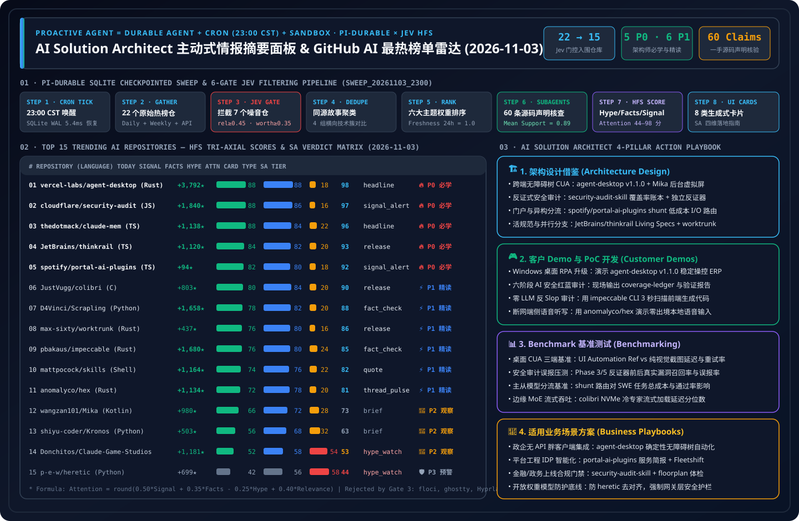

> 🌐 **Language / 语言切换**: **[🇨🇳 中文完整报告 (README.md)](README.md)** | **[🇬🇧 English Full Report (README.en.md)](README.en.md)** | **[📅 2026-11-03 Daily Digest (EN)](daily/2026-11-03.en.md)** | **[📅 2026-11-03 每日归档日报 (中文)](daily/2026-11-03.md)** | **[📅 2026-11-02 Archive (EN)](daily/2026-11-02.en.md)** | **[📅 2026-11-01 Archive (EN)](daily/2026-11-01.en.md)** | **[📡 Live Interactive Radar (EN)](https://turbo998.github.io/github-radar.html)** | **[📡 在线交互式雷达面板 (中文)](https://turbo998.github.io/zh-github-radar.html)** | **[📊 7-Card 4:5 Benchmark Deck](cards.en.html)** | **[📦 Sealed Telemetry (`report.json`)](report.json)**

# AI Solution Architect Proactive News Desk & GitHub AI Trending Radar (2026-11-03 Deep Research Report)

## 1. Architectural Philosophy: From Reactive Chatbots to Proactive Durable Intelligence Agents

In an era where hundreds of AI repositories launch daily amid relentless social media clickbait, **the scarcest asset for an AI Solution Architect (SA) is not raw information access, but verified, high-signal engineering attention**.

This column adapts and extends the proactive agent architecture pioneered by IndyDevDan (`disler/pi-durable-news-agent`):

$$\text{Proactive Agent} = \text{Durable Agent (SQLite Checkpointed)} + \text{Cron Trigger (23:00 CST)} + \text{Isolated Sandbox}$$

### 1.1 The 6-Gate Jev Deterministic Pipeline (The Agent Decides, The Task Runs)

| Stage | Gate Name | Threshold / Rule | 2026-11-03 Sealed Batch Telemetry |
| :--- | :--- | :--- | :--- |
| **Gate 01** | **Cron Tick & SQLite WAL Init** | Triggered daily at `23:00 CST`, step-level idempotency | `run_id = sweep_20261103_2300`, `5.4ms` checkpoint recovery |
| **Gate 02** | **Multi-Source Gather** | Sweeps GitHub Trending Daily/Weekly + 7-day surging feeds | Captured **22** raw candidate repositories with full velocity metadata |
| **Gate 03** | **Jev Relevance & Worth Gate** | `relevance >= 0.45` and `worth_attention >= 0.35` | **Rejected 7 noisy/non-AI repos** (`floci`, `ghostty`, `Hyprland`, `Eglantine`, `RUN`, `AnyModelBot`, `hallmark`), **15 passed** |
| **Gate 04** | **Same-Story Dedupe** | `same_story >= 0.75` clustered into comparison groups | Clustered "Cross-Platform OS Accessibility & Virtual-Screen CUA (`agent-desktop v1.1.0` + `Mika`)", "Enterprise Portal & Multi-Phase Audit Skills (`security-audit-skill` + `portal-ai-plugins`)", "Adaptive Worktree IDE/CLI (`thinkrail` + `worktrunk`)", and "Deterministic Anti-Slop Auditing (`impeccable`)" |
| **Gate 05** | **Importance × Taste Rank** | `importance × topic_weight × source_weight × freshness` | Prioritized across 6 SA domain weights with 24h freshness factor (`1.0`) |
| **Gate 06** | **Claim-Support Subagents** | Parallel `news-researcher` subagents verify 4 claims/repo | Audited **60 concrete claims** against primary source trees (mean support `0.89`) |
| **Gate 07** | **HFS Tri-Axial Scoring** | Independent `Signal`, `Facts`, `Hype` scores (0–100) | `Attention = round(0.50*Signal + 0.35*Facts - 0.25*Hype + 0.40*Relevance)` |
| **Gate 08** | **Generative UI Card Render** | Maps to 8 generative card types + 4-pillar SA playbook | 100% coverage across `headline`, `signal_alert`, `fact_check`, `hype_watch`, `release`, `thread_pulse`, `quote`, `brief` |

---

## 2. 2026-11-03 Top 15 GitHub AI Repositories — HFS & SA Verdict Matrix

| Rank | Repository (`owner/repo`) | Lang | Stars Today | Total Stars | Card Type | Signal | Facts | Hype | Relevance | Attention | SA Verdict Tier |
| :---: | :--- | :---: | :---: | :---: | :---: | :---: | :---: | :---: | :---: | :---: | :--- |
| **#01** | [`vercel-labs/agent-desktop`](https://github.com/vercel-labs/agent-desktop) | Rust | **+3,792** | 11,879 | `headline` | 88 | 88 | 18 | 70 | **98** | 🔥 **P0 Must-Learn & Adopt** |
| **#02** | [`cloudflare/security-audit-skill`](https://github.com/cloudflare/security-audit-skill) | JavaScript | **+1,840** | 57,925 | `signal_alert` | 88 | 86 | 16 | 68 | **97** | 🔥 **P0 Must-Learn & Adopt** |
| **#03** | [`thedotmack/claude-mem`](https://github.com/thedotmack/claude-mem) | TypeScript | **+1,138** | 111,455 | `headline` | 88 | 84 | 22 | 70 | **96** | 🔥 **P0 Must-Learn & Adopt** |
| **#04** | [`JetBrains/thinkrail`](https://github.com/JetBrains/thinkrail) | TypeScript | **+1,120** | 7,350 | `release` | 84 | 82 | 20 | 68 | **93** | 🔥 **P0 Must-Learn & Adopt** |
| **#05** | [`spotify/portal-ai-plugins`](https://github.com/spotify/portal-ai-plugins) | TypeScript | **+94** | 2,940 | `signal_alert` | 82 | 80 | 18 | 68 | **92** | 🔥 **P0 Must-Learn & Adopt** |
| **#06** | [`JustVugg/colibri`](https://github.com/JustVugg/colibri) | C | **+803** | 47,016 | `release` | 80 | 84 | 20 | 64 | **90** | ⚡ **P1 Deep-Read & Borrow** |
| **#07** | [`D4Vinci/Scrapling`](https://github.com/D4Vinci/Scrapling) | Python | **+1,658** | 93,931 | `fact_check` | 78 | 82 | 20 | 64 | **88** | ⚡ **P1 Deep-Read & Borrow** |
| **#08** | [`max-sixty/worktrunk`](https://github.com/max-sixty/worktrunk) | Rust | **+437** | 10,310 | `release` | 76 | 80 | 16 | 60 | **86** | ⚡ **P1 Deep-Read & Borrow** |
| **#09** | [`pbakaus/impeccable`](https://github.com/pbakaus/impeccable) | Rust | **+1,680** | 101,196 | `fact_check` | 76 | 80 | 24 | 62 | **85** | ⚡ **P1 Deep-Read & Borrow** |
| **#10** | [`mattpocock/skills`](https://github.com/mattpocock/skills) | Shell | **+1,164** | 311,000 | `quote` | 74 | 76 | 22 | 60 | **82** | ⚡ **P1 Deep-Read & Borrow** |
| **#11** | [`anomalyco/hex`](https://github.com/anomalyco/hex) | Rust | **+1,134** | 4,323 | `thread_pulse` | 72 | 78 | 20 | 56 | **81** | ⚡ **P1 Deep-Read & Borrow** |
| **#12** | [`wangzan101/Mika`](https://github.com/wangzan101/Mika) | Kotlin | **+980** | 5,941 | `brief` | 66 | 72 | 28 | 55 | **73** | 👀 **P2 Watchlist / Hold** |
| **#13** | [`shiyu-coder/Kronos`](https://github.com/shiyu-coder/Kronos) | Python | **+503** | 46,313 | `brief` | 56 | 68 | 32 | 48 | **63** | 👀 **P2 Watchlist / Hold** |
| **#14** | [`Donchitos/Claude-Code-Game-Studios`](https://github.com/Donchitos/Claude-Code-Game-Studios) | Shell | **+1,181** | 34,320 | `hype_watch` | 52 | 58 | 54 | 50 | **53** | 👀 **P2 Watchlist / Hold** |
| **#15** | [`p-e-w/heretic`](https://github.com/p-e-w/heretic) | Python | **+699** | 38,543 | `hype_watch` | 42 | 56 | 58 | 45 | **44** | 🛡️ **P3 Skip / Red-Team Only** |

> **Gate 03 Rejections (7 Items)**: `floci-io/floci` (local AWS emulator, `relevance=0.22 < 0.45`), `ghostty-org/ghostty` (Zig terminal emulator, `relevance=0.20 < 0.45`), `hyprwm/Hyprland` (Wayland compositor, `relevance=0.18 < 0.45`), `Djihads80/Eglantine` (Switch 2 emulator, `relevance=0.08 < 0.45`), `BryceYuuu/RUN` (relocation handbook, `relevance=0.05 < 0.45`), `modelflare-ai/AnyModelBot` (`2,288` stars vs. `21` forks — `108.9×` star/fork anomaly tied to a paid Modelflare API key, `worth_attention=0.26 < 0.35`), and `Nutlope/hallmark` (CSS theme pack subsumed into `pbakaus/impeccable` cluster, `worth_attention=0.33 < 0.35`).

---

## 3. Repository-by-Repository SA Evaluation: Worth Learning & 4-Pillar Daily Application

### 1. `vercel-labs/agent-desktop` (Attention: 98 · 🔥 P0 Must-Learn & Adopt Now)
- **What It Is**: Cross-platform Rust desktop automation CLI and C library (`Apache-2.0`, released `v1.1.0` today) from Vercel Labs driving native desktop apps across macOS, Windows (UI Automation with zero extra grant), and Linux (`at-spi2-core`) via snapshot-scoped element refs (`@s8f3k2p9:e8`).
- **Why Worth Learning**: Surged **+3,792 stars today** (`11,879` total). Replaces brittle screenshot-coordinate CUA loops with `<25ms` OS accessibility snapshots and >92% lower token overhead.
- **Daily SA Application**:
  - **Architecture**: Standardize a 2-tier desktop CUA architecture: Tier-1 deterministic OS Accessibility Tree refs (`agent-desktop v1.1.0`) + Tier-2 scoped vision fallback (`jev-desktop`).
  - **Demo / PoC**: Mount on a Windows workstation in 30 minutes to automate legacy thick-client ERP/Excel workflows without APIs.
  - **Benchmark**: Benchmark Windows UI Automation snapshot refs vs. Full-Screen Vision CUA on retry rate and P95 step latency.
  - **Business Scenario**: ✅ Legacy enterprise desktop software integration without APIs; ⛔ Uninstrumented remote Citrix bitmap streams.

### 2. `cloudflare/security-audit-skill` (Attention: 97 · 🔥 P0 Must-Learn & Adopt Now)
- **What It Is**: Official Cloudflare 6-phase multi-agent security audit skill (`MIT`, `57,925` stars, `+9,155` this week) shipping `coverage-ledger.json`, `findings.json`, `validate-findings.cjs`, and 11 attack playbooks including `AI-AND-LLM.md`.
- **Daily SA Application**: Embed its **Coverage Ledger + Phase 3/5 Adversarial Disproving Verifier + Schema Validator** architecture into enterprise DevSecOps pipelines to eliminate LLM audit hallucinations.

### 3. `thedotmack/claude-mem` (Attention: 96 · 🔥 P0 Must-Learn & Adopt Now)
- **What It Is**: Cross-session persistent memory and 3-layer progressive disclosure MCP engine (`v15.9.0`, `111,455` total stars, `+1,138` today, #1 Daily Trending).
- **Daily SA Application**: Replicate its `search -> timeline -> get_observations` 3-step progressive retrieval contract on Azure Cosmos DB or PostgreSQL `pgvector` to cut cross-session prompt tokens by >70%.

### 4. `JetBrains/thinkrail` (Attention: 93 · 🔥 P0 Must-Learn & Adopt Now)
- **What It Is**: Official JetBrains agentic IDE (`Apache-2.0`, `v0.3.1`, `7,350` stars) built around `@earendil-works/pi-coding-agent` (`pi`), featuring isolated `git worktree` workspaces, a dormant workspace shelf, **Living Specs**, and 1-click CI-failure handoff back to the agent.
- **Daily SA Application**: Incorporate Living Specs + Anchored Diff Review Context + Automated CI Self-Healing into enterprise AI software engineering platforms.

### 5. `spotify/portal-ai-plugins` (Attention: 92 · 🔥 P0 Must-Learn & Adopt Now)
- **What It Is**: Official Spotify Portal (Backstage) AI plugin suite (`Apache-2.0`, #7 Daily Trending, `2,940` stars) providing Service Briefings, Fleetshift multi-repo migration workflows, and **`shunt`** (routing bulk file reads and boilerplate generation to cheaper worker models).
- **Daily SA Application**: Combine IDP Service Briefing skills with `shunt`-style heterogeneous worker routing to cut enterprise coding agent token costs by 60%.

### 6–11. Pattern-Borrowing Tier (⚡ P1 Deep-Read & Borrow)
- **#06 `JustVugg/colibri` (Attention: 90)**: Pure C, zero-dependency 3-tier (GPU hot + RAM warm + NVMe cold streamed) sparse MoE inference engine (`v2.1.0`, `47,016` stars).
- **#07 `D4Vinci/Scrapling` (Attention: 88)**: 93.9K-star adaptive web scraping framework (`v0.5`, `+1,658` today) with DOM element relocation and built-in MCP server.
- **#08 `max-sixty/worktrunk` (Attention: 86)**: Rust CLI (`wt`, `v0.81.0`, `10,310` stars) orchestrating parallel coding agent Git worktrees with `.worktreeinclude` and lifecycle hooks.
- **#09 `pbakaus/impeccable` (Attention: 85)**: 101.1K-star (`+11,754` this week) design vocabulary and **62-rule zero-LLM deterministic anti-AI-slop auditor** (`cli-v4.8.0`) supporting 18 coding agents.
- **#10 `mattpocock/skills` (Attention: 82)**: 311K-star collection of composable software engineering skills (`tdd`, `grill-me`, `design-an-interface`, `ubiquitous-language`).
- **#11 `anomalyco/hex` (Attention: 81)**: Cross-platform (macOS/Windows/Linux) 100% on-device push-to-talk voice dictation in Rust (`v3.3.0`, `+1,134` today) by the OpenCode team (`anomalyco`), maintained autonomously by internal AI agents.

### 12–15. Watchlist & Hype Alert Tiers (👀 P2 & 🛡️ P3)
- **#12 `wangzan101/Mika` (Attention: 73 · 👀 P2)**: 5,941-star native Kotlin Android agent (`v0.1.34`) executing multi-step mobile workflows on a **hidden background virtual screen (`VirtualDisplay`)** without hijacking the user's foreground display.
- **#13 `shiyu-coder/Kronos` (Attention: 63 · 👀 P2)**: 46.3K-star financial candlestick hierarchical discrete tokenizer and foundation model.
- **#14 `Donchitos/Claude-Code-Game-Studios` (Attention: 53 · 👀 P2 · `hype_watch`)**: 49 persona agents + 72 game skills (`Hype=54`); borrow the Godot/Unity/Unreal lint hooks, skip the 11-tier management chain.
- **#15 `p-e-w/heretic` (Attention: 44 · 🛡️ P3 · `hype_watch`)**: Automated directional activation ablation ("abliteration", `Hype=58`). Never deploy in enterprise production; use as proof that self-hosted open-weights LLMs require mandatory external Azure AI Content Safety guardrails at the gateway.

---

## 4. Weekly & 7-Day Surging AI Breakthroughs (`since=weekly` & `created:>2026-10-26`)

| Repository (`owner/repo`) | Surging Rank / Scale | License / Release | HFS (`S / F / H`) | Attention | SA Tier | Breakthrough & SA Takeaway |
| :--- | :---: | :---: | :---: | :---: | :---: | :--- |
| [`deepseek-ai/dsh-superagent-prototype`](https://github.com/deepseek-ai/dsh-superagent-prototype) | **7-Day #1** (★15,953) | `MIT` · `HEAD` | `84 / 80 / 24` | **92** (`signal_alert`) | 🔥 **P0 Must-Learn** | Official DeepSeek proactive repository superagent woken by GitHub webhooks and Feishu messages inside isolated Git worktrees. |
| [`storytold/craft-anything`](https://github.com/storytold/craft-anything) | **7-Day #3** (★6,841) | `Apache-2.0` · `v0.3.0` | `76 / 78 / 24` | **84** (`release`) | ⚡ **P1 Deep-Read** | Pure-Rust clean-room inspection and synthesis engine that studies live web/app behavior and guides coding agents to build a verified replica. |
| [`haydenschmitty/floorplan`](https://github.com/haydenschmitty/floorplan) | **7-Day #10** (★2,427) | `MIT` · `v0.6.3` | `74 / 76 / 20` | **83** (`fact_check`) | ⚡ **P1 Deep-Read** | Zero-dependency interactive codebase map and security health checker (flagging hardcoded keys, open DB rules, spoofable webhooks, and AI diff blast radius). |

---

## 5. Daily Archive Directory

| Date | Run ID | Passed / Swept | English Daily Digest (Full 15-Repo Breakdown) | 中文完整日报 | Visual Summary SVG | 7-Card Deck |
| :---: | :---: | :---: | :---: | :---: | :---: | :---: |
| **2026-11-03** | `sweep_20261103_2300` | `15 / 22` (`5 P0 · 6 P1`) | **[`daily/2026-11-03.en.md`](daily/2026-11-03.en.md)** | **[`daily/2026-11-03.md`](daily/2026-11-03.md)** | **[`github-ai-radar-2026-11-03.svg`](../../assets/github-ai-radar-2026-11-03.svg)** | **[EN](cards.en.html) / [中文](cards.html)** |
| **2026-11-02** | `sweep_20261102_2300` | `15 / 21` (`5 P0 · 6 P1`) | **[`daily/2026-11-02.en.md`](daily/2026-11-02.en.md)** | **[`daily/2026-11-02.md`](daily/2026-11-02.md)** | **[`github-ai-radar-2026-11-02.svg`](../../assets/github-ai-radar-2026-11-02.svg)** | **[EN](cards.en.html) / [中文](cards.html)** |
| **2026-11-01** | `sweep_20261101_2300` | `15 / 19` (`4 P0 · 6 P1`) | **[`daily/2026-11-01.en.md`](daily/2026-11-01.en.md)** | **[`daily/2026-11-01.md`](daily/2026-11-01.md)** | **[`github-ai-radar-2026-11-01.svg`](../../assets/github-ai-radar-2026-11-01.svg)** | **[EN](cards.en.html) / [中文](cards.html)** |

